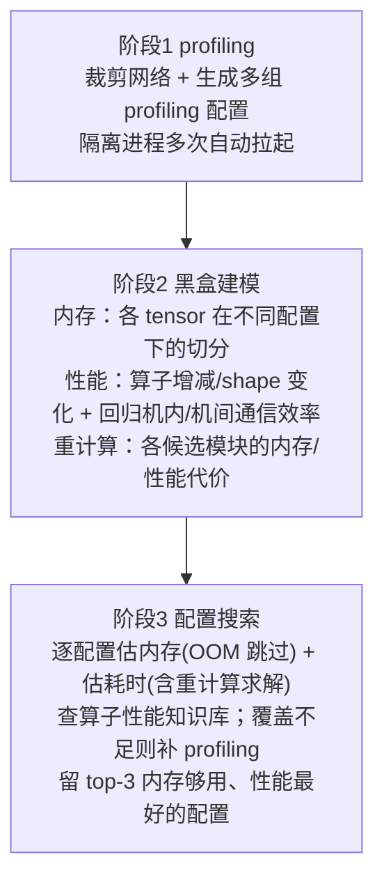

# Auto-Settings（并行/重计算/内存配置自动搜索）

## Summary

大模型训练可调的配置维度越来越多——TP、SP、PP、VPP、DP、ZeRO、CP、EP、micro-batch-size、重计算……每一维都同时牵动内存峰值与吞吐，组合爆炸使手工调参既慢又难逼近最优。Auto-Settings（特性内部代号 OOTB，Out-Of-The-Box「开箱优化」）用 `--auto-settings` 一键替换训练入口，把「找一组内存放得下、性能最好的并行/重计算/内存配置」这件事自动化：先用少量机器跑若干被裁剪过的小规模 profiling，再据 profiling 结果做黑盒建模，最后在剪枝后的配置空间里逐一估算内存与耗时、推荐 top-3 配置。它与业界白/灰盒方案的两点不同——**完全基于 profiling、不对网络结构做假设**（GQA/MQA 之类改动不会让模型失真）、并支持**「以小仿大」**（缩小网络规模与并行度做 profiling，预估更大集群上的较优配置，避免在千卡规模直接 profiling 的高开销）。提供白盒 / 黑盒 / 混合三档搜索，分别在效率与精度间取舍。它解决「配置怎么选」，与具体省内存机制（[recomputation](recomputation.md)）、流水排布（[pipeline-parallel-advanced](../parallelism/pipeline_parallel_advanced.md)）正交——搜出来的重计算层数、PP/VPP 切分最终落到那些特性上执行。

## 为什么需要自动搜索

并行训练的内存与性能是配置的高维耦合函数。已有自动调优多走白盒/灰盒建模：对网络结构做假设、推导内存与算子开销。两点不足限制了它的实用性：

- **建模对结构敏感**。白/灰盒把网络结构写进公式，用户一旦改模型（哪怕只是把 MHA 换成 GQA/MQA），内存估算就会偏差。
- **profiling 规模等同实际负载**。要上千卡训练，就得在千卡上 profiling，开销大到不可接受。

Auto-Settings 的对策是把建模数据完全交给 profiling：建模只依赖 profiling 解析出的张量切分、算子增减与 shape 变化、通信效率，与网络结构变化解耦；同时把 profiling 跑在裁剪后的小规模上（小集群双机即可推测大集群配置），用「以小仿大」绕开大规模 profiling 的成本。

## 白盒 / 黑盒 / 混合三档搜索

`--auto-settings-type` 选搜索方案，三者是精度与效率的不同取舍（`AutoSettings._get_searcher`）：

| 方案 | 取值 | 做法 | 取舍 |
|---|---|---|---|
| 白盒 | `white` | profiling 建模后，用模型**估算**每个候选配置的内存/耗时，不再逐配置 profiling | 最快，靠建模精度 |
| 黑盒 | `black` | 对候选配置采集裁剪 profiling，再由内存公式和流水成本模型推导完整配置的峰值/耗时 | 增加定向 profiling，结果仍是估算 |
| 混合 | `mixed` | 先白盒筛出 M 组候选，再对这 M 组用黑盒精筛出 top-k | 兼顾效率与精度 |

混合方案下 `MixedSearcher` 先调 `WhiteSearcher` 取白盒 top-k（`mixed` 档置为 5）作为黑盒输入，再调 `BlackSearcher` 在这几组上精筛出最终 top-3。

## 白盒搜索的三个阶段

白盒是理解整个特性的主线，分三阶段（`WhiteSearcher.search` → `pre_search` → 逐配置估算）：

- **阶段 1（profiling 建模数据）**：`SearchSpace.build_pre_search_spaces` 生成三类被裁剪的 profiling 配置——静态内存样本（`generate_static_mem_profiling_list`，如 PP4／4 层、基线 TP 的两倍／单层、MoE 专家=2 单层）、动态内存样本（`generate_dynamic_mem_profiling_list`，单层、TP4 与 TP8、4K 与 8K 序列对照）、以及 `profiling_configs.json` 描述的通用样本。基线 TP=`min(world_size//4, 4)`，双机共16卡时基线为4、所谓 TP2 样本实际为 TP8，样本名不代表绝对并行度。这些配置都把层数压到 1~4 层、并按需缩小 TP/seq，正是「以小仿大」的载体。`Profiler` 在隔离进程里按配置多次自动拉起训练做 profiling，结束后解析结果文件，提取后续建模所需信息。
- **阶段 2（黑盒建模）**：依 profiling 结果建模。内存侧自动分析各 tensor 在不同配置下如何被切分；性能侧推断算子随配置的增减与 shape 变化，并**回归出机内 / 机间通信效率**；此外对各候选重计算模块单独 profiling 其内存与性能代价，供后续搜索预估「该不该、该选哪几层做重计算」。`MemoryCost.train_models` / `TimeCost.train_models` 承载内存与耗时建模。
- **阶段 3（配置搜索）**：在剪枝后的配置空间逐一估算——先 `get_memory_cost` 估峰值内存，超 `memory_cap` 直接判 OOM 跳过；再 `get_time_cost` 估端到端耗时（含重计算求解，见下），用一个长度为 topk 的有序队列维护当前最优，最终推荐内存够用、性能最好的三组配置。

## 搜索空间与一阶段剪枝

被逐一估算的配置空间由 `SearchSpace.build_search_spaces`（stage-1 prune，纯枚举无建模）给出：在 `tp × cp × pp × dp × ep × layers_per_vpp × mbs` 的笛卡尔积上施加一组硬约束，只留下合法的 PTD 组合。关键剪枝条件：

- `tp` 取 `2^i`（上限到单节点卡数 `devices_per_node`）；`tp·cp·pp·dp` 必须恰好等于搜索目标卡数 `search_world_size`。
- 序列约束：`seq_length % cp == 0`；开 CP 时按设备型号设每卡序列下限（910B 或 A2G 下 `seq/cp ≥ 8K`、910\_93 下 `≥ 4K`）。
- 层数约束：`num_layers % pp == 0`；VPP 仅在 `pp>1` 时搜，且 `layers_per_vpp·pp | num_layers`，并丢掉 `layers_per_vpp == num_layers//pp` 这个会退化为非 VPP 的取值。
- MoE 约束：`ep` 只在有专家时搜，取值满足 `(cp·dp) % ep == 0`，且按 `moe_tp_extend_ep` 决定 `num_experts % (tp·ep 或 ep) == 0`。
- micro-batch 约束：`mbs ∈ {1,2}`；`num_micro_batches = global_batch_size / mbs` 须被 `dp` 整除，且 `num_micro_batches // (pp·dp) > 1`（保证流水有稳态段）。

每条合法配置落成 `SearchConfig`，并据 `dp·cp//ep > 1` 决定是否开分布式优化器（ZeRO1）。已覆盖的搜索维度：DP / TP / Megatron-SP / PP / ZeRO1 / VPP / CP（ring attention）/ EP（DeepSpeed-MoE）/ micro-batch-size / token 重排 / 重计算 / MC2；尚未纳入搜索的：ZeRO2、Megatron-MoE 的 EP、swap-attention、激活函数重计算、MoE All2All overlap。文档验证过的模型为 llama2-7b、mixtral-8×7b、gpt3-15b。

## 内存估算与重计算求解

白盒搜索里「OOM 与否」「该重算几层」由内存与耗时建模联立决定，体现了「显存 ↔ 算力」的取舍被自动量化：

- `MemoryCost.get_memory_cost`（`memory_model.estimate`）给出每层激活内存 `recompute_mem`、stage 峰值 `peak_stage_mem`、优化器峰值 `optimizer_peak`，取 `peak_mem = max(peak_stage_mem, optimizer_peak)`。若 `peak_mem > memory_cap` 即判 OOM。
- 设备在 `peak_stage_mem` 之上的余量为 `oom_cap = memory_cap − peak_stage_mem`；当需保留的激活内存（`max_release_mem`）超出该余量时进入重算分支，按 `layer_calculate = oom_cap // (memory_per_layer·pp)` 反推**最多能保留多少层不重算**，其余 `recompute_layer = num_layers/pp − layer_calculate` 层需重计算，输出 `need_recompute=True` 与对应 `recompute_layer`。
- `TimeCost.get_time_cost` 的基础耗时按「每层都重计算」估（每层多算一遍前向，`fw_performance = operator_fw_time + fw_communication_time`），再据内存求解把不必重算层的那遍前向从总耗时里**扣回**：不需重算时把全部 `num_layers`（每 stage 层数）层的多算前向 `total_num_micro_batches · num_layers · fw_performance` 全数扣回；需重算时只扣回保留层的 `total_num_micro_batches · layer_calculate · fw_performance`（`layer_calculate` 即上一步反推的可不重算层数），剩下的 `num_layers − layer_calculate` 层才是真正重算层、其多算前向留在耗时里。最终把 `recompute_num_layers`（=该 `num_layers − layer_calculate`）、`use_ascend_mc2`（仅 `tp>1` 时生效）等回写进推荐配置——搜出来的重计算层数随后交由重计算特性执行。

## 算子性能知识库与按需补采

阶段 3 估算算子耗时时会查一个**算子性能知识库**（`operator_database.py`，sqlite 持久化为 `operator_history` / `operator_different` / `operator_profiling` 三个 `.db` 库、每库一张 `operator_history` 表，按算子类型、加速核、输入/输出 shape、dtype、device、jit、cann/driver 版本等唯一键索引耗时）。profiling 见到的新算子被写入知识库。某配置下若知识库覆盖的算子比例低于阈值，则**额外拉起一组「以小仿大」profiling**（`operator_re_profile.py`，同时缩小网络规模与并行度，凑出相同 shape 的算子）补采；仍未覆盖的少量算子则用回归估其性能。

## 注入与分阶段拉起机制

`AutoSettingsFeature`（`optimization_level=2`）把 `megatron.training.training.pretrain` 整体 patch 成 MindSpeed 的入口：开 `--auto-settings` 后，训练脚本被改造成跑搜索流程（`AutoSettings.auto_setting_fun`）而非真正训练。它在 `node_rank==0` 上跑搜索、在其余节点上 `run_on_slaves` 配合 profiling。

阶段性 profiling 靠一组**仅供内部使用、隔离进程内设置且不 export 到用户环境**的环境标记驱动 `Profiler` 在每次自动拉起时只做一遍特定动作（`is_need_apply` 据此判定）：`OOTB_OPTIMIZER_PARSE_ARGS` 取硬件信息与模型参数、`OOTB_OPTIMIZER_PARSE_MODEL` 取模型结构、`OOTB_OPTIMIZER_PROFILING` 取完整 profiling（含自适应重计算 profiling）、`OOTB_OPTIMIZER_PROFILING_BLACK` 取黑盒搜索所需 profiling；拉起配置的改写参数经 `OOTB_OPTIMIZER_MODIFIED_ARGV_PATH` 指向的 json 传入。这些标记禁止在正常训练流程里手动设置。

## 使用方法与约束

在训练脚本参数表中加入下列开关启用（`AutoSettingsFeature._add_auto_settings_args`）：

| 参数 | 含义 |
|---|---|
| `--auto-settings` | 开启特性 |
| `--auto-settings-type` | 搜索方案，`white` / `black` / `mixed` |
| `--auto-settings-work-dir` | 工作目录，保存 profiling 等中间文件（缺省当前目录） |
| `--auto-settings-ranks` | 搜索目标卡数 `search_world_size`（文档建议 ≥16） |
| `--auto-settings-log-level` | 日志等级 `warning` / `info` / `debug` |
| `--nnodes` | profiling 实际拉起的节点数；实际 world_size=nnodes×nproc_per_node |
| `--target-nnodes` | 目标节点数，用于 target_world_size=target_nnodes×nproc_per_node，与实际拉起节点数区分 |
| `--nproc-per-node` / `--node-rank` / `--master-addr` / `--master-port` | torchrun 拉起参数；`master-port` 须与基线脚本不同 |

约束：`--auto-settings` 与 `--load` / `--save` 不可同用（`validate_args` 断言）——搜索阶段不做断点保存/加载。注意特性还顺带注册了 `--automated-pipeline[-perf]`（在线 profiling 的流水布局自动搜索，机制本体见 [pipeline-parallel-advanced](../parallelism/pipeline_parallel_advanced.md) 的 Automated Pipeline 小节），它解决 PP 内部排布；另注册的 `--jit-compile` 是编译模式开关，开启时调用 `torch_npu.npu.set_compile_mode(jit_compile=True)`，不搜索流水布局。上游使用说明将 target-nnodes 与实际节点数混用，此处按 SystemConfig 和 Runner 实现区分。

## 产出

搜索结束后日志打印推荐 top-k，白盒结果可回填 `recompute_num_layers`、`use_ascend_mc2` 等建模选择。黑盒把候选的 pp/tp/dp/ring_attention/ulysses/mbs/vpp/ep 及**估算** peak_memory/e2e_time 保存到 `model_results.csv`，在可用显存 95% 阈值内按估算耗时择优；`MemoryCostBlack` 用参数量与激活公式估峰值，`TimeCostBlack` 用 profiling 分块耗时调用 pipeline_costmodel 推导整步时间，不能当成完整目标配置的直接实测。

当前的 `BlackSearcher.get_top_k` 重新构造 SearchConfig 时只带回 pp/tp/dp/ring_attention/ulysses/mbs/vpp/ep，未保留 context_parallel_size、use_distributed_optimizer、recompute_num_layers 或 use_ascend_mc2；混合方案最终也返回此结果。使用前须补齐目标配置并实测内存、耗时和训练正确性，不能直接套用为已验证方案。

运行环境为 MindSpeed 昇腾 NPU 栈，SystemConfig 直接读取 torch.npu 设备属性；代码包含 910B/A2G、910_93 的剪枝分支。现有证据尚未给出本特性完整的产品支持矩阵，因此保留为 draft、暂不声明型号级 platforms，不将其标成硬件无关。

## 单节点规模来源

`SystemConfig.__post_init__()` 将 `devices_per_node` 设置为 `nproc_per_node`，TP 搜索上限由本次实际单节点进程数决定；它与 `search_world_size`、`target_world_size` 分别表示不同维度，不能用目标总卡数替代单节点卡数。

## Evidence

- [README.md](../../../../../cann-recipes-raw/mindspeed/c5a72765f99fd8470362c7afdc2cdffe0ab5aea6/README.md)（primary）
- [auto_settings.md](../../../../../cann-recipes-raw/mindspeed/c5a72765f99fd8470362c7afdc2cdffe0ab5aea6/docs/zh/features/auto_settings.md)（supporting）
- [searcher.py](../../../../../cann-recipes-raw/mindspeed/c5a72765f99fd8470362c7afdc2cdffe0ab5aea6/mindspeed/auto_settings/module/searcher.py)（implementation）
- [memory_cost_black.py](../../../../../cann-recipes-raw/mindspeed/c5a72765f99fd8470362c7afdc2cdffe0ab5aea6/mindspeed/auto_settings/module/memory_cost_black.py)（implementation）
- [time_cost_black.py](../../../../../cann-recipes-raw/mindspeed/c5a72765f99fd8470362c7afdc2cdffe0ab5aea6/mindspeed/auto_settings/module/time_cost_black.py)（implementation）
- [system_config.py](../../../../../cann-recipes-raw/mindspeed/c5a72765f99fd8470362c7afdc2cdffe0ab5aea6/mindspeed/auto_settings/config/system_config.py)（implementation）
- [search_space.py](../../../../../cann-recipes-raw/mindspeed/c5a72765f99fd8470362c7afdc2cdffe0ab5aea6/mindspeed/auto_settings/search_space.py)（implementation）
- [auto_settings_feature.py](../../../../../cann-recipes-raw/mindspeed/c5a72765f99fd8470362c7afdc2cdffe0ab5aea6/mindspeed/features_manager/auto_settings/auto_settings_feature.py)（implementation）

## Links

- [recomputation](recomputation.md)（Auto-Settings 搜出「该重算几层」，由重计算特性执行；内存求解里的 `recompute_num_layers` 即喂给这套粒度/层选择机制）
- [pipeline-parallel-advanced](../parallelism/pipeline_parallel_advanced.md)（搜索维度含 PP/VPP；本特性顺带注册的 `--automated-pipeline[-perf]` 是更细粒度的 PP 内部布局在线搜索，与全局 PTD 搜索互补）
- [mindspeed](../frameworks/mindspeed.md)（承载框架：`MindSpeedFeature` + patch `megatron.training.training.pretrain` 把训练入口改成搜索入口的接入机制）
- [ttp-high-availability](ttp_high_availability.md)（长训练高可用：自动调参定配置、TTP 保障故障可恢复）
