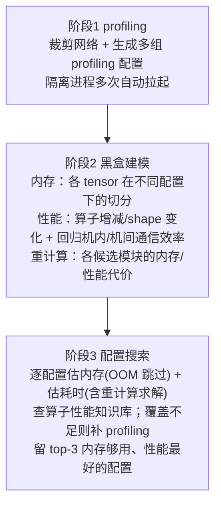

# Auto-Settings（并行/重计算/内存配置自动搜索）

## Summary

大模型训练可调的配置维度越来越多——TP、SP、PP、VPP、DP、ZeRO、CP、EP、micro-batch-size、重计算……每一维都同时牵动内存峰值与吞吐，组合爆炸使手工调参既慢又难逼近最优。Auto-Settings（特性内部代号 OOTB，Out-Of-The-Box「开箱优化」）用 `--auto-settings` 一键替换训练入口，把「找一组内存放得下、性能最好的并行/重计算/内存配置」这件事自动化：先用少量机器跑若干被裁剪过的小规模 profiling，再据 profiling 结果做黑盒建模，最后在剪枝后的配置空间里逐一估算内存与耗时、推荐 top-3 配置。它与业界白/灰盒方案的两点不同——**完全基于 profiling、不对网络结构做假设**（GQA/MQA 之类改动不会让模型失真）、并支持**「以小仿大」**（缩小网络规模与并行度做 profiling，预估更大集群上的较优配置，避免在千卡规模直接 profiling 的高开销）。提供白盒 / 黑盒 / 混合三档搜索，分别在效率与精度间取舍。它解决「配置怎么选」，与具体省内存机制（[recomputation](recomputation.md)）、流水排布（[pipeline-parallel-advanced](../parallelism/pipeline_parallel_advanced.md)）正交——搜出来的重计算层数、PP/VPP 切分最终落到那些特性上执行。

## 为什么需要自动搜索

并行训练的内存与性能是配置的高维耦合函数。已有自动调优多走白盒/灰盒建模：对网络结构做假设、推导内存与算子开销。两点不足限制了它的实用性：

- **建模对结构敏感**。白/灰盒把网络结构写进公式，用户一旦改模型（哪怕只是把 MHA 换成 GQA/MQA），内存估算就会偏差。
- **profiling 规模等同实际负载**。要上千卡训练，就得在千卡上 profiling，开销大到不可接受。

Auto-Settings 的对策是把建模数据完全交给 profiling：建模只依赖 profiling 解析出的张量切分、算子增减与 shape 变化、通信效率，与网络结构变化解耦；同时把 profiling 跑在裁剪后的小规模上（小集群双机即可推测大集群配置），用「以小仿大」绕开大规模 profiling 的成本。

## 白盒 / 黑盒 / 混合三档搜索

`--auto-settings-type` 选搜索方案，三者是精度与效率的不同取舍（`AutoSettings._get_searcher`）：

| 方案 | 取值 | 做法 | 取舍 |
|---|---|---|---|
| 白盒 | `white` | profiling 建模后，用模型**估算**每个候选配置的内存/耗时，不再逐配置 profiling | 最快，靠建模精度 |
| 黑盒 | `black` | 对搜索空间里每个配置都真实 profiling，量取内存与算子/通信耗时再择优 | 最准，profiling 次数最多 |
| 混合 | `mixed` | 先白盒筛出 M 组候选，再对这 M 组用黑盒精筛出 top-k | 兼顾效率与精度 |

混合方案下 `MixedSearcher` 先调 `WhiteSearcher` 取白盒 top-k（`mixed` 档置为 5）作为黑盒输入，再调 `BlackSearcher` 在这几组上精筛出最终 top-3。

## 白盒搜索的三个阶段

白盒是理解整个特性的主线，分三阶段（`WhiteSearcher.search` → `pre_search` → 逐配置估算）：

- **阶段 1（profiling 建模数据）**：`SearchSpace.build_pre_search_spaces` 生成三类被裁剪的 profiling 配置——静态内存样本（`generate_static_mem_profiling_list`，如 PP4／4 层、TP2／单层、MoE 专家=2 单层）、动态内存样本（`generate_dynamic_mem_profiling_list`，单层、TP4 与 TP8、4K 与 8K 序列对照）、以及 `profiling_configs.json` 描述的通用样本。这些配置都把层数压到 1~4 层、并按需缩小 TP/seq，正是「以小仿大」的载体。`Profiler` 在隔离进程里按配置多次自动拉起训练做 profiling，结束后解析结果文件，提取后续建模所需信息。
- **阶段 2（黑盒建模）**：依 profiling 结果建模。内存侧自动分析各 tensor 在不同配置下如何被切分；性能侧推断算子随配置的增减与 shape 变化，并**回归出机内 / 机间通信效率**；此外对各候选重计算模块单独 profiling 其内存与性能代价，供后续搜索预估「该不该、该选哪几层做重计算」。`MemoryCost.train_models` / `TimeCost.train_models` 承载内存与耗时建模。
- **阶段 3（配置搜索）**：在剪枝后的配置空间逐一估算——先 `get_memory_cost` 估峰值内存，超 `memory_cap` 直接判 OOM 跳过；再 `get_time_cost` 估端到端耗时（含重计算求解，见下），用一个长度为 topk 的有序队列维护当前最优，最终推荐内存够用、性能最好的三组配置。

## 搜索空间与一阶段剪枝

被逐一估算的配置空间由 `SearchSpace.build_search_spaces`（stage-1 prune，纯枚举无建模）给出：在 `tp × cp × pp × dp × ep × layers_per_vpp × mbs` 的笛卡尔积上施加一组硬约束，只留下合法的 PTD 组合。关键剪枝条件：

- `tp` 取 `2^i`（上限到单节点卡数 `devices_per_node`）；`tp·cp·pp·dp` 必须恰好等于搜索目标卡数 `search_world_size`。
- 序列约束：`seq_length % cp == 0`；开 CP 时按设备型号设每卡序列下限（910B 下 `seq/cp ≥ 8K`、910\_93 下 `≥ 4K`）。
- 层数约束：`num_layers % pp == 0`；VPP 仅在 `pp>1` 时搜，且 `layers_per_vpp·pp | num_layers`，并丢掉 `layers_per_vpp == num_layers//pp` 这个会退化为非 VPP 的取值。
- MoE 约束：`ep` 只在有专家时搜，取值满足 `(cp·dp) % ep == 0`，且按 `moe_tp_extend_ep` 决定 `num_experts % (tp·ep 或 ep) == 0`。
- micro-batch 约束：`mbs ∈ {1,2}`；`num_micro_batches = global_batch_size / mbs` 须被 `dp` 整除，且 `num_micro_batches // (pp·dp) > 1`（保证流水有稳态段）。

每条合法配置落成 `SearchConfig`，并据 `dp·cp//ep > 1` 决定是否开分布式优化器（ZeRO1）。已覆盖的搜索维度：DP / TP / Megatron-SP / PP / ZeRO1 / VPP / CP（ring attention）/ EP（DeepSpeed-MoE）/ micro-batch-size / token 重排 / 重计算 / MC2；尚未纳入搜索的：ZeRO2、Megatron-MoE 的 EP、swap-attention、激活函数重计算、MoE All2All overlap。文档验证过的模型为 llama2-7b、mixtral-8×7b、gpt3-15b。

## 内存估算与重计算求解

白盒搜索里「OOM 与否」「该重算几层」由内存与耗时建模联立决定，体现了「显存 ↔ 算力」的取舍被自动量化：

- `MemoryCost.get_memory_cost`（`memory_model.estimate`）给出每层激活内存 `recompute_mem`、stage 峰值 `peak_stage_mem`、优化器峰值 `optimizer_peak`，取 `peak_mem = max(peak_stage_mem, optimizer_peak)`。若 `peak_mem > memory_cap` 即判 OOM。
- 设备在 `peak_stage_mem` 之上的余量为 `oom_cap = memory_cap − peak_stage_mem`；当需保留的激活内存（`max_release_mem`）超出该余量时进入重算分支，按 `layer_calculate = oom_cap // (memory_per_layer·pp)` 反推**最多能保留多少层不重算**，其余 `recompute_layer = num_layers/pp − layer_calculate` 层需重计算，输出 `need_recompute=True` 与对应 `recompute_layer`。
- `TimeCost.get_time_cost` 的基础耗时按「每层都重计算」估（每层多算一遍前向，`fw_performance = operator_fw_time + fw_communication_time`），再据内存求解把不必重算层的那遍前向从总耗时里**扣回**：不需重算时把全部 `num_layers`（每 stage 层数）层的多算前向 `total_num_micro_batches · num_layers · fw_performance` 全数扣回；需重算时只扣回保留层的 `total_num_micro_batches · layer_calculate · fw_performance`（`layer_calculate` 即上一步反推的可不重算层数），剩下的 `num_layers − layer_calculate` 层才是真正重算层、其多算前向留在耗时里。最终把 `recompute_num_layers`（=该 `num_layers − layer_calculate`）、`use_ascend_mc2`（仅 `tp>1` 时生效）等回写进推荐配置——搜出来的重计算层数随后交由重计算特性执行。

## 算子性能知识库与按需补采

阶段 3 估算算子耗时时会查一个**算子性能知识库**（`operator_database.py`，sqlite 持久化为 `operator_history` / `operator_different` / `operator_profiling` 三个 `.db` 库、每库一张 `operator_history` 表，按算子类型、加速核、输入/输出 shape、dtype、device、jit、cann/driver 版本等唯一键索引耗时）。profiling 见到的新算子被写入知识库。某配置下若知识库覆盖的算子比例低于阈值，则**额外拉起一组「以小仿大」profiling**（`operator_re_profile.py`，同时缩小网络规模与并行度，凑出相同 shape 的算子）补采；仍未覆盖的少量算子则用回归估其性能。

## 注入与分阶段拉起机制

`AutoSettingsFeature`（`optimization_level=2`）把 `megatron.training.training.pretrain` 整体 patch 成 MindSpeed 的入口：开 `--auto-settings` 后，训练脚本被改造成跑搜索流程（`AutoSettings.auto_setting_fun`）而非真正训练。它在 `node_rank==0` 上跑搜索、在其余节点上 `run_on_slaves` 配合 profiling。

阶段性 profiling 靠一组**仅供内部使用、隔离进程内设置且不 export 到用户环境**的环境标记驱动 `Profiler` 在每次自动拉起时只做一遍特定动作（`is_need_apply` 据此判定）：`OOTB_OPTIMIZER_PARSE_ARGS` 取硬件信息与模型参数、`OOTB_OPTIMIZER_PARSE_MODEL` 取模型结构、`OOTB_OPTIMIZER_PROFILING` 取完整 profiling（含自适应重计算 profiling）、`OOTB_OPTIMIZER_PROFILING_BLACK` 取黑盒搜索所需 profiling；拉起配置的改写参数经 `OOTB_OPTIMIZER_MODIFIED_ARGV_PATH` 指向的 json 传入。这些标记禁止在正常训练流程里手动设置。

## 使用方法与约束

在训练脚本参数表中加入下列开关启用（`AutoSettingsFeature._add_auto_settings_args`）：

| 参数 | 含义 |
|---|---|
| `--auto-settings` | 开启特性 |
| `--auto-settings-type` | 搜索方案，`white` / `black` / `mixed` |
| `--auto-settings-work-dir` | 工作目录，保存 profiling 等中间文件（缺省当前目录） |
| `--auto-settings-ranks` | 搜索目标卡数 `search_world_size`（文档建议 ≥16） |
| `--auto-settings-log-level` | 日志等级 `warning` / `info` / `debug` |
| `--target-nnodes` | profiling 实际拉起的节点数（与基线训练脚本一致） |
| `--nproc-per-node` / `--node-rank` / `--master-addr` / `--master-port` | torchrun 拉起参数；`master-port` 须与基线脚本不同 |

约束：`--auto-settings` 与 `--load` / `--save` 不可同用（`validate_args` 断言）——搜索阶段不做断点保存/加载。注意特性还顺带注册了 `--automated-pipeline[-perf]`（在线 profiling 的流水布局自动搜索，机制本体见 [pipeline-parallel-advanced](../parallelism/pipeline_parallel_advanced.md) 的 Automated Pipeline 小节）与 `--jit-compile`，二者解决的是 PP 内部排布，与本特性的全局 PTD+重计算+内存搜索是不同粒度的「自动化」。

## 产出

搜索结束后日志按 `<==========Top #i config==========>` 打印**内存充足、性能最好的三组配置**（`SearchConfig`，含 TP/PP/VPP-layers/DP/CP/EP/ZeRO 与回填的 `recompute_num_layers`、`use_ascend_mc2`）。黑盒方案另把全部 profiling 过的配置（pp/tp/dp/ring\_attention/ulysses/mbs/vpp/ep/peak\_memory/e2e\_time）落 `model_results.csv`，并在峰值内存低于可用显存 95% 阈值的行里按端到端耗时升序取 top-k。这组推荐配置即用户可直接套用的训练并行/重计算/内存方案。

## Evidence

- [mindspeed](https://gitcode.com/ascend/MindSpeed) — [`docs/zh/features/auto_settings.md`](https://gitcode.com/Ascend/MindSpeed/blob/1432cb092818b870c31b61db0eb6d3378b7fbdad/docs/zh/features/auto_settings.md)（问题背景与白/灰盒两点不足、profiling-only + 以小仿大、白/黑/混合三方案各阶段、已支持模型 llama2-7b/mixtral-8×7b/gpt3-15b、已支持/未来特性清单、`--auto-settings*` 使用方法、OOTB 环境变量为内部隔离用途）
- [`mindspeed/features_manager/auto_settings/auto_settings_feature.py`](https://gitcode.com/Ascend/MindSpeed/blob/1432cb092818b870c31b61db0eb6d3378b7fbdad/mindspeed/features_manager/auto_settings/auto_settings_feature.py) — `AutoSettingsFeature`：`optimization_level=2`、`is_need_apply`（`--auto-settings` 或 `OOTB_OPTIMIZER_PARSE_ARGS/PARSE_MODEL/PROFILING`）、`validate_args`（与 `--load`/`--save` 互斥）、`register_patches`（patch `megatron.training.training.pretrain` / `setup_model_and_optimizer` / `build_tokenizer`）、全部 `--auto-settings*` 参数定义
- [`mindspeed/auto_settings/auto_settings.py`](https://gitcode.com/Ascend/MindSpeed/blob/1432cb092818b870c31b61db0eb6d3378b7fbdad/mindspeed/auto_settings/auto_settings.py) — `AutoSettings`：`_get_searcher`（white/black/mixed，mixed 置 white_topk=5）、`init`（PARSE_ARGS 取硬件/模型）、`search`（`build_search_spaces` → `searcher.search(topk=3)`）、`auto_setting_fun`（入口 patch、node_rank 主从、打印 top-3）
- [`mindspeed/auto_settings/search_space.py`](https://gitcode.com/Ascend/MindSpeed/blob/1432cb092818b870c31b61db0eb6d3378b7fbdad/mindspeed/auto_settings/search_space.py) — `SearchSpace`：`generate_static/dynamic_mem_profiling_list`（裁剪层数与并行度的 profiling 样本）、`build_pre_search_spaces`、`build_search_spaces`（stage-1 prune：tp/cp/pp/dp/ep/layers_per_vpp/mbs 枚举与全部约束、ZeRO1 判定）
- [`mindspeed/auto_settings/module/searcher.py`](https://gitcode.com/Ascend/MindSpeed/blob/1432cb092818b870c31b61db0eb6d3378b7fbdad/mindspeed/auto_settings/module/searcher.py) — `WhiteSearcher`（`pre_search` 建模、逐配置 `get_memory_cost`/`get_time_cost`、topk 有序队列）、`BlackSearcher`（逐配置 profiling、`model_results.csv`、`get_top_k` 按 e2e 时间在 95% 显存阈值内取 topk）、`MixedSearcher`（white→black 级联）
- [`mindspeed/auto_settings/module/memory_cost.py`](https://gitcode.com/Ascend/MindSpeed/blob/1432cb092818b870c31b61db0eb6d3378b7fbdad/mindspeed/auto_settings/module/memory_cost.py) — `MemoryCost.get_memory_cost`：`estimate` 出 `recompute_mem`/`peak_stage_mem`/`optimizer_peak`、`oom_cap` 反推 `layer_calculate` 与 `recompute_layer`、`need_recompute`/`new_memory` 输出
- [`mindspeed/auto_settings/module/time_cost.py`](https://gitcode.com/Ascend/MindSpeed/blob/1432cb092818b870c31b61db0eb6d3378b7fbdad/mindspeed/auto_settings/module/time_cost.py) — `TimeCost.get_time_cost`：算子+通信耗时、`bubble_ratio`、重计算求解（基础耗时按逐层重算估：不重算时扣回全部层多算前向、需重算时只扣回保留层 `micro_batches·layer_calculate·fw_performance`，剩 `num_layers−layer_calculate` 层为真正重算层）、输出 `total_time`/`num_layers`/`use_mc2`
- [`mindspeed/auto_settings/config/generate_profiling_configs.py`](https://gitcode.com/Ascend/MindSpeed/blob/1432cb092818b870c31b61db0eb6d3378b7fbdad/mindspeed/auto_settings/config/generate_profiling_configs.py) + [`profile/README.md`](https://gitcode.com/Ascend/MindSpeed/blob/1432cb092818b870c31b61db0eb6d3378b7fbdad/mindspeed/auto_settings/profile/README.md) — `profiling_configs.json` 字段规则（`tp=mul_t_by=n`、`seq=slice_seq_by=n`、`name` 含 skip 跳过、`disable_cp` 与 `seq/cp<2K` 丢弃）
- [`mindspeed/auto_settings/module/operator/operator_database.py`](https://gitcode.com/Ascend/MindSpeed/blob/1432cb092818b870c31b61db0eb6d3378b7fbdad/mindspeed/auto_settings/module/operator/operator_database.py) + [`operator_re_profile.py`](https://gitcode.com/Ascend/MindSpeed/blob/1432cb092818b870c31b61db0eb6d3378b7fbdad/mindspeed/auto_settings/module/operator/operator_re_profile.py) — 算子性能知识库（sqlite `operator_history`/`operator_different`/`operator_profiling`，按 shape/dtype/device/jit 唯一键）、覆盖不足时以小仿大补采

## Links

- [recomputation](recomputation.md)（Auto-Settings 搜出「该重算几层」，由重计算特性执行；内存求解里的 `recompute_num_layers` 即喂给这套粒度/层选择机制）
- [pipeline-parallel-advanced](../parallelism/pipeline_parallel_advanced.md)（搜索维度含 PP/VPP；本特性顺带注册的 `--automated-pipeline[-perf]` 是更细粒度的 PP 内部布局在线搜索，与全局 PTD 搜索互补）
- [mindspeed](../frameworks/mindspeed.md)（承载框架：`MindSpeedFeature` + patch `megatron.training.training.pretrain` 把训练入口改成搜索入口的接入机制）
- [ttp-high-availability](ttp_high_availability.md)（长训练高可用：自动调参定配置、TTP 保障故障可恢复）

<!-- cannbot:related:start -->
## 相关

- [MindSpeed 高级流水并行（VPP / Ripipe / 多参数 / Unaligned PP / 变长序列 / PP Layout）](../parallelism/pipeline_parallel_advanced.md)（`related`）：它解决「配置怎么选」，与具体省内存机制（［recomputation］(recomputation.md)）、流水排布（［pipeline-parallel-advanced］(../parallelism/pipeline_parallel_advanced.md)）正交——搜出来的重计算层数、PP/VPP 切分最终落到那些特性上执行。；MindSpeed 在 Megatron 流水并行（PP）之上叠了一组以 `MindSpeedFeature` + monkey-patch 形式注入 megatron 的高级 PP 能力。Auto Settings 卡说明搜索结果中的 PP/VPP 切分落到高级流水特性执行，流水卡定义 MindSpeed 注入 Megatron 的高级 PP 能力，形成自动选配置到具体流水排布消费者的关系。
- [重计算（Recomputation：选择性/全量 + 激活函数/Norm 细粒度 + 按 PP rank 层数）](recomputation.md)（`related`）：它解决「配置怎么选」，与具体省内存机制（［recomputation］(recomputation.md)）、流水排布（［pipeline-parallel-advanced］(../parallelism/pipeline_parallel_advanced.md)）正交——搜出来的重计算层数、PP/VPP 切分最终落到那些特性上执行。；重计算（activation checkpointing / rematerialization）用算力换显存：前向只保留少量关键张量，把中间激活在反向需要时按保存的输入重新算一遍，从而压低激活显存峰值。。Auto Settings 卡明确搜索出的重计算层数由 recomputation 特性执行，机制卡说明以反向重算换取激活显存下降的具体行为，形成配置搜索到省内存执行机制的落地链。
<!-- cannbot:related:end -->
