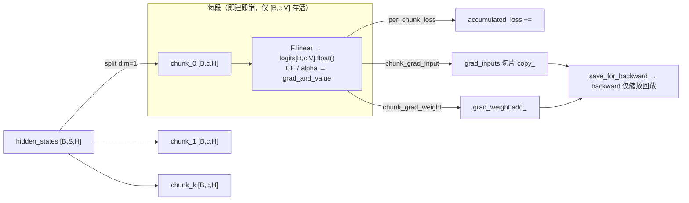

# Chunk Loss（分块 LM-Head + 损失，规避全量 logits 显存）

## Summary

Chunk Loss 把训练末端「LM-Head 投影 + 交叉熵」沿**序列维度切成若干长度为 `chunk_size` 的子段**，每段在前向内立即算出该段的损失与梯度、随手累加，再丢弃该段的中间张量。任意时刻只驻留一段 `[B, chunk_size, V]` 的 logits，而非完整的 `[B, S, V]`——大词表（`vocab_size ≫ hidden_size`）下后者一次性 materialize 是训练显存峰值的主要来源之一。实现是一个自定义 `torch.autograd.Function`：用 `torch.func.grad_and_value` 在每段上当场求导，反向只是把前向已算好的 `grad_input` / `grad_weight` 按上游标量缩放回放，因此**全量 logits 的自动微分图从不被保留**。损失对全局有效 token 数 `alpha` 归一，分段求和与不分块的 mean 在数学归一口径上等价，但浮点归约顺序不同，不能保证逐位一致；来源报告在合理配置下保持相同损失曲线。通用技术，[mindspeed](../frameworks/mindspeed.md) 的 MindSpeed-LLM（GPT / `deepseek4`，即 DeepSeek-V4 / DeepSeekV4-Flash 的实现路径；DeepSeek-V3.2 走另一条 `deepseek32` 路径）与 MindSpeed-MM（理解模型 + FSDP2 路径）共用同一套 `ChunkLoss` 内核，MM 侧另含「按 token 预算自适应分块」的动态变体。

## 动机：全量 logits 的显存峰值

语言模型末端要把 backbone 隐藏态 `hidden_states [B, S, H]` 经 LM-Head 投影成 logits `[B, S, V]` 再算交叉熵。词表 `V` 通常远大于隐藏维 `H`（V 可达十万量级），于是这块 logits 是整张计算图里**单个最大的激活**：

- 显存量 ≈ `B · S · V · dtype_bytes`，且 `calculate_lm_loss` 为数值稳定把 logits `.float()` 成 FP32，bf16 训练下这一步又把它**翻倍**；交叉熵的 softmax 中间量再叠一层。
- 词表越大、序列越长，峰值越高；动态 shape 场景下这种大块一次性分配还易制造**显存碎片**，进一步加剧管理负担。

示意：`V=150k`、`S=8192`、`B=1`、FP32 下单份 logits 约 `8192 × 150000 × 4 B ≈ 4.6 GB`，含 float 转换与 CE 中间量实际占用更高——而这块激活只为算一个标量 loss 服务，前反向之外毫无用处。

## 机制：分块 + 前向内即时求导

核心是 `ChunkLoss(torch.autograd.Function)`。`forward` 预分配两块梯度缓冲——`grad_inputs` 与隐藏态同形 `[B,S,H]`、`grad_weight` 与权重同形 `[V,H]`，**两者都不含 `S·V` 量级的张量**，再沿序列维 `dim=1` 把隐藏态切片，逐段处理：

```python
grad_inputs = torch.empty_like(hidden_states)     # [B, S, H]，非 [B,S,V]
grad_weight = torch.zeros_like(head_weight)       # [V, H]
grad_inputs_chunks  = torch.split(grad_inputs,  chunk_size, dim=1)
hidden_states_chunks = torch.split(hidden_states, chunk_size, dim=1)
for hidden_states_chunk, grad_inputs_chunk, loss_kwargs in zip(...):
    (chunk_grad_input, chunk_grad_weight), (per_chunk_loss, _) = torch.func.grad_and_value(
        loss_forward, argnums=(0, 1), has_aux=True
    )(hidden_states_chunk, head_weight, None, **loss_kwargs)
    accumulated_loss.add_(per_chunk_loss)
    grad_inputs_chunk.copy_(chunk_grad_input)     # 写回整块缓冲的对应切片
    grad_weight.add_(chunk_grad_weight)           # 跨段累加权重梯度
ctx.save_for_backward(grad_inputs, grad_weight)
return accumulated_loss
# mindspeed_mm/models/common/chunkloss.py · ChunkLoss.forward
```

关键不在「分段」本身，而在 `torch.func.grad_and_value(..., argnums=(0,1), has_aux=True)`：它对单段**函数式地**一次算出「对 `hidden_chunk` 的梯度、对 `head_weight` 的梯度」与「损失、aux」，该段的 logits 与 softmax 中间图在这次调用内即建即销，**不为后续 `.backward()` 保留**。于是全程驻留的只有标量 loss、`grad_inputs [B,S,H]`、`grad_weight [V,H]`，三者都不含 `S·V` 量级的张量。`backward` 因此退化为「回放」：把前向存好的梯度按上游标量缩放即可（loss 是最终标量时上游恒为 1.0，带系数时才缩放）：

```python
grad_input, grad_weight = ctx.saved_tensors
if torch.ne(grad_output[0], torch.tensor(1.0, device=grad_output[0].device)):
    grad_input = grad_input * grad_output[0]
    grad_weight = grad_weight * grad_output[0]
return grad_input, grad_weight, None, None, None, None
# mindspeed_mm/models/common/chunkloss.py · ChunkLoss.backward
```



### 损失归一与数值等价

每段的 `loss_forward` 是 `calculate_lm_loss`：把段内隐藏态 flatten、`F.linear(hidden, head_weight).float()` 出该段 logits，再走 `fixed_cross_entropy`。归一系数 `alpha` 在**分块之前**就按整批的有效 token 数算定（默认模式 `alpha = loss_mask.sum()`，`reduction="sum"`），并**同值传给每一段**。于是「各段 CE 求和 ÷ 全局 alpha」严格等于「全序列 CE 之和 ÷ 全局有效 token 数」，即对所有有效 token 取 mean——这是实数运算下的数学等价，浮点归约与权重梯度累加顺序改变后可能产生舍入差异，不能据此保证逐位一致；官方记录的是相应配置下的损失曲线效果。`fixed_cross_entropy` 还支持 `reduction="none"` 的逐样本 / 逐 token 加权（`alpha` 为 0 维标量或 1 维 `[N]`：标量先对逐元素 loss 求和再除，`[N]` 则把 loss reshape 成 `[N, -1]` 逐样本归一后求和），覆盖 per-sample、per-token 等损失口径。LM-Head **bias 不支持**：`head_bias` 非空直接 `NotImplementedError`。

## 显存收益

logits 这块主激活的峰值从 `B · S · V · dtype_bytes` 降到 `B · chunk_size · V · dtype_bytes`，缩减因子约为 `S / chunk_size`（`S=8192`、`chunk_size=1024` 即降到约 1/8）。新增的常驻代价只是两块梯度缓冲：`grad_inputs` 与隐藏态同形 `[B,S,H]`、`grad_weight` 与权重同形 `[V,H]`，均与序列长度 × 词表的乘积无关。`chunk_size` 越小峰值越低、但分段次数越多（核启动 / 调度开销上升），是一组按词表与序列规模权衡的旋钮。

## 接入路径

### MindSpeed-LLM：GPT 与 deepseek4

`ChunkLossFeature` 注册两个开关：`--loss-compute-mode {default,chunk}`（默认 `default`）与 `--loss-chunk-size`（默认 1024）。`gpt_model.py` 与 `deepseek4_model.py` 的 `post_process` 末端在 `loss_compute_mode == "chunk"` **且** `tensor_model_parallel_size == 1` **且** `context_parallel_size == 1` 时走 chunk 分支——Megatron 隐藏态布局为 `[S, B, H]`，先 `transpose(0,1).contiguous()` 成 `[B, S, H]` 再沿 `dim=1` 分块；`alpha = loss_mask.sum()`、`reduction="sum"`，`head_weight = self.output_layer.weight`。TP>1（词表并行 logits）或 CP>1（序列已被切分）时不进入该路径，回退原始全量 logits + `output_layer`。

### MindSpeed-MM：理解模型静态 / 动态分块 + FSDP2

MM 侧由理解模型 `model.json` 的 `loss_cfg` 驱动，`compute_mode ∈ {default, chunk, dynamic_chunk}`、`chunk_size`（`chunk` 模式默认 1024，`dynamic_chunk` 默认 4096）：

- `chunk`：固定子段长度，等价于上面的静态分块，覆盖 default / per-sample / per-token 三类损失口径，并兼容 CP（`split_forward_gather_backward_with_cp` 按 CP 切分 `shift_labels`；唯逐 token 加权的 `alpha` 口径——如 `square_loss`——才连同 `alpha` 一并按 CP / 分块切分，而 per-sample 的 `alpha` 是逐样本 `[batch_size]`、对各段广播复用而非切分）。
- `dynamic_chunk`：把 `chunk_size` 当作「`batch_size × 子段长` 的 token 预算」上限，`calculate_chunk_size` 取**不超过 `total_size // batch_size` 的最大 2 的幂**作为实际子段长，在 batch_size、total_size 均为正整数且 batch_size <= total_size 时满足单段 token 预算。该函数在 batch_size >= total_size 或参数非正时直接返回 1；batch_size > total_size 时仍会超过预算，因此不能保证任意 batch 的预算或避免所有 OOM。
- FSDP2 路径用 `chunkloss_lm_head` 把 LM-Head `nn.Linear` 的 `forward` 替换成处理 **DTensor**（`weight.to_local()`）的分块版本，再经 `build_loss_func` 闭包接同一 `chunk_loss` 内核——与 [mm-activation-memory](mm_activation_memory.md) 同属 MM 训练的激活显存压制手段。

## 约束

- LM-Head **bias 不支持**，仅 weight。
- LLM 侧仅在 **TP=1 且 CP=1** 时启用（分块沿序列维，与词表并行 logits / CP 序列切分不叠加）。
- 分段沿序列维进行，`chunk_size` 指每段 token 数；过小会增加分段次数与调度开销，需按词表与序列规模权衡。

## 当前原生 FSDP2 配置与稀疏 SFT 路径

原生 FSDP2 在 YAML `features` 段设置 `enable_chunk_loss: true`，通过 `chunkloss_plan.apply_module: lm_head`（须为 nn.Linear）和 `chunk_size`（默认1024）控制静态分块；动态分块用 `enable_dynamic_chunk_loss` 与 `total_chunk_size`（默认4096）。二者都默认 false，且**不要同开**：框架没有冲突校验，同时开启会造成模型按静态使能、loss 按动态推导块大小的不一致。

`loss_cfg.compute_mode` 的 model.json 配置属于旧 Megatron 桥接 FSDP2；mcore Qwen3.5 另用模型 config 的 `use_chunk_loss`/`chunk_size`。三条入口不能混写配置。

FSDP2 专用的 `fsdp/features/memory/chunkloss/chunkloss.py` 在 `reduction="sum"`、alpha 为标量（或 None）、且仅部分 label 为 ignore_index 时，先展平 batch 并筛掉被忽略的行，再重新分块，避免它们进入 LM-Head。索引反向把梯度散回有效行、其余归零；数学上保持标量归约，浮点求和顺序仍可能不同。per-sample/非标量 alpha、全忽略或无忽略时走原路径；不能由这一优化推断所有 common ChunkLoss 实现都做了过滤。

CCE 的 `chunk_loss_cce_fused` 同样在 vocab-tile kernel 前过滤部分 ignore_index 行，并可再按有效 token 序列分段；per-sample 归约不适用这种跨样本展平。该优化无额外开关，收益依赖实际 mask 比例，仍须核对 loss 与梯度而非只测显存。

## Evidence

- [README.md](../../../../../cann-recipes-raw/mindspeed-mm/0d2270c8ee178d7bfece88f356a5072bf8e2b3ed/README.md)（primary）
- [chunkloss.md](../../../../../cann-recipes-raw/mindspeed-mm/0d2270c8ee178d7bfece88f356a5072bf8e2b3ed/docs/zh/features/optimization/chunkloss.md)（supporting）
- [graphtrainer.md](../../../../../cann-recipes-raw/cann-recipes-train/532c60c5a3fd8ac84c207ab29be241a88b6eb6ba/docs/llm_pretrain/ascend950/graphtrainer.md)（supporting）
- [chunkloss.py](../../../../../cann-recipes-raw/mindspeed-mm/0d2270c8ee178d7bfece88f356a5072bf8e2b3ed/mindspeed_mm/models/common/chunkloss.py)（implementation）
- [transformers_model.py](../../../../../cann-recipes-raw/mindspeed-mm/0d2270c8ee178d7bfece88f356a5072bf8e2b3ed/mindspeed_mm/models/transformers_model.py)（implementation）
- [chunkloss.py](../../../../../cann-recipes-raw/mindspeed-mm/0d2270c8ee178d7bfece88f356a5072bf8e2b3ed/mindspeed_mm/fsdp/features/memory/chunkloss/chunkloss.py)（implementation）
- [chunkloss_cce_fused.py](../../../../../cann-recipes-raw/mindspeed-mm/0d2270c8ee178d7bfece88f356a5072bf8e2b3ed/mindspeed_mm/fsdp/features/memory/chunkloss/chunkloss_cce_fused.py)（implementation）

## Links

- [mindspeed](../frameworks/mindspeed.md)（Chunk Loss 内核所在框架；MindSpeed-LLM 与 MindSpeed-MM 共用 `ChunkLoss`）
- [optimizer-memory](optimizer_memory.md)（训练显存治理全景：Chunk Loss 压制末端 logits 激活峰值，与优化器侧显存优化互补）
- [mm-activation-memory](mm_activation_memory.md)（MM 训练激活显存压制；FSDP2 路径的分块 LM-Head 是其一环）

## 新增 GraphTrainer 路径的通信边界

当前 950 文档在一维 SimpleFSDP Linear head、FP32 主参数及梯度归约的适用路径中，将同一 microbatch 内各 loss chunk 的 head 梯度先本地累加，再统一一次 ReduceScatter；跨 microbatch 累加语义保留。这是减少重复归约的配套改进，不改变本卡分块 logits 的基本动机，也不能外推到所有 MindSpeed/DTensor 路径。具体联合图与版本条件见 [GraphTrainer](../frameworks/graphtrainer.md)。本批未执行训练。
