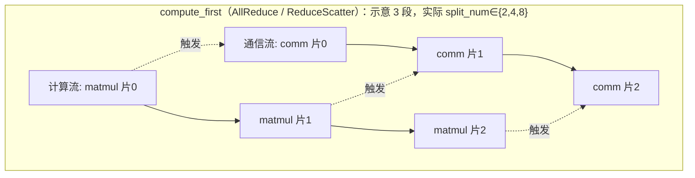

# CoC（Communication over Computation：计算通信重叠）

## Summary

TP 把每层的两个线性层（`ColumnParallelLinear` / `RowParallelLinear`）切到多卡，前反向里都出现「matmul 紧挨一次集合通信」的组合：不开 SP 时是 matmul→AllReduce，开 SP 时是 AllGather→matmul（列）或 matmul→ReduceScatter（行）。这对 matmul 与通信**顺序依赖**（后者的输入正是前者的输出），默认串行执行，于是计算流在等通信、通信流在等计算，两条流各有空闲。CoC 把 matmul 与通信都沿左矩阵的 m 轴（序列×批合并后的行）切成 2/4/8 份更细的子任务，让第 i 片的通信与第 i±1 片的计算在时间上交织，把彼此的空闲填掉。

落地有两条实现，二选一：**Python 脚本流水**（`--coc-parallel-num 2|4|8`，框架层用 `COCParallel` 逐片拼接「计算 + 异步通信」，无额外依赖、可灵活设切分数与先算/先通）和 **LCAL 融合算子**（`--coc-fused-kernel`，基于 MTE 远端内存访问把切分与重叠塞进单个大 Kernel，依赖 ATB 加速库、当前仅 TP=8）。总开关 `--use-ascend-coc`。CoC 与 [mc2](mc2.md)（硬件融合算子路线）互斥、与 [tensor-parallel-2d](../parallelism/tensor_parallel_2d.md) 的 `--use-ascend-coc` 互斥（但 TP-2D 复用同一套 LCAL `coc_ops` 做自己的 AG-matmul-RS 融合）；当前未适配 MoE 模型。融合算子端到端收益：BLOOM 7B 约 +3.20%、BLOOM 176B 约 +5.47%、LLAMA2 70B 约 +7.85%，精度相对误差控制在 2% 内。

## 为什么 TP 线性层值得重叠

TP 的列并行 / 行并行线性层在前反向中各自带一段相邻、顺序依赖的「计算 + 通信」：

- **不开序列并行**：通信是 `AllReduce`。
- **开序列并行**：列并行走 `AllGather`（先聚激活再算），行并行走 `ReduceScatter`（先算再散约）。

因为后一步的输入是前一步的输出，它们只能串行排布，matmul 跑时通信链路空闲、通信跑时计算单元空闲，整段的执行效率没有被压满。CoC 的核心就是把这段不能跨步重叠的依赖，拆成片内仍依赖、**片间可重叠**的细粒度流水。

## 细粒度切片软件流水（COCParallel）

脚本路线的引擎是 `COCParallel`：把输入沿第 0 维（m 轴）切成 `split_num ∈ {2,4,8}` 片（`input_slice = m // split_num`），逐片执行计算与异步通信。按通信类型与「先算还是先通」分两种排布：

- **先算后通（`compute_first=True`）**——用于 `AllReduce`（行并行不开 SP）与 `ReduceScatter`（行并行开 SP）。`run_compute_first` 对每片先 `compute_fcn` 算出该片输出，立刻 `async_op=True` 发起该片通信并把 work 入列；下一片的计算与上一片的通信并行推进，最后 `run_synchronize` 等所有 work 落地。`AllReduce` 因接口只能就地覆写输入，直接把 all_reduce 作用在该片输出内存上。
- **先通后算（`compute_first=False`）**——用于 `AllGather`（列并行开 SP）。`run_communicate_first` 先对第 i 片发起异步通信，再回头 `pre_work.wait()` 等第 i−1 片通信完成后算它的 matmul，写入第 i−1 个输出片；如此让「第 i 片的通信」掩盖「第 i−1 片的计算」。

切片会打乱片与 world_size 维的排布顺序，`shuffle_as_coc_all_gather` / `shuffle_as_coc_reduce_scatter` 在通信前后做 `reshape+transpose` 把布局还原成与单次集合通信一致的顺序。

时间线上 `comm 片0` 与 `matmul 片1` 同时跑、`comm 片1` 与 `matmul 片2` 同时跑，仅首片计算与末片通信无法被掩盖，重叠度随切分数提高。

### 前反向各处的重叠落点

替换后的四个 autograd Function 各自只在「有顺序依赖的那一段」插入重叠：

- **列并行（不开 SP）`COCColumnAllReduceFunction`**：前向沿用 rewrite 版本，重叠点在**反向**——`grad_input = grad_output.matmul(weight)` 后立刻异步 `all_reduce(grad_input)`，与紧接着的 `grad_weight` matmul 并行，最后 `handle.wait()`。
- **行并行（不开 SP）`COCRowAllReduceFunction`**：前向用 `COCParallel(ALL_REDUCE, compute_first=True)` 把 matmul 与 AllReduce 流水。
- **列并行（开 SP）`COCColumnSeqParallelFunction`**：前向用 `COCParallel(ALL_GATHER, compute_first=False)`；`recompute_all_gather=False` 时把前向 AllGather 的结果 `ctx.total_input` 留到反向，省一次反向 AllGather 但抬高峰值内存。
- **行并行（开 SP）`COCRowSeqParallelFunction`**：前向用 `COCParallel(REDUCE_SCATTER, compute_first=True)`，反向用 `COCParallel(ALL_GATHER, compute_first=False)`。

反向算 `grad_weight` 时若开 `gradient_accumulation_fusion`，走 `npu_matmul_add_fp32/fp16` 把 wgrad 直接累加进 `weight.main_grad`。

### 脚本路线的约束与亲和处理

- **m 轴须为切分数倍数**：`get_parallel_num` 里若 `m < parallel_num` 直接回退为 1（该层不重叠）；m 不是 2/4/8 倍数无法均匀切片。
- **不适合计算/通信耗时差距大**的片段——某一条流远长于另一条时，重叠掩盖不出收益。
- **切分数大、小 matmul 多易 host bound**：脚本逐片下发算子，host 侧调度开销可能吃掉收益。
- `matmul_soc_friendly`（默认 True）对进 matmul 的张量做 transpose/padding，使其按 512B 对齐成 NPU 亲和 shape（`get_aligned_mm_inputs`）换取 matmul 性能。
- `customized_coc` 可按具体 `[m,k,n]` shape 覆盖切分数：对某些 shape 设 1（不开 CoC）或设成与 `--coc-parallel-num` 不同的值。

## LCAL 融合算子路线

`--coc-fused-kernel` 不在框架层拼片，而是基于 MTE 远端内存访问能力，把「切分 + 计算 + 通信」全部塞进单个大 Kernel 内部完成重叠，调度交给算子。需先装 ATB（CANN-NNAL 包，`source .../nnal/atb/set_env.sh`），**当前仅支持 TP=8**；融合算子优先级高于脚本——同时给 `--coc-parallel-num>1` 与 `--coc-fused-kernel` 时前者不生效。

对外接口是 `mindspeed/ops/lcal_functional.py` 的 `coc_ops`（底层 `LcalOpBuilder` 加载，按 `device // tp_size` 划 `comm_domain`、`device % tp_size` 定 rank）：

| 接口 | 语义 | 约束 |
|---|---|---|
| `matmul_all_reduce` | 先算后通：matmul→AllReduce(+bias) | `[m,k]×[k,n]`，fp16/bf16，二维 |
| `matmul_reduce_scatter` | 先算后通：matmul→ReduceScatter | m 须为 world_size 倍数，输出 `[m//ws, n]` |
| `all_gather_matmul` | 先通后算：AllGather→matmul | 左矩阵 `[m//ws, k]`，m 须为 world_size 倍数 |
| `all_gather_matmul_v2` | 同上，额外把 AllGather 中间结果写回 `comm_output` 供反向算 wgrad 复用 | 同上 |
| `pure_matmul` | LCAL 纯 matmul（无通信） | `[m,k]×[k,n]` |

量化场景：`matmul_all_reduce` 支持 fp16 的 w8A16 伪量化，粒度含 per-tensor / per-channel / per-group。

融合版 autograd Function（`FusedCOC*`）按 `get_parallel_num` 的返回值分流：`==1` 回退到无重叠的 rewrite 版本；落在 `{2,4,8}` 时退回脚本版 `COC*Function`；其余（默认 `default_parallel_num=-1`）才真正调 `coc_ops` 融合算子。`enable_coc_in_column_backward`（仅融合路线适用，默认 False）控制列并行反向是否用 `matmul_reduce_scatter` 融合——列并行反向本就含互不依赖的计算通信，默认不额外开。

## 开关、模式与接入点

`CoCFeature`（feature 名 `use-ascend-coc`）注册四个开关：`--use-ascend-coc`、`--coc-mode`（-1 自动 / 0 original / 1 rewrite / 2 coc）、`--coc-parallel-num`（1/2/4/8）、`--coc-fused-kernel`。它把 Megatron 的 `ColumnParallelLinear` / `RowParallelLinear` 整类 patch 成 MindSpeed 实现，再由这两类的 `forward` 按 `module_type` 绑定到对应 autograd Function。

`acquire_module_type` 据 `coc_mode` × `sequence_parallel` 在六种类型间选择——`{ORIGINAL, REWRITE, COC} × {ALL_REDUCE, SEQ_PARALLEL}`：`coc_mode=-1` 时按 `parallel_num==1?0:2` 推断（即不切就 original、切了就 COC）；`tp_size==1` 强制关闭（`coc_mode=0, parallel_num=1`）；`sequence_parallel` 决定走 SEQ_PARALLEL 还是 ALL_REDUCE 那一组。其中 REWRITE 只是重写了 forward 但不重叠，COC 才插入流水重叠。这些可调项集中在 `user_config.py` 的 `coc_cfgs`：`recompute_all_gather`（默认 True；False 则保留前向 AllGather 到反向，减反向计算、增峰值内存）、`matmul_soc_friendly`、`customized_coc`、`enable_coc_in_column_backward`、`k_min/k_max`。

## CoC 与 MC2 的取舍

二者都重叠 TP 的 matmul 与通信，但路线不同，且 `--use-ascend-coc` 与 `--use-ascend-mc2` 互斥（`validate_args` 直接 raise）：

- **CoC 脚本流水**：纯软件、框架层拼片，无 ATB 依赖，可灵活设切分数（2/4/8）与先算/先通、按 shape 定制；代价是 m 轴倍数约束与切分过细时的 host bound 风险。
- **CoC 融合算子**：单 Kernel 内重叠，依赖 ATB、仅 TP=8。
- **MC2**：另一套硬件融合算子库（见 [mc2](mc2.md)），与 CoC 各持一套实现，不能同开。

其它互斥：CoC 与 `--unaligned-linear` 互斥（feature 的 `incompatible_check`）；Ascend 950 不支持开启 CoC 融合算子；TP-2D 与 `--use-ascend-coc` 互斥——但 TP-2D 自身在 `--coc-fused-kernel` 下复用同一套 LCAL `coc_ops`（`all_gather_matmul_reduce_scatter` / `all_gather_matmul_v2`）做 AG+matmul+RS 的算子级融合，见 [tensor-parallel-2d](../parallelism/tensor_parallel_2d.md)。

## 适用范围与效果

适用于训练场景下 attention 模块与 MLP 模块串行、且计算通信存在顺序依赖与位置毗邻的结构。脚本侧支持 `ALL_REDUCE / ALL_GATHER / REDUCE_SCATTER` 三种通信、可灵活设先通或先算。当前未适配 MoE 模型；Atlas A2 / A3 训练系列完全支持，Ascend 950 系列不支持开启融合算子。

融合算子端到端收益：BLOOM 7B 约 +3.20%、BLOOM 176B 约 +5.47%、LLAMA2 70B 约 +7.85%，精度相对误差在 2% 范围内。

## Evidence

- [mindspeed](https://gitcode.com/ascend/MindSpeed) — [`docs/zh/features/communication-over-computation.md`](https://gitcode.com/Ascend/MindSpeed/blob/1432cb092818b870c31b61db0eb6d3378b7fbdad/docs/zh/features/communication-over-computation.md)（背景与顺序依赖串行问题 / Python 脚本与融合算子两路 / `--use-ascend-coc` `--coc-parallel-num` `--coc-fused-kernel` 用法 / m 轴倍数与 host bound 约束 / 三种通信场景 / 已支持的四个融合算子与 w8A16 伪量化 / `coc_cfgs` 自定义项 / 不兼容 MC2、未适配 MoE、Ascend 950 限制 / BLOOM·LLAMA2 收益）、[`docs/zh/ops/lcal_coc.md`](https://gitcode.com/Ascend/MindSpeed/blob/1432cb092818b870c31b61db0eb6d3378b7fbdad/docs/zh/ops/lcal_coc.md)（`coc_ops` 五个接口的 shape/dtype 约束与 m 须为 world_size 倍数）
- [`mindspeed/features_manager/tensor_parallel/locl_coc.py`](https://gitcode.com/Ascend/MindSpeed/blob/1432cb092818b870c31b61db0eb6d3378b7fbdad/mindspeed/features_manager/tensor_parallel/locl_coc.py) — `CoCFeature`：四个开关注册、`validate_args`（与 `unaligned_linear`/`use_ascend_mc2` 互斥、Ascend 950 禁融合算子）、`register_patches` 把 `Column/RowParallelLinear` patch 成 MindSpeed CoC 实现
- [`mindspeed/core/tensor_parallel/lcal_coc/coc_utils.py`](https://gitcode.com/Ascend/MindSpeed/blob/1432cb092818b870c31b61db0eb6d3378b7fbdad/mindspeed/core/tensor_parallel/lcal_coc/coc_utils.py) — `COCParallel`（`split_num` 切片、`run_compute_first` / `run_communicate_first` 两种流水、`comm_fcn` 的 ALL_GATHER/REDUCE_SCATTER/ALL_REDUCE 分支）、`get_parallel_num`（m<parallel_num 回退 1、customized_coc 覆盖）、`shuffle_as_coc_all_gather/reduce_scatter`
- [`mindspeed/core/tensor_parallel/lcal_coc/coc_parallel_linears_all_reduce.py`](https://gitcode.com/Ascend/MindSpeed/blob/1432cb092818b870c31b61db0eb6d3378b7fbdad/mindspeed/core/tensor_parallel/lcal_coc/coc_parallel_linears_all_reduce.py) — `COCColumnAllReduceFunction.backward`（grad_input 异步 all_reduce 掩盖 grad_weight）、`COCRowAllReduceFunction.forward`（ALL_REDUCE + compute_first）
- [`mindspeed/core/tensor_parallel/lcal_coc/coc_parallel_linears_sequence_parallel.py`](https://gitcode.com/Ascend/MindSpeed/blob/1432cb092818b870c31b61db0eb6d3378b7fbdad/mindspeed/core/tensor_parallel/lcal_coc/coc_parallel_linears_sequence_parallel.py) — `COCColumnSeqParallelFunction`（ALL_GATHER + communicate_first、`recompute_all_gather` 控反向重算）、`COCRowSeqParallelFunction`（前向 REDUCE_SCATTER、反向 ALL_GATHER）、`gradient_accumulation_fusion` 下 `npu_matmul_add`
- [`mindspeed/core/tensor_parallel/lcal_coc/coc_parallel_linears_all_reduce_fused.py`](https://gitcode.com/Ascend/MindSpeed/blob/1432cb092818b870c31b61db0eb6d3378b7fbdad/mindspeed/core/tensor_parallel/lcal_coc/coc_parallel_linears_all_reduce_fused.py) 与 [`coc_parallel_linears_sequence_parallel_fused.py`](https://gitcode.com/Ascend/MindSpeed/blob/1432cb092818b870c31b61db0eb6d3378b7fbdad/mindspeed/core/tensor_parallel/lcal_coc/coc_parallel_linears_sequence_parallel_fused.py) — `FusedCOC*Function` 按 `parallel_num`（1→rewrite / 2,4,8→脚本 / -1→`coc_ops` 融合）三路分流、`enable_coc_in_column_backward`
- [`mindspeed/core/tensor_parallel/lcal_coc/min_comm_cfg.py`](https://gitcode.com/Ascend/MindSpeed/blob/1432cb092818b870c31b61db0eb6d3378b7fbdad/mindspeed/core/tensor_parallel/lcal_coc/min_comm_cfg.py) — `ModuleType` 六类型、`acquire_module_type`（coc_mode/sequence_parallel/tp_size 选型、tp=1 强制关）、`replace_forward_functions_by_autograd_class`
- [`mindspeed/core/tensor_parallel/lcal_coc/user_config.py`](https://gitcode.com/Ascend/MindSpeed/blob/1432cb092818b870c31b61db0eb6d3378b7fbdad/mindspeed/core/tensor_parallel/lcal_coc/user_config.py) — `coc_cfgs` 默认项、`initialize_coc_from_cfg`（脚本/融合算子分发、map_type2autograd_class 绑定）
- [`mindspeed/ops/lcal_functional.py`](https://gitcode.com/Ascend/MindSpeed/blob/1432cb092818b870c31b61db0eb6d3378b7fbdad/mindspeed/ops/lcal_functional.py) — `CoCOperations.coc_ops`（`matmul_all_reduce` / `matmul_reduce_scatter` / `all_gather_matmul(_v2)` / `pure_matmul` / `all_gather_matmul_reduce_scatter` 及 comm_domain·rank 划分）

## Links

- [mc2](mc2.md)（同为 TP matmul-通信重叠的另一条路线：MC2 是硬件融合算子，与 `--use-ascend-coc` 互斥，二选一）
- [tensor-parallel-2d](../parallelism/tensor_parallel_2d.md)（互斥但复用：TP-2D 与 `--use-ascend-coc` 不同开，却在 `--coc-fused-kernel` 下复用同一套 LCAL `coc_ops` 做 AG-matmul-RS 融合）
- [mindspeed](../frameworks/mindspeed.md)（CoC 所在框架；`CoCFeature` 注册开关并 patch Megatron 的 Column/RowParallelLinear）

<!-- cannbot:related:start -->
## 相关

- [MC2（Matmul + Communication 算子级融合）](mc2.md)（`related`）：CoC 与 ［mc2］(mc2.md)（硬件融合算子路线）互斥；两类 MC2 都与「软件重叠」路线 ［coc］(coc.md) 显式互斥。两端从各自实现说明同一开关冲突，联合阅读可在 TP 计算通信重叠任务中完成 CoC 软件流水与 MC2 融合算子的二选一。
- [高维张量并行 TP-2D（MindSpeed 2D Tensor Parallel）](../parallelism/tensor_parallel_2d.md)（`related`）：与 ［tensor-parallel-2d］(../parallelism/tensor_parallel_2d.md) 的 `--use-ascend-coc` 互斥（但 TP-2D 复用同一套 LCAL `coc_ops` 做自己的 AG-matmul-RS 融合）；- `--coc-fused-kernel`：调 `coc_ops.all_gather_matmul_reduce_scatter`（`TP2DConfig`）把 AG+matmul+RS 做算子级融合，依赖 ATB 加速库，与前两个开关不兼容。。前者明确 TP-2D 不能启用一维 TP 的 use-ascend-coc，后者给出 TP-2D 内部复用 coc_ops 的专用融合入口，构成具体配置边界。
<!-- cannbot:related:end -->
