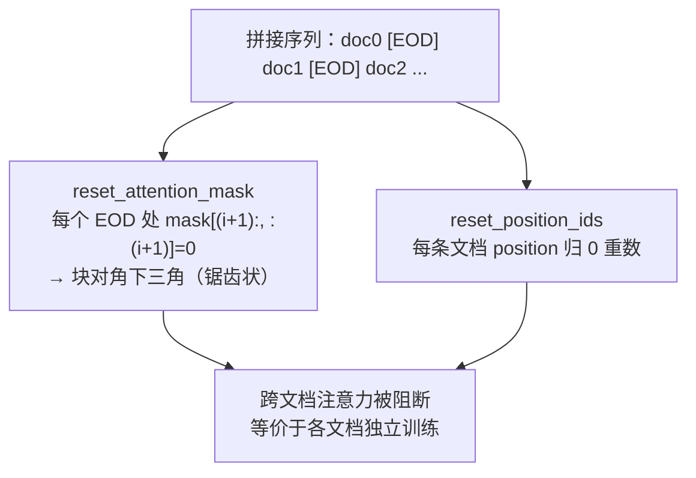
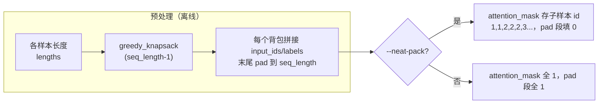

# 训练数据效率（EOD Reset + 变长 Flash Attention + 多样本 Packing）

## Summary

一个训练批次喂进模型的序列，通常由多条文档（pretrain）或多条问答样本（SFT）拼接而成，但天然样本长度参差不齐。直接按固定 `seq-length` 训练有两处浪费：短样本要 pad 到 `seq-length`，padding token 白占算力；多条文档拼在一条序列里若不加隔离，文档之间会互相做 self-attention，污染语义。MindSpeed-LLM 用三件协同的机制把「数据/算力利用率」抬上来：

- **EOD Reset**（`--reset-attention-mask` / `--reset-position-ids`）——在每条文档末尾的 EOD（end-of-document）token 处，把 attention mask 与 position_ids 重置，阻断跨文档注意力、让每条文档的位置编号从 0 重新计数，使拼接序列在语义上等价于「各文档独立训练」。
- **变长 Flash Attention**（varlen FA，TND 布局 + `actual_seq_len`）——不再 materialize 稠密 `[S,S]` 下三角 mask，而是把各文档/各子样本的真实累计长度打成 `actual_seq_len` 传给 FA 算子，算子按 TND（token×head×dim 的扁平打包）布局只算每条文档对角块内的注意力，跨文档的左下空白区直接不算。
- **多样本 Packing**（`--pack` / `--neat-pack`）——数据预处理阶段用贪心装箱把多条短样本拼成一条恰好 `seq-length` 的「Pack」，把 padding 浪费降到每条 Pack 末尾的一小段，配合 EOD reset / neat-pack 锯齿 mask 保持子样本间相互隔离。

三者本质是一条流水线：Packing 在**离线预处理**阶段决定「怎么把短样本塞满一条序列」，EOD Reset 与变长 FA 在**训练运行时**保证「塞在一起的样本互不串扰、且减少跨样本区域的注意力计算；padding 占比由 Packing 降低」。机制属 [mindspeed](../frameworks/mindspeed.md) 的 MindSpeed-LLM 数据栈，SFT 与 pretrain 共用同一套 EOD/varlen 内核。

## EOD Reset：在文档边界重置 mask 与 position_ids

默认情况下多条文档被视为同一条序列，互相之间的 self-attention 不加掩盖、所有 token 都参与计算。当训练要求文档独立（文档间不能互相 attention）时，就要在每个文档结束位置（EOD）重置 attention mask 和 position_ids。

pretrain 路径的实现是 `gpt_dataset.py` 的 `_get_ltor_masks_and_position_ids(data, eod_token, reset_position_ids, reset_attention_mask, eod_mask_loss, create_attention_mask)`：先按序列长度建一张下三角 `attention_mask`，再定位 `data == eod_token` 的所有下标 `eod_index`，逐个边界 `i` 做两件事——

- `reset_attention_mask`：`attention_mask[0, (i+1):, :(i+1)] = 0`，把「第 `i` 个 EOD 之后的 query」对「该 EOD 及之前的 key」的注意力清零。逐个 EOD 处理后，原本整块的下三角被切成沿对角线排布的若干独立下三角块——每条文档只能看见自己块内的历史。
- `reset_position_ids`：`position_ids[(i+1):] -= i + 1 - prev_index; prev_index = i + 1`，把每条文档起点的 position 拉回 0，使每条文档拥有独立的、从 0 起算的相对位置编号。

两个旋钮可独立开关：只重置 mask 时各文档共享全局递增的 position，只重置 position 时注意力不隔离。另有两个配套开关：`eod_mask_loss` 把 EOD token 自身从损失里剔除（`loss_mask[data == eod_token] = 0`）；`create_attention_mask` 在 FA 算子能自产 mask 时可关掉稠密 mask 的构建（`attention_mask = None`），把 mask 职责让给变长 FA——这正是下一节的接续。

## 变长 Flash Attention：按边界计算对角块

稠密 mask 路线下，attn_mask 是一张压缩的下三角矩阵（如 2048×2048），多文档共享一条序列、全 token 参与计算。变长 FA 改走 FA 算子的可变长模式：**不初始化 mask**，转而根据 EOD 位置生成 `actual_seq_len` 标识各文档拼接后的真实累计长度，实际计算量由 `actual_seq_len` 决定，对角块左下角的跨文档空白区不参与计算。

`actual_seq_len` 是各文档长度的**累计前缀**。文档真实长度 `[2,2,0,2,2]` → `actual_seq_len` 为 `[2,4,4,6,8]`（长度 0 的空文档让相邻值重复）。等价的 mask 形如沿对角线排布的锯齿状下三角（实际计算时并不生成这张稠密矩阵）。这串累计边界在代码里有两种等价算法：从 EOD 下标直接加一（`actual_seq_len = eod_index + 1`，详见下一节非 neat-pack 路径），或经 `compute_actual_seq_len`（`training/utils.py`）从 `position_ids` 折算——取其零值分隔位（每条文档/子样本起点处 position 归 0，首位除外）再补上总长。两者在常规无空文档时给出同一串边界；开 MTP 时还会按 `mtp_num_layers` 逐层生成错位副本——第 `i` 层把非 `seq_len` 整除的边界各减 `i`（`j % seq_len == 0` 的边界保持不动），得到多层 `actual_seq_len`。

启用链路两步走：

- **数据准备**：预处理须给每条文档末尾补 EOD token（`--append-eod`）。pretrain handler 的 `_filter` 在每条 `doc_ids` 末尾追加 `tokenizer.eod`（同步给 `attention_mask` 补 1、`labels` 补 EOD）；TND 必须配 EOD 才能切分文档。
- **训练参数**：脚本加 `--reset-attention-mask`，运行时据 EOD 位置生成 `actual_seq_len` 传入 FA，算子随后按 **TND** 格式计算。TND 把多条变长序列在 token 维直接首尾相接成一条扁平张量（区别于 BSND 的等长矩形 + padding），避免每个子样本各自 pad 到统一长度，跨文档块不计算。但固定链路的 Pack 仍补齐到 `seq_length`；neat-pack 将 padding 的 position_ids 置零，`_compute_actual_seq_len` 把这些零位作为边界并追加总长，padding token 仍进入计算序列，不能声称算子完全跳过 padding。

这恰好与 EOD Reset 互补：EOD Reset 负责语义隔离（哪些 token 能互相看见），变长 FA 负责减少跨文档块的计算，Packing 则降低 padding 占比。开了变长 FA，pretrain 侧的稠密 `attention_mask` 即可由 `create_attention_mask=False` 省去。

## 多样本 Packing：贪心装箱拼满序列

资源紧张时每个批次样本长短不一，大部分数据要 pad 到 `seq-length`，训练效率低、算力浪费。多样本 Packing 把多条样本打包成一个「Pack」：将不同长度的数据组合到指定长度并尽量填满有效内容；拼不满 `seq-length` 的才 pad 到指定长度。于是每条 Pack 长度一致、样本总数下降，训练效率提升。

打包在预处理阶段 `data_handler.py` 的 `_pack_serialize_to_disk` 完成：先收集所有有效样本及其长度，再调 `greedy_knapsack(lengths, seq_length - 1)`（留一格给 padding token）做装箱——这是带二分查找的贪心背包：长度升序排好，每个背包反复用 `search_for_fit`（`bisect` 找 ≤ 剩余容量的最大长度）塞样本直到塞不下，得到一组背包。每个背包把命中的样本 `input_ids` 顺序拼接，末尾按 `pad_length` 补齐：`input_ids` 补 `pad_token_id`、`labels` 补 `ignored_label`，使每条 Pack 严格等于 `seq-length`。

**`--neat-pack`** 是 Pack 场景下用锯齿 `attention_mask` 参与计算的开关：它复用预处理阶段生成的 `attention_mask` 字段——拼接时不再写全 1，而是给第 `i` 条子样本的每个 token 写子样本编号 `i+1`（`[i + 1] * len(key_data)`），padding 段写 0。训练时 SFT 数据集 `DecoderPackedMTFDataset` 的 `_get_neat_pack_position_ids` 据这串编号重建 position_ids（每个子样本编号内从 0 递增计数、padding 归 0），再 `compute_actual_seq_len(position_ids)` 折算出 `actual_seq_len` 喂给 FA。`__getitem__` 末尾把 `actual_seq_len` 用 `-1` pad 到 `seq_length` 对齐返回。非 neat-pack 路径则直接 `actual_seq_len = eod_index + 1`。如此 Pack 内多个子样本各成一个对角下三角块、互不 self-attention，处理量减少而样本独立性得以保持。

约束（两条强依赖）：预处理用 `--neat-pack` 的前提是必须用 `--pack`；训练用 `--neat-pack` 的前提是必须用 `--reset-attention-mask`（锯齿 mask 经 `actual_seq_len` 落到 FA）。可选 `--padded-samples` 把样本总数凑成 `batch-size` 的整数倍，`--no-shuffle` 顺序加载。

### 与单样本变长的关系

不打包时也有一档更轻的省 padding 手段：单样本微调的 `--no-pad-to-seq-lengths`，允许不同 mini-batch 以动态序列长度训练——不再 pad 到完整 `--seq-length`，而是 pad 到「≥ 真实数据长度且为 8 的整数倍」（倍数可由 `--pad-to-multiple-of` 改）。它治的是「单条样本 pad 到满序列」的浪费，Packing 治的是「多条短样本各占一条序列」的浪费，二者目标一致、粒度不同。

## 三者协同与适用

| 机制 | 阶段 | 解决的浪费 | 关键参数 |
|---|---|---|---|
| 多样本 Packing | 离线预处理 | 短样本各占一条序列、padding 占比高 | `--pack` / `--neat-pack` / `greedy_knapsack` |
| EOD Reset | 训练运行时 | 拼接序列内跨文档/跨样本注意力串扰 | `--reset-attention-mask` / `--reset-position-ids` |
| 变长 Flash Attention | 训练运行时（FA 算子） | 跨文档块的无效注意力计算（不保证移除 padding token） | `--append-eod` + `actual_seq_len` + TND |

典型组合是「Packing 拼满序列 → neat-pack 写子样本编号 → reset-attention-mask 生成 actual_seq_len → 变长 FA 在 TND 下只算对角块」。pretrain 侧多用 EOD + varlen FA（文档边界即 EOD），SFT 侧在此之上叠加 Packing 把一问一答的短样本拼满。三者叠加后，一条 `seq-length` 序列里有效 token 占比可提高，残余 padding 仍可能计算，且各文档/子样本严格隔离。

这条数据效率链与 [peft-lora](peft_lora.md) 正交叠加——LoRA/QLoRA 压低可训练参数与显存，Packing+varlen 压低数据冗余与无效算力，常在同一 SFT 任务里同时启用。多模态训练的 Packing 与变长处理另见 [multimodal-data](multimodal_data.md)，图文样本的拼接需额外处理视觉 token 边界。

## Evidence

- [README.md](../../../../../cann-recipes-raw/mindspeed-llm/72b0cca64535371e0bbf178087b88448c392970b/README.md)（primary）
- [variable_length_flash_attention.md](../../../../../cann-recipes-raw/mindspeed-llm/72b0cca64535371e0bbf178087b88448c392970b/docs/zh/pytorch/features/mcore/variable_length_flash_attention.md)（supporting）

## Links

- [mindspeed](../frameworks/mindspeed.md)（EOD/varlen/Packing 数据栈所在框架；MindSpeed-LLM 的预处理与训练运行时）
- [peft-lora](peft_lora.md)（与数据效率链正交：LoRA/QLoRA 压参数显存，Packing+varlen 压数据冗余与无效算力，同一 SFT 常并用）
- [multimodal-data](multimodal_data.md)（多模态训练的样本拼接与变长处理，图文 token 边界的对应实践）
