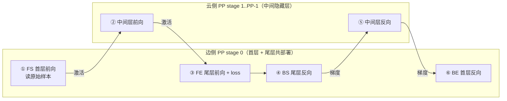

# 分层解耦训练 LDT（Layerwise Disaggregated Training / U 形拆分学习）

## Summary

LDT（Layerwise Disaggregated Training，分层解耦训练，又称边云协同分布式安全训练）面向「运营商出租算力、企业不愿把原始样本上云」的场景：金融、医疗等客户既缺自建算力、又有数据合规约束。常规做法要么企业自建（投资大），要么租云（样本须上传，隐私不达标）。LDT 给出第三条路——在普通 PP 之上换一种切分：把模型**首层与尾层同时部署在企业本地（边侧）、把大量中间隐藏层放在运营商（云侧）**，形成 U 形拓扑。训练时边侧读原始样本，只把**激活值**（前向）和**梯度**（反向）发往云侧，原始样本始终不出园。这样边侧仅需少量算力处理首尾层，敏感数据留在本地。

实现落在两个套件：MindSpeed-LLM 覆盖 Qwen2.5/Qwen3 纯文本 LLM（`--layerwise-disaggregated-training` 开关），MindSpeed-MM 覆盖 Qwen2.5-VL 多模态（`model.json` 里 `"patch": {"layerwise_disaggregated_training": true}`）。二者共用同一套机制：U 形拆分用 VPP 在 PP stage 0 摆下首尾两个虚拟 stage、跨域用激活/梯度 P2P 接力、配合流水编排把边云通信掩盖到计算之下，并支持边云卡数不一致的非对称 TP / DP。它本质是 [pipeline-parallel-advanced](../parallelism/pipeline_parallel_advanced.md) 的一种 U 形 PP 变体，部署语义上则与 [hetero-parallel](../parallelism/hetero_parallel.md) 的「同卡异并行」互补——一个解决跨域数据安全，一个解决子模块算存失衡。

## U 形拆分：首尾层共部署

常规 PP 把 decoder 层线性切成 `stage0 → stage1 → … → stage(PP-1)`，样本进 stage0、loss 在末 stage。LDT 改成 U 形：**首层与尾层都落在第一级流水（边侧）**，中间层在云侧接力，前向走下去再「折返」回边侧算 loss。指定边侧设备为第一级流水后，单个样本的训练分边/云交替进行：

- **前向（边）**：边侧读原始样本，过模型首层，转成激活值发往云侧；
- **前向（云）**：云侧收激活，跑完中间隐藏层，把结果发回边侧；
- **前向（边）**：边侧过尾层并算 loss，前向结束；
- 反向对称折返：边侧尾层反向 → 梯度发云 → 云侧中间层反向 → 梯度回边 → 边侧首层反向。

于是边侧每个样本要做四步，对应调度里的四类任务：首层前向 **FS（ForwardStart）**、尾层前向 **FE（ForwardEnd）**、尾层反向 **BS（BackwardStart）**、首层反向 **BE（BackwardEnd）**；云侧照常规 PP 中间层那样只有「中间层前向 / 中间层反向」两步。

机制上「首尾共部署」靠 VPP 实现：给 PP stage 0 配两个虚拟 stage（一个装首层、一个装尾层）。LLM 侧传 `--num-virtual-stages-per-pipeline-rank 2`，MM 侧 VPP 固定为 3（视觉编码器在 VPP0 按 PP 铺开，text_decoder 连同其 embedding/unembedding 在 VPP1）。每个 `(pp_stage, vpp_rank)` 持有的层数由二维 `num_layer_list[pp_stage][vpp_rank]` 决定——`get_num_layers_to_build` 在开启 LDT 时按 pp_stage 与 vpp_rank 双重索引取层数。非均匀切分用 `--num-layer-list 1,31,31,1` 表达：首层 1 层、中间 31+31、尾层 1 层。多模态场景下落在边侧 stage 0 的是「直接读原始图文样本的输入侧模块」——视觉编码器靠前的若干层（含读入图像 patch 的 embedding）与 text_decoder 的输入 embedding，U 形尾层则是 text_decoder 的 unembedding（LM-Head）；视觉编码器主体与 text_decoder 中间层仍按 PP 铺到云侧（示例 vit 32 层经 `[[3,7,7,7,7],[1,0,0,0,0],…]` 切分，仅约 4 层落边侧、其余在云）。正因为吃原始样本的输入嵌入都在边侧，云侧只收激活、无需读原始样本。

调度入口被替换：`get_forward_backward_func` 在 LDT 下一律返回改写版的 `forward_backward_pipelining_without_interleaving`，并把 `forward_step` 的 loss 触发条件从「是否末 stage」改为 `is_pipeline_first_stage() and is_end_stage`——U 形下 loss 在边侧（第一级流水）的尾层（end_stage）算，而不在物理末 stage。

## 流水编排：两级逻辑流水合并 + FS-FE-BS-BE 重排

U 形下边侧第一级流水比常规 PP（只做 FS、BE）多担两类任务（FE、BS），直接编排会冲突。编排分两步：先把第一级流水拆成「处理首层」「处理尾层」两级逻辑流水，各自照常规 1F1B 排；再把两级合并，任务队列冲突处按 **FS-FE-BS-BE** 顺序重排执行。重排的收益是**增大可容忍的边云通信时延**：让某个样本的前向跨域通信，被两三个样本之后的前向计算时间掩盖，从而在「拉远收敛」（边云物理距离大、链路时延高）场景下减小算效损失。

边侧的逐阶段编排（云侧照常规 PP 中间层编排）：

| 阶段 | 操作 | 次数 | PP=3, mbn=4 例 |
| --- | --- | --- | --- |
| warmup | FS | PP+1 | 4 |
| steady state 1 | FEBS | `num_forward_end_backward_start` | 2 |
| steady state 2 | FS-FE-BS-BE | `mbn − num_forward_end_backward_start` | 2 |
| cooldown | BE | `num_forward_end_backward_start` | 2 |

其中 FEBS 与 cooldown 的次数由 `num_forward_end_backward_start = int((4·PP + 1) / 6)` 给定（PP=3 时为 2），稳态主体 FS-FE-BS-BE 跑 `mbn − num_forward_end_backward_start` 次（边侧 `num_2f2b = num_microbatches − num_forward_end_backward_start`）。这套编排保证**稳态阶段不引入额外空泡**——当边云通信时延小于 `tf`（边侧单 microbatch 首层前向计算时间）时，稳态零额外气泡，仅 warmup/cooldown 有少量。

为把跨域收发与计算重叠，调度持有多条独立通信流：`stream_ping` / `stream_pang` 在偶/奇 PP rank 间错开收发流；当 PP 为奇数时，首/尾 stage 额外用 `stream_last_to_first` / `stream_first_to_last` 处理 U 形折返的环回通信。发送统一走异步 P2P（`wait_on_reqs=False`），收方在 `wait_helper` 里再 `wait_stream` 同步，使下一轮 recv 与本轮计算并行。

## 非对称 TP 与非对称 DP

边侧算力/节点常少于云侧，LDT 支持边云并行度不对等。

**非对称 TP（VTP）**：边侧 TP 可小于云侧 TP（边侧 TP 即边侧实际卡数）。对称 TP 的 P2P 是「同 PP 组相邻卡一一收发」；非对称 TP 改成两步——当前 TP 组内**编号最小的卡**把数据发给下一 TP 组内编号最小的卡，后者再 `broadcast` 给本组全部卡。由于 Megatron 在 P2P 前已在 TP 组内做过 AllReduce，单卡持有的就是完整数据，单卡转发即可正确跨级。实现上 `_vtp_send_forward` / `_vtp_recv_forward` 只让 `is_vtp_stage_rank0()` 参与跨 stage 的 `irecv`，再用 `_VTPRecvWork` 把「irecv work + 延迟 broadcast」包成一个可等待对象，broadcast 推迟到 `wait_helper` 执行以与计算重叠。VTP 各 stage 的 TP size 在分布式初始化后由每节点 GPU 拓扑 all_gather 自动探测；`--tensor-model-parallel-size` 设为各节点最大 TP。

**非对称 DP（VDP）**：边侧 DP 可小于云侧 DP。对称 DP 是各卡各管自己 DP 域的数据；非对称 DP 下边侧用**时分复用**处理多个 DP 域的数据，分别与云侧通信。`get_all_batches` 在边侧把 microbatch 数乘以 `get_vdp_size()`，`_split_item` 按 round-robin 把一批数据切成 `get_vdp_size()` 份（如 `[1..6]`、vdp=3 → `[[1,4],[2,5],[3,6]]`）分别下发各 DP 域。通讯组初始化复用 Megatron 生成 rank 组的逻辑：先按对称 DP 把边/云分开生成，再把边侧 rank 组「重计算合并」、云侧 rank 组整体偏移边侧卡数。梯度处理上，Megatron 时分复用多个 DP 域时默认累加梯度（相当于边侧已对梯度做了 AR），最后对累加总梯度求平均即可。

## 权重转换与使能

U 形要求把首尾两层合到同一张卡，权重转换分两步。先按 **PP+1** 转换（多出来的一级流水临时存放尾层），如 PP=3 实际按 `--target-pipeline-parallel-size 4` + `--num-layer-list 1,31,31,1` 转；再用 `convert_ckpt_pp_vpp.py merge` 把首尾层 PP stage 合并成 VPP 格式并恢复 PP=3，`--merge-stages 0,PP` 指首尾两 stage、`--middle-stages 1..PP-1` 指中间层，输出边/云两份权重（`--save-dir-edge` / `--save-dir-cloud`）。非对称 TP 场景下边/云各按自己的 TP size 单独转换后再 merge（`--load-dir-edge` / `--load-dir-cloud`）。

使能开关在两套件不同：

- **MindSpeed-LLM**：训练脚本加 `--layerwise-disaggregated-training` + `--num-layer-list 1,31,31,1` + `--num-virtual-stages-per-pipeline-rank 2`，边/云分别按各自实际卡数填 `NPUS_PER_NODE`，非对称 DP 场景须显式指定 `WORLD_SIZE=边侧卡数+云侧卡数`。特性由 `UShapedSplitFeature` / `VTPFeature` / `VirtualDPFeature` 三个 `MindSpeedFeature` 注册，patch 进 Megatron 的 `get_forward_backward_func`、`forward_backward_pipelining_without_interleaving`、`initialize_model_parallel`、p2p 收发、`get_model` / `train_step` 等。
- **MindSpeed-MM**：`model.json` 里 `"patch": {"layerwise_disaggregated_training": true}` 开启，VPP 配 `--virtual-pipeline-model-parallel-size 3`，并按 `image_encoder.vision_encoder.pipeline_num_layers` / `text_decoder.pipeline_num_layers` 配非均匀 PP 切分（如 vit `[[3,7,7,7,7],…]`、text_decoder `[[0,0,0,0,0],[0,16,16,16,16],…]`）。patch 在 `patch_manager` 的 `layerwise_disaggregated_training` 配置项里批量注册，按 `model.json` 的 patch 段条件生效。

## 与常规 PP / 异构并行的区别

- **vs 常规 PP**：常规 PP 是线性接力、loss 在末 stage、stage 间只单向传隐藏态；LDT 是 U 形折返、loss 回到边侧首级、stage0 额外承担 FE/BS、稳态从 1F1B 变成 FS-FE-BS-BE 的 2F2B 编排，目的不是压气泡而是把原始样本锁在边侧。
- **vs [hetero-parallel](../parallelism/hetero_parallel.md)**：异构并行解决「同一组卡上不同子模块（编码器/主干）算存悬殊」，做法是逐子模块独立并行度 + 运行时切换 `parallel_state`；LDT 解决「边云两组物理隔离的卡之间数据不能流动」，做法是 U 形层切分 + 跨域激活/梯度接力 + 非对称 TP/DP。前者同卡异并行，后者跨域同模型。多模态 LDT 复用了异构思路里「视觉编码器靠前部署」的分层，但落点是边侧而非负载均衡。
- **vs VPP**：LDT 借 VPP 摆首尾两虚拟 stage，但 `--num-virtual-stages-per-pipeline-rank` / `--virtual-pipeline-model-parallel-size` 被强制为特定值（2 / 3）以使能首尾共部署，不能当常规 VPP（任意 v）用。

## 约束

- 模型范围：MM 侧支持 Qwen2.5-VL 32B，LLM 侧支持 Qwen2.5/Qwen3 系列；**暂不支持 MoE 模型**。
- **不支持 PP=1**（无 U 形可言）、**暂不支持 LoRA**。
- 不支持常规 VPP：VPP 传参必须为使能首尾共部署的特定值（LLM `--num-virtual-stages-per-pipeline-rank 2`、MM `--virtual-pipeline-model-parallel-size 3`）。
- 非对称 TP 场景仅支持 DP=1；非对称 DP 场景仅支持边侧 DP=1；二者同开时仅支持 TP 为偶数且边侧 TP 整除云侧 TP。
- 训练的并行配置（TP/PP）须与权重转换时一致。

## Evidence

- [mindspeed-mm](https://gitcode.com/Ascend/MindSpeed-MM) — [`docs/zh/features/layerwise_disaggregated_training.md`](https://gitcode.com/Ascend/MindSpeed-MM/blob/8e740b46cb8290be0addf060e3e063d0b0380aa6/docs/zh/features/layerwise_disaggregated_training.md)（边云协同动机 / U 形原理与单样本前后向折返 / FS·FE·BS·BE 四步 / 流水编排表 warmup·steady1·steady2·cooldown / 非对称 TP rank0 转发+broadcast / 非对称 DP 时分复用与 rank 组生成 / Qwen2.5-VL-32B 使能与 `pipeline_num_layers` / 约束）
- [mindspeed-llm](https://gitcode.com/Ascend/MindSpeed-LLM) — [`docs/zh/pytorch/training/finetune/mcore/layerwise_disaggregated_training.md`](https://gitcode.com/Ascend/MindSpeed-LLM/blob/183e02c21011c2e423a599633cf2d55929ba9ea3/docs/zh/pytorch/training/finetune/mcore/layerwise_disaggregated_training.md)（Qwen3-32B 四种模式：对称 / 非对称 TP / 非对称 DP / 双非对称；`--num-layer-list 1,31,31,1`、PP+1 转换、`convert_ckpt_pp_vpp.py merge --merge-stages/--middle-stages`、`--num-virtual-stages-per-pipeline-rank 2`、WORLD_SIZE 注意）
- [`mindspeed_llm/core/layerwise_disaggregated_training/schedules.py`](https://gitcode.com/Ascend/MindSpeed-LLM/blob/183e02c21011c2e423a599633cf2d55929ba9ea3/mindspeed_llm/core/layerwise_disaggregated_training/schedules.py) — `get_forward_backward_func`（LDT 走 without-interleaving）、`forward_step`（`should_compute_loss = is_pipeline_first_stage() and is_end_stage`）、`get_all_batches` / `_split_item`（VDP round-robin 切分）、`num_forward_end_backward_start = int((4·PP+1)/6)`、warmup/FEBS/2F2B/cooldown 循环、`stream_ping`/`stream_pang`/`stream_last_to_first`/`stream_first_to_last` 多通信流
- [`mindspeed_llm/core/layerwise_disaggregated_training/num_layer_list.py`](https://gitcode.com/Ascend/MindSpeed-LLM/blob/183e02c21011c2e423a599633cf2d55929ba9ea3/mindspeed_llm/core/layerwise_disaggregated_training/num_layer_list.py) — `get_num_layers_to_build`：LDT 下按 `num_layer_list[pp_stage][vpp_rank]` 双重索引取层数
- [`mindspeed_llm/core/layerwise_disaggregated_training/p2p_communication.py`](https://gitcode.com/Ascend/MindSpeed-LLM/blob/183e02c21011c2e423a599633cf2d55929ba9ea3/mindspeed_llm/core/layerwise_disaggregated_training/p2p_communication.py) — `_vtp_send_forward`/`_vtp_recv_forward`/`_vtp_send_backward`/`_vtp_recv_backward`（`is_vtp_stage_rank0` 跨 stage irecv + `_VTPRecvWork` 延迟 broadcast）
- [`mindspeed_llm/features_manager/layerwise_disaggregated_training/`](https://gitcode.com/Ascend/MindSpeed-LLM/blob/183e02c21011c2e423a599633cf2d55929ba9ea3/mindspeed_llm/features_manager/layerwise_disaggregated_training/u_shaped_split_feature.py) — `u_shaped_split_feature.py`（`--layerwise-disaggregated-training` 注册 + 十余处 patch：调度/`initialize_model_parallel`/p2p `_communicate`·收发/`get_model`/`train_step`/`initialize_megatron`/`_get_block_submodules`/重计算等）、`vtp_feature.py`（world_size 膨胀/复原、`all_gather_into_tensor` patch）、`vdp_feature.py`（`finish_grad_sync`/`register_grad_ready`/`create_group`/`get_grad_norm_fp32` patch）
- [`mindspeed_mm/patchs/patch_manager.py`](https://gitcode.com/Ascend/MindSpeed-MM/blob/8e740b46cb8290be0addf060e3e063d0b0380aa6/mindspeed_mm/patchs/patch_manager.py) — `layerwise_disaggregated_training` 配置项（`create_group` / `get_forward_backward_func` / `forward_backward_pipelining_without_interleaving` / `setup_model_and_optimizer` / 梯度同步 / VTP·VDP utils 批量 patch）、`apply_patches_from_config` 按 `model.json` 的 `patch` 段生效
- [`mindspeed_mm/patchs/layerwise_disaggregated_training/`](https://gitcode.com/Ascend/MindSpeed-MM/blob/8e740b46cb8290be0addf060e3e063d0b0380aa6/mindspeed_mm/patchs/layerwise_disaggregated_training/u_shaped_split_learning_patch.py) — `u_shaped_split_learning_patch.py`（边侧数据加载 `build_train_valid_test_datasets_provider`，`is_pipeline_first_stage` 才读样本）、`schedules_patch.py`（VLM 版 U 形调度，`num_forward_end_backward_start` + vit 前后向掩盖编排）

## Links

- [pipeline-parallel-advanced](../parallelism/pipeline_parallel_advanced.md)（LDT 是 U 形 PP 变体：借 VPP 摆首尾虚拟 stage，在 without-interleaving 1F1B 调度上改成 FS-FE-BS-BE 编排）
- [hetero-parallel](../parallelism/hetero_parallel.md)（互补对照：异构并行解同卡子模块算存失衡，LDT 解跨域数据安全；MM 侧 LDT 复用视觉编码器靠前部署的分层）
- [mindspeed-mm](../frameworks/mindspeed_mm.md)（多模态承载套件：Qwen2.5-VL LDT 经 `model.json` patch 段使能，走 Megatron-mcore 路线）
