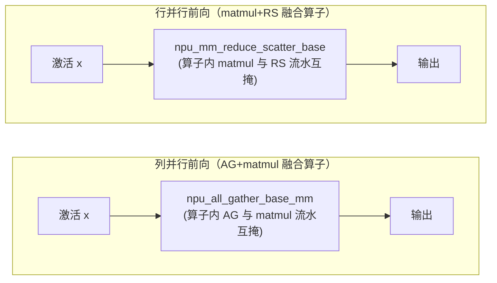

# MC2（Matmul + Communication 算子级融合）

## Summary

开 TP+SP 的训练里，每层线性层都出现「matmul 紧挨一次集合通信」、且后者输入正是前者输出的强依赖：列并行是 AG→matmul、行并行是 matmul→RS。串行排布时 matmul 跑则通信链路空闲、通信跑则计算单元空闲。MC2 是昇腾自研的解法——把这对 matmul 与通信**融合进单个昇腾融合算子**（torch_npu 提供），算子内部再把大计算/通信任务切成小子任务，靠流水让通信子任务与计算子任务互相掩盖，从而压掉暴露的通信时间、提利用率。

MC2 在 MindSpeed 里落在两处，各由独立特性开关控制：

- **TP 线性层（`--use-ascend-mc2`）**：把 Megatron 的 `ColumnParallelLinear` / `RowParallelLinear` patch 成 MC2 实现，列并行前向走 `npu_all_gather_base_mm`（AG+matmul 融合）、行并行前向走 `npu_mm_reduce_scatter_base`（matmul+RS 融合）。强约束是必须同时开 `--sequence-parallel` 且 TP>1。
- **MoE 层（`--moe-alltoall-mc2`）**：把 EP 维的 All2All 与专家 GMM（分组矩阵乘）融合，前向 fc1 走 `npu_alltoallv_gmm`（A2A-v + GMM）、fc2 走 `npu_gmm_alltoallv`（GMM + A2A-v），用在 `alltoall` / `alltoall_seq` 两种 dispatcher 上。

两类 MC2 都与「软件重叠」路线 [coc](coc.md) 显式互斥：MC2 是融合算子（把切分与流水塞进单个算子，调度交给算子），CoC 走框架层逐片拼接计算与异步通信的脚本流水（或 LCAL 融合算子），二者各持一套实现，`validate_args` 直接 `raise 'mc2 and coc can not be used together'`，不能同开。MoE-MC2 同样与 [moe-comm-overlap](moe_comm_overlap.md) 的层内 overlap（`--moe-alltoall-overlap-comm` / `--moe-allgather-overlap-comm`）互斥。TP-MC2 文档的环境前提是 CANN 8.0.RC2 / Ascend HDK 24.1.RC2 及以后版本，并明确不支持 Atlas 900 A3；该排除条件不能自动扩展到另一 MoE-MC2 分支。两者均依赖 Ascend NPU，现有证据未给出各分支完整型号支持范围，保留 draft、platforms 暂空，使用前应分别核对对应融合算子环境。

## TP 线性层的通算融合（`--use-ascend-mc2`）

`MC2Feature`（feature 名 `use-ascend-mc2`）注册单一开关 `--use-ascend-mc2`，并在 `register_patches` 里把 `megatron.core.tensor_parallel.layers.ColumnParallelLinear` / `RowParallelLinear` 整类替换成 `MindSpeedMC2ColumnParallelLinear` / `MindSpeedMC2RowParallelLinear`（多继承 MindSpeed 的 `MC2*ParallelLinearImpl` + Megatron 原类）。patch 有前置闸门：若未开 `sequence_parallel` 或 `tensor_model_parallel_size==1`，`register_patches` 直接 `return` 不替换——MC2 只在 TP+SP 场景生效。

替换后的 `forward` 按权重是否需要梯度选 autograd Function：

- **列并行前向 `ColumnSeqParallelLinearFunction`**：把激活沿序列维 reshape 成二维后调 `torch_npu.npu_all_gather_base_mm(x, weight.t(), hcomm_info, world_size, gather_index=0, gather_output=(not all_gather_recomputation))`——AllGather 聚激活与 matmul 在一个算子内融合并流水。`gather_output` 控制是否额外吐出 AG 中间结果留给反向：`all_gather_recomputation=True` 时不留、反向重算 AG 省内存。反向先完成 `grad_input = grad_output.matmul(weight)`，再对该结果异步 ReduceScatter，并用 `grad_weight` 计算掩盖该通信；开重算时，还会先异步 AllGather 输入、用 grad_input 的 matmul 掩盖这一 AllGather。
- **行并行前向 `RowSeqParallelLinearFunction`**：调 `torch_npu.npu_mm_reduce_scatter_base(x, weight.t(), hcomm_info, world_size, reduce_op="sum")`——matmul 与 ReduceScatter 融合。反向调 `npu_all_gather_base_mm(grad_output, weight, ...)` 做 AG+matmul 求 `grad_input`，并用吐出的 `all_gather_grad_output` 算 `grad_weight`。

`hcomm_info`（HCCL 通信域名）由 `get_hcomm_info_and_world_size` 从 TP group 取 `get_hccl_comm_name`，融合算子据此知道在哪个通信域上做集合通信。两路前向的融合算子均**不支持 bias**，bias 在算子外另加。开 `gradient_accumulation_fusion` 且 `weight.main_grad.dtype==float32` 时，wgrad 走 `npu_matmul_add_fp32` 直接累加进 `weight.main_grad`。

**权重冻结也支持**：`forward` 在 `weight.requires_grad==False` 时改走 `ColumnSeqParallelLinearWithFrozenWeightFunction` / `RowSeqParallelLinearWithFrozenWeightFunction`（反向只回 grad_input、不算 grad_weight），冻结与不冻结两个场景一致使用同一对融合算子。冻结可对 `ColumnParallelLinear` / `RowParallelLinear` 的参数置 `requires_grad=False`（如冻除 `output_layer` 外的全部 TP 线性层）。

## MoE 层的 All2All-GMM 融合（`--moe-alltoall-mc2`）

`MoEAlltoAllMC2Feature`（feature 名 `moe-alltoall-mc2`）注册 `--moe-alltoall-mc2`，把 `megatron.core.transformer.moe.moe_layer.MoELayer` patch 成 `MindSpeedAlltoAllMC2MoeLayerAdaptor`（即 `AlltoAllMC2MoeLayer`）。该 MoE 层据 `moe_token_dispatcher_type` 选 dispatcher——`alltoall` → `MoEAlltoAllMC2TokenDispatcherAdaptor`、`alltoall_seq` → `MoEAlltoAllSEQMC2TokenDispatcherAdaptor`，专家用 `MindSpeedGmmMC2Experts`（`GmmExpertsMC2Impl`）。此快照 `token_permutation` 先本地 permute，仅对路由概率 probs 异步 AllToAll 并按专家排序，再返回本地重排激活；没有在此执行激活的 EP A2A 或 TP AG。激活通信放在后续专家融合算子中，`preprocess` 算出 `send_counts` / `recv_counts` 传给融合算子。

专家计算把 EP 维的变长 All2All（A2A-v）与分组矩阵乘 GMM 融成单算子：

- **fc1 `AlltoallvPermuteGmm`**：前向调 `torch_npu.npu_alltoallv_gmm(gmm_x, gmm_weight, hcom, ep_world_size, send_counts, recv_counts, permute_out_flag=True)`——A2A-v 把 token 散到对应 EP rank 后立刻做该 rank 的 GMM，一个算子内完成「通信 + 专家矩阵乘」。
- **fc2 `GmmUnpermuteAlltoallv`**：前向调 `torch_npu.npu_gmm_alltoallv(...)`——先做专家 GMM，再把结果 A2A-v 回原 rank。

反向用镜像算子（`npu_gmm_alltoallv` / `npu_alltoallv_gmm`）求输入梯度，权重梯度走 `npu_grouped_matmul(..., group_type=2, group_list_type=1)`。激活可按 `should_recompute_activation` 经 `CheckpointWithoutOutput` 重计算省显存。共享专家（`moe_shared_expert_intermediate_size` 非空）场景会自动置 `moe_shared_expert_overlap=True`（alltoall dispatcher），不过当前 gmmmc2 的共享专家因算子限制实际未启用、交由 Megatron 的 shared-expert-overlap 承载。

## 开关、约束与互斥

`--use-ascend-mc2`（TP-MC2）的 `validate_args`：

- 与 `unaligned_linear` 互斥（`incompatible_check`）。
- 检出 `use_ascend_coc` 即 `raise AssertionError('mc2 and coc can not be used together')`——与 [coc](coc.md) 不能同开。
- 必须同时满足 TP>1 与 `sequence_parallel=True`，否则 raise 提示「需 TP>1 且开 SP，MC2 已被禁用」。
- 与 `use_pipe_experts` 互斥（`raise 'mc2 is not compatible with use_pipe_experts'`）、与 `use_nanopipe` 互斥（`raise 'mc2 is not compatible with use_nanopipe'`）。

另有两条限制由官方文档列出、不在 `validate_args` 里强校验：MoE 模型暂不支持开 TP-MC2，且该特性不支持 Atlas 900 A3。

`--moe-alltoall-mc2`（MoE-MC2）的 `validate_args`：

- 与 `use_ascend_mc2`、`moe_alltoall_overlap_comm`、`moe_allgather_overlap_comm`、`moe_fb_overlap`、`moe_tp_extend_ep` 逐项 `incompatible_check`——两类 MC2 不能并开，且与 [moe-comm-overlap](moe_comm_overlap.md) 的层内 overlap、与 DualPipeV 的 `--moe-fb-overlap`、与 [tensor-parallel-2d](../parallelism/tensor_parallel_2d.md) 相关的 tp-extend-ep 均互斥。
- `moe_token_dispatcher_type` 必须是 `alltoall` 或 `alltoall_seq`。
- `alltoall_seq` 支路要求 TP=1；`alltoall` 支路要求 ETP（`expert_tensor_parallel_size`）=1，且仅支持 dropless（`moe_expert_capacity_factor` 须为 None）。训练时 TP>1 还必须开启 `sequence_parallel`，否则 `AlltoAllMC2MoeLayer.forward` 抛 ValueError；这不额外限制 TP=1 的 alltoall_seq 分支。

## MC2 与 CoC 的取舍

二者目标相同——掩盖 TP matmul 与通信的强依赖等待，但实现路线不同，且 `--use-ascend-mc2` 与 `--use-ascend-coc` 互斥：

- **MC2**：昇腾自研融合算子，切分 + 计算 + 通信全部在单个 torch_npu 算子内部完成流水，调度交给算子；强制 TP+SP，并扩展到 MoE 的 A2A-GMM 融合。约束硬（必开 SP、与多条流水/overlap 特性互斥；TP-MC2 文档排除 A3）。
- **CoC**：见 [coc](coc.md)，脚本路线在框架层把 matmul 与异步通信逐片（2/4/8）拼接成软件流水，可灵活设切分数与先算/先通；另有 LCAL 融合算子路线（仅 TP=8）。当前未适配 MoE。

开 TP+SP 的稠密线性层场景两者择一即可；MoE 模型则用 `--moe-alltoall-mc2` 或 moe-comm-overlap 的层内 overlap 二选一。MC2 的收益方向是开 TP+SP 时减少内存开销并提高计算效率（官方文档未给具体百分比）。

## Evidence

- [README.md](../../../../../cann-recipes-raw/mindspeed/c5a72765f99fd8470362c7afdc2cdffe0ab5aea6/README.md)（primary）
- [mc2.md](../../../../../cann-recipes-raw/mindspeed/c5a72765f99fd8470362c7afdc2cdffe0ab5aea6/docs/zh/features/mc2.md)（supporting）

## Links

- [coc](coc.md)（同为 TP matmul-通信重叠的另一条路线：CoC 是框架层软件流水/LCAL 算子，MC2 是昇腾融合算子，`--use-ascend-coc` 与 `--use-ascend-mc2` 互斥，二选一）
- [moe-comm-overlap](moe_comm_overlap.md)（MoE 通信掩盖：层内 overlap `--moe-alltoall-overlap-comm` / `--moe-allgather-overlap-comm` 与本页 `--moe-alltoall-mc2` 互斥，同为 MoE 的 dispatch/combine 通信优化二选一）
- [tensor-parallel-2d](../parallelism/tensor_parallel_2d.md)（同属 TP 域的通算优化；MoE-MC2 与 tp-extend-ep 互斥，二维 TP 另走 LCAL coc_ops 做 AG-matmul-RS 融合）
- [mindspeed](../frameworks/mindspeed.md)（MC2 所在框架；`MC2Feature` / `MoEAlltoAllMC2Feature` 注册开关并 patch Megatron 的 Column/RowParallelLinear 与 MoELayer）
