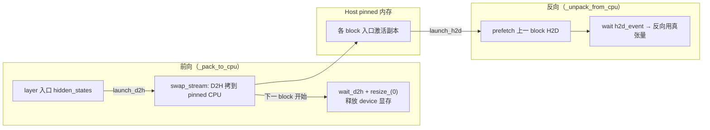

# MindSpeed-MM 激活显存优化（Chunk-MBS 微批切块 + 异步激活 Offload）

## Summary

[mindspeed-mm](../frameworks/mindspeed_mm.md) 的 FSDP2 训练后端为多模态长序列场景提供两个互补的激活显存优化：**异步激活 Offload**（`enable_activation_offload`）用 PyTorch `saved_tensors_hooks` 把前向保存的 layer 入口激活在独立 copy 流上异步换出 Host pinned 内存、反向时按需预取换回，把激活从 device 峰值里搬走；**Chunk-MBS**（`enable_chunk_mbs`）在一次 FSDP Unshard 之后把单个 micro-batch 沿 batch 维切成多个微块串行前反向，使动态激活峰值被压到「单个微块」量级。二者建立在重计算之上：开了 Chunk-MBS 的 module 必须同时开 offload 与 recompute。Chunk-MBS 的核心收益不止省显存——它让 `micro_batch_size=GBS / grad_acc=1` 成为可能，于是每次参数更新只需对每个 block 做一次 Unshard，省掉梯度累积带来的重复 AllGather 通信，Qwen3.5 35B 实测整网约 5% 提速。三个特性的包装顺序由 `pre_fully_shard_apply` 严格固定为 recompute → offload → Chunk-MBS。

## 动机：长序列把激活推成显存瓶颈

多模态 VLM 训练里 self-attention 计算量随序列长度平方增长，激活显存随之膨胀。传统两条路各有短板：重计算（recompute）丢弃前向激活、反向重算，带来大量冗余计算；序列并行把单序列摊到多卡，但跨卡通信频繁、难被计算掩盖。在 FSDP2 下，参数/梯度/优化器分片后静态显存已经吃掉很大一块，单纯靠加大序列长度或 MBS 来提升单次 Unshard 后的计算密度，会立刻撞上激活显存的墙。

把激活从 device 峰值中剥离有两个正交手段——换出到 Host，以及把一个 micro-batch 再切细让同时驻留的激活更少。MindSpeed-MM 把两者都做成可按 module 正则开启的特性，并与重计算叠加。

## 异步激活 Offload

`async_save_on_cpu` 继承 `torch.autograd.graph.saved_tensors_hooks`，用 `_pack_to_cpu` / `_unpack_from_cpu` 一对钩子接管「前向保存为反向所用的张量」的落盘与回取：前向保存时把张量换出 Host，反向取用时换回 device。

### 只换 layer 入口那一个激活

`async_offload_modules` 给每个匹配到的 module 包一层 `with_async_save_on_cpu`，它从 `args[0]` 取出本层入口 `hidden_states`，并设一个只放行入口张量的 `custom_check_fn`：

```python
context = async_save_on_cpu(
    block_idx=layer_idx,
    depth=depth,
    custom_check_fn=lambda x: x.data_ptr() == hidden_states.data_ptr(),
    prefetch=prefetch)
# mindspeed_mm/fsdp/features/memory/async_offload.py · with_async_save_on_cpu
```

配合重计算（层内中间激活被丢弃、反向重算），每层实际只保留并换出入口 hidden_states 这一个张量。`base_check_fn` 再兜底跳过 Parameter 及其 view、跳过 storage 为 0 的空壳。`custom_check_fn` 的取舍准则：换出「计算量大、激活小」的部分，对「激活大、计算短」的部分走重计算，否则 H2D/D2H 拷贝量过大、掩盖不住。

### SwapTensor：device↔Host 搬运与延迟释放

每个被换出的张量包成 `SwapTensor`，持一块 pinned CPU 副本与 `d2h_event` / `h2d_event` 两个 event。前向换出 `launch_d2h` 在 copy 流上把 device 数据拷到 pinned CPU、record `d2h_event`、置 `stat="host"`，但**此刻并不释放 device storage**：

```python
def launch_d2h(self, stream):
    if self.stat != "device": return
    forward_event = create_event(); forward_event.record()
    with torch.no_grad(), switch_to_specified_stream(stream):
        stream.wait_event(forward_event)
        self.tensor_cpu.copy_(self.tensor, non_blocking=True)   # 或按 storage 拷贝
        self.d2h_event.record(); self.stat = "host"
# mindspeed_mm/fsdp/features/memory/async_offload.py · SwapTensor.launch_d2h
```

真正的显存释放推迟到下一个 block 的换出开始时：`_pack_to_cpu` 发现 `block_idx` 跨入新块（`after_block`）就调 `del_npu_tensor` 对上一块所有张量执行 `wait_d2h_finished`——当前流先 `wait_event(d2h_event)` 确认拷贝完成，再 `tensor.storage().resize_(0)` 释放 device 显存。这种「拷完才释放、且滞后一个 block」的错峰避免了 D2H 未完成就清空源数据。最后一个 block（`block_idx == depth-1`）的入口激活紧接着就要反向用到，直接保留不换出。

反向换回 `launch_h2d` 在 copy 流上 `storage().resize_(storage_size)` 重新分配、从 pinned CPU 拷回、record `h2d_event`；`_unpack_from_cpu` 随后让当前流 `wait_event(h2d_event)` 确保数据就位再进反向。

### 预取与单 copy 流

`OffloadManager` 是单例，用 `{block_idx}_{tensor_idx}` 为每个换出张量编 key、引用计数管理生命周期，并持一条全局 `swap_stream`——D2H 与 H2D 都走这条与计算流分离的流，从而拷贝被计算掩盖。反向解包时按 `prefetch` 触发 `prefetch_get`：提前把上一个 block（`block_idx-1`）的张量 H2D 拉回，隐藏加载延迟：

```python
def prefetch_get(self, block_idx, tensor_idx, h2d_stream, d2h_stream):
    prefetch_keys = self.getcnt.get_prefetch_keys(block_idx, tensor_idx)
    for prefetch_key in prefetch_keys:
        if self.exist(prefetch_key):
            prefetch_swap_tensor = self.get(prefetch_key)
            d2h_stream.wait_stream(h2d_stream)
            prefetch_swap_tensor.launch_h2d(h2d_stream)
# mindspeed_mm/fsdp/features/memory/async_offload.py · OffloadManager.prefetch_get
```



### 配置与适用

YAML 侧 `enable_activation_offload: true` + `activation_offload_plan.apply_modules` 正则匹配要换出的层（如 `model.visual.blocks.{*}`、`model.language_model.layers.{*}`）。`get_offload_modules` 展开 `{*}` 到 ModuleList 子层，给每层分配全局 `layer_idx` 并把 `depth` 统一回填为换出层总数。两类典型收益：多模态长序列下换出 self-attention 前向激活、重计算时跳过 self-attention 重算，端到端 20%+；FSDP2 短序列下换出重计算入口激活、腾出的显存用于增大 MBS 或序列长度提高计算占比，端到端 60%+。

## Chunk-MBS：单 micro-batch 沿 batch 维切块

一次 FSDP2 Unshard 把整块 Block 参数聚齐后，Chunk-MBS 在 batch 维把当前层输入切成多个微块（micro-chunk）依次前反向，使整体激活峰值压到单个微块量级——动态显存与计算规模（GBS）的强绑定就此解耦。

`chunk_mbs_forward` 装饰 module.forward：从首个待切入参在 `batch_dim` 上读出 `full_batch_size`，若不大于 `chunk_mbs` 直接原样跑，否则切成 `num_micros = ceil(full_batch_size / chunk_mbs)` 块，逐块切片入参、串行前向、收集后沿 batch 维 `torch.cat` 拼回：

```python
num_micros = (full_batch_size + chunk_mbs - 1) // chunk_mbs
for i in range(num_micros):
    start = i * chunk_mbs; end = min(start + chunk_mbs, full_batch_size)
    micro_args = [_slice_batch_recursive(a, start, end, batch_dim) if idx in chunk_arg_indexs else a
                  for idx, a in enumerate(args)]
    micro_kwargs = {k: (_slice_batch_recursive(v, start, end, batch_dim) if k in chunk_kwarg_names else v)
                    for k, v in kwargs.items()}
    outputs.append(forward_func(*micro_args, **micro_kwargs))
return torch.cat(outputs, dim=batch_dim)   # 输出为 tuple/list 时逐元素 cat
# mindspeed_mm/fsdp/features/communication/chunk_mbs.py · chunk_mbs_forward
```

`_slice_batch_recursive` 递归处理 tensor / tuple / list / dict，非张量原样透传——`chunk_arg_indexs`（位置参数下标）与 `chunk_kwarg_names`（关键字参数名）显式指明哪些入参随 batch 切分。配置里 `chunk_mbs` 是切块后的微批大小（原 MBS=8 切 4 份则填 2），`batch_dim` 按层输入 layout 选（`[b,s,h]` 填 0，`[s,b,h]` 填 1）。

### 省通信才是大头

GBS 不变时，常规做法设 `micro_batch_size=MBS`、`GRAD_ACC=GBS/MBS`，每个梯度累积步都要对每个 block 重做一次参数 Unshard，AllGather 通信被乘上 GRAD_ACC 倍。开 Chunk-MBS 后可改设 `micro_batch_size=GBS`、`GRAD_ACC=1`、`chunkmbs_plan.chunk_mbs=GBS/MBS`：每次更新参数只对每个 block 做一次 Unshard，切块在 Unshard 之内串行消化掉等效的梯度累积。省下的就是那部分重复 Unshard 通信——Qwen3.5 35B 实测整网约 5% 收益。

### 配置与适用

`enable_chunk_mbs: true` + `chunkmbs_plan.apply_modules`，且 `apply_modules` 必须被 recompute 与 activation_offload 的 `apply_modules` 覆盖——Chunk-MBS 依赖二者把单微块激活进一步换出/重算。`get_chunkmbs_modules` 按正则匹配后 `apply_chunkmbs_module` monkey-patch 这些层的 forward。适用于大参数模型受静态显存挤压、序列/MBS 提升空间有限的场景，尤以多模态长序列为甚。

## 三特性的协同与包装顺序

`FeaturesApplier.pre_fully_shard_apply` 在 `fully_shard` 之前按固定顺序套三层装饰器，顺序不可换：

```python
self.apply_recompute_models(model)          # 1. recompute：最内层
self.apply_activation_offload_modules(model) # 2. offload：中间层
self.apply_chunk_mbs(model)                  # 3. chunk_mbs：最外层
# mindspeed_mm/fsdp/features/apply_features.py · pre_fully_shard_apply
```

Chunk-MBS 必须是最外层包装，保证 batch 切片在数据进入重计算与 offload 逻辑**之前**执行——即先切微块，每个微块再各自走 offload 与 recompute。由此 device 动态显存 = 单 block × 单微块的激活，叠加 offload 把这部分入口激活也搬去 Host，叠加 recompute 丢弃层内中间激活，三者把激活显存逐级压低，换来在有限显存下灵活增大计算规模（GBS）的余地。

## Evidence

- [mindspeed-mm](https://gitcode.com/Ascend/MindSpeed-MM) — [`docs/zh/features/chunkmbs.md`](https://gitcode.com/Ascend/MindSpeed-MM/blob/8e740b46cb8290be0addf060e3e063d0b0380aa6/docs/zh/features/chunkmbs.md)（背景挑战 / 细粒度激活切分与异步流水 / 与 recompute+offload 的依赖关系 / `GBS=MBS,GRAD_ACC=1` 省 Unshard 通信用法 / Qwen3.5 35B ~5% 实测）
- [mindspeed-mm](https://gitcode.com/Ascend/MindSpeed-MM) — [`docs/zh/features/async_activation_offload.md`](https://gitcode.com/Ascend/MindSpeed-MM/blob/8e740b46cb8290be0addf060e3e063d0b0380aa6/docs/zh/features/async_activation_offload.md)（D2H/H2D 异步多流 / prefetch 预取 / `custom_check_fn` 取舍准则 / 长序列 20%+、FSDP2 短序列 60%+ 效果）
- 实现源 [`mindspeed_mm/fsdp/features/memory/async_offload.py`](https://gitcode.com/Ascend/MindSpeed-MM/blob/8e740b46cb8290be0addf060e3e063d0b0380aa6/mindspeed_mm/fsdp/features/memory/async_offload.py)（`async_save_on_cpu` 钩子、`SwapTensor.launch_d2h/wait_d2h_finished/launch_h2d`、`OffloadManager` 单例 + `swap_stream` + `prefetch_get`、`get_offload_modules`/`async_offload_modules`/`with_async_save_on_cpu` 的 `custom_check_fn`）
- 实现源 [`mindspeed_mm/fsdp/features/communication/chunk_mbs.py`](https://gitcode.com/Ascend/MindSpeed-MM/blob/8e740b46cb8290be0addf060e3e063d0b0380aa6/mindspeed_mm/fsdp/features/communication/chunk_mbs.py)（`chunk_mbs_forward` 切块前反向 + `torch.cat` 拼接、`_slice_batch_recursive` 递归切片、`get_chunkmbs_modules`/`apply_chunkmbs_module` monkey-patch）
- 装配源 [`mindspeed_mm/fsdp/features/apply_features.py`](https://gitcode.com/Ascend/MindSpeed-MM/blob/8e740b46cb8290be0addf060e3e063d0b0380aa6/mindspeed_mm/fsdp/features/apply_features.py)（`pre_fully_shard_apply` 固定 recompute→offload→chunk_mbs 顺序、各特性的开关与 plan 校验）
- 配置源 [`mindspeed_mm/fsdp/params/feature_args.py`](https://gitcode.com/Ascend/MindSpeed-MM/blob/8e740b46cb8290be0addf060e3e063d0b0380aa6/mindspeed_mm/fsdp/params/feature_args.py)（`ChunkMbsPlanConfig`：`chunk_mbs`/`batch_dim`/`chunk_arg_indexs`/`chunk_kwarg_names`；`ActivationOffloadPlanConfig`、`enable_chunk_mbs`/`enable_activation_offload` 字段）

## Links

- [mindspeed-mm](../frameworks/mindspeed_mm.md)（特性所在的多模态训练套件，FSDP2 后端按 module 正则装配本组激活优化）
- [mindspeed](../frameworks/mindspeed.md)（MindSpeed-MM 的训练加速底座；激活/优化器侧 Host 卸载思路同源）
- [swap-attention](swap_attention.md)（Megatron 路线的注意力激活换出，与本页 FSDP2 异步激活 offload 互为对照）
- [chunk-loss](chunk_loss.md)（同套 FSDP2 特性里的 lm_head 损失分块，沿 vocab/序列维切块降末层激活峰值，机理与 Chunk-MBS 呼应）
