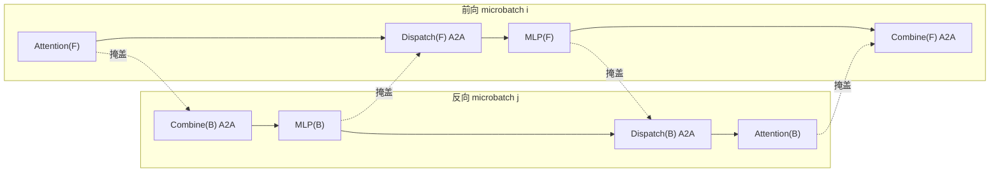

# MoE 通信掩盖（Dispatch 调度 + AllToAll/AllGather Overlap + 前反向跨 MicroBatch 掩盖）

## Summary

MoE 在 EP（专家并行）下，每个 token 经门控路由后要被送到「持有所选专家」的那张卡上算、再取回原卡——这一来一回就是 **dispatch（分发）/ combine（收集）** 两次集合通信。它在端到端耗时里占比很高，且与专家计算存在前后依赖，难以直接掩盖，是 MoE 训练 MFU 的主要瓶颈。MindSpeed 给出三档逐级加强的掩盖方案，共享同一组「permute → dispatch 通信 → 专家计算 → combine 通信 → unpermute」流水：

- **dispatcher 内部异步化**（`--moe-permutation-async-comm`）：把 permute 阶段内部串行的 repeat_interleave / gather-scatter / AllGather 拆到独立流上异步下发，与计算交叠。`alltoall` 与 `allgather` 两种 dispatcher 各有针对性优化。
- **层内通信掩盖**（`--moe-alltoall-overlap-comm` / `--moe-allgather-overlap-comm`）：把整个 MoE 层重写成一个 `autograd.Function`，前向用异步通信让专家计算掩盖 dispatch/combine，反向对计算图做子图切分实现通算并行；同 microbatch 内即可掩盖。
- **跨 microbatch 前反向掩盖**（`--moe-fb-overlap`）：用「无依赖的前向计算掩盖反向产生的 All2All、用反向计算掩盖前向 All2All」，配合 dw/dx 分离，在 1F1B 稳定阶段做到 All2All **100% 掩盖**。这是 [dualpipev](../parallelism/dualpipev.md) 稳定阶段全掩盖专家 All2All 的机制本体。

三档可独立衡量收益也彼此约束（`moe-fb-overlap` 与 `moe-alltoall-overlap-comm` 互斥，二选一）。机制承自 MindSpeed Core 的 MoE 特性模块（见 [mindspeed](../frameworks/mindspeed.md)），是 [moe-training-optim](moe_training_optim.md) 通信维度的核心抓手。

## EP 下 token 路由为何要 dispatch/combine

专家并行把不同专家分到不同卡。一个 token 选中的 topk 专家可能落在别的卡，所以一层 MoE 的数据流固定是：门控算 `routing_map` → 按目标专家把 token 重排打包（**permute**）→ 把每张卡该发的 token 发到目标卡（**dispatch 通信**）→ 各卡对收到的 token 跑本地专家（GroupedMatmul）→ 把结果发回 token 原属卡（**combine 通信**）→ 还原成原始 token 顺序（**unpermute**）。

dispatch/combine 这两次通信就是掩盖的对象。MindSpeed 把 permute/unpermute 各自再切成两半，让通信夹在中间，便于后续按细粒度排布：

- **dispatch** = `token_permute1`（本地按专家重排）→ `async_dispatch_comm`（All2All-v）→ `token_permute2`（对端收齐后再排）。
- **combine** = `token_unpermute1` → `async_combine_comm`（All2All-v 反向）→ `token_unpermute2`。

正是这个「permute1 / 通信 / permute2」结构让通信能挂到独立流、与相邻的计算块重叠。

## 两种 dispatcher：alltoall 与 allgather 的取舍

`--moe-token-dispatcher-type` 决定 dispatch/combine 用哪种集合通信，两者通信量与实现复杂度不同：

- **allgather dispatcher**：permute 阶段对 `hidden_states`、`routing_map`、`probs` 分别做 AllGather，把 EP/TP 组内**全部** token 汇到每张卡，各卡再本地挑出路由到自己专家的 token 算，combine 用 ReduceScatter 退回。优点是索引简单、无需对端 token 数；代价是**每张卡都拿到全量 token**，通信量与显存都偏大。MindSpeed 对这一支的优化是把逐元素的 gather/scatter（大量随机地址、性能差）等价替换为 index / index_put 的逐行操作，并把三路 AllGather 改成 `async=True` 异步下发（`--moe-permutation-async-comm`），实测类 DeepSeek-V2 十亿级 MoE 端到端约 +10%。

- **alltoall dispatcher**：按「每专家收多少 token」算出不等长 split，用 All2All-v 把每个 token **只**发到持有其专家的卡，通信量正比于实际路由的 token 数，大 EP 下显著小于 allgather；代价是要从 device 取回每专家 token 数（一次 device→host 同步）。MindSpeed 对这一支：把串行的 repeat_interleave 挪到新下发流并行；并把「补全切分的 H 维 AllGather + 专家计算」按专家切片做成「算第一个专家时并发通第二个专家」的通算并行（仅在未开 `--moe-grouped-gemm` 时生效，开 GMM 后专家计算被单算子合并、该项失效）。`alltoall_seq` 是其序列维变体，配 `--moe-tp-extend-ep` 可把 TP 维并进 EP。

大 EP 训练（如 DeepSeek-V3）普遍选 alltoall——通信量小，且只有它被 `--moe-fb-overlap` 支持。

## permute / unpermute 融合

permute（按专家分组）与 unpermute（还原顺序）是 dispatcher 里搬数据最重的两步，分布式下尤甚。`--moe-permute-fusion`（等价旧名 `--use-fused-moe-token-permute-and-unpermute`，推荐用前者）把这两个操作各融成一个算子，省内存又提速。使用边界：仅支持 `alltoall` / `alltoall_seq`，**不支持 allgather**；要用 `--moe-expert-capacity-factor` 须同开 `--moe-pad-expert-input-to-capacity` 才兼容；环境需 CANN 8.3.RC1 / PTA 7.2.RC1 及以上。最佳配置：alltoall 配 `--expert-tensor-parallel-size 1`，alltoall_seq 配 `--moe-tp-extend-ep`，否则部分场景开融合反而劣化。

## 层内通信掩盖：alltoall-overlap / allgather-overlap

`--moe-alltoall-overlap-comm`（对应 alltoall / alltoall_seq）和 `--moe-allgather-overlap-comm`（对应 allgather）把原生 `MoELayer` 替换为 MindSpeed 的重写版（`MoELayerOverlapAllToAll` / `MoELayerOverlapAllGather`，均为 `torch.autograd.Function`）。它在**同一个 microbatch 内**做两件事：

- **前向**：dispatch/combine 的 All2All（或 AllGather/ReduceScatter）改异步下发（独立 `COMM_STREAM`），让没有依赖的计算去填通信空窗。alltoall 支路还兼容并细化了 Megatron 的 `--moe-shared-expert-overlap`——带共享专家时自动置 `moe_shared_expert_overlap=True`，用共享专家的计算掩盖路由专家的 dispatch 通信，较原生方案再提速 4%+。
- **反向**：对计算流程做子图切分，使反向也能通算并行。

相较基准 dispatcher，开启后训练性能可提升 10%+。代价是显存占用上升（保留更多中间图用于重叠），属正常现象，可叠 [ZeroMemory](moe_training_optim.md) 回收显存。约束：与 `use_ascend_mc2`（见 [mc2](mc2.md)）互斥，需 `--moe-grouped-gemm`、`expert-model-parallel-size>1`；alltoall 支路不支持 `--moe-tp-extend-ep`（要扩 TP 进 EP 须切 `alltoall_seq` 并配 `--moe-permutation-async-comm`）。

## 跨 microbatch 前反向掩盖：fb-overlap

同 microbatch 内 dispatch 和专家计算有依赖，掩盖空间有限。`--moe-fb-overlap` 把视野扩到**两个不同 microbatch**：一个走前向、一个走反向，二者无数据依赖，于是可以拿前向的计算去盖反向的通信、反之亦然。

把单层前向按序拆成 **Attention(F) → Dispatch(F) → MLP(F) → Combine(F)**，反向拆成 **Combine(B) → MLP(B) → Dispatch(B) → Attention(B)**（Dispatch/Combine 即专家计算前后的两次 All2All）。双流交错编排后形成四对掩盖：

即 Attention(F) 盖 Combine(B)、MLP(B) 盖 Dispatch(F)、MLP(F) 盖 Dispatch(B)、Attention(B) 盖 Combine(F)。昇腾上通信由 AICPU 下发、不占 cube 计算单元，因此通信与计算并发对算力影响很低。

要在 1F1B 稳定阶段把 4 次 A2A 全盖住，关键是**分离调度专家与 Attention 反向的 dw / dx**：反向只先算决定下游能否推进的 dx，把权重梯度 dw 计算缓存进 `WeightGradStore`（`start_decouple` 置位后入队、`pop`/`pop_single` 择机执行），再用空出来的 Attention dw 计算去掩盖 PP 的 P2P 通信，从而 1F1B 阶段 A2A **100% 掩盖**。dw/dx 分离机制与 [dualpipev](../parallelism/dualpipev.md) 同源（共用 `WeightGradStore`）。

warmup / cooldown 阶段只有同 microbatch 的前向或反向，没有跨 microbatch 配对，改用**层内自掩盖**：前向用共享专家计算盖 dispatch、用路由专家 dw 盖 dispatch，反向用共享专家反向盖 combine——把这两段的 A2A 掩盖约 **50%**。

落地有两条流水载体：配 `--schedules-method dualpipev` 走 DualPipeV 双向流水；或在传统 Megatron VPP 上比原始 VPP 多做一个 warmup microbatch，实现更简单也能掩盖 A2A。非 PP（`pipeline-model-parallel-size 1`）多 microbatch 场景同样支持。在 DeepSeek-V3 上结合 DualPipeV，相比已有的 `--moe-alltoall-overlap-comm` 端到端再 **+10%**。

fb-overlap 的约束较硬（`MoEFwdBwdOverlapFeature.validate_args`）：仅 `alltoall` dispatcher（不支持 allgather / alltoall_seq）；需 `--moe-grouped-gemm`、`expert-tensor-parallel-size=1` 且 `expert-model-parallel-size>1`（不支持专家 TP）；流水只能是无 PP / VPP / DualPipeV 之一；`moe-zero-memory` 仅 `level0`；仅 Mcore（不能 `--use-legacy-models`）。与下列互斥：`moe-alltoall-overlap-comm`、`moe-hierarchical-alltoallv`、`recompute-in-advance`、`recompute-in-bubble`、`overlap-grad-reduce`（异步 DP）、`swap-attention`、`moe-tp-extend-ep`、`use-nanopipe`、`automated-pipeline`。当前在 DeepSeek-V3 验证，其它 MoE 需另行适配。

## 三档掩盖的取舍

| 档位 | 开关 | 掩盖范围 | 关键约束 |
|---|---|---|---|
| dispatcher 异步 | `--moe-permutation-async-comm` | permute 阶段内部通信异步化 | alltoall / allgather 各有优化；开 GMM 后 alltoall 的逐专家通算并行失效 |
| 层内 overlap | `--moe-alltoall-overlap-comm` / `--moe-allgather-overlap-comm` | 同 microbatch 内 dispatch/combine 与计算重叠 | 需 GMM + EP>1；增显存；与 `use_ascend_mc2` 互斥 |
| 跨 microbatch fb-overlap | `--moe-fb-overlap` | 1F1B 100% / warmup-cooldown 50% A2A 掩盖 | 仅 alltoall + EP>1 + ETP=1；流水限 VPP/DualPipeV/无 PP；与 alltoall-overlap-comm 互斥 |

共性是都靠多流异步把 dispatch/combine 通信挂到与之无依赖的计算上，本质是「用计算填通信空窗」换 MFU。掩盖力度越强，对 dispatcher 类型、流水排布、显存的要求越紧。

> 跨域对照：推理侧把整条 dispatch/combine All2All 路由链收敛为**一体化融合算子** `npu_moe_distribute_dispatch_v2` / `combine_v2`（见 [moe-dispatch-combine-v2](../../../inference/concepts/techniques/moe_dispatch_combine_v2.md)），把发送/重排/同步封进单算子降低 host 下发；训练侧则靠异步通信 + 跨 microbatch 排布把 All2All 与计算重叠。两条不同思路，同治 EP 通信瓶颈。

## Evidence

- [mindspeed](https://gitcode.com/ascend/MindSpeed) — [`docs/zh/features/megatron_moe/megatron-moe-fb-overlap.md`](https://gitcode.com/Ascend/MindSpeed/blob/1432cb092818b870c31b61db0eb6d3378b7fbdad/docs/zh/features/megatron_moe/megatron-moe-fb-overlap.md)（四阶段拆分 Attention/Dispatch/MLP/Combine 与四对掩盖、dw/dx 分离实现 1F1B A2A 100% 掩盖、warmup/cooldown 50% 层内自掩盖、DualPipeV 与 VPP 两条载体、DeepSeek-V3 + DualPipeV +10%、全部使用约束）
- [mindspeed](https://gitcode.com/ascend/MindSpeed) — [`docs/zh/features/megatron_moe/megatron-moe-alltoall-overlap-comm.md`](https://gitcode.com/Ascend/MindSpeed/blob/1432cb092818b870c31b61db0eb6d3378b7fbdad/docs/zh/features/megatron_moe/megatron-moe-alltoall-overlap-comm.md) / [`megatron-moe-allgather-overlap-comm.md`](https://gitcode.com/Ascend/MindSpeed/blob/1432cb092818b870c31b61db0eb6d3378b7fbdad/docs/zh/features/megatron_moe/megatron-moe-allgather-overlap-comm.md)（前向异步通信掩盖 + 反向子图切分通算并行、性能 +10% 及 shared-expert-overlap 再 +4%、显存增配 ZeroMemory）
- [mindspeed](https://gitcode.com/ascend/MindSpeed) — [`docs/zh/features/megatron_moe/megatron-moe-alltoall-dispatcher.md`](https://gitcode.com/Ascend/MindSpeed/blob/1432cb092818b870c31b61db0eb6d3378b7fbdad/docs/zh/features/megatron_moe/megatron-moe-alltoall-dispatcher.md)（repeat_interleave 新流并行、逐专家 AllGather+计算通算并行、开 GMM 后失效）/ [`megatron-moe-allgather-dispatcher.md`](https://gitcode.com/Ascend/MindSpeed/blob/1432cb092818b870c31b61db0eb6d3378b7fbdad/docs/zh/features/megatron_moe/megatron-moe-allgather-dispatcher.md)（gather/scatter→index/index_put 等价替换、三路 AllGather async）
- [mindspeed](https://gitcode.com/ascend/MindSpeed) — [`docs/zh/features/moe-token-permute-and-unpermute.md`](https://gitcode.com/Ascend/MindSpeed/blob/1432cb092818b870c31b61db0eb6d3378b7fbdad/docs/zh/features/moe-token-permute-and-unpermute.md)（`--moe-permute-fusion` 各融一个算子、仅 alltoall/alltoall_seq、capacity-factor 兼容性、CANN 8.3.RC1/PTA 7.2.RC1+、最佳配置）
- [`mindspeed/features_manager/moe/fb_overlap.py`](https://gitcode.com/Ascend/MindSpeed/blob/1432cb092818b870c31b61db0eb6d3378b7fbdad/mindspeed/features_manager/moe/fb_overlap.py) — `MoEFwdBwdOverlapFeature`：`--moe-fb-overlap` 注册、`validate_args` 全部互斥/依赖（alltoall-only、ETP=1 且 EMP>1、流水限 VPP/DualPipeV/无 PP）、`register_patches`（替 `get_moe_module_spec` / `TransformerBlock.__init__` / `LinearWithGradAccumulationAndAsyncCommunication.backward` / MTP 前向）
- [`mindspeed/features_manager/moe/moe_alltoall_overlap.py`](https://gitcode.com/Ascend/MindSpeed/blob/1432cb092818b870c31b61db0eb6d3378b7fbdad/mindspeed/features_manager/moe/moe_alltoall_overlap.py) / [`moe_allgather_overlap.py`](https://gitcode.com/Ascend/MindSpeed/blob/1432cb092818b870c31b61db0eb6d3378b7fbdad/mindspeed/features_manager/moe/moe_allgather_overlap.py) — `validate_args`（`use_ascend_mc2` 互斥、dispatcher 校验、GMM/EP>1、alltoall 自动开 shared-expert-overlap、alltoall_seq 需 tp-extend-ep）、`register_patches`（`MoELayer` 替换为 `MindSpeedAlltoAllOverlapMoeLayerAdaptor` / `MindSpeedAllGatherOverlapMoeLayerAdaptor`）
- [`mindspeed/core/transformer/moe/moe_feature/fb_overlap/overlap_funcs/fwdbwd.py`](https://gitcode.com/Ascend/MindSpeed/blob/1432cb092818b870c31b61db0eb6d3378b7fbdad/mindspeed/core/transformer/moe/moe_feature/fb_overlap/overlap_funcs/fwdbwd.py) — `transformer_layer_forward_moe_backward_moe_overlaping` 等四个前反向交错函数：`token_permute1`/`async_dispatch_comm`/`token_permute2`、`token_unpermute1`/`async_combine_comm`/`token_unpermute2`、`WeightGradStore.start_decouple`/`pop(experts_only=True)` dw 分离、shared expert 重叠
- [`mindspeed/core/transformer/moe/moe_feature/fb_overlap/modules/weight_grad_store.py`](https://gitcode.com/Ascend/MindSpeed/blob/1432cb092818b870c31b61db0eb6d3378b7fbdad/mindspeed/core/transformer/moe/moe_feature/fb_overlap/modules/weight_grad_store.py) — `WeightGradStore`（`is_decoupleBlock` / `start_decouple` / `flush_chunk_grad` / `pop` / `pop_single`）dw 延后队列
- [`mindspeed/core/transformer/moe/moe_feature/overlap/moe_layer_overlap_all2all.py`](https://gitcode.com/Ascend/MindSpeed/blob/1432cb092818b870c31b61db0eb6d3378b7fbdad/mindspeed/core/transformer/moe/moe_feature/overlap/moe_layer_overlap_all2all.py) / [`moe_layer_overlap_allgather.py`](https://gitcode.com/Ascend/MindSpeed/blob/1432cb092818b870c31b61db0eb6d3378b7fbdad/mindspeed/core/transformer/moe/moe_feature/overlap/moe_layer_overlap_allgather.py) — `MoELayerOverlapAllToAll` / `MoELayerOverlapAllGather`（allgather 用 `async_all_gather`×3 + `async_reduce_scatter` combine）
- [`mindspeed/core/transformer/moe/moe_feature/overlap/comm_utils.py`](https://gitcode.com/Ascend/MindSpeed/blob/1432cb092818b870c31b61db0eb6d3378b7fbdad/mindspeed/core/transformer/moe/moe_feature/overlap/comm_utils.py) — `async_all_to_all` / `_AsyncAllToAllWithBackward` / `async_all_gather` / `async_reduce_scatter`（独立 `COMM_STREAM` 异步下发、不等长 all2all-v）

## Links

- [dualpipev](../parallelism/dualpipev.md)（fb-overlap 的流水载体：DualPipeV 稳定阶段全掩盖专家 All2All 即由 `--moe-fb-overlap` 提供，共用 `WeightGradStore` dw/dx 分离）
- [moe-training-optim](moe_training_optim.md)（MoE 训练优化枢纽：通信掩盖是其通信维度抓手，与 GMM / ZeroMemory / 负载均衡并列）
- [mc2](mc2.md)（TP 域算子级通算融合，另一条通信掩盖路线；与 `--moe-alltoall-overlap-comm` 的 `use_ascend_mc2` 互斥校验直接相关）
- [mindspeed](../frameworks/mindspeed.md)（三档特性所在框架，经 features_manager patch 注入 Megatron MoE 层与调度）
- [moe-dispatch-combine-v2](../../../inference/concepts/techniques/moe_dispatch_combine_v2.md)（跨域对照：推理侧把整条 dispatch/combine All2All 收敛为一体化融合算子，与训练侧异步重叠互为对照）

<!-- cannbot:related:start -->
## 相关

- [DualPipeV（V 形双向流水 + Zero-Bubble dw 分离）](../parallelism/dualpipev.md)（`related`）：“配合 `--moe-fb-overlap`（MoE 跨 microbatch 前反向通信掩盖）可在稳定阶段全掩盖专家 All2All。”明确给出左端事实；“- **跨 microbatch 前反向掩盖**（`--moe-fb-overlap`）：用「无依赖的前向计算掩盖反向产生的 All2All、用反向计算掩盖前向 All2All」，配合 dw/dx 分离，在 1F1B 稳定阶段做到 All2All **100% 掩盖**。这是 ［dualpipev］(../parallelism/dualpipev.md) 稳定阶段全掩盖专家 All2All 的机制本体。”明确给出右端事实。DualPipeV 提供双向流水载体，MoE 通信页解释该开关如何以跨 microbatch 前反向计算和 WeightGradStore 掩盖 All2All。
- [MoE 训练优化（TP-Extend-EP / Zero-Memory / GMM 分组矩阵乘 / Shared-Experts）](moe_training_optim.md)（`related`）：依赖与边界（`MoEZeroMemoryFeature`）：必须搭 `--moe-alltoall-overlap-comm` 或 `--moe-fb-overlap`；支持 `alltoall` 与 `alltoall_seq` dispatcher；`--moe-fb-overlap` 下支持 level0 但不支持 `--moe-zero-memory-num-layers`。机制上，overlap 前向把专家计算的中间激活在用完后 `untyped_storage().resize_(0)` 直接释放、把重算所需的 `weight1 / activation_func / tokens_per_expert` 等存进 ctx，反向时按 `group_list` 重新 permute + GMM 复算出激活；level1 较 level0 多复算一段从而省得更多。跨 microbatch 前反向通信掩盖的机制本体见 ［moe-comm-overlap］(moe_comm_overlap.md)。；三档可独立衡量收益也彼此约束（`moe-fb-overlap` 与 `moe-alltoall-overlap-comm` 互斥，二选一）。机制承自 MindSpeed Core 的 MoE 特性模块（见 ［mindspeed］(../frameworks/mindspeed.md)），是 ［moe-training-optim］(moe_training_optim.md) 通信维度的核心抓手。。训练优化卡的 Zero-Memory 依赖 overlap 掩盖重算与重通信，通信卡提供对应 AllToAll 层内和跨 microbatch 调度机制。
- [单专家 alltoall-v 缺同步屏障：非阻塞 D2H 搬回的 split 尺寸未就绪即被异步集合通信消费](../../../inference/runbooks/runtime/moe_alltoallv_single_expert_missing_d2h_sync.md)（`related`）：`num_local_experts == 1` 时不需要构造 `global_input_tokens_local_experts_indices`，代码**跳过整个 `repeat_interleave`**；代价是要从 device 取回每专家 token 数（一次 device→host 同步）；前者说明单专家分支为何丢失 split 搬回的偶然屏障，后者说明 alltoall dispatcher 消费每专家 token 数时本来就跨越 device→host 控制面，二者共同定位 split 在集合通信前必须就绪。
<!-- cannbot:related:end -->
