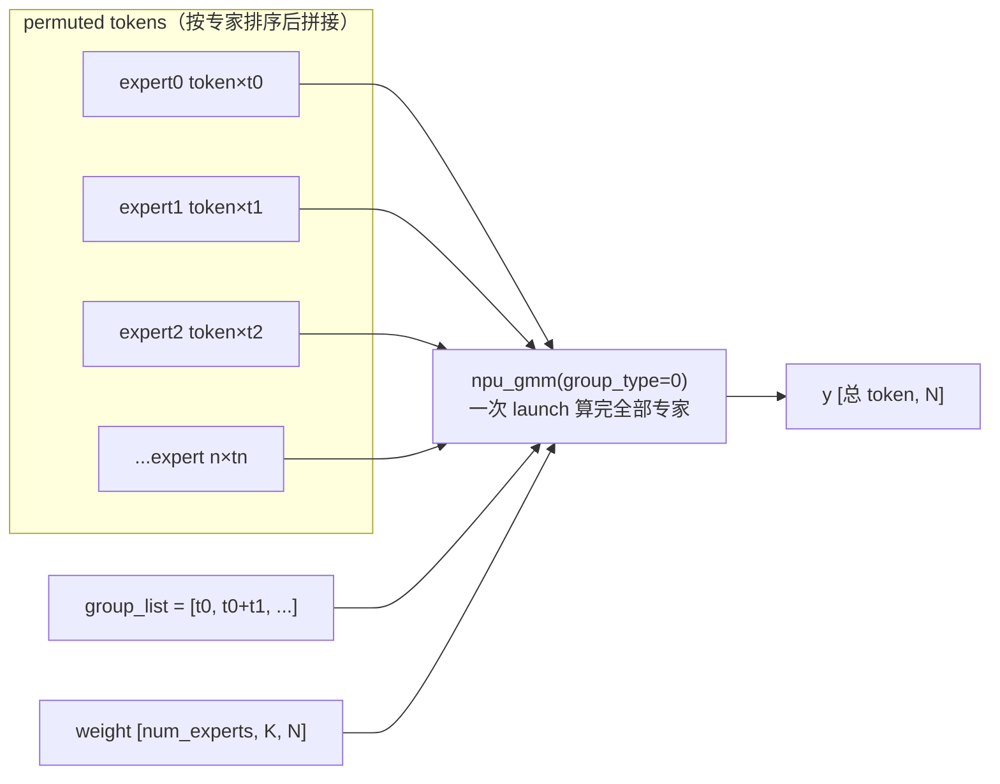

# MoE 训练优化（TP-Extend-EP / Zero-Memory / GMM 分组矩阵乘 / Shared-Experts）

## Summary

MoE 大模型训练的瓶颈集中在专家层：细粒度小专家被 TP 切分后单专家 GEMM 太小、算子效率塌方；专家计算激活随 overlap 策略放大撞内存墙；单卡多专家被拆成一串细碎 matmul、kernel launch 与 padding 开销高；路由专家之间还存在参数冗余。MindSpeed 在专家层给出四项相互配合的优化：

- **TP-Extend-EP（`--moe-tp-extend-ep`）**：专家层 TP 组不再切分专家**权重**、而是切分专家**数量**，把 TP 域并进 EP，专家 GEMM 在完整（未被 TP 切碎）的权重上跑，通信由 TP 的 AllGather/ReduceScatter 改走 EP 的 All2All；细粒度小专家场景 GMM 效率显著回升。
- **GMM 分组矩阵乘（`--moe-grouped-gemm`）**：把单卡多专家的变长 token batch 拼成一次 `npu_gmm` 融合算子，沿 token 轴按 `group_list` 分组，避免「每专家一次 matmul」的多次 launch 与 drop-and-pad 的补零浪费。
- **MoE Zero-Memory（`--moe-zero-memory level0/level1`）**：在专家计算段做细粒度重计算 + 重通信 + 针对性 swap，把专家激活做到近零冗余，且让重算/未掩盖通信被无依赖计算掩盖；省下的显存达粗粒度全 MLP 重计算可省内存的 70%+（level0）~90%+（level1），但靠计算把重算/重通信藏进时间线、速度优于全 MLP 重计算。
- **共享专家（`--moe-shared-expert-intermediate-size` / `--n-shared-experts`）**：所有 token 都过的共享专家与按门控 top-k 选择的路由专家并行计算、结果相加，沉淀共性知识、压低路由专家间的参数冗余；在 overlap 路径下共享专家计算与路由专家 All2All 重叠。

四者都接在 MindSpeed 的 features_manager 上以 patch 注入 Megatron MoE（见 [mindspeed](../frameworks/mindspeed.md)），常一起启用：TP-Extend-EP 强制依赖 GMM，Zero-Memory 依赖前反向 overlap，共享专家可借 overlap 与路由专家并行。

## TP-Extend-EP：把 TP 域并进 EP，专家 GEMM 用 EP 通信替 TP

开启 TP+EP 后，专家层默认在 TP 组内切分专家**权重张量**（每个专家的 `w1/w2` 沿隐藏维列/行并行切分）。对类 DeepSeek-V2 的**细粒度小专家**（单专家参数本就很小）这是灾难——TP 切分后每片权重小到 GMM 算子效率严重下降。

TP-Extend-EP 把思路反过来：**专家层 TP 组不切专家参数、改切专家数量**。`tp*ep` 个 rank 各自持有 `num_experts / (tp*ep)` 个**完整**专家，TP 维不再制造权重切片而是变成 EP 的延伸；专家 GEMM 因此在完整权重上跑、效率回升，专家间通信也从 TP 的 AllGather/ReduceScatter 转为 EP 风格的 All2All（仅支持 `alltoall_seq` dispatcher）。这要求 `num_experts` 能被 `tp*ep` 整除。

机制落在两处 patch（`MoETpExtendEpFeature.register_patches`）：

- 路由 `TopKRouter.routing` → `routing_tp_extend_ep`：先 `apply_z_loss`、再 `gather_from_sequence_parallel_region` 把序列并行域的 logits 聚齐、做 top-k 路由，**关键差异在路由完成后**——对 `scores` 和 `routing_map` 各做一次 `_split_along_first_dim`，沿 **token 维**把结果切给各 TP rank。于是同一份专家权重不被切，token 被切分到 TP 维上分摊，TP 真正变成「扩展的 EP」。
- 未开 `--moe-alltoall-overlap-comm` 时把 `MoELayer` 换成 `MindSpeedAlltoAllSEQTptoEpMoELayer`，按上述 token 切分组织 All2All 与专家计算。

约束与收益：必须同时开 `--moe-permutation-async-comm` 与 `--moe-grouped-gemm`（仅 Grouped MLP）；不支持 token drop-and-pad（`--moe-expert-capacity-factor` 须为 None）。在类 DeepSeek-V2 万亿参数级、细粒度小专家场景，避免 TP 切专家权重后 GMM 效率提升，整体训练性能最高提升 10% 以上。

## GMM 分组矩阵乘：多专家变长 batch 合一个算子

单卡承载多个本地专家时，朴素实现是「每专家各算一次 matmul」——专家数多则 kernel launch 细碎、且若按容量 drop-and-pad 还要给每个专家补零到固定容量。Grouped GEMM 把这串 matmul 合成一次 `npu_gmm` 融合算子：把所有专家的 token 沿 **m 轴（token 轴）首尾拼接**成一个变长 batch，用 `group_list` 记录每个专家分到多少 token，算子内部按组切换权重，一次 launch 算完全部专家、且天然容纳变长分组、免去 padding。

`npu_gmm` 接口（`mindspeed/ops/gmm.py`）：

```python
y = npu_gmm(x, weight, bias=None, group_list=None, group_type=0, gemm_fusion=False, original_weight=None)
```

- `group_type` 选分组轴（矩阵乘 `C[m,n]=A[m,k]·B[k,n]`）：`-1` 不分组、`0` m 轴、`1` n 轴、`2` k 轴；MoE 取 `group_type=0`（按 token 数分组），此时 `weight` 为 3 维 `[num_experts, K, N]`、`x`/`y` 为 2 维。反向要算 `dx/dw` 时也要求 `group_type=0`。
- `group_list` 两种语义对应两个接口：`npu_gmm` 传**累积和**（cumsum），`npu_gmm_v2` 传**每组大小**；前序算子若直接给出各组大小则用 v2 省一次 `torch.cumsum`。约束：`npu_gmm` 的 cumsum 形式须非负单调非递减，`npu_gmm_v2` 的每组大小形式只须非负（不必递增）且仅接受 tensor，两者长度都不能为 1。
- `gemm_fusion=True` 在反向累加梯度时启用 GMM+ADD 融合算子，配 `original_weight` 取 view 前权重的 `main_grad` 做梯度累加（`--gemm-gradient-accumulation-fusion`）。



接入靠 `MoEGmmFeature`：`--moe-grouped-gemm` 把 `GroupedMLP` 换成 `MindSpeedGmmExperts`、把 `MoEAlltoAllSEQTokenDispatcher.preprocess` 换成 `ascend_gmm_preprocess`（用 `routing_map.sum(dim=0)` 直接在 NPU 上算出每专家 token 数即 `group_list`）。专家前向 `GmmExpertsImpl.forward` 里 `w1` view 成 `[num_local_experts, hidden, -1]`、`gg.ops.gmm(permuted_hidden, w1, tokens_per_expert, ...)` 跑 fc1，激活后再一次 gmm 跑 fc2；本地无 token 时退化为 `torch.matmul`。支持 allgather / alltoall / alltoall_seq 三种 dispatcher。

GMM 的收益随专家「碎」的程度变化——FFN 越大、单专家计算越不细碎，收益越小甚至转负；TP 越大、EP 越小（单卡切到的计算越小），收益越大：

表一 · grok 模型不同 `ffn_hidden_size` 性能（数值越小越快）：

| ffn_hidden_size | 32768 | 16384 | 8192 | 4096 |
|---|---|---|---|---|
| baseline | 2280 | 1780 | 1537 | 1446 |
| GEMM | 2416 | 1719 | 1448 | 1331 |
| 性能提升 | -5.30% | 3.53% | 6.12% | 8.60% |

表二 · Mixtral 8×7B 不同配置性能提升：

| 配置 | tp4 ep2 16expert | tp4 ep2 8expert | tp2 ep4 16expert | tp2 ep4 8expert |
|---|---|---|---|---|
| 性能提升 | 44.06% | 17.93% | 8.39% | -2.19% |

注意：Megatron 原生不支持 `--moe-grouped-gemm` 与 `--bf16` 同开；昇腾 310 系列仅在 `group_type=0` 且 x/weight/y 均为单 tensor 时支持转置。

## MoE Zero-Memory：专家激活近零冗余

MoE 动态内存本就大，叠加 overlap 策略后动态内存进一步抬高、内存墙严重；此时若用粗粒度的普通重计算，会因粒度太粗加重重计算的性能损失。Zero-Memory 换一条更细的路：在专家计算段做**细粒度重计算 + 重通信 + 针对性 swap**，再用计算去掩盖重通信与 swap、把重计算和未掩盖通信藏进时间线，从而既省显存又不像全 MLP 重计算那样掉性能。这里的「MLP」包含**共享专家**部分；`alltoall` 分支还把 probs 重计算前移，进一步加大省内存力度。

两档强度（`--moe-zero-memory level0/level1`）：

- **level0**：在专家计算部分做重计算，性能损失较小，省下的内存约为「重计算 MLP 能省内存」的 70%+，所有层使能、不支持配置层数。
- **level1**：更大程度重计算，性能损失相对 level0 多，省内存约 90%+；可用 `--moe-zero-memory-num-layers x` 配置使能层数（`0 ≤ x ≤ num_layers // pp`，默认所有层）。

依赖与边界（`MoEZeroMemoryFeature`）：必须搭 `--moe-alltoall-overlap-comm` 或 `--moe-fb-overlap`；支持 `alltoall` 与 `alltoall_seq` dispatcher；`--moe-fb-overlap` 下支持 level0 但不支持 `--moe-zero-memory-num-layers`。机制上，overlap 前向把专家计算的中间激活在用完后 `untyped_storage().resize_(0)` 直接释放、把重算所需的 `weight1 / activation_func / tokens_per_expert` 等存进 ctx，反向时按 `group_list` 重新 permute + GMM 复算出激活；level1 较 level0 多复算一段从而省得更多。跨 microbatch 前反向通信掩盖的机制本体见 [moe-comm-overlap](moe_comm_overlap.md)。

## 共享专家：与路由专家并行计算

MoE 把专家分成两类：**路由专家**的输入要先过门控（router）选概率高的 top-k 个专家计算，**共享专家**不过门控、所有 token 都过；两者结果相加作为 MoE 模块输出。把一部分专家设为共享专家用以承接、整合不同上下文里的共性知识，从而降低路由专家之间的参数冗余、提高参数效率，让每个路由专家更专注独特方面（思路源自 DeepSeekMoE）。

参数（`MoESharedExpertsFeature`）：`--n-shared-experts [int]` 为共享专家数量（已弃用，等价折算为 `--moe-shared-expert-intermediate-size`），共享专家中间隐藏层大小与路由专家一致由 `--ffn-hidden-size` 配置；`validate_args` 把 `n_shared_experts` 折算成 `moe_shared_expert_intermediate_size = n_shared_experts * (moe_ffn_hidden_size or ffn_hidden_size)`，二者不可同时指定。需在 mcore 模式（不设 `--use-legacy-models`）。

并行计算是关键收益点：共享专家对全部 token 的计算不依赖路由结果，因此可与路由专家的 dispatch/combine All2All 在时间上重叠。overlap 路径（`shared_expert_overlap`）把共享专家的计算图单独存一份供反向用、让其与路由专家的 All2All 并行掩盖通信；带 `shared_expert_gate` 时共享专家输出再过一道 sigmoid 门控（`zero_memory_shared_expert_mlp_forward`）。Zero-Memory 也覆盖共享专家——level1 下共享专家激活同样进重算路径。

## 四项的协同与约束

| 特性 | 开关 | 强依赖 | 关键边界 |
|---|---|---|---|
| TP-Extend-EP | `--moe-tp-extend-ep` | `--moe-permutation-async-comm` + `--moe-grouped-gemm` | 仅 `alltoall_seq`；`num_experts % (tp*ep)==0`；不支持 drop-and-pad |
| GMM | `--moe-grouped-gemm` | 无（被前三者复用） | 不与 `--bf16` 同开（megatron 原生限制）；FFN 大则收益小 |
| Zero-Memory | `--moe-zero-memory level0/level1` | `--moe-alltoall-overlap-comm` 或 `--moe-fb-overlap` | fb-overlap 仅支持 level0、不支持 num-layers 配置 |
| 共享专家 | `--moe-shared-expert-intermediate-size` | mcore 模式 | `n_shared_experts` 与 intermediate-size 二选一 |

共性是都把优化压在专家层这一 MoE 训练最贵的环节：TP-Extend-EP 还专家 GEMM 一个完整权重、GMM 合多专家为一个算子、Zero-Memory 把激活换成可掩盖的重算/重通信、共享专家用并行计算与参数复用降冗余。专家负载在专家间是否均衡由路由侧的负载均衡机制决定，见 [moe-load-balance](moe_load_balance.md)。

## Evidence

- [mindspeed](https://gitcode.com/ascend/MindSpeed) — [`docs/zh/features/megatron_moe/megatron-moe-tp-extend-ep.md`](https://gitcode.com/Ascend/MindSpeed/blob/1432cb092818b870c31b61db0eb6d3378b7fbdad/docs/zh/features/megatron_moe/megatron-moe-tp-extend-ep.md)（不切专家权重改切专家数量 / 需 permutation-async-comm + grouped-gemm / `num_experts%(tp*ep)==0` / 仅 alltoall_seq、不支持 capacity-factor / DeepSeek-V2 细粒度小专家提升 10%+）、[`docs/zh/features/megatron_moe/megatron-moe-gmm.md`](https://gitcode.com/Ascend/MindSpeed/blob/1432cb092818b870c31b61db0eb6d3378b7fbdad/docs/zh/features/megatron_moe/megatron-moe-gmm.md)（多专家合一算子 / grok FFN 与 Mixtral 8×7B 收益表 / 不与 bf16 同开）、[`docs/zh/features/megatron_moe/megatron-moe-zero-memory.md`](https://gitcode.com/Ascend/MindSpeed/blob/1432cb092818b870c31b61db0eb6d3378b7fbdad/docs/zh/features/megatron_moe/megatron-moe-zero-memory.md)（level0/level1 省内存 70%+/90%+ / MLP 含共享专家 / alltoall 分支 probs 重计算前移 / fb-overlap 仅 level0）、[`docs/zh/features/shared-experts.md`](https://gitcode.com/Ascend/MindSpeed/blob/1432cb092818b870c31b61db0eb6d3378b7fbdad/docs/zh/features/shared-experts.md)（路由专家 vs 共享专家、结果相加、降参数冗余）、[`docs/zh/ops/gmm.md`](https://gitcode.com/Ascend/MindSpeed/blob/1432cb092818b870c31b61db0eb6d3378b7fbdad/docs/zh/ops/gmm.md)（npu_gmm/npu_gmm_v2 接口、group_list cumsum vs 每组大小、group_type 场景限制）
- [`mindspeed/features_manager/moe/tp_extend_ep.py`](https://gitcode.com/Ascend/MindSpeed/blob/1432cb092818b870c31b61db0eb6d3378b7fbdad/mindspeed/features_manager/moe/tp_extend_ep.py) — `MoETpExtendEpFeature`：`--moe-tp-extend-ep` / `--moe-permutation-async-comm` 注册、`validate_args` 整除与依赖校验、patch `TopKRouter.routing`→`routing_tp_extend_ep` 与 `MoELayer`→`MindSpeedAlltoAllSEQTptoEpMoELayer`
- [`mindspeed/core/transformer/moe/moe_feature/common.py`](https://gitcode.com/Ascend/MindSpeed/blob/1432cb092818b870c31b61db0eb6d3378b7fbdad/mindspeed/core/transformer/moe/moe_feature/common.py) — `routing_tp_extend_ep`（gather logits + 路由后 `_split_along_first_dim(scores/routing_map)` 沿 token 维切给 TP）、`ascend_gmm_preprocess`（`routing_map.sum(dim=0)` 算每专家 token 数）
- [`mindspeed/features_manager/moe/gmm.py`](https://gitcode.com/Ascend/MindSpeed/blob/1432cb092818b870c31b61db0eb6d3378b7fbdad/mindspeed/features_manager/moe/gmm.py) — `MoEGmmFeature`：`--gemm-gradient-accumulation-fusion`、patch `GroupedMLP`→`MindSpeedGmmExperts` 与 dispatcher `preprocess`→`ascend_gmm_preprocess`
- [`mindspeed/ops/gmm.py`](https://gitcode.com/Ascend/MindSpeed/blob/1432cb092818b870c31b61db0eb6d3378b7fbdad/mindspeed/ops/gmm.py) — `npu_gmm` / `npu_gmm_v2`、`GMMFunction`（group_list_type 0=cumsum / 1=每组大小、`gemm_fusion` 走 `npu_gmm_backward_fusion` + `npu_groupmatmul_add_fp32` 累加 `original_weight.main_grad`）
- [`mindspeed/core/transformer/moe/moe_feature/gmm/experts.py`](https://gitcode.com/Ascend/MindSpeed/blob/1432cb092818b870c31b61db0eb6d3378b7fbdad/mindspeed/core/transformer/moe/moe_feature/gmm/experts.py) — `GmmExpertsImpl.forward`：`w1` view `[num_local_experts, hidden, -1]`、`gg.ops.gmm(...)` 跑 fc1/fc2、空 token 退化 `torch.matmul`、`is_recompute_activation` 走 `CheckpointWithoutOutput`
- [`mindspeed/features_manager/moe/moe_zero_memory.py`](https://gitcode.com/Ascend/MindSpeed/blob/1432cb092818b870c31b61db0eb6d3378b7fbdad/mindspeed/features_manager/moe/moe_zero_memory.py) — `MoEZeroMemoryFeature`：`--moe-zero-memory` / `--moe-zero-memory-num-layers` 注册、`pre_validate_args`（层数 `0..num_layers//pp`、必须搭 overlap）、patch `SharedExpertMLP.forward`→`zero_memory_shared_expert_mlp_forward`
- [`mindspeed/core/transformer/moe/moe_feature/overlap/moe_layer_overlap_all2all.py`](https://gitcode.com/Ascend/MindSpeed/blob/1432cb092818b870c31b61db0eb6d3378b7fbdad/mindspeed/core/transformer/moe/moe_feature/overlap/moe_layer_overlap_all2all.py) — level1 把 `weight1/activation_func/tokens_per_expert` 存 ctx 供反向重算、`expert_output_datach.untyped_storage().resize_(0)` 释放激活、`shared_expert_overlap` 单独存共享专家计算图与路由 All2All 并行
- [`mindspeed/core/transformer/moe/moe_feature/overlap/experts.py`](https://gitcode.com/Ascend/MindSpeed/blob/1432cb092818b870c31b61db0eb6d3378b7fbdad/mindspeed/core/transformer/moe/moe_feature/overlap/experts.py) — `zero_memory_shared_expert_mlp_forward`（`MLP.forward` + 可选 `shared_expert_gate` sigmoid 门控）
- [`mindspeed/features_manager/moe/shared_expert.py`](https://gitcode.com/Ascend/MindSpeed/blob/1432cb092818b870c31b61db0eb6d3378b7fbdad/mindspeed/features_manager/moe/shared_expert.py) — `MoESharedExpertsFeature`：`--n-shared-experts` 折算 `moe_shared_expert_intermediate_size = n_shared_experts * (moe_ffn_hidden_size or ffn_hidden_size)`、二者互斥

## Links

- [moe-comm-overlap](moe_comm_overlap.md)（专家 All2All 跨 microbatch 前反向通信掩盖；Zero-Memory 依赖它做重通信/重算的掩盖，共享专家亦借其与路由 All2All 并行）
- [moe-load-balance](moe_load_balance.md)（路由侧专家负载均衡；专家层优化只让计算更快，负载是否均衡由路由决定，二者互补）
- [mindspeed](../frameworks/mindspeed.md)（四项特性所在框架；均以 features_manager patch 注入 Megatron MoE）
