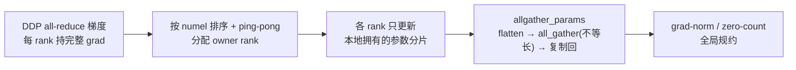

# Muon 优化器（DistMuon/FlexShard 与 MindSpeed 实现）

## Summary

Muon 对矩阵动量做 Newton–Schulz 迭代，改变更新方向；Swap/Virtual 管理状态存放，两者可以在明确支持的路径组合。当前 TorchTitan NPU 使用 DistMuon 与 AdamW 混合容器，不再使用旧单设备 MuonHybridOptimizersContainer。

## DistMuon / FlexShard

当前以 DeepSeek-V4 的 DistMuon/FlexShard 实现为准。该路径按参数匹配规则把矩阵参数交给 DistMuon，其余参数交给 AdamW；FlexShard 提供 storage-to-compute 布局和 bucket 调度。embedding、输出头、归一化与其他 1D 参数走 AdamW。

显式设置 `--optimizer.name Muon` 后，DSV4 recipe 默认 momentum=0.95、weight_decay=0.1、ns_steps=10、adjust_lr_fn=match_rms_adamw、foreach=False。两组共用 `--optimizer.lr`，没有独立 muon_lr 字段。支持范围是已验证的单机 8 卡、TP=1、PP=1 及 EP/DP-shard 路径；文档覆盖 EP=8/EP=1 storage mesh，不能由此推导 TP>1 或 PP>1。

state swap 需要在 `--override.imports` 中显式加入 `torchtitan_npu.override.common.optimizer.swap_optimizer`，不存在 swap_optimizer=true 字段。该 override 可以配合 Muon，但与 `torchtitan_npu.override.common.optimizer.virtual` 互斥。Muon momentum 首次更新时懒创建，随后按 FlexShard bucket 预取 H2D、在消费点 WAIT_DEVICE，并在对应 inbound A2A 提交后按事件依赖安排 D2H；AdamW 状态也按 bucket 管理，不能省略流间依赖。

HSDP replica dedup 默认关闭；仅启用 DistMuon 并使用 HSDP 时，可显式增加 `--optimizer.muon-enable-hsdp-replica-dedup`，由 replica 轴上的 owner 更新 momentum 并广播参数。开启 swap 后，checkpoint 支持同步和 CPU snapshot 的 async，暂不支持 async_with_pinned_mem；跨 world size 恢复及复杂拓扑下的 swap checkpoint 尚未证明。完整启动参数见本卡登记的固定 Muon 文档，950 训练视图见 [FlexMuon 矩阵布局](../../optimizations/flexmuon_matrix_layout.md)。

## 当前参数覆盖与配置

矩阵规则覆盖 attention、compressor/indexer、shared/routed experts、router、mHC 的 hc_fn/hc_head 及相应二维 ape。embedding、输出头、norm 与其他一维参数走 AdamW；不能仅凭 p.ndim==2 判断全部分流。模型的 `_dsv4_optimizer_config()` 提供 schema，`_dsv4_muon_profile()` 提供匹配、compute layout 和 bucket 元数据。

显式 `optimizer.name=Muon` 才构建 DistMuon；默认 DSV4 配置 momentum0.95、ns_steps10、weight_decay0.1、adjust_lr_fn=match_rms_adamw、foreach=False。两组共用 optimizer.lr，没有独立 muon_lr 或旧 MuonLRSchedulersContainer 配置。matrix scaling 的形状修正不能保证目标模型自动获得收敛收益，仍需核对 loss、梯度和训练评测。

HSDP replica dedup 默认关闭，仅对 DistMuon 生效；每个 FQN 在 replica 轴选择确定 owner 存 momentum 和更新，再异步广播更新后的本地参数。普通 DCP 路径沿用原配置，不需 dedup 专用保存参数。

## MindSpeed（Megatron 栈）实现

MindSpeed 使用 Megatron 的 TensorParallelMuon 和 layer-wise optimizer 路线，分布式张量、参数分流及 checkpoint 机制与 DistMuon 不同。特性以 `MuonOptimizerFeature("muon-optimizer", optimization_level=0)` 注册，对 `get_megatron_optimizer`、`_get_megatron_optimizer_based_on_param_groups`、`OptimizerConfig.__init__`、TP duplicate filter、grad-norm/zero-count、checkpoint 与 `param_and_grad_buffer` 等十余个 Megatron 入口打 patch。

### 参数分流与优化器装配

`get_megatron_optimizer_muon_wrapper` 拦截 Megatron 的优化器工厂。装配前先扫描所有 `requires_grad` 参数打标：名字含 `experts` 且非 `shared` 的参数置 `expert_tp=True`，`linear_qkv.weight` 的 2D 参数置 `is_qkv=True`。随后按 `_is_nonlinear_or_embedding` 分流 —— `is_embedding_or_output_parameter` 或 `len(shape) != 2` 的参数（embedding、输出层、bias、norm）通过 `default_param_overrides` 改走标量优化器（固定为 `adam`；该版本装配路径未读取 `muon_scalar_optimizer`，不能靠该开关切为 Lion），其余 2D 矩阵参数进入 `TensorParallelMuon`。`_get_param_groups` 把参数按 override 指纹聚成组，并跨 rank `all_gather_object` 对齐组结构以保证分布式 checkpoint 一致；最终按 `(opt_name, is_expert)` 拆成多个子优化器，**每个子优化器携带自己的 `grad_stats_parallel_group` 与 `tp_group`**（`grad_stats_parallel_group` 在 dense 取 `pg_collection.mp`、expert 取 `pg_collection.tp_ep_pp`；`tp_group` 不分 dense/expert 统一取 `pg_collection.tp`），再用 `ChainedOptimizer`（或下文的 layer-wise 容器）串起来。

非矩阵参数默认跳过 weight decay：1-D 参数与 `.bias` 走 `wd_mult=0.0` 的组；`--apply-wd-to-qk-layernorm` 则例外地对 `q_layernorm.` / `k_layernorm.` 保留 weight decay。

### Newton-Schulz 正交化与形状缩放

每步先更新动量 `momentum_buffer.lerp_(grad, 1 - momentum)`（EMA，`--muon-momentum` 默认 0.95），`--muon-nesterov` 开启时取 `grad.lerp(buffer, momentum)`，否则直接用动量缓冲作为待正交化的更新矩阵。weight decay 默认 decoupled（`param -= weight_decay · lr · param`）。

`newton_schulz` 把更新矩阵先按 Frobenius 范数归一化（`X / sqrt(ΣX²)`），再迭代逼近正交化方向。单步迭代是五次多项式

$$A = XX^\top,\qquad X \leftarrow aX + (bA + cA^2)X$$

其中系数三元组 $(a,b,c)$ 来自 `--muon-coefficient-type`（`simple` / `quintic`（默认）/ `polar_express` / `aol`；底层还接受 `custom`，但当前优化器调用链未转发必需的 `custom_coefficient_sets`，直接在 CLI 选择它会抛 ValueError），`quintic` 为 5 组系数循环、`polar_express` 跑完后重复末组；`--muon-num-ns-steps` 默认 5 步。当行数 > 列数时先转置，让 Gram 矩阵 $A$ 落在较小维度上。`--muon-fp32-matmul-prec medium`（默认）时迭代内部把矩阵转 bf16 做 matmul（NPU 上 `use_syrk` 仅作 API 兼容、实际回落 PyTorch matmul）。

正交化后乘形状缩放因子 `get_muon_scale_factor`，调整更新尺度，由 `--muon-scale-mode` 选；只有 spectral 采用绝对维度缩放，shape_scaling 不保证跨尺寸 RMS 一致：

| scale mode | 缩放因子 |
|------------|----------|
| `spectral`（默认） | $\sqrt{\max(d_\text{out},\ d_\text{in})}$ |
| `shape_scaling` | $\sqrt{\max(1,\ d_\text{out}/d_\text{in})}$ |
| `unit_rms_norm` | $\sqrt{d_\text{out}/d_\text{in}}$ |

最后乘 `--muon-extra-scale-factor`（默认 1.0），以 `param.add_(orth_grad, alpha=-lr)` 落更新。注意 MindSpeed 默认 `spectral`（$\sqrt{\max(d_\text{out},\ d_\text{in})}$）与 torchtitan-npu 默认的 `match_rms_adamw`（$0.2\sqrt{\max(A,\ B)}$，见上节）同属按绝对维度取 $\sqrt{\max}$ 的 spectral 形式，仅差一个 $0.2$ 常数与「直接复用 AdamW lr」的设计取向；MindSpeed 另有的 `shape_scaling`（$\sqrt{\max(1,\ d_\text{out}/d_\text{in})}$）才对应 torchtitan `original` 那一类按维度比缩放的取法。

### TP 分片矩阵的三种正交化模式

矩阵被 TP 切分后，`TensorParallelMuon.orthogonalize` 读参数的 `partition_dim` 还原全局矩阵语义（缩放因子按 `size[partition_dim] *= tp_size` 用全局形状算），`--muon-tp-mode` 选三种处理：

- **`blockwise`（默认）**：把 `partition_dim` 视为 `None`，各 TP rank 只对本地分片当独立矩阵正交化，无跨 TP 通信、缩放因子按本地形状算 —— 最省通信的近似。
- **`duplicated`**：`all_gather` 各 rank 分片沿 `partition_dim` 拼成完整矩阵，整体跑 Newton-Schulz，再 `chunk` 回本 rank 分片。
- **`distributed`**：不收集整权重，只在每步迭代内对 Gram 矩阵 `A` 和归一化范数做 `all_reduce`（`partition_dim` 决定是否转置），把跨 TP 通信压到小矩阵上。

这里是 TensorParallelMuon 正交化内部使用的通信组，区别于上文 wrapper 用来过滤梯度统计的 tp_group。正交化 `tp_group` 的选取按参数属性区分：`expert_tp` 参数用 `pg_collection.expt_tp`，dense 参数用 `pg_collection.tp`，避免 MoE 场景下 dense/expert 用错通信组。

### QKV 融合权重拆分

对 `is_qkv` 参数，直接对融合大矩阵正交化不符合预期。`split_qkv` 开启（默认，`--muon-no-split-qkv` 关闭）时按模型配置算出 Q/K/V 子块尺寸 `[num_attention_heads // num_query_groups · kv_channels, kv_channels, kv_channels]`，将梯度 reshape 成 `(num_query_groups, ΣQKV, ·)` 后沿 Q/K/V 维拆开，分别正交化再 `cat` 拼回原形状。

### TP 重复参数过滤与 bf16 master param 属性继承

TP 下部分参数在不同 rank 上是重复视图，统计 grad-norm / grad-clip / zero-count 必须去重。MindSpeed patch 了 `param_is_not_tensor_parallel_duplicate` 使其接受显式 `tp_group`，并在 `get_main_grads_for_grad_norm`、`count_zeros_fp32` 中用各 wrapper 自带的 `tp_group` 过滤 —— 非 TP 参数只在该 group 的 rank 0 计入。

bf16 训练会为参数创建 fp32 master param，而 `expert_tp` / `is_qkv` 是挂在原始参数上的自定义属性。`add_muon_tensor_model_parallel_attributes` 把这两个属性注册进 Megatron 的 `_MODEL_PARALLEL_ATTRIBUTE_DEFAULTS`，`copy_muon_tensor_model_parallel_attributes_wrapper` 在创建 master param 时把它们从模型参数复制到 master param，确保 step 时仍能正确识别 expert 与 QKV 参数。

### layer-wise distributed optimizer（ZeRO 路径）

Muon 与 `--use-distributed-optimizer` 同用时，会把 `use_distributed_optimizer` 关掉、改置 `use_layer_wise_distributed_optimizer=True`，走 `LayerWiseDistributedOptimizer`（早期 `--optimizer dist_muon` 别名已废弃，等价于二者同开）。它不按 Megatron 原生 distributed optimizer 的连续 buffer 切分，而是**按完整参数分配 owner rank**：

1. 所有参数按 numel 排序，在 DP / EP-DP rank 间以 ping-pong（`range(n)+reversed(range(n))`）方式分配 owner，平衡各 rank 参数量；
2. 每个 rank 的本地优化器只保留自己负责的参数（其余组置空）；
3. 梯度仍由 DDP all-reduce，每个 rank 持有完整梯度；
4. step 只更新本地分片，随后 `allgather_params` 把各 rank 更新后的参数 flatten → `torch.distributed.all_gather`（直接收集不等长 flat tensor，靠 NCCL 分组 send/recv）→ unflatten → 复制回模型参数；
5. grad-norm / zero-count 一律 `grad_stats_parallel_group=None` 全局规约。

`--overlap-param-gather`（需同开 `--overlap-grad-reduce`）把 step 后的 all-gather 延迟到 DDP forward pre-hook：`set_bucket_layerwise_params_list` 把各 rank 拥有的参数映射到 DDP bucket，由 bucket 触发异步 gather，减少参数同步对训练 step 的阻塞。torch 格式 checkpoint 下，layer-wise 优化器按 DP rank 额外存 `layer_wise_optimizer_{dp_rank}.pt`，恢复时各 rank 加载自己那份，避免只用主 checkpoint 中单个 DP rank 的优化器状态；torch_dist 格式则在 `sharded_state_dict` 中把 `replica_id` 的 DP 维归 0、用非空 rank 补齐空组的元数据。该 torch_dist 路径只适用于固定 DP 规模，不能据此推导支持改变 DP 规模恢复。

### MindSpeed 的适用限制

MindSpeed 侧限制：不支持 fp16（`validate_args` 直接抛 `AssertionError`，请用 bf16/fp32）；不支持与 MindSpeed 自定义 FSDP 或 torch FSDP2 同用；`--overlap-param-gather` 必须同时开 `--use-distributed-optimizer`（layer-wise 路径）与 `--overlap-grad-reduce`；当前路径不支持 `--overlap-param-gather-with-optimizer-step`（开启会被 warning 并关闭）；标量参数装配固定走 Adam，安装 Lion 依赖不会改变此分流。

## Evidence

- [muon_optimizer.md](../../../../../cann-recipes-raw/torchtitan-npu/8a71d8940e877cc9f2e5f4b977b4f18d48539592/docs/feature_guides/muon_optimizer.md)（primary）
- [optimizer.py](../../../../../cann-recipes-raw/torchtitan-npu/8a71d8940e877cc9f2e5f4b977b4f18d48539592/torchtitan_npu/override/common/optimizer.py)（implementation）
- [config_registry.py](../../../../../cann-recipes-raw/torchtitan-npu/8a71d8940e877cc9f2e5f4b977b4f18d48539592/torchtitan_npu/models/deepseek_v4/config_registry.py)（implementation）
- [flexmuon.md](../../../../../cann-recipes-raw/cann-recipes-train/532c60c5a3fd8ac84c207ab29be241a88b6eb6ba/docs/llm_pretrain/ascend950/flexmuon.md)（implementation）
- [emerging_optimizers.py](../../../../../cann-recipes-raw/mindspeed/c5a72765f99fd8470362c7afdc2cdffe0ab5aea6/mindspeed/core/optimizer/muon/emerging_optimizers.py)（implementation）
- [muon_utils.py](../../../../../cann-recipes-raw/mindspeed/c5a72765f99fd8470362c7afdc2cdffe0ab5aea6/mindspeed/core/optimizer/muon/muon_utils.py)（implementation）
- [layer_wise_optimizer.py](../../../../../cann-recipes-raw/mindspeed/c5a72765f99fd8470362c7afdc2cdffe0ab5aea6/mindspeed/core/optimizer/muon/layer_wise_optimizer.py)（implementation）

## Links

- [Swap Optimizer](swap_optimizer.md)
- [Virtual Optimizer](virtual_optimizer.md)
- [FlexMuon 矩阵布局](../../optimizations/flexmuon_matrix_layout.md)
- [DeepSeek V4 训练](../../guides/recipes/deepseek_v4_continue_pretrain.md)
