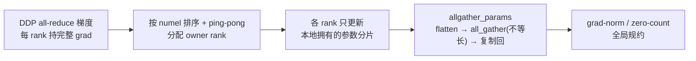

# Muon 优化器（torchtitan-npu 混合优化器）

Muon 是 torchtitan-npu 为大规模 LLM 训练提供的**计算侧**优化器特性：对 2D 矩阵参数（Linear 权重）做**动量正交化**（Momentum Orthogonalization，经 Newton-Schulz 迭代），获得比 Adam/AdamW 更快/更稳的收敛，而非内存侧的卸载技术。它与 [swap-optimizer](swap_optimizer.md) / [virtual-optimizer](virtual_optimizer.md) 不同 —— 后两者是把优化器状态/梯度搬到 Host 或缩减常驻显存（省内存），Muon 改的是**梯度更新方向本身**（改收敛，不省显存）。

> 机制区分：Muon = compute（正交化动量改变更新方向）；Swap / Virtual = memory（优化器状态/梯度 offload 或裁剪显存）。三者解决不同问题，但 Muon 当前**与 Swap Optimizer 互斥**（见限制）。

## 核心思想

传统 Adam/AdamW 把每个参数视为独立一维标量更新，忽略了 Linear 层权重的矩阵结构。Muon 在每步更新时对动量做**正交化**（通过 Newton-Schulz 迭代逼近，迭代步数由 `muon_ns_steps` 控制，默认 5），让矩阵参数的更新方向更接近正交基，从而在不同形状矩阵上获得一致的 RMS 量级更新。

## 混合参数分配（Muon + AdamW）

torchtitan-npu 采用 **Muon + AdamW 混合**策略，由 `MuonHybridOptimizersContainer` 统一管理两个子优化器（`optimizers = [muon, adamw]`）：

- **2D 参数**（Linear 权重矩阵）→ `torch.optim.Muon`
- **非 2D 参数**（bias / LayerNorm / Embedding 等）→ `torch.optim.AdamW`

判定逻辑见 `_should_use_muon`：参数须 `p.ndim == 2`，且名字**不**包含排除关键词 `_MUON_EXCLUDED_KEYWORDS = ("embed", "lm_head", "output")` —— 即 embedding、lm_head、输出层即便是 2D 也归 AdamW。`_split_parameters_for_muon` 跨所有 `model_parts` 遍历 `named_parameters()` 分流，并日志打印两组参数名与数量。

> 与上游 `OptimizersContainer` 的差异：上游是 `model_parts[i] ↔ optimizers[i]` 一一配对；本容器是**每个子优化器管理来自全部 model_parts 的参数子集**，`state_dict` / `load_state_dict` 用双层循环遍历，DCP API 自动过滤到各优化器实际管理的参数。

## 两种学习率调整模式（`muon_adjust_lr_fn`）

正交化后的更新需按矩阵形状（两维 $A$、$B$）调学习率，使不同形状矩阵的更新 RMS 一致。两模式核心区别在调整幅度与是否需独立调参：

| 模式 | 调整公式 | LR / 调度器 |
|------|----------|-------------|
| `original` | $\gamma \leftarrow \gamma \cdot \sqrt{\max(1,\ A/B)}$ | 需独立 `muon_lr`（约为 AdamW lr 的 10×）+ `MuonLRSchedulersContainer` |
| `match_rms_adamw` | $\gamma \leftarrow 0.2 \cdot \gamma \cdot \sqrt{\max(A,\ B)}$ | 复用 AdamW 的 lr / weight_decay + 标准 `LRSchedulersContainer` |

- **`original`**（Keller Jordan 原始实现）：宽矩阵（$A \le B$）系数取 1 不额外调整，高矩阵（$A > B$）按 $\sqrt{A/B}$ 缩放。调整幅度大，通常需单独为 Muon 调 lr（实践可取 AdamW lr 的 ~10 倍），故 Muon 与 AdamW 用**不同 base_lr**，必须配 `MuonLRSchedulersContainer`。
- **`match_rms_adamw`**（Moonshot 团队，论文 [Muon is Scalable for LLM Training](https://arxiv.org/pdf/2502.16982) / arXiv:2502.16982）：调整后 lr 与 AdamW 同量级，可**直接复用为 AdamW 调好的 lr / weight_decay**，无需额外搜参，Muon 与 AdamW 共享 base_lr，用标准 `LRSchedulersContainer` 即可。

代码侧 `_get_muon_lr_config`：当 `muon_adjust_lr_fn == "match_rms_adamw"` 且仍设了 `muon_lr` 时会 warning 并忽略 `muon_lr`、回退到 base lr。

## 配置选项

推荐在模型 `config_registry.py` 中使用 `MuonHybridOptimizersContainer.Config`（来源 `torchtitan_npu.patches.optimizer.muon_optimizer`）：

| 配置项 | 类型 | 默认值 | 说明 |
|--------|------|--------|------|
| `name` | str | "AdamW" | 设为 `"Muon"` 启用本特性（`Config.build` 校验 name 必须为 `"Muon"`） |
| `muon_lr` | float | None | Muon 专用 lr；不设则用 base lr（`match_rms_adamw` 下被忽略） |
| `muon_momentum` | float | 0.9 | Muon 动量因子 |
| `muon_enable_nesterov` | bool | false | 是否启用 Nesterov 动量 |
| `muon_ns_steps` | int | 5 | Newton-Schulz 正交化迭代步数 |
| `muon_adjust_lr_fn` | str | "match_rms_adamw" | lr 调整模式：`"original"` 或 `"match_rms_adamw"` |

```python
from torchtitan_npu.patches.optimizer.muon_optimizer import (
    MuonHybridOptimizersContainer,
    MuonLRSchedulersContainer,
)

optimizer = MuonHybridOptimizersContainer.Config(
    name="Muon",
    lr=3e-4,
    muon_lr=1e-3,
    weight_decay=0.01,
    muon_momentum=0.9,
    muon_enable_nesterov=False,
    muon_ns_steps=5,
    muon_adjust_lr_fn="original",
)
lr_scheduler = MuonLRSchedulersContainer.Config(
    warmup_steps=2000,
    decay_ratio=0.8,
    decay_type="cosine",
)
```

命令行可覆盖同名字段：

```bash
bash scripts/run_train.sh \
  --optimizer.name Muon \
  --optimizer.muon_adjust_lr_fn original
```

## 限制

1. **仅单设备**：`MuonHybridOptimizersContainer.__init__` 校验 `world_size`，`world_size > 1` 直接抛 `NotImplementedError("Muon optimizer currently only support single device")`，不支持多卡分布式。
2. **与 Swap Optimizer 互斥**：不能与 [swap-optimizer](swap_optimizer.md) 同时启用。

```python
is_distributed = torch.distributed.is_initialized()
world_size = torch.distributed.get_world_size() if is_distributed else 1
if world_size > 1:
    raise NotImplementedError("Muon optimizer currently only support single device")
```

## MindSpeed（Megatron 栈）实现

torchtitan-npu 的 Muon 只跑单设备，[mindspeed](../frameworks/mindspeed.md) 把同一套算法（2D 矩阵参数走 Newton-Schulz 正交化、非矩阵参数走标量优化器）作为 feature patch 反向移植到 Megatron 0.12.x，`--optimizer muon` 触发，跑在完整的 TP / EP / PP + 分布式优化器栈上。它与 [swap-optimizer](swap_optimizer.md) / [virtual-optimizer](virtual_optimizer.md) 这类内存侧优化器解决的问题不同 —— Muon 改的是矩阵参数的更新方向，分布式工程量集中在「TP 分片矩阵怎么正交化、dense/expert 用哪个通信组、QKV 融合权重怎么拆、bf16 master param 属性怎么继承、ZeRO 分片下谁更新哪块参数」这五件事。特性以 `MuonOptimizerFeature("muon-optimizer", optimization_level=0)` 注册，对 `get_megatron_optimizer`、`_get_megatron_optimizer_based_on_param_groups`、`OptimizerConfig.__init__`、TP duplicate filter、grad-norm/zero-count、checkpoint 与 `param_and_grad_buffer` 等十余个 Megatron 入口打 patch。

### 参数分流与优化器装配

`get_megatron_optimizer_muon_wrapper` 拦截 Megatron 的优化器工厂。装配前先扫描所有 `requires_grad` 参数打标：名字含 `experts` 且非 `shared` 的参数置 `expert_tp=True`，`linear_qkv.weight` 的 2D 参数置 `is_qkv=True`。随后按 `_is_nonlinear_or_embedding` 分流 —— `is_embedding_or_output_parameter` 或 `len(shape) != 2` 的参数（embedding、输出层、bias、norm）通过 `default_param_overrides` 改走标量优化器（默认 `adam`，可 `--muon-scalar-optimizer lion`），其余 2D 矩阵参数进入 `TensorParallelMuon`。`_get_param_groups` 把参数按 override 指纹聚成组，并跨 rank `all_gather_object` 对齐组结构以保证分布式 checkpoint 一致；最终按 `(opt_name, is_expert)` 拆成多个子优化器，**每个子优化器携带自己的 `grad_stats_parallel_group` 与 `tp_group`**（`grad_stats_parallel_group` 在 dense 取 `pg_collection.mp`、expert 取 `pg_collection.tp_ep_pp`；`tp_group` 不分 dense/expert 统一取 `pg_collection.tp`），再用 `ChainedOptimizer`（或下文的 layer-wise 容器）串起来。

非矩阵参数默认跳过 weight decay：1-D 参数与 `.bias` 走 `wd_mult=0.0` 的组；`--apply-wd-to-qk-layernorm` 则例外地对 `q_layernorm.` / `k_layernorm.` 保留 weight decay。

### Newton-Schulz 正交化与形状缩放

每步先更新动量 `momentum_buffer.lerp_(grad, 1 - momentum)`（EMA，`--muon-momentum` 默认 0.95），`--muon-nesterov` 开启时取 `grad.lerp(buffer, momentum)`，否则直接用动量缓冲作为待正交化的更新矩阵。weight decay 默认 decoupled（`param -= weight_decay · lr · param`）。

`newton_schulz` 把更新矩阵先按 Frobenius 范数归一化（`X / sqrt(ΣX²)`），再迭代逼近正交化方向。单步迭代是五次多项式

$$A = XX^\top,\qquad X \leftarrow aX + (bA + cA^2)X$$

其中系数三元组 $(a,b,c)$ 来自 `--muon-coefficient-type`（`simple` / `quintic`（默认）/ `polar_express` / `aol` / `custom`），`quintic` 为 5 组系数循环、`polar_express` 跑完后重复末组；`--muon-num-ns-steps` 默认 5 步。当行数 > 列数时先转置，让 Gram 矩阵 $A$ 落在较小维度上。`--muon-fp32-matmul-prec medium`（默认）时迭代内部把矩阵转 bf16 做 matmul（NPU 上 `use_syrk` 仅作 API 兼容、实际回落 PyTorch matmul）。

正交化后乘形状缩放因子 `get_muon_scale_factor`，使不同形状矩阵的更新 RMS 量级一致，由 `--muon-scale-mode` 选：

| scale mode | 缩放因子 |
|------------|----------|
| `spectral`（默认） | $\sqrt{\max(d_\text{out},\ d_\text{in})}$ |
| `shape_scaling` | $\sqrt{\max(1,\ d_\text{out}/d_\text{in})}$ |
| `unit_rms_norm` | $\sqrt{d_\text{out}/d_\text{in}}$ |

最后乘 `--muon-extra-scale-factor`（默认 1.0），以 `param.add_(orth_grad, alpha=-lr)` 落更新。注意 MindSpeed 默认 `spectral`（$\sqrt{\max(d_\text{out},\ d_\text{in})}$）与 torchtitan-npu 默认的 `match_rms_adamw`（$0.2\sqrt{\max(A,\ B)}$，见上节）同属按绝对维度取 $\sqrt{\max}$ 的 spectral 形式，仅差一个 $0.2$ 常数与「直接复用 AdamW lr」的设计取向；MindSpeed 另有的 `shape_scaling`（$\sqrt{\max(1,\ d_\text{out}/d_\text{in})}$）才对应 torchtitan `original` 那一类按维度比缩放的取法。

### TP 分片矩阵的三种正交化模式

矩阵被 TP 切分后，`TensorParallelMuon.orthogonalize` 读参数的 `partition_dim` 还原全局矩阵语义（缩放因子按 `size[partition_dim] *= tp_size` 用全局形状算），`--muon-tp-mode` 选三种处理：

- **`blockwise`（默认）**：把 `partition_dim` 视为 `None`，各 TP rank 只对本地分片当独立矩阵正交化，无跨 TP 通信、缩放因子按本地形状算 —— 最省通信的近似。
- **`duplicated`**：`all_gather` 各 rank 分片沿 `partition_dim` 拼成完整矩阵，整体跑 Newton-Schulz，再 `chunk` 回本 rank 分片。
- **`distributed`**：不收集整权重，只在每步迭代内对 Gram 矩阵 `A` 和归一化范数做 `all_reduce`（`partition_dim` 决定是否转置），把跨 TP 通信压到小矩阵上。

`tp_group` 的选取按参数属性区分：`expert_tp` 参数用 `pg_collection.expt_tp`，dense 参数用 `pg_collection.tp`，避免 MoE 场景下 dense/expert 用错通信组。

### QKV 融合权重拆分

对 `is_qkv` 参数，直接对融合大矩阵正交化不符合预期。`split_qkv` 开启（默认，`--muon-no-split-qkv` 关闭）时按模型配置算出 Q/K/V 子块尺寸 `[num_attention_heads // num_query_groups · kv_channels, kv_channels, kv_channels]`，将梯度 reshape 成 `(num_query_groups, ΣQKV, ·)` 后沿 Q/K/V 维拆开，分别正交化再 `cat` 拼回原形状。

### TP 重复参数过滤与 bf16 master param 属性继承

TP 下部分参数在不同 rank 上是重复视图，统计 grad-norm / grad-clip / zero-count 必须去重。MindSpeed patch 了 `param_is_not_tensor_parallel_duplicate` 使其接受显式 `tp_group`，并在 `get_main_grads_for_grad_norm`、`count_zeros_fp32` 中用各 wrapper 自带的 `tp_group` 过滤 —— 非 TP 参数只在该 group 的 rank 0 计入。

bf16 训练会为参数创建 fp32 master param，而 `expert_tp` / `is_qkv` 是挂在原始参数上的自定义属性。`add_muon_tensor_model_parallel_attributes` 把这两个属性注册进 Megatron 的 `_MODEL_PARALLEL_ATTRIBUTE_DEFAULTS`，`copy_muon_tensor_model_parallel_attributes_wrapper` 在创建 master param 时把它们从模型参数复制到 master param，确保 step 时仍能正确识别 expert 与 QKV 参数。

### layer-wise distributed optimizer（ZeRO 路径）

Muon 与 `--use-distributed-optimizer` 同用时，会把 `use_distributed_optimizer` 关掉、改置 `use_layer_wise_distributed_optimizer=True`，走 `LayerWiseDistributedOptimizer`（早期 `--optimizer dist_muon` 别名已废弃，等价于二者同开）。它不按 Megatron 原生 distributed optimizer 的连续 buffer 切分，而是**按完整参数分配 owner rank**：

1. 所有参数按 numel 排序，在 DP / EP-DP rank 间以 ping-pong（`range(n)+reversed(range(n))`）方式分配 owner，平衡各 rank 参数量；
2. 每个 rank 的本地优化器只保留自己负责的参数（其余组置空）；
3. 梯度仍由 DDP all-reduce，每个 rank 持有完整梯度；
4. step 只更新本地分片，随后 `allgather_params` 把各 rank 更新后的参数 flatten → `torch.distributed.all_gather`（直接收集不等长 flat tensor，靠 NCCL 分组 send/recv）→ unflatten → 复制回模型参数；
5. grad-norm / zero-count 一律 `grad_stats_parallel_group=None` 全局规约。



`--overlap-param-gather`（需同开 `--overlap-grad-reduce`）把 step 后的 all-gather 延迟到 DDP forward pre-hook：`set_bucket_layerwise_params_list` 把各 rank 拥有的参数映射到 DDP bucket，由 bucket 触发异步 gather，减少参数同步对训练 step 的阻塞。torch 格式 checkpoint 下，layer-wise 优化器按 DP rank 额外存 `layer_wise_optimizer_{dp_rank}.pt`，恢复时各 rank 加载自己那份，避免只用主 checkpoint 中单个 DP rank 的优化器状态；torch_dist 格式则在 `sharded_state_dict` 中把 `replica_id` 的 DP 维归 0、用非空 rank 补齐空组的元数据。

### 与 torchtitan-npu 实现的对照及限制

| 维度 | torchtitan-npu | MindSpeed（Megatron） |
|------|----------------|------------------------|
| 部署规模 | 仅单设备（`world_size>1` 抛错） | TP / EP / PP + layer-wise ZeRO 分布式 |
| 权重表示 | FSDP2 / TP 下的 DTensor，经 `unwrap_dtensor` | Megatron TP 分片张量，`partition_dim` 还原全局形状 |
| 非矩阵参数 | AdamW | Adam（默认）/ Lion |
| 默认 scale 模式 | `match_rms_adamw`（复用 AdamW lr） | `spectral`（`sqrt(max(out,in))`） |
| 精度 | — | 仅 bf16 / fp32，不支持 fp16 |

MindSpeed 侧限制：不支持 fp16（`validate_args` 直接抛 `AssertionError`，请用 bf16/fp32）；不支持与 MindSpeed 自定义 FSDP 或 torch FSDP2 同用；`--overlap-param-gather` 必须同时开 `--use-distributed-optimizer`（layer-wise 路径）与 `--overlap-grad-reduce`；当前路径不支持 `--overlap-param-gather-with-optimizer-step`（开启会被 warning 并关闭）；`--muon-scalar-optimizer lion` 需额外提供 `emerging_optimizers` 包的 Lion 实现。

## 在 recipe 中的应用

[DeepSeek-V4 续训练](../../guides/recipes/deepseek_v4_continue_pretrain.md)所依据的上游优化文档将集成 Muon 列为未来工作；其已展示的 V4 续训配置未启用 Muon，受上述 torchtitan-npu 实现的单设备限制制约。

## Evidence

- [torchtitan-npu](https://gitcode.com/cann/torchtitan-npu) — 实现源（@8f128cd）：[`torchtitan_npu/patches/optimizer/muon_optimizer.py`](https://gitcode.com/cann/torchtitan-npu/blob/8f128cd177e9c9a14d9b70f4491bde28bc342481/torchtitan_npu/patches/optimizer/muon_optimizer.py)（`MuonHybridOptimizersContainer` / `MuonLRSchedulersContainer` / `_should_use_muon` / `_split_parameters_for_muon` / `_get_muon_lr_config`）
- 上游算子：[PyTorch Muon 官方文档](https://docs.pytorch.org/docs/stable/generated/torch.optim.Muon.html)（`torch.optim.Muon`）
- 论文：[Muon is Scalable for LLM Training (arXiv:2502.16982)](https://arxiv.org/pdf/2502.16982)（`match_rms_adamw` lr 调整模式来源）
- [mindspeed](https://gitcode.com/ascend/MindSpeed) — MindSpeed 实现源（@1432cb0）：
  - 特性文档 [`docs/zh/features/muon-optimizer.md`](https://gitcode.com/Ascend/MindSpeed/blob/1432cb092818b870c31b61db0eb6d3378b7fbdad/docs/zh/features/muon-optimizer.md)（TP/MoE/ZeRO 挑战与方案、参数表）
  - 特性门 [`mindspeed/features_manager/optimizer/muon_optimizer_feature.py`](https://gitcode.com/Ascend/MindSpeed/blob/1432cb092818b870c31b61db0eb6d3378b7fbdad/mindspeed/features_manager/optimizer/muon_optimizer_feature.py)（`MuonOptimizerFeature`：CLI 注册、`validate_args` 限制、十余处 `register_patch`）
  - 装配入口 [`mindspeed/core/optimizer/muon/adaptor.py`](https://gitcode.com/Ascend/MindSpeed/blob/1432cb092818b870c31b61db0eb6d3378b7fbdad/mindspeed/core/optimizer/muon/adaptor.py)（`get_megatron_optimizer_muon_wrapper`、`_get_megatron_emerging_optimizer`、`expert_tp`/`is_qkv` 打标、`param_is_not_tensor_parallel_duplicate`、`count_zeros_fp32`、`copy_muon_tensor_model_parallel_attributes_wrapper`）
  - Muon 优化器 [`mindspeed/core/optimizer/muon/emerging_optimizers.py`](https://gitcode.com/Ascend/MindSpeed/blob/1432cb092818b870c31b61db0eb6d3378b7fbdad/mindspeed/core/optimizer/muon/emerging_optimizers.py)（`TensorParallelMuon`：三种 tp_mode、QKV split、`_is_nonlinear_or_embedding` 标量分流）与基类 [`orthogonalized_optimizer.py`](https://gitcode.com/Ascend/MindSpeed/blob/1432cb092818b870c31b61db0eb6d3378b7fbdad/mindspeed/core/optimizer/muon/orthogonalized_optimizer.py)（`OrthogonalizedOptimizer.step`、动量/weight-decay）
  - Newton-Schulz [`mindspeed/core/optimizer/muon/muon_utils.py`](https://gitcode.com/Ascend/MindSpeed/blob/1432cb092818b870c31b61db0eb6d3378b7fbdad/mindspeed/core/optimizer/muon/muon_utils.py)（`newton_schulz` / `newton_schulz_tp` / `get_muon_scale_factor` / 系数表 `_COEFFICIENT_SETS`）
  - ZeRO 路径 [`mindspeed/core/optimizer/muon/layer_wise_optimizer.py`](https://gitcode.com/Ascend/MindSpeed/blob/1432cb092818b870c31b61db0eb6d3378b7fbdad/mindspeed/core/optimizer/muon/layer_wise_optimizer.py)（`LayerWiseDistributedOptimizer`：`shard_params` ping-pong、`allgather_params`、`sharded_state_dict`）、bucket 重叠 [`param_and_grad_buffer.py`](https://gitcode.com/Ascend/MindSpeed/blob/1432cb092818b870c31b61db0eb6d3378b7fbdad/mindspeed/core/optimizer/muon/param_and_grad_buffer.py)、torch checkpoint [`checkpointing.py`](https://gitcode.com/Ascend/MindSpeed/blob/1432cb092818b870c31b61db0eb6d3378b7fbdad/mindspeed/core/optimizer/muon/checkpointing.py)

## Links

- [torchtitan](../frameworks/torchtitan.md)（torchtitan-npu 优化器容器体系）
- [mindspeed](../frameworks/mindspeed.md)（Megatron 栈侧 Muon 实现所在框架，TP/EP/ZeRO 分布式适配）
- [swap-optimizer](swap_optimizer.md)（内存侧优化器对照，机制不同；Muon 与其互斥）
- [virtual-optimizer](virtual_optimizer.md)（内存侧优化器对照，机制不同）
- [deepseek-v4-continue-pretrain](../../guides/recipes/deepseek_v4_continue_pretrain.md)（应用 recipe）