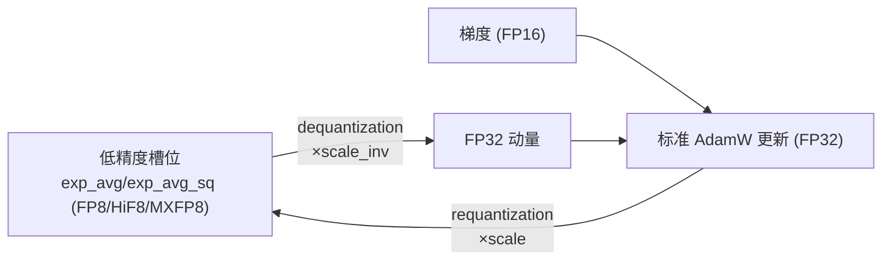

# 优化器显存优化（Reuse-FP32-Param / 低精度优化器 / LayerZeRO）

## Summary

混合精度训练的静态显存大头在优化器一侧：FP32 参数副本（master weight）、FP32 梯度、Adam 一二阶动量。MindSpeed 提供三条正交的优化器显存压缩路线，分别从「副本冗余」「精度冗余」「分片维度」三个角度切入——**Reuse-FP32-Param** 让 FP32 master 与 BF16 工作权重共享同一份 storage，省掉一份权重副本；**低精度优化器**把动量量化到 FP8/HiF8/MXFP8、梯度量化到 FP16，压缩动量与梯度的字节数；**LayerZeRO** 用「ZeRO1 存优化器状态 + ZeRO3 重建参数」的分层分片，在多模态长序列场景拿到接近 TP+ZeRO1 的省显存效果且通信可隐藏。三者与 [swap-optimizer](swap_optimizer.md)（把动量换出 Host）、[virtual-optimizer](virtual_optimizer.md)（驱动级虚拟内存映射）一起构成 [mindspeed](../frameworks/mindspeed.md) 的优化器显存工具箱，各自有适用面与互斥约束。

## Reuse-FP32-Param：FP32 master 与 BF16 工作权重共享存储

BF16 混合精度训练里前反向用 BF16 计算权重、参数更新用 FP32 master 副本，两者数值一一对应、生命周期不重叠，却各占一份内存（BF16 2 字节 + FP32 4 字节 = 6 字节/参数）。Reuse-FP32-Param 观察到 FP32 的高 16 位恰好就是对应的 BF16，低 16 位是残差（Residual），于是把这两份合并到 FP32 那 4 字节里：

```
FP32 = BF16(高16位) + Residual(低16位)
```

实现把 FP32 master 的底层 storage 同时重解释为三种视图（`init_and_reuse_storage_of_tensors`，用 `AlgorithmOpBuilder().load().reuse_data_ptr` 让多个 tensor 复用同一指针、零拷贝）：一个 2×numel 长的 BF16 视图、一个 numel 长（与 FP32 等长）的 INT32 视图，再从 BF16 视图切出 `res_tensor`（残差块）与 `bf16_tensor`（工作权重块）。两个转换原语在这块共享 storage 上原地重排字节：

- **前向前** `fp32_tensors_to_bf16_tensors`：把交错排布的 `0p0p0p0p` 重排成 `bf16(pppp) + res(0000)`——通过 `view(-1, 2).transpose(1, 0).reshape` 把高半字（BF16）与低半字（残差）分离，让 BF16 工作权重连续可用。
- **优化器更新前** `bf16_tensors_to_fp32_tensors`：逆向重排 `view(2, -1).transpose` 把 BF16 与残差重新交错，**精确恢复**原 FP32 master 后再更新。

关键的舍入正确性靠一个魔法常量 `TRANSPOSE_BF16_BIT = 32768`（即 `0x8000`）：在 INT32 视图上 `add_(0x8000)` / `sub_(0x8000)` 等价于在截断成 BF16 时做 IEEE-754 向偶数舍入（round-to-nearest-even），保证转换不引入额外误差。`*_deterministic` 变体进一步用 `odd_even_tensor = ((int32_tensor & 131071) == TRANSPOSE_BF16_BIT)` 把被舍入丢弃的进位位编码进优化器 `exp_avg_sq` 的符号位（`optimizer_exp_avg_save_sign` 存、更新前 `optimizer_exp_avg_load_sign` 取回；二阶动量恒非负，符号位空闲可借用），实现 BF16↔FP32 往返的**比特级可复现**。

**收益**：对 `Float16OptimizerWithFloat16Params` 整体省 `sizeof(bf16) × 模型参数量` 的静态显存；开启分布式优化器时 master 已按 DP 切分，省 `sizeof(bf16) × 参数量 / DP`。两种情形实测性能损耗均 < 1%。

**约束**（`ReuseFP32Param.validate_args`）：依赖 `--bf16`，与 `enable_zero3` 互斥；legacy 模型下不能与 `--overlap-param-gather` 同开；不支持 `fused_ema_adamw` 优化器；断点续训不可改变切分方式与卡数。启用开关 `--reuse-fp32-param`。

## 低精度优化器：动量 FP8 / 梯度 FP16

Adam 类优化器全程用 FP32 保存参数副本、梯度和一二阶动量，静态内存占比很高。低精度优化器分别压缩这几类数据：动量量化到 **FP8（E4M3）/ HiF8 / MXFP8**，梯度量化到 **FP16**，并复用上面的 Reuse-FP32-Param 压参数副本。开关为 `--quant-states {fp8|hif8|mxfp8}`（动量）与 `--quant-grads`（梯度，dtype 固定 FP16）。

量化-更新-反量化的核心在 `quant_adamw.AdamW` 与 `ScaleMeta`。`ScaleMeta` 按量化类型决定动态范围与缩放粒度：E4M3 的 `fp8_max = 448`、E5M2 为 `57344`、HiF8 另有取值；MXFP8 走**块量化**（默认 `block_size = 32`，per-block 一个 scale），用 `torch_npu.npu_dynamic_mx_quant` 生成块缩放因子并按 `scale = 2^(sf - 127)` 解码。更新时不直接用低精度算：每个 param 先把 `exp_avg` / `exp_avg_sq`（含 amsgrad 的 `max_exp_avg_sq`）**反量化回 FP32**（`_dequantize_tensor` → `dequantization`：先按 scale_inv 还原），喂给标准 Adam 更新，更新后再 `_requantize_tensor` 量化写回低精度槽位。即低精度只用于**存储**，计算仍在 FP32 完成以保精度。



**约束**（`LowPrecisionOptimizerFeature.validate_args`）：`--quant-grads` 与 GEMM 梯度累加融合 `--gradient-accumulation-fusion` 互斥，需 `--no-gradient-accumulation-fusion` 关闭；`--quant-states` / `--quant-grads` 都**与 `--swap-optimizer` 互斥**（要用低精度优化器须关闭 swap）。兼容 `--reuse-fp32-param`。启用量化时 feature 会把 `MixedPrecisionOptimizer.step` / `prepare_grads` / `step_with_ready_grads`、`DistributedOptimizer.__init__` 等一并 patch 成 quant 版本，使量化对训练主循环透明。

## LayerZeRO：分层 ZeRO 分片

多模态模型架构比纯 LLM 复杂，TP 开销远大于 LLM 场景、又与 DSP（动态序列并行）叠加额外开销，其中 ZeRO3 的全 DP 通信域过大是主要瓶颈。LayerZeRO 把 ZeRO1 与 ZeRO3 拆成两级通信域：

- **ZeRO1 通信组**：全部 DP 并行的设备——优化器状态（master 参数、动量）在此域内 ZeRO1 切分，可训练参数拉平成一维张量后均匀划到组内各 rank。
- **ZeRO3 通信组**：ZeRO1 组的**子集**（一般落在机内，`zero3_size` 配置，默认 8）——micro-batch 运行时在此域 all-gather 出完整参数，**运行时参数是重建参数的视图，用完即销毁**。

每个优化器步前把梯度同步到 ZeRO1 域，更新后把 ZeRO1 的参数同步回 ZeRO3 域。整套通过在前反向各阶段注册 hook 驱动：参数预取重建/销毁、梯度内存申请/释放、梯度同步、优化器梯度同步。由此拿到与 TP+ZeRO1 近似的省显存效果，但因 ZeRO3 域更小、通信更易被计算隐藏。

```mermaid
flowchart TB
  subgraph Z1["ZeRO1 域 = 全 DP"]
    O["优化器状态 (master/动量) ZeRO1 分片"]
  end
  subgraph Z3["ZeRO3 域 = DP 子集 (机内, zero3_size)"]
    P["参数 ZeRO3 分片"]
  end
  P -->|micro-batch: all-gather 重建完整参数 (视图)| FWD["前向/反向"]
  FWD -->|用后销毁完整参数| P
  FWD -->|梯度同步到 ZeRO1| O
  O -->|更新后 ZeRO1 参数同步回 ZeRO3| P
```

入口是配置文件式开关 `--layerzero --layerzero-config config.yml`。`config.py` 由 `wrap_model_with_layerzero` 把模型（去掉原 `MegatronModule` 封装后的各 chunk）逐个套进 `LayerZeRO3`（FSDP 风格的 wrap 容器，定义于 `zero3/fsdp.py`，按 `ModuleWrapPolicy` 把 `transformer_layers` 指定的 `module.submodule.class` 逐层包装）；包装所需的 process_group、混合精度策略、auto_wrap_policy 等 kwargs 由 `LayerzeroConfig.to_dict()` 产出。可配置项含 `zero3_size`、`transformer_layers`、混合精度的 `param_dtype` / `reduce_dtype`（fp16/bf16/fp32）、`ignored_modules`（不被分层 ZeRO 管理、需自定义同步的模块，如 OpenSoraPlan1.3 的 VAE / text_encoder）、`offload_grads`（梯度累积期间 offload 完整梯度）、`ckpt_load_path`（同配置断点续训）。进程组初始化区分纯 PP（`initialize_zero_process_group_with_pp`）与 TP+PP（`initialize_tp_zero_process_group`）两套构建逻辑。

**适配范围与收益**：支持 TP / CP / PP(1F1B) / 梯度累积 / 梯度 offload。由于模型封装从 MegatronModule 换成 LayerZeRO3，开发中依赖 MegatronModule 的部分可能失效；checkpoint 序列化用到 pickle，需收紧存储目录写权限以防注入。实测 MM-OpenSoraPlan1.3：并行配置 `CP=8 + LayerZeRO` 相比基线 `TP=8 + ZeRO1` 内存基本持平、端到端性能 **+9.7%**。

## 五条路线的组合与互斥

| 路线 | 压缩对象 | 机制 | 关键互斥 |
| --- | --- | --- | --- |
| Reuse-FP32-Param | FP32 参数副本 | master 与 BF16 共享 storage（int32 舍入位重排） | 与 `enable_zero3` 互斥；不支持 fused_ema_adamw |
| 低精度优化器 | 动量 + 梯度 | 动量 FP8/HiF8/MXFP8、梯度 FP16，算时反量化 | 与 `--swap-optimizer` 互斥；quant_grads 与梯度累加融合互斥 |
| LayerZeRO | 优化器状态 + 参数 | ZeRO1 存状态 + ZeRO3 重建参数的分层分片 | 替换 MegatronModule 封装 |
| [swap-optimizer](swap_optimizer.md) | 动量 | 切片流水换出 Host pinned 内存 | 与低精度优化器、virtual-optimizer 互斥 |
| [virtual-optimizer](virtual_optimizer.md) | 动量 | 驱动级虚拟内存地址映射（Host 常驻 Device 可寻址） | 与 swap-optimizer 互斥；需驱动 25.5.2+ |

Reuse-FP32-Param 是其它路线的底座之一：低精度优化器显式复用它来压参数副本；它本身与低精度量化、swap 等可叠加（前提是各自互斥约束满足）。选型上，副本冗余优先开 Reuse-FP32-Param（近乎零成本）；动量是显存大头且能容忍量化误差时叠加低精度优化器；多模态长序列、需要靠增大 CP 省激活值显存时用 LayerZeRO 替代 TP+ZeRO1。

## Evidence

- [mindspeed](https://gitcode.com/ascend/MindSpeed) — 特性文档 [`docs/zh/features/reuse-fp32-param.md`](https://gitcode.com/Ascend/MindSpeed/blob/1432cb092818b870c31b61db0eb6d3378b7fbdad/docs/zh/features/reuse-fp32-param.md)（FP32=BF16+Residual、int32 等价模拟、省 `sizeof(bf16)×参数量/DP`、约束）
- 特性文档 [`docs/zh/features/low-precision-optimizer.md`](https://gitcode.com/Ascend/MindSpeed/blob/1432cb092818b870c31b61db0eb6d3378b7fbdad/docs/zh/features/low-precision-optimizer.md)（动量 FP8/HiF8/MXFP8、梯度 FP16、与 swap 互斥）
- 特性文档 [`docs/zh/features/LayerZeRO.md`](https://gitcode.com/Ascend/MindSpeed/blob/1432cb092818b870c31b61db0eb6d3378b7fbdad/docs/zh/features/LayerZeRO.md)（分层 ZeRO 思路、配置项、OpenSoraPlan1.3 +9.7%）
- 开关与校验 [`mindspeed/features_manager/memory/reuse_fp32_param.py`](https://gitcode.com/Ascend/MindSpeed/blob/1432cb092818b870c31b61db0eb6d3378b7fbdad/mindspeed/features_manager/memory/reuse_fp32_param.py)（`--reuse-fp32-param`、`incompatible_check(enable_zero3)`、`dependency_check(bf16)`）
- 开关与校验 [`mindspeed/features_manager/optimizer/low_precision_optimizer_feature.py`](https://gitcode.com/Ascend/MindSpeed/blob/1432cb092818b870c31b61db0eb6d3378b7fbdad/mindspeed/features_manager/optimizer/low_precision_optimizer_feature.py)（`--quant-states`/`--quant-grads`、swap 与梯度累加融合互斥校验、patch 列表）
- 共享存储实现 [`mindspeed/core/memory/reuse_param/reuse_optimizer.py`](https://gitcode.com/Ascend/MindSpeed/blob/1432cb092818b870c31b61db0eb6d3378b7fbdad/mindspeed/core/memory/reuse_param/reuse_optimizer.py)（`init_and_reuse_storage_of_tensors`、`reuse_data_ptr`、`fp32_tensors_to_bf16_tensors` / `bf16_tensors_to_fp32_tensors`、`TRANSPOSE_BF16_BIT=32768`、deterministic 变体）
- 量化更新实现 [`mindspeed/core/optimizer/low_precision/quant_adamw.py`](https://gitcode.com/Ascend/MindSpeed/blob/1432cb092818b870c31b61db0eb6d3378b7fbdad/mindspeed/core/optimizer/low_precision/quant_adamw.py)（`quant_adamw.AdamW`、`ScaleMeta`（fp8_max=448、mxfp8 block_size=32）、`quantization`/`dequantization`、反量化→FP32 更新→requantize）
- LayerZeRO 实现 [`mindspeed/core/distributed/layerzero/config.py`](https://gitcode.com/Ascend/MindSpeed/blob/1432cb092818b870c31b61db0eb6d3378b7fbdad/mindspeed/core/distributed/layerzero/config.py)（`LayerzeroConfig`、`wrap_model_with_layerzero`、`initialize_zero_process_group_with_pp` / `initialize_tp_zero_process_group`、`_ZERO1/_ZERO3_PROCESS_GROUP`）

## Links

- [swap-optimizer](swap_optimizer.md)（同属优化器显存优化；低精度优化器与之互斥，可对照「量化压缩」与「换出 Host」两种压动量思路）
- [virtual-optimizer](virtual_optimizer.md)（驱动级虚拟内存的动量卸载，另一条优化器显存路线）
- [mindspeed](../frameworks/mindspeed.md)（三条特性所属训练框架，feature manager 注册开关与 patch）
- [chunk-loss](chunk_loss.md)（正交的显存治理：分块 LM-Head + 损失压制末端 logits 激活峰值，与优化器侧显存优化互补）
- [qat-train](qat_train.md)（量化感知训练：训练态低比特权重，与低精度优化器存储互补）

<!-- cannbot:related:start -->
## 相关

- [Muon 优化器（torchtitan-npu 混合优化器）](muon_optimizer.md)（`related`）：Muon 是 torchtitan-npu 为大规模 LLM 训练提供的**计算侧**优化器特性：对 2D 矩阵参数（Linear 权重）做**动量正交化**（Momentum Orthogonalization，经 Newton-Schulz 迭代），获得比 Adam/AdamW 更快/更稳的收敛，而非内存侧的卸载技术。它与 ［swap-optimizer］(swap_optimizer.md) / ［virtual-optimizer］(virtual_optimizer.md) 不同 —— 后两者是把优化器状态/梯度搬到 Host 或缩减常驻显存（省内存），Muon 改的是**梯度更新方向本身**（改收敛，不省显存）。；混合精度训练的静态显存大头在优化器一侧：FP32 参数副本（master weight）、FP32 梯度、Adam 一二阶动量。MindSpeed 提供三条正交的优化器显存压缩路线，分别从「副本冗余」「精度冗余」「分片维度」三个角度切入——**Reuse-FP32-Param** 让 FP32 master 与 BF16 工作权重共享同一份 storage，省掉一份权重副本；**低精度优化器**把动量量化到 FP8/HiF8/MXFP8、梯度量化到 FP16，压缩动量与梯度的字节数；**LayerZeRO** 用「ZeRO1 存优化器状态 + ZeRO3 重建参数」的分层分片，在多模态长序列场景拿到接近 TP+ZeRO1 的省显存效果且通信可隐藏。三者与 ［swap-optimizer］(swap_optimizer.md)（把动量换出 Host）、［virtual-optimizer］(virtual_optimizer.md)（驱动级虚拟内存映射）一起构成 ［mindspeed］(../frameworks/mindspeed.md) 的优化器显存工具箱，各自有适用面与互斥约束。。Muon 卡明确它改变更新方向而不省显存，显存卡给出正交的副本、低精度和分片路线，二者共同支撑优化器选型。
- [Swap Optimizer（优化器状态卸载 Host 内存）](swap_optimizer.md)（`related`）：混合精度训练的静态显存大头在优化器一侧：FP32 参数副本（master weight）、FP32 梯度、Adam 一二阶动量。MindSpeed 提供三条正交的优化器显存压缩路线，分别从「副本冗余」「精度冗余」「分片维度」三个角度切入——**Reuse-FP32-Param** 让 FP32 master 与 BF16 工作权重共享同一份 storage，省掉一份权重副本；**低精度优化器**把动量量化到 FP8/HiF8/MXFP8、梯度量化到 FP16，压缩动量与梯度的字节数；**LayerZeRO** 用「ZeRO1 存优化器状态 + ZeRO3 重建参数」的分层分片，在多模态长序列场景拿到接近 TP+ZeRO1 的省显存效果且通信可隐藏。三者与 ［swap-optimizer］(swap_optimizer.md)（把动量换出 Host）、［virtual-optimizer］(virtual_optimizer.md)（驱动级虚拟内存映射）一起构成 ［mindspeed］(../frameworks/mindspeed.md) 的优化器显存工具箱，各自有适用面与互斥约束。；Swap Optimizer 把 AdamW 优化器状态在前向 / 反向期间**卸载到 Host（CPU pinned）内存**、仅在 `optimizer.step()` 时以 **param 为粒度的「加载 → 更新 → 卸载」切片流水**搬回 device 计算，从而压低 device 显存峰值。源自 MindSpeed `SwapOptimizer`，［torchtitan］(../frameworks/torchtitan.md) 域由 **torchtitan-npu** 以 `SwapOptimizersContainer` + monkey-patch `AdamW.step` 的方式参考实现。DeepSeek-V3.2 预训练用它配合 ［fsdp］(../parallelism/fsdp.md) 与 Atlas A3 的高速 H2D 带宽，是 671B 长序列全量训练「最小化部署」的关键一环。。显存工具箱卡列出 Swap，目标卡闭合状态切片、Host pinned 驻留和 optimizer.step 搬算流水。
- [Virtual Optimizer（优化器显存虚拟化）](virtual_optimizer.md)（`related`）：混合精度训练的静态显存大头在优化器一侧：FP32 参数副本（master weight）、FP32 梯度、Adam 一二阶动量。MindSpeed 提供三条正交的优化器显存压缩路线，分别从「副本冗余」「精度冗余」「分片维度」三个角度切入——**Reuse-FP32-Param** 让 FP32 master 与 BF16 工作权重共享同一份 storage，省掉一份权重副本；**低精度优化器**把动量量化到 FP8/HiF8/MXFP8、梯度量化到 FP16，压缩动量与梯度的字节数；**LayerZeRO** 用「ZeRO1 存优化器状态 + ZeRO3 重建参数」的分层分片，在多模态长序列场景拿到接近 TP+ZeRO1 的省显存效果且通信可隐藏。三者与 ［swap-optimizer］(swap_optimizer.md)（把动量换出 Host）、［virtual-optimizer］(virtual_optimizer.md)（驱动级虚拟内存映射）一起构成 ［mindspeed］(../frameworks/mindspeed.md) 的优化器显存工具箱，各自有适用面与互斥约束。；Virtual Optimizer 是 torchtitan-npu 提供的一套**基于 Ascend NPU 原生虚拟内存能力**的优化器显存优化方案。它把 AdamW 优化器的一阶/二阶动量（`exp_avg`、`exp_avg_sq`）实际存储在 **Host（CPU）内存**中，但其地址被映射到 Device，使得张量仍可参与大多数 NPU 算子计算——**在不修改任何训练代码的前提下**节省 NPU 显存占用。该实现派生自 MindSpeed 的 ［VirtualOptimizer 特性］(https://gitcode.com/Ascend/MindSpeed/blob/1432cb092818b870c31b61db0eb6d3378b7fbdad/docs/zh/features/virtual-optimizer.md)。。显存工具箱卡列出 Virtual，目标卡闭合 Host 物理驻留、Device 地址映射和驱动版本前提。
<!-- cannbot:related:end -->
