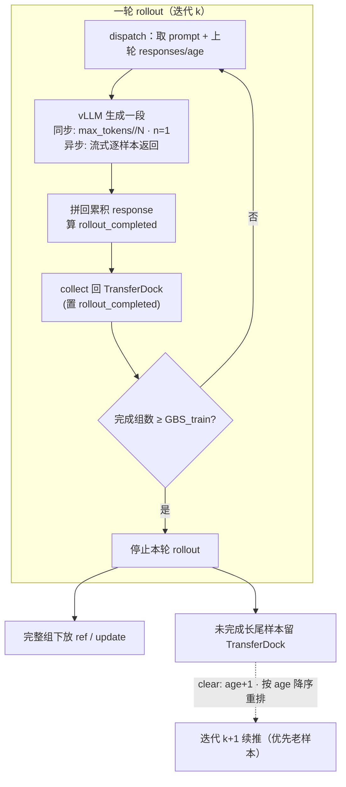

# Partial Rollout（长尾 rollout 暂停续跑）

## Summary

同步 on-policy RL 的一轮 rollout 必须等到这批 prompt 全部生成完毕才能进入 ref / update，而生成长度天然长尾——少数极长 response 把整批的同步点拖到最后，其它卡早已生成完却空转等待。**Partial Rollout** 给单步生成设一个 token 预算上限：到达上限仍未结束（未遇 eod、未触 `max_model_len` / 总 `max_tokens`）的长样本**就地暂停**，把已生成的 token 序列连同进度状态存回 [transferdock-data-scheduling](transferdock_data_scheduling.md)，**下一轮 rollout 把 `prompt + 已生成 token` 重新喂入续推**，可跨多轮把一条长序列分段生成完。由此单步 rollout 的最长生成时间被封顶为「总长度 / 切分轮数」，整批不再被长尾样本锁死，集群吞吐提升。

开关是一个整数 `partial_rollout_max_split = N`（[mindspeed-rl](../frameworks/mindspeed_rl.md) 的 `rl_config`）：`N=1` 关闭（普通一轮跑完），`N>1` 表示「在 N 轮内把最长序列推完」，单步预算即 `max_tokens // N`。它与 [rollout-rebalance](rollout_rebalance.md) 同治 rollout 长尾，但路线正交：partial rollout 在**时间/迭代维**截断长样本再续跑，rollout rebalance 在**空间/rank 维**把序列连 KVCache 搬迁重排，两者机制差异见下文。

## 长尾问题：一批里几条长序列锁死同步点

`partial_rollout_max_split` 默认 `1`（即不切分、一轮把每条 response 一次生成到底）。在该默认下，同一组 prompt 的 response 长度长尾分布，一轮 rollout 的耗时由**最长那条**决定；先生成完的样本对应的卡只能等。把单步生成时间封顶，就把「等最长一条」换成「每条每轮只推一段、攒够一批完整组就开训」，长尾对单步的影响被摊平。

启用后（`partial_rollout_max_split > 1`）actor 侧据此置位 `enable_partial_rollout`，整条 rollout 通路切到「截断 + 续推」语义；[transferdock-data-scheduling](transferdock_data_scheduling.md) 侧以 `max_age = partial_rollout_max_split` 同步开启 `enable_partial_rollout`（`max_age > 1`）。

## 核心机制：单步预算封顶 + 跨迭代续推

### 单步 token 预算封顶

同步生成里，每轮调用 vLLM 时把 `max_tokens` 压成 `sampling_config["max_tokens"] // partial_rollout_max_split`，且 `n=1`（一条样本一次只续一段，不再按组采样）：

```python
max_tokens = self.generate_config.sampling_config["max_tokens"] // self.rl_config.partial_rollout_max_split
responses_pad_right = self.actor_hybrid.generate_sequences(prompts_list, max_tokens=max_tokens, n=1, ...)
```

续推的「断点」是已生成的 token：dispatch 时除 `prompts / prompt_length` 外额外取出该样本上一轮的 `responses / response_length / age`，把 prompt 与已生成片段拼成新的输入再喂回引擎——

```python
responses_partial = truncate_rows(responses, responses_length_partial)
prompts_for_vllm = [torch.cat((prompt, response), dim=0) for prompt, response in zip(prompts, responses_partial)]
# 生成后把新段拼回累积 response
new_resp = torch.cat((response_partial, response), dim=0)
```

跨训练迭代持久化的是**已生成 token 序列**（存 TransferDock），续推靠重新 prefill `prompt + 已生成 token` 恢复上下文；不跨迭代持有 KV（每轮 rollout 前权重已被 update 改写，旧 KV 失效）。这正是与 [rollout-rebalance](rollout_rebalance.md)「带 KVCache 在 rank 间搬迁」的根本不同——后者在同一轮内迁移、KV 仍有效。

### 完成判定与续推状态

每段生成后给每条样本算一个 `rollout_completed` 标志（满足任一即「真完成」、不再续推）：

- 末 token 是 `eod`（自然结束）；
- `prompt_length + response_length ≥ max_model_len`（顶到模型上下文窗口）；
- 累积 `response_length ≥ max_tokens`（用满总生成预算）。

TransferDock 用两个与样本行对齐的张量承载续推状态：`rollout_completed`（该样本是否已真完成）与 `age`（这条样本已被续推/落后当前 actor 参数的轮数）。put 回数据时，必须随 `responses` 一并提供 `rollout_completed`，未完成样本保留在库中待下一轮再取。

### 一轮 rollout 的停止条件：攒够 GBS 个完整组

rollout 不是「所有样本都推完才停」，而是「攒够 `GBS_train` 个**组内 n 条样本全部完成**的 prompt 组就停」。`find_all_consumed_n_samples_groups` 把 `rollout_completed` 按 `n_samples_per_prompt` reshape 成组，组内全 1 才算该组完成；`all_consumed`（actor_rollout）在完成组数 `≥ GBS_train` 时返回真，worker 的生成循环随即退出。剩下未完成的长尾样本留在 TransferDock，下一训练迭代继续。

下游消费做了对应隔离：`ref` / `update` 取数据时要求 `global_ready_mask == 1`（仅整组完成的 prompt 才下放计算），而 `actor_rollout` 自身取数据不受此限——这样未完成样本只在 rollout 内被反复续推，绝不会半成品流入 ref/update。

### 优先级混合重排采样

每个迭代末 `clear()` 给仍有数据、未消费的样本 `age += 1`，已完成消费的组置 `age = -1`；随后 `sort_every_n_samples_by_age` 取每组 `age` 最大值、**按 age 降序重排所有组**，把「被续推更久」的样本顶到队首。下一轮 dispatch 顺序取数即天然「优先续推老样本、再混合新样本」，对应官方方案的「基于优先级的混合数据重排和采样」，避免某条长样本被无限期推后、保证收敛性。

## 同步引擎与异步引擎两条路径



**同步引擎**：数据按批进入、批内全部生成完同时返回；靠「单步 `max_tokens//N` 截断 + 跨迭代续推」实现长尾封顶（`sync_generate_process`）。

**异步引擎**（`async_engine=True`，`async_generate_process`）：vLLM 按样本粒度流式返回，配 `stop_singal_func=get_partial_rollout_stop_signal` 实时探测——一旦 `get_update_ready` 判定「完成组数 ≥ GBS_train」即中断在飞生成、把未完样本暂存续推，无需预设固定截断长度。取数规模按未完成样本动态算（**异步引擎全程、以及任意引擎的最后一个训练迭代** `iteration == train_iters - 1`——末迭代无「下一轮」可续，须把残留未完样本一次收完）：`experience_count = ceil(incomplete_resp_num / dp_size)`，其中 `incomplete_resp_num = prompts.sum() - rollout_completed.sum()`；其余同步轮仍用固定的 `actor_rollout_dispatch_size`。

## off-policy 偏移与收敛性约束

续推让一条长序列的不同片段由**不同版本的 actor 参数**生成（早段旧、晚段新），引入有界的 off-policy 偏移——`age` 就是这条样本落后当前参数的轮数。两个机制把偏移与收敛性兜住：

- `partial_rollout_max_split = N` 限定任何样本最多被续推到第 N 轮，age 上界即 `N-1`；
- `require_max_age_all_finished`（默认 `True`）：`get_update_ready` 在停止判定里**额外要求所有 `age == max_age-1`（已到最后一轮）的样本必须 `rollout_completed`**，即「踩线样本本迭代内必须强制收完」，保证样本在规定轮数内一定完成、不无限滚动。设 `False` 则只看完成组数、放松这一约束。

## 与 Rollout Rebalance 的区别

| 维度 | Partial Rollout（本页） | [rollout-rebalance](rollout_rebalance.md) |
|------|------------------------|------------------|
| 动作 | 长样本**截断 → 暂停 → 续推** | 序列在 rank 间**搬迁 → 重排均衡**，不截断 |
| 维度 | 时间 / 跨训练迭代 | 空间 / 单轮内跨 DP rank |
| 搬运状态 | 已生成 token（存 TransferDock），续推靠重新 prefill | Request 含 **KVCache** 一并迁移，落地即续推免 rePrefill |
| 封顶对象 | 单步生成 token 预算 `max_tokens//N` | 全局尽快切到更小 BatchSize 编图档位（更低 TPOT） |
| 承载层 | actor worker + TransferDock（MindSpeed-RL 原生） | vLLM 内层推理循环（verl patch） |
| 代价 | 引入有界 off-policy（age），靠 `require_max_age_all_finished` 兜底 | 调度/KVCache 搬迁开销，须避免多对一拥塞 |

一句话：partial rollout **把长样本切段、跨轮攒完**；rollout rebalance **把序列在卡间重排、让全局进低档位**。二者可叠加——前者降单步上限、后者均衡每轮负载。

## 配置与约束

- `rl_config.partial_rollout_max_split`：`N>1` 启用，`max_tokens//N` 为单步预算，`N` 轮内推完最长序列；默认 `1`（关闭）。
- `rl_config.require_max_age_all_finished`：默认 `True`，强制踩 `max_age` 线的样本本迭代收完。
- 启用 partial rollout 时**必须 `guarantee_order = False`**（保序与续推重排互斥，否则 `validate_config` 直接报错）。
- 启用时 `GBS_train`（`global_batch_size`）必须提供——停止判定以「完成组数 ≥ GBS_train」为准，`GBS_train == 0` 在 put 数据 / 停止判定时即抛 `ValueError`。
- **暂不支持与 VPP（virtual pipeline parallel）同时启用**（官方特性说明注意事项）。

## Evidence

- [mindspeed-rl](https://gitcode.com/Ascend/MindSpeed-RL) — [`docs/zh/features/partial_rollout.md`](https://gitcode.com/Ascend/MindSpeed-RL/blob/398fd9a5fa6358c50071db2d09919e414accea90/docs/zh/features/partial_rollout.md)（核心思想长序列提前中断+续推；`partial_rollout_max_split=N` 用法；同步/异步引擎方案：长序列截断机制 + 基于优先级的混合数据重排和采样 + 收敛性保证；async 流水图 `docs/zh/figures/partial_rollout/async.png`；注意事项暂不支持 VPP）
- [mindspeed-rl](https://gitcode.com/Ascend/MindSpeed-RL) — [`mindspeed_rl/workers/actor_hybrid_worker.py`](https://gitcode.com/Ascend/MindSpeed-RL/blob/398fd9a5fa6358c50071db2d09919e414accea90/mindspeed_rl/workers/actor_hybrid_worker.py)（`enable_partial_rollout = partial_rollout_max_split > 1`；`generate_sequences` 取 `responses/response_length/age` + `get_n_samples=not enable_partial_rollout`；`sync_generate_process` 单步 `max_tokens//N`·`n=1`、`prompts_for_vllm = cat(prompt, responses_partial)`、`rollout_completed` 完成判定 eod/max_model_len/max_tokens；`async_generate_process` + `stop_singal_func`；`get_partial_rollout_stop_signal`）
- [mindspeed-rl](https://gitcode.com/Ascend/MindSpeed-RL) — [`mindspeed_rl/trainer/utils/transfer_dock.py`](https://gitcode.com/Ascend/MindSpeed-RL/blob/398fd9a5fa6358c50071db2d09919e414accea90/mindspeed_rl/trainer/utils/transfer_dock.py)（`enable_partial_rollout = max_age > 1`；`rollout_completed` / `age` / `global_ready_mask` 张量；`find_all_consumed_n_samples_groups` 组内全完成才算组完成；`all_consumed`/`get_update_ready` 完成组数 ≥ `GBS_train` + `require_max_age_all_finished` 踩线必须收完；下游需 `global_ready_mask==1`；`sort_every_n_samples_by_age` + `clear` age 递增重排；`get_incomplete_response_num = prompts.sum() − rollout_completed.sum()`）
- [mindspeed-rl](https://gitcode.com/Ascend/MindSpeed-RL) — [`mindspeed_rl/config_cls/rl_config.py`](https://gitcode.com/Ascend/MindSpeed-RL/blob/398fd9a5fa6358c50071db2d09919e414accea90/mindspeed_rl/config_cls/rl_config.py)（`partial_rollout_max_split` 默认 1、`require_max_age_all_finished` 默认 True 定义）、[`config_cls/validate_config.py`](https://gitcode.com/Ascend/MindSpeed-RL/blob/398fd9a5fa6358c50071db2d09919e414accea90/mindspeed_rl/config_cls/validate_config.py)（`partial_rollout_max_split>1` 时 `guarantee_order` 必须 False）、[`trainer/grpo_trainer_hybrid.py`](https://gitcode.com/Ascend/MindSpeed-RL/blob/398fd9a5fa6358c50071db2d09919e414accea90/mindspeed_rl/trainer/grpo_trainer_hybrid.py)（建 TD 时 `max_age=partial_rollout_max_split`、`gbs_train=global_batch_size`）

## Links

- [rollout-rebalance](rollout_rebalance.md)（同治 rollout 长尾的正交技术：序列级跨 rank 均衡搬迁，不截断；机制差异见对比表）
- [transferdock-data-scheduling](transferdock_data_scheduling.md)（续推状态的承载层：`rollout_completed`/`age`/`global_ready_mask` 张量、组完成判定与按 age 重排都在 TransferDock 内）
- [mindspeed-rl](../frameworks/mindspeed_rl.md)（承载框架：`partial_rollout_max_split` 配置入口、actor_hybrid_worker 的截断续推实现、同步/异步引擎）
- [grpo-dapo](grpo_dapo.md)（partial rollout 服务的 on-policy RL 算法：组内 n 条样本全完成才算一个完整组下放 ref/update）