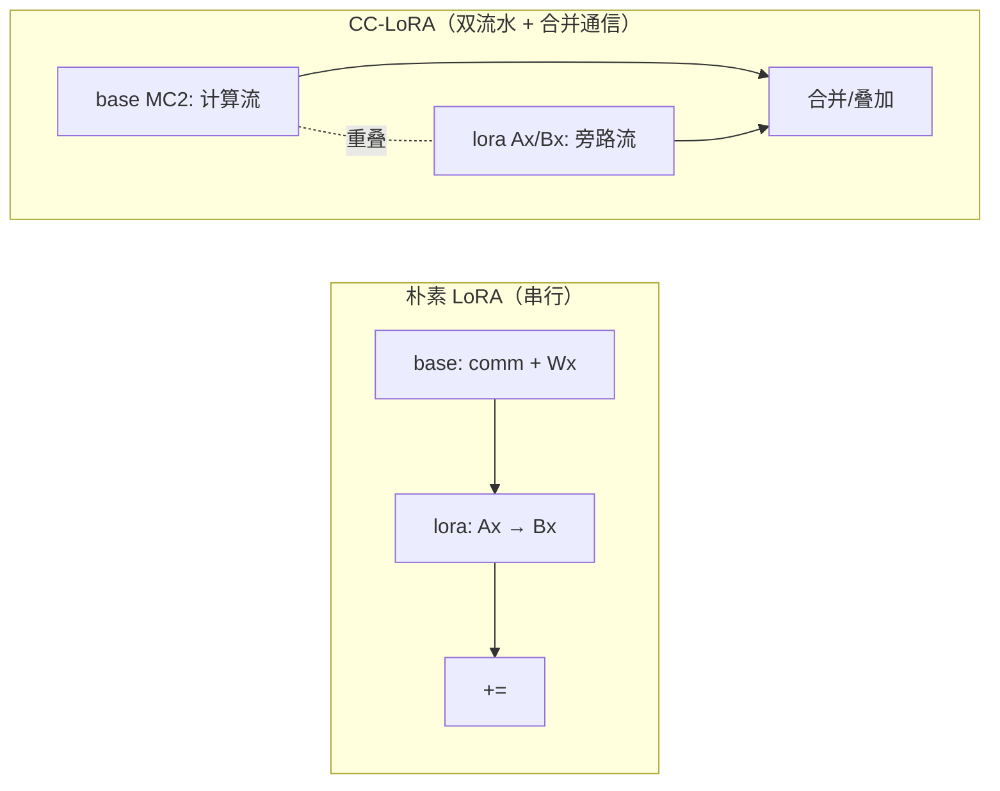
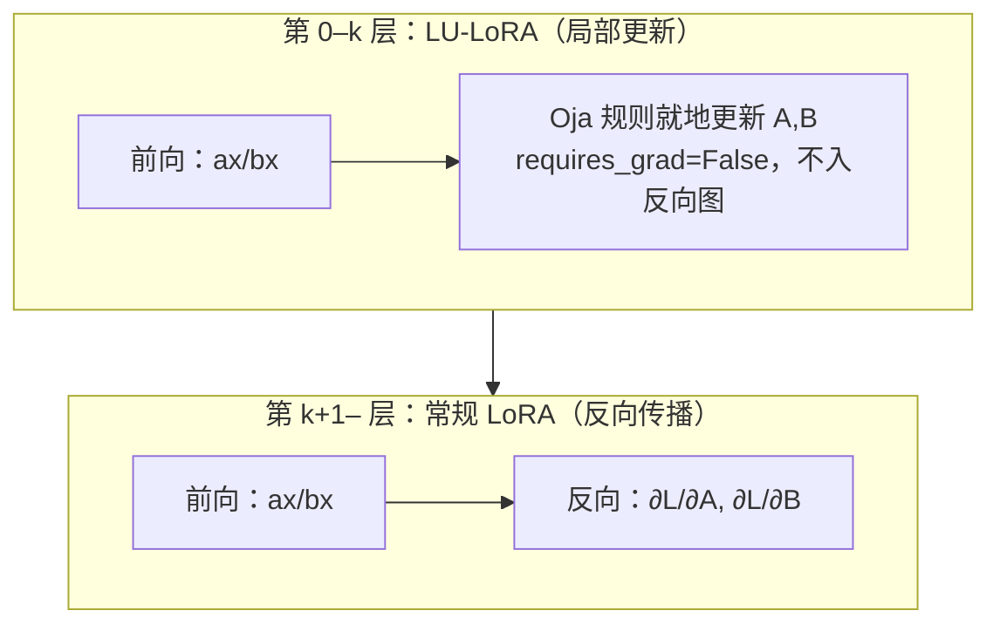

# PEFT / LoRA 家族（LoRA / CC-LoRA / QLoRA / LU-LoRA / LoRA-MoE）

## Summary

参数高效微调（PEFT）只训练极少量旁路参数、冻结预训练主干，省下全参微调的优化器状态与梯度显存。MindSpeed-LLM 的 PEFT 全部围绕 **LoRA** 展开：在目标线性层上挂一对低秩矩阵 `A`（降维到 rank `r`）和 `B`（升回输出维），前向给基座输出叠一项 `(α/r)·B(Ax)`，反向只更新 `A,B`，基座权重 `W₀` 始终冻结。在这个基线上派生出四个变体，各解决一类成本：**CC-LoRA**（`--lora-fusion`）把低秩分支与 TP/SP 通信异步重叠、消冗余通信换吞吐；**QLoRA**（`--qlora`）把冻结基座量化成 NF4、省主干权重显存；**LU-LoRA**（`--lu-lora-final-layer-index`）把浅层的反向传播换成局部学习规则、省浅层激活与反向耗时；**LoRA-MoE**（`LoraParallelLinearMoE`）让低秩适配器适配 TP/EP 切分的专家线性层。四者复用同一套 PEFT 接入（`peft` 库的 `LoraConfig` + `get_peft_model`）、同一组权重合并/转换脚本，可按 SFT 场景叠加或择一。机制承自 [mindspeed](../frameworks/mindspeed.md) 的 MindSpeed-LLM `tasks/posttrain/lora`。

## LoRA 基础：冻结基座 + 低秩增量

线性层 `y = xW₀ᵀ + bias`，其权重矩阵在预训练后通常接近满秩。微调阶段的权重更新 `ΔW = W' − W₀` 可以用一对低秩矩阵近似：取 `lora_A ∈ ℝ^{r×in}`、`lora_B ∈ ℝ^{out×r}`，`r ≪ min(in, out)`，则

```
ΔW = (α / r) · B·A        # rank(ΔW) ≤ r
y  = x·W₀ᵀ + (α/r)·(x·Aᵀ)·Bᵀ
```

前向把输入先降维 `ax = x·Aᵀ`（到 `r` 维）、再升回 `bx = ax·Bᵀ`，乘缩放系数 `scaling = α/r` 叠加到基座输出。反向只对 `A,B` 求梯度——对 `A`（或 `B`）求偏导时 `xW₀ᵀ` 视作常数、不更新 `W₀`，但为把梯度继续往前传，本层仍要返回 `∂L/∂x = ∂L/∂y·(W₀ + ΔW)`，因此 `W₀` 在前/反向各参与一次矩阵乘、只是不积累梯度。可训练参数从 `in·out` 降到 `r·(in+out)`，优化器状态与梯度随之骤减。

接入由 PEFT 驱动：`is_enable_lora()`（`lora_target_modules` 非空即启用）时，`model_provider_func_wrapper` 用 `LoraConfig(r, lora_alpha, target_modules, ...)` + `get_peft_model` 包住模型，并把 `peft` 的 `LoraParallelLinear` 替换为 MoE 感知的 `LoraParallelLinearMoE`（见 LoRA-MoE 一节）。关键旋钮：

- `--lora-r`（默认 16）：低秩维度，越小越省、过小限制表达力。
- `--lora-alpha`（默认 32）：增量影响比例，`scaling = α/r`，经验上保持 `α/r ≈ 2`。
- `--lora-target-modules`：挂 LoRA 的线性层，可选 `linear_qkv` / `linear_proj` / `linear_fc1` / `linear_fc2`。
- `--lora-load`：加载已有 LoRA 断点续训或推理。

LoRA 适配器内部强制升到 FP32（`megatron_config.params_dtype = torch.float32`）以免低秩矩阵数值溢出。训练产物是独立的 LoRA 权重，推理/部署时用 `convert_ckpt` 系脚本带 `--lora-load --lora-r --lora-alpha --lora-target-modules` 把 `A,B` 合并回基座并转回 HF 格式；合并经 `peft` 落到 FP16，bf16 基座（如 Qwen 系）合并转 HF 有精度损失，可临时把原 HF `config.json` 的 dtype 改成 float16 规避。合并场景当前不支持 `--mtp-num-layers`。

## CC-LoRA：低秩分支与 TP 通信重叠

CC-LoRA（Communication-Computation overlap LoRA，`--lora-fusion`）解决的是分布式 LoRA 的通信冗余：朴素实现里冻结基座分支与低秩更新分支**串行**走前/反向，分布式场景两条分支各自触发 all-gather / reduce-scatter，造成重复通信。而基座分支（`W₀`）与更新分支（`A,B`）之间没有数据依赖，可异步重叠；再借数学等价变换合并通信。三条优化叠加：

- **单流水改通算双流水**：把基座的 MC2 矩阵乘（`npu_mm_reduce_scatter_base` / `npu_all_gather_base_mm` 这类计算-通信融合算子）与低秩分支的 `ax`、`bx` 计算交错下发，让 all-gather/reduce-scatter 与 matmul 在不同流上重叠。
- **数学等价合并通信**：SP & Row 场景下 `B` 是各卡一致的普通线性层，反向对 `A` 求导可写成 `grad_a = all_gather(grad_y·B) = all_gather(grad_y)·B`，而 `all_gather(grad_y)` 在算 `grad_x` 的 MC2 里已经取到，于是省掉 `grad_y·B` 的一次 all-gather。
- **等价优化 scale 逻辑**：按 token 数 `BS` 与隐藏维 `H` 选合并方式——`BS < H` 时分开算 `Y = Wx + B(λA)x`；`BS ≥ H` 时先把权重合成 `W_combine = W + B·(λA)` 再单次矩阵乘 `Y = (W+BλA)x`。token 多时合并摊薄了构造 `W_combine` 的代价，token 少时分开更省。代码里就是 `ctx.combine = seq_size ≥ d` 的分支（`_FusedBaseParallelLoRAFunction` 内 `if seq_size < d: 不合并`）。



`--lora-fusion` 把 `LoraParallelLinear.forward` 替换成 `CCLoraParallelLinearForward`，按 `base_layer` 的并行属性分派到五个 `torch.autograd.Function`：TP=1 或专家显式通信走 `_FusedBaseParallelLoRAFunction`，Column/Row 各分 SP / 无 SP 四种（`_FusedColumnSeqParallelLoRAFunction` 等）。配 `--use-fused-mlp` 时还把 `MLP.forward` 换成 `ParallelSwigluMLPLoRAForward`，把 `linear_fc1`/`linear_fc2` 两层 LoRA 与 `npu_swiglu` 及其通信在单个 Function 里融合。CC-LoRA 与 PP、VPP、分布式优化器兼容，但与 `--overlap-param-gather` 冲突、不能同时开；GLM-4.5 不支持。Atlas 900 A2 PODc 1×8 实测：Llama2-7B 动态序列 TP8 吞吐 9.72→13.64（+40.3%）、pack 序列 +11.5%，Mixtral-7×8B PP4 +47.1%，Llama2-70B PP4 +9.3%。

## QLoRA：量化冻结基座，省主干显存

QLoRA 在 LoRA 之上把**冻结的基座权重**量化成 4-bit，只对线性层权重矩阵下手，激活、梯度、优化器状态仍保持原精度。量化用 **NF4**（4-bit NormalFloat，一种近似高斯分布最优表示的查找表量化），实现走 NPU 版 `bitsandbytes`（`bitsandbytes-npu-beta`）。前向每次用到基座时实时反量化：

```
W₀^NF4 = Q(W₀)                                # 权重转换阶段一次性量化
y      = x·(Q⁻¹(W₀^NF4))ᵀ + (α/r)·(x·Aᵀ)·Bᵀ    # 前向反量化基座
∂L/∂x  = ∂L/∂y·Q⁻¹(W₀^NF4) + ∂L/∂y·(α/r)·BA      # 反向同样反量化
```

启用分两步：权重转换时加 `--qlora-nf4` 得到 NF4 量化的 mg 权重，微调时加 `--qlora`（须加载量化后的权重，不支持随机初始化）。代码里基座线性层的 `weight` 以 `bitsandbytes` 的 `Params4bit` 形态存活、带 `quant_state`：`parallel_linear_init_wrapper` 先把权重落在 CPU 以避开建模时的显存峰值，`get_model` 只把非目标层/适配器搬到 device、量化基座留作 NF4；`LinearWithFrozenWeight` 的前/反向（`linear_with_frozen_weight_forward/backward`）在矩阵乘前 `dequantize_4bit`；存档 `parallel_linear_save_to_state_dict_wrapper` 写出 `quant_state` 分量、读档 `parallel_linear_load_from_state_dict_wrapper` 经 `Params4bit.from_prequantized` 还原；MoE 的分组 GEMM 走 `WeightNf4QuantGMMFunction` 在 GMM 前反量化。默认保存仍是量化权重，加 `--qlora-save-dequantize` 可在存档时反量化成浮点，之后合并/推理路径与 LoRA 相同。

收益取决于 batch、序列长度等（仅权重被量化）：Llama-2-70b 权重 129GB→35GB（省 94GB）、Mixtral-8x7b 87GB→24GB（省 63GB），两者均可单卡 64GB 微调（70B 单 batch 实测约 50GB）。约束：QLoRA 不支持 `--lora-fusion`（量化基座无法预合成 `W_combine`，CC-LoRA 的 combine 路径失效、开了也无收益），但与分布式 LoRA、PP/TP/VPP/CP/SP、重计算兼容。量化基座必然对精度有影响，需评估后使用。

## LU-LoRA：浅层用局部学习规则替代反向传播

LU-LoRA（Locally-Updated LoRA，局部更新的 LoRA）把模型**靠前若干层**的 LoRA 适配器从反向传播更新换成**局部学习规则**更新，其余层仍走常规 LoRA。`--lu-lora-final-layer-index = k` 表示第 `0`–`k` 层用 LU-LoRA、其余用 LoRA；层数多的模型可让更多浅层走局部更新以省更多计算与显存，但覆盖过多会限制泛化，经验上先取约 37.5% 的层。三个要件：反向传播与局部学习的结合、用 Hebb 型规则做适配器的特殊初始化、给适配器不同的学习率。

机制要点（`enable_lu_lora` 激活的层）：

- **不进反向图**：LU-LoRA 层的前向是只定义 `forward`、没有 `backward` 的 `torch.autograd.Function`（`_Fused*LULoRAFunction`），且把 `lora_A/lora_B` 的 `weight.requires_grad` 置 `False`。这些层因此不为反向保留激活、不参与 autograd，省下浅层的激活显存与反向耗时——这正是 LU-LoRA 相对常规 LoRA 的省内存来源。
- **前向内就地更新**：算完 `ax = x·(A·scaling)ᵀ`、`bx = ax·Bᵀ` 后，当场调 `optimizer_a.update(x, ax, A)`、`optimizer_b.update(ax, bx, B)` 用局部规则改 `A,B`。规则是 **Oja 规则**（稳定化的 Hebb 规则，`OjasRule`）：`Δ = η·y(x − y·w) = η(yx − y²w)`，按序列维取均值算 `yx` 与 `y²w` 后做 `F.normalize`。`LULoRALayerOptimizer.update` 把 `Δ` 在 TP 组内 all-reduce、按 `global_batch_size // micro_batch_size // dp_size` 个步累加，满一个累积窗口才 `weight ← weight − lr·(ΣΔ / accumulation_step)` 并清零，模拟一次「优化器步」。
- **特殊初始化与独立学习率**：`enable_lu_lora` 把 `lora_B` 重置为 `randn × 1e-4`；`A,B` 各用自己的学习率，由 `LULoRALRScheduler`（包住反向传播 scheduler 与一条独立 LU-LoRA scheduler）提供。`--lu-lora-lr`（默认 `1.25e-6`）是 LU-LoRA 层初始学习率，`--lu-lora-lr-ratio` 是 B 与 A 适配器的学习率比（代码缺省 `1.0`，经验建议约 `24`）。



非 LU-LoRA 层仍走 `CCLULoRAParallelLinear._lora_forward`，因此可叠 `--lora-fusion`（CC-LoRA）路径。LU-LoRA 基于 LoRA，权重合并/转换/评估复用 LoRA 脚本与参数（`--lora-r --lora-alpha --lora-target-modules`，取值须与微调一致）。来源见 ECAI 2025 的 Hebb 学习论文。

## LoRA-MoE：适配 TP/EP 切分的专家线性层

`LoraParallelLinearMoE` 是替换 `peft.LoraParallelLinear` 的默认适配器，让 LoRA 在 TP/EP 切分的并行线性层上保持输入/输出形状一致：当基座是 `RowParallelLinear`（输入已切分）时，把 `lora_A` 也做行切分（`RowParallelLinear`，输出 rank `r`）、`lora_B` 用完整 `nn.Linear`；当基座是 `ColumnParallelLinear`（输出切分）时，`lora_B` 做列切分（`ColumnParallelLinear`）、`lora_A` 用完整 `nn.Linear`。这样低秩旁路的并行布局与基座对齐，前向 `result = base(x) + scaling·lora_B(lora_A(dropout(x)))` 的聚合（all-reduce / reduce-scatter）由并行线性层自身完成，不丢通信。共享专家走 `SERowParallelLinear` / `SEColumnParallelLinear` 变体。`lora_target_modules` 非空时 `MoELayer.__init__` 被 `lora_moe_layer_init` 接管以挂载这些适配器。

MoE 上 LoRA/QLoRA 的约束（`LoraFeature.validate_args`）：有专家时 `--moe-token-dispatcher-type` 必须为 `alltoall_seq`，且与 `--moe-tp-extend-ep` 互斥。

## 接入与变体取舍

| 变体 | 开关 | 解决什么 | 关键边界 |
|---|---|---|---|
| LoRA | `--lora-target-modules` | 冻结基座、只训低秩 `A,B`，省优化器/梯度显存 | 适配器 FP32；合并落 FP16（bf16 基座有精度损失） |
| CC-LoRA | `--lora-fusion` | 低秩分支与 TP/SP 通信重叠、消冗余通信 | 与 `--overlap-param-gather` 冲突；GLM-4.5 不支持 |
| QLoRA | `--qlora`（+`--qlora-nf4` 转权重） | NF4 量化冻结基座，省主干权重显存 | 不支持 `--lora-fusion`；须加载量化权重；有精度影响 |
| LU-LoRA | `--lu-lora-final-layer-index` | 浅层用 Oja 局部规则替反向，省浅层激活/反向 | 仅浅层；非 LU 层仍可叠 CC-LoRA |
| LoRA-MoE | `LoraParallelLinearMoE`（自动） | 低秩适配器适配 TP/EP 专家线性层 | MoE 须 `alltoall_seq`；与 `moe-tp-extend-ep` 互斥 |

LoRA 微调的数据侧（指令样本打包 / 动态序列）与 [data-packing-varlen](data_packing_varlen.md) 同链路——CC-LoRA benchmark 里「pack」与「动态」两种序列形态的吞吐差异即源于此；SFT 全流程的入门样例见 [qwen3-sft](../../guides/recipes/qwen3_sft.md)。

## Evidence

- [mindspeed-llm](https://gitcode.com/Ascend/MindSpeed-LLM) — [`docs/zh/pytorch/training/finetune/mcore/lora_finetune.md`](https://gitcode.com/Ascend/MindSpeed-LLM/blob/183e02c21011c2e423a599633cf2d55929ba9ea3/docs/zh/pytorch/training/finetune/mcore/lora_finetune.md)（`W'=W+A·B`、`lora-r`/`lora-alpha`(α/r≈2)/`lora-target-modules`(linear_qkv/proj/fc1/fc2)/`lora-load`、`lora-fusion` 即 CCLoRA）、[`develop/mcore/lora_finetune_adaptation.md`](https://gitcode.com/Ascend/MindSpeed-LLM/blob/183e02c21011c2e423a599633cf2d55929ba9ea3/docs/zh/pytorch/develop/mcore/lora_finetune_adaptation.md)（合并转 HF：peft 合并落 FP16、bf16 精度损失、不支持 `--mtp-num-layers`）
- [mindspeed-llm](https://gitcode.com/Ascend/MindSpeed-LLM) — [`docs/zh/pytorch/features/mcore/cc_lora.md`](https://gitcode.com/Ascend/MindSpeed-LLM/blob/183e02c21011c2e423a599633cf2d55929ba9ea3/docs/zh/pytorch/features/mcore/cc_lora.md)（单流水→通算双流水、SP&Row 合并 all_gather、`BS<H`/`BS≥H` 的 scale 合并、与 `--overlap-param-gather` 冲突、Llama2/Mixtral 吞吐表）
- [mindspeed-llm](https://gitcode.com/Ascend/MindSpeed-LLM) — [`docs/zh/pytorch/training/finetune/mcore/qlora_finetune.md`](https://gitcode.com/Ascend/MindSpeed-LLM/blob/183e02c21011c2e423a599633cf2d55929ba9ea3/docs/zh/pytorch/training/finetune/mcore/qlora_finetune.md)（NF4 查找表量化、`--qlora-nf4`/`--qlora`/`--qlora-save-dequantize`、Llama-2-70b 129→35GB、不支持 lora-fusion）、[`lu_lora_finetune.md`](https://gitcode.com/Ascend/MindSpeed-LLM/blob/183e02c21011c2e423a599633cf2d55929ba9ea3/docs/zh/pytorch/training/finetune/mcore/lu_lora_finetune.md)（`--lu-lora-final-layer-index`(取 37.5% 层)/`--lu-lora-lr`(1.25e-6)/`--lu-lora-lr-ratio`、Hebb 初始化、ECAI 2025 引用）
- [`mindspeed_llm/features_manager/finetune/lora.py`](https://gitcode.com/Ascend/MindSpeed-LLM/blob/183e02c21011c2e423a599633cf2d55929ba9ea3/mindspeed_llm/features_manager/finetune/lora.py) — `LoraFeature`：`--lora-r/-alpha/-target-modules/-load/-fusion/--qlora/--qlora-save-dequantize` 注册、QLoRA patch 集、`validate_args`（MoE 须 `alltoall_seq`、禁 `moe-tp-extend-ep`）；[`finetune/lu_lora.py`](https://gitcode.com/Ascend/MindSpeed-LLM/blob/183e02c21011c2e423a599633cf2d55929ba9ea3/mindspeed_llm/features_manager/finetune/lu_lora.py) — `--lu-lora-final-layer-index/-lr/-lr-ratio`
- [`mindspeed_llm/training/training.py`](https://gitcode.com/Ascend/MindSpeed-LLM/blob/183e02c21011c2e423a599633cf2d55929ba9ea3/mindspeed_llm/training/training.py) — `model_provider_func_wrapper`：`get_peft_model`/`LoraConfig` 接入、`LoraParallelLinear→LoraParallelLinearMoE`、`lora_fusion` 时 `LoraParallelLinear.forward=CCLoraParallelLinearForward`（+ `MLP.forward=ParallelSwigluMLPLoRAForward`）、`lu_lora_final_layer_index` 时换 `CCLULoRAParallelLinear`
- [`mindspeed_llm/tasks/posttrain/lora/cc_lora_forward.py`](https://gitcode.com/Ascend/MindSpeed-LLM/blob/183e02c21011c2e423a599633cf2d55929ba9ea3/mindspeed_llm/tasks/posttrain/lora/cc_lora_forward.py) — 五个 `_Fused*ParallelLoRAFunction`（`ctx.combine = seq_size≥d`、`npu_mm_reduce_scatter_base`/`npu_all_gather_base_mm`、`dequantize` 兼 QLoRA）、`column/row_cc_lora_parallel_linear_forward`、`CCLoraParallelLinearForward`；[`cc_lora_mlp_forward.py`](https://gitcode.com/Ascend/MindSpeed-LLM/blob/183e02c21011c2e423a599633cf2d55929ba9ea3/mindspeed_llm/tasks/posttrain/lora/cc_lora_mlp_forward.py) — `ParallelSwigluMLPLoRAForward`（fc1/fc2 LoRA + `npu_swiglu` 融合）
- [`mindspeed_llm/tasks/posttrain/lora/qlora.py`](https://gitcode.com/Ascend/MindSpeed-LLM/blob/183e02c21011c2e423a599633cf2d55929ba9ea3/mindspeed_llm/tasks/posttrain/lora/qlora.py) — `parallel_linear_init_wrapper`(权重落 CPU)、`linear_with_frozen_weight_forward/backward`(`dequantize_4bit`)、`save/load_from_state_dict_wrapper`(`Params4bit.from_prequantized`/`quant_state`)、`WeightNf4QuantGMMFunction`(MoE GMM 反量化)；[`lora/utils.py`](https://gitcode.com/Ascend/MindSpeed-LLM/blob/183e02c21011c2e423a599633cf2d55929ba9ea3/mindspeed_llm/tasks/posttrain/lora/utils.py) — `is_enable_lora`/`is_enable_qlora`/`filter_lora_keys`
- [`mindspeed_llm/tasks/posttrain/lora/lora_moe.py`](https://gitcode.com/Ascend/MindSpeed-LLM/blob/183e02c21011c2e423a599633cf2d55929ba9ea3/mindspeed_llm/tasks/posttrain/lora/lora_moe.py) — `LoraParallelLinearMoE`：Row/Column 基座的 `lora_A`/`lora_B` 切分策略、共享专家 `SE*ParallelLinear`、适配器 FP32、`forward` 叠加
- [`mindspeed_llm/tasks/posttrain/lu_lora/optimizer.py`](https://gitcode.com/Ascend/MindSpeed-LLM/blob/183e02c21011c2e423a599633cf2d55929ba9ea3/mindspeed_llm/tasks/posttrain/lu_lora/optimizer.py) — `LULoRALayerOptimizer.update`(accumulation_step 累积、TP all-reduce、`weight−=lr·ΣΔ/step`)；[`lu_lora/rules.py`](https://gitcode.com/Ascend/MindSpeed-LLM/blob/183e02c21011c2e423a599633cf2d55929ba9ea3/mindspeed_llm/tasks/posttrain/lu_lora/rules.py) — `OjasRule`(`Δ=η(yx−y²w)` + `F.normalize`)
- [`mindspeed_llm/tasks/posttrain/lu_lora/layers/tp_lu_lora_linear.py`](https://gitcode.com/Ascend/MindSpeed-LLM/blob/183e02c21011c2e423a599633cf2d55929ba9ea3/mindspeed_llm/tasks/posttrain/lu_lora/layers/tp_lu_lora_linear.py) — `CCLULoRAParallelLinear`(`enable_lu_lora` 置 `requires_grad=False`+`lora_B=randn×1e-4`、`_lora_forward` 兼 CC-LoRA)；[`layers/lu_lora_forward.py`](https://gitcode.com/Ascend/MindSpeed-LLM/blob/183e02c21011c2e423a599633cf2d55929ba9ea3/mindspeed_llm/tasks/posttrain/lu_lora/layers/lu_lora_forward.py) — 只前向无反向的 `_Fused*LULoRAFunction` + 前向内 `optimizer.update`；[`lu_lora/bootstrap.py`](https://gitcode.com/Ascend/MindSpeed-LLM/blob/183e02c21011c2e423a599633cf2d55929ba9ea3/mindspeed_llm/tasks/posttrain/lu_lora/bootstrap.py) — `get_lu_lora_layers_indices_on_rank`/`configure_lr_for_lu_lora_layers`/`LULoRALRScheduler`

## Links

- [mindspeed](../frameworks/mindspeed.md)（PEFT 全套所在框架：MindSpeed-LLM `tasks/posttrain/lora`/`lu_lora` + features_manager 接入）
- [qwen3-sft](../../guides/recipes/qwen3_sft.md)（SFT 入门样例；LoRA/QLoRA/LU-LoRA 微调即在此 SFT 链路上加 LoRA 参数启用）
- [data-packing-varlen](data_packing_varlen.md)（微调数据侧：指令样本打包 / 动态序列，CC-LoRA pack vs 动态吞吐差异的来源）
