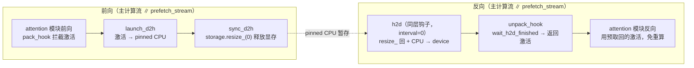

# Swap Attention（激活换出 Host + SmartSwap + 自适应内存）

## Summary

激活显存是大模型训练的主要内存压力来源，传统对策是重计算（recompute）——前向丢弃激活、反向重算，省内存但加算力。MindSpeed 的内存优化模块给出另一条路线：把前向激活**换出到 Host（CPU pinned）内存**，反向用到时再从 Host 预取回 device，用 H2D 高带宽「以网补存、以网强算」，从而避免或减少重计算，提升 MFU。这条路线在 MindSpeed 里有三个层级的实现：

- **`--swap-attention`**：按模块清单（默认 attention 侧的 `input_norm,self_attention,post_attention_norm`）把激活在前向换出、反向预取，可单开省内存，也可叠 `--recompute-num-layers N` 把 MLP 的前 N 层重计算、替换全重计算换取性能。
- **`--smart-swap`（SmartSwap）**：替换底层 NPU caching allocator，通过「数据采样 → 策略生成 → 策略执行」迭代自动决定换出哪些张量、换多少，使训练落在指定/可用显存内，免去手写异步换入换出与内存管理。
- **`--adaptive-memory-optimization`（自适应内存）**：基于逐模块 profiling（显存/耗时）由求解器联合编排「重计算 + swap + 预取 + OOM 兜底换出」，迭代到策略稳定。

三者都是「显存 ↔ 算力/带宽」取舍的不同自动化程度，解决同一问题、通常择一启用（其中 swap-attention 与自适应内存有显式互斥校验，详见各节），且都与重计算特性配合或二选一。机制承自 MindSpeed Core 内存优化模块（见 [mindspeed](../frameworks/mindspeed.md)）。

本页讲述的是具体 Ascend NPU allocator、torch_npu Stream/Event 实现；换出思路虽通用，现有证据未给出三条路线完整型号支持矩阵，故保留 draft、platforms 暂空，不能据此推导任意硬件可用。

## swap-attention：模块级激活换出 + 反向预取

启用前提是已开 flash attention 融合算子。`--swap-attention` 对每层 attention 侧模块的激活做「前向换出 / 反向预取」；`--swap-modules` 指定换出哪些子模块，默认 `"input_norm,self_attention,post_attention_norm"`，mcore 场景默认仅预取 `self_attention`。

两种用法对应两种收益：

- **替换全重计算（性能）**：全重计算场景下用 `--swap-attention` + `--recompute-num-layers N` 替换全重计算——attention 激活由 Host 预取回来免去重算，仅对前 N 层的全连接（MLP）做重计算，相比完全重计算有性能收益。未启用 VPP 时 N 可按 PP rank 层数理解；启用 VPP 且未开 `enable_recompute_layers_per_pp_rank` 时，源码将 N 乘 vpp_size，若 N≥per_vpp_layers 则截断为 per_pp_layers。开启该开关后才直接按 PP 总层数计数并截断。因此“前 N 层”需结合 chunk 分配理解。
- **纯省内存**：不需要重计算的场景只开 `--swap-attention`，在几乎不损耗性能的前提下省出激活显存，以支撑更大模型配置。

### 换出 / 预取的张量级机制

换出的最小单位是 `SwapTensor`：每个持一份 `pin_memory=True` 的 CPU 副本，用四个状态 `device → d2h → host → h2d` 流转；搬运统一走 `SwapPrefetch` 持有的、独立于主计算流的 `prefetch_stream`。注入靠 PyTorch 的 `saved_tensors_hooks(pack_hook, unpack_hook)` 包住被换模块的前向：

- **前向换出**：`pack_hook` 对每个待存激活调 `launch_d2h`——在 `prefetch_stream` 上把 device 激活 `copy_` 到 pinned CPU（`non_blocking=True`），与主计算流并行。该层前向结束后由注册在该层上的 forward-hook 调 `sync_d2h`：等首个张量 d2h 完成，再把 device 张量 `storage().resize_(0)` **真正释放激活显存**，并把这批 `SwapTensor` 入 `prefetch_list`。
- **反向预取**：注册在层上的 backward-hook 在反向推进到该层时调 `h2d`——`resize_` 回原 storage 大小、在 `prefetch_stream` 上把 CPU 副本 `copy_` 回 device、record `h2d_event`。`unpack_hook` 在该激活真正被反向用到时调 `wait_h2d_finished` 取回 device 张量——该批最后一个张量在此让主/默认计算流 `wait_stream(prefetch_stream)`，确保 prefetch_stream 上的 h2d 全部完成。匹配条件为 `layer_id + interval == 当前反向层`；当前实现的solve_prefetch_policy 和 granular_module_allocation 都返回 interval=0，实际在同层钩子触发 H2D，未实现这里的跨层提前预取。

并非所有张量都换出——`no_swap_tensor` 过滤掉：双倍字节数 < 1 MB 的小张量、`grad_fn is None`（非激活）、storage 已为 0、底层 storage 与 numel 不等的切片/视图张量、`_base.dim() >= 5` 的张量。底层 storage `data_ptr` 相同的多个激活由 `pack_hook` 去重、共享同一份 CPU 副本，避免对同一 storage 重复搬运。

### 换/算/重算的逐层策略

哪些层换出、哪些层重计算由 `AdaptiveRecomputeSwap.solve_prefetch_policy` 按 pp / vpp 与 `recompute_method` 算出一张 `[swap_list, prefetch_list, recompute_list]`：`recompute_method='block'` 时换出层数 `num_prefetch = recompute_num_layers`，`'uniform'` 或默认取每 pp rank 满层数；vpp>1 走 `granular_module_allocation` 按 chunk 取模分配。`noop_layers`（空层）在三张表里对应位置置空，不参与换/算。`AdaptiveRecomputeSwapReg.register_recursive_apply_prefetch` 据此递归挂钩：命中 `swap_modules` 且层号在 `prefetch_list` 的子模块，其 `forward` 被 `hook_swap_manager_forward` 包成换出版本；`mlp` 子模块且层号在 `recompute_list` 的则包成重计算版本。

接入点经 features_manager 的 `SwapAttentionFeature.register_patches` 注入：`setup_model_and_optimizer_wrapper` 在建模后挂 prefetch 钩子；`TransformerLayer` / `ParallelTransformerLayer` 经 `allowed_recomputing_swap_module_wrapper` 标记可换可重算；`LinearWithGradAccumulationAndAsyncCommunication.forward/backward` 经 `linear_*_main_grad_wrapper` 在 ctx 上保住 `weight` 引用，保证换出后反向仍能取到权重算 wgrad。同时 patch `TransformerBlock._checkpointed_forward`：开 `swap_attention` 后，原生 uniform/block 重计算路径对这些层**跳过 checkpoint**（走无 checkpoint 的 `custom` 前向），把重算决策交给 swap 机制自身的钩子，避免与原生重计算重复。

约束：`--swap-attention` 与**自适应选择重计算**（`adaptive-recompute-device-size>0` / `adaptive-recompute-device-swap`）、`--adaptive-memory-optimization`、**LoRA 微调**互斥。性能波动多由跨 NUMA 内存访问引起，可用进程绑核缓解（`export CPU_AFFINITY_CONF=1,lazy_bind:0`）。

## SmartSwap：自适应迭代生成 Swap 策略

手写 swap 路线要用户自己控制异步换入换出时机与内存管理，成本高；SmartSwap 把这步自动化：替换底层 NPU caching allocator（`change_allocator()`，启用前 `time.sleep(10)` 等待），并 patch `megatron.training.training.train_step`，通过迭代选出有限次验证下的最优策略。一次训练分三阶段：

- **WarmUp**：仅做数据采样，采集 Tensor 生命周期信息供后续分析。此阶段若 OOM，会拦截底层内存异常让模型继续跑。
- **SearchPolicy**：采样 + 策略执行并行。策略生成含候选内存过滤、内存策略生成、内存模拟排布几步。
- **Stable**：仅执行策略，通过多流异步换入换出掩盖对计算流的耗时影响。

调试旋钮在 `swap_policy_config.py`（v2 简化版）：`policy_v2=True` 开启 v2；`policy_pref` 在 `BETTER_PERFORMANCE`（只换 activation）与 `BETTER_MEMORY_SAVING`（换 activation + optimizer）间取舍；`swap_bucket_size` 控制每层换出张量大小（字节，-1 为全选）；`num_attn_layers_per_stage` 定 SwapStage 粒度（默认每个 SwapStage 含 1 个 attention layer）。

适用：OOM 场景（拦截报错、自动生成策略、跑在可用最大显存内）、非 OOM 场景（按配置的减显存值生成策略跑在指定显存内）、作为重计算替代缩小重算范围。效果上，借换出可降低 TP/PP 取得收益（llama2 8p/pp1/8K/32 层，tp8→tp1 提速 25%）或关闭全重计算取得收益（同模型 16K/40 层关全重计算提速 28%）。

注意边界：仅适配**静态序列**场景，**未适配 MoE 等动态场景**；占用 Host 内存（单机 8 卡每卡换出 30 GB 则需 Host 内存约 240 GB）；自定义编译的 cpp 算子需手动加采集 Hook（`NPUSwapManager` 的 `BeginHook/TensorHook/PostHook/EndHook`）并改编译链接与 `LD_LIBRARY_PATH`。与自适应选择重计算互斥。

## 自适应内存（adaptive-memory-optimization）：profiling 驱动的联合编排

`--adaptive-memory-optimization` 是这条路线里最「自动」的一档：不靠人指定模块清单，而是先 profiling 再由求解器联合编排重计算 / swap / 预取 / OOM 兜底换出。

`AdaptiveMemoryProfiling` 递归遍历模型构建模块 context 树（`construct_ctx_recursively`），在模块上挂 forward 前/后钩子，记录每个模块的输入输出大小、显存占用增量（前后 `memory_allocated` 差值）与前向耗时（NPU `Event(enable_timing=True)` 计时）；它识别出代表性的「layer 0」（`is_layer0`，排除 expert）作为被反复 profiling 的样板层，并挂 `RecomputeHook` 采重计算代价。`AdaptMemPolicyManager` / `AdaptMemGraphSolver` 据此生成组合策略，`AdaptMemApplyManager` 落地；策略连续 10 步不变即视为稳定（`remove_swap_manager_hook_step`），随后撤掉兜底钩子。

承担换出的是 `adaptive_memory_swap_manager.SwapManager`（单例），张量包成 `SwappableTensor`，用 `SwappableTensorStat` 的 `HOST/DEVICE/D2H/H2D` 状态机流转，两条职责并存：

- **预取换出**：`prefetch_pack` / `prefetch_unpack` 经 `saved_tensors_hooks` 在前向把激活 `launch_d2h` 到 pinned CPU（独立 `prefetch_stream`），`sync_d2h` 等预取完成后 `storage().resize_(0)` 释放显存并按 microbatch 入队；反向前 `h2d` 把对应 microbatch 的激活预取回 device。`no_swap_tensor` 过滤逻辑与 swap-attention 同源（<1 MB、无 grad_fn、storage 为 0、切片张量、`_base.dim()>=5` 跳过）。
- **OOM 兜底换出**：`oom_rescue_pack` 把前向激活登记到 `oom_rescue_device_tensors`；当 allocator 触发 OOM，`swap_out_by_size(size)` 按需把够数的 storage 搬到 Host（`move_storage_out`），并处理共享底层 storage 的张量——同一 storage 的张量记为 `bro_tensors`、由占满整块 storage 的 `cap_tensor` 统一搬运，避免重复换出；`oom_rescue_unpack` 用到时 `move_storage_in` 搬回。`swap_out_by_size` 的统一入口 `core/memory/common.py` 按 `args.adaptive_memory_optimization` 路由到自适应内存的 `SwapManager` 或自适应重计算的 `SwapManager`。

求解器内部联合安排重计算不代表可再开启用户显式重计算开关。`arguments.py` 还要求 ampipe_degree≤1、关闭自适应重计算、recompute_granularity 和 recompute_method 均为 None，且禁止 recompute_activation_function 与 recompute_in_bubble，否则启动断言失败。

自适应内存与 `--swap-attention` 显式互斥（`SwapAttentionFeature.validate_args` 的 `incompatible_check('adaptive_memory_optimization')`，`arguments.py` 亦 `assert not args.swap_attention`）；与 `--smart-swap` 之间无显式互斥校验，但二者解决同一问题，按场景择一启用。

## 三条路线的取舍

| 路线 | 决策方式 | 关键边界 |
|---|---|---|
| `--swap-attention` | 按 `swap_modules` 清单 + `recompute_num_layers` 手工指定换/算 | 需先开 FA 融合算子；与自适应重计算 / 自适应内存 / LoRA 互斥 |
| `--smart-swap` | 替换 allocator，迭代采样自动生成策略 | 仅静态序列、不支持 MoE 动态场景；占大量 Host 内存 |
| `--adaptive-memory-optimization` | profiling + 求解器联合编排重算/swap/预取/OOM 兜底 | 自动度最高；与 swap-attention 显式互斥（smart-swap 无显式校验，实践择一） |

共性是都把激活（必要时含优化器状态）在 device 与 Host 间搬运、用多流与计算重叠掩盖搬运耗时，本质是拿 H2D/D2H 带宽换激活显存，常作为重计算的替代或补充。与 [swap-optimizer](swap_optimizer.md) 把**优化器状态**换出 Host 的思路同源、对象不同（激活 vs 优化器动量）。

## Evidence

- [README.md](../../../../../cann-recipes-raw/mindspeed/c5a72765f99fd8470362c7afdc2cdffe0ab5aea6/README.md)（primary）
- [swap_attention.md](../../../../../cann-recipes-raw/mindspeed/c5a72765f99fd8470362c7afdc2cdffe0ab5aea6/docs/zh/features/swap_attention.md)（supporting）

## Links

- [recomputation](recomputation.md)（同为激活显存优化：swap-attention 是重计算的替代/补充，常二选一或叠加用）
- [swap-optimizer](swap_optimizer.md)（同源 Host 换出思路，对象是优化器状态而非激活）
- [mm-activation-memory](mm_activation_memory.md)（FSDP2 路线的异步激活 offload，与本页 Megatron 路线的注意力激活换出互为对照）
- [mindspeed](../frameworks/mindspeed.md)（三个特性所在框架，内存优化模块的「自适应 Swap」即此处机制）
