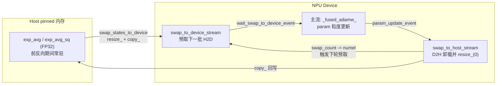

# Swap Optimizer（优化器状态卸载 Host 内存）

## Summary

Swap Optimizer 把 AdamW 优化器状态在前向 / 反向期间**卸载到 Host（CPU pinned）内存**、仅在 `optimizer.step()` 时以 **param 为粒度的「加载 → 更新 → 卸载」切片流水**搬回 device 计算，从而压低 device 显存峰值。源自 MindSpeed `SwapOptimizer`，[torchtitan](../frameworks/torchtitan.md) 域由 **torchtitan-npu** 以 `SwapOptimizersContainer` + monkey-patch `AdamW.step` 的方式参考实现。DeepSeek-V3.2 预训练用它配合 [fsdp](../parallelism/fsdp.md) 与 Atlas A3 的高速 H2D 带宽，是 671B 长序列全量训练「最小化部署」的关键一环。

## 动机

AdamW 为每个参数维护 **两个 FP32 动量**（`exp_avg`、`exp_avg_sq`；amsgrad 时再加 `max_exp_avg_sq`），内存代价约为参数量的 2~3 倍。而前向 / 反向计算期间优化器并不被使用——这部分状态在前反向期间白白占用 device 内存。Swap 把它们换到 Host，只在更新瞬间换回，并用切片流水让搬运与计算重叠，避免「整块换回」造成新的内存峰值。

## 配置开关与统一路由

开关由 NPU `OptimizerConfig` 描述、经 `SwapOptimizersContainer.Config.build()` 统一路由（下述）；三个字段：`name`（默认 `"AdamW"`）/ `swap_optimizer`（默认 `false`）/ `swap_optimizer_times`（默认 `16`）。

模型的 `config_registry.py` 统一用 `torchtitan_npu.config.configs.OptimizerConfig` 描述优化器参数（例如 `models/deepseek_v3/config_registry.py` 直接 `OptimizerConfig(name="AdamW", lr=..., swap_optimizer=True, swap_optimizer_times=16)`）：

```python
# torchtitan_npu/config/configs.py
class OptimizerConfig(OptimizersContainer.Config):
    swap_optimizer: bool = False
    swap_optimizer_times: int = 16   # 切片数：越大 → 切片越小越多 → step 内峰值越低
```

`config/configs.py` 只承载**参数定义**，不维护 swap 的分支构建逻辑。唯一的 swap 开关路由在 `SwapOptimizersContainer.Config.build()`：`swap_optimizer=False` 时回退到上游基础 `OptimizersContainer`（`_base_optimizer_config(self)`），`swap_optimizer=True` 时构造 `SwapOptimizersContainer`；NPU `OptimizerConfig.build()` 由 patch 层适配转入同一套路由：

```python
# torchtitan_npu/patches/optimizer/swap_optimizer.py — SwapOptimizersContainer.Config.build
def build(self, **kwargs):
    _check_build_kwargs(self, kwargs)
    if not self.swap_optimizer:
        return OptimizersContainer(config=_base_optimizer_config(self), **kwargs)  # 上游基础容器
    ...
    return self._owner(config=replace(self), **kwargs)                              # SwapOptimizersContainer
```

`swap_optimizer_times` 决定流水切片数：`step()` 把每个 optimizer 的总元素数均分成这么多片，单片 numel 即下文的 `swap_numel` 上限。Muon 优化器**不支持** swap（见 [muon-optimizer](muon_optimizer.md)）。CLI 也可覆盖：`--optimizer.swap-optimizer --optimizer.swap-optimizer-times 16`。

## 机制

### 入口 patch：Config.build 路由 + step 替换

torchtitan-npu 不改 TorchTitan 上游代码，注入点是上文的 `SwapOptimizersContainer.Config.build()` 路由：`swap_optimizer=True` 时构造 `SwapOptimizersContainer`，并在其 `__init__` 中把 `AdamW.step` / `Adam.step` 整体换成自定义 `swap_optimizer_step`：

```python
# SwapOptimizersContainer.__init__
torch.optim.AdamW.step = swap_optimizer_step   # monkey-patch step
torch.optim.Adam.step = swap_optimizer_step
logger.info("[SwapOptimizer] Patched AdamW.step and Adam.step")
if SwapOptimizersContainer.swap_to_device_stream is None:   # 惰性建流
    SwapOptimizersContainer.swap_to_device_stream = get_torch_device().Stream()
    SwapOptimizersContainer.swap_to_host_stream = get_torch_device().Stream()
# torchtitan_npu/patches/optimizer/swap_optimizer.py
```

### 状态初始化：device 占位清零 + Host pinned 副本

`SwapOptimizersContainer` 持有两条独立 stream（`swap_to_device_stream` / `swap_to_host_stream`）与一组 event map（搬入/搬出/更新各一），用 event 在三条逻辑流间建依赖。初始化时为每个 param 建立 device state 与 CPU 副本，并**立即把 device state 的底层 storage `resize_(0)`** 释放显存——device 上只保留「空壳」，真正数据在 pinned CPU：

```python
device_state[key] = torch.zeros_like(param, memory_format=torch.contiguous_format)
unwrap_dtensor(device_state[key]).untyped_storage().resize_(0)  # offload device states
cpu_state[key] = torch.zeros_like(
    unwrap_dtensor(param), pin_memory=True, device="cpu")
# torchtitan_npu/patches/optimizer/swap_optimizer.py — param_state_initialization
```

`state_keys = ["exp_avg", "exp_avg_sq", "max_exp_avg_sq"]`；非 amsgrad 时 `max_exp_avg_sq` 两侧均置 `None`，不分配。

### DTensor 处理

与 MindSpeed 不同，TorchTitan 权重在 FSDP2 / TP 下是 **DTensor**。所有搬运、`numel()`、`zeros_like` 都先经 `unwrap_dtensor` 取本地分片再操作——swap 只针对每卡持有的 local shard，不触发跨卡通信：

```python
def unwrap_dtensor(tensor):
    if isinstance(tensor, DTensor):
        return tensor.to_local()
    return tensor
# torchtitan_npu/patches/optimizer/swap_optimizer.py
```

### H2D / D2H 搬运原语

搬入 `swap_states_to_device`：对 storage 大小为 0 的 device state，先 `resize_` 回原大小再 `copy_(cpu_state, non_blocking=True)`，并在当前流 record 一个 device-event。搬出 `swap_states_to_host`：把 device state `copy_` 回 pinned CPU、随即 `resize_(0)` 释放显存，并 record host-event。两者均 `non_blocking=True`，依赖 event 串依赖、不串流水。

### param 粒度切片流水：load → update → offload

`swap_optimizer_step` 顺序遍历所有 param。**预取式加载**：只在 `swap_count == 0`（即缓冲被消费空）时调用 `pipeline_load_param`，一次性预加载到累计 numel 逼近 `swap_numel` 的一批 param（缓冲满即停），加载发生在 `swap_to_device_stream` 上，与主流的更新计算重叠：

```python
def pipeline_load_param(swap_numel, params_list, start_index, current_swap_count):
    with torch_device.stream(SwapOptimizersContainer.swap_to_device_stream):
        torch_device.current_stream().wait_stream(
            SwapOptimizersContainer.swap_to_host_stream)
        idx = start_index
        while idx < len(params_list):
            if params_list[idx].grad is None:
                idx += 1; continue                      # 跳过无梯度 param
            numel = unwrap_dtensor(params_list[idx]).numel()
            if current_swap_count > 0 and current_swap_count + numel > swap_numel:
                break                                   # 缓冲满则停止加载
            SwapOptimizersContainer.swap_states_to_device(params_list[idx])
            current_swap_count += numel
            idx += 1
    return current_swap_count
# torchtitan_npu/patches/optimizer/swap_optimizer.py
```

**更新**在主流：先 `wait_swap_to_device_event(param)` 等该 param 的 H2D 搬入完成，再调用 `param_update`，随后 record 一个 update-event。**卸载**在 `swap_to_host_stream`：先 `wait_param_update_event(param)` 等更新算完，把 `swap_count` 减回该 param 的 numel（腾出缓冲触发下一轮预取），再 `swap_states_to_host` 写回 Host：

```python
# update
SwapOptimizersContainer.wait_swap_to_device_event(param)
param_update(param, state, group)
SwapOptimizersContainer.param_update_events_map[param] = \
    get_torch_device().current_stream().record_event()
# offload
with get_torch_device().stream(SwapOptimizersContainer.swap_to_host_stream):
    SwapOptimizersContainer.wait_param_update_event(param)
    swap_count -= unwrap_dtensor(param).numel()
    SwapOptimizersContainer.swap_states_to_host(param)
# torchtitan_npu/patches/optimizer/swap_optimizer.py — swap_optimizer_step
```

由此形成三段重叠流水：当前 param 在主流更新时，下一批 param 已在 device-stream 上 H2D，上一个 param 在 host-stream 上 D2H 卸载。`swap_numel = swap_num // swap_optimizer_times` 控制在途缓冲大小——切片越多，单时刻驻留 device 的优化器状态越少，峰值越低（但搬运次数越多）。

### 实际更新算子

`param_update` 直接调用 PyTorch 融合 Adam kernel，按 `decoupled_weight_decay` 选 `torch._fused_adamw_` / `torch._fused_adam_`，单 param 入参（fused 单元素 list），AdamW 解耦权重衰减走前者：

```python
step_func = torch._fused_adamw_ if param_group["decoupled_weight_decay"] else torch._fused_adam_
step_func([param], [param.grad], [state["exp_avg"]], [state["exp_avg_sq"]],
          [state["max_exp_avg_sq"]] if param_group["amsgrad"] else [],
          [param_group["step"]], amsgrad=..., lr=..., beta1=beta1, beta2=beta2, ...)
# torchtitan_npu/patches/optimizer/swap_optimizer.py — param_update
```



## DCP Checkpoint 集成

Swap Optimizer 已支持与 torchtitan 的 DCP（Distributed Checkpoint）组合保存 / 续训，见 [checkpoint-dcp-hf](checkpoint_dcp_hf.md)。核心约束：device 侧 state 在前反向期间是被 `resize_(0)` 清空的「零显存占位」，真实优化器状态只在 pinned CPU cache —— 因此 checkpoint 必须从 CPU cache 出入，不能直接序列化空壳。

**保存（`state_dict`）**：先 `_wait_pending_swap_to_host()` 同步 `swap_to_host_stream`、等待所有 pending swap/offload 写回完成，再逐 param 从 `param_to_cpu_states_map` 取真实 Adam/AdamW state（`exp_avg` / `exp_avg_sq` / 可选 `max_exp_avg_sq` / `step`）写入 flat state_dict：

```python
def state_dict(self):
    self._wait_pending_swap_to_host()           # 等 D2H 卸载落盘
    state_dict = {}
    for model_part, optim in zip(self.model_parts, self.optimizers):
        state_dict.update(self._optimizer_state_dict(model_part, optim))
    return state_dict
# torchtitan_npu/patches/optimizer/swap_optimizer.py
```

`_tensor_for_state_dict` 防御性校验：若某 state 的 local storage 已为 0 且无 CPU cache 兜底，则 `raise RuntimeError("Cannot checkpoint a swapped optimizer state without CPU cache.")`。对 **DTensor** 参数，保存走 `wrap_like_param_without_device_move`：用 `DTensorSpec(device_mesh, placements, TensorMeta(shape, stride, dtype))` 重建全局元数据包住 **CPU local shard**，**不把 CPU cache tensor 回搬 NPU** —— 与运行期搬运用的 `wrap_like_param`（`DTensor.from_local`，落在 device）刻意区分。

**加载（`load_state_dict`）**：先 `_save_optimizer_states` / `_save_param_groups` 快照以便异常回滚，再逐 param `_load_param_state`：把 checkpoint 值 `_clone_to_cpu_cache`（pinned CPU）写回 `param_to_cpu_states_map`，并用 `_clone_loaded_state_for_device_placeholder` 在 device 侧 `empty_strided` 后立即 `untyped_storage().resize_(0)` **重建零显存占位**，从而恢复到「CPU 有真值、device 是空壳」的可续训状态；最后 `_empty_device_cache`：

```python
def load_state_dict(self, state_dict):
    original_states = self._save_optimizer_states()
    original_param_groups = self._save_param_groups(self.optimizers)
    try:
        for model_part, optim in zip(self.model_parts, self.optimizers):
            self._load_optimizer_state_dict(model_part, optim, state_dict)
    except Exception:
        self._restore_states(original_states); self._restore_param_groups(original_param_groups); raise
    self._empty_device_cache()
# torchtitan_npu/patches/optimizer/swap_optimizer.py
```

## 与 MindSpeed 的差异

本实现在 TorchTitan 框架下参考 MindSpeed `SwapOptimizer`，有两点不同：

- TorchTitan 训练中优化器只管理两个 FP32 动量（amsgrad 关闭时 `max_exp_avg_sq=None`）。
- 需处理权重为 **DTensor** 的场景（FSDP2 / TP 切分），所有搬运经 `unwrap_dtensor` 落到 local shard。

<p align="center"></p>
<p align="center"><sub>图：param 粒度「加载—更新—卸载」切片流水，H2D/D2H 与更新计算重叠（<a href="https://gitcode.com/cann/cann-recipes-train/blob/d17909ef35e0eee1f5bc81189a12d2abebb0b4c2/docs/llm_pretrain/deepseek-v32_pre_train_optimization.md">DeepSeek-V3.2 预训练优化文档</a>·内存优化 / Swap Optimizer）</sub></p>

## MindSpeed Swap Optimizer 实现

torchtitan-npu 的 swap 派生自 MindSpeed `SwapDistributedOptimizer`，二者同属「前反向期间把优化器侧 FP32 状态卸到 Host、step 内以切片流水换回」的思路；但 MindSpeed 直接长在 **Megatron 分布式优化器**上，卸载对象更全、更新算子也不同。整体显存账见 [optimizer-memory](optimizer_memory.md)，框架侧见 [mindspeed](../frameworks/mindspeed.md)。

### 注入点与适用约束

`SwapOptimizerFeature`（开关 `--swap-optimizer`）在 optimizer 名含 `adam`（即 `--optimizer-selection fused_adamw`）时，把 `megatron.core.optimizer.distrib_optimizer.DistributedOptimizer` 整类替换为 `SwapDistributedOptimizer`，并把 `mindspeed.core.optimizer.adamw.AdamW.step` 换成 `swap_adamw_step`。仅在开启分布式优化器（`--use-distributed-optimizer` 或 `--use-layer-wise-distributed-optimizer`）时可用，否则 `validate_args` 直接抛错；与 `--reuse-fp32-param`、fused ema adamw 互斥。Muon 优化器走另一条 `swap_muon` 路径，不复用本类。`--swap-optimizer-times` 默认 16，越小则单批换得越大、并行越多、性能劣化越小但峰值越高。

### 卸载三类张量（与 torchtitan 的关键差异）

Megatron 分布式优化器里每个 fp16/bf16 模型权重对应一份 **FP32 master 副本**（`shard_fp32_from_float16`），AdamW 又为它维护 `exp_avg` / `exp_avg_sq` 两个 FP32 动量——合计 `参数量 × 12` Bytes 在前反向期间纯属占用。MindSpeed 把这三者**全部**卸到 Host pinned 内存：`create_tensor_maps` 给 fp16/bf16 主参数建 `cpu_state = {'param': pinned}`，`init_param_opt_state` 再给两动量各建 pinned 副本；device 侧一律 `storage().resize_(0)` 只留逻辑视图。这是与 torchtitan 的最大区别——torchtitan 权重由 FSDP2 以 DTensor 管理、optimizer 里没有独立 master 权重，故只卸两个动量。纯 FP32 模型参数（`shard_fp32_groups`）落入 `no_swap_params`：权重本体前反向要用、不卸，只卸其优化器状态。

### 初始化即随建随卸

`_build_model_and_main_param_groups` 每 clone 出一份 `shard_main_param` 就立刻 `swap_tensors_to_host`，避免建满整组 master 权重时冲击峰值（只发生在初始化，性能影响可忽略）。`init_param_opt_state` 给动量建 device 占位、copy 进 pinned CPU 后随即 `resize_(0)`。`swap_numel = swap_num // swap_optimizer_times`（`swap_num` 为全部 master 参数元素数）即单批在途上限；构造时按 `swap_num × 12 / MB` 打印本卡卸载量。

### step 三流水：预取 → 更新 → 回拷 → 卸载

`swap_adamw_step` 顺序遍历 `param_to_group_map`，靠两条 stream（`swap_to_device_stream` / `swap_to_host_stream`）加三组 event map（`swap_to_device` / `copy_to_model_param` / `swap_to_host`）串联依赖：

- **预取**：仅在 `swap_count == 0`（缓冲消费空）时，在 device stream 上 `wait_stream(swap_to_host_stream)` 后一次性 `swap_tensors_to_device` 预取累计 numel 逼近 `swap_numel` 的一批 master 参数 + 动量（`resize_` 回真实大小再 `copy_`，`non_blocking`）。
- **更新**：主流先 `wait_swap_to_device_event(param)`，再调 **`npu_apply_fused_adamw_v2`**（NPU 自研融合 AdamW kernel，区别于 torchtitan 走的 `torch._fused_adamw_`）原地更新 master 参数与两动量。
- **回拷**：`copy_tensor_to_model_param` 把更新后的 FP32 master 写回 bf16 模型权重，record 一个 `copy_to_model_param` event——这一步是 master-weight 设计独有，torchtitan 无此环节。
- **卸载**：在 host stream 上 `wait_copy_to_model_event(param)` 等回拷完成，`swap_count -= numel` 腾缓冲触发下一轮预取，再 `swap_tensors_to_host` 把 master 参数 + 动量写回 pinned CPU 并 `resize_(0)` 释显存。

由此 master 权重既要从 host 取回更新、又要在更新后回写 bf16 权重再卸回 host，比 torchtitan「只搬动量」多一条 master↔model 回拷链；第二轮 d2h 须等前一轮 h2d 结束再下发以保异步拷贝时序正确。

### Checkpoint 走 Megatron DP-zero

不依赖 torchtitan 的 DCP。`get_parameter_state_dp_zero` 收集 DP rank0 全量状态时，对已卸载参数直接从 `param_to_cpu_states_map` 取 host 真值（`tensors = param_to_cpu_states_map[main_param]`）而非读 device；`load_parameter_state_from_dp_zero` 回写时，若某 state 的 device storage 为 0 就把值写进对应 `cpu_state[key]`，维持「真值在 host、device 是空壳」的可续训态。

## Evidence

- [cann-recipes-train](https://gitcode.com/cann/cann-recipes-train/tree/d17909ef35e0eee1f5bc81189a12d2abebb0b4c2) — [`docs/llm_pretrain/deepseek-v32_pre_train_optimization.md`](https://gitcode.com/cann/cann-recipes-train/blob/d17909ef35e0eee1f5bc81189a12d2abebb0b4c2/docs/llm_pretrain/deepseek-v32_pre_train_optimization.md)（内存优化 / Swap Optimizer 方法论）
- [torchtitan-npu](https://gitcode.com/cann/torchtitan-npu) — [`docs/feature_guides/swap_optimizer.md`](https://gitcode.com/cann/torchtitan-npu/blob/8f128cd177e9c9a14d9b70f4491bde28bc342481/docs/feature_guides/swap_optimizer.md)（特性原理、统一 `OptimizerConfig` 路由、配置项表、DCP checkpoint 组合）
- 实现源（@8f128cd）：[`torchtitan_npu/patches/optimizer/swap_optimizer.py`](https://gitcode.com/cann/torchtitan-npu/blob/8f128cd177e9c9a14d9b70f4491bde28bc342481/torchtitan_npu/patches/optimizer/swap_optimizer.py)（`SwapOptimizersContainer` + 内嵌 `Config.build()` 路由、`swap_states_to_device/host`、`pipeline_load_param`、`swap_optimizer_step`、`param_update`、`state_dict`/`load_state_dict`、`wrap_like_param_without_device_move`）
- 配置源（@8f128cd）：[`torchtitan_npu/config/configs.py`](https://gitcode.com/cann/torchtitan-npu/blob/8f128cd177e9c9a14d9b70f4491bde28bc342481/torchtitan_npu/config/configs.py)（`OptimizerConfig.swap_optimizer` / `swap_optimizer_times` 字段定义）；模型侧 [`torchtitan_npu/models/deepseek_v3/config_registry.py`](https://gitcode.com/cann/torchtitan-npu/blob/8f128cd177e9c9a14d9b70f4491bde28bc342481/torchtitan_npu/models/deepseek_v3/config_registry.py)（`OptimizerConfig(swap_optimizer=True, swap_optimizer_times=16)` 实例）
- 上游参考：MindSpeed `mindspeed/core/optimizer/swap_optimizer/swap_optimizer.py`（torchtitan-npu 实现的派生来源，见文件头版权声明）
- [mindspeed](https://gitcode.com/ascend/MindSpeed) — [`docs/zh/features/swap-optimizer.md`](https://gitcode.com/Ascend/MindSpeed/blob/1432cb092818b870c31b61db0eb6d3378b7fbdad/docs/zh/features/swap-optimizer.md)（背景：`参数量 × 12` Bytes 优化器状态、随建随卸、step 三段并行、`--use-distributed-optimizer` + `--optimizer-selection fused_adamw` 约束）
- MindSpeed 实现源（@1432cb09）：[`mindspeed/core/optimizer/swap_optimizer/swap_optimizer.py`](https://gitcode.com/Ascend/MindSpeed/blob/1432cb092818b870c31b61db0eb6d3378b7fbdad/mindspeed/core/optimizer/swap_optimizer/swap_optimizer.py)（`SwapDistributedOptimizer`、`opt_states_initialization`/`init_param_opt_state`、`create_tensor_maps`、`swap_tensors_to_device`/`swap_tensors_to_host`、`copy_tensor_to_model_param`、`swap_adamw_step`、`get_parameter_state_dp_zero`/`load_parameter_state_from_dp_zero`、`no_swap_params`）
- MindSpeed 特性注册（@1432cb09）：[`mindspeed/features_manager/optimizer/swap_optimizer_feature.py`](https://gitcode.com/Ascend/MindSpeed/blob/1432cb092818b870c31b61db0eb6d3378b7fbdad/mindspeed/features_manager/optimizer/swap_optimizer_feature.py)（`--swap-optimizer`/`--swap-optimizer-times`、`validate_args` 排除 `reuse_fp32_param` + 校验分布式优化器、`register_patches` 按 adam / muon 分流）；NPU 融合算子 [`mindspeed/ops/npu_apply_fused_adamw_v2.py`](https://gitcode.com/Ascend/MindSpeed/blob/1432cb092818b870c31b61db0eb6d3378b7fbdad/mindspeed/ops/npu_apply_fused_adamw_v2.py)（`swap_adamw_step` 调用的实际更新 kernel）

## Links

- [deepseek-v32-pretrain](../../guides/recipes/deepseek_v32_pretrain.md)（所属预训练实践，内存优化主线之一）
- [fsdp](../parallelism/fsdp.md)（与 FSDP2 零冗余权重共同压低单卡显存；swap 经 `unwrap_dtensor` 处理 FSDP2 切出的 DTensor 分片）
- [torchtitan](../frameworks/torchtitan.md)（实现所在框架；torchtitan-npu 经 `SwapOptimizersContainer.Config.build()` 路由注入）
- [kvcache-offload](../../../inference/concepts/techniques/kvcache_offload.md)（跨域：推理侧的 Host 卸载思路对照）
- [mindspeed](../frameworks/mindspeed.md)（SwapOptimizer 特性上游来源 MindSpeed）
- [deepseek-v4-continue-pretrain](../../guides/recipes/deepseek_v4_continue_pretrain.md)（V4 续训用 Swap 把常驻 16→8 字节/参数）
- [deepseek-r1-rl](../../guides/recipes/deepseek_r1_rl.md)（RL 训练侧经 MindSpeed `swap_optimizer=True` 复用本优化卸载优化器状态）
- [verl](../frameworks/verl.md)（veRL RL 训练后端经 swap_optimizer=True 复用本优化）
- [train-rollout-switch](train_rollout_switch.md)（RL 训推切换 offload 与本优化协同压显存）
- [qwen3-rl](../../guides/recipes/qwen3_rl.md)（Qwen3 235B RL 训练内存优化）
- [checkpoint-dcp-hf](checkpoint_dcp_hf.md)（DCP checkpoint 保存/续训：swap state 从 CPU cache 出入、device 侧重建零显存占位）
- [muon-optimizer](muon_optimizer.md)（Muon 优化器不支持 swap 卸载，路由层显式排除）
- [virtual-optimizer](virtual_optimizer.md)（同属优化器侧显存优化技术，可对照不同显存换计算取舍）
- [swap-attention](swap_attention.md)（激活侧 Host 卸载对照：本页卸优化器状态，swap-attention 卸前向激活，常配合压显存）

<!-- cannbot:related:start -->
## 相关

- [DCP / HF Checkpoint（torchtitan-npu 断点恢复与权重导出）](checkpoint_dcp_hf.md)（`related`）：“开启后优化器 state 仍随 DCP checkpoint 完整保存与恢复”给出焦点端事实；“checkpoint 必须从 CPU cache 出入，不能直接序列化空壳。”给出候选端事实。Checkpoint 卡承诺 swap optimizer state 的 DCP 保存恢复语义，Swap Optimizer 卡给出 CPU cache 是真实状态源的实现约束，二者闭合保存与续训合同。
- [DeepSeek-R1 veRL + MindSpeed + vLLM-Ascend 全共卡 GRPO RL 训练](../../guides/recipes/deepseek_r1_rl.md)（`related`）：`swap_optimizer=True` 即 Ascend Swap Optimizer；优化器状态在前向 / 反向期间**卸载到 Host（CPU pinned）内存**；连接配置开关与显存机制。
- [RL 训推切换（Train/Rollout Switch：reshard / offload / D2D）](train_rollout_switch.md)（`related`）：Swap Optimizer 把 AdamW 优化器状态在前向 / 反向期间**卸载到 Host（CPU pinned）内存**、仅在 `optimizer.step()` 时以 **param 为粒度的「加载 → 更新 → 卸载」切片流水**搬回 device 计算，从而压低 device 显存峰值。；`MegatronOffLoader` 用 `offload_train_optimizer` / `offload_train_grad` / `offload_train_param` 三个 `generate_config` 开关分别控制优化器状态、梯度、权重的卸载。两者在 RL 全共卡训推切换时衔接为优化器态卸载的机制选择与切换期显存释放。
- [Swap Attention（激活换出 Host + SmartSwap + 自适应内存）](swap_attention.md)（`related`）：与 ［swap-optimizer］(swap_optimizer.md) 把**优化器状态**换出 Host 的思路同源、对象不同（激活 vs 优化器动量）。；Swap Optimizer 把 AdamW 优化器状态在前向 / 反向期间**卸载到 Host（CPU pinned）内存**、仅在 `optimizer.step()` 时以 **param 为粒度的「加载 → 更新 → 卸载」切片流水**搬回 device 计算，从而压低 device 显存峰值。；双方明确区分激活与优化器状态两种 Host offload 对象，形成显存处置选型。
- [Virtual Optimizer（优化器显存虚拟化）](virtual_optimizer.md)（`related`）：Swap 卡说明“Swap Optimizer 把 AdamW 优化器状态在前向 / 反向期间**卸载到 Host（CPU pinned）内存**、仅在 `optimizer.step()` 时以 **param 为粒度的「加载 → 更新 → 卸载」切片流水**搬回 device 计算，从而压低 device 显存峰值。”；Virtual 卡则指出“与 ［swap-optimizer］(swap_optimizer.md)（手动三流 H2D/D2H 拷贝 + 切片 `resize_(0)` 的流水化 swap）不同，Virtual Optimizer 走的是**地址映射、代码透明**的路线：动量张量的内存物理上常驻 Host，但对训练代码而言其使用方式与普通 NPU 张量无异。”，两端能直接支撑同一优化器显存问题下的互斥路线选型，但核心机制不同。
- [优化器显存优化（Reuse-FP32-Param / 低精度优化器 / LayerZeRO）](optimizer_memory.md)（`related`）：混合精度训练的静态显存大头在优化器一侧：FP32 参数副本（master weight）、FP32 梯度、Adam 一二阶动量。MindSpeed 提供三条正交的优化器显存压缩路线，分别从「副本冗余」「精度冗余」「分片维度」三个角度切入——**Reuse-FP32-Param** 让 FP32 master 与 BF16 工作权重共享同一份 storage，省掉一份权重副本；**低精度优化器**把动量量化到 FP8/HiF8/MXFP8、梯度量化到 FP16，压缩动量与梯度的字节数；**LayerZeRO** 用「ZeRO1 存优化器状态 + ZeRO3 重建参数」的分层分片，在多模态长序列场景拿到接近 TP+ZeRO1 的省显存效果且通信可隐藏。三者与 ［swap-optimizer］(swap_optimizer.md)（把动量换出 Host）、［virtual-optimizer］(virtual_optimizer.md)（驱动级虚拟内存映射）一起构成 ［mindspeed］(../frameworks/mindspeed.md) 的优化器显存工具箱，各自有适用面与互斥约束。；Swap Optimizer 把 AdamW 优化器状态在前向 / 反向期间**卸载到 Host（CPU pinned）内存**、仅在 `optimizer.step()` 时以 **param 为粒度的「加载 → 更新 → 卸载」切片流水**搬回 device 计算，从而压低 device 显存峰值。源自 MindSpeed `SwapOptimizer`，［torchtitan］(../frameworks/torchtitan.md) 域由 **torchtitan-npu** 以 `SwapOptimizersContainer` + monkey-patch `AdamW.step` 的方式参考实现。DeepSeek-V3.2 预训练用它配合 ［fsdp］(../parallelism/fsdp.md) 与 Atlas A3 的高速 H2D 带宽，是 671B 长序列全量训练「最小化部署」的关键一环。。显存工具箱卡列出 Swap，目标卡闭合状态切片、Host pinned 驻留和 optimizer.step 搬算流水。
<!-- cannbot:related:end -->
