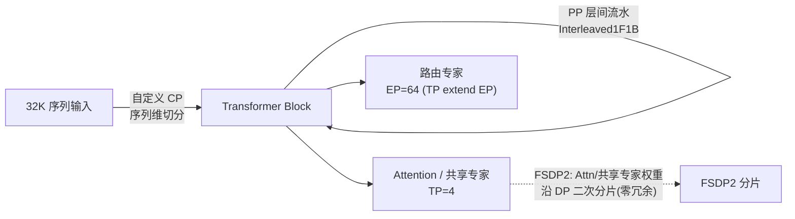

# DeepSeek-V3.2 TorchTitan 32K 长序列预训练

## Summary

基于 [torchtitan](../../concepts/frameworks/torchtitan.md) + `torchtitan-npu` 插件（样例版本 `v0.2.2`），**DeepSeek-V3.2**（671B / 61 层，DSA 稀疏注意力）**32K 长序列预训练 / CPT** 在 **64 卡 Atlas A3** 集群上达到 **148 TPS/卡**。训练使用 5D 混合并行（FSDP2+TP+PP+EP+自定义 CP）、**DSA 反向算子**（SLIG / SFAG），以及 `torch.compile + Inductor` 的模型到算子编译路径。DeepSeek-V3.2 与推理侧 [deepseek-v3.2-exp](../../../inference/concepts/models/deepseek_v3_2_exp.md) 同属 DSA 模型谱系。

## 训练配置与拉起

完整 671B 预训练的权威配置为 `deepseek_v32_671b_61layers_32k_128die.toml`（`model.flavor = "671B_debug_128die"`）；关键并行度与 converters 逐字取自该 toml：

```toml
[model]
converters = ["npu_dsa", "npu_rms_norm", "npu_permute", "npu_gmm", "npu_rope"]
[optimizer]
name = "AdamW"; swap_optimizer = true; swap_optimizer_times = 16
[training]
local_batch_size = 1; global_batch_size = 128; seq_len = 32768
[parallelism]
data_parallel_shard_degree = -1     # FSDP2 吃满剩余维度
tensor_parallel_degree = 4
expert_parallel_degree = 64; expert_tensor_parallel_degree = 1
context_parallel_degree = 8
enable_custom_context_parallel = true
pipeline_parallel_degree = 1; pipeline_parallel_schedule = "Interleaved1F1B"
[activation_checkpoint]
mode = "full"
# torchtitan_npu/models/deepseek_v32/train_configs/deepseek_v32_671b_61layers_32k_128die.toml
```

`converters` 是 TorchTitan ModelConverter 机制的开关位 —— 作用在模型定义后、并行策略应用前，不改上游模型代码即可逐项注册 NPU 融合算子（`npu_dsa` = LI/SFA/SLIG 三件套，其余四个为 RMSNorm/Permute/GMM/Rope 基础融合算子）。`global_batch_size=128`（gbs 梯度累积仅在 PP=1 时推荐开）。

**拉起命令**（脚本与 toml 均在 `torchtitan-npu` 仓内，需先 `cd torchtitan-npu`）：

```shell
# 64 卡 671B 全量预训练（8 机同时拉起，先改 run_train_multinodes.sh 的 IPs / Network_Interface）
CONFIG_FILE="./torchtitan_npu/models/deepseek_v32/train_configs/deepseek_v32_671b_61layers_32k_128die.toml" \
  bash ./scripts/run_train_multinodes.sh
# 单机 debug（2 层=1moe+1dense 裁剪），可叠加 inductor compile
NGPU=16 CONFIG_FILE=".../deepseek_v32_671b_debug.toml" bash ./scripts/run_train.sh \
  --compile.enable --model.converters "npu_bypass_triton_codegen"
# llm_pretrain/deepseekv32/README.md
```

数据用 enwiki parquet，`utils/parquet2json.py` 转 jsonl（全量约 12GB→20GB）；权重用 `weight_convert.sh` 把 DeepSeek-V3.2 官方 **FP8 → Bfloat16**：

```shell
bash utils/weight_convert.sh --input_fp8_hf_path /data/models/DeepSeek-V3.2 \
  --output_hf_path /data/models/DeepSeek-V3.2-bf16 --quant_mode bfloat16
# llm_pretrain/deepseekv32/README.md（convert_model.py 为核心；output_hf 即 toml 的 hf_assets_path）
```

| 维度 | 取值 |
|------|------|
| 模型 | DeepSeek-V3.2，671B / 61 层（debug 用 2 / 4 / 8 层裁剪模型） |
| 框架 | TorchTitan + `torchtitan-npu` 插件 `v0.2.2`（`torchtitan_npu.entry`） |
| 平台 / 规模 | Atlas A3，64 卡（671B 全量预训练最小部署规模） |
| 序列长度 | 32K（`seq_len=32768`） |
| 并行（toml） | **TP4 × EP64 × CP8**，PP1（`Interleaved1F1B` 预留），FSDP2 吃满剩余 DP 维 |
| 权重存储 | TorchTitan 用 FP32 存模型权重（671B 权重 + 梯度约 5368GB，超 32 卡 A3 总内存 4096GB → 64 卡最小） |
| 软件 | CANN 9.0.0-beta.1，py3.11，官方公开镜像 |



## 关键优化

### 5D 混合并行（链 [torchtitan](../../concepts/frameworks/torchtitan.md)）

并行由 `parallelize_deepseekv32()` 装配：先 `apply_non_moe_tp` 切非 MoE 部分，CP 启用时把 attention 的 `attn_type` 从 `sdpa` 覆盖为 `dsa`（避免 DTensor dispatcher 拦截 `npu_lightning_indexer`），再 `apply_moe_ep_tp` 切 MoE，最后 `apply_fsdp`。

- **MoE TP 策略优化**（链 [torchtitan-5d-parallel](../../concepts/parallelism/torchtitan_5d_parallel.md)）：把 TorchTitan 原生 MoE TP 中位置不合理的 AllGather/ReduceScatter 从路由专家分支移到共享专家分支，消除路由分支冗余 topk/SP 与共享分支不安全的 Partial 状态。大 EP 场景路由专家不做 TP 切分（TP extend EP）。代码层把 TP 域的 AllGather/ReduceScatter 收敛到共享专家分支——路由专家分支消除冗余 topk 与 SP，共享专家退化为普通 TP：

  ```python
  experts_plan = ExpertParallel()           # ep_mesh：路由专家走纯 EP，无 TP 切分
  "moe.shared_experts": PrepareModuleInput(  # 共享专家：AllGather 输入
      input_layouts=(Shard(0),), desired_input_layouts=(Replicate(),))
  "moe.shared_experts.w2": RowwiseParallel(output_layouts=Shard(0))  # ReduceScatter 输出
  # torchtitan_npu/models/deepseek_v32/infra/parallelize.py: apply_moe_ep_tp
  ```

- **自定义 CP for DSA**（链 [custom-cp-dsa](../../concepts/parallelism/custom_cp_dsa.md)）：torch 原生 CP 只支持 SDPA、把 Attention 换成 RingAttention/AllGatherKV；DSA 内含 Lightning Indexer + 稀疏注意力且非 SDPA，原生 CP 不适用。方案是实现 `CustomContextParallelContext` 基类（只做输入序列维切分），子类在 DSA forward 上 patch 一次「对 KV 做序列维 AllGather」即可——weight-absorb 下 KV 与 indexer key 内存很小，AllGather 代价可接受。
- **DTensor Sharding 策略优化**（链 [torchtitan-5d-parallel](../../concepts/parallelism/torchtitan_5d_parallel.md)）：用 PyTorch 自带的 matmul 策略生成函数纠正 DTensor 默认 sharding，令 q_lora/output 等算子的输入输出不再做多余切分状态转换，从而消除 Slice/AllReduce/AllGather/AllToAll 等冗余操作。默认 matmul sharding 会把本应 Replicate 的 q_lora 矩阵乘改成权重 TP 行切，引入多余 Slice + Partial→Replicate 的 AllReduce。修正用 PyTorch 自带的 matmul 策略生成函数；matmul backward 无现成函数，遂对 dX/dW 两个矩阵乘分别调 `_mm_like_strategy` 再融合，分别取「不调 W 切分」(dX) 与「dW 与 W 切分一致」(dW) 的策略，消除多余 Slice/AllGather/AllToAll。

### 内存优化（链 [fsdp](../../concepts/parallelism/fsdp.md)）

- **最小化切分策略**：671B 在 FP32 权重下权重+梯度即 5368GB > 32 卡 A3 的 4096GB，故 64 卡是最小规模；以 `PP2TP4DP16` 估单卡非 MoE 权重+梯度约 `(671B−654B)/2/4*8B ≈ 18GB`（含不参与 TP 切分的 `qkv_a`/`indexer`，实际更高），权衡 MoE 负载不均后选 **PP2TP4EP64** 为基础。
- **FSDP2 零冗余权重**：大 EP 小 TP 下 MoE 已被 EP/PP 完全切分，但 Attention/共享专家权重在卡间冗余复制；FSDP2 (`data_parallel_shard_degree=-1`) 把这部分按 DP 域二次分片，逐层 AllGather/reshard，DP16 下近乎抹平冗余。
- **Swap Optimizer**（链 [swap-optimizer](../../concepts/techniques/swap_optimizer.md)）：AdamW 两个 FP32 动量在前反向期间卸载到 host（`swap_optimizer=true`、`swap_optimizer_times=16`），以 param 粒度把「加载→更新→卸载」做成切片流水。与 MindSpeed 版差异：TorchTitan 只管两个动量且需处理权重为 DTensor 的场景。
- **Activation Checkpoint**：`mode="full"`；selective 模式的 op 保存白名单 `_op_sac_save_list` 含 `aten.mm` / SDPA 系列 / `reduce_scatter_tensor` / `all_to_all_single` / `aten.max`（低精度训练保留 absmax）。

### DSA 训练融合算子

业界率先攻克 DSA 算子反向，正向件与推理侧共享、反向件为训练侧新增（Ascend C，`ops-transformer`）：

- **LI / SFA**：Lightning Indexer / Sparse Flash Attention 正反向融合 Kernel（正向同推理 [lightning-indexer](../../../inference/concepts/kernels/lightning_indexer.md) / [sparse-flash-attention](../../../inference/concepts/kernels/sparse_flash_attention.md)）。
- **SLIG**（链 [slig](../../concepts/kernels/slig.md)）：训练独有的 Indexer 反向梯度 + KL Loss 融合算子（KL Loss 公式、梯度推导、Tiling / 五阶段 Pipeline / srcGap 离散访存优化详见该页）。
  - 代码侧：CP/DSA 启用时，`inner_attention.compute_dsa_indexer_loss` 被替换为 `SparseLightningIndexerKLLoss()`，并配 `indexer_loss_plan`（对 query 与 softmax_max/sum 做 AllGather，保证 tp_group 内各 rank indexer loss 一致）。indexer loss 跨 PP/TP/DP/CP 用单次全局 `all_reduce(AVG)` 再乘 `pp_degree` 还原非 PP 域均值（`apply_distributed_indexer_loss_tracking`）。
- **SFAG**（链 [sfag](../../concepts/kernels/sfag.md)）：训练独有的 SFA 反向算子（沿用 FlashAttentionGrad 流程，合轴分核 / 起步连发 V0+C1 / 离散转连续访存等实现见该页）。

### FSDP2 + torch.compile + Inductor（链 [torchtitan](../../concepts/frameworks/torchtitan.md)）

- **A3 超节点权重预取全掩盖**：计算第 N 层时通信流已异步发起第 N+1 层 AllGather，算完即 reshard 释放显存；A3 高带宽互联把 AllGather 耗时压进计算窗口，Profiling 中预取通信几乎被 Device 计算完全覆盖。
- **Inductor host-bound 缓解**：编译期完成算子选型 / shape 推导 / 内存规划，运行时只剩精简 Kernel Launch；linear 层（aten::t + aten::matmul）host 下发 **409.5μs → 118.8μs**。`apply_compile` 对每个 TransformerBlock 编译，但跳过 `inner_attention`（已是 DSA 融合算子）与 experts（dispatch/combine），只编 MLAProlog/MLAEpilog 及 router/gate 等小算子密集处。
- **Bypass Triton**：NPU 上 Inductor 自动融合出的 Triton 算子编译慢、性能差。`npu_bypass_triton_codegen` converter 在 compile 前清空 `lowerings`/`decompositions` 让 Aten 算子 fallback 原始实现，并去除反向算子的 `require_contiguous` 布局约束，完全屏蔽 Triton 算子。
- **Future**：对接 [autofuse](../../../inference/concepts/frameworks/autofuse.md)（Ascend C 自动融合替代 Triton Codegen）、DualPipeV（待解 ZeRO3 DP 切分约束）、Async TP（Inductor 识别 all_gather+matmul / matmul+reduce_scatter pattern 自动分解重排）。

## Benchmark

**精度（收敛性）**：lm loss 由 step1 的 12.25 稳步降至 step37 的 8.37，grad norm 由 28.24 回落至 16.03，indexer loss 全程平稳递减——大规模分布式场景下精度正常。

<p align="center"></p>
<p align="center"><sub>图：lm loss step1 12.25→step37 8.37、grad norm 28.24→16.03 稳健收敛（<a href="https://gitcode.com/cann/cann-recipes-train/blob/d17909ef35e0eee1f5bc81189a12d2abebb0b4c2/docs/llm_pretrain/deepseek-v32_pre_train_optimization.md">DeepSeek-V3.2 预训练优化文档</a>·Benchmark / 精度）</sub></p>

对 DeepSeek-V3.2 新增的 Lightning Indexer 也同步训练——整个预训练过程中 indexer loss 稳步下降、全程平稳递减，与 lm loss / grad norm 收敛曲线一致，佐证大规模分布式场景下精度正常。

<p align="center"></p>
<p align="center"><sub>图：Lightning Indexer 训练 indexer loss 全程平稳递减（<a href="https://gitcode.com/cann/cann-recipes-train/blob/d17909ef35e0eee1f5bc81189a12d2abebb0b4c2/docs/llm_pretrain/deepseek-v32_pre_train_optimization.md">DeepSeek-V3.2 预训练优化文档</a>·Benchmark/精度）</sub></p>

**性能**：A3 64 卡 671B 全量预训练 **148 TPS/卡**。DSA 融合算子在裁剪模型上的内存 / 性能对比（训练长度 4K）：

| 裁剪模型 | 实现方式 | 内存 | 性能 |
|---------|---------|------|------|
| 8 层 | 原始小算子 | 58.32G | 155 TPS |
| 8 层 | 矩阵吸收 + DSA 融合算子 | 50.54G | 400 TPS |
| 4 层 | 原始小算子 | 54.58G | 402 TPS |
| 4 层 | 矩阵吸收 + DSA 融合算子 | 38.71G | 568 TPS |

完整模型进一步开启基础融合算子（RMSNorm 138.7→39.9μs / −71.2%，Permute 803.9→127.3μs / −84.2%，GMM 3.1→2.4ms / −22.6%），单 step 计算时间减少 **5.16%**；开启 inductor compile 后单层耗时减少 **5.1%**，MLAProlog host 下发 11.0ms→5.7ms（V3.2 计算集中于 SFA / LI，host 侧下发优化对整网增益有限）。

## Evidence

- [cann-recipes-train](https://gitcode.com/cann/cann-recipes-train/tree/d17909ef35e0eee1f5bc81189a12d2abebb0b4c2) — [`llm_pretrain/deepseekv32/README.md`](https://gitcode.com/cann/cann-recipes-train/blob/d17909ef35e0eee1f5bc81189a12d2abebb0b4c2/llm_pretrain/deepseekv32/README.md)（环境 / enwiki 数据 / FP8→BF16 权重转换 / `run_train.sh` · `run_train_multinodes.sh` 拉起脚本与 CONFIG_FILE）
- [cann-recipes-train](https://gitcode.com/cann/cann-recipes-train/tree/d17909ef35e0eee1f5bc81189a12d2abebb0b4c2) — [`docs/llm_pretrain/deepseek-v32_pre_train_optimization.md`](https://gitcode.com/cann/cann-recipes-train/blob/d17909ef35e0eee1f5bc81189a12d2abebb0b4c2/docs/llm_pretrain/deepseek-v32_pre_train_optimization.md)（MoE TP / 自定义 CP / Sharding / 内存 / SLIG·SFAG 推导与 Tiling / 训练入图 / Benchmark）
- `torchtitan-npu@v0.2.2` — [`torchtitan_npu/models/deepseek_v32/train_configs/deepseek_v32_671b_61layers_32k_128die.toml`](https://gitcode.com/cann/torchtitan-npu/blob/87221a1beaa55314a1cdb73460346ba3cec0b475/torchtitan_npu/models/deepseek_v32/train_configs/deepseek_v32_671b_61layers_32k_128die.toml)（真实并行度与 converters）、`infra/parallelize.py`（`parallelize_deepseekv32` / `apply_non_moe_tp` / `apply_moe_ep_tp` / `apply_compile` 装配）

## Links

- [torchtitan](../../concepts/frameworks/torchtitan.md)
- [torchtitan-5d-parallel](../../concepts/parallelism/torchtitan_5d_parallel.md)
- [fsdp](../../concepts/parallelism/fsdp.md)
- [custom-cp-dsa](../../concepts/parallelism/custom_cp_dsa.md)
- [slig](../../concepts/kernels/slig.md)
- [sfag](../../concepts/kernels/sfag.md)
- [swap-optimizer](../../concepts/techniques/swap_optimizer.md)
- [deepseek-v3.2-exp](../../../inference/concepts/models/deepseek_v3_2_exp.md)（跨域：同 DSA 模型谱系的推理部署）
- [dsa](../../../inference/concepts/modules/dsa.md)（跨域：DSA 架构模式）
- [sparse-flash-attention](../../../inference/concepts/kernels/sparse_flash_attention.md)（跨域：SFA 正向，训练补 SFAG 反向）
- [lightning-indexer](../../../inference/concepts/kernels/lightning_indexer.md)（跨域：LI 正向，训练补 SLIG 反向）
- [mla](../../../inference/concepts/modules/mla.md)（跨域：MLA 子图，DSA ⊇ MLA）
- [autofuse](../../../inference/concepts/frameworks/autofuse.md)（跨域：训练入图 Future 对接）
- [cann-recipes-train](https://gitcode.com/cann/cann-recipes-train/tree/d17909ef35e0eee1f5bc81189a12d2abebb0b4c2)
- [deepseek-v3-low-precision-pretrain](deepseek_v3_low_precision_pretrain.md)（同域并列预训练路线：V3 低精度(MindSpeed/950)）
- [checkpoint-dcp-hf](../../concepts/techniques/checkpoint_dcp_hf.md)（DCP / HF checkpoint 断点恢复与导出）
- [npu-fused-op-converters](../../concepts/frameworks/npu_fused_op_converters.md)（融合算子 converter benchmark 的应用 recipe：RMSNorm/Permute/GMM 等收益数据出处）
- [training-debug-observability](../../concepts/techniques/training_debug_observability.md)（HCCL Flight Recorder / Profiling 调试可观测）
- [deepseek-v32-mtp-train](../../concepts/modules/deepseek_v32_mtp_train.md)（DeepSeek-V3.2 MTP 训练）
- [tilelang-rope](../../concepts/kernels/tilelang_rope.md)（本 recipe 用到的 TileLang RoPE 训练算子）
- [tilelang-moe-token-permute](../../concepts/kernels/tilelang_moe_token_permute.md)（TileLang MoE Token Permute 算子族）
- [tilelang-rmsnorm-swiglu](../../concepts/kernels/tilelang_rmsnorm_swiglu.md)（TileLang RMSNorm/SwiGLU 训练算子）

<!-- cannbot:related:start -->
## 相关

- [DeepSeek-V3 裁剪模型 MXFP8/HiF8 低精度预训练（MindSpeed · Atlas 950 950DT · 8K）](deepseek_v3_low_precision_pretrain.md)（`related`）：它与 ［deepseek-v32-pretrain］(deepseek_v32_pretrain.md)（TorchTitan 671B 全量 / DSA 路线）并列——MindSpeed + 裁剪模型 + 低精度是另一条预训练路线。；基于 ［torchtitan］(../../concepts/frameworks/torchtitan.md) + `torchtitan-npu` 插件（样例版本 `v0.2.2`），在 **64 卡 Atlas A3** 集群上完成 **DeepSeek-V3.2**（671B / 61 层，DSA 稀疏注意力）**32K 长序列预训练 / CPT** 的全链路优化适配，A3 64 卡极致显存场景达成 **148 TPS/卡**。。两张 recipe 是显式并列的 DeepSeek 预训练路线：一条是 MindSpeed 裁剪 V3 的 950 低精度实验，另一条是 TorchTitan V3.2 全量 DSA 长序列训练。
- [SFAG（SparseFlashAttentionGrad，DSA 稀疏注意力反向算子）](../../concepts/kernels/sfag.md)（`related`）：基于 ［torchtitan］(../../concepts/frameworks/torchtitan.md) + `torchtitan-npu` 插件（样例版本 `v0.2.2`），在 **64 卡 Atlas A3** 集群上完成 **DeepSeek-V3.2**（671B / 61 层，DSA 稀疏注意力）**32K 长序列预训练 / CPT** 的全链路优化适配，A3 64 卡极致显存场景达成 **148 TPS/卡**。；`SparseFlashAttentionGrad`（SFAG；优化文档 Tiling/Pipeline 实现段用算子全名 `SparseFlashAttentionScoreGrad`，对齐昇腾 `FlashAttentionScoreGrad` 命名——本库及其它页用简写 `SparseFlashAttentionGrad`/SFAG 指代同一算子）是 DeepSeek-V3.2 **训练独有**的 ［sparse-flash-attention］(../../../inference/concepts/kernels/sparse_flash_attention.md) 反向融合算子，整体沿用 `FlashAttentionGrad`（FAG）计算流程，针对 DSA 稀疏 Top-k 选择带来的**离散访存**做指令缩减与搬运聚合。。recipe 的 DSA 预训练链包含稀疏 attention 反向，SFAG 页给出该训练独有节点的 FAG 流程与离散访存优化。
- [SLIG（SparseLightningIndexerGradKLLoss，DSA 训练反向算子）](../../concepts/kernels/slig.md)（`related`）：基于 ［torchtitan］(../../concepts/frameworks/torchtitan.md) + `torchtitan-npu` 插件（样例版本 `v0.2.2`），在 **64 卡 Atlas A3** 集群上完成 **DeepSeek-V3.2**（671B / 61 层，DSA 稀疏注意力）**32K 长序列预训练 / CPT** 的全链路优化适配，A3 64 卡极致显存场景达成 **148 TPS/卡**。；`SparseLightningIndexerGradKLLoss`（SLIG）是 DeepSeek-V3.2 **训练独有**的 DSA 反向融合算子：在 Sparse Training Stage 计算每个 token Top-k 位置的 ［lightning-indexer］(../../../inference/concepts/kernels/lightning_indexer.md) 反向梯度，并**融合 KL Loss 的计算**。。recipe 覆盖 DeepSeek-V3.2 的 DSA 训练全链路，SLIG 页补充其训练独有的 indexer 反向梯度与 KL Loss 融合节点。
- [TorchTitan / torchtitan-npu（训练框架）](../../concepts/frameworks/torchtitan.md)（`related`）：基于 ［torchtitan］(../../concepts/frameworks/torchtitan.md) + `torchtitan-npu` 插件（样例版本 `v0.2.2`），在 **64 卡 Atlas A3** 集群上完成 **DeepSeek-V3.2**（671B / 61 层，DSA 稀疏注意力）**32K 长序列预训练 / CPT** 的全链路优化适配，A3 64 卡极致显存场景达成 **148 TPS/卡**。；**TorchTitan** 是 PyTorch 社区原生的大模型训练框架，以 **DTensor** 为一等公民，把张量并行抽象为 Placement（Shard / Replicate / Partial），通过子模块的 `ParallelStyle` 声明切分方式、无需手写通信逻辑，以极低侵入成本实现 **5D 并行（FSDP2 + TP + PP + EP + CP）** 的乐高式组合。。recipe 明确以 TorchTitan/torchtitan-npu 实现 64 卡预训练，框架页解释其 DTensor 与 5D 并行抽象，是复现该 recipe 的框架机制入口。
- [TorchTitan 5D 并行与 DTensor Sharding 优化（DeepSeek-V3.2）](../../concepts/parallelism/torchtitan_5d_parallel.md)（`related`）：基于 ［torchtitan］(../../concepts/frameworks/torchtitan.md) + `torchtitan-npu` 插件（样例版本 `v0.2.2`），在 **64 卡 Atlas A3** 集群上完成 **DeepSeek-V3.2**（671B / 61 层，DSA 稀疏注意力）**32K 长序列预训练 / CPT** 的全链路优化适配，A3 64 卡极致显存场景达成 **148 TPS/卡**。；这是 DeepSeek-V3.2 TorchTitan 预训练 recipe 的**并行原理枢纽页**：把「为什么选 TorchTitan、5D 并行如何乐高式组合、MoE 的 TP 策略为何要重排通信、DTensor 算子 sharding 默认策略为何不合理」这些原理讲清。。recipe 给出 64 卡实践结果，并行页解释同一 DeepSeek-V3.2 实践中 FSDP2、TP、PP、EP、CP 的组合和 DTensor 分片决策。
- [自定义 CP for DSA（DeepSeek-V3.2 长序列上下文并行）](../../concepts/parallelism/custom_cp_dsa.md)（`related`）：基于 ［torchtitan］(../../concepts/frameworks/torchtitan.md) + `torchtitan-npu` 插件（样例版本 `v0.2.2`），在 **64 卡 Atlas A3** 集群上完成 **DeepSeek-V3.2**（671B / 61 层，DSA 稀疏注意力）**32K 长序列预训练 / CPT** 的全链路优化适配，A3 64 卡极致显存场景达成 **148 TPS/卡**。；长序列训练用 **Context Parallel（CP）** 沿 Sequence 维切分输入，可大幅降低激活内存。。recipe 的 32K DSA 预训练依赖长序列并行，custom CP 页提供沿 Sequence 切分及稀疏注意力通信重构的具体机制。
<!-- cannbot:related:end -->
