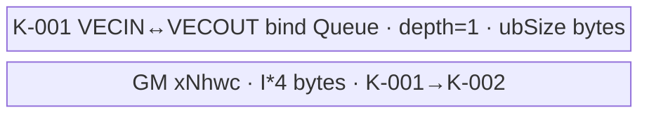
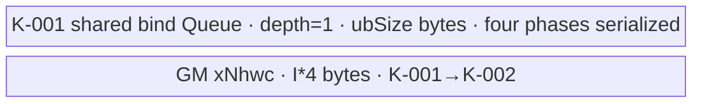

# GridSampler3D 950 Direct Invoke 算子知识

## 算子速览

| 项目 | 内容 |
|---|---|
| 实际入口 | `cann_bench::grid_sampler_3d` → `grid_sampler_3d_npu` → `launch_grid_sampler_3d_direct_{float16,float32}`，或大 FP32 bilinear 路线的 `launch_transpose_kernel` → `launch_grid_sampler_3d_nhwc_float32`；Direct Invoke |
| 计算语义 | 对 5-D `x[N,C,D,H,W]` 按归一化 `grid[N,Dout,Hout,Wout,3]` 做 trilinear（接口名为 bilinear）或 nearest 采样，输出 `y[N,C,Dout,Hout,Wout]` |
| 输入输出 | `x/grid/y` 同为 FP16 或 FP32；输入分别为 contiguous NCDHW 与 NDHW3；输出 contiguous NCDHW |
| 执行类型 | R-001/R-002 为单节点 SIMT；R-004/R-005 为 NDDMA+AIV 搬运 transpose + SIMT sampler；R-003 为 SIMT transpose + SIMT sampler；无可达 Cube/AIC 或 MIX_CV |
| Kernel 路线 | R-001 NCDHW trilinear；R-002 NCDHW nearest；R-004 CUT_ONCE transpose+NHWC；R-005 CUT_TWICE transpose+NHWC；R-003 small-shape transpose+NHWC |
| 核心资源 | Grid sampler 直接 GM→寄存器→GM，无 AIV UB/dynamic UB；R-004/R-005 transpose 各有一个 depth=1、容量 `ubSize` 的 bind Queue；R-003 以中间 GM Tensor 交接且无 UB；无 Device workspace |
| 来源闭包 | `direct_implementation_closed`：转换交付件闭合 schema、Meta/PrivateUse1、Direct Tiling/POD、route selector、全部可达 entry/body、同流多 Kernel 边和构建；固定官方源码只支撑相关 bilinear、坐标 helper、nearest primitive 与 transpose 实现来源，不把 Direct 派生符号表述为官方 API |

## 接口与语义

### 计算语义

令 `g=(gx,gy,gz)=grid[n,do,ho,wo,:]`。每轴先反归一化：`align_corners=true` 时 `p=(g+1)(L-1)/2`，否则 `p=((g+1)L-1)/2`。`padding_mode=border` 把坐标夹到 `[0,L-1]`；`reflection` 按 `align_corners` 在 `[0,L-1]` 或 `[-0.5,L-0.5]` 反射后再夹取；`zeros` 保留坐标，越界邻点贡献 0。nearest 对处理后坐标执行 `rintf` 并取一个体素。trilinear 对 `(floor(z),floor(y),floor(x))` 周围 8 个体素按三个小数距离的乘积加权，所有乘加在 FP32 标量中完成，最后转回 `T`。

### 输入、输出与属性

| 参数 | shape/layout | dtype | 约束、默认值与语义 |
|---|---|---|---|
| `x` | `[N,C,D,H,W]`，contiguous NCDHW | FP16/FP32 | rank=5；所有维在 Direct Tiling 中必须 `>0` |
| `grid` | `[N,Dout,Hout,Wout,3]`，contiguous NDHW3 | 与 `x` 相同 | rank=5，末维=3，batch 与 `x` 一致 |
| `interpolation_mode` | Host 字符串 | `bilinear`/`nearest` | 默认 `bilinear`；5-D 的 `bilinear` 实际为 8 点 trilinear |
| `padding_mode` | Host 字符串 | `zeros`/`border`/`reflection` | 默认 `zeros` |
| `align_corners` | Host 标量 | bool | 默认 false，决定归一化与 reflection 边界 |
| `y` | `[N,C,Dout,Hout,Wout]`，contiguous NCDHW | 与 `x` 相同 | 由 Meta/PrivateUse1 入口分配；完整写出，不与输入别名 |

### 入口与版本

转换交付注册 Torch schema，并分别绑定 Meta 与 `PrivateUse1` 实现；它不是 ACLNN 两段式接口。相关官方 `image/grid_sample` 的 arch35 三维 bilinear body 与 common helper 被保持，普通 Tiling 宏、注册式 key router 和 `gert::TilingContext` 被 Direct POD、显式 entry 与 `PlatformAscendCManager` 替代。nearest forward、NHWC-input sampler、2,000,000 元素 selector 和 Direct launch glue 是交付派生路线；nearest 只复用官方 3D-grad/2D-forward 中可核对的坐标与 `rintf` 语义。目标构建为 CANN 9.1.0、950/Ascend 950（`dav-3510`）。

## Host/Launcher 执行流程

### 参数校验与前处理

`grid_sampler_3d_meta` 依次检查模式字符串、两个输入 rank、`grid[-1]==3`、batch 相等、dtype 相等及 FP16/FP32 白名单，然后分配输出。`grid_sampler_3d_npu` 再检查设备相同与两个输入 contiguous，调用 `calc_grid_sampler_3d_tiling` 校验所有 8 个空间/批通道维为正、枚举值和 `alignCorners∈{0,1}`，查询 AIV 核数并生成 POD。任何 `TORCH_CHECK` 或负返回码都在 launch 前终止；实现不会隐式 Contiguous/ViewCopy。

### 参数、Workspace 与生命周期

设 `O=N*C*Dout*Hout*Wout`，`G=N*Dout*Hout*Wout*3`，`I=N*C*D*H*W`：

```text
requiredCores = ceil(O / 512)
blockDim = max(1, min(platformAivCores, requiredCores))
useUint64 = (I > INT32_MAX || O > INT32_MAX || G > INT32_MAX)
```

POD 与 launch 参数在 Host 栈上生成，按值传给 Kernel。R-001/R-002 无 workspace。R-004、R-005、R-003 的 `xNhwc` 是 Torch 持有的 GM Tensor，大小为 `I*sizeof(T)`，从 transpose 提交起存活到 sampler 提交完成；它不是 opaque workspace。transpose Tiling 会保留官方 `workspaceSize` 值，但 launcher 不分配、不传 workspace，三个 transpose entry 也没有 workspace 参数，故 Device workspace 为 0。

### 启动图与失败传播

```text
grid_sampler_3d_npu
  -> calc_grid_sampler_3d_tiling
  -> useNhwc = FP32 && bilinear && padding!=reflection && O>=2,000,000
     false -> K-001 direct NCDHW bilinear/nearest SIMT -> y
     true  -> query core/UB -> calc_transpose_tiling([N,C,DHW],[0,2,1])
             -> require key in {10001,10002,10003}
             -> K-001 transpose x[N,C,S] -> xNhwc[N,S,C]
             -> same stream ordering
             -> K-002 NHWC-input trilinear SIMT -> y[N,C,Dout,Hout,Wout]
```

K-001 与 K-002 在当前 NPU stream 顺序提交；转换层没有跨流 event，因此 GM 可见性与 `xNhwc` 生命周期依赖同流顺序和 Tensor capture。transpose Tiling/平台查询失败或产生其它 key 时，`TORCH_CHECK` 阻止两个节点。Device launcher 返回 `void`，没有逐节点返回码。

## Route 与参数设计

### 分核与资源计算

两个 sampler body 都把输出展平为 `O`，每个 AIV block 内启动 512 个 SIMT lane；lane `t` 从 `blockIdx*512+t` 开始，以 `blockDim*512` 递增。整除由 `GetUintDivMagicAndShift` 预生成 magic/shift。R-004、R-005、R-003 的 transpose Host 先移除 size-1 轴、合并连续轴，再由官方 arch35 tiler产生 `realCoreNum/blkFactor/blkTailFactor`。key 10002/10003 以硬件 UB 字节数为 `tiling.ubSize`，单个 depth-1 bind Queue 占满该容量；key 10001 直接 GM→GM。

### Route 重要性

P 等级用于组织知识阅读顺序，不参与 Host 分支判定，也不改变 Route ID。

| 重要性 | Route | Route 特征 | 适用范围 | 实现前提 |
|---:|---|---|---|---|
| P0 | R-001 | 单 Kernel NCDHW trilinear SIMT，是未启用 NHWC 路线时的 bilinear 主路径 | FP16 bilinear；或不满足 NHWC 谓词的 FP32 bilinear，包括 reflection 与较小输出 | Direct sampler body、FP32 坐标与累加、u32/u64 索引模板闭合 |
| P1 | R-002 | 单 Kernel NCDHW nearest SIMT，是 nearest 的唯一可达路径 | FP16/FP32、全部 padding 与 align-corners 组合的 nearest | nearest 坐标处理与 `rintf`、三轴边界检查、u32/u64 索引模板闭合 |
| P2 | R-004 | CUT_ONCE NDDMA transpose 后接 NHWC trilinear sampler | NHWC 谓词成立，transpose tiler 选择 key 10002 | CUT_ONCE Tiling/POD、depth-1 bind Queue、中间 GM Tensor 与同流节点顺序闭合 |
| P3 | R-005 | CUT_TWICE NDDMA transpose 后接 NHWC trilinear sampler | NHWC 谓词成立，且双切轴关系使 transpose tiler 选择 key 10003 | 四个互斥 phase、单 Queue 串行复用、中间 GM Tensor 与同流节点顺序闭合 |
| P4 | R-003 | small-shape SIMT transpose 后接 NHWC trilinear sampler | NHWC 谓词成立，且 transpose reduced bytes 低于 small-shape 阈值并选择 key 10001 | small-shape 地址变换 body、中间 GM Tensor 与同流节点顺序闭合 |

### 真实 Host selector 顺序、短路与 fallback

下表和伪码记录真实执行顺序，不代表 P 等级。Host 先短路判断 NHWC 谓词；命中后由 transpose tiler 决定 R-003/R-004/R-005，未知 key 直接失败，不回退到 R-001。未命中 NHWC 谓词时才按插值模式落到 R-001 或 R-002。

| 顺序 | Route | Key/模板 | 精确选择条件与优先级 | 不适用去向 |
|---:|---|---|---|---|
| 1 | R-003/R-004/R-005 NHWC hybrid | transpose key 10001/10002/10003；sampler `<float,u32/u64,true>` | `dtype==FP32 && interpolation==bilinear && padding!=reflection && O>=2000000`；随后 transpose tiler key 必须为 10001/2/3 | 条件 false 到 R-001/R-002；key 非白名单则失败 |
| 2 | R-001 NCDHW trilinear | `<half/float,u32/u64>` | `interpolation==bilinear` 且未命中第 1 行 | 终点 |
| 3 | R-002 NCDHW nearest | `<half/float,u32/u64>` | `interpolation==nearest`；因此总不命中 NHWC | 终点 |

```text
if FP32 && bilinear && padding != reflection && O >= 2,000,000:
    transposeKey = official_arch35_transpose_tiler([N,C,D*H*W], [0,2,1])
    if key==10001: R-003
    else if key==10002: R-004
    else if key==10003: R-005
    else: fail before launch
else if bilinear: R-001
else: R-002
```

### 模板/实现执行矩阵

| Route | key/selector | dtype/shape/platform 完整命中条件 | 执行拓扑与 Kernel 节点 | 实际模板/body | 内存与同步特征 | tail/fallback |
|---|---|---|---|---|---|---|
| R-001 | direct bilinear | bilinear 且 NHWC 谓词 false；FP16/FP32；u32/u64 由三体积上界选 | 单 SIMT | `GridSampler3dBilinearSimt<T,T_IDX,U_IDX>` | GM+线程寄存器；512 lanes | grid-stride 尾界 `index<O` |
| R-002 | direct nearest | nearest；FP16/FP32；u32/u64 同上 | 单 SIMT | `GridSampler3dNearestSimt<T,T_IDX,U_IDX>` | GM+线程寄存器；512 lanes | `rintf` 后三轴边界检查 |
| R-004 | 10002 + NHWC | NHWC 谓词 true；前置vconv/gather不命中；大shape进入NDDMA且 `outCutIndex<=FindOutIndex(inCutIndex)` | NDDMA/AIV→SIMT | `TransposeCutOneAxis<int32_t>`；同上 sampler | depth-1 bind Queue=`ubSize`；GM 边、同流 | main/tail shape |
| R-005 | 10003 + NHWC | NHWC 谓词 true；前置vconv/gather不命中；大shape进入NDDMA且 `outCutIndex>FindOutIndex(inCutIndex)` | NDDMA/AIV→SIMT | `TransposeCutTwoAxis<int32_t>`；同上 sampler | 同一 bind Queue串行复用四 phase；GM 边、同流 | main/input-tail/output-tail/both-tail |
| R-003 | 10001 + NHWC | NHWC 谓词 true，transpose reduced bytes `<1,000,000` 并选 small shape | SIMT transpose→SIMT sampler | `TransposeSmallShape<int32_t>`；`GridSampler3dNhwcSimt<float,...,true>` | `xNhwc` GM 边；同流；无 UB | 最后一核 `blkTailFactor`；sampler grid-stride tail |

### 隐藏性能 Guard

| Guard | Host/Tiling 条件 | Device/资源原因 | 影响 Route | 不满足时去向 | 源码符号 |
|---|---|---|---|---|---|
| 32/64 位索引 | `I/O/G` 任一超过 `INT32_MAX` | flat offset 和 magic division 必须避免 32 位溢出 | 全部 sampler | u64 模板 | `calc_grid_sampler_3d_tiling` |
| block 上界 | `blockDim=min(AIV cores,ceil(O/512))` 且至少 1 | 每 block 512 lane，避免启动超过工作量需要的核 | 全部 sampler | 参数失败时不启动 | `calc_grid_sampler_3d_tiling` |
| NHWC crossover | FP32、bilinear、非 reflection、`O>=2,000,000` | 先转为 channel-contiguous，使相邻 lane 的 8 邻点读取相邻 channel；代价是一次全量 transpose | R-004、R-005、R-003 | R-001/R-002 | `grid_sampler_3d_npu::useNhwc`（Direct 派生） |
| transpose key 白名单 | `key∈{10001,10002,10003}` | Direct router只闭合这三个 body | R-004、R-005、R-003 | Host 失败 | `grid_sampler_3d_npu`、`launch_transpose_kernel` |
| NDDMA UB | `ubSize>0`；10002/3 `InitBuffer(...,1,ubSize)` | 单 tile 必须容纳在一个 bind Queue slot；NDDMA destination stride按 32 B 对齐 | R-004/R-005 | Tiling 失败 | `TransposeCutOneAxis/TransposeCutTwoAxis::Init/SetupLoopInfo` |
| small threshold | reduced bytes `<1,000,000` | 小数据直接 SIMT 地址变换，不分配 UB | R-003 | 大 shape 到 NDDMA selector | `TransposeNddmaTiling::EntryTilingTemplate` |

### POD/ABI

`GridSampleTilingData` 为 17 个连续 `int64_t`，`sizeof=136, alignof=8`；`GridSampler3DLaunchInfo sizeof=144`。下表中 offset 均为字节。

| 结构 | 字段 | 类型/位宽 | ABI 布局 | 单位 | Host/launcher producer | Device consumer | 边界 |
|---|---|---|---|---|---|---|---|
| GridSampleTilingData | `coreNumVar` | int64/64 | off 0 | core | platform AIV core | 当前 body不读 | 保留上游 ABI |
| 同上 | `inN` | int64/64 | off 8 | element-axis | `inN` | sampler batch | `>0` |
| 同上 | `inC` | int64/64 | off 16 | element-axis | `inC` | output/input offset | `>0` |
| 同上 | `inD` | int64/64 | off 24 | element-axis | `inD` | coordinate/offset | `>0` |
| 同上 | `inH` | int64/64 | off 32 | element-axis | `inH` | coordinate/offset | `>0` |
| 同上 | `inW` | int64/64 | off 40 | element-axis | `inW` | coordinate/offset | `>0` |
| 同上 | `outD` | int64/64 | off 48 | element-axis | `outD` | flat decode/grid | `>0` |
| 同上 | `outH` | int64/64 | off 56 | element-axis | `outH` | flat decode/grid | `>0` |
| 同上 | `outW` | int64/64 | off 64 | element-axis | `outW` | flat decode/grid | `>0` |
| 同上 | `interpolationMode` | int64/64 | off 72 | enum | 0/1 | launcher router | body compile-time/function fixed |
| 同上 | `paddingMode` | int64/64 | off 80 | enum | 0..2 | `Clip` | 已校验 |
| 同上 | `alignCorners` | int64/64 | off 88 | bool | 0/1 | coordinate map | 已校验 |
| 同上 | `channelLast` | int64/64 | off 96 | bool | 固定 0 | 当前 body不读 | inactive |
| 同上 | `needCoreNum` | int64/64 | off 104 | core | `blockDim` | SIMT grid stride | `1..AIV cores` |
| 同上 | `preCoreNum` | int64/64 | off 112 | core | 零初始化 | 当前 body不读 | inactive |
| 同上 | `preNumPerCore` | int64/64 | off 120 | element | 零初始化 | 当前 body不读 | inactive |
| 同上 | `postNumPerCore` | int64/64 | off 128 | element | 零初始化 | 当前 body不读 | inactive |
| GridSampler3DLaunchInfo | `blockDim` | uint32/32 | off 136 | block | min公式 | launch `<<<>>>` | 至少1 |
| 同上 | `useUint64` | uint32/32 | off 140 | bool | 三体积比较 | entry模板 router | 0/1 |

`TransposeOpTilingData sizeof=928, alignof=8`。数组字段每项为 `int64_t`；未命中 phase 的数组仍由零初始化 POD 持有，但不被对应 body 读取。

| 结构 | 字段 | 类型/位宽 | ABI 布局 | 单位 | Host/launcher producer | Device consumer | 边界 |
|---|---|---|---|---|---|---|---|
| TransposeOpTilingData | `permSize` | int64/64 | off 0 | axis | reduced rank | 三个 body | 1..8；Direct仅接受可产出白名单key的结果 |
| 同上 | `inCutIndex` | int64/64 | off 8 | axis | UB split | 10003 | inactive于10001 |
| 同上 | `outCutIndex` | int64/64 | off 16 | axis | UB split | 10002/3 | 同上 |
| 同上 | `inUbFactor` | int64/64 | off 24 | element | UB split | tail/shape | key相关 |
| 同上 | `outUbFactor` | int64/64 | off 32 | element | UB split | loop count | key相关 |
| 同上 | `inTailFactor` | int64/64 | off 40 | element | remainder | 10003 phase | 0表示无tail |
| 同上 | `outTailFactor` | int64/64 | off 48 | element | remainder | 10002/3 | 0表示无tail |
| 同上 | `realCoreNum` | int64/64 | off 56 | core | block split | core guard | `>0` |
| 同上 | `blkFactor` | int64/64 | off 64 | tile/core | block split | per-core span | element/loop依key |
| 同上 | `blkTailFactor` | int64/64 | off 72 | element/loop | block split | tail core | key相关 |
| 同上 | `ubSize` | int64/64 | off 80 | byte | platform UB | 10002/3 InitBuffer | `>0` |
| 同上 | `totalNddmaNum` | int64/64 | off 88 | loop | split | NDDMA range | 10002/3 |
| 同上 | `rangeMainEnd` | int64/64 | off 96 | loop index | interval builder | 10003 | inclusive |
| 同上 | `rangeInputTailStart` | int64/64 | off 104 | loop index | interval builder | 10003 | inactive可为0 |
| 同上 | `rangeInputTailEnd` | int64/64 | off 112 | loop index | interval builder | 10003 | inclusive |
| 同上 | `rangeOutputTailStart` | int64/64 | off 120 | loop index | interval builder | 10003 | inactive可为0 |
| 同上 | `rangeOutputTailEnd` | int64/64 | off 128 | loop index | interval builder | 10003 | inclusive |
| 同上 | `rangeTailStart` | int64/64 | off 136 | loop index | interval builder | 10003 | both-tail/inactive |
| 同上 | `rangeTailEnd` | int64/64 | off 144 | loop index | interval builder | 10003 | inclusive |
| 同上 | `inputShape` | int64[8] | off 152 | element-axis | reduced input | 10001 stride/body | 仅前permSize有效 |
| 同上 | `outputShape` | int64[8] | off 216 | element-axis | reduced output | 10001/2/3 | 同上 |
| 同上 | `perm` | int64[8] | off 280 | axis | reduced perm | 地址变换 | 同上 |
| 同上 | `baseInShape` | int64[8] | off 344 | element-axis | block split | NDDMA offset | key相关 |
| 同上 | `baseNddmaShape` | int64[5] | off 408 | element-axis | dim expand | NDDMA | 5-D |
| 同上 | `nddmaIdx` | int64[5] | off 448 | axis | dim expand | NDDMA | 5-D |
| 同上 | `expandedPerm` | int64[5] | off 488 | axis | left-pad expand | NDDMA dst stride | 5-D |
| 同上 | `expandedInputShape` | int64[5] | off 528 | element-axis | left-pad expand | NDDMA src stride | 5-D |
| 同上 | `expandedOutputShape` | int64[5] | off 568 | element-axis | left-pad expand | copyout stride | 5-D |
| 同上 | `inUbMainSrcShape` | int64[5] | off 608 | element-axis | main shape builder | main NDDMA | 5-D |
| 同上 | `inUbMainDstShape` | int64[5] | off 648 | element-axis | main shape builder | main copyout | 5-D |
| 同上 | `inUbInputTailSrcShape` | int64[5] | off 688 | element-axis | input-tail builder | 10003 input-tail NDDMA | conditional |
| 同上 | `inUbInputTailDstShape` | int64[5] | off 728 | element-axis | input-tail builder | 10003 input-tail copyout | conditional |
| 同上 | `inUbOutputTailSrcShape` | int64[5] | off 768 | element-axis | output-tail builder | 10003 output-tail NDDMA | conditional |
| 同上 | `inUbOutputTailDstShape` | int64[5] | off 808 | element-axis | output-tail builder | 10003 output-tail copyout | conditional |
| 同上 | `inUbTailSrcShape` | int64[5] | off 848 | element-axis | tail builder | 10002/3 tail NDDMA | conditional |
| 同上 | `inUbTailDstShape` | int64[5] | off 888 | element-axis | tail builder | 10002/3 tail copyout | conditional |
| TransposeLaunchParams | `blockDim` | int64/64 | off 0 | block | transpose TilingContext | launch `<<<>>>` | `>0` |
| 同上 | `tilingKey` | uint64/64 | off 8 | key | transpose TilingContext | Direct router | 仅10001/2/3可达launch |
| 同上 | `workspaceSize` | size_t/64 | off 16 | byte | transpose TilingContext | Device不读 | 声明值不传Device |
| 同上 | `dataSize` | size_t/64 | off 24 | byte | raw POD size | launcher size guard | `sizeof(TransposeTilingData)..2048` |
| 同上 | `data` | byte[2048] | off 32 | serialized POD | `memcpy(raw)` | reinterpret为`TransposeTilingData` | alignas(8)，结构总长2080B |

### Route 源码闭包

| Route | Key/selector | Host/Tiling producer | POD/参数 | Kernel entry/router 节点 | Kernel body/直接依赖 | 构建接线 |
|---|---|---|---|---|---|---|
| R-001 | Direct bilinear | `op_plugin/grid_sampler_3d_plugin.cpp::grid_sampler_3d_npu`；`op_kernel/grid_sampler_3d_kernel.cpp::calc_grid_sampler_3d_tiling` | `GridSampler3DLaunchInfo` | `launch_grid_sampler_3d_direct_*`→4 bilinear entries | official-related `GridSampler3dBilinearSimt`、`Clip` | `csrc/ops/grid_sampler_3d/CMakeLists.txt::register_direct_launch_op` |
| R-002 | Direct nearest | 同上 | 同上 | 同 launcher→4 nearest entries | derived `GridSampler3dNearestSimt` + official-related common/grad primitive | 同上 |
| R-004 | 10002 | plugin→official-related NDDMA tiler | 两个 POD | cut-one entry→NHWC entry | `TransposeCutOneAxis`；derived NHWC body | 同上 |
| R-005 | 10003 | 同上 | 两个 POD | cut-two entry→NHWC entry | `TransposeCutTwoAxis`；derived NHWC body | 同上 |
| R-003 | 10001 | plugin→`calc_transpose_tiling` | 两个 POD | transpose small entry→NHWC entry | `TransposeSmallShape`；derived `GridSampler3dNhwcSimt` | 同上 |

## Kernel 实现

### 公共执行流程

所有 sampler entry 都声明 AIV-only wrapper，再在每个 block 内用 `asc_vf_call(...dim3{512,1,1})` 执行 SIMT。坐标从 `grid[...,0:3]` 读取为 FP32，按 `alignCorners` 反归一化，进入共享 `Clip`，最后取 8 邻点或 `rintf` 单点。没有 shared/dynamic UB、barrier 或 atomic；每个 lane只写唯一 `y[index]`。R-004、R-005、R-003 在 sampler 前增加一个 transpose 节点，唯一跨节点边为 `xNhwc` GM Tensor。

### Route R-001：NCDHW trilinear SIMT

#### 适用条件

##### 选择证据

| 层级 | 文件 | 符号 | 源码谓词/参数 | 结果/下一跳 |
|---|---|---|---|---|
| Launcher | `op_plugin/grid_sampler_3d_plugin.cpp` | `grid_sampler_3d_npu` | `!useNhwc && interpolationCode==BILINEAR` | direct dtype launcher |
| Router | `op_kernel/grid_sampler_3d_kernel.cpp` | `launch_grid_sampler_3d_direct_*` | dtype + `useUint64` | official-related bilinear模板实例 |

#### Device 数据流

##### 函数级调用链

```text
launch_grid_sampler_3d_direct_{float16,float32}
  -> grid_sampler_3d_direct_bilinear_{fp16,fp32}_{u32,u64}_entry
    -> GridSampler3dBilinearSimt::Init/Process
      -> asc_vf_call<ComputeGridSampler3d>(512 lanes)
        -> Clip(z/y/x) -> ComputeBilinear -> GetInputPointValue × 8 -> y[index]
```

##### 源码等价伪码

```text
for index = blockId*512 + lane; index < O; index += blockDim*512:
  decode index -> (n,c,do,ho,wo) with magic division
  (x,y,z) = float(grid[((n*Dout+do)*Hout+ho)*Wout+wo, :])
  unnormalize and Clip each axis
  base = floor(z,y,x); frac = point-base
  acc_fp32 = sum over dz,dy,dx in {0,1}: load_or_zero(x[n,c,base+delta]) * trilinear_weight
  y[index] = T(acc_fp32)
```

#### 内存与数据搬运

##### 资源与搬运表

| 层级/缓冲区 | offset/地址公式 | extent/容量公式 | dtype/layout | producer | consumer | owner/lifetime | 对齐/复用 |
|---|---|---|---|---|---|---|---|
| GM x | `n*C*DHW+c*DHW+z*HW+h*W+w` | `I` | T/NCDHW | caller | 8 point loads | input Tensor | 越界返回0 |
| GM grid | `(n*outSpatial+spatial)*3` | `G` | T/NDHW3 | caller | 每个输出空间点；channel间重复读 | grid Tensor | 无缓存 |
| thread registers | 当前坐标、8 value/weight、acc | 固定标量 | FP32/index | lane | same lane | 单迭代 | 无共享 |
| GM y | `index` | `O` | T/NCDHW | lane | caller | output Tensor | 唯一写 |

##### 分层内存布局

N/A：该 SIMT body 不分配 AIV UB 或 dynamic UB，直接 GM→线程私有标量→GM。

##### 字节账与复用顺序

```text
UB_total = 0
dynamic_ub = N/A
workspace_total = 0
```

| 复用子区 | 写入者 | 读取者/消费点 | 下一次覆盖 | 同步或释放依据 | 安全条件 |
|---|---|---|---|---|---|
| 线程私有 `inputValue/inputWeight` | 当前邻点 load/weight | 当前累加 | 下一邻点 | 单线程程序序 | 不跨 lane |

#### 同步、精度与尾块

##### 同步与数值边界表

| 阶段 | primitive/机制 | producer | consumer/等待点 | 保护对象 | 精度/尾块 |
|---|---|---|---|---|---|
| lane分工 | grid-stride loop | launcher blockDim | 每个lane | y元素 | `index<O` |
| 坐标 | `Clip` | grid FP16/FP32→FP32 | floor/weight | 有限坐标 | nonfinite变为故障坐标，zeros路径最终越界为0 |
| 插值 | FP32 scalar accumulate | 8 loads | cast to T | acc | FP16输入也升FP32，末端一次降精度 |

#### 关键实现

##### 符号证据表

| 阶段 | 文件 | 符号/模板实例 | 实现事实 |
|---|---|---|---|
| Host producer | `op_kernel/grid_sampler_3d_kernel.cpp` | `calc_grid_sampler_3d_tiling` | blockDim、u32/u64、POD |
| Kernel router | 同文件 | `launch_grid_sampler_3d_direct_*` | dtype/index width映射 |
| Device body | `op_kernel/arch35/grid_sampler_3d_bilinear_smit.h` | `ComputeGridSampler3d/ComputeBilinear` | flat SIMT、8点FP32累加 |
| Helper | `op_kernel/arch35/grid_sampler_bilinear_smit_common.h` | `Clip/reflectCoordinates` | 三种padding与非有限值 |

### Route R-002：NCDHW nearest SIMT

#### 适用条件

##### 选择证据

| 层级 | 文件 | 符号 | 源码谓词/参数 | 结果/下一跳 |
|---|---|---|---|---|
| Launcher | `op_plugin/grid_sampler_3d_plugin.cpp` | `grid_sampler_3d_npu` | nearest使`useNhwc=false` | direct dtype launcher |
| Router | `op_kernel/grid_sampler_3d_kernel.cpp` | `launch_grid_sampler_3d_direct_*` | interpolation非bilinear + index width | nearest entry |

#### Device 数据流

##### 函数级调用链

```text
direct launcher -> nearest_{dtype}_{u32/u64}_entry
  -> GridSampler3dNearestSimt::Process
    -> ComputeGridSampler3dNearest(512 lanes)
      -> Clip -> rintf(z/y/x) -> GetNearestInputPointValue -> y[index]
```

##### 源码等价伪码

```text
for each grid-stride output index:
  decode (n,c,do,ho,wo); load and unnormalize grid
  (iz,iy,ix) = rintf(Clip(z)), rintf(Clip(y)), rintf(Clip(x))
  y[index] = in_bounds ? x[n,c,iz,iy,ix] : 0
```

#### 内存与数据搬运

##### 资源与搬运表

| 层级/缓冲区 | offset/地址公式 | extent/容量公式 | dtype/layout | producer | consumer | owner/lifetime | 对齐/复用 |
|---|---|---|---|---|---|---|---|
| x/grid/y GM | 同 R-001；x只取1点 | `I/G/O` | T/NCDHW,NDHW3 | caller/lane | lane/caller | Tensor | 唯一输出写 |
| thread registers | coordinate、3个rounded index、value | 固定标量 | FP32/U_IDX/T | lane | same lane | 单迭代 | 无共享 |

##### 分层内存布局

N/A：SIMT 直接 GM→寄存器→GM。

##### 字节账与复用顺序

```text
UB_total=0; dynamic_ub=N/A; workspace_total=0
```

| 复用子区 | 写入者 | 读取者/消费点 | 下一次覆盖 | 同步或释放依据 | 安全条件 |
|---|---|---|---|---|---|
| lane标量 | 当前输出 | GM store | 下一迭代 | 程序序 | lane拥有 |

#### 同步、精度与尾块

##### 同步与数值边界表

| 阶段 | primitive/机制 | producer | consumer/等待点 | 保护对象 | 精度/尾块 |
|---|---|---|---|---|---|
| nearest | `rintf` | FP32坐标 | bounds/load | index | 与官方相关 nearest primitive一致；边界后仍检查 |
| tail | `index<O` | grid stride | output store | y | 无padding lane写出 |

#### 关键实现

##### 符号证据表

| 阶段 | 文件 | 符号/模板实例 | 实现事实 |
|---|---|---|---|
| Host/router | `op_kernel/grid_sampler_3d_kernel.cpp` | `launch_grid_sampler_3d_direct_*` | nearest/u32-u64分发 |
| Device body | `op_kernel/arch35/grid_sampler_3d_nearest_simt.h` | `ComputeGridSampler3dNearest` | Direct派生forward body |
| Official related | `image/grid_sampler3_d_grad/...simt*.h`、`image/grid_sampler2_d/...simt.h` | nearest source-index helpers | `rintf`、padding语义参照，不是本forward入口 |

### Route R-004：CUT_ONCE NDDMA transpose + NHWC SIMT

#### 适用条件

##### 选择证据

| 层级 | 文件 | 符号 | 源码谓词/参数 | 结果/下一跳 |
|---|---|---|---|---|
| Direct selector | `op_plugin/grid_sampler_3d_plugin.cpp` | `useNhwc` | NHWC完整谓词 | transpose tiling |
| Tiling | `transpose_tiling_arch35.cpp` | `DoSplitUB/GetIntervalInfo` | `outCutIndex<=FindOutIndex(inCutIndex)` | 10002 |
| Router | `grid_sampler_3d_kernel.cpp` | `launch_transpose_kernel` | key10002, elementSize4 | cut-one entry |

#### Device 数据流

##### 函数级调用链

```text
K-001 TransposeCutOneAxis<int32_t>::Process
  -> ProcessPerCore -> SetupLoopInfo -> CopyIn(DataCopy NDDMA 5-D)
  -> EnQue/DeQue -> CopyOut(DataCopyPad + loop mode) -> xNhwc
same stream -> K-002 GridSampler3dNhwcSimt<float,...,true> -> y
```

##### 源码等价伪码

```text
for loopIdx in this core's [start,end):
  choose main or out-tail shape
  decode mixed-radix source/destination offsets
  NDDMA 5-D GM x -> bind Queue
  dequeue; loop-mode DataCopyPad -> xNhwc exact output strides
K2 same as R-003
```

#### 内存与数据搬运

##### 资源与搬运表

| 层级/缓冲区 | offset/地址公式 | extent/容量公式 | dtype/layout | producer | consumer | owner/lifetime | 对齐/复用 |
|---|---|---|---|---|---|---|---|
| bind Queue | current NDDMA tile | `1*ubSize` B | int32/5-D expanded | NDDMA | MTE3 copyout | K-001 TPipe/current loop | depth1；dst内部stride按32B对齐 |
| xNhwc GM edge | `(n*S+s)*C+c` | `I*4` B | FP32/NSC | K-001 | K-002 | Torch temp | same stream |
| K2 registers | 同R-003 | fixed | FP32 | K2 | y | lane | no UB |

##### 分层内存布局



##### 字节账与复用顺序

```text
UB_total(K1)=1*ubSize
UB_total(K2)=0
workspace_total=0
intermediate_GM=I*4 B
```

| 复用子区 | 写入者 | 读取者/消费点 | 下一次覆盖 | 同步或释放依据 | 安全条件 |
|---|---|---|---|---|---|
| whole bind Queue | current NDDMA | current DataCopyPad | next loop | EnQue→DeQue→FreeTensor | 单slot消费后覆盖 |
| xNhwc | K-001 | K-002 | 调用后 | same stream | 同R-003 |

#### 同步、精度与尾块

##### 同步与数值边界表

| 阶段 | primitive/机制 | producer | consumer/等待点 | 保护对象 | 精度/尾块 |
|---|---|---|---|---|---|
| NDDMA→MTE3 | bind Queue | `DataCopy<...,5>` | `DeQue`/`DataCopyPad` | UB tile | main/tail使用不同shape |
| K1→K2 | same stream | xNhwc | sampler | GM | bitwise FP32 |
| sampler | 同R-003 | grid/xNhwc | y | output | FP32 trilinear |

#### 关键实现

##### 符号证据表

| 阶段 | 文件 | 符号/模板实例 | 实现事实 |
|---|---|---|---|
| Tiling | `transpose_host/transpose_tiling_arch35.cpp` | `DoSplitUB/FillTilingData` | single-cut factors/main-tail shape |
| K1 body | `op_kernel/transpose_nddma/arch35/transpose_cut_one_axis.h` | `SetupLoopInfo/CopyIn/CopyOut/ProcessPerCore` | NDDMA→loop-mode MTE3 |
| K2 body | `op_kernel/arch35/grid_sampler_3d_nhwc_simt.h` | `ComputeNhwcBilinear` | NHWC邻点读取 |

### Route R-005：CUT_TWICE NDDMA transpose + NHWC SIMT

#### 适用条件

##### 选择证据

| 层级 | 文件 | 符号 | 源码谓词/参数 | 结果/下一跳 |
|---|---|---|---|---|
| Direct selector | `op_plugin/grid_sampler_3d_plugin.cpp` | `useNhwc` | NHWC完整谓词 | transpose tiling |
| Tiling | `transpose_tiling_arch35.cpp` | `DoSplitUB/GetIntervalInfoForCutTwice` | `outCutIndex>FindOutIndex(inCutIndex)` | 10003与四区间 |
| Router | `grid_sampler_3d_kernel.cpp` | `launch_transpose_kernel` | key10003, elementSize4 | cut-two entry |

#### Device 数据流

##### 函数级调用链

```text
K-001 TransposeCutTwoAxis<int32_t>::Process
  -> ProcessPerCore/GetCopyOutParams/GetTailAddressOffsetBase/ProcessBlock
  -> ProcessMain / ProcessInputTail / ProcessOutputTail / ProcessTail
  -> each: NDDMA -> bind Queue -> loop-mode DataCopyPad -> xNhwc
same stream -> K-002 GridSampler3dNhwcSimt<float,...,true> -> y
```

##### 源码等价伪码

```text
intersect this core span with four disjoint intervals:
  main, input-tail, output-tail, both-tail
for each non-empty intersection in fixed order:
  choose phase-specific src/dst 5-D shapes and base offsets
  NDDMA GM->same bind Queue; dequeue; padded-stride copyout to xNhwc
K2 same as R-003
```

#### 内存与数据搬运

##### 资源与搬运表

| 层级/缓冲区 | offset/地址公式 | extent/容量公式 | dtype/layout | producer | consumer | owner/lifetime | 对齐/复用 |
|---|---|---|---|---|---|---|---|
| bind Queue | phase-specific mixed-radix offset | `1*ubSize` B | int32/expanded 5-D | phase NDDMA | phase MTE3 | K-001/all phases | depth1，同一物理slot |
| xNhwc GM edge | `(n*S+s)*C+c` | `I*4` B | FP32/NSC | K-001 phases | K-002 | Torch temp | four intervals不重叠 |
| K2 registers | 同R-003 | fixed | FP32 | K2 | y | lane | no UB |

##### 分层内存布局



##### 字节账与复用顺序

```text
UB_total(K1)=1*ubSize（不是四倍）
UB_total(K2)=0
workspace_total=0
intermediate_GM=I*4 B
```

| 复用子区 | 写入者 | 读取者/消费点 | 下一次覆盖 | 同步或释放依据 | 安全条件 |
|---|---|---|---|---|---|
| whole bind Queue | 当前phase NDDMA | 当前phase MTE3 | 下一phase/tile | Queue EnQue/DeQue/Free | phase顺序固定且区间不重叠 |
| xNhwc | four K1 phases | K2 | 调用后 | same stream | 所有K1 stores先于K2 loads |

#### 同步、精度与尾块

##### 同步与数值边界表

| 阶段 | primitive/机制 | producer | consumer/等待点 | 保护对象 | 精度/尾块 |
|---|---|---|---|---|---|
| phase内 | Queue + loop mode | NDDMA | MTE3 | UB tile | phase-specific shape避免padding写GM |
| phase间 | fixed calls + Queue lifecycle | previous copyout | next NDDMA | single slot | 四区间可为空 |
| K1→K2 | same stream | xNhwc | sampler | GM | FP32 bit-copy |

#### 关键实现

##### 符号证据表

| 阶段 | 文件 | 符号/模板实例 | 实现事实 |
|---|---|---|---|
| Tiling | `transpose_host/transpose_tiling_arch35.cpp` | `GetIntervalInfo/FillTilingData` | 四区间与四组shape |
| K1 body | `op_kernel/transpose_nddma/arch35/transpose_cut_two_axis.h` | `ProcessMain/ProcessInputTail/ProcessOutputTail/ProcessTail` | 单Queue四phase |
| K2 body | `op_kernel/arch35/grid_sampler_3d_nhwc_simt.h` | `ComputeGridSampler3dNhwc` | channel-contiguous loads、NCDHW store |

### Route R-003：Small-shape transpose + NHWC SIMT

#### 适用条件

##### 选择证据

| 层级 | 文件 | 符号 | 源码谓词/参数 | 结果/下一跳 |
|---|---|---|---|---|
| Direct selector | `op_plugin/grid_sampler_3d_plugin.cpp` | `useNhwc` | 完整 NHWC 谓词 | transpose tiling |
| Tiling | `transpose_tiling_arch35.cpp` | `EntryTilingTemplate` | reduced bytes `<1,000,000` | key 10001 |
| Router | `grid_sampler_3d_kernel.cpp` | `launch_transpose_kernel` | key 10001、elementSize=4 | `TransposeSmallShape<int32_t>` |

#### Device 数据流

##### 函数级调用链

```text
K-001 TransposeSmallShape<int32_t>::Process -> SimtComputeDimThree
  -> xNhwc[N,S,C]
same stream
K-002 GridSampler3dNhwcSimt<float,u32/u64,int32/int64,true>::Process
  -> ComputeGridSampler3dNhwc -> ComputeNhwcBilinear -> y NCDHW
```

##### 源码等价伪码

```text
K1: per core span [coreOffset,coreOffset+coreFactor), SIMT decode y[n,s,c], copy x[n,c,s]
K2: flat work order [n,spatial,c]; adjacent lanes tend to adjacent c
    load common grid point, read 8 NHWC neighbors, FP32 weighted sum
    store y[(n*C+c)*outSpatial+spatial]
```

#### 内存与数据搬运

##### 资源与搬运表

| 层级/缓冲区 | offset/地址公式 | extent/容量公式 | dtype/layout | producer | consumer | owner/lifetime | 对齐/复用 |
|---|---|---|---|---|---|---|---|
| xNhwc GM edge | `(n*S+s)*C+c` | `I*4` B | FP32/NSC | K-001 | K-002 | Torch temp until both submissions complete | 不与x/y别名 |
| K-001 registers | decoded indices | fixed | uint32 | transpose lane | GM store | lane | no UB |
| K-002 registers | 8 neighbors/weights | fixed | FP32 | sampler lane | y store | lane | no UB |

##### 分层内存布局

N/A：两个 SIMT 节点均不分配 AIV UB；实际中间层为 `xNhwc` GM Tensor。

##### 字节账与复用顺序

```text
UB_total(K1)=0; UB_total(K2)=0; dynamic_ub=N/A
workspace_total=0; intermediate_GM=I*4 B
```

| 复用子区 | 写入者 | 读取者/消费点 | 下一次覆盖 | 同步或释放依据 | 安全条件 |
|---|---|---|---|---|---|
| xNhwc | K-001 | K-002 | 调用结束后Tensor析构可回收 | same stream ordering + captured Tensor lifetime | K-002提交前不可释放 |

#### 同步、精度与尾块

##### 同步与数值边界表

| 阶段 | primitive/机制 | producer | consumer/等待点 | 保护对象 | 精度/尾块 |
|---|---|---|---|---|---|
| K1→K2 | same NPU stream | transpose store | sampler load | xNhwc | bitwise FP32 transpose |
| K1 tail | core span + `blkTailFactor` | tiler | lane loop | xNhwc | last core exact extent |
| K2 tail | grid-stride `index<O` | blockDim | store | y | FP32计算/输出 |

#### 关键实现

##### 符号证据表

| 阶段 | 文件 | 符号/模板实例 | 实现事实 |
|---|---|---|---|
| Tiling | `transpose_host/transpose_tiling_arch35.cpp` | `EntryTilingTemplate/FillTilingData` | 10001与core span |
| K1 body | `op_kernel/transpose_nddma/arch35/transpose_small_shape.h` | `TransposeSmallShape::Process/SimtComputeDimThree` | GM→GM transpose |
| K2 body | `op_kernel/arch35/grid_sampler_3d_nhwc_simt.h` | `ComputeGridSampler3dNhwc` | Direct派生NHWC读取、NCDHW写出 |

## 算子特定优化

### Trick T-001：512-lane grid-stride 覆盖输出，magic division 解码多维坐标

#### 触发与源码依据

- 适用 Route：R-001；R-002、R-004、R-005、R-003 的 sampler 沿用同一调度形态。
- 触发条件：所有非空输出；Host 令 `blockDim<=ceil(O/512)`。
- Golden 来源：[`image/grid_sample/op_kernel/arch35/grid_sampler_3d_bilinear_smit.h:139-147`](https://gitcode.com/cann/ops-cv/blob/fcc3b33c070c1ad146344f172ca147839b956686/image/grid_sample/op_kernel/arch35/grid_sampler_3d_bilinear_smit.h)

**官方源码（固定 Commit 连续逐字摘录）**：

```cpp
for (T_IDX index = blockId_ * VF_MAX_THREAD_NUM_3D + threadIdx.x; index < outImgSize * intN;
     index += (blockNum * VF_MAX_THREAD_NUM_3D)) {
```

#### 机制与设计原因

512 来自 `VF_MAX_THREAD_NUM_3D`，`blockNum` 来自 Direct POD 的 `needCoreNum`。每个 lane 处理互不重叠的 flat index，并用预先计算的 magic/shift 替代循环内普通多次整数除法；既覆盖任意尾部，也无需跨线程同步。转换对官方相关 bilinear body保持该机制，nearest/NHWC派生 body也采用同构调度。

#### 迁移边界

- 适用：输出可一一映射到独立 lane、无跨元素归约的采样/映射算子。
- 前提：flat 体积和地址乘积使用足够宽的 `T_IDX`；blockDim 与 Device stride一致。
- 失效：存在跨输出依赖或索引体积超过所选位宽时必须换调度/位宽；本实现切到u64而非fallback。

#### 错误做法

固定源码未提供反例。

### Trick T-002：大 FP32 trilinear 先 NCS→NSC，再按 channel 连续读取 8 邻点

#### 触发与源码依据

- 适用 Route：R-004、R-005、R-003。
- 触发条件：Direct 派生谓词 `FP32 && bilinear && padding!=reflection && O>=2,000,000`，且 transpose tiler产出白名单key。
- Golden 来源：[`conversion/transpose/op_kernel/arch35/transpose_cut_one_axis.h:312-330`](https://gitcode.com/cann/ops-math/blob/e8c3c219b98e1c554ff2917ce8b26915fc8abbe0/conversion/transpose/op_kernel/arch35/transpose_cut_one_axis.h)

**官方源码（固定 Commit 连续逐字摘录）**：

```cpp
CopyIn(loopIdx, paramsMain);
CopyOut(loopIdx, loopSizeMain_, loopSrcStrideMain_, loopDstStrideMain_);
```

#### 机制与设计原因

官方相关 transpose 负责把 `[N,C,S]` 搬为 `[N,S,C]`；Direct 派生 sampler 的 flat order 是 `[N,outSpatial,C]`，因此相邻 lane在同一采样邻点上访问相邻 channel。它以一次 `I*4` B 中间 GM 物化换取 sampler 的 channel 连续性。R-004/R-005用5-D NDDMA和loop-mode copyout；R-003用SIMT小转置。阈值与模式限制是 Direct 调度策略，不能归因于官方 GridSample Host selector。

#### 迁移边界

- 适用：输入 channel-first、采样阶段跨 channel 并行且工作量足以摊销全量转置的 FP32 trilinear。
- 前提：可分配 `I*4` B 临时 Tensor；同流保证 producer→consumer；transpose key在闭包内。
- 失效：FP16、nearest、reflection或较小输出使用R-001/R-002；未知 transpose key在Host失败。

#### 错误做法

固定源码未提供反例；转换交付只以显式谓词限制该组合，不外推性能收益。

### Trick T-003：CUT_TWICE 四种尾域共用单个 depth-1 UB Queue

#### 触发与源码依据

- 适用 Route：R-005。
- 触发条件：transpose key 10003，input/output切轴不同并可能同时出现余数。
- Golden 来源：[`conversion/transpose/op_kernel/arch35/transpose_cut_two_axis.h:102-129`](https://gitcode.com/cann/ops-math/blob/e8c3c219b98e1c554ff2917ce8b26915fc8abbe0/conversion/transpose/op_kernel/arch35/transpose_cut_two_axis.h)

**官方源码（固定 Commit 连续逐字摘录）**：

```cpp
pipe->InitBuffer(vecQue_, 1, tiling_->ubSize);
```

#### 机制与设计原因

Host 把 main、input-tail、output-tail、both-tail写成互斥区间和四组5-D shape。Device逐区间与本核 span 求交，在同一 Queue 中串行执行 NDDMA→MTE3；因此 UB 是 `ubSize` 而不是四份 buffer。phase-specific shape与32 B对齐后的内部stride阻止无效padding lane写到GM。

#### 迁移边界

- 适用：两个切轴各有main/tail组合、phase可串行提交的layout transform。
- 前提：Queue生命周期完整，四区间互不重叠，所有shape/offset由同一POD producer生成。
- 失效：phase需并发重叠或producer/consumer跨stream时不能复用单slot；应增加buffer或event协议。

#### 错误做法

固定源码未提供反例。

## 模板与实现对比

| 对比维度 | R-001 trilinear | R-002 nearest | R-004/005 NDDMA+NHWC | R-003 small+NHWC | 设计选择依据 |
|---|---|---|---|---|---|
| 命中条件/优先级 | bilinear且NHWC false | 所有nearest | NHWC true且key10002/3 | NHWC true且key10001 | Direct selector先于插值router |
| 模板与 dtype | half/float×u32/u64 | half/float×u32/u64 | K1 int32 bit-copy；K2 float×u32/u64 | 同R-004/005 | FP32大work才物化NSC |
| 循环与分核 | 512-lane grid stride | 同左 | NDDMA loop/core + sampler grid stride | transpose core span + sampler grid stride | 工作拓扑不同即拆Route |
| Queue/TBuf/寄存器/dynamic UB | 线程寄存器 | 线程寄存器 | K1 depth1 bind Queue；K2寄存器 | 两节点寄存器，无UB | SIMT不伪造UB |
| 内存总占用与复用 | workspace 0 | workspace 0 | `UB=ubSize`+中间GM=`I*4` | 中间GM=`I*4` | transpose queue按迭代/phase复用 |
| 搬运/Vector/SIMT/NDDMA API | 8个标量GM load/输出 | 1个标量GM load/输出 | 5-D NDDMA→DataCopyPad + 8邻点 | SIMT GM transpose + 8邻点 | channel连续性换全量transpose |
| 同步、精度与 tail | 独立lane；FP32累加 | 独立lane；rintf | Queue + 同流 | 同流K1→K2 | 输出tail均由边界谓词保护 |
| fallback/失败边界 | 终点 | 终点 | key终点 | key终点 | 非白名单key Host失败，不静默回退 |

## 平台差异

| 项目 | A2 | A3 | 950 |
|---|---|---|---|
| 支持状态 | 官方相关 ACLNN 文档支持；本卡不提取 Direct 构建 | 官方相关 ACLNN 文档支持；本卡不提取 Direct 构建 | 官方相关 ACLNN 文档支持；转换交付 Direct 构建目标 `ascend950/dav-3510`、CANN 9.1.0 |
| Host/Launcher | Direct 未提取 | Direct 未提取 | `PlatformAscendCManager` 查询 AIV core/UB；Torch当前NPU stream |
| Kernel/资源 | Direct 未提取 | Direct 未提取 | arch35 SIMT与NDDMA/AIV-only wrapper；无Cube/AIC/MIX_CV |

## 限制与失败边界

- 仅接受 rank-5 contiguous `x/grid`、同设备同dtype FP16/FP32、正维、`grid[-1]=3`；不会隐式修复非连续布局。
- `Product5` 先在 `uint64_t` 中连乘但没有显式乘法溢出检查；超过 `uint64_t` 表示范围的极端shape不闭合。输出 Tensor 分配会更早受框架/设备容量约束。
- R-004、R-005、R-003 当前由 `!isFloat16` 保证 elementSize=4；虽然 launcher保留FP16 NHWC符号，该符号从实际入口不可达，不进入正式Route。
- `launch_grid_sampler_3d_float*`、half2/tiled sampler和专用SIMT transpose entry被编入源码但不由当前 PrivateUse1 调用链到达，属于 dormant 实现，不作为可达Route。
- transpose Tiling声明的 workspace 不传Device；若未来官方body开始消费该workspace，当前Direct ABI必须同步扩展，不能沿用“0 Device workspace”结论。
- 固定官方源码只证明相关算法与实现来源；Direct selector、POD替换、nearest forward、NHWC sampler、Torch生命周期和构建 glue 均为转换交付事实。

## 源码索引

### 链路索引

| 链路阶段 | 文件 | 关键符号 | 支撑内容 |
|---|---|---|---|
| Related API/平台 | `image/grid_sample/docs/aclnnGridSampler3D.md` | 产品支持表、接口约束 | 950官方相关支持与3-D公开语义；不代表Direct入口 |
| Related Host/Tiling | `image/grid_sample/op_host/grid_sample_tiling_arch35.cpp` | arch35 GridSample tiling | 官方相关核数/u32-u64路线参照 |
| Related Device | `image/grid_sample/op_kernel/arch35/grid_sampler_3d_bilinear_smit.h` | `GridSampler3dBilinearSimt` | 官方相关三维trilinear SIMT body |
| Related helper | `image/grid_sample/op_kernel/arch35/grid_sampler_bilinear_smit_common.h` | `Clip/reflectCoordinates` | padding/非有限坐标 |
| Related nearest | `image/grid_sampler3_d_grad/op_kernel/arch35/grid_sampler3_d_grad_simt.h` | nearest `rintf`路径 | Direct nearest语义参照 |
| Related nearest helper | `image/grid_sampler3_d_grad/op_kernel/arch35/grid_sampler3_d_grad_simt_base.h` | source-index helper | 3-D padding边界参照 |
| Related 2-D forward | `image/grid_sampler2_d/op_kernel/arch35/grid_sampler2_d_simt.h` | forward nearest | forward数据流交叉核对 |
| Related build | `image/grid_sample/CMakeLists.txt` | GridSample target | 官方相关构建接线 |
| Transpose Tiling | `conversion/transpose/op_host/arch35/transpose_tiling_arch35.cpp` | `TransposeNddmaTiling` | key10001/2/3、POD与UB/core公式 |
| Transpose router | `conversion/transpose/op_kernel/transpose_apt.cpp` | key router | 官方key到body映射参照 |
| Transpose body | `conversion/transpose/op_kernel/arch35/transpose_small_shape.h` | `TransposeSmallShape` | small SIMT |
| Transpose body | `conversion/transpose/op_kernel/arch35/transpose_cut_one_axis.h` | `TransposeCutOneAxis` | single-cut NDDMA |
| Transpose body | `conversion/transpose/op_kernel/arch35/transpose_cut_two_axis.h` | `TransposeCutTwoAxis` | four-phase NDDMA |
| Transpose build | `conversion/transpose/CMakeLists.txt` | transpose target | 官方相关构建接线 |

每行官方文件均存在于 Frontmatter `sources`。Direct 交付文件只在正文以包内相对路径标识，未伪造成官方 HTTP 来源。

### 实现复用检查

| 检查项 | 可复用事实 | 不得改变的约束 | 源码符号 |
|---|---|---|---|
| ABI/POD | GridSample 17×int64与transpose 928B POD | 字段顺序、offset、u32/u64选择和inactive字段读取边界 | `GridSampleTilingData`、`TransposeOpTilingData` |
| 调用顺序 | NHWC路线固定transpose→sampler | 两节点必须同流且temp存活 | `grid_sampler_3d_npu::launch` |
| workspace/内存 | sampler workspace 0；transpose单Queue；GM temp `I*4` | 不得把声明workspace当已传Device；不能提前释放xNhwc | launchers、`InitBuffer` |
| 同步 | sampler lane独立；NDDMA Queue串行；节点同流 | Queue lifecycle和same-stream ordering不可删除 | `asc_vf_call`、`EnQue/DeQue/FreeTensor` |
| 精度与尾块 | FP32坐标/权重/累加；nearest `rintf`；grid-stride tail | FP16仅末端cast；padding后仍做bounds check | `ComputeBilinear`、`ComputeGridSampler3dNearest` |
| 失败边界 | 非法shape/mode、平台失败、transpose非白名单key均launch前失败 | 不得把未知key静默改为direct，否则改变调度契约 | `calc_grid_sampler_3d_tiling`、`grid_sampler_3d_npu` |
