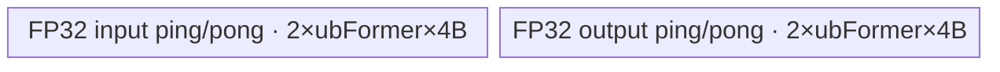
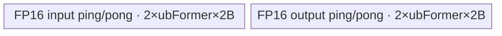
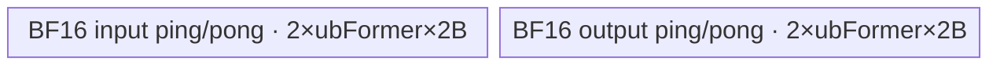
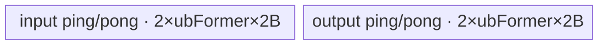

# Gelu 950 Direct Invoke 算子知识

## 算子速览

| 项目 | 内容 |
|---|---|
| 实际入口 | dispatcher `cann_bench::gelu` → `gelu_npu` → `launch_gelu_kernel` → 六个 `gelu_{none|tanh}_{fp16|bf16|fp32}` entry；入口类型为 Direct Invoke。 |
| 计算语义 | `none`：`y=x·Φ(x)=0.5x(1+erf(x/√2))`；`tanh`：`y=0.5x(1+tanh(√(2/π)(x+0.044715x³)))`，交付件以等价 logistic 形式实现。 |
| 输入输出 | 连续 NPU Tensor；任意 rank 按 `numel()` 扁平；FP16、BF16、FP32；输出 shape、dtype 与输入相同。 |
| 执行类型 | 六条可达 Route 均为单节点 `AIV_VECTOR`；无 Cube/AIC、MIX_CV、SIMT、NDDMA 或通信节点。 |
| Kernel 路线 | 重要性顺序：P0 R-006 tanh FP32 pair；P1 R-004 tanh FP16；P2 R-002 none BF16；P3 R-003 none FP32；P4 R-005 tanh BF16；P5 R-001 none FP16。Route ID 保持 launcher 映射。 |
| 核心资源 | 输入/输出 GM，ATVOSS `ElementwiseSch16B<1,DAG>` 管理的双缓冲 UB，MicroAPI `RegTensor/MaskReg`；Device workspace 为 0。 |
| 来源闭包 | `direct_implementation_closed`：插件校验、Direct tiling、按值 POD、六 entry、实际 fused body、tail/NaN、单 Kernel launch 与构建接线均闭合。 |
| 验证状态 | 已完成源码闭包检查；本次知识提取未执行编译、真机、数值或性能测试。 |

## 接口与语义

### 计算语义

对扁平有效域 `i∈[0,N)`：

```text
approximate == "none":
  y[i] = x[i] * Φ(x[i])
       = 0.5 * x[i] * (1 + erf(x[i] / sqrt(2)))

approximate == "tanh":
  y[i] = 0.5 * x[i] * (1 + tanh(sqrt(2/pi) * (x[i] + 0.044715*x[i]^3)))
       = x[i] / (1 + exp(-1.595769121 * (x[i] + 0.044715*x[i]^3)))
```

交付件保持这两个模式的语义，但 Device body 并非逐字复制官方 DAG：`none` 使用按 dtype 派生的 logit/多项式近似，`tanh` 使用稳定 logistic；这些融合、系数压缩与双寄存器组调度均是交付件事实。官方固定提交仅证明转换起点、950 路线、模板语义和系数参考，不能把派生实现反向表述成官方原码。

### 输入、输出与属性

| 参数 | shape/layout | dtype | 约束、默认值与语义 |
|---|---|---|---|
| `x` | 任意 rank；Direct body 按连续一维 `[N]` 解释 | FP16/BF16/FP32 | 必须是 NPU Tensor 且由调用约定保证 contiguous；插件不执行 `Contiguous`。 |
| `approximate` | 字符串属性 | `"none"` 或 `"tanh"` | 默认 `"none"`；其它值在 `gelu_meta` 中由 `TORCH_CHECK` 拒绝。 |
| `y` | `empty_like(x)`，shape/layout 与 `x` 相同 | 与 `x` 相同 | `N==0` 时只返回空输出，不启动 Kernel。 |

### 入口与版本

`TORCH_LIBRARY_FRAGMENT` 声明 `gelu(Tensor x, str approximate="none") -> Tensor`，Meta 与 PrivateUse1 分别绑定 `gelu_meta`、`gelu_npu`。`gelu_npu` 安装输入设备 guard、分配 `empty_like` 输出、取得当前 NPU stream，再调用 C ABI `launch_gelu_kernel`。这不是 ACLNN 两段式入口，也不经过官方 `gert::TilingContext` 或 tiling registry。

官方固定提交以 `SUPPORT_COMPUTE_UNIT="ascend950"`、`AddConfig("ascend950", ...)` 和 Ascend 950 binary config 证明转换起点覆盖 950，三种 dtype 均为 ND/format-agnostic。交付件把官方 `gelu_v2<schMode,approximate,dType>` 的模板路由改成六个显式按值 POD entry；Direct 适配层与派生计算体属于交付件，而不是官方 blob 的公开接口。

## Host/Launcher 执行流程

### 参数校验与前处理

1. `gelu_meta` 先检查 `approximate∈{"none","tanh"}`，再检查 dtype 为 FP16、BF16 或 FP32；成功后 `empty_like(x)`。
2. `gelu_npu` 安装 `OptionalDeviceGuard(x.device())`，取得当前 NPU stream，令 `N=x.numel()`。
3. `N==0` 直接返回输出；否则调用 `calc_gelu_tiling_params(N)`。
4. `approximate` 映射为 `GELU_APPROX_NONE=1` 或 `GELU_APPROX_TANH=2`；dtype 映射为 FP16=1、BF16=2、FP32=3。
5. `OpCommand::RunOpApi("GeluDirect", aclCall)` 调用 `launch_gelu_kernel`；闭包内无 Host 输入回读和数值 fallback。

### 参数、Workspace 与生命周期

令 `H=GetCoreNumAiv()`，若查询值非正则按 1 处理。Launcher 生成 `GeluLaunchConfig`，再复制其中前三个字段到 Device 可见的 `EleBaseTilingData16B`：

```text
selectedCoreNum = max(min(H, ceil(N / 512)), 1)
logicalCoreNum  = selectedCoreNum，随后按源码循环增加，直到
                  blockDim = ceil(N / align_up(ceil(N/logicalCoreNum),512))
                  尽量达到 selectedCoreNum，且物理 launch 不越过它
ubFormer        = (N >= 8*1024*1024) ? 8192 : 4096       # 元素
workspace_total = 0
```

`x`/`y` Tensor 持有 GM；`GeluLaunchConfig` 与 `EleBaseTilingData16B` 均按值传递，生命周期只需覆盖 launch 参数封送。当前 stream 给出本次单 Kernel 与同 stream 前后工作的顺序。`RunOpApi` 闭包固定返回 0；交付源码没有读取 `<<<>>>` 的异步 Device 状态。

### 启动图与失败传播

```text
cann_bench::gelu
  -> gelu_npu: validate + empty_like + current stream + N
    -> N==0 ? return y
    -> calc_gelu_tiling_params(N)
    -> launch_gelu_kernel(dtypeCode, approximateCode, config)
      -> exactly one gelu_{mode}_{dtype} AIV entry
        -> ElementwiseSch16B<1,DAG>::Init(x,y)
        -> ElementwiseSch16B<1,DAG>::Process()
          -> GM x -> ping/pong UB -> fused VF -> ping/pong UB -> GM y
```

| 节点 | Host 启动函数 | Kernel entry | blockDim/POD | 输入→输出 | workspace/边 |
|---|---|---|---|---|---|
| K1 | `launch_gelu_kernel` | 六个 entry 中精确一个 | `config.blockDim`；`EleBaseTilingData16B` 按值 | `x` GM → `y` GM | 0；单节点，无跨 Kernel 边 |

Host 校验失败会在 launch 前抛错；空域正常返回。合法码值由 `gelu_npu` 保证；若绕过插件直接把未知 dtype code 传给 C ABI，则 launcher 的最终 `else` 会落到 FP32 entry，未知 approximate code 会落到 `tanh` 分支，这是 Direct C ABI 的边界，不应视作受支持 fallback。

## Route 与参数设计

### 分核与资源计算

Device scheduler 从三字段 POD 重新计算：

```text
blockFormer = align_up(ceil(dim0 / coreNum), 512)          # 元素
blockNum    = ceil(dim0 / blockFormer)                     # 等于物理 blockDim
blockTail   = dim0 - (blockNum-1)*blockFormer
loops       = ceil(blockLength / ubFormer)
tileLength  = ubFormer；末 tile 为 blockLength % ubFormer（整除时为 ubFormer）
gmBase(core)= core * blockFormer                           # 元素；实际字节乘 sizeof(dtype)
```

`N<8 Mi` 使用 4096 元素 tile，否则使用 8192。每个 fused DAG 是 `CopyIn<U>→单个 Reg/VF 计算节点→CopyOut<U>`，`MemOptCfg<LEVEL_2>` 让 ATVOSS 对输入和输出 tile 做 ping/pong。逻辑字节账为 `UB_total=4*ubFormer*sizeof(U)`：FP16/BF16 为 32768/65536 B，FP32 为 65536/131072 B（小/大 tile）。计算中间值只驻留 `RegTensor`，没有额外 TBuf 物化。

### Route 特征与重要性

P0～P5 只表示实现知识的阅读与复用重要性，不改变 Route ID，也不改变 Host 的真实判断顺序、短路关系或 fallback。

| 重要性 | Route | Route 特征 | 适用域 | 实现前提 |
|---|---|---|---|---|
| P0 | R-006 tanh FP32 pair | 两组独立 FP32 RegTensor 交错覆盖长 `Exp/Div` 依赖链；第二向量由完整 UB tile padding 承接 | FP32、`approximate="tanh"`、`N>0`、950 | ATVOSS 按 `ubFormer` 分配完整 tile；GM 仅发布 live count；两组寄存器不别名 |
| P1 | R-004 tanh FP16 | 原生 128-lane FP16 stable logistic；中央区计算后按原 dtype 恢复远尾与 NaN | FP16、`approximate="tanh"`、`N>0`、950 | 950 FP16 `Exp/Div` 可用；clamp、符号 numerator 与恢复次序保持一致 |
| P2 | R-002 none BF16 | BF16 载入后转 FP16 执行短 logit 多项式与 stable logistic，再转回 BF16 | BF16、`approximate="none"`、`N>0`、950 | BF16 `Exp/Div` 不直接可用；BF16↔FP16 cast trait、远尾和 NaN 恢复保持一致 |
| P3 | R-003 none FP32 | FP32 压缩 logit 多项式、clamp、`Exp/Div` 与 NaN 恢复 | FP32、`approximate="none"`、`N>0`、950 | 64-lane masked VF；中央近似区和特殊值边界保持一致 |
| P4 | R-005 tanh BF16 | BF16→FP16 stable logistic→BF16；保留 128-lane B16 宽度 | BF16、`approximate="tanh"`、`N>0`、950 | BF16↔FP16 cast trait、原 dtype tail/NaN restore 与 live mask 保持一致 |
| P5 | R-001 none FP16 | 原生 128-lane FP16 多项式与 `Exp/Div`，中间量全驻留寄存器 | FP16、`approximate="none"`、`N>0`、950 | clamp 与 NaN 恢复保持一致；无额外 TBuf |

### Route 选择

下表按重要性 P0→P5 排列；`Host 顺序、短路与 fallback` 字段保留 launcher 中 `approximate` 外层、dtype 内层的实际控制流。

| 重要性 | Route | Key/模板 | 精确选择条件 | Host 顺序、短路与 fallback |
|---|---|---|---|---|
| P0 | R-006 tanh FP32 pair | `gelu_tanh_fp32` | `approximateCode!=1 && dtypeCode` 不是 1/2；受支持调用中为 2/3 | H2.3：H1 未进入 none 树；H2.1 FP16、H2.2 BF16 均未命中后由最终 `else` 命中并结束。未知 mode/dtype 也会误落此路 |
| P1 | R-004 tanh FP16 | `gelu_tanh_fp16` | `approximateCode!=1 && dtypeCode==1`；受支持调用中 approximate=2 | H2.1：H1 未进入 none 树后首先检查 FP16；命中即结束，否则检查 R-005，再落 R-006 |
| P2 | R-002 none BF16 | `gelu_none_bf16` | `approximateCode==1 && dtypeCode==2` | H1.2：进入 none 树，R-001 未命中后检查 BF16；命中即结束，否则落 R-003 |
| P3 | R-003 none FP32 | `gelu_none_fp32` | `approximateCode==1 && dtypeCode` 不是 1/2；受支持调用中即 3 | H1.3：进入 none 树，R-001/R-002 均未命中后由最终 `else` 命中并结束；未知 dtype 也会误落此路 |
| P4 | R-005 tanh BF16 | `gelu_tanh_bf16` | `approximateCode!=1 && dtypeCode==2` | H2.2：H2.1 FP16 未命中后检查 BF16；命中即结束，否则落 R-006 |
| P5 | R-001 none FP16 | `gelu_none_fp16` | `approximateCode==1 && dtypeCode==1` | H1.1：outer none 命中后首先检查 FP16；命中即结束，否则检查 R-002，再落 R-003 |

```text
if approximateCode == GELU_APPROX_NONE:
  dtype FP16 -> R-001
  else dtype BF16 -> R-002
  else -> R-003
else:
  dtype FP16 -> R-004
  else dtype BF16 -> R-005
  else -> R-006
```

### 模板/实现执行矩阵

| 重要性/Route | key/selector | dtype/shape/platform 完整命中条件 | 执行拓扑与 Kernel 节点 | 实际模板/body | 内存与同步特征 | tail/fallback |
|---|---|---|---|---|---|---|
| P0/R-006 | tanh/FP32 | N>0、FP32、tanh、950 | 单 K1 AIV | `...<GeluV2TanhPairFloatDag::OpDag>` → `GeluV2TanhPairFloat` | 两组独立 FP32 Reg 交错 | padded 第二向量；CopyOut 只发布 count |
| P1/R-004 | tanh/FP16 | N>0、FP16、tanh、950 | 单 K1 AIV | `...<GeluV2TanhFusedDag<half>::OpDag>` → `GeluV2TanhFused<half>` | native FP16 stable logistic | ±5.75 tail、NaN 恢复 |
| P2/R-002 | none/BF16 | N>0、BF16、none、950 | 单 K1 AIV | `...<GeluV2ErfPolyFusedDag<bfloat16_t>::OpDag>` | BF16→FP16 Reg→BF16，4×tile×2B | 正负远尾与 NaN 恢复 |
| P3/R-003 | none/FP32 | N>0、FP32、none、950 | 单 K1 AIV | `...<GeluV2ErfPolyFusedDag<float>::OpDag>` | FP32 Reg，4×tile×4B | clamp、mask、NaN 恢复 |
| P4/R-005 | tanh/BF16 | N>0、BF16、tanh、950 | 单 K1 AIV | `...<GeluV2TanhFusedDag<bfloat16_t>::OpDag>` | BF16→FP16 Reg→BF16 | ±5.75 tail、NaN 恢复 |
| P5/R-001 | none/FP16 | N>0、FP16、none、950 | 单 K1 AIV | `ElementwiseSch16B<1,GeluV2ErfPolyFusedDag<half>::OpDag>` → `GeluV2ErfPolyFused<half>` | 16-bit Reg，4×tile×2B UB | masked VF；NaN 恢复 |

### 隐藏性能 Guard

| Guard | Host/Tiling 条件 | Device/资源原因 | 影响 Route | 不满足时去向 | 源码符号 |
|---|---|---|---|---|---|
| 空域 | `N==0` | 避免 `CeilDivI64`/scheduler 对空块求分配 | 全部 | 直接返回空输出 | 交付件 `gelu_npu` |
| 512 元素分核 | `selectedCoreNum=min(H,ceil(N/512))` | `ElementwiseSch16B` 以 512 元素对每核片段对齐 | 全部 | 至少 1 core | `calc_gelu_tiling_params` |
| 大 tile | `N>=8*1024*1024` | fused Reg body不需要官方高层 Erf DAG 的 120 KiB API buffer，可扩大 `ubFormer` | 全部 | 小 tile 4096 | `kLargeTileThreshold` |
| 模式/dtype | 插件只产生 `{1,2}×{1,2,3}` | C ABI 的 `else` 不是安全的 unknown-key 失败 | 全部 | 绕过插件会误落 FP32/tanh | `gelu_meta`、`launch_gelu_kernel` |
| VF mask | `loopNum=ceil(count/vl)`，每轮 `UpdateMask(...,count)` | 最后一向量不能把 padded lane 写成有效结果 | P1 R-004、P2 R-002、P3 R-003、P4 R-005、P5 R-001 | 无其它 fallback | 两个 fused body |
| Pair padding | `pairCount=ceil(ceil(count/vl)/2)` | R-006 每轮无条件装载/计算两个 FP32 vector | P0 R-006 | ATVOSS tile padding 承接第二组；GM 只写 `count` | `GeluV2TanhPairFloat` |
| BF16 transcendental | 950 3510 的 `Exp/Div` 不接收 BF16 | 保持 128-lane B16 宽度时需 BF16→FP16 | P2 R-002、P4 R-005 | 无 BF16 native Exp/Div route | `GELU_BF16_TO_HALF` |

### POD/ABI

`GeluLaunchConfig` 只在 Host/launcher 间传递；Device entry 接收 `EleBaseTilingData16B`。布局由字段声明与自然对齐闭合：前者 `sizeof=24, alignof=8`，后者 `sizeof=16, alignof=8`。

| 结构 | 字段 | 类型/位宽 | ABI 布局 | 单位 | Host/launcher producer | Device consumer | 边界 |
|---|---|---|---|---|---|---|---|
| `GeluLaunchConfig` | `dim0` | `int64_t`/64 | offset 0 | 元素 | `totalLength` | launcher 复制到 Device POD | N>0 |
| 同上 | `coreNum` | `int32_t`/32 | offset 8 | logical core | `logicalCoreNum` 窄化 | launcher 复制 | 受 AIV core 数约束 |
| 同上 | `ubFormer` | `int32_t`/32 | offset 12 | 元素/tile | 4096 或 8192 | launcher 复制 | 所有 Route 活跃 |
| 同上 | `blockDim` | `int32_t`/32 | offset 16 | 物理 block | `ceil(N/blockFormer)` 窄化 | `<<<blockDim,...>>>` | 20～23 为尾 padding |
| `EleBaseTilingData16B` | `dim0` | `int64_t`/64 | offset 0 | 元素 | `config.dim0` | scheduler 计算 block/tail | N>0 |
| 同上 | `coreNum` | `int32_t`/32 | offset 8 | logical core | `config.coreNum` | scheduler 计算 `blockFormer` | 可大于物理 `blockDim`，用于对齐分块 |
| 同上 | `ubFormer` | `int32_t`/32 | offset 12 | 元素/tile | `config.ubFormer` | scheduler 计算 UB loop/tail | 4096 或 8192 |

### Route 源码闭包

| 重要性/Route | Key/selector | Host/Tiling producer | POD/参数 | Kernel entry/router 节点 | Kernel body/直接依赖 | 构建接线 |
|---|---|---|---|---|---|---|
| P0/R-006 | tanh/FP32 | 交付件 `gelu_npu`、`calc_gelu_tiling_params`、`launch_gelu_kernel` | 两个 config/POD | `gelu_tanh_fp32` | `GeluV2TanhPairFloat` | 交付件算子 CMake → `register_direct_launch_op` |
| P1/R-004 | tanh/FP16 | 同上 | 同上 | `gelu_tanh_fp16` | `GeluV2TanhFused<half>` | 同上 |
| P2/R-002 | none/BF16 | 同上 | 同上 | `gelu_none_bf16` | `GeluV2ErfPolyFused<bfloat16_t>` | 同上 |
| P3/R-003 | none/FP32 | 同上 | 同上 | `gelu_none_fp32` | `GeluV2ErfPolyFused<float>` | 同上 |
| P4/R-005 | tanh/BF16 | 同上 | 同上 | `gelu_tanh_bf16` | `GeluV2TanhFused<bfloat16_t>` | 同上 |
| P5/R-001 | none/FP16 | 同上 | 同上 | `gelu_none_fp16` | `GeluV2ErfPolyFused<half>` + ATVOSS scheduler | 同上 |

上表中的 Direct entry、fused body 与构建宏是交付件源码事实；官方 `gelu_v2_apt.cpp`、tiling 与 DAG 只作为转换对应关系，不冒充这些派生符号的官方出处。

## Kernel 实现

### 公共执行流程

六条 Route 共享 `ElementwiseSch16B<1,DAG>`：每个 block 的 GM base 为 `blockIdx*blockFormer`，逐 `ubFormer` 元素 tile 交替 ping/pong，执行 `Vec::CopyIn<U>→fused unary Reg body→Vec::CopyOut<U>`。entry 先声明 `KERNEL_TYPE_AIV_ONLY`，按值 POD 构造 scheduler，再调用 `Init(x,y)` 与 `Process()`。所有数值中间量驻留 MicroAPI 寄存器；单节点图没有 workspace、event 或跨 Kernel owner/lifetime。

以下逐 Route 章节按重要性 P0→P5 展开；Route ID 不变，Host 的 H1/H2 判断与短路关系以“Route 选择”表为准。

### P0 / Route R-006：tanh FP32 双寄存器组交错

#### 适用条件

##### 选择证据

| 层级 | 文件 | 符号 | 源码谓词/参数 | 结果/下一跳 |
|---|---|---|---|---|
| Plugin | 交付件 `gelu_plugin.cpp` | `gelu_npu` | FP32 + tanh | code 3/2 |
| Launcher | 交付件 `gelu_kernel.cpp` | `launch_gelu_kernel` | tanh 分支最终 else | `gelu_tanh_fp32` |
| Entry | 同上 | `gelu_tanh_fp32` | `GeluV2TanhPairFloatDag::OpDag` | pair body |

#### Device 数据流

##### 函数级调用链

```text
gelu_tanh_fp32 -> ElementwiseSch16B<1,GeluV2TanhPairFloatDag::OpDag>
  -> CopyIn<float> -> GeluV2TanhPairFloat -> CopyOut<float>
```

##### 源码等价伪码

```text
vl=VECTOR_REG_WIDTH/4; pairCount=ceil(ceil(count/vl)/2)
for pairIdx:
  x0=load(offset0); x1=load(offset0+vl)
  interleave for group0/group1:
    square=x*x; tmp=square*x; tmp+=x/0.044715
    tmp*=-1.595769121*0.044715; tmp=exp(tmp); tmp+=1; out=x/tmp
  store both padded UB vectors
scheduler CopyOut publishes only count live elements
```

#### 内存与数据搬运

##### 资源与搬运表

| 层级/缓冲区 | offset/地址公式 | extent/容量公式 | dtype/layout | producer | consumer | owner/lifetime | 对齐/复用 |
|---|---|---|---|---|---|---|---|
| GM/UB | 公共 offset | 每侧 `2*ubFormer*4` B | FP32 | scheduler/VF | VF/scheduler | Tensor/ATVOSS | ping/pong + padded tile |
| group 0 Reg | `2*pairIdx*vl` | 4 FP32 RegTensor | FP32 | LoadAlign | StoreAlign | 当前 pair | 与 group 1 独立 |
| group 1 Reg | `(2*pairIdx+1)*vl` | 4 FP32 RegTensor | FP32 | LoadAlign | StoreAlign | 当前 pair | 最后一组可落在 padding |

##### 分层内存布局



##### 字节账与复用顺序

```text
UB_total = 65536 B 或 131072 B; dynamic_ub=N/A; workspace_total=0
```

| 复用子区 | 写入者 | 读取者/消费点 | 下一次覆盖 | 同步或释放依据 | 安全条件 |
|---|---|---|---|---|---|
| UB ping/pong | CopyIn/VF | VF/CopyOut | 下一同 parity tile | ATVOSS | tile 容量覆盖补齐向量 |
| group0/group1 Reg | LoadAlign/算术 | StoreAlign | 下一 pair | VF 程序顺序 | 两组地址相隔 `vl`，不别名 |
| padded output lane | pair VF | 不被 GM 消费 | 下一 tile | CopyOut count | 只能写 UB padding，不能扩大 GM extent |

#### 同步、精度与尾块

##### 同步与数值边界表

| 阶段 | primitive/机制 | producer | consumer/等待点 | 保护对象 | 精度/尾块 |
|---|---|---|---|---|---|
| pair VF | group0/group1 交错指令 | 两组 LoadAlign | 两组 StoreAlign | independent Reg | FP32，无 cast |
| pair tail | `pairCount=ceil(vecCount/2)` | scheduler padded UB | VF | 奇数末 vector | VF 用 ALL mask，但仅触及已分配 UB |
| GM tail | scheduler CopyOut count | output UB | GM | live elements | padding 永不发布 |

#### 关键实现

##### 符号证据表

| 阶段 | 文件 | 符号/模板实例 | 实现事实 |
|---|---|---|---|
| Host/Tiling producer | 交付件 `gelu_kernel.cpp` | common tiling | tile 完整容量为 pair padding 提供边界 |
| Kernel entry/router | 同上 | `gelu_tanh_fp32` | FP32/tanh 显式 entry |
| Device body/helper | 交付件 `gelu_v2_dag.h` | `GeluV2TanhPairFloat` | 两独立 Reg 组按 Mul/Mul/Axpy/Muls/Exp/Adds/Div 交错 |

### P1 / Route R-004：tanh FP16 稳定 logistic

#### 适用条件

##### 选择证据

| 层级 | 文件 | 符号 | 源码谓词/参数 | 结果/下一跳 |
|---|---|---|---|---|
| Plugin | 交付件 `gelu_plugin.cpp` | `gelu_npu` | FP16 + tanh | code 1/2 |
| Launcher | 交付件 `gelu_kernel.cpp` | `launch_gelu_kernel` | tanh outer + FP16 | `gelu_tanh_fp16` |
| Entry | 同上 | `gelu_tanh_fp16` | `GeluV2TanhFusedDag<half>` | native half body |

#### Device 数据流

##### 函数级调用链

```text
gelu_tanh_fp16 -> ElementwiseSch16B<1,GeluV2TanhFusedDag<half>::OpDag>
  -> CopyIn<half> -> GeluV2TanhFused<half> -> CopyOut<half>
```

##### 源码等价伪码

```text
c=clamp(x,-5.75,5.75); p=-1.595769121*(c+0.044715*c^3)
e=exp(-abs(p)); numerator=(x>0)?x:x*e; y=numerator/(1+e)
y=x>5.75?x:y; y=x<-5.75?x*0:y; y=isnan(x)?x:y
```

#### 内存与数据搬运

##### 资源与搬运表

| 层级/缓冲区 | offset/地址公式 | extent/容量公式 | dtype/layout | producer | consumer | owner/lifetime | 对齐/复用 |
|---|---|---|---|---|---|---|---|
| GM/UB | 公共 offset | 每侧双缓冲 `2*ubFormer*2` B | FP16 | scheduler/VF | VF/scheduler | Tensor/ATVOSS | ping/pong |
| Reg | vector lane | input/square/cubic/exp/output | half | VF | VF/store | 当前 vector | `square/cubic/output` 跨步骤覆盖 |

##### 分层内存布局



##### 字节账与复用顺序

```text
UB_total = 32768 B 或 65536 B; dynamic_ub=N/A; workspace_total=0
```

| 复用子区 | 写入者 | 读取者/消费点 | 下一次覆盖 | 同步或释放依据 | 安全条件 |
|---|---|---|---|---|---|
| UB ping/pong | CopyIn/VF | VF/CopyOut | 下一同 parity tile | ATVOSS | 当前消费者完成 |
| `square16/cubic16/output16` | Mul/Axpy/Exp | Div/Select/store | 下一 vector | 程序顺序 | restore 在 store 前 |

#### 同步、精度与尾块

##### 同步与数值边界表

| 阶段 | primitive/机制 | producer | consumer/等待点 | 保护对象 | 精度/尾块 |
|---|---|---|---|---|---|
| logistic | `exp(-abs(p))` | cubic | Div | half Reg | 防 Exp 溢出 |
| tail | Compare/Select | original input | store | ±5.75、NaN | far negative 用 `x*0` |
| copy | mask + scheduler count | VF | GM | 最后 tile/vector | 只写 live elements |

#### 关键实现

##### 符号证据表

| 阶段 | 文件 | 符号/模板实例 | 实现事实 |
|---|---|---|---|
| Host/Tiling producer | 交付件 `gelu_kernel.cpp` | common tiling | 公共资源参数 |
| Kernel entry/router | 同上 | `gelu_tanh_fp16` | tanh/FP16 entry |
| Device body/helper | 交付件 `gelu_v2_dag.h` | `GeluV2TanhFused<half>` | 原生 half logistic/tail |

### P2 / Route R-002：none BF16 经 FP16 transcendental

#### 适用条件

##### 选择证据

| 层级 | 文件 | 符号 | 源码谓词/参数 | 结果/下一跳 |
|---|---|---|---|---|
| Plugin | 交付件 `gelu_plugin.cpp` | `gelu_npu` | BF16 + none | code 2/1 |
| Launcher | 交付件 `gelu_kernel.cpp` | `launch_gelu_kernel` | none 分支的 BF16 `else if` | `gelu_none_bf16` |
| Entry | 同上 | `gelu_none_bf16` | `GeluV2ErfPolyFusedDag<bfloat16_t>` | BF16 fused body |

#### Device 数据流

##### 函数级调用链

```text
gelu_none_bf16 -> ElementwiseSch16B<1,GeluV2ErfPolyFusedDag<bfloat16_t>::OpDag>
  -> CopyIn<bf16> -> GeluV2ErfPolyFused<bf16> -> CopyOut<bf16>
```

##### 源码等价伪码

```text
x_bf = masked_load(); x_h = cast_bf16_to_half(SAT, ROUND)
c = clamp(x_h,-5.75,5.75); p = (b2*c²+b1)*c²+b0; p *= c
e = exp(-abs(p)); numerator = (x_h>0) ? x_h : x_h*e
y_h = numerator/(1+e); y_bf = cast_half_to_bf16(RINT)
y_bf = x_bf>5.75 ? x_bf : y_bf
y_bf = x_bf<-13.15 ? x_bf*0 : y_bf
y_bf = isnan(x_bf) ? x_bf : y_bf; masked_store()
```

#### 内存与数据搬运

##### 资源与搬运表

| 层级/缓冲区 | offset/地址公式 | extent/容量公式 | dtype/layout | producer | consumer | owner/lifetime | 对齐/复用 |
|---|---|---|---|---|---|---|---|
| GM/UB input+output | `(blockIdx*blockFormer+tileOffset)*2` B | 每侧双缓冲 `2*ubFormer*2` B | BF16/flat | scheduler | VF/GM | Tensor/ATVOSS | ping/pong |
| conversion/compute Reg | VF scope | `vl=VECTOR_REG_WIDTH/2` | BF16+half | cast/算术 | store | 当前 vector | 无 FP32 UB 中间量 |

##### 分层内存布局



##### 字节账与复用顺序

```text
UB_total = 4 * ubFormer * 2 = 32768 B 或 65536 B
dynamic_ub = N/A; workspace_total = 0
```

| 复用子区 | 写入者 | 读取者/消费点 | 下一次覆盖 | 同步或释放依据 | 安全条件 |
|---|---|---|---|---|---|
| BF16 input/output slot | CopyIn/fused op | fused op/CopyOut | 下一同 parity tile | ATVOSS acquire/release | 当前消费者完成 |
| half Reg 临时量 | Cast/算术 | Exp/Div/Select | 下一指令/向量 | VF 程序顺序 | 先完成原 dtype tail/NaN restore |

#### 同步、精度与尾块

##### 同步与数值边界表

| 阶段 | primitive/机制 | producer | consumer/等待点 | 保护对象 | 精度/尾块 |
|---|---|---|---|---|---|
| cast | BF16→FP16 SAT/ROUND | input Reg | polynomial | 中央值 | tail 从原 BF16 恢复 |
| logistic | `exp(-abs(p))` + sign Select | polynomial | Div | half Reg | 避免负尾 Exp 溢出 |
| store | RINT + mask | half result | UB/GM | BF16 output | ±tail 和 NaN 显式恢复 |

#### 关键实现

##### 符号证据表

| 阶段 | 文件 | 符号/模板实例 | 实现事实 |
|---|---|---|---|
| Host/Tiling producer | 交付件 `gelu_kernel.cpp` | `calc_gelu_tiling_params` | 公共 tiling |
| Kernel entry/router | 同上 | `gelu_none_bf16` | none/BF16 路由 |
| Device body/helper | 交付件 `gelu_v2_dag.h` | `GeluV2ErfPolyFused<bfloat16_t>` | BF16↔FP16、稳定 logistic、tail restore |

### P3 / Route R-003：none FP32 压缩多项式

#### 适用条件

##### 选择证据

| 层级 | 文件 | 符号 | 源码谓词/参数 | 结果/下一跳 |
|---|---|---|---|---|
| Plugin | 交付件 `gelu_plugin.cpp` | `gelu_npu` | FP32 + none | code 3/1 |
| Launcher | 交付件 `gelu_kernel.cpp` | `launch_gelu_kernel` | none 分支最终 else | `gelu_none_fp32` |
| Entry | 同上 | `gelu_none_fp32` | `GeluV2ErfPolyFusedDag<float>` | FP32 fused body |

#### Device 数据流

##### 函数级调用链

```text
gelu_none_fp32 -> ElementwiseSch16B<1,GeluV2ErfPolyFusedDag<float>::OpDag>
  -> CopyIn<float> -> GeluV2ErfPolyFused<float> -> CopyOut<float>
```

##### 源码等价伪码

```text
x0 = masked_load_fp32(); n=max(x0,-13.15); t=min(n,5.75)
s=t*t; p=((((a4*s+a3)*s+a2)*s+a1)*s+a0)*t
y0=n/(1+exp(p)); y0=isnan(x0)?x0:y0; masked_store_fp32()
```

#### 内存与数据搬运

##### 资源与搬运表

| 层级/缓冲区 | offset/地址公式 | extent/容量公式 | dtype/layout | producer | consumer | owner/lifetime | 对齐/复用 |
|---|---|---|---|---|---|---|---|
| GM input/output | 公共 flat offset | `tileLength` | FP32 | caller/CopyOut | CopyIn/caller | Tensor | tail 有效元素 |
| input/output UB | ping/pong slot | 每侧 `2*ubFormer*4` B | FP32 | CopyIn/VF | VF/CopyOut | ATVOSS | 双缓冲 |
| FP32 Reg | vector lane | 多个 `RegTensor<float>` | FP32 | VF | VF/store | 当前 vector | Horner/FMA 原地覆盖 |

##### 分层内存布局


##### 字节账与复用顺序

```text
UB_total = 4 * ubFormer * 4 = 65536 B 或 131072 B
dynamic_ub = N/A; workspace_total = 0
```

| 复用子区 | 写入者 | 读取者/消费点 | 下一次覆盖 | 同步或释放依据 | 安全条件 |
|---|---|---|---|---|---|
| ping/pong UB | CopyIn/VF | VF/CopyOut | 下一同 parity tile | ATVOSS protocol | 不提前覆盖 |
| `poly/square/output` Reg | FMA/Exp/Div | 下一算术/store | 当前 vector 后 | 程序顺序 | mask 与 NaN restore |

#### 同步、精度与尾块

##### 同步与数值边界表

| 阶段 | primitive/机制 | producer | consumer/等待点 | 保护对象 | 精度/尾块 |
|---|---|---|---|---|---|
| VF | FP32 FMA/Exp/Div | polynomial | result | Reg | 不发生 dtype cast |
| tail | `UpdateMask<float>(count)` | scheduler count | load/store | 最后 vector | NaN 原值恢复 |
| GM | CopyOut | output UB | output Tensor | 有效 tile | 不写 padding |

#### 关键实现

##### 符号证据表

| 阶段 | 文件 | 符号/模板实例 | 实现事实 |
|---|---|---|---|
| Host/Tiling producer | 交付件 `gelu_kernel.cpp` | `calc_gelu_tiling_params` | 公共分核/tile |
| Kernel entry/router | 同上 | `gelu_none_fp32` | none/FP32 entry |
| Device body/helper | 交付件 `gelu_v2_dag.h` | `GeluV2ErfPolyFused<float>` | FP32 压缩多项式、NaN restore |

### P4 / Route R-005：tanh BF16 经 FP16 transcendental

#### 适用条件

##### 选择证据

| 层级 | 文件 | 符号 | 源码谓词/参数 | 结果/下一跳 |
|---|---|---|---|---|
| Plugin | 交付件 `gelu_plugin.cpp` | `gelu_npu` | BF16 + tanh | code 2/2 |
| Launcher | 交付件 `gelu_kernel.cpp` | `launch_gelu_kernel` | tanh outer + BF16 | `gelu_tanh_bf16` |
| Entry | 同上 | `gelu_tanh_bf16` | `GeluV2TanhFusedDag<bfloat16_t>` | BF16 fused body |

#### Device 数据流

##### 函数级调用链

```text
gelu_tanh_bf16 -> ElementwiseSch16B<1,GeluV2TanhFusedDag<bfloat16_t>::OpDag>
  -> CopyIn<bf16> -> GeluV2TanhFused<bf16> -> CopyOut<bf16>
```

##### 源码等价伪码

```text
x_bf=masked_load(); x_h=cast_bf16_to_half(SAT,ROUND)
c=clamp(x_h,-5.75,5.75); p=-1.595769121*(c+0.044715*c^3)
e=exp(-abs(p)); y_h=((x_h>0)?x_h:x_h*e)/(1+e); y_bf=cast_RINT(y_h)
restore x_bf for positive tail, x_bf*0 for negative tail, and x_bf for NaN
```

#### 内存与数据搬运

##### 资源与搬运表

| 层级/缓冲区 | offset/地址公式 | extent/容量公式 | dtype/layout | producer | consumer | owner/lifetime | 对齐/复用 |
|---|---|---|---|---|---|---|---|
| GM/UB | 公共 offset | 每侧 `2*ubFormer*2` B | BF16 | scheduler/VF | VF/scheduler | Tensor/ATVOSS | ping/pong |
| Reg | vector lane | BF16 input/output + half compute | mixed B16 | Cast/VF | Select/store | 当前 vector | 无 FP32 tile 物化 |

##### 分层内存布局


##### 字节账与复用顺序

```text
UB_total = 32768 B 或 65536 B; dynamic_ub=N/A; workspace_total=0
```

| 复用子区 | 写入者 | 读取者/消费点 | 下一次覆盖 | 同步或释放依据 | 安全条件 |
|---|---|---|---|---|---|
| UB ping/pong | CopyIn/VF | VF/CopyOut | 下一同 parity tile | ATVOSS | 当前消费者完成 |
| BF16/half Reg | Cast/算术 | restore/store | 下一 vector | VF 程序顺序 | 原 BF16 input 保留到 restore |

#### 同步、精度与尾块

##### 同步与数值边界表

| 阶段 | primitive/机制 | producer | consumer/等待点 | 保护对象 | 精度/尾块 |
|---|---|---|---|---|---|
| cast | BF16→half SAT/ROUND | input | VF | 中央区 | 末端 RINT 回 BF16 |
| stable exp | `exp(-abs(p))` | polynomial | Div | half | 不让负尾溢出 |
| restore | Compare/Select/NaN | original BF16 | store | tail/NaN | mask 保护末 vector |

#### 关键实现

##### 符号证据表

| 阶段 | 文件 | 符号/模板实例 | 实现事实 |
|---|---|---|---|
| Host/Tiling producer | 交付件 `gelu_kernel.cpp` | common tiling | 公共参数 |
| Kernel entry/router | 同上 | `gelu_tanh_bf16` | tanh/BF16 route |
| Device body/helper | 交付件 `gelu_v2_dag.h` | `GeluV2TanhFused<bfloat16_t>` | BF16↔half、stable exp、restore |

### P5 / Route R-001：none FP16 原生 16-bit 多项式

#### 适用条件

##### 选择证据

| 层级 | 文件 | 符号 | 源码谓词/参数 | 结果/下一跳 |
|---|---|---|---|---|
| Plugin | 交付件 `op_plugin/gelu_plugin.cpp` | `gelu_meta/gelu_npu` | FP16 且 `approximate=="none"` | code 1/1 |
| Launcher | 交付件 `op_kernel/gelu_kernel.cpp` | `launch_gelu_kernel` | outer none，inner FP16 | `gelu_none_fp16` |
| Entry | 同上 | `gelu_none_fp16` | DAG=`GeluV2ErfPolyFusedDag<half>` | fused FP16 body |

#### Device 数据流

##### 函数级调用链

```text
launch_gelu_kernel -> gelu_none_fp16
  -> ElementwiseSch16B<1,GeluV2ErfPolyFusedDag<half>::OpDag>::Process
    -> CopyIn<half> -> GeluV2ErfPolyFused<half> -> CopyOut<half>
```

##### 源码等价伪码

```text
for tile in core_slice:
  for vector of vl=VECTOR_REG_WIDTH/2 lanes, masked by remaining count:
    x0 = load half
    n = max(x0,-13.15); t = clamp(n,-5.75,5.75)
    p = (((a3*t²+a2)*t²+a1)*t²+a0) * t
    y0 = n / (1 + exp(p))
    y0 = isnan(x0) ? x0 : y0
    store half under mask
  CopyOut only tileLength live elements
```

#### 内存与数据搬运

##### 资源与搬运表

| 层级/缓冲区 | offset/地址公式 | extent/容量公式 | dtype/layout | producer | consumer | owner/lifetime | 对齐/复用 |
|---|---|---|---|---|---|---|---|
| input GM | `(blockIdx*blockFormer+tileOffset)*2` B | `tileLength` 元素 | FP16/flat | caller | CopyIn | input Tensor | scheduler tail |
| ping/pong input UB | slot×`ubFormer*2` | `2*ubFormer*2` B | FP16 | CopyIn | fused VF | ATVOSS tile | 双缓冲 |
| RegTensor | VF register | `vl` lanes/寄存器 | half | load/每步覆盖 | 下一 MicroAPI | VF scope | 多项式临时量原地复用 |
| ping/pong output UB | slot×`ubFormer*2` | `2*ubFormer*2` B | FP16 | fused VF | CopyOut | ATVOSS tile | 双缓冲 |
| output GM | 同 input 元素 offset | `tileLength` 元素 | FP16/flat | CopyOut | caller | output Tensor | 只写有效元素 |

##### 分层内存布局



##### 字节账与复用顺序

```text
UB_total = 4 * ubFormer * 2 = 32768 B 或 65536 B
dynamic_ub = N/A
workspace_total = 0
```

| 复用子区 | 写入者 | 读取者/消费点 | 下一次覆盖 | 同步或释放依据 | 安全条件 |
|---|---|---|---|---|---|
| input ping/pong | CopyIn | fused VF | 同 parity 的下一 tile | ATVOSS Get/ReleaseTensor 协议 | 当前 VF 已消费 |
| output ping/pong | fused VF | CopyOut | 同 parity 的下一 tile | CopyOut 后 ReleaseTensor | 当前 GM 提交已完成 |
| `poly16/square16` Reg | 每个算术步骤 | 紧随的 FMA/Exp/Div | 当前 vector 下一步/下一 vector | 程序顺序 | mask 保持尾 lane 无效 |

#### 同步、精度与尾块

##### 同步与数值边界表

| 阶段 | primitive/机制 | producer | consumer/等待点 | 保护对象 | 精度/尾块 |
|---|---|---|---|---|---|
| GM→UB→VF | ATVOSS tensor acquire/release | CopyIn | fused op | ping/pong slot | FP16 原生；`UpdateMask(count)` |
| VF | MicroAPI 程序顺序 | clamp/FMA | Exp/Div | RegTensor | NaN 最后从原输入恢复 |
| VF→GM | masked Reg store + CopyOut | fused op | GM | output slot | CopyOut 只提交 tileLength |

#### 关键实现

##### 符号证据表

| 阶段 | 文件 | 符号/模板实例 | 实现事实 |
|---|---|---|---|
| Host/Tiling producer | 交付件 `gelu_kernel.cpp` | `calc_gelu_tiling_params` | 512 元素分核与 4096/8192 tile |
| Kernel entry/router | 同上 | `gelu_none_fp16` | code 1/1 到 FP16 fused DAG |
| Device body/helper | 交付件 `gelu_v2_dag.h` | `GeluV2ErfPolyFused<half>` | FP16 多项式、Exp/Div、mask、NaN |

## 算子特定优化

### Trick T-001：把官方模板路由固化为六个 Direct entry

#### 触发与源码依据

- 适用 Route：P0 R-006、P1 R-004、P2 R-002、P3 R-003、P4 R-005、P5 R-001。
- 触发条件：合法 `approximate × dtype`；Direct launcher 已产生 code。
- Golden 来源：[`activation/gelu_v2/op_kernel/gelu_v2_apt.cpp:25-43`](https://gitcode.com/cann/ops-nn/blob/955f8b33985b6d72989ebff341bb9c2c564a51bc/activation/gelu_v2/op_kernel/gelu_v2_apt.cpp)

**官方源码（固定 Commit 连续逐字摘录）**：

```cpp
template <uint64_t schMode, uint64_t approximate, uint64_t dType>
__global__ __aicore__ void gelu_v2(GM_ADDR x, GM_ADDR y, GM_ADDR workspace, GM_ADDR tiling)
{
    REGISTER_TILING_DEFAULT(EleBaseTilingData16B);
    GET_TILING_DATA_PTR_WITH_STRUCT(EleBaseTilingData16B, tilingData, tiling);
    KERNEL_TASK_TYPE_DEFAULT(KERNEL_TYPE_AIV_ONLY);
    if constexpr(approximate == TPL_NONE) {
        if constexpr(dType == TPL_FP16) {
            ElementwiseSch16B<schMode, GeluV2Op::GeluV2Erf16BDag<half>::OpDag> sch(tilingData);
```

#### 机制与设计原因

官方 entry 用编译期 `approximate/dType` 选择六个 DAG。交付件保留同一六格映射和 `ElementwiseSch16B<1,DAG>`，但删除 registry tiling 指针、workspace 参数与 `TILING_KEY_IS` 风格 glue，改为六个显式 AIV entry和按值 16B POD。这样 Direct launcher 的一次 Host 分支对应一个已专门化 body；这是交付件的 Direct 适配，不是官方 API 变更。

#### 迁移边界

- 适用：模式和 dtype 枚举有限、可在 Host 完整校验的单 Kernel elementwise 转换。
- 前提：Direct C ABI 只接收已校验 code，POD 字段与 scheduler ABI 一致。
- 失效：新增 dtype/mode 必须新增 entry 与 Host 分支；不能依赖最终 `else`。
- 未验证：本次知识提取未执行编译、真机、数值或性能测试。

#### 错误做法

直接暴露当前 C ABI 给未校验 code 会把未知值误路由到 FP32 或 tanh；固定交付源码没有 unknown-key error branch。

### Trick T-002：把 Cast 与算术融合在一个 VF scope

#### 触发与源码依据

- 适用 Route：P1 R-004、P2 R-002、P3 R-003、P4 R-005、P5 R-001；其中 BF16 的 P2 R-002/P4 R-005 还包含 dtype 桥接。
- 触发条件：`GeluV2ErfPolyFusedDag<U>` 或 `GeluV2TanhFusedDag<U>`。
- Golden 来源：[`activation/gelu_v2/op_kernel/arch35/gelu_v2_dag.h:150-162`](https://gitcode.com/cann/ops-nn/blob/955f8b33985b6d72989ebff341bb9c2c564a51bc/activation/gelu_v2/op_kernel/arch35/gelu_v2_dag.h)

**官方源码（固定 Commit 连续逐字摘录）**：

```cpp
template <typename U, typename T = float>
struct GeluV2TanhDag {
    using OpCopyIn0 = Bind<Vec::CopyIn<U>, Placeholder::In0<U>>;
    using OpCopyIn0Cast = Bind<Vec::Cast<T, U, CAST_MODE_NONE>, OpCopyIn0>;
    using OpLogResult = Bind<GeluV2Tanh<T>, OpCopyIn0Cast>;
    using OpResultCast = Bind<Vec::Cast<U, T, CAST_MODE_RINT>, OpLogResult>;
    using OpCopyOut = Bind<Vec::CopyOut<U>, Placeholder::Out0<U>, OpResultCast>;
```

#### 机制与设计原因

官方 16-bit DAG 把 widen、GELU 与 narrow 建成独立节点。交付件把 cast、polynomial/logistic、tail restore 放进一个 unary VF body，中间量停留在 RegTensor；DAG 只剩 CopyIn、一个 fused op、CopyOut。因此 UB 只承担输入/输出 ping-pong，不物化 FP32 中间 tile。BF16 在 950 上进一步经 native FP16 `Exp/Div`，保持 B16 寄存器宽度。

#### 迁移边界

- 适用：中间值只被一个下游消费且能在单 VF scope 内完成的 unary elementwise。
- 前提：寄存器压力可接受；cast trait、round、saturation、tail/NaN 恢复必须逐 dtype 保留。
- 失效：中间结果跨节点复用、需要 GM/workspace 交接或 VF 寄存器不足时应拆 DAG。
- 未验证：本次知识提取未执行编译、真机、数值或性能测试。

#### 错误做法

只把 DAG 节点名合并而仍把 widen 后 tile 写回 UB，不会获得本实现的内存闭包；固定官方源码提供的对照是独立 Cast 节点，未提供交付件融合失败的可验证反例。

### Trick T-003：稳定 logistic 与原 dtype 尾值恢复

#### 触发与源码依据

- 适用 Route：P1 R-004、P2 R-002、P4 R-005；P3 R-003/P5 R-001 共享 NaN 恢复思想。
- 触发条件：16-bit `Exp/Div` 路线及远离中央近似区的输入。
- Golden 来源：[`activation/gelu_quant/op_kernel/arch35/gelu_quant_base_regbase.h:28-39`](https://gitcode.com/cann/ops-nn/blob/955f8b33985b6d72989ebff341bb9c2c564a51bc/activation/gelu_quant/op_kernel/arch35/gelu_quant_base_regbase.h)

**官方源码（固定 Commit 连续逐字摘录）**：

```cpp
constexpr float ERF_PARAM1 = -0.3512339572e-8f;
constexpr float ERF_PARAM2 = 0.2645266170e-6f;
constexpr float ERF_PARAM3 = -0.7929488134e-5f;
constexpr float ERF_PARAM4 = 0.1106123840e-3f;
constexpr float ERF_PARAM5 = 0.6518995814e-4f;
constexpr float ERF_PARAM6 = -0.7266616915e-1f;
constexpr float ERF_PARAM7 = -0.1595769883e1f;
constexpr float ERF_MIN = 5.75f;
constexpr float ERF_MAX = -13.15f;
```

#### 机制与设计原因

官方 GeluQuant 给出 exact-mode 的多项式系数与 `5.75/-13.15` 边界。交付件以此为转换参考，按输出 dtype 压缩中央区近似，并把 `x/(1+exp(p))` 改写为 `e=exp(-abs(p))` 后按符号选择 numerator，避免 FP16 负尾的 Exp 溢出。随后用原 BF16/FP16 input 恢复正尾 `x`、负尾 `x*0` 与 NaN，避免饱和 cast 或 clamp 改变特殊值。派生系数和 restore 次序是交付件事实。

#### 迁移边界

- 适用：具有 sigmoid 对称形式、尾部可用解析渐近值恢复的逐元素激活。
- 前提：阈值、近似系数、输入 dtype 与 round/saturation 策略必须共同审计。
- 失效：不能证明尾部渐近值或特殊值语义时，应使用完整高精度函数路线。
- 未验证：本次知识提取未执行编译、真机、数值或性能测试。

#### 错误做法

在 FP16 中直接计算 `exp(p)` 而不做符号稳定化，负尾可能溢出；只恢复有限尾而不恢复 NaN 也会让 clamp 的平台行为泄漏到输出。

### Trick T-004：FP32 tanh 的两独立寄存器组交错

#### 触发与源码依据

- 适用 Route：P0 R-006。
- 触发条件：FP32 + `tanh`，每个 ATVOSS tile 至少分配完整 `ubFormer` 容量。
- Golden 来源：[`activation/gelu_v2/op_kernel/arch35/gelu_v2_dag.h:76-108`](https://gitcode.com/cann/ops-nn/blob/955f8b33985b6d72989ebff341bb9c2c564a51bc/activation/gelu_v2/op_kernel/arch35/gelu_v2_dag.h)

**官方源码（固定 Commit 连续逐字摘录）**：

```cpp
MicroAPI::Mul(vregInputSqr, vregInput, vregInput, mask);
MicroAPI::Mul(vregInputCub, vregInputSqr, vregInput, mask);
MicroAPI::Axpy(vregInputCub, vregInput, TANH_APPROX_FACTOR, mask);
MicroAPI::Muls(vregInputCub, vregInputCub, NEG_SQRT_EIGHT_OVER_PI, mask);
MicroAPI::Exp(vregInputCub, vregInputCub, mask);
MicroAPI::Adds(vregInputCub, vregInputCub, (float)1.0, mask);
MicroAPI::Div(vregOutput, vregInput, vregInputCub, mask);
```

#### 机制与设计原因

官方源码给出单组 FP32 的依赖链。交付件保留同一 `Mul/Mul/Axpy/Muls/Exp/Adds/Div` 数学顺序，但同时维护 `x0/.../output0` 与 `x1/.../output1` 两套独立 RegTensor，并按每种指令先 group0 后 group1 交错发射。奇数末 vector 在完整 UB tile 的 padding 内计算，最终 scheduler 仍只 CopyOut `count` 个元素。双组调度是交付件派生事实。

#### 迁移边界

- 适用：长依赖链、相邻向量互不依赖且 UB 已安全 padding 的 FP32 unary VF。
- 前提：两组寄存器不别名，寄存器资源可承受，GM 发布范围仍由 live count 控制。
- 失效：无 padding、输入输出别名不安全或寄存器压力超限时改回单组 masked loop。
- 未验证：本次知识提取未执行编译、真机、数值或性能测试。

#### 错误做法

把 ALL mask 的第二组直接指向未分配 UB，或把 padded store 的范围扩大到 GM，都会破坏尾块安全；固定官方源码未提供双组实现的可验证反例。

## 模板与实现对比

| 对比维度 | P0 R-006 tanh FP32 | P1 R-004 tanh FP16 | P2 R-002 none BF16 | P3 R-003 none FP32 | P4 R-005 tanh BF16 | P5 R-001 none FP16 | 设计选择依据 |
|---|---|---|---|---|---|---|---|
| Host 命中位置 | H2.3 | H2.1 | H1.2 | H1.3 | H2.2 | H1.1 | launcher 先 mode、后 dtype 的二层决策树 |
| 模板与 dtype | Tanh pair float | Tanh fused half | Erf fused bf16 | Erf fused float | Tanh fused bf16 | Erf fused half | mode/dtype 显式 entry |
| 循环与分核 | 双 FP32 vector/pair | masked 128-lane | masked 128-lane | masked FP32 lane | masked 128-lane | masked 128-lane | dtype primitive 与依赖链 |
| Queue/TBuf/寄存器/dynamic UB/通信 window | 两组 FP32 Reg | half Reg | BF16/half Reg | FP32 Reg | BF16/half Reg | input/output ping-pong + half Reg | 均无 dynamic UB/通信 |
| 内存总占用与复用 | 64/128 KiB | 32/64 KiB | 32/64 KiB | 64/128 KiB | 32/64 KiB | 32/64 KiB | 4×tile×dtype bytes |
| 搬运/Vector API | Load/StoreAlign+双组链 | stable Exp/Div | Cast+stable Exp/Div | FMA+Exp+Div | Cast+stable Exp/Div | DataCopy+FMA+Exp+Div | 中间值不落 UB |
| 同步、精度与 tail | UB padding+live CopyOut | half tail restore | cast/restore | FP32+NaN | cast/tail restore | mask+NaN | 各 dtype 特殊值边界 |
| fallback/失败边界 | unknown mode/dtype 会误落此路 | 无 Device fallback | 无 Device fallback | unknown dtype 会误落此路 | 无 Device fallback | 无 Device fallback | 必须由插件校验 |

## 平台差异

| 项目 | A2 | A3 | 950 |
|---|---|---|---|
| 支持状态 | 本卡固定源码不发布 | 本卡固定源码不发布 | 官方 CMake、OpDef 与 binary config 支持 Ascend 950；本卡目标平台 |
| Host/Launcher | 未提取 | 未提取 | `PlatformAscendCManager::GetCoreNumAiv` + 六 entry Direct launcher |
| Kernel/资源 | 未提取 | 未提取 | `__vector__` AIV、3510 MicroAPI、ATVOSS 16B POD scheduler |

## 限制与失败边界

- Direct 插件只校验 mode/dtype；连续性是调用约定，源码没有 `is_contiguous()` 检查或 `Contiguous` 转换。
- `GeluLaunchConfig` 的 `coreNum/blockDim` 从 `int64_t` 窄化到 `int32_t`，源码依赖 AIV 核数远小于该上限，没有独立溢出检查。
- 512 是 scheduler 的元素对齐单位，不随 dtype 转为字节；迁移时不能误写为 512B。
- 六个 entry 都没有 unknown-key body；绕过插件调用 C ABI 时未知 code 会静默落到 FP32/tanh。
- P0 R-006 使用 ALL mask 成对访问 UB padding；只有完整 tile 分配与 live-count CopyOut 同时成立才安全。
- ATVOSS scheduler 是 CANN 9.1 SDK 依赖，未复制到交付件；本卡按交付件锁定的 `ElementwiseSch16B`/`EleBaseTilingData16B` ABI 描述，不把 SDK 内部当作算子自有源码。
- 本次知识提取未执行编译、真机、数值或性能测试。

## 源码索引

### 链路索引

| 链路阶段 | 文件 | 关键符号 | 支撑内容 |
|---|---|---|---|
| 平台声明 | `activation/gelu_v2/CMakeLists.txt` | `SUPPORT_COMPUTE_UNIT` | Ascend 950 与 arch35 tiling 接线 |
| 平台/接口约束 | `activation/gelu_v2/op_host/gelu_v2_def.cpp` | `GeluV2` | dtype、ND、默认 approximate、950 config |
| binary config | `activation/gelu_v2/op_host/config/ascend950/gelu_v2_binary.json` | `op_list` | FP16/BF16/FP32 与 format-agnostic |
| Host/Tiling | `activation/gelu_v2/op_host/arch35/gelu_v2_tiling_arch35.cpp` | `GeluV2Tiling::RunTiling` | 官方六格 route 与 `EleBaseTilingData16B` 起点 |
| 模板 ABI | `activation/gelu_v2/op_kernel/arch35/gelu_v2_struct.h` | `ASCENDC_TPL_ARGS_DECL` | mode/dtype/schedule 模板枚举 |
| Kernel router | `activation/gelu_v2/op_kernel/gelu_v2_apt.cpp` | `gelu_v2` | AIV-only 与六 DAG 映射 |
| Kernel DAG | `activation/gelu_v2/op_kernel/arch35/gelu_v2_dag.h` | `GeluV2*Dag` | 官方计算 DAG 与 MicroAPI 公式 |
| 系数参考 | `activation/gelu_quant/op_kernel/arch35/gelu_quant_base_regbase.h` | `ERF_PARAM*` | exact-mode 转换系数/边界参考 |

每行均对应 Frontmatter 中固定 40 位 Commit 的官方 blob。Direct 插件、launcher、fused body 与构建接线来自交付件事实，因此只在正文中以“交付件”标识，不加入 `sources`。

### 实现复用检查

| 检查项 | 可复用事实 | 不得改变的约束 | 源码符号 |
|---|---|---|---|
| ABI/POD | `EleBaseTilingData16B={int64 dim0,int32 coreNum,int32 ubFormer}` 按值 | 16B、offset 0/8/12、单位均为元素/core | 交付件 `GeluLaunchConfig`、`EleBaseTilingData16B` |
| 调用顺序 | validate→empty_like→tiling→single launch | `N==0` 必须在 tiling/launch 前返回 | `gelu_npu` |
| workspace/内存 | workspace=0；input/output UB ping-pong | `UB_total=4*ubFormer*sizeof(dtype)`；P0 R-006 需完整 padding | fused DAG + ATVOSS scheduler |
| 同步 | 单 stream、scheduler tensor acquire/release | 不能跨 stream 提前复用 Tensor/UB | `RunOpApi`、`ElementwiseSch16B::Process` |
| 精度与尾块 | mode/dtype 专门化；mask、cast、tail/NaN restore | cast trait、阈值、恢复顺序、CopyOut live count不能变 | 两个 fused body、pair body |
| 失败边界 | 插件拒绝非法 mode/dtype，空域正常返回 | Direct C ABI 不可接收未校验 code；无 Device fallback | `gelu_meta`、`launch_gelu_kernel` |

<!-- cannbot:related:start -->
## 相关

- [Ascend950 Reg 命名空间无 Erf/Tanh 封装](../../../../runbooks/compilation/ascend950_reg_erf_tanh.md)（`related`）：编译卡指出“GELU exact 模式的 erf 必须分解为 Reg 操作组合”；950 Direct 算子记录“交付件以此为转换参考，按输出 dtype 压缩中央区近似”，展示了不依赖 Reg::Erf 的实际六路 Device 实现及其 tail/NaN 恢复边界。
<!-- cannbot:related:end -->
