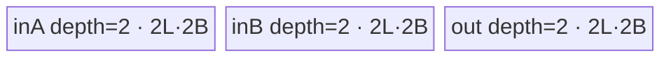
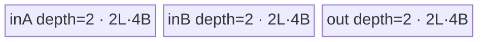
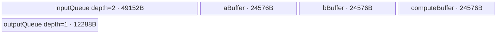
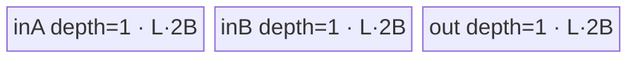
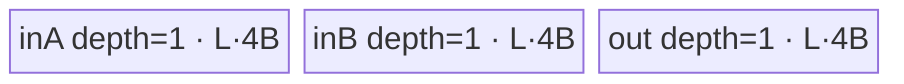

# SwiGlu 950 Direct Invoke 算子知识

## 算子速览

| 项目 | 内容 |
|---|---|
| 实际入口 | Python `cann_bench.swi_glu` → dispatcher `cann_bench::swi_glu` → `swi_glu_npu` → `launch_swi_glu_float` / `launch_swi_glu_half` / `launch_swi_glu_bfloat16`；入口类型为 Direct Invoke。 |
| 计算语义 | 沿 `dim` 把输入等分为前半 `A` 与后半 `B`，输出 `Y = swish(A) * B = A / (1 + exp(-A)) * B`。 |
| 输入输出 | 连续 strided Tensor，rank 为 2～8；`float32`、`float16` 或 `bfloat16`；输出 dtype/layout 与输入相同，`dim` 轴长度减半。 |
| 执行类型 | 所有可达节点均为 `AIV_VECTOR`；每次调用只启动一个 Kernel；无可达 Cube/AIC 或 MIX_CV 节点。 |
| Kernel 路线 | 重要性顺序：P0 R-006、P1 R-002、P2 R-008、P3 R-004、P4 R-001、P5 R-007、P6 R-003、P7 R-009、P8 R-005。Route ID 保持实现叶节点身份；P 级不改变 Host 控制流。 |
| 核心资源 | GM 输入/输出、AIV UB `TQue/TBuf` 或 RegTensor；无 Device workspace，无跨 Kernel 中间边。 |
| 来源闭包 | `direct_implementation_closed`：Python/dispatcher、校验与 shape 扁平化、dtype launcher、tiling/POD、单 Kernel entry、实际 body/helper、UB/同步/tail 和构建接线均已闭合。 |
| 验证状态 | 已完成源码闭包检查；本次知识提取未执行编译、真机、数值或性能测试。 |

## 接口与语义

### 计算语义

把归一化后的切分轴记为 `d`。对任意输入索引，把 `x` 在 `d` 轴等分为 `A`（前半）和 `B`（后半），输出有效域为输入有效域在该轴上的前一半：

```text
A = x[..., 0 : size(d)/2, ...]
B = x[..., size(d)/2 : size(d), ...]
Y = A / (1 + exp(0 - A)) * B
```

Direct Invoke 把输入逻辑折叠为 `[rowLen, 2 * colLen]`：`rowLen=∏shape[0:d]`，`colLen=∏shape[d:rank]/2`。这只改变地址解释，不产生重排或 workspace。

### 输入、输出与属性

| 参数 | shape/layout | dtype | 约束、默认值与语义 |
|---|---|---|---|
| `input` | rank 2～8，strided 且 contiguous | FP32/FP16/BF16 | `size(d)>0` 且为偶数；Direct Invoke 不执行 `Contiguous`。 |
| `dim` | 标量，默认 `-1` | `int64_t` | `-rank <= dim < rank`；负值加 rank 归一化。 |
| `output` | 与 input 同 rank/layout，`shape[d]=input.shape[d]/2` | 与 input 相同 | 由 `torch::empty(input.options())` 在输入设备上分配。 |

### 入口与版本

`cann_bench/__init__.py` 的 Python 函数调用 `torch.ops.cann_bench.swi_glu`。插件以 `TORCH_LIBRARY_FRAGMENT` 声明 schema，以 Meta 实现产生输出 shape，以 PrivateUse1 实现绑定 `swi_glu_npu`。`swi_glu_npu` 通过三个 C ABI launcher 按 dtype 直接提交 Kernel；它不是 ACLNN 两段式入口。

固定官方映射只用于确认 SwiGlu 数学语义、950/Ascend 950 注册以及被转换实现复用的 tiling/搬运骨架。`op_host/swi_glu_def.cpp` 的 `ascend950` 配置、`ascend950/swi_glu_binary.json` 的三种 dtype 和 README 支持表不否决这张直调卡；`ExpSub` 与 BF16 `colLen==1` 紧凑分支来自转换实现，不伪称官方实现。

## Host/Launcher 执行流程

### 参数校验与前处理

1. `CheckAndFlatten` 检查 rank、strided layout、contiguous 和三种 dtype。
2. 检查 `dim` 范围并归一化为 `splitDim`，再检查该轴为正偶数。
3. 输出 shape 复制输入 shape 并把 `splitDim` 轴除二；随后计算 `rowLen` 与 `colLen`。
4. `swi_glu_npu` 安装输入 device guard，分配输出，取得 input/output GM 地址与当前 NPU stream。
5. dtype 分发到对应 `launch_swi_glu_*`；任一 launcher 先查询 AIV 核数、UB 大小和架构，再计算 tiling。

Meta 实现复用同一校验与 shape 计算，但不启动 Device。输入不连续、空 split 轴、奇数 split 轴、非法 dtype/rank/dim 都在启动前由 `TORCH_CHECK` 终止。

### 参数、Workspace 与生命周期

Host 参数只有 `input`、`output`、`rowLen`、`colLen` 和 `stream`。`CalcSwiGluTiling` 生成按值传入的 `SwiGluTilingData` 及 `blockDim`；tiling 对象存活到 launch 参数封送结束。输入与输出 Tensor 持有 GM；当前 stream 约束 Kernel 对它们的访问顺序。

```text
workspace_total = 0
launch = kernel<<<blockDim, nullptr, current_stream>>>(input, output, tiling_by_value)
```

没有 executor workspace、dynamic UB 参数或多 Kernel 临时 GM。`OpCommand::RunOpApi("SwiGlu", directCall)` 包装提交，但 `directCall` 在调用 launcher 后固定返回 0。

### 启动图与失败传播

```text
cann_bench.swi_glu
  -> torch.ops.cann_bench.swi_glu
    -> swi_glu_npu
      -> CheckAndFlatten + output allocation + current stream
      -> launch_swi_glu_{float|half|bfloat16}
        -> CalcSwiGluTiling
        -> exactly one AIV kernel
          -> GM output
```

| 节点 | Host 启动函数 | Kernel entry | blockDim/POD | 输入→输出 | workspace |
|---|---|---|---|---|---|
| K1 | 对应 dtype 的 `launch_swi_glu_*` | R-001 为 `swi_glu_bfloat16_col1_compact_aiv`；其余为 `swi_glu_{float|half|bfloat16}_expsub_{db|sb}_aiv` | `blockDim=min(totalTileNum, GetCoreNumAiv())`；`SwiGluTilingData` 按值 | input GM → output GM | N/A |

这是单节点图，没有节点间边。Host 校验、平台查询或 tiling 失败会在 launch 前抛异常；源码未读取 `<<<>>>` 的异步提交状态，`directCall` 也不把 Device 异步错误转换为非零返回。

## Route 与参数设计

### 分核与资源计算

令 `s=sizeof(dtype)`，950 上 FP32 为 4，FP16/BF16 为 2；`U` 为每核可用 UB，`N` 为 AIV 核数：

```text
u32 = 32 / s                         # 元素，32B 对齐单位
cache = 512 / s                      # 元素，baseCol 搜索步长
aligned = (colLen % u32 == 0)
host_bytes_per_element(DB) = FP32:28, FP16/BF16:20
host_bytes_per_element(SB) = FP32:16, FP16/BF16:14
maxTileLen = align_down(U / host_bytes_per_element, u32)
baseCol upper = min(colLen, maxTileLen, aligned ? 65535 : floor(65535/s))
baseRow upper = min(rowLen, 4095)
totalTileNum = ceil(rowLen/baseRowLen) * ceil(colLen/baseColLen)
blockDim = min(totalTileNum, N)
```

候选 base shape 按以下优先级更新：使用核数更多、总 tile 更少、base 面积更大、完整 base tile 更多。若 stride 上限要求单行，固定 `baseRowLen=1`；否则 `baseColLen` 按 512B pack 逐步减小并搜索。DB 总是先算；仅当 DB 每核恰为两个 tile，且 SB 可做到每核一个 tile并且不减少使用核数时，选择 SB。

### Route 选择

定义 `A=(colLen % (32/s)==0)`；`S=(DB.tileNumPerCore==2 && SB 计算成功 && SB.tileNumPerCore==1 && SB.usedCoreNum>=DB.usedCoreNum)`。下表按知识重要性 P0→P8 排列，不代表 Host 判断顺序。Route ID 保持不变；`Host 顺序`列单独保留真实的 tiling、短路、entry 分派和 Device 内部分支。

Host 先按 dtype 进入 launcher（H0），所有 launcher 都先完成 `CalcSwiGluTiling`（H1）：先生成 DB 候选，仅在 `S` 成立时替换为 SB。BF16 launcher 随后检查 `colLen==1`（H2），命中即短路到 compact entry；其余 dtype/shape 按 DB/SB 选择 entry（H3），entry 内再以 `is32BAligned` 选择 aligned/nonaligned 搬运（D1）。任一前置校验、平台查询或 tiling 失败都直接报错，不跨 Route 重试。

| 重要性 | Route | 特征 | 适用域 | 实现前提 | Host 顺序、短路与 fallback |
|---:|---|---|---|---|---|
| P0 | R-006 16-bit aligned DB | T16 I/O、FP32 中间值、depth-2 TQue、32B block DMA | FP16/BF16，`A`，`!S`，且非 BF16 col1 | 950 AIV；DB base shape 成功；对齐 copy 参数合法 | H0→H1 保持 DB；BF16 经 H2 未命中 compact；H3 选 DB entry，D1 选 aligned；失败直接报错 |
| P1 | R-002 FP32 aligned DB | FP32 全程、depth-2 TQue、32B block DMA | FP32，`A`，`!S` | 950 AIV；DB base shape 成功；对齐 copy 参数合法 | H0→H1 保持 DB→H3 DB entry→D1 aligned；失败直接报错 |
| P2 | R-008 16-bit unaligned DB | T16 I/O、FP32 中间值、depth-2 padded row | FP16/BF16，`!A`，`!S`，且 BF16 `colLen!=1` | 950 AIV；DB base shape 成功；byte-unit DataCopyPad 参数合法 | H0→H1 保持 DB；BF16 经 H2 未命中；H3 DB entry→D1 nonaligned；失败直接报错 |
| P3 | R-004 FP32 unaligned DB | FP32 全程、depth-2 padded row | FP32，`!A`，`!S` | 950 AIV；DB base shape 成功；byte-unit DataCopyPad 参数合法 | H0→H1 保持 DB→H3 DB entry→D1 nonaligned；失败直接报错 |
| P4 | R-001 BF16 col1 紧凑 | 相邻 `[A,B]` pair 连续搬运、GatherMask、固定行 tile | BF16，`colLen==1` | 950 AIV；输入连续 pair 布局；固定 135168B UB 可用 | H0→H1 完整 tiling 后，H2 首个 launcher 分支直接短路；忽略 H1 生成的 DB/SB body 选择；无 Device fallback |
| P5 | R-007 16-bit aligned SB | T16 I/O、FP32 中间值、depth-1 TQue、32B block DMA | FP16/BF16，`A`，`S`，且非 BF16 col1 | 950 AIV；SB 能把每核工作降为单 tile且不减使用核数 | H0→H1 由 DB 替换为 SB；BF16 经 H2 未命中；H3 SB entry→D1 aligned；失败直接报错 |
| P6 | R-003 FP32 aligned SB | FP32 全程、depth-1 TQue、32B block DMA | FP32，`A`，`S` | 950 AIV；SB 替换谓词完整成立 | H0→H1 替换 SB→H3 SB entry→D1 aligned；失败直接报错 |
| P7 | R-009 16-bit unaligned SB | T16 I/O、FP32 中间值、depth-1 padded row | FP16/BF16，`!A`，`S`，且 BF16 `colLen!=1` | 950 AIV；SB 替换成立；byte-unit padded copy 合法 | H0→H1 替换 SB；BF16 经 H2 未命中；H3 SB entry→D1 nonaligned；失败直接报错 |
| P8 | R-005 FP32 unaligned SB | FP32 全程、depth-1 padded row | FP32，`!A`，`S` | 950 AIV；SB 替换成立；byte-unit padded copy 合法 | H0→H1 替换 SB→H3 SB entry→D1 nonaligned；失败直接报错 |

```text
H0 dtype launcher
  -> H1 calculate DB candidate; if S, replace with SB
  -> H2 BF16 && colLen==1 ? R-001
  -> H3 choose DB or SB entry
       -> D1 FP32: A ? R-002/R-003 : R-004/R-005
       -> D1 T16 : A ? R-006/R-007 : R-008/R-009
```

### 模板/实现执行矩阵

| 重要性 | Route | Host 顺序 | key/selector | dtype/shape/platform 完整命中条件 | 执行拓扑与 Kernel 节点 | 实际模板/body | 内存与同步特征 | tail/fallback |
|---:|---|---|---|---|---|---|---|---|
| P0 | R-006 | H0→H1 DB→H3→D1 aligned | T16/A/DB | FP16/BF16，`A&&!S`，非 compact，950 | 单 K1 | `SwigluSingle<SwigluExpSubVector<T16,2>,T16,T16>` | `3*2*L*2` B TQue；寄存器中升 FP32 | masked cast/store；Host 失败报错 |
| P1 | R-002 | H0→H1 DB→H3→D1 aligned | FP32/A/DB | FP32，`A&&!S`，950 | 单 K1 | `SwigluSingle<SwigluExpSubVector<float,2>,float,float>` | `3*2*L*4` B TQue；VF mask | 四区 tail；Host 失败报错 |
| P2 | R-008 | H0→H1 DB→H2 miss→H3→D1 nonaligned | T16/!A/DB | FP16/BF16，`!A&&!S`，BF16 非 col1，950 | 单 K1 | `SwigluSingle<SwigluExpSubVector<T16,2>,T16,T16>` | 行 padding；`3*2*L*2` B；FP32 中间值 | padded lane 不写 GM；Host 失败报错 |
| P3 | R-004 | H0→H1 DB→H3→D1 nonaligned | FP32/!A/DB | FP32，`!A&&!S`，950 | 单 K1 | `SwigluSingle<SwigluExpSubVector<float,2>,float,float>` | 行 padding；`3*2*L*4` B | 只回写有效列；Host 失败报错 |
| P4 | R-001 | H0→H1→H2 short-circuit | BF16/col1 | BF16，`colLen==1`，合法非空 shape，950 | 单 K1 | `SwiGluNarrowBf16::{Process,CopyIn,Compute,CopyOut}` | 固定 135168B UB；Queue + `PipeBarrier<PIPE_V>` | core 连续分区；`count` 尾保护；无 fallback |
| P5 | R-007 | H0→H1 SB→H3→D1 aligned | T16/A/SB | FP16/BF16，`A&&S`，非 compact，950 | 单 K1 | `SwigluSingle<SwigluExpSubVector<T16,1>,T16,T16>` | `3*L*2` B TQue；寄存器中升 FP32 | masked cast/store；Host 失败报错 |
| P6 | R-003 | H0→H1 SB→H3→D1 aligned | FP32/A/SB | FP32，`A&&S`，950 | 单 K1 | `SwigluSingle<SwigluExpSubVector<float,1>,float,float>` | `3*L*4` B TQue；VF mask | 四区 tail；Host 失败报错 |
| P7 | R-009 | H0→H1 SB→H2 miss→H3→D1 nonaligned | T16/!A/SB | FP16/BF16，`!A&&S`，BF16 非 col1，950 | 单 K1 | `SwigluSingle<SwigluExpSubVector<T16,1>,T16,T16>` | 行 padding；`3*L*2` B；FP32 中间值 | padded lane 不写 GM；Host 失败报错 |
| P8 | R-005 | H0→H1 SB→H3→D1 nonaligned | FP32/!A/SB | FP32，`!A&&S`，950 | 单 K1 | `SwigluSingle<SwigluExpSubVector<float,1>,float,float>` | 行 padding；`3*L*4` B | 只回写有效列；Host 失败报错 |

### 隐藏性能 Guard

| Guard | Host/Tiling 条件 | Device/资源原因 | 影响 Route | 不满足时去向 | 源码符号 |
|---|---|---|---|---|---|
| 32B 对齐 | `colLen % (32/s)==0` | 决定 `DataCopy` 的 32B block 单位或 `DataCopyPad` 的 byte 单位 | R-002～R-009 | 对应 aligned/unaligned 路线 | `CalcTiling`、`SwigluSingle::Process` |
| DB→SB | 上述 `S` | SB 扩大 tile，只有从每核 2 tile 降为 1 tile且核数不减时替换 | R-002～R-009 | 保持 DB | `GluSingleTilingCalculator::CalcTiling` |
| DMA block count | `baseRowLen<=4095` | `blockCount` 为 `uint16_t`，接口上限 4095 | R-002～R-009 | Host 缩小 base row | `GetBaseRowLenUpBound` |
| DMA block length | aligned: `baseColLen<=65535`；unaligned: `baseColLen<=floor(65535/s)` | aligned 参数以 32B block 表示，unaligned 参数以 byte 表示 | R-002～R-009 | Host 缩小 base col | `GetBaseColLenUpBound` |
| DMA stride | 多行时满足 `2*colLen-baseColLen` 的对应单位不超过 65535 | `srcStride/dstStride` 上限 | R-002～R-009 | 强制 `baseRowLen=1` 或继续搜索 | `MustBeSingleBaseRowLen` |
| Compact shape | dtype=BF16 且 `colLen==1` | 避免普通非对齐路线把每个一元素行扩为 16 个 BF16 UB lane | R-001 | 普通 BF16 路线 | `launch_swi_glu_bfloat16` |
| AIV task | 所有实际启动 entry 均调用 `KERNEL_TASK_TYPE_DEFAULT(KERNEL_TYPE_AIV_ONLY)` | 明确 direct ABI 的 Vector 任务元数据 | 全部 | 无可达非 AIV fallback | `*_aiv` entries |
| 空域 | `rowLen>0 && colLen>0` | tiling 中多处除法与 tile 分配要求非空 | 全部 | 抛 `runtime_error` | `CalcSwiGluTiling` |

### POD/ABI

`SwiGluTilingData` 是按值传入 Kernel 的标准布局结构；以下 offset/size 按字段声明顺序与 8B 自然对齐推导，结构 `sizeof=80`、`alignof=8`。只有前六个字段被可达 body 消费。

| 结构 | 字段 | 类型/位宽 | ABI 布局 | 单位 | Host/launcher producer | Device consumer | 边界 |
|---|---|---|---|---|---|---|---|
| `SwiGluTilingData` | `is32BAligned` | `uint32_t`/32 | offset 0 | bool | `colLen % (32/s)==0` | `SwigluSingle::Process/GetTilingAndOffset` | R-001 不读 |
| 同上 | `isDoubleBuffer` | `uint32_t`/32 | offset 4 | bool | DB 默认 1，命中 `S` 写 0 | launcher 选择 entry | R-001 值不影响 body |
| 同上 | `rowLen` | `uint64_t`/64 | offset 8 | 元素行 | `rowLen` 实参 | 普通 tiling 与 `SwiGluNarrowBf16::Init` | 必须 >0 |
| 同上 | `colLen` | `uint64_t`/64 | offset 16 | 每半行元素 | `colLen` 实参 | 普通 tiling | 必须 >0；R-001 已知为 1 |
| 同上 | `baseRowLen` | `uint32_t`/32 | offset 24 | 行 | 选中的 `optBaseRowLen` | `GetTilingAndOffset` | R-001 不读 |
| 同上 | `baseColLen` | `uint32_t`/32 | offset 28 | 元素 | 选中的 `optBaseColLen` | `GetTilingAndOffset` | R-001 不读 |
| 同上 | `activateLeft` | `uint32_t`/32 | offset 32 | bool | 默认 0 | 可达 body 不读 | inactive |
| 同上 | `biasIsEmpty` | `uint32_t`/32 | offset 36 | bool | 默认 0 | 可达 body 不读 | inactive |
| 同上 | `quantScaleIsEmpty` | `uint32_t`/32 | offset 40 | bool | 默认 0 | 可达 body 不读 | inactive |
| 同上 | `activateScaleIsEmpty` | `uint32_t`/32 | offset 44 | bool | 默认 0 | 可达 body 不读 | inactive |
| 同上 | `swiColLen` | `uint64_t`/64 | offset 48 | 元素 | 默认 0 | 可达 body 不读 | inactive |
| 同上 | `perRowLen` | `uint64_t`/64 | offset 56 | 元素 | 默认 0 | 可达 body 不读 | inactive |
| 同上 | `modRowLen` | `uint64_t`/64 | offset 64 | 元素 | 默认 0 | 可达 body 不读 | inactive |
| 同上 | `usedCoreNum` | `uint32_t`/32 | offset 72 | core | 默认 0 | 可达 body 不读 | inactive；76～79 为尾 padding |

### Route 源码闭包

| 重要性 | Route | Key/selector | Host/Tiling producer | POD/参数 | Kernel entry/router 节点 | Kernel body/直接依赖 | 构建接线 |
|---:|---|---|---|---|---|---|---|
| P0 | R-006 | T16/A/DB | `CheckAndFlatten`；`GluSingleTilingCalculator`；half/BF16 launcher | `SwiGluTilingData` 前六字段 | `swi_glu_{half|bfloat16}_expsub_db_aiv` | `SwigluSingle`、`SwigluSingleTilingKernel`、`SwigluExpSubVector/SwiGluExpSubVF<T16>` | `CMakeLists.txt`→`register_direct_launch_op`→`all_kernels_obj/_C`；950 `dav-3510` |
| P1 | R-002 | FP32/A/DB | `CheckAndFlatten`；`GluSingleTilingCalculator`；float launcher | 同上 | `swi_glu_float_expsub_db_aiv` | 同上，FP32 specialization | 同上 |
| P2 | R-008 | T16/!A/DB | 同 P0；nonaligned tiling 参数 | 同上 | `swi_glu_{half|bfloat16}_expsub_db_aiv` | 同 P0，加 nonaligned copy helpers | 同上 |
| P3 | R-004 | FP32/!A/DB | 同 P1；nonaligned tiling 参数 | 同上 | `swi_glu_float_expsub_db_aiv` | FP32 specialization + nonaligned copy helpers | 同上 |
| P4 | R-001 | BF16 `colLen==1` | `CheckAndFlatten`；`CalcSwiGluTiling`；BF16 launcher H2 | `SwiGluTilingData.rowLen` | `swi_glu_bfloat16_col1_compact_aiv` | `swi_glu_narrow_bf16.h::SwiGluNarrowBf16` | 同上 |
| P5 | R-007 | T16/A/SB | 同 P0；`S` 替换分支 | 同上 | `swi_glu_{half|bfloat16}_expsub_sb_aiv` | 同 P0，BufferNum=1 | 同上 |
| P6 | R-003 | FP32/A/SB | 同 P1；`S` 替换分支 | 同上 | `swi_glu_float_expsub_sb_aiv` | FP32 specialization，BufferNum=1 | 同上 |
| P7 | R-009 | T16/!A/SB | 同 P2；`S` 替换分支 | 同上 | `swi_glu_{half|bfloat16}_expsub_sb_aiv` | T16 specialization + nonaligned copy helpers，BufferNum=1 | 同上 |
| P8 | R-005 | FP32/!A/SB | 同 P3；`S` 替换分支 | 同上 | `swi_glu_float_expsub_sb_aiv` | FP32 specialization + nonaligned copy helpers，BufferNum=1 | 同上 |

## Kernel 实现

### 公共执行流程

P0/P1/P2/P3/P5/P6/P7/P8 对应的普通路线共享 `SwigluSingle`：`Init` 从 POD 派生 tile/四类 tail copy 参数、绑定输入输出 GM 并按 entry 的 `BufferNum` 分配 UB；`Process` 选择 aligned 或 nonaligned 宏。每个 core 处理 `tileIdx=blockIdx+k*blockNum`，逐 tile 执行 `CopyIn(A,B)→Compute→CopyOut(Y)`。P4 / R-001 不复用二维 tile，而以 core 连续行段和固定 6144 行 tile 执行相同数学语义。

普通路线的每 tile GM 元素 offset 为：

```text
rowTile = tileIdx / colTileNum
colTile = tileIdx % colTileNum
gmRow = rowTile * baseRowLen
A = gmRow*(2*colLen) + colTile*baseColLen
B = A + colLen
Y = gmRow*colLen + colTile*baseColLen
```

### P0 / Route R-006：16-bit aligned DB

#### 适用条件

##### 选择证据

| 层级 | 文件 | 符号 | 源码谓词/参数 | 结果/下一跳 |
|---|---|---|---|---|
| Host | `op_kernel/swi_glu_kernel.cpp` | half/BF16 launcher | `colLen%16==0 && !S`，非 R-001 | 16-bit DB entry |

#### Device 数据流

##### 函数级调用链

```text
half/BF16 DB entry -> SwigluSingle<SwigluExpSubVector<T16,2>,T16,T16>
  -> aligned CopyIn -> SwiGluExpSubVF<T16> -> aligned CopyOut
```

##### 源码等价伪码

```text
32B DMA A/B；VF 每 64 元素 unpack T16并 cast FP32；FP32 ExpSub/Adds/Div/Mul；CAST_RINT 后 pack T16；32B DMA output。
```

#### 内存与数据搬运

##### 资源与搬运表

| 层级/缓冲区 | offset/地址公式 | extent/容量公式 | dtype/layout | producer | consumer | owner/lifetime | 对齐/复用 |
|---|---|---|---|---|---|---|---|
| GM A/B/Y | 公共公式 | current tile | FP16 or BF16 | caller/DMA | DMA/caller | Tensor | 32B block |
| three TQue | queue-local | each depth 2 × L | T16 | DMA/VF | VF/DMA | pipe | each `2L*2` B |
| RegTensor | 64 lanes | register lifetime | T16 staging + FP32 arithmetic | VF | VF | one call | zeroing mask + RINT |

##### 分层内存布局



##### 字节账与复用顺序

```text
UB_total=12L bytes; Host conservative budget=20L bytes<=U; dynamic_ub=N/A; workspace_total=0
```

| 复用子区 | 写入者 | 读取者/消费点 | 下一次覆盖 | 同步或释放依据 | 安全条件 |
|---|---|---|---|---|---|
| depth-2 slots | DMA/VF | VF/DMA | later tile | Queue lifecycle | pairwise DeQue/FreeTensor |

#### 同步、精度与尾块

##### 同步与数值边界表

| 阶段 | primitive/机制 | producer | consumer/等待点 | 保护对象 | 精度/尾块 |
|---|---|---|---|---|---|
| VF | Reg CastTrait + UpdateMask | T16 load | T16 store | 64-lane repeat | FP32 intermediates；`CAST_RINT` output |
| DMA | TQue | CopyIn | VF/CopyOut | tile slots | aligned four-zone tail |

#### 关键实现

##### 符号证据表

| 阶段 | 文件 | 符号/模板实例 | 实现事实 |
|---|---|---|---|
| Host/Tiling producer | `op_kernel/swi_glu_kernel.cpp` | dtype launch + DB | s=2 tiling |
| Kernel entry/router | 同上 | half/BF16 expSub DB entries | T16 BufferNum=2 |
| Device body/helper | `swi_glu_expsub.h` | `SwiGluExpSubVF<T16>` | unpack/cast/FP32/pack |

### P1 / Route R-002：FP32 aligned DB

#### 适用条件

##### 选择证据

| 层级 | 文件 | 符号 | 源码谓词/参数 | 结果/下一跳 |
|---|---|---|---|---|
| Host | `op_kernel/swi_glu_kernel.cpp` | `CalcTiling<float>` | `colLen%8==0` 且 `!S` | `is32BAligned=1,isDoubleBuffer=1` |
| Launcher | 同上 | `launch_swi_glu_float` | DB branch | FP32 DB entry |

#### Device 数据流

##### 函数级调用链

```text
launch_swi_glu_float -> swi_glu_float_expsub_db_aiv
  -> SwigluSingle<SwigluExpSubVector<float,2>,float,float>::Init/Process
    -> CopyIn -> SwigluExpSubVector::Compute -> CopyOut
```

##### 源码等价伪码

```text
for tileIdx=blockIdx; tileIdx<totalTileNum; tileIdx+=blockNum:
  choose base/tail row×col parameters; DataCopy A and B in 32B blocks
  VF repeats ceil(curCalLen/64): masked FP32 load; expSub(0,A); +1; A/divisor; *B; masked store
  DataCopy valid output rows in 32B blocks
```

#### 内存与数据搬运

##### 资源与搬运表

| 层级/缓冲区 | offset/地址公式 | extent/容量公式 | dtype/layout | producer | consumer | owner/lifetime | 对齐/复用 |
|---|---|---|---|---|---|---|---|
| GM A/B/Y | 公共 offset 公式 | 当前 row×col tile | FP32 2D-strided | caller/CopyOut | CopyIn/caller | Tensor | 32B block copy |
| inA/inB/out TQue | queue-local | each depth 2 × `L` | FP32 | CopyIn/VF | VF/CopyOut | pipe | each `2*L*4` B |
| RegTensor | 64 lane/repeat | compile-time register set | FP32 | VF loads | ExpSub/Adds/Div/Mul/store | one VF call | mask protects tail |

##### 分层内存布局



##### 字节账与复用顺序

```text
UB_total = 3*2*L*4 = 24L bytes
Host selector budget = 28L bytes <= U; therefore actual UB is within its conservative bound
dynamic_ub = N/A; workspace_total = 0
```

| 复用子区 | 写入者 | 读取者/消费点 | 下一次覆盖 | 同步或释放依据 | 安全条件 |
|---|---|---|---|---|---|
| TQue slots | CopyIn/VF | VF/CopyOut | 后续 tile | DeQue + FreeTensor | depth 2 生命周期配对 |

#### 同步、精度与尾块

##### 同步与数值边界表

| 阶段 | primitive/机制 | producer | consumer/等待点 | 保护对象 | 精度/尾块 |
|---|---|---|---|---|---|
| DMA↔VF | TQue EnQue/DeQue/FreeTensor | CopyIn/VF | VF/CopyOut | UB slot | FP32 全程；64-lane UpdateMask |
| tail | 四区参数 + mask | tile selector | DMA/VF | 尾行/尾列 | aligned tail 仍以合法 32B block 表示 |

#### 关键实现

##### 符号证据表

| 阶段 | 文件 | 符号/模板实例 | 实现事实 |
|---|---|---|---|
| Host/Tiling producer | `op_kernel/swi_glu_kernel.cpp` | `GluSingleTilingCalculator` | aligned、DB、tile/core 参数 |
| Kernel entry/router | 同上 | `swi_glu_float_expsub_db_aiv` | 模板 BufferNum=2 |
| Device body/helper | `arch35/swi_glu_single.hpp`、`swi_glu_expsub.h` | `SwigluSingle`、`SwiGluExpSubVF<float>` | aligned DMA 与 FP32 VF 闭包 |

### P2 / Route R-008：16-bit unaligned DB

#### 适用条件

##### 选择证据

| 层级 | 文件 | 符号 | 源码谓词/参数 | 结果/下一跳 |
|---|---|---|---|---|
| Host | `op_kernel/swi_glu_kernel.cpp` | half/BF16 launcher | `colLen%16!=0 && !S`；BF16 要求 `colLen!=1` | nonaligned DB |

#### Device 数据流

##### 函数级调用链

```text
T16 DB entry -> SwigluSingle<SwigluExpSubVector<T16,2>>::Process
  -> CopyIn_Non32BAligned -> T16/FP32 VF -> CopyOut_Non32BAligned
```

##### 源码等价伪码

```text
每行复制 calCol*2 bytes；UB 行宽 pad 到 align_up(calCol,16)。
VF 对 curCalLen 使用 mask 和 FP32 中间值；每行只写回 calCol*2 有效 bytes。
```

#### 内存与数据搬运

##### 资源与搬运表

| 层级/缓冲区 | offset/地址公式 | extent/容量公式 | dtype/layout | producer | consumer | owner/lifetime | 对齐/复用 |
|---|---|---|---|---|---|---|---|
| GM A/B/Y | 公共公式 | valid tile | FP16/BF16 | caller/DMA | DMA/caller | Tensor | byte-unit DataCopyPad |
| three TQue | queue-local | each depth 2 × `L=baseRow*align_up(baseCol,16)` | T16 padded | DMA/VF | VF/DMA | pipe | total 12L B |

##### 分层内存布局


##### 字节账与复用顺序

```text
UB_total=12L bytes; Host budget=20L bytes<=U; dynamic_ub=N/A; workspace_total=0
```

| 复用子区 | 写入者 | 读取者/消费点 | 下一次覆盖 | 同步或释放依据 | 安全条件 |
|---|---|---|---|---|---|
| padded depth-2 slots | DMA/VF | VF/DMA | later tile | Queue lifecycle | output excludes padded columns |

#### 同步、精度与尾块

##### 同步与数值边界表

| 阶段 | primitive/机制 | producer | consumer/等待点 | 保护对象 | 精度/尾块 |
|---|---|---|---|---|---|
| DMA/VF | DataCopyPad + TQue + mask | GM/T16 load | VF/GM store | padded tile | FP32 intermediates；RINT；valid-byte output |

#### 关键实现

##### 符号证据表

| 阶段 | 文件 | 符号/模板实例 | 实现事实 |
|---|---|---|---|
| Host/Tiling producer | `op_kernel/swi_glu_kernel.cpp` | nonaligned DB calculation | pad/stride/base shape |
| Kernel entry/router | 同上 | half/BF16 expSub DB entries | compact BF16 已先截获 |
| Device body/helper | `arch35/swi_glu_single.hpp`、`swi_glu_expsub.h` | nonaligned copy + T16 VF | full closure |

### P3 / Route R-004：FP32 unaligned DB

#### 适用条件

##### 选择证据

| 层级 | 文件 | 符号 | 源码谓词/参数 | 结果/下一跳 |
|---|---|---|---|---|
| Host | `op_kernel/swi_glu_kernel.cpp` | `CalcTiling<float>` | `colLen%8!=0 && !S` | nonaligned DB |
| Device | `arch35/swi_glu_single.hpp` | `Process` | `is32BAligned==0` | padded path |

#### Device 数据流

##### 函数级调用链

```text
FP32 DB entry -> SwigluSingle::Process
  -> CopyIn_Non32BAligned -> ExpSub VF -> CopyOut_Non32BAligned
```

##### 源码等价伪码

```text
每个 GM 行搬运 calCol*4 bytes 到 UB；UB 行宽 pad 到 align_up(calCol,8)。
VF 处理含 padding 的 curCalLen；CopyOut 只提交 calCol*4 个有效 bytes/行。
```

#### 内存与数据搬运

##### 资源与搬运表

| 层级/缓冲区 | offset/地址公式 | extent/容量公式 | dtype/layout | producer | consumer | owner/lifetime | 对齐/复用 |
|---|---|---|---|---|---|---|---|
| GM A/B/Y | 公共公式 | `calRow*calCol` valid | FP32 strided | caller/CopyOut | CopyIn/caller | Tensor | DataCopyPad byte units |
| three TQue | queue-local | each depth 2 × `L`，`L=baseRow*align_up(baseCol,8)` | FP32 padded rows | DMA/VF | VF/DMA | pipe | total 24L B |

##### 分层内存布局


##### 字节账与复用顺序

```text
UB_total=24L bytes; Host budget=28L bytes<=U; dynamic_ub=N/A; workspace_total=0
```

| 复用子区 | 写入者 | 读取者/消费点 | 下一次覆盖 | 同步或释放依据 | 安全条件 |
|---|---|---|---|---|---|
| padded Queue slot | DataCopyPad/VF | VF/DataCopyPad | 后续 tile | Queue lifecycle | GM 只读取/写入有效 byte 数 |

#### 同步、精度与尾块

##### 同步与数值边界表

| 阶段 | primitive/机制 | producer | consumer/等待点 | 保护对象 | 精度/尾块 |
|---|---|---|---|---|---|
| nonaligned DMA | DataCopyPad + TQue | GM copy | VF/GM output | padded row | FP32；无效 lane 不回写 |

#### 关键实现

##### 符号证据表

| 阶段 | 文件 | 符号/模板实例 | 实现事实 |
|---|---|---|---|
| Host/Tiling producer | `op_kernel/swi_glu_kernel.cpp` | `CalcOptBaseShape` | 32B pad 容量与 stride guard |
| Kernel entry/router | 同上 | `swi_glu_float_expsub_db_aiv` | FP32 DB |
| Device body/helper | `arch35/swi_glu_single.hpp` | `CopyIn_Non32BAligned/CopyOut_Non32BAligned` | byte-unit tail copy |

### P4 / Route R-001：BF16 col1 紧凑路线

#### 适用条件

##### 选择证据

| 层级 | 文件 | 符号 | 源码谓词/参数 | 结果/下一跳 |
|---|---|---|---|---|
| Plugin | `op_plugin/swi_glu_plugin.cpp` | `CheckAndFlatten` | BF16、合法 shape，`colLen=shapeAfter/2` | BF16 launcher |
| Launcher | `op_kernel/swi_glu_kernel.cpp` | `launch_swi_glu_bfloat16` | `if (colLen == 1)` 在 DB/SB 前 | compact entry |
| Entry | 同上 | `swi_glu_bfloat16_col1_compact_aiv` | AIV task；按值 tiling | `SwiGluNarrowBf16` |

#### Device 数据流

##### 函数级调用链

```text
launch_swi_glu_bfloat16
  -> swi_glu_bfloat16_col1_compact_aiv
    -> SwiGluNarrowBf16::Init
    -> Process
      -> CopyIn -> Compute -> CopyOut
```

##### 源码等价伪码

```text
rowsPerCore = ceil(rowLen/blockNum)
[begin,end) = contiguous rows owned by blockIdx
for row in [begin,end) step 6144:
  count = min(6144, end-row)
  copy input[row*2 : row*2+2*count] as one contiguous byte block
  gather even lanes -> A_bf16; gather odd lanes -> B_bf16
  cast A,B to FP32
  C = A / (1 + exp(-A)) * B
  cast_rint C to BF16
  copy count BF16 values to output[row:]
```

#### 内存与数据搬运

##### 资源与搬运表

| 层级/缓冲区 | offset/地址公式 | extent/容量公式 | dtype/layout | producer | consumer | owner/lifetime | 对齐/复用 |
|---|---|---|---|---|---|---|---|
| input GM | `row*2` | `2*count` | BF16 interleaved `[A,B]` pairs | caller | `CopyIn` | input Tensor | 单连续 `DataCopyPad` |
| `inputQueue_` | UB queue | depth 2 × `6144*2` elem | BF16 | `CopyIn` | `Compute` | pipe；free after gather | 49152B total |
| `aBuffer_`/`bBuffer_` | BF16 staging starts at BF16 offset 6144；FP32 view starts at 0 | each `6144*4` B | staged BF16 then FP32 | Gather/Cast | arithmetic | TBuf, whole Kernel | 同一 TBuf 分阶段覆盖 |
| `computeBuffer_` | 0 | `6144*4` B | FP32 | vector arithmetic | output cast | TBuf | 原地复用 C |
| `outputQueue_` | UB queue | depth 1 × 6144 elem | BF16 | output cast | `CopyOut` | free after GM copy | 12288B |
| output GM | `row` | `count` | BF16 contiguous | `CopyOut` | caller | output Tensor | 只写有效 count |

##### 分层内存布局



##### 字节账与复用顺序

```text
UB_total = 2*(6144*2*2) + 6144*2 + 3*(6144*4) = 135168 bytes
dynamic_ub = N/A
workspace_total = 0
```

| 复用子区 | 写入者 | 读取者/消费点 | 下一次覆盖 | 同步或释放依据 | 安全条件 |
|---|---|---|---|---|---|
| `aBuffer_`/`bBuffer_` | Gather 写高地址 BF16 view | Cast | Cast 写 FP32 view | Gather 后、Cast 后各 `PIPE_V` barrier | 严格保持阶段顺序 |
| `computeBuffer_` | `Muls` | Exp/Adds/Div/Mul | 下一 tile `Muls` | 每步 `PIPE_V` barrier | 前一步完成后原地覆盖 |

#### 同步、精度与尾块

##### 同步与数值边界表

| 阶段 | primitive/机制 | producer | consumer/等待点 | 保护对象 | 精度/尾块 |
|---|---|---|---|---|---|
| Copy→Gather | input TQue | `CopyIn` EnQue | `Compute` DeQue | input tile | byte copy 精确为 `2*count*2` |
| Gather→Cast | `PipeBarrier<PIPE_V>` | two `GatherMask` | Cast | A/B staging | repeat=`ceil(2*count/64)` |
| Arithmetic | 每条 Vector 指令后 `PIPE_V` barrier | Cast/Muls/Exp/Adds/Div/Mul | 下一指令 | FP32 buffers | BF16 升 FP32，末尾 `CAST_RINT` |
| CopyOut | output TQue | EnQue | DeQue | BF16 output tile | 仅 `count` 个元素写 GM |

#### 关键实现

##### 符号证据表

| 阶段 | 文件 | 符号/模板实例 | 实现事实 |
|---|---|---|---|
| Host/Tiling producer | `op_kernel/swi_glu_kernel.cpp` | `launch_swi_glu_bfloat16` | col1 优先选择；blockDim 仍来自公共 tiling |
| Kernel entry/router | 同上 | `swi_glu_bfloat16_col1_compact_aiv` | AIV-only，构造 compact body |
| Device body/helper | `op_kernel/swi_glu_narrow_bf16.h` | `SwiGluNarrowBf16` | 连续 pair copy、GatherMask、FP32 arithmetic、tail count |

### P5 / Route R-007：16-bit aligned SB

#### 适用条件

##### 选择证据

| 层级 | 文件 | 符号 | 源码谓词/参数 | 结果/下一跳 |
|---|---|---|---|---|
| Host | `op_kernel/swi_glu_kernel.cpp` | half/BF16 launcher | `colLen%16==0 && S`，非 R-001 | 16-bit SB entry |

#### Device 数据流

##### 函数级调用链

```text
half/BF16 SB entry -> SwigluSingle<SwigluExpSubVector<T16,1>,T16,T16>
  -> aligned CopyIn -> FP32-intermediate VF -> aligned CopyOut
```

##### 源码等价伪码

```text
与 R-006 相同的 dtype、DMA、精度和 mask；Queue depth 改为 1。
```

#### 内存与数据搬运

##### 资源与搬运表

| 层级/缓冲区 | offset/地址公式 | extent/容量公式 | dtype/layout | producer | consumer | owner/lifetime | 对齐/复用 |
|---|---|---|---|---|---|---|---|
| GM and three TQue | 公共公式 | each Queue=`L` elem | FP16/BF16 | DMA/VF | VF/DMA | Tensor/pipe | depth 1, aligned |

##### 分层内存布局



##### 字节账与复用顺序

```text
UB_total=6L bytes; Host conservative budget=14L bytes<=U; dynamic_ub=N/A; workspace_total=0
```

| 复用子区 | 写入者 | 读取者/消费点 | 下一次覆盖 | 同步或释放依据 | 安全条件 |
|---|---|---|---|---|---|
| one slot/Queue | DMA/VF | VF/DMA | next tile | FreeTensor | sequential tile body |

#### 同步、精度与尾块

##### 同步与数值边界表

| 阶段 | primitive/机制 | producer | consumer/等待点 | 保护对象 | 精度/尾块 |
|---|---|---|---|---|---|
| all | TQue + VF mask | DMA/VF | VF/DMA | T16 tile | FP32 intermediates、RINT、aligned tail |

#### 关键实现

##### 符号证据表

| 阶段 | 文件 | 符号/模板实例 | 实现事实 |
|---|---|---|---|
| Host/Tiling producer | `op_kernel/swi_glu_kernel.cpp` | `S` selector | SB base shape |
| Kernel entry/router | 同上 | half/BF16 expSub SB entries | BufferNum=1 |
| Device body/helper | `swi_glu_expsub.h` | T16 specialization | aligned SB closure |

### P6 / Route R-003：FP32 aligned SB

#### 适用条件

##### 选择证据

| 层级 | 文件 | 符号 | 源码谓词/参数 | 结果/下一跳 |
|---|---|---|---|---|
| Host | `op_kernel/swi_glu_kernel.cpp` | `CalcTiling<float>` | `colLen%8==0` 且 `S` | SB base shape |
| Launcher | 同上 | `launch_swi_glu_float` | `isDoubleBuffer==0` | FP32 SB entry |

#### Device 数据流

##### 函数级调用链

```text
launch_swi_glu_float -> swi_glu_float_expsub_sb_aiv
  -> SwigluSingle<SwigluExpSubVector<float,1>,float,float>::Init/Process
    -> aligned CopyIn -> FP32 ExpSub VF -> aligned CopyOut
```

##### 源码等价伪码

```text
与 R-002 相同的 cyclic tile、32B DMA 和 masked VF；区别是每个 Queue 只有一个 slot，且 Host 选用 SB base shape。
```

#### 内存与数据搬运

##### 资源与搬运表

| 层级/缓冲区 | offset/地址公式 | extent/容量公式 | dtype/layout | producer | consumer | owner/lifetime | 对齐/复用 |
|---|---|---|---|---|---|---|---|
| GM A/B/Y | 公共公式 | 当前有效 tile | FP32 | caller/CopyOut | CopyIn/caller | Tensor | 32B block |
| inA/inB/out TQue | queue-local | each depth 1 × `L` | FP32 | CopyIn/VF | VF/CopyOut | pipe | each `L*4` B |

##### 分层内存布局



##### 字节账与复用顺序

```text
UB_total=12L bytes; Host selector budget=16L bytes<=U; dynamic_ub=N/A; workspace_total=0
```

| 复用子区 | 写入者 | 读取者/消费点 | 下一次覆盖 | 同步或释放依据 | 安全条件 |
|---|---|---|---|---|---|
| 单 Queue slot | CopyIn/VF | VF/CopyOut | 下一 tile | FreeTensor | 本 tile 消费完成后覆盖 |

#### 同步、精度与尾块

##### 同步与数值边界表

| 阶段 | primitive/机制 | producer | consumer/等待点 | 保护对象 | 精度/尾块 |
|---|---|---|---|---|---|
| 全流程 | TQue + VF mask | DMA/VF | VF/DMA | 单 slot | FP32；四区 tail 与 R-002 相同 |

#### 关键实现

##### 符号证据表

| 阶段 | 文件 | 符号/模板实例 | 实现事实 |
|---|---|---|---|
| Host/Tiling producer | `op_kernel/swi_glu_kernel.cpp` | `CalcTiling` 的 SB 替换分支 | `S` 的完整优先级 |
| Kernel entry/router | 同上 | `swi_glu_float_expsub_sb_aiv` | BufferNum=1 |
| Device body/helper | `arch35/swi_glu_single.hpp`、`swi_glu_expsub.h` | FP32 specialization | 单 buffer aligned 实现 |

### P7 / Route R-009：16-bit unaligned SB

#### 适用条件

##### 选择证据

| 层级 | 文件 | 符号 | 源码谓词/参数 | 结果/下一跳 |
|---|---|---|---|---|
| Host | `op_kernel/swi_glu_kernel.cpp` | half/BF16 launcher | `colLen%16!=0 && S`；BF16 要求 `colLen!=1` | nonaligned SB |

#### Device 数据流

##### 函数级调用链

```text
T16 SB entry -> SwigluSingle<SwigluExpSubVector<T16,1>>::Process
  -> CopyIn_Non32BAligned -> T16/FP32 VF -> CopyOut_Non32BAligned
```

##### 源码等价伪码

```text
与 R-008 相同的 row padding、FP32 中间计算和有效 byte 回写；Queue depth=1。
```

#### 内存与数据搬运

##### 资源与搬运表

| 层级/缓冲区 | offset/地址公式 | extent/容量公式 | dtype/layout | producer | consumer | owner/lifetime | 对齐/复用 |
|---|---|---|---|---|---|---|---|
| GM and three TQue | 公共公式 | Queue each=`L` T16 elem | FP16/BF16 padded | DMA/VF | VF/DMA | Tensor/pipe | depth 1 |

##### 分层内存布局


##### 字节账与复用顺序

```text
UB_total=6L bytes; Host budget=14L bytes<=U; dynamic_ub=N/A; workspace_total=0
```

| 复用子区 | 写入者 | 读取者/消费点 | 下一次覆盖 | 同步或释放依据 | 安全条件 |
|---|---|---|---|---|---|
| padded single slots | DMA/VF | VF/DMA | next tile | FreeTensor | valid byte copy parameters |

#### 同步、精度与尾块

##### 同步与数值边界表

| 阶段 | primitive/机制 | producer | consumer/等待点 | 保护对象 | 精度/尾块 |
|---|---|---|---|---|---|
| all | DataCopyPad/TQue/VF mask | CopyIn/VF | VF/CopyOut | single padded tile | FP32 intermediates、RINT、valid-only output |

#### 关键实现

##### 符号证据表

| 阶段 | 文件 | 符号/模板实例 | 实现事实 |
|---|---|---|---|
| Host/Tiling producer | `op_kernel/swi_glu_kernel.cpp` | nonaligned SB selector | full predicate |
| Kernel entry/router | 同上 | half/BF16 expSub SB entries | BufferNum=1 |
| Device body/helper | `arch35/swi_glu_single.hpp`、`swi_glu_expsub.h` | padded copy + T16 VF | full closure |

### P8 / Route R-005：FP32 unaligned SB

#### 适用条件

##### 选择证据

| 层级 | 文件 | 符号 | 源码谓词/参数 | 结果/下一跳 |
|---|---|---|---|---|
| Host | `op_kernel/swi_glu_kernel.cpp` | `CalcTiling<float>` | `colLen%8!=0 && S` | SB/nonaligned |

#### Device 数据流

##### 函数级调用链

```text
FP32 SB entry -> SwigluSingle<SwigluExpSubVector<float,1>>::Process
  -> CopyIn_Non32BAligned -> Compute -> CopyOut_Non32BAligned
```

##### 源码等价伪码

```text
与 R-004 相同的 padded-row 语义；Queue depth=1，Host 采用 SB base shape。
```

#### 内存与数据搬运

##### 资源与搬运表

| 层级/缓冲区 | offset/地址公式 | extent/容量公式 | dtype/layout | producer | consumer | owner/lifetime | 对齐/复用 |
|---|---|---|---|---|---|---|---|
| GM and Queue | 公共公式 | valid=`calRow*calCol`；UB each=`L` | FP32 padded | DMA/VF | VF/DMA | Tensor/pipe | depth 1 |

##### 分层内存布局


##### 字节账与复用顺序

```text
UB_total=12L bytes; Host budget=16L bytes<=U; dynamic_ub=N/A; workspace_total=0
```

| 复用子区 | 写入者 | 读取者/消费点 | 下一次覆盖 | 同步或释放依据 | 安全条件 |
|---|---|---|---|---|---|
| single padded slot | DMA/VF | VF/DMA | next tile | FreeTensor | valid byte extent unchanged |

#### 同步、精度与尾块

##### 同步与数值边界表

| 阶段 | primitive/机制 | producer | consumer/等待点 | 保护对象 | 精度/尾块 |
|---|---|---|---|---|---|
| all | TQue + VF mask | CopyIn/VF | VF/CopyOut | one padded tile | FP32；只回写有效列 |

#### 关键实现

##### 符号证据表

| 阶段 | 文件 | 符号/模板实例 | 实现事实 |
|---|---|---|---|
| Host/Tiling producer | `op_kernel/swi_glu_kernel.cpp` | SB branch | nonaligned SB selector |
| Kernel entry/router | 同上 | `swi_glu_float_expsub_sb_aiv` | BufferNum=1 |
| Device body/helper | `arch35/swi_glu_single.hpp`、`swi_glu_expsub.h` | nonaligned methods + FP32 VF | 完整 body |

## 算子特定优化

### Trick T-002：`ExpSub(0,A)` 合并负号与指数输入

#### 触发与源码依据

- 适用 Route：R-006、R-002、R-008、R-004、R-007、R-003、R-009、R-005。
- 触发条件：所有普通 `ExpSub` entry；16-bit 分支先升 FP32。
- 转换片段定位：`swi_glu_expsub.h:47-65`；相关官方源码：[`glu_tiling_kernel.hpp`](https://gitcode.com/cann/ops-nn/blob/ceb4536a2bd6fc99b85aec9d0fdcc0f470376292/activation/swi_glu/op_kernel/arch35/glu_tiling_kernel.hpp)。

**事实主源码（转换实现，非官方映射）**：

```cpp
AscendC::Reg::Duplicate(zero, 0.0f);
AscendC::Reg::ExpSub(denominator, zero, srcAF32, mask);
AscendC::Reg::Adds(denominator, denominator, 1.0f, mask);
```

#### 机制与设计原因

`ExpSub(dst, zero, srcA, mask)` 直接形成 `exp(0-A)`，不先物化 `-A`。同一 64-lane mask 随后保护 `Adds/Div/Mul` 和 store。FP16/BF16 用 unpack+cast 得到 FP32 `srcAF32/srcBF32`，最终用 `CAST_RINT` 降回原 dtype；FP32 不执行 cast。

#### 迁移边界

- 适用：需要 `exp(-x)` 且寄存器 VF 提供 `ExpSub` 的 Vector 计算。
- 前提：保持 `zero-srcA` 的操作数顺序、64-lane repeat 和相同 mask。
- 失效：缺少 `ExpSub` primitive 时需恢复等价的取负再 Exp 序列。
- 未验证：本次知识提取未执行编译、真机、数值或性能测试。

#### 错误做法

交换 `zero` 与 `srcA` 会计算 `exp(A)`，不再是 SwiGlu。固定仓未提供其它可验证反例。

### Trick T-001：BF16 单列按相邻 pair 连续搬运

#### 触发与源码依据

- 适用 Route：R-001。
- 触发条件：dtype=BF16 且折叠后的 `colLen==1`。
- 转换片段定位：`swi_glu_narrow_bf16.h:56-68`；相关官方源码：[`swi_glu_single.hpp`](https://gitcode.com/cann/ops-nn/blob/ceb4536a2bd6fc99b85aec9d0fdcc0f470376292/activation/swi_glu/op_kernel/arch35/swi_glu_single.hpp)。

**事实主源码（转换实现，非官方映射）**：

```cpp
DataCopyExtParams copyParams{1, count * 2 * sizeof(bfloat16_t), 0, 0, 0};
DataCopyPad(inputLocal, inputGm_[row * 2], copyParams, padParams);
```

#### 机制与设计原因

普通非对齐路线按“多行、每行一元素”搬运时，每行在 UB 中按 32B 对齐。紧凑路线把 `[A0,B0,A1,B1,...]` 作为一个连续 byte block 搬入，再用 `GatherMask` 分离偶/奇 lane，避免为每个 BF16 行单独保留 16-lane UB 行宽。固定 tile 为 6144 行，尾部 `count` 同时约束 copy、gather、compute 与 output。

#### 迁移边界

- 适用：split 后每半行恰为一个 BF16 元素且输入连续。
- 前提：950 AIV；输入物理排列确为相邻 `[A,B]` pair；固定 135168B UB 可用。
- 失效：`colLen!=1` 必须回到 R-006～R-009 的二维 strided copy。
- 未验证：本次知识提取未执行编译、真机、数值或性能测试。

#### 错误做法

不能把 `colLen>1` 的 `[A-row,B-row]` 布局当成相邻 pair；这会改变 A/B 对应关系。固定源码未提供其它可验证反例。

### Trick T-003：仅在“一次搬运替代两次”时关闭 double buffer

#### 触发与源码依据

- 适用 Route：R-007、R-003、R-009、R-005。
- 触发条件：DB 每核恰为 2 tile，SB 每核为 1 tile，且 SB 使用核数不小于 DB。
- Golden 来源：[`op_host/swi_glu_tiling.cpp:423-432`](https://gitcode.com/cann/ops-nn/blob/ceb4536a2bd6fc99b85aec9d0fdcc0f470376292/activation/swi_glu/op_host/swi_glu_tiling.cpp#L423-L432)。

**官方源码（固定 Commit 连续逐字摘录）**：

```cpp
if (optTilingDb.tileNumPerCore == static_cast<uint64_t>(2)) {
    if (CalcOptTiling<Glu_Flag, 1>(ubSize, dtype, optTilingNoDb) &&
        (optTilingNoDb.tileNumPerCore == static_cast<uint64_t>(1)) &&
        (optTilingNoDb.totalUsedCoreNum >= optTilingDb.totalUsedCoreNum)) {
```

#### 机制与设计原因

SB 把 Queue depth 从 2 降为 1，释放的 UB 用于更大的 base tile。选择器并非普遍偏向更大 tile：它只在每核 tile 数从 2 降到 1且并行核数不下降时切换，避免以减少 core 并行度换取单缓冲。

#### 迁移边界

- 适用：Queue 深度直接参与 UB 上界、且 tile 数可被更大 base shape 减半的逐元素算子。
- 前提：SB/DB 都重新完整计算 base shape、tile 数和使用核数。
- 失效：条件任一不满足则保持 DB。
- 未验证：本次知识提取未执行编译、真机、数值或性能测试。

#### 错误做法

只因 SB tile 更大就关闭 DB 会忽略核数下降和流水重叠损失；官方选择谓词明确阻止该情况。

## 模板与实现对比

| 重要性 / Route | dtype / 搬运 / Buffer | 循环与分核 | UB、计算与同步 | tail / fallback |
|---:|---|---|---|---|
| P0 / R-006 | T16 aligned DB | cyclic 二维 tile | 三个 depth-2 TQue；FP32 中间值；TQue + VF mask | aligned 四区 tail；Host 失败报错 |
| P1 / R-002 | FP32 aligned DB | cyclic 二维 tile | 三个 depth-2 TQue；FP32 全程；TQue + VF mask | aligned 四区 tail；Host 失败报错 |
| P2 / R-008 | T16 nonaligned DB | cyclic padded 二维 tile | depth-2 TQue；FP32 中间值；DataCopyPad + VF mask | 仅回写有效 byte；Host 失败报错 |
| P3 / R-004 | FP32 nonaligned DB | cyclic padded 二维 tile | depth-2 TQue；FP32 全程；DataCopyPad + VF mask | 仅回写有效 byte；Host 失败报错 |
| P4 / R-001 | BF16 compact | core 连续行段，固定行 tile | inQ depth2、outQ depth1、三个 TBuf；显式 PIPE_V；固定 135168B | `count` 保护有效行；无 Device fallback |
| P5 / R-007 | T16 aligned SB | cyclic 二维 tile | 三个 depth-1 TQue；FP32 中间值；TQue + VF mask | aligned 四区 tail；Host 失败报错 |
| P6 / R-003 | FP32 aligned SB | cyclic 二维 tile | 三个 depth-1 TQue；FP32 全程；TQue + VF mask | aligned 四区 tail；Host 失败报错 |
| P7 / R-009 | T16 nonaligned SB | cyclic padded 二维 tile | depth-1 TQue；FP32 中间值；DataCopyPad + VF mask | 仅回写有效 byte；Host 失败报错 |
| P8 / R-005 | FP32 nonaligned SB | cyclic padded 二维 tile | depth-1 TQue；FP32 全程；DataCopyPad + VF mask | 仅回写有效 byte；Host 失败报错 |

所有 Route 都是单 AIV Kernel，无 dynamic UB、SIMT、NDDMA、通信 window 或 Device workspace。普通路线的 Host UB 上界比可达 body 的实际 TQue 分配更保守；不得据此臆造已不存在的 TBuf。

## 平台差异

| 项目 | A2 | A3 | 950 |
|---|---|---|---|
| 支持状态 | 官方语义映射支持；直调构建枚举 `ascend910b`，本卡不覆盖 | 官方语义映射支持；直调构建枚举 `ascend910_93`，本卡不覆盖 | 官方 README、OpDef `ascend950` 与 binary config 支持；本卡目标平台 |
| Host/Launcher | 同一转换 launcher 源码，目标 arch flag 不同 | 同左 | `NPU_ARCH=ascend950` 映射 `dav-3510` |
| Kernel/资源 | 未在本卡做 Route 闭包 | 未在本卡做 Route 闭包 | AIV-only；本文完整闭合 UB、DMA、VF 与 tail |

## 限制与失败边界

- Direct Invoke 比官方 ACLNN 语义域更窄：只接受 rank 2～8、连续 strided、非空且 split 轴为正偶数的 Tensor；不执行自动 contiguous，也没有 empty-tensor key。
- shape 乘积使用 `uint64_t` 连乘，没有显式乘法溢出检查；超出可表示范围时行为不由该实现保护。
- `rowLen/colLen` 为 64 位，但 base shape 与 copy 参数会窄化为 32/16 位；Host 通过 4095/65535、UB 和 stride guard 约束可达值。
- R-001 固定申请 135168B UB；源码没有把该常量回代为显式 `ubSize>=135168` selector，950 部署必须保持该资源前提。
- 普通 `ExpSub` body 实际不分配 Host 预算公式中的旧 TBuf，因此实际 UB 小于 Host 的保守估算；修改预算公式时不能反向假设这些 TBuf 在可达 body 中存在。
- `swi_glu_kernel.cpp` 还保留未被三个 launcher 调用的 faithful/adapted entry；它们不属于本文 Host 可达 Route。
- 当前 stream 上只提交一个 Kernel，无跨节点 workspace 或显式 event。launch wrapper 未读取异步提交状态，Device 异步错误不在 `directCall` 的固定返回值中传播。
- 固定官方映射不包含转换实现的 `ExpSub` 和 compact body；两者的事实只归属于 Direct Invoke 转换源码。
- 本次知识提取未执行编译、真机、数值或性能测试。

## 源码索引

### 链路索引

| 链路阶段 | 文件 | 关键符号 | 支撑内容 |
|---|---|---|---|
| Python 入口 | `cann_bench/__init__.py` | `swi_glu` | Python→dispatcher |
| 入口实现 | `op_plugin/swi_glu_plugin.cpp` | `CheckAndFlatten`、`swi_glu_npu` | 校验、shape、dtype、stream、launch |
| Launcher ABI | `op_kernel/swi_glu_launch.h` | `launch_swi_glu_*` | C ABI 参数 |
| POD | `op_kernel/swi_glu_tilingdata.h` | `SwiGluTilingData` | 按值 ABI |
| Host/Tiling/Router | `op_kernel/swi_glu_kernel.cpp` | `GluSingleTilingCalculator`、launchers、entries | Route、POD producer、单 Kernel launch |
| Kernel 公共 body | `op_kernel/arch35/swi_glu_single.hpp` | `SwigluSingle` | Init/Process/CopyIn/CopyOut |
| Device tile helper | `op_kernel/arch35/glu_tiling_kernel.hpp` | `SwigluSingleTilingKernel` | tile、offset、DMA 参数、tail |
| General compute | `op_kernel/swi_glu_expsub.h` | `SwiGluExpSubVF`、`SwigluExpSubVector` | Reg VF、精度、Queue |
| Compact compute | `op_kernel/swi_glu_narrow_bf16.h` | `SwiGluNarrowBf16` | pair copy、Gather、UB、tail |
| 构建接线 | `csrc/ops/swi_glu/CMakeLists.txt` | `register_direct_launch_op` | kernel/plugin 注册 |
| 950 构建 | `CMakeLists.txt` | `NPU_ARCH`、`all_kernels_obj`、`_C` | `ascend950→dav-3510` 与共享库 |
| 官方语义/平台 | `activation/swi_glu/README.md` | 产品表、公式 | 950 相关映射 |
| 官方 950 注册 | `activation/swi_glu/op_host/swi_glu_def.cpp` | `AddConfig("ascend950")` | 950 注册信号 |
| 官方 950 dtype | `activation/swi_glu/op_host/config/ascend950/swi_glu_binary.json` | `SwiGlu_1/2/3` | FP16/FP32/BF16 映射 |
| 官方 tiling 映射 | `activation/swi_glu/op_host/swi_glu_tiling.cpp` | `GluSingleTilingCalculator` | 转换 tiling 的对应来源 |
| 官方搬运映射 | `activation/swi_glu/op_kernel/arch35/swi_glu_single.hpp` | `SwigluSingle` | 公共 body 映射 |
| 官方 tile 映射 | `activation/swi_glu/op_kernel/arch35/glu_tiling_kernel.hpp` | `SwigluSingleTilingKernel` | tile/copy 参数映射 |

### 实现复用检查

| 检查项 | 可复用事实 | 不得改变的约束 | 源码符号 |
|---|---|---|---|
| ABI/POD | 前六字段足以驱动可达 body | 字段顺序、位宽、按值传递和 inactive 字段默认值 | `SwiGluTilingData` |
| 调用顺序 | validate→flatten→tiling→one launch→Init/Process | BF16 col1 必须在 DB/SB entry 选择前截获 | `swi_glu_npu`、launchers |
| workspace/内存 | General 三 Queue；compact 固定 Queue/TBuf | depth、L、135168B、GM offset 与有效 extent | `InitUbBuffer`、`SwiGluNarrowBf16::Init` |
| 同步 | TQue 生命周期；compact 显式 PIPE_V | 不得提前覆盖 Queue/TBuf 或省略数据依赖 barrier | `CopyIn/Compute/CopyOut` |
| 精度与尾块 | FP32 intermediate、T16 RINT、64-lane mask、四区 tail | ExpSub 操作数顺序、cast/round、valid-only output | `SwiGluExpSubVF`、`CaclOneTileParam` |
| 失败边界 | Host 校验/tiling 失败阻断 launch | 不得把固定返回 0 当成异步 Device 成功证明 | `CheckAndFlatten`、`CalcSwiGluTiling`、`directCall` |

<!-- cannbot:related:start -->
## 相关

- [SwiGlu 950 ACLNN 算子知识](../../../aclnn/nn/activation/swi_glu_950.md)（`same_topic`）：“沿 `dim` 把输入等分为前半 `A` 与后半 `B`，输出 `Y = swish(A) * B = A / (1 + exp(-A)) * B`。”与“沿 `dim` 对半切成 A/B，`y=A/(1+exp(-A))*B`。”分别给出两端正文事实；两卡实现同一 950 SwiGlu 数学与 shape 契约，但分别闭合 Direct Invoke 与 ACLNN 的 Host、empty、workspace 和 kernel route，联合阅读可做启动方式选型。
<!-- cannbot:related:end -->
