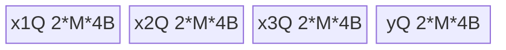
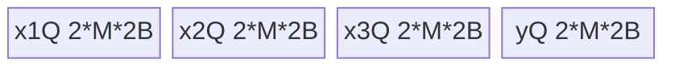

# ForeachAddcdivScalar A5 Direct Invoke 算子知识

## 算子速览

| 项目 | 内容 |
|---|---|
| 实际入口 | `cann_bench::foreach_addcdiv_scalar`；PrivateUse1 实现 `foreach_addcdiv_scalar_npu`；另有六个 Host 可调用的 `launch_foreach_addcdiv_scalar_{supplemental,adapted}_{fp16,fp32,bf16}`。 |
| 计算语义 | 对列表中每组同形 Tensor 逐元素计算 `y=x1+scalar*(x2/x3)`，先除后乘加。 |
| 输入输出 | `x1/x2/x3/y` 为等长 ND TensorList，对应 shape 相同，统一 FP16/FP32/BF16；scalar 在 Host 收窄为 FP32 值。 |
| 执行类型 | 单 Device Kernel；R-001～R-003 为 `AIV_VECTOR` RegBase/MicroAPI；R-004～R-009 为 AIV wrapper 内 SIMT VF；无 Cube/AIC 或 MIX_CV。 |
| Kernel 路线 | 按重要性为 R-002、R-003、R-001、R-006、R-008、R-004、R-007、R-009、R-005；前三条是默认 RegBase dtype Route，后六条是独立 adapted SIMT dtype×32/64 位索引 Route。 |
| 核心资源 | RegBase 使用四个 depth=2 TQue 与 FP32 RegTensor；SIMT 直访 GM、使用线程寄存器；workspace 均为 0。 |
| 来源闭包 | `direct_implementation_closed`：PrivateUse1、descriptor、tiling/POD、六个 launcher、两执行族 body 与构建接线闭合；官方固定 Commit 仅作 A5/arch35 相关映射。 |
| 验证状态 | 已完成源码闭包检查；本次知识提取未执行编译、真机、数值或性能测试。 |

## 接口与语义

### 计算语义

对 `0<=i<N`、`0<=j<E_i`：

```text
q = x2[i][j] / x3[i][j]
y[i][j] = x1[i][j] + float32(scalar) * q
```

FP32 路线直接计算；FP16/BF16 把三输入提升到 FP32，完成除法与乘加后降回输出 dtype。没有对零分母、NaN、Inf 或 scalar 有限性的附加分支。输出由 `empty_like` 新建，不与输入原地别名。

### 输入、输出与属性

| 参数 | shape/layout | dtype | 约束、默认值与语义 |
|---|---|---|---|
| `x1` | 列表长 1～64；每项 rank 1～8、1～64M 元素、连续 ND | 列表统一 FP16/FP32/BF16 | 加法左输入；所有输入在同一设备。 |
| `x2` | 与 x1 等长；对应项同 shape、连续 ND | 同 x1 | 除法分子。 |
| `x3` | 与 x1 等长；对应项同 shape、连续 ND | 同 x1 | 除法分母。 |
| `scalar` | 标量属性 | schema 为 float；C++ double 转 FP32 | 所有项共享，无默认值。 |
| `y` | 与 x1 等长、同 shape/layout | 同 x1 | 完整写出。 |

### 入口与版本

`TORCH_LIBRARY_FRAGMENT` 声明 `cann_bench::foreach_addcdiv_scalar`；Meta 只校验并构造输出元信息，PrivateUse1 绑定 `foreach_addcdiv_scalar_npu`。这不是 ACLNN 入口：官方固定 Commit 的 scalar 是 Tensor、A5 arch35 body 为 SIMT；转换交付把 scalar 改成按值 FP32，并增加 supplemental RegBase。官方 README 明确 Ascend 950PR/950DT 支持该逻辑算子，official `op_kernel/CMakeLists.txt` 把 arch35 接到 `ascend950`，没有平台冲突；这些事实不把转换 ABI 记作官方 ABI。

## Host/Launcher 执行流程

### 参数校验与前处理

顺序为：`ValidateLists` 校验长度、dtype、对应 shape、rank、元素数、设备及连续性；固定 device/stream；按 dtype 得到 tag 0/1/2；建立输出；为 x1/x2/x3/y 各打包 pointer-only `ListTensorDesc`；调用 `calc_foreach_addcdiv_scalar_tiling`；将 descriptor 异步复制到 NPU；按 dtype 调 supplemental launcher。copy 失败、tiling 返回 0 或 `blockDim==0` 都阻断 launch。

每份 descriptor 有 `3+N` 个 uint64 word：`word0=24` 字节、`word1=N<<32`、`word2=0xffffffff`，随后是 N 个 GM 地址。

### 参数、Workspace 与生命周期

令 `D=8*(3+N)`，四份 descriptor 在同一 UInt8 NPU Tensor 中的 byte offset 为 `0,D,2D,3D`，总辅助 GM 为 `4D`。Host vector 与 Device Tensor 被 callback 捕获；copy 与 Kernel 使用同一 stream。`OpCommand::RunOpApi` 的 stream 完成期保活属于框架边界。

workspace 为 0。launcher 解引用 POD 后按值传入 entry。按字段自然对齐，转换 POD `alignof=8,sizeof=3672`；构建把 AICore 输入参数上限设为 4096。局部 CMake 的“3664 bytes”是未加 `inputsTensorUbSize/reserved` 的官方 POD 大小，不是转换 POD 的实际布局。

### 启动图与失败传播

```text
PrivateUse1
  -> validate/build outputs and 4 descriptors
  -> calc_tiling
  -> H2D descriptor copy (current stream)
  -> launch_supplemental_{dtype}
     -> one AIV grid(blockDim) -> RegBase Process<T>

独立 Host Direct Invoke
  -> launch_adapted_{dtype}
     -> one AIV grid(blockDim) -> Process<T> -> per-segment SIMT VF_CALL<T,INDEX_T>
```

| 边 | 交接介质 | ordering/owner/lifetime | 失败传播 |
|---|---|---|---|
| Host descriptor→Device | 单 GM Tensor 四个 D-byte slice | 同 stream；callback 捕获对象，框架完成期保活 | copy 失败抛出，Kernel 不启动 |
| tiling→entry | 3672B POD 值副本 | Host 先生成，launcher 按值传 | tiling/零 blockDim 阻断 PrivateUse1 |
| Kernel→y | 每个输出 Tensor 有效域 | 当前 stream；PyTorch Tensor owner | launcher 为 void，无显式 Device 状态回传 |

六个 `launch_*` 均为 Host-visible `extern "C"`。PrivateUse1 只选三个 supplemental；三个 adapted 可被 Host 独立调用。三个 faithful Device entry 虽编译，却没有 Host-visible launcher，不进入正式 Route。

## Route 与参数设计

### 分核与资源计算

令 `s=sizeof(T)`、`E=sum(E_i)`、`C=GetCoreNumAiv()`：

```text
elementsPerBlock=32/s
blockCount=ceil(E/elementsPerBlock)
needCoreNum=min(ceil(E/1024),C)，且至少 1
perCoreBlockCount=blockCount/needCoreNum
第 k 核目标=(perCoreBlockCount+(k<blockCount%needCoreNum))*elementsPerBlock
```

`AssignDataToEachCore` 将逻辑拼接区间还原成 tensor 起止 index 与 inclusive offset；末核可短于 32B 块。PrivateUse1 排除空域，POD tiler 容量 256 而入口进一步限为 64。

RegBase 令平台 UB 为 U：

```text
M0=floor(U/(2*4*s))
M=floor(M0*s/32)*32/s
UB_total=4 queues*depth2*M*s=8*M*s<=U
```

tiler 只检查 `U>128KiB`，未从 U 扣除该常量；SIMT 不消费 M。

### Route 选择

| 优先级 | Route | 路线特征 | 适用域 | 实现前提 | Host 顺序 |
|---:|---|---|---|---|---|
| P0 | R-002 FP32 RegBase | 默认入口的 FP32 MicroAPI 路线；全程 FP32 | PrivateUse1 FP32，或独立 supplemental_fp32 调用 | 有效 POD、RegBase UB 容量与 FP32 descriptor | PrivateUse1 selector 第 2 个判断：tag 1；仅在 tag 0 未命中后检查 |
| P1 | R-003 BF16 RegBase | 默认入口的 BF16 路线；FP32 提升计算后降回 BF16 | PrivateUse1 BF16，或独立 supplemental_bf16 调用 | 有效 POD、RegBase UB 容量与 BF16 descriptor | PrivateUse1 selector 最终 `else`：仅在 tag 0、tag 1 均未命中后进入 |
| P2 | R-001 FP16 RegBase | 默认入口的 FP16 路线；FP32 提升计算后降回 FP16 | PrivateUse1 FP16，或独立 supplemental_fp16 调用 | 有效 POD、RegBase UB 容量与 FP16 descriptor | PrivateUse1 selector 第 1 个判断：tag 0 命中即短路 |
| P3 | R-006 FP32 SIMT32 | 独立 adapted FP32 launcher 的常规索引路线；1024-thread GM 直访 | adapted_fp32 的正长度 segment，且 `dataCount<=INT32_MAX` | 调用方提供匹配 FP32 的 descriptor、POD、stream 与 launcher 参数 | adapted_fp32 内第 1 个 segment 判断；命中即短路，不进入 R-007 |
| P4 | R-008 BF16 SIMT32 | 独立 adapted BF16 launcher 的常规索引路线；FP32 提升、1024-thread GM 直访 | adapted_bf16 的正长度 segment，且 `dataCount<=INT32_MAX` | 调用方提供匹配 BF16 的 descriptor、POD、stream 与 launcher 参数 | adapted_bf16 内第 1 个 segment 判断；命中即短路，不进入 R-009 |
| P5 | R-004 FP16 SIMT32 | 独立 adapted FP16 launcher 的常规索引路线；FP32 提升、1024-thread GM 直访 | adapted_fp16 的正长度 segment，且 `dataCount<=INT32_MAX` | 调用方提供匹配 FP16 的 descriptor、POD、stream 与 launcher 参数 | adapted_fp16 内第 1 个 segment 判断；命中即短路，不进入 R-005 |
| P6 | R-007 FP32 SIMT64 | 独立 adapted FP32 launcher 的宽索引 fallback；512-thread GM 直访 | adapted_fp32 且 `dataCount>INT32_MAX` | R-006 的上界判断未命中，且 segment 为正 | adapted_fp32 内第 2 个分支；R-006 未命中后的唯一宽索引 fallback |
| P7 | R-009 BF16 SIMT64 | 独立 adapted BF16 launcher 的宽索引 fallback；FP32 提升、512-thread GM 直访 | adapted_bf16 且 `dataCount>INT32_MAX` | R-008 的上界判断未命中，且 segment 为正 | adapted_bf16 内第 2 个分支；R-008 未命中后的唯一宽索引 fallback |
| P8 | R-005 FP16 SIMT64 | 独立 adapted FP16 launcher 的宽索引 fallback；FP32 提升、512-thread GM 直访 | adapted_fp16 且 `dataCount>INT32_MAX` | R-004 的上界判断未命中，且 segment 为正 | adapted_fp16 内第 2 个分支；R-004 未命中后的唯一宽索引 fallback |

```text
重要性顺序：R-002 -> R-003 -> R-001 -> R-006 -> R-008 -> R-004 -> R-007 -> R-009 -> R-005

真实 Host selector 顺序（不得按重要性重排）：
PrivateUse1: if tag==0 -> R-001; else if tag==1 -> R-002; else -> R-003
adapted_fp16: skip if dataCount<=0; else if dataCount<=INT32_MAX -> R-004; else -> R-005
adapted_fp32: skip if dataCount<=0; else if dataCount<=INT32_MAX -> R-006; else -> R-007
adapted_bf16: skip if dataCount<=0; else if dataCount<=INT32_MAX -> R-008; else -> R-009
```

### 模板/实现执行矩阵

| Route | key/selector | dtype/shape/platform 完整命中条件 | 执行拓扑与 Kernel 节点 | 实际模板/body | 内存与同步特征 | tail/fallback |
|---|---|---|---|---|---|---|
| R-002/R-003/R-001 | supplemental suffix | A5、对应 dtype、有效 POD | 单 AIV Kernel | RegBase `<float/bf16/half>` | 四 depth2 Queue；B16 路线 FP32 promotion | mask tail；无 fallback |
| R-006/R-008/R-004 | adapted suffix+u32 | A5、对应 dtype、段不超 INT32_MAX | AIV wrapper+SIMT VF | `SimtKernel<T,uint32_t>` | GM 直访、1024 threads、无 dynamic UB | thread guard；大段转同 dtype i64 |
| R-007/R-009/R-005 | adapted suffix+i64 | A5、对应 dtype、大段 | AIV wrapper+SIMT VF | `SimtKernel<T,int64_t>` | GM 直访、512 threads、无 dynamic UB | thread guard；无更宽 fallback |

### 隐藏性能 Guard

| Guard | Host/Tiling 条件 | Device/资源原因 | 影响 Route | 不满足时去向 | 源码符号 |
|---|---|---|---|---|---|
| A5 build | `ascend950->dav-3510` | arch35/MicroAPI/SIMT 目标 | 全部 | 配置失败 | top CMake |
| POD 上限 | 4096 | 值传 POD 推导 3672B | 全部 | 编译器拒绝 | operator CMake |
| UB | `coreNum>0,U>128KiB,M>0,M<=UINT32_MAX` | 四 Queue 双缓冲 | R-002/R-003/R-001 | tiling 失败 | `calc_*_tiling` |
| 容量 | PrivateUse1 N<=64；POD N<=256；per-core array 80 | 固定数组索引 | 全部 | 前两者失败；未检查 coreNum<=80 | Validate/POD |
| repeat 窄化 | repeats→uint16 | MicroAPI 循环 | R-002/R-003/R-001 | 无显式 guard | RegBase Compute |
| SIMT 位宽 | dataCount 与 INT32_MAX 比较 | u32 1024 threads/i64 512 threads | R-006/R-008/R-004/R-007/R-009/R-005 | 同 dtype i64 | adapted Process |

### POD/ABI

| 结构 | 字段 | 类型/位宽 | ABI 布局 | 单位 | Host/launcher producer | Device consumer | 边界 |
|---|---|---|---|---|---|---|---|
| tiling | `needCoreNum` | int32 | off 0 | core | clamp core 公式 | grid 间接消费 | 数组仅 80 |
| tiling | `tensorCount` | int32 | off 4 | tensor | N | body 不读 | 入口 64/POD 256 |
| tiling | `totalDataCount` | int64 | off 8 | element | sum | SIMT 空域 guard | 求和未查溢出 |
| tiling | `inputsTensorUbSize` | uint32 | off 16 | element | M | RegBase tile | SIMT inactive |
| tiling | `reserved` | uint32 | off 20 | N/A | 清零 | 不读 | 保持 0 |
| tiling | `tensorDataCountList[256]` | int64[] | off 24, 2048B | element | numel | tensor tail | 未用项 0 |
| tiling | `tensorStartList[80]` | uint16[] | off 2072, 160B | tensor/core | core splitter | blockIdx 索引 | inclusive range |
| tiling | `tensorEndList[80]` | uint16[] | off 2232, 160B | tensor/core | 同上 | 同上 | inclusive |
| tiling | `tensorStartOffsetList[80]` | int64[] | off 2392, 640B | element/core | 同上 | 首段 | inclusive |
| tiling | `tensorEndOffsetList[80]` | int64[] | off 3032, 640B | element/core | 同上 | 尾段 | inclusive |
| descriptor | word0/word1/word2 | uint64×3 | off 0/8/16 | byte/count/sentinel | 24、N<<32、0xffffffff | SDK parser | 固定 header |
| descriptor | `data[i]` | uint64 | off `24+8i` | GM addr | `data_ptr` | `GetDataPtr<T>` | 生命周期覆盖 launch |

### Route 源码闭包

| Route | Key/selector | Host/Tiling producer | POD/参数 | Kernel entry/router 节点 | Kernel body/直接依赖 | 构建接线 |
|---|---|---|---|---|---|---|
| R-002 | supplemental fp32 suffix | plugin+`calc_*_tiling` | tiling+FP32 scalar | supplemental fp32 entry | RegBase float | operator CMake |
| R-003 | supplemental bf16 suffix | plugin+`calc_*_tiling` | 同上 | supplemental bf16 entry | RegBase bf16 | 同上 |
| R-001 | supplemental fp16 suffix | plugin+`calc_*_tiling` | 同上 | supplemental fp16 entry | RegBase half | 同上 |
| R-006 | adapted fp32+u32 | adapted fp32 launcher | 同上 | adapted fp32 entry | adapted SIMT float/u32 | 同上 |
| R-008 | adapted bf16+u32 | adapted bf16 launcher | 同上 | adapted bf16 entry | adapted SIMT bf16/u32 | 同上 |
| R-004 | adapted fp16+u32 | adapted fp16 launcher | 同上 | adapted fp16 entry | adapted SIMT half/u32 | 同上 |
| R-007 | adapted fp32+i64 | adapted fp32 launcher | 同上 | adapted fp32 entry | adapted SIMT float/i64 | 同上 |
| R-009 | adapted bf16+i64 | adapted bf16 launcher | 同上 | adapted bf16 entry | adapted SIMT bf16/i64 | 同上 |
| R-005 | adapted fp16+i64 | adapted fp16 launcher | 同上 | adapted fp16 entry | adapted SIMT half/i64 | 同上 |

## Kernel 实现

### 公共执行流程

所有 Route 都是一个 AIV grid；每个 block 从 POD 读取自己的 tensor 起止与首尾 offset，并用 `ListTensorDesc::GetDataPtr<T>` 解出 GM。每个元素仅一个 writer，无 atomic。RegBase 逐 segment 分 M-element tile，三路 GM→VECIN Queue→FP32 RegTensor Div/Axpy→VECOUT Queue→GM。SIMT wrapper 对每段一次 `VF_CALL`，线程以 `i=threadIdx;i<dataCount;i+=threadNum` 直访 GM。无跨 Kernel workspace 边。

### Route R-002：FP32 RegBase

#### 适用条件
##### 选择证据
`dtypeTag==1 -> launch_supplemental_fp32 -> RegBase<float>`。
#### Device 数据流
##### 函数级调用链
`CopyIn -> FP32 register DataCopy -> Div -> Axpy -> register DataCopy -> CopyOut`。
##### 源码等价伪码
按 M 分 tile，搬三路 `count*4B`；每 repeat masked FP32 计算并写同 offset 输出。
#### 内存与数据搬运
##### 资源与搬运表
四 Queue 各 `2*M*4B`；三个 FP32 source register，x2/x1 原地覆盖。
##### 分层内存布局

##### 字节账与复用顺序
`UB_total=8*M*4<=U; dynamic_ub=N/A; workspace=0`；Queue 释放后复用。
#### 同步、精度与尾块
##### 同步与数值边界表
Queue 协议与 FP32 mask tail；全程 FP32。
#### 关键实现
##### 符号证据表
plugin tag 1、supplemental_fp32 entry、RegBase `<float>` 三层闭合。

### Route R-003：BF16 RegBase

#### 适用条件
##### 选择证据
校验后的 tag 2 -> supplemental_bf16 -> RegBase `<bfloat16_t>`。
#### Device 数据流
##### 函数级调用链
`CopyIn -> DIST_UNPACK_B16/cast -> Div/Axpy -> CAST_RINT/DIST_PACK_B32 -> CopyOut`。
##### 源码等价伪码
与 R-001 同 tile/Queue，BF16 输入提升 FP32，masked pack BF16 输出。
#### 内存与数据搬运
##### 资源与搬运表
四 Queue 各 `2*M*2B`；BF16 packed 与 FP32 registers 只活跃于 repeat。
##### 分层内存布局

##### 字节账与复用顺序
`UB_total=8*M*2<=U; dynamic_ub=N/A; workspace=0`；Queue/register 生命周期同 R-001。
#### 同步、精度与尾块
##### 同步与数值边界表
Queue+mask；BF16→FP32→BF16，`CAST_RINT`，GM 只复制有效字节。
#### 关键实现
##### 符号证据表
plugin tag 2、supplemental_bf16 entry、BF16 Load/Store helper 闭合。

### Route R-001：FP16 RegBase

#### 适用条件
##### 选择证据
`dtypeTag==0 -> launch_supplemental_fp16 -> entry<half> -> RegBase<half>`。
#### Device 数据流
##### 函数级调用链
`Init -> Process -> CopyIn -> Compute(LoadAsFloat,Div,Axpy,StoreFromFloat) -> CopyOut`。
##### 源码等价伪码
`for segment/tile: copy 3*count*2B; masked half->fp32; x2/=x3; x1+=scalar*x2; CAST_RINT fp32->half; copy count*2B out`。
#### 内存与数据搬运
##### 资源与搬运表
三 VECIN Queue 与一 VECOUT Queue各 `2*M*2B`；GM offset=`cursorStart+loop*M`；x2Reg/x1Reg 原地覆盖。
##### 分层内存布局

##### 字节账与复用顺序
`UB_total=8*M*2<=U; dynamic_ub=N/A; workspace=0`。Queue 依 `EnQue->DeQue->FreeTensor` 后复用；register 在 store 后覆盖。
#### 同步、精度与尾块
##### 同步与数值边界表
Queue 保护 DMA/compute；`UpdateMask<float>` 屏蔽尾 lane；FP16→FP32→FP16，降精度 `CAST_RINT`。
#### 关键实现
##### 符号证据表
`calc_*_tiling` 产 M/range；kernel cpp 路由 half；supplemental header 提供 Queue、cast、Div/Axpy 与 tail。

### Route R-006：FP32 SIMT32

#### 适用条件
##### 选择证据
adapted_fp32 且正段不超 INT32_MAX。
#### Device 数据流
##### 函数级调用链
`launch_adapted_fp32 -> SimtKernel<float,uint32_t>(1024)`。
##### 源码等价伪码
u32 thread stride，FP32 GM load→除法/乘加→FP32 store。
#### 内存与数据搬运
##### 资源与搬运表
GM base+i；FP32 thread registers；无共享。
##### 分层内存布局
N/A：GM/register direct。
##### 字节账与复用顺序
`UB=N/A; dynamic_ub=N/A; workspace=0`。
#### 同步、精度与尾块
##### 同步与数值边界表
无 barrier；`i<dataCount`；全程 FP32。
#### 关键实现
##### 符号证据表
adapted fp32 launcher、u32 predicate、float SIMT body。

### Route R-008：BF16 SIMT32

#### 适用条件
##### 选择证据
adapted_bf16 且正段不超 INT32_MAX。
#### Device 数据流
##### 函数级调用链
`launch_adapted_bf16 -> SimtKernel<bfloat16_t,uint32_t>(1024)`。
##### 源码等价伪码
u32 stride；BF16→FP32，除法/乘加，FP32→BF16。
#### 内存与数据搬运
##### 资源与搬运表
BF16 GM base+i；FP32 thread registers。
##### 分层内存布局
N/A：无 Queue/TBuf/dynamic UB。
##### 字节账与复用顺序
`UB=N/A; dynamic_ub=N/A; workspace=0`。
#### 同步、精度与尾块
##### 同步与数值边界表
无 barrier；u32 guard；BF16→FP32→BF16。
#### 关键实现
##### 符号证据表
adapted BF16 launcher、u32 predicate、BF16 cast helpers。

### Route R-004：FP16 SIMT32

#### 适用条件
##### 选择证据
adapted_fp16 且 `0<dataCount<=INT32_MAX`。
#### Device 数据流
##### 函数级调用链
`launch_adapted_fp16 -> Process<half> -> VF_CALL<SimtKernel<half,uint32_t>>(1024)`。
##### 源码等价伪码
1024-thread stride；half 三输入转 FP32，按公式计算后转 half。
#### 内存与数据搬运
##### 资源与搬运表
GM offset=`segmentBase+i`；线程私有 FP32 registers；无共享/atomic。
##### 分层内存布局
N/A：GM 与线程寄存器直连，无 AIV Queue/TBuf/dynamic UB。
##### 字节账与复用顺序
`UB=N/A; dynamic_ub=N/A; workspace=0`；register 在当前 store 后复用。
#### 同步、精度与尾块
##### 同步与数值边界表
无 barrier；唯一 writer；`i<dataCount` 尾保护；FP16→FP32→FP16。
#### 关键实现
##### 符号证据表
adapted fp16 launcher/entry、`Process<half>` predicate、`SimtKernel<half,uint32_t>` 闭合。

### Route R-007：FP32 SIMT64

#### 适用条件
##### 选择证据
adapted_fp32 且 `dataCount>INT32_MAX`。
#### Device 数据流
##### 函数级调用链
`Process<float> -> SimtKernel<float,int64_t>(512)`。
##### 源码等价伪码
int64 thread stride，FP32 direct math/store。
#### 内存与数据搬运
##### 资源与搬运表
GM int64 offset；FP32+int64 registers。
##### 分层内存布局
N/A：无 UB/dynamic UB。
##### 字节账与复用顺序
`UB=N/A; dynamic_ub=N/A; workspace=0`。
#### 同步、精度与尾块
##### 同步与数值边界表
无 barrier；int64 tail guard；FP32。
#### 关键实现
##### 符号证据表
adapted float 大段分支、512-thread i64 VF。

### Route R-009：BF16 SIMT64

#### 适用条件
##### 选择证据
adapted_bf16 且 `dataCount>INT32_MAX`。
#### Device 数据流
##### 函数级调用链
`Process<bfloat16_t> -> SimtKernel<bfloat16_t,int64_t>(512)`。
##### 源码等价伪码
int64 stride；BF16 提升 FP32 计算后降回 BF16。
#### 内存与数据搬运
##### 资源与搬运表
BF16 GM int64 offset；FP32+int64 registers。
##### 分层内存布局
N/A：无 AIV UB/dynamic UB。
##### 字节账与复用顺序
`UB=N/A; dynamic_ub=N/A; workspace=0`。
#### 同步、精度与尾块
##### 同步与数值边界表
无 barrier/atomic；int64 guard；BF16→FP32→BF16。
#### 关键实现
##### 符号证据表
adapted BF16 大段分支、512-thread i64 VF。

### Route R-005：FP16 SIMT64

#### 适用条件
##### 选择证据
adapted_fp16 且 `dataCount>INT32_MAX`。
#### Device 数据流
##### 函数级调用链
`Process<half> -> VF_CALL<SimtKernel<half,int64_t>>(512)`。
##### 源码等价伪码
512-thread int64 stride，FP32 promotion 后回写 half。
#### 内存与数据搬运
##### 资源与搬运表
GM int64 offset；线程 FP32 values+int64 index。
##### 分层内存布局
N/A：无 UB Queue/dynamic UB。
##### 字节账与复用顺序
`UB=N/A; dynamic_ub=N/A; workspace=0`；每迭代 store 后复用。
#### 同步、精度与尾块
##### 同步与数值边界表
无 barrier/atomic；int64 `i<dataCount`；FP32 math。
#### 关键实现
##### 符号证据表
adapted `Process<half>` 大段分支与 `THREADS<int64_t>=512`。

## 算子特定优化

### Trick T-001：按索引位宽切换 SIMT 线程数

#### 触发与源码依据

- 适用 Route（重要性顺序）：R-006、R-008、R-004、R-007、R-009、R-005。
- 触发条件：segment `dataCount<=INT32_MAX` 选 uint32/1024 threads，否则选 int64/512 threads。
- Golden 来源：[`foreach_addcdiv_scalar_simt.h:137-144`](https://gitcode.com/cann/ops-nn/blob/ceb4536a2bd6fc99b85aec9d0fdcc0f470376292/foreach/foreach_addcdiv_scalar/op_kernel/arch35/foreach_addcdiv_scalar_simt.h#L137-L144)

**官方源码（固定 Commit 连续逐字摘录）**：

```cpp
if (dataCount <= static_cast<int64_t>(INT32_MAX)) {
    Simt::VF_CALL<ForeachAddcdivScalarSimtKernel<T, uint32_t>>(
        Simt::Dim3(THREADS<uint32_t>), static_cast<uint32_t>(dataCount), scalar,
        x1_gm, x2_gm, x3_gm, y_gm);
} else {
    Simt::VF_CALL<ForeachAddcdivScalarSimtKernel<T, int64_t>>(
        Simt::Dim3(THREADS<int64_t>), dataCount, scalar,
```

#### 机制与设计原因

索引位宽是编译期模板参数：常规段不承担 i64 索引，使用 1024-thread launch bound；仅超大段使用 i64 并降为 512 threads。adapted body保留官方索引、线程与数学顺序，只把 scalar GM 指针改为 FP32 值。

#### 迁移边界

- 适用：A5 上独立、连续的 TensorList segment。
- 前提：per-core range、descriptor、dtype 一致；u32 分支必须证明上界。
- 失效：无法证明上界时进入同 dtype i64 Route，不得截断 dataCount。
- 未验证：本次知识提取未执行编译、真机、数值或性能测试。

#### 错误做法

官方源码明确的反例是：Process 已按 core 切片，VF 再加入 block-level stride 会使非零 core 跳过数据；因此 VF 只用 `GetThreadIdx/GetThreadNum`。

## 模板与实现对比

| 对比维度 | R-002/R-003/R-001 RegBase | R-006/R-008/R-004 SIMT32 | R-007/R-009/R-005 SIMT64 | 设计选择依据 |
|---|---|---|---|---|
| 命中条件/优先级 | PrivateUse1 默认、dtype 分支 | adapted+常规段 | adapted+超大段 | 先入口 family，再 dtype/段宽 |
| 模板与 dtype | RegBase T | SIMT T,u32 | SIMT T,i64 | dtype 控制 cast，段宽控制索引 |
| 循环与分核 | core→tensor→tile→repeat | core→tensor→1024-thread stride | 同左、512 threads | UB tile 与 GM direct |
| Queue/TBuf/寄存器/dynamic UB/通信 window | 四 depth2 Queue+FP32 regs | thread regs | thread regs+i64 | 均无通信/workspace |
| 内存总占用与复用 | `8*M*s` | 无显式 UB | 无显式 UB | Queue 生命周期或 thread program order |
| 搬运/Vector/SIMT/NDDMA/通信 API | DataCopyPad+MicroAPI | VF_CALL+GM | VF_CALL+GM | 无 NDDMA/通信 |
| 同步、精度与 tail | Queue+mask；B16 promotion | unique writer+thread guard | 同左、i64 guard | 无 atomic/barrier |
| fallback/失败边界 | tiling 失败终止 | 大段转 i64 | 无更宽 fallback | void launcher 无状态回传 |

## 平台差异

| 项目 | A2 | A3 | A5 |
|---|---|---|---|
| 支持状态 | 官方逻辑算子支持；本直调未闭合 | 官方逻辑算子支持；本直调未闭合 | 官方支持，直调交付明确 ascend950/dav-3510 |
| Host/Launcher | 不发布本卡 Route | 不发布本卡 Route | PrivateUse1+六 launcher |
| Kernel/资源 | 其它架构实现不作本卡事实 | 同左 | arch35 AIV RegBase与AIV/SIMT，POD 3672B |

## 限制与失败边界

- PrivateUse1 列表上限 64，POD/tiler 为 256；每 Tensor 连续、rank 1～8、1～64M 元素。绕过入口直接调用 launcher 时，调用方负责 descriptor、dtype、range 与生命周期。
- int64 总和、`coreNum<=80`、RegBase repeats→uint16 没有显式 guard。
- RegBase 容量使用完整 U，虽检查 U>128KiB 却不扣该常量；迁移必须保持口径或重做 UB 证明。
- CMake 的 3664B 注释与转换 POD 推导 3672B 不一致；4096 上限覆盖后者，但不能混用官方 POD。
- descriptor copy 与 Kernel 同 stream；框架完成期保活不可见。launcher 返回 void，无显式 launch 状态传播。
- adapted 不由 PrivateUse1 默认选择；faithful entry 无 Host launcher，均不得混入默认 Route。
- Frontmatter 只保留转换所参考的固定官方 HTTP 源码；attribute scalar、RegBase、POD 扩展和 PrivateUse1 接线属于 Direct Invoke 转换事实，不声称来自官方 Commit。
- 本次知识提取未执行编译、真机、数值或性能测试。

## 源码索引

### 链路索引

| 链路阶段 | 文件 | 关键符号 | 支撑内容 |
|---|---|---|---|
| 入口声明/约束 | conversion plugin cpp | schema、Validate、PrivateUse1 | 接口、descriptor、默认 Route |
| Host/Launcher | conversion launch header | calc 与六 launcher | Host 表面 |
| Host/Tiling/entry | conversion kernel cpp | calc、Assign、entries | core/UB/POD/launch |
| POD | conversion tiling data header | tiling class | ABI |
| Kernel body | conversion supplemental header | RegBase | AIV/MicroAPI |
| Kernel body | conversion adapted header | Process/SIMT VF | SIMT |
| 构建接线 | conversion operator CMake | register、4096 | direct A5 build |
| 官方平台 | official README | 支持表 | A5 相关性 |
| 官方 Host | official arch35 tiling cpp | core split | arch35 映射 |
| 官方 Kernel | official arch35 kernel cpp/SIMT header | dtype dispatch、VF | AIV/SIMT 映射 |
| 官方构建 | official op_kernel CMake | ascend950 | A5 接线 |

### 实现复用检查

| 检查项 | 可复用事实 | 不得改变的约束 | 源码符号 |
|---|---|---|---|
| ABI/POD | 3672B POD、pointer-only descriptor | 字段顺序/offset、三字 header、scalar 按值 | tiling/InitDescriptor |
| 调用顺序 | validate→tiling→H2D→launch | 同 stream、失败阻断 | PrivateUse1 |
| workspace/内存 | workspace 0；RegBase `8*M*s` | 32B alignment、四 Queue depth2 | calc/Init |
| 同步 | Queue protocol；SIMT unique writer | Queue 释放顺序；VF 无二次 block stride | RegBase/SIMT |
| 精度与尾块 | B16→FP32；先 Div 后乘加 | CAST_RINT、mask/thread guard、inclusive range | Compute/VF |
| 失败边界 | tiling/copy/validation 失败 | void launcher 不是状态；不混用 POD | plugin/calc/launch |
