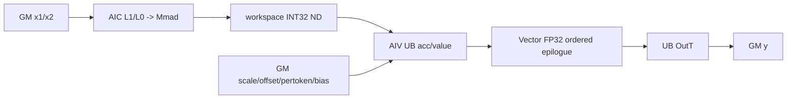
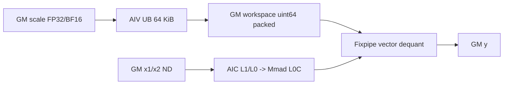
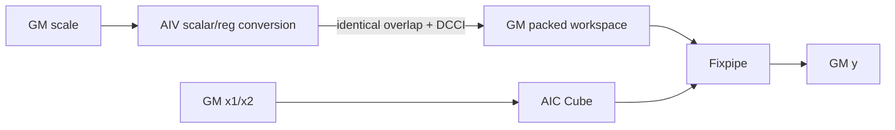
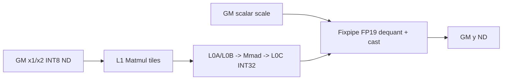
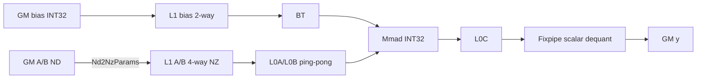

# QuantMatmul A5 Direct Invoke 算子知识

## 算子速览

| 项目 | 内容 |
|---|---|
| 实际入口 | `cann_bench::quant_matmul`（Torch schema）→`quant_matmul_npu`→`launch_quant_matmul`，Direct Invoke |
| 计算语义 | `acc=Σ_k int8(x1)*int8(x2)+bias_int32`；再按顺序执行 `float(acc)*scale + offset`、`* pertoken_scale`、`+ bias_float`，最后转为 FP16/BF16；不存在的项跳过 |
| 输入输出 | `x1[...,M,K]`、`x2[...,K,N]` 为 contiguous ND INT8；batch 右对齐广播；`y[...,M,N]` 为 contiguous ND FP16/BF16 |
| 执行类型 | `AIC_CUBE`；同一 Host launch graph 中按 Route 可达 `AIV_VECTOR` 与 ND→NZ layout DataCopy（NDDMA/MTE 搬运能力）；无 Host 可达 `MIX_CV` 节点 |
| Kernel 路线 | P0 R-005 raw Cube + ordered AIV epilogue；P1 R-003 buffered packed-scale；P2 R-004 redundant packed-scale；P3 R-001 标量 on-the-fly；P4 R-002 CMCT Basic |
| 核心资源 | GM 输入/输出；Route 专属 workspace；Cube 的 L1/L0A/L0B/L0C；packed/epilogue 的 UB 或标量寄存器 |
| 来源闭包 | `direct_implementation_closed`：Torch schema、校验/分配、Host POD、workspace、launcher selector、全部可达 kernel/body/helper 与构建接线闭合；通用 AscendC Matmul primitive 内部为库边界 |
| 验证状态 | 已完成源码闭包检查；本次知识提取未执行编译、真机、数值或性能测试。 |

## 接口与语义

### 计算语义

设广播后的 batch 索引为 `b`，`0<=m<M`、`0<=n<N`：

```text
acc[b,m,n] = Σ_k int32(x1[bA,m,k]) * int32(x2[bB,k,n])
if bias.dtype == int32: acc += bias[biasBatch,n]
v = float32(acc) * float32(scale[scale_count == 1 ? 0 : n])
if offset:         v += offset[scale_count == 1 ? 0 : n]
if pertoken_scale: v *= pertoken_scale[m]
if bias.dtype != int32: v += float32(bias[biasBatch,n])
y = cast_rint<FP16/BF16>(v)
```

P0 R-005 让 `yType=int32_t` 的 Cube specialization 写出原始累加面，再由 AIV 严格按上式完成 epilogue；P1 R-003、P2 R-004、P3 R-001 与 P4 R-002 则把可表达的反量化与 cast 融入 Cube Fixpipe。FP32/BF16 scale 进入 Fixpipe 时使用高 19 位表示：FP32 位模式与 `0xffffe000`，BF16 先左移 16 位；packed 路线再与 `1ULL<<46` 组合成 `uint64_t` 量化参数。

### 输入、输出与属性

| 参数 | shape/layout | dtype | 约束、默认值与语义 |
|---|---|---|---|
| `x1` | rank 2..6，`[...,M,K]`，contiguous ND | INT8 | `1<=M<=4096`，`16<=K<=16384` |
| `x2` | rank 2..6，`[...,K,N]`，contiguous ND | INT8 | `K` 与 `x1` 相等，`16<=N<=65535` |
| `scale` | `[1]` 或 `[N]`，contiguous ND | FP32/BF16 | BF16 scale 只允许 BF16 输出 |
| `offset` | 可选 `[1]` 或 `[N]`，模式须与 scale 相同 | FP32 | 在 scale 后相加 |
| `pertoken_scale` | 可选 `[M]` | FP32 | 对每个 batch 复用，按 `row % M` 取值 |
| `bias` | `[N]`、`[1,N]` 或 `[...,1,N]` | INT32/FP32/FP16/BF16 | batch 数只能为 1 或输出 batch；INT32 在 Cube 累加前加入，浮点 bias 在 scale/offset/pertoken 后加入 |
| `output_dtype` | 字符串 | `"float16"`/`"bfloat16"` | 默认 `"float16"` |
| `y` | 广播 batch + `[M,N]`，contiguous ND | FP16/BF16 | 新分配输出 |

batch 维最多 4 个，右对齐到 `batch_*_dims[4]`；输出 batch 乘积不超过 256，三个 batch 乘积均受 `uint32_t` ABI 上界约束。

### 入口与版本

入口不是 ACLNN：`TORCH_LIBRARY_FRAGMENT` 声明 `cann_bench::quant_matmul`，Meta 实现只校验并分配，PrivateUse1 实现为 `quant_matmul_npu`。后者在当前 NPU stream 上通过 `OpCommand::RunOpApi("QuantMatmulDirect", direct_call)` 同步完成 Host 侧 launch 提交，实际 Device 入口由 `launch_quant_matmul` 选择。目标版本为 CANN 9.1.0、A5/950；构建时必须选择 `NPU_ARCH=ascend950`，对应 Bisheng `--npu-arch=dav-3510`。

限定官方目录只提供 QuantBatchMatmulV3 arch35 服务的相关映射；本卡的 Torch schema、selector、workspace 切片和补充 AIV epilogue 均来自 Direct Invoke 交付快照，不声明为官方 ACLNN 行为。

## Host/Launcher 执行流程

### 参数校验与前处理

`quant_matmul_npu` 的顺序为：设备/contiguous ND 检查→INT8/rank/MNK 检查→右对齐 batch 广播检查→scale/output_dtype 检查→可选 offset/pertoken/bias 检查→填充 `QuantMatmulHostParams`→分配输出→按同一 selector 计算 workspace→取得当前 NPU stream→调用 `launch_quant_matmul`。不执行 Contiguous、View、TransData 或 Host 数学；不连续输入直接失败。

### 参数、Workspace 与生命周期

`QuantMatmulHostParams` 在 `CheckedInputs` 内生成，随后按值复制到 lambda 的 `params`；launcher 在 Host 调用期间立即解引用，Device kernel 接收的 `BasicTiling`、`MixTiling` 或 `QuantMatmulHostParams` 均为 by-value 参数。workspace 是当前设备上的 `uint8` Tensor，实际分配至少 32 B：

```text
P0 R-005: raw_acc = batchC * M * N * 4 B，offset=0，ND int32
P1 R-003 / P2 R-004: packed_scale = align_up(N,32) * 8 B，offset=0
P3 R-001 / P4 R-002: logical workspace = 32 B（服务实参可为该地址，算法不切片）
```

所有节点使用同一 current stream。workspace Tensor 由框架分配器拥有；源码没有显式 event、`recordStream` 或手工释放，异步存活依赖 `RunOpApi`/NPU allocator 的 stream 语义。

### 启动图与失败传播

```text
cann_bench::quant_matmul
  -> quant_matmul_npu / CheckInputs / AllocateOutput
  -> quant_matmul_workspace_bytes
  -> launch_quant_matmul
     ├─ P0 / Host 5 / R-005: AIC raw int32 -> workspace[raw_acc] -> AIV ordered epilogue -> y
     ├─ P1 / Host 1 / R-003: AIV buffered pack -> workspace[packed_scale] -> AIC on-the-fly Fixpipe -> y
     ├─ P2 / Host 2 / R-004: AIV redundant pack -> workspace[packed_scale] -> AIC on-the-fly Fixpipe -> y
     ├─ P3 / Host 3 / R-001: AIC on-the-fly -> y
     └─ P4 / Host 4 / R-002: AIC CMCT Basic -> y
```

Host 校验、空 platform、零 AIC、L1 不足或无效 L1 step 以异常终止。kernel launch 语句没有逐节点返回值检查；多 Kernel 路线按同一 stream 提交，源码没有在首个 launch 后查询状态，因此后继是否被阻止属于 runtime 边界。`direct_call` 在提交后固定返回 0，异步 Device 错误由 stream/runtime 报告。

## Route 与参数设计

### 分核与资源计算

P0 R-005、P1 R-003、P2 R-004 与 P3 R-001 共用 Mix tiling 主体：`baseM=min(256,align_up(M,16))`，`baseN=min(256,align_up(N,32))`，`baseK=min(128,align_up(K,32))`；`usedCoreNum=min(AIC,ceil(M/baseM)*ceil(N/baseN))`。先从 L1 扣除 `bias_bytes` 与 per-channel `scale_bytes`，再令 `stepKa=floor((leftL1/2/baseM/baseK)/2)`、`stepKb=floor((leftL1/2/baseN/baseK)/2)`，裁到 K 循环并互相整除；`depthA1=2*stepKa`、`depthB1=2*stepKb`。其中 `dbL0C` 仅在 `2*baseM*baseN*4<=L0C` 且 bias/scale guard 满足时为 2，否则为 1。

P0 R-005 的 AIV 侧使用 `nTiles=ceil(N/2048)`、`jobs=batchC*M*nTiles`、`vectorDim=min(AIV,jobs)`，每核 grid-stride 遍历 job。P1 R-003 固定一个 AIV block；P2 R-004 使用 `min(AIV,ceil(N/64))`。P3 R-001 不增加 AIV 节点。

P4 R-002 使用 Basic tiling：`baseM=min(128,align_up(M,16))`，`baseN=min(256,align_up(N,32))`，`baseK=min(128,align_up(K,32))`，`stepKa=stepKb=1`，`nBufferNum=4`，`dbL0C=1`；`cubeDim=min(AIC, batchC*ceil(M/baseM)*ceil(N/baseN))`。

### Route 特征

下表按复用重要性降序组织；`Host 顺序`单独记录 launcher 的真实判定先后。优先级不改变 selector 控制流。

| 重要性 | Route | 特征 | 适用域 | 实现前提 | Host 顺序 |
|---:|---|---|---|---|---|
| P0 | R-005 raw Cube + AIV | 先物化 exact INT32 累加面，再以 FP32 向量链执行完整有序 epilogue；语义覆盖最宽 | 未命中 packed，且 per-channel scale、offset、pertoken 或浮点 bias 任一使复杂后处理成立 | `batchC*M*N*4` workspace；raw AIC 与 AIV 同 stream；epilogue 严格保持 scale→offset→pertoken→floating-bias→cast | 5：前置 fast path 全部未返回后进入；作为合法复杂语义的终点，不再转入其他数学 Route |
| P1 | R-003 buffered packed-scale | 单 AIV 以 UB 分块连续生成 packed FP19 参数，随后 AIC Fixpipe 融合反量化 | per-channel；无 offset/pertoken/floating bias；且 `M>=2048 || N%512!=0` | packed workspace 为 `align_up(N,32)*8`；AIV 发布先于 AIC 消费；L1 能容纳 A/B 与参数面 | 1：`official_mix=false` 后首个可达短路；命中即完成并返回 |
| P2 | R-004 redundant packed-scale | 多 AIV 分片标量写 packed 参数，以邻域重复覆盖和 DCCI 发布换取并行生成 | packed 公共域内，`M<2048 && N%512==0`，且 `3584<=N<4096 || N>=8192` | 同 P1 的 packed ABI 与 Fixpipe 消费约定；覆盖值必须一致，发布必须在 AIC 前可见 | 2：仅在 packed 公共谓词成立而 buffered 条件为假时选择；命中即完成并返回 |
| P3 | R-001 标量 on-the-fly | 不物化参数面，Cube Fixpipe 直接消费 FP19 scalar 并写最终输出 | `scale_count=1`、无 offset/pertoken、无 bias | Mix tiling 有效；scale/output dtype specialization 完整；标量量化值可由 Fixpipe 表达 | 3：packed 分支未返回后检查；命中即完成并返回 |
| P4 | R-002 CMCT Basic | ND→NZ L1 搬运、四路 L1 与两路 L0 复用，INT32 bias 在 Cube 累加前加入 | scalar scale、无 offset/pertoken、bias 为 INT32 | Basic tiling 与 RowMajor specialization 匹配；bias BT/stride、HardEvent 和 Fixpipe 约定完整 | 4：R-001 未命中且 `supplemental=false` 时选择；命中即完成并返回 |

### Host 选择链

`official_mix` 固定为 `false`，因此不形成可达 Route。launcher 先计算 packed 与 supplemental 谓词，再依照下列真实顺序短路；重要性只用于本文组织。

```text
Host 1: if packed_fixpipe && buffered_pack_domain: R-003; return
Host 2: if packed_fixpipe && !buffered_pack_domain: R-004; return
Host 3: if scale_count==1 && !offset && !pertoken && bias==none: R-001; return
Host 4: if !supplemental: R-002; return
Host 5: R-005
```

其中：

```text
packed_fixpipe =
    (buffered_pack_domain || redundant_pack_domain)
    && scale_count>1 && !offset && !pertoken && bias∈{none,int32}
buffered_pack_domain = M>=2048 || N%512!=0
redundant_pack_domain = (3584<=N<4096) || N>=8192
supplemental =
    !official_mix && !packed_fixpipe
    && (scale_count>1 || offset || pertoken || floating_bias)
```

### 模板/实现执行矩阵

| 重要性 | Route | Host 顺序 | Key/selector | dtype/shape/platform 完整命中条件 | 执行族与 kernel 节点 | 实际模板/body | 内存与同步特征 | tail/fallback |
|---:|---|---:|---|---|---|---|---|---|
| P0 | R-005 supplemental | 5 | supplemental 终点 | 其余合法复杂 epilogue | AIC raw→AIV epilogue | `MatMulASWKernel<...,float,int32,...>`→九种 dtype specialization | exact ND int32 workspace；同 stream；AIV 48 KiB UB | N tile 2048，8 元素对齐，GM 仅写 count；无后续数学 fallback |
| P1 | R-003 packed buffered | 1 | packed/buffered | per-channel；无 offset/pertoken/floating bias；buffered domain | AIV pack→AIC OTF | `PackFixpipeScaleBuffered`→`MatMulASWKernel<...,int64_t,...>` | workspace packed scale；同 stream producer→consumer；64 KiB UB | pack 8192-element tail；AIC ASW tail；命中后短路 |
| P2 | R-004 packed redundant | 2 | packed/redundant | packed 公共条件且 redundant-only domain | AIV redundant pack→AIC OTF | `PackFixpipeScale`→同 AIC 模板 | scalar GM stores+DCCI；邻域重复覆盖；同 stream | shard `ceil(N/blockCount)`；边界截断；命中后短路 |
| P3 | R-001 标量 OTF | 3 | scalar/no-bias | A5；scale FP32/BF16；out FP16/BF16；表中谓词 | AIC：`quant_matmul_otf_*` | `MatMulASWKernel<...,FusedOpType::NONE>` | GM→Matmul L1/L0→L0C→Fixpipe→GM；单 stream | ASW tail；空 tile continue；Host 校验排除零维；未命中继续 |
| P4 | R-002 Basic | 4 | scalar/int32-bias | A5；bias INT32 | AIC：`quant_matmul_basic_*` | `QuantMmBatchCube` + `BlockMmadA8W8FixpipeQuant` | ND→NZ L1 DataCopy；L0 ping-pong；Mmad+BT bias；Fixpipe | scheduler tail split；命中后短路 |

### 隐藏性能 Guard

| 重要性 | Guard | Host/Tiling 条件 | Device/资源原因 | 影响 Route | Host 顺序/不满足去向 | 源码符号 |
|---:|---|---|---|---|---|---|
| P0 | supplemental gate | 未命中 packed，且 `scale_count>1 || offset || pertoken || floating_bias` | Fixpipe 不能完整表达既定有序 epilogue 时，保留 exact INT32 中间面 | R-005 | Host 5；终点，资源无效则 Host 异常 | `launch_quant_matmul::supplemental` |
| P0 | AIV epilogue UB | 固定 `2048*6*4=49152 B` | 六个逻辑 2048 元素分区 | R-005 | Host 5；N tail 缩短 count | `SupplementalEpilogue::kTileN` |
| P1 | packed 公共域 | per-channel、无 offset/pertoken/floating bias | Fixpipe 可直接消费 packed per-channel 参数 | R-003/R-004 | Host 1/2；域外继续 Host 3 | `launch_quant_matmul::packed_fixpipe` |
| P1 | buffered 优先 | `M>=2048 || N%512!=0` | 单 AIV 以 UB+MTE3 发布完整参数面 | R-003 | Host 1；不满足检查 R-004 | `buffered_pack_domain` |
| P2 | redundant-only | `M<2048 && N%512==0` 且 N 区间命中 | 多 AIV 标量写、邻域覆盖与 DCCI 可见性 | R-004 | Host 2；不满足继续 Host 3 | `redundant_pack_domain` |
| P3 | scalar on-the-fly | scalar scale、无 offset/pertoken/bias | Fixpipe 直接消费标量，无需参数预处理与中间面 | R-001 | Host 3；不满足继续 Host 4 | `official_on_the_fly` |
| P4 | Basic L0 tile | `baseM<=128,baseN<=256,baseK<=128` | int32 L0C 与 A/B L0 容量 | R-002 | Host 4；cap 后执行 | `MakeBasicTiling` |
| shared | mixed gate | `official_mix=false` | 编译出的 MIX_CV entry 不进入 launcher 图 | 全部 | Host 0；继续可达 Route | `official_mix` |
| shared | L1 可容纳参数 | `L1>bias_bytes+scale_bytes` 且 `stepKa,stepKb>0` | A/B 双深度与 bias/scale 共享 L1 | R-005/R-003/R-004/R-001 | 对应 Host 分支；失败为 Host 异常 | `MakeMixTiling` |
| shared | L0C 双缓冲 | `2*baseM*baseN*4<=L0C && bias_ok_db && scale_ok_db` | 两个 int32 累加 tile | R-005/R-003/R-004/R-001 | `dbL0C=1` | `MakeMixTiling::dbL0C` |

### Route 源码闭包

| 重要性 | Route | Host 顺序 | Key/selector | Host/Tiling producer | POD/参数 | Kernel entry/router | Kernel body/直接依赖 | 构建接线 |
|---:|---|---:|---|---|---|---|---|---|
| P0 | R-005 | 5 | `supplemental` | `MakeMixTiling(true)/VectorBlockDim` | `MixTiling` + 100 B HostParams | `quant_matmul_otf_raw_i32`→`quant_matmul_epi_*` | `MatMulASWKernel<...,int32_t>` + `SupplementalEpilogue::Kernel` | `CMakeLists.txt` + op CMake |
| P1 | R-003 | 1 | `packed_fixpipe&&buffered` | `MakeMixTiling` | `MixTiling` + scalar args | `quant_matmul_pack_scale_*`→`quant_matmul_otf_qparam_*` | `PackFixpipeScaleBuffered` + `MatMulASWKernel` | 同上 |
| P2 | R-004 | 2 | `packed_fixpipe&&!buffered` | `MakeMixTiling` | 同上 | `quant_matmul_pack_scale_redundant_*`→`quant_matmul_otf_qparam_*` | `PackFixpipeScale` + `MatMulASWKernel` | 同上 |
| P3 | R-001 | 3 | `official_on_the_fly` | `quant_matmul_kernel.cpp::MakeMixTiling` | `MixTiling` | `quant_matmul_otf_*` | `qbmm_cube_on_the_fly.h::MatMulASWKernel` | 同上 |
| P4 | R-002 | 4 | `!supplemental` after OTF miss | `MakeBasicTiling/CubeBlockDim` | `BasicTiling` | `quant_matmul_basic_*` | `QbmmCubeBasicApiKernel`→`QuantMmBatchCube`→`BlockMmadA8W8FixpipeQuant` | 同上 |

### POD/ABI

| 结构 | 字段 | 类型/位宽 | ABI 布局 | 单位 | Host/launcher producer | Device consumer | 边界 |
|---|---|---|---|---|---|---|---|
| `QuantMatmulHostParams` | `m,n,k` | `uint32_t` | sizeof=100, alignof=4；offset 0/4/8 | 元素 | `CheckInputs` | tiling、AIV epilogue | 已校验范围 |
| 同上 | `batch_a,batch_b,batch_c` | `uint32_t` | offset 12/16/20 | batch 数 | `Product` | batch offset/scheduler | `batch_c<=256` |
| 同上 | `batch_a_dims[4]` | 4×`uint32_t` | offset 24 | 维度 | `RightAlignFour` | Basic/Mix tiling | 左侧补 1 |
| 同上 | `batch_b_dims[4]` | 4×`uint32_t` | offset 40 | 维度 | 同上 | 同上 | 左侧补 1 |
| 同上 | `batch_c_dims[4]` | 4×`uint32_t` | offset 56 | 维度 | 同上 | 同上 | 广播结果 |
| 同上 | `scale_count` | `uint32_t` | offset 72 | 元素 | `scale.numel()` | selector、epilogue | 1 或 N |
| 同上 | `scale_dtype` | `uint32_t` | offset 76 | enum | `DTypeCode` | template dispatch/epilogue | 0 或 27 |
| 同上 | `bias_dtype` | `uint32_t` | offset 80 | enum | `DTypeCode` | selector、tiling、epilogue | NO_DTYPE/0/1/3/27 |
| 同上 | `bias_batches` | `uint32_t` | offset 84 | batch 数 | bias shape 检查 | Cube/AIV bias offset | 1 或 batchC |
| 同上 | `output_dtype` | `uint32_t` | offset 88 | enum | output string | template dispatch | 1 或 27 |
| 同上 | `has_offset` | `uint32_t` | offset 92 | bool ABI | optional presence | selector/AIV | 0/1 |
| 同上 | `has_pertoken` | `uint32_t` | offset 96 | bool ABI | optional presence | selector/AIV | 0/1 |
| `BasicTiling` | `params.batch* / dims / quantMode / bias*` | `uint32_t` | `params` 88 B；逐字段 4 B，pack(8) | batch/enum | `MakeBasicTiling` | `QbmmCubeBasicApiKernel` | 未写 group 字段保持 0 |
| 同上 | `matmulTiling` | 混合定宽字段 | offset 88，size 40 B | 元素/flag | `MakeBasicTiling` | scheduler/MMAD/Fixpipe | `BasicTiling` size 152 B |
| 同上 | `adaptiveSlidingWin` | 6×`uint32_t` | offset 128，size 24 B | tile/flag | `MakeBasicTiling` | scheduler | 六字段均显式写 |
| `MixTiling` | `params` | 32×`uint32_t` | offset 0，size 128 B，pack(8) | batch/flag/UB 元素 | `MakeMixTiling` | ASW block | 未写字段零初始化 |
| 同上 | `matmulTiling` | SDK `TCubeTiling` | offset 128；固定交付未提供 `sizeof/offsetof` 静态断言 | 元素/core/flag | `MakeMixTiling` | `MatMulASWKernel/mm_` | by-value ABI 必须与 CANN 9.1.0 SDK 一致 |
| 同上 | `tileL2cacheTiling` | 6×`uint32_t` | 位于 `TCubeTiling` 后，size 24 B | tile/flag | 零初始化 | 当前 body 未读 | inactive |
| 同上 | `adaptiveSlidingWin` | 6×`uint32_t` | 尾部 size 24 B | tile/flag | `MakeMixTiling` | ASW block | 六字段显式写 |

## Kernel 实现

### 公共执行流程

所有 Route 先按右对齐四维 batch 计算 A/B/C 偏移，再把 `(M,N)` tile 映射到 AIC。Cube 公共数学路径是 `GM int8 ND→L1/L0A/L0B→int32 Mmad→L0C`。fused Route 从 L0C 经 Fixpipe 反量化/cast 写 GM；R-005 写 exact ND int32 workspace 后由 AIV 消费。多 Kernel 边仅依赖同一 stream 顺序；kernel 内使用 MTE/M/FIX/V pipe flag 或 barrier 保护局部 buffer。

### Route R-005：raw Cube 与有序 AIV epilogue

#### 适用条件

##### 选择证据

| 层级 | 文件 | 符号 | 源码谓词/参数 | 结果/下一跳 |
|---|---|---|---|---|
| Launcher | `op_kernel/quant_matmul_kernel.cpp` | `supplemental` | 未命中 packed，且复杂 epilogue 任一存在 | raw AIC→AIV |
| AIC | 同上 | `quant_matmul_otf_raw_i32` | `yType=int32_t`，`MakeMixTiling(raw=true)` | exact ND accumulator |
| AIV | 同上 | `DEFINE_EPILOGUE_KERNEL` | scale/bias/out dtype 矩阵 | 九种 specialization |

#### Device 数据流

##### 函数级调用链

```text
quant_matmul_otf_raw_i32
 -> RunOfficialOnTheFly<float,int32_t>
 -> MatMulASWKernel (skip SetQuantScalar/Vector)
 -> workspace int32 ND
 -> quant_matmul_epi_*
 -> SupplementalEpilogue::Kernel::Init/Process/ComputeTile
 -> GM y
```

##### 源码等价伪码

```text
AIC: workspace = int32_matmul(x1,x2) + optional_int32_bias
AIV for job in blockIdx..batchC*M*ceil(N/2048) step blockNum:
    row,n0,count = decode(job)
    value = cast_rint_fp32(workspace[row*N+n0 : +count])
    value *= scalar_or_channel_scale
    if offset: value += scalar_or_channel_offset
    if pertoken: value *= pertoken[row % M]
    if floating_bias: value += cast_fp32(bias[(shared_or_batch)*N+n0])
    y[...] = cast_rint<OutT>(value)  // GM only writes count, not aligned tail
```

#### 内存与数据搬运

##### 资源与搬运表

| 层级/缓冲区 | offset/地址公式 | extent/容量公式 | dtype/layout | producer | consumer | owner/lifetime | 对齐/复用 |
|---|---|---|---|---|---|---|---|
| Cube L1/L0 | Mix tiling | 同 R-001 | INT8/internal | Matmul | Mmad | AIC | raw 禁用浮点 bias |
| workspace raw_acc | `(batch*M*N+m*N+n)*4` | `batchC*M*N*4` B | INT32 ND exact stride N | AIC | AIV | workspace until epilogue completes | 无隐藏 row padding |
| AIV UB storage | 六个 `kTileN` 分区 | 2048×6×4=49152 B | reinterpreted int32/FP32/ScaleT/BiasT/OutT | MTE2/scalar | Vector/MTE3 | AIV kernel | count 向上对齐 8 计算 |
| scale/offset/bias GM | scalar或`n0`，bias含 batch offset | count elements | declared dtype ND | caller | AIV | caller | DataCopyPad tail |
| output GM | `row*N+n0` | count×sizeof(OutT) | FP16/BF16 ND | AIV | caller | output | 只写 count |

##### 分层内存布局



##### 字节账、交接边与复用顺序

```text
workspace_total = batchC*M*N*4
UB_total = 2048*6*4 = 49152
register/local temporaries = scalar scale/offset/pertoken and vector API registers (physical count library-defined)
```

| 边/复用子区 | producer | offset/extent | dtype/layout | consumer | ordering/sync | owner/lifetime | 安全条件 |
|---|---|---|---|---|---|---|---|
| AIC→AIV raw | raw Matmul GetTensorC | 0/`batchC*M*N*4` | INT32 ND | `CopyInInt` | same stream | workspace Tensor | AIC specialization不执行反量化 |
| UB aliases | `storage` | 六个 8192 B logical spans | mixed reinterpret | `ComputeTile` stages | `PIPE_ALL/PIPE_V` | AIV kernel | 顺序 barrier 防覆盖 |
| AIV→y | cast OutT | `gm_offset/count` | FP16/BF16 ND | MTE3 | `PIPE_ALL` | output | aligned lane 不写 GM |

#### 同步、精度与尾块

##### 同步与数值边界表

| 阶段 | primitive/机制 | producer | consumer/等待点 | 保护对象 | 精度/尾块 |
|---|---|---|---|---|---|
| 跨 kernel | same stream | raw AIC | AIV launch | workspace | INT32 exact ND |
| GM→UB | `DataCopyPad` + `PIPE_ALL` | MTE2 | Vector | acc/operand | count tail，aligned=(count+7)&~7 |
| Vector chain | `PIPE_V` | Cast/Mul/Add | 下一算子 | FP32 value | 固定 scale→offset→pertoken→bias 顺序 |
| UB→GM | `PIPE_ALL` | OutT cast | MTE3 | output local | `blockLen=count*sizeof(OutT)` |

#### 关键实现

##### 符号证据表

| 阶段 | 文件 | 符号/模板实例 | 实现事实 |
|---|---|---|---|
| Host/Tiling producer | `op_kernel/quant_matmul_kernel.cpp` | `MakeMixTiling(true)/VectorBlockDim` | raw bias flag、AIV jobs |
| Kernel entry/router | 同上 | `quant_matmul_otf_raw_i32` + `quant_matmul_epi_*` | 两节点与 dtype 矩阵 |
| Device body/helper | 同上 | `SupplementalEpilogue::Kernel::ComputeTile` | 精确运算序、UB、tail、barrier |

### Route R-003：buffered packed-scale

#### 适用条件

##### 选择证据

| 层级 | 文件 | 符号 | 源码谓词/参数 | 结果/下一跳 |
|---|---|---|---|---|
| Launcher | `op_kernel/quant_matmul_kernel.cpp` | `packed_fixpipe/buffered_pack_domain` | packed 公共域且 `M>=2048||N%512!=0` | 单 AIV pack→AIC |
| AIV | 同上 | `PackFixpipeScaleBuffered` | `kTileElems=8192` | UB→GM packed scale |
| AIC | 同上 | `quant_matmul_otf_qparam_*` | `inputScaleType=int64_t` | per-channel Fixpipe |

#### Device 数据流

##### 函数级调用链

```text
quant_matmul_pack_scale_{f32|bf16}
 -> PackFixpipeScaleBuffered
 -> [same stream]
quant_matmul_otf_qparam_{f16|bf16}
 -> RunOfficialOnTheFly<int64_t,OutT>
 -> MatMulASWKernel::SetQuantVector -> mm_.Iterate/GetTensorC
```

##### 源码等价伪码

```text
for base in [0,N) step 8192:
    local[i] = uint64(fp19(scale[base+i])) | (1<<46)
    barrier; DataCopyPad UB -> workspace[base:base+length]; barrier
same_stream AIC:
    Mmad x1*x2 (+ optional int32 bias)
    Fixpipe per-channel(workspace[n]) -> y
```

#### 内存与数据搬运

##### 资源与搬运表

| 层级/缓冲区 | offset/地址公式 | extent/容量公式 | dtype/layout | producer | consumer | owner/lifetime | 对齐/复用 |
|---|---|---|---|---|---|---|---|
| AIV UB | 0 | 8192×8=65536 B | uint64 | scalar conversion | MTE3 | pack kernel | 单 TBuf，tile 复用 |
| workspace packed | `8*n` | `align_up(N,32)*8` B | uint64[N] | AIV | AIC Fixpipe | workspace Tensor | 尾部仅容量，不消费 |
| Cube L1/L0 | 同 R-001 | Mix tiling 公式 | INT8/internal | Matmul | Mmad/Fixpipe | AIC | per-channel参数另占 L1 |
| GM y | tile offset | output | FP16/BF16 ND | Fixpipe | caller | output | ASW tail |

##### 分层内存布局



##### 字节账、交接边与复用顺序

```text
workspace_total = align_up(N,32)*8
UB_pack = 8192*8 = 65536
Cube L1/L0 = R-001 formulas + baseN*8 per-channel scale staging when selected by Matmul
```

| 边/复用子区 | producer | offset/extent | dtype/layout | consumer | ordering/sync | owner/lifetime | 安全条件 |
|---|---|---|---|---|---|---|---|
| packed scale | AIV MTE3 | 0/N×8 | uint64 vector | AIC Fixpipe | same stream launch order；AIV 内 `PIPE_ALL` | workspace until AIC completes | AIV 写全 N 后 kernel 结束 |

#### 同步、精度与尾块

##### 同步与数值边界表

| 阶段 | primitive/机制 | producer | consumer/等待点 | 保护对象 | 精度/尾块 |
|---|---|---|---|---|---|
| pack tile | `PipeBarrier<PIPE_ALL>` | scalar UB writes | MTE3/next tile | 64 KiB UB | 最后 tile length 精确 |
| 跨 kernel | same stream | pack kernel | AIC kernel | workspace | FP19 截断后 uint64 |
| Cube | Matmul/Fixpipe | Mmad | GM y | L0C/scale | INT32→FP16/BF16 |

#### 关键实现

##### 符号证据表

| 阶段 | 文件 | 符号/模板实例 | 实现事实 |
|---|---|---|---|
| Host/Tiling producer | `op_kernel/quant_matmul_kernel.cpp` | `buffered_pack_domain/MakeMixTiling` | selector、workspace、core |
| Kernel entry/router | 同上 | `quant_matmul_pack_scale_*`→`quant_matmul_otf_qparam_*` | 两节点同 stream |
| Device body/helper | 同上 + `official/arch35/qbmm_cube_on_the_fly.h` | `PackFixpipeScaleBuffered/MatMulASWKernel` | UB pack、per-channel Fixpipe |

### Route R-004：redundant packed-scale

#### 适用条件

##### 选择证据

| 层级 | 文件 | 符号 | 源码谓词/参数 | 结果/下一跳 |
|---|---|---|---|---|
| Launcher | `op_kernel/quant_matmul_kernel.cpp` | `redundant_pack_domain` | packed 公共域、buffered=false、N 区间命中 | 多 AIV pack→AIC |
| AIV | 同上 | `PackFixpipeScale` | `block_count=min(AIV,ceil(N/64))`，radius=8 | 重复标量写+DCCI |
| AIC | 同上 | `quant_matmul_otf_qparam_*` | workspace 为 packed vector | Fixpipe 输出 |

#### Device 数据流

##### 函数级调用链

```text
quant_matmul_pack_scale_redundant_{f32|bf16}
 -> PackFixpipeScale(scale,workspace,N,blockIdx,blockCount)
 -> DataCacheCleanAndInvalid<CACHELINE_OUT>
 -> [same stream] quant_matmul_otf_qparam_*
```

##### 源码等价伪码

```text
perBlock=ceil(N/blockCount)
each AIV covers logical blocks [blockIdx-8, blockIdx+8]
for each covered i: workspace[i]=fp19(scale[i])|(1<<46)
DCCI entire destination tensor
same_stream AIC Mmad + per-channel Fixpipe
```

#### 内存与数据搬运

##### 资源与搬运表

| 层级/缓冲区 | offset/地址公式 | extent/容量公式 | dtype/layout | producer | consumer | owner/lifetime | 对齐/复用 |
|---|---|---|---|---|---|---|---|
| AIV 寄存器/标量 cache | per element | O(1) per core | FP bits/uint64 | scalar load | GM store | AIV kernel | 邻域重复写相同值 |
| workspace packed | `i*8` | `align_up(N,32)*8` | uint64 | 多 AIV | AIC Fixpipe | workspace | DCCI publish |
| Cube L1/L0/y | 同 R-003 | 同 R-003 | 同 R-003 | 同 R-003 | 同 R-003 | AIC/output | 同 R-003 |

##### 分层内存布局



##### 字节账、交接边与复用顺序

```text
workspace_total = align_up(N,32)*8
UB = N/A（标量 GetValue/SetValue）
```

| 边/复用子区 | producer | offset/extent | dtype/layout | consumer | ordering/sync | owner/lifetime | 安全条件 |
|---|---|---|---|---|---|---|---|
| overlapping shards | neighbor AIVs | shard±8 | uint64 | packed workspace | identical stores | workspace | 所有写入值由同一 scale[i] 决定 |
| packed→AIC | AIV + DCCI | N×8 | uint64 | Fixpipe | same stream | workspace | DCCI 在 producer 退出前执行 |

#### 同步、精度与尾块

##### 同步与数值边界表

| 阶段 | primitive/机制 | producer | consumer/等待点 | 保护对象 | 精度/尾块 |
|---|---|---|---|---|---|
| AIV publish | `DataCacheCleanAndInvalid` | cached scalar stores | stream 后继 AIC | packed GM | FP19 |
| shard tail | begin/end clamp | 每 AIV | GM | `[0,N)` | `end=min(begin+perBlock,N)` |
| AIC | Fixpipe vector quant | L0C | y | tile | ASW M/N tail |

#### 关键实现

##### 符号证据表

| 阶段 | 文件 | 符号/模板实例 | 实现事实 |
|---|---|---|---|
| Host/Tiling producer | `op_kernel/quant_matmul_kernel.cpp` | `redundant_pack_domain` | reduced Route 与 blockDim |
| Kernel entry/router | 同上 | `quant_matmul_pack_scale_redundant_*` | dtype entry |
| Device body/helper | 同上 | `PackFixpipeScale` | 邻域、FP19、DCCI |

### Route R-001：标量 on-the-fly

#### 适用条件

##### 选择证据

| 层级 | 文件 | 符号 | 源码谓词/参数 | 结果/下一跳 |
|---|---|---|---|---|
| Launcher | `op_kernel/quant_matmul_kernel.cpp` | `launch_quant_matmul` | `!offset&&!pertoken&&scale_count==1&&bias==NO_DTYPE` | `quant_matmul_otf_*` |
| Tiling | 同上 | `MakeMixTiling` | ND、非转置，base/step/depth 公式 | `MixTiling` |
| Device | `official/arch35/qbmm_cube_on_the_fly.h` | `MatMulASWKernel` | `isPerTensor=1` | `SetQuantScalar`→`Iterate/GetTensorC` |

#### Device 数据流

##### 函数级调用链

```text
quant_matmul_otf_{f32_f16|f32_bf16|bf16_bf16}
  -> RunOfficialOnTheFly<ScaleT,OutT>
    -> MatMulASWKernel::Init
    -> MatMulASWKernel::Process
      -> ComputeBasicOptiLoop / ComputeBmmOptiLoop
      -> SetMMParaAndCompute
        -> mm_.SetQuantScalar / SetTensorA / SetTensorB
        -> mm_.Iterate -> mm_.GetTensorC
```

##### 源码等价伪码

```text
scaleScalar = fp19(scale[0])
for batch and ASW round assigned to this AIC:
    derive broadcast A/B/C offsets and valid tail M/N
    mm.set_shape(validM, validN, K)
    mm.set_quant_scalar(scaleScalar)
    mm.set_A(x1[offsetA]); mm.set_B(x2[offsetB])
    mm.iterate_int8_to_int32()
    mm.get_C_fixpipe_cast(y[offsetC])
```

#### 内存与数据搬运

##### 资源与搬运表

| 层级/缓冲区 | offset/地址公式 | extent/容量公式 | dtype/layout | producer | consumer | owner/lifetime | 对齐/复用 |
|---|---|---|---|---|---|---|---|
| GM A/B | batch broadcast + tile offset | logical A/B tensor | INT8 ND | caller | Matmul GM prologue | caller | M/N/K 由 base 对齐处理 tail |
| L1 | Matmul specialization internal | `depthA1*baseM*baseK + depthB1*baseN*baseK`，另有参数区 | INT8 NZ/internal | GM prologue | L0 load | AIC kernel | depth=2*step |
| L0A/L0B | tile ping-pong | 2×base tile，上界由 SDK Matmul 资源检查 | INT8 cube layout | L1 load | Mmad | AIC kernel | `dbL0A=dbL0B=2` |
| L0C | tile | `dbL0C*baseM*baseN*4` | INT32 | Mmad | Fixpipe | AIC kernel | db 为 1/2 |
| UB/寄存器 | N/A | N/A | N/A | N/A | N/A | N/A | 标量 scale 直接供 Fixpipe |
| GM y | `batch*M*N + tileM*N + tileN` | output tensor | FP16/BF16 ND | Fixpipe | caller | output Tensor | `dstStride=N` |

##### 分层内存布局



##### 字节账、交接边与复用顺序

```text
workspace_total = 32 B logical placeholder
L1_active = depthA1*baseM*baseK + depthB1*baseN*baseK + parameter slices
L0_active = 2*baseM*baseK + 2*baseN*baseK + dbL0C*baseM*baseN*4
UB = N/A
```

| 边/复用子区 | producer | offset/extent | dtype/layout | consumer | ordering/sync | owner/lifetime | 安全条件 |
|---|---|---|---|---|---|---|---|
| L1 ping-pong | GM prologue | step/depth tile | INT8 internal | L0 load | Matmul pipe protocol | kernel | depth 与 K loop 一致 |
| L0C→y | Mmad | validM×validN | INT32→OutT ND | Fixpipe | unitFlag final accumulation | output Tensor | tail shape 先传给 `SetSingleShape` |

#### 同步、精度与尾块

##### 同步与数值边界表

| 阶段 | primitive/机制 | producer | consumer/等待点 | 保护对象 | 精度/尾块 |
|---|---|---|---|---|---|
| GM→Cube | Matmul 内部 MTE flag | GM copy | L0/Mmad | L1/L0 tile | K tail 由 single shape |
| 累加→输出 | final accumulation/Fixpipe | Mmad | GM y | L0C | INT32 累加，FP19 scale，FP16/BF16 cast |
| ASW tail | `UpdateBlockParams` | scheduler | `SetSingleShape` | M/N tile | 零 tile continue |

#### 关键实现

##### 符号证据表

| 阶段 | 文件 | 符号/模板实例 | 实现事实 |
|---|---|---|---|
| Host/Tiling producer | `op_kernel/quant_matmul_kernel.cpp` | `MakeMixTiling` | base/step/depth/core/ASW |
| Kernel entry/router | 同上 | `quant_matmul_otf_*` | dtype 到模板映射 |
| Device body/helper | `official/arch35/qbmm_cube_on_the_fly.h` | `MatMulASWKernel::SetMMParaAndCompute` | 标量 Fixpipe、batch offset、tail |

### Route R-002：CMCT Basic 标量反量化

#### 适用条件

##### 选择证据

| 层级 | 文件 | 符号 | 源码谓词/参数 | 结果/下一跳 |
|---|---|---|---|---|
| Launcher | `op_kernel/quant_matmul_kernel.cpp` | `!supplemental` | scalar、无 offset/pertoken、bias INT32 | `quant_matmul_basic_*` |
| Tiling | 同上 | `MakeBasicTiling` | base 128×256×128 cap，四 L1 buffer | `BasicTiling` |
| Router | `official/arch35/qbmm_cube_basic_api_cmct.h` | `QbmmCubeBasicApiKernel` | RowMajor/RowMajor/RowMajorAlign，fullLoad=0 | CMCT Cube |

#### Device 数据流

##### 函数级调用链

```text
quant_matmul_basic_*
 -> RunOfficialBasic
 -> QbmmCubeBasicApiKernel
 -> QuantMmBatchCube::Run / ProcessSingleBatch
 -> BlockMmadA8W8FixpipeQuant::operator()
    -> DataCopyA/CopyBInL1 (ND->NZ)
    -> CopyInL0A/CopyInL0B -> Mmad
    -> CopyFixpipeScalar -> GM y
```

##### 源码等价伪码

```text
for scheduled batch,M,N tile:
    ND2NZ x1/x2 GM -> four-way L1 buffers
    copy int32 bias GM -> L1 -> BT for first K tile
    for K-L1 tile and K-L0 tile:
        LoadData L1 -> ping-pong L0A/L0B
        Mmad(int8,int8,int32, optional BT bias)
    Fixpipe(L0C, fp19(scale[0]), validM,validN,dstStride=N) -> y
```

#### 内存与数据搬运

##### 资源与搬运表

| 层级/缓冲区 | offset/地址公式 | extent/容量公式 | dtype/layout | producer | consumer | owner/lifetime | 对齐/复用 |
|---|---|---|---|---|---|---|---|
| GM A/B | batch/tile/K offset | logical tensors | INT8 RowMajor ND | caller | `DataCopyA/B` | caller | `Nd2NzParams` |
| L1 A | half-L1 parity + `AOne*(id>>1)` | `4*baseM*baseK` B logical | INT8 NZ | NDDMA/MTE2 | L0A | kernel | 4-way，id=`loop&3` |
| L1 B | A region 后的 parity 分区 | `4*baseN*baseK` B logical | INT8 NZ | NDDMA/MTE2 | L0B | kernel | 4-way |
| L1 bias | scale region 后 | `2*baseN*4` B | INT32 ND | MTE2 | BT | kernel | 2-way |
| L0A/L0B | `HALF_L0_SIZE*(pingpong&1)` | active `baseM*baseK` / `baseN*baseK` B each | INT8 cube layout | LoadData | Mmad | kernel | 2-way |
| BT | `baseN*biasBufId` | 2×aligned baseN INT32 | INT32 | L1 copy | first Mmad | kernel | 2-way |
| L0C | offset 0（`dbL0C=1`） | `baseM*baseN*4` B active | INT32 | Mmad | Fixpipe | kernel | final unitFlag |
| GM y | tile C offset | output tensor | FP16/BF16 RowMajorAlign，stride N | Fixpipe | caller | output | valid M/N |

##### 分层内存布局



##### 字节账、交接边与复用顺序

```text
workspace_total = 32 B logical placeholder
L1_logical = 4*baseM*baseK + 4*baseN*baseK + 2*baseN*4
L0_active = 2*baseM*baseK + 2*baseN*baseK + baseM*baseN*4
```

| 边/复用子区 | producer | offset/extent | dtype/layout | consumer | ordering/sync | owner/lifetime | 安全条件 |
|---|---|---|---|---|---|---|---|
| GM→L1 | `DataCopyA/B` | current M/N/K tile | INT8 ND→NZ | LoadData | `MTE1_MTE2`/`MTE2_MTE1` flag 0..3 | kernel | buffer id 不覆写未消费 tile |
| L1→L0 | `CopyInL0A/B` | K-L0 tile | INT8 cube layout | Mmad | `M_MTE1`/`MTE1_M` ping-pong | kernel | 两半交替 |
| L0C→GM | final Mmad | valid tile | INT32→OutT | Fixpipe | `unitFlag=FINAL_ACCUMULATION` | output | dst stride N |

#### 同步、精度与尾块

##### 同步与数值边界表

| 阶段 | primitive/机制 | producer | consumer/等待点 | 保护对象 | 精度/尾块 |
|---|---|---|---|---|---|
| L1 循环 | HardEvent flags 0..3 | MTE2 ND→NZ | MTE1 LoadData | A/B buffer | K tail=`K-iter*baseK` |
| bias | flags 4/5 | GM→L1 | BT/Mmad | bias buffer | 仅首个 K tile注入 INT32 |
| L0 循环 | flags 0/1 | LoadData | Mmad | L0A/B halves | odd N1 时分段 LoadData+barrier |
| Fixpipe | `DEQF16`/`QS322BF16_PRE` | L0C | GM | valid tile | scale 高19位；M/N tail 精确 |

#### 关键实现

##### 符号证据表

| 阶段 | 文件 | 符号/模板实例 | 实现事实 |
|---|---|---|---|
| Host/Tiling producer | `op_kernel/quant_matmul_kernel.cpp` | `MakeBasicTiling` | tile 与四 buffer |
| Kernel entry/router | `official/arch35/qbmm_cube_basic_api_cmct.h` | `QbmmCubeBasicApiKernel<...,0>` | 完整 layout/类型/scheduler |
| Device body/helper | `cmct/block/block_mmad_a8w8_fixpipe_quant.h` | `DataCopyA/CopyBInL1/Iterate/CopyFixpipeScalar` | ND→NZ、L0/Mmad、Fixpipe、同步 |

## 算子特定优化

### Trick T-001：按可表达 epilogue 选择 fused Fixpipe 或 raw-AIV

#### 触发与源码依据

- 适用 Route：全部可达 Route
- 触发条件：packed、scalar on-the-fly、Basic 与 supplemental 谓词按固定优先级判断
- 转换片段定位：`op_kernel/quant_matmul_kernel.cpp:799-809`；相关官方源码：[`quant_batch_matmul_v3.cpp`](https://gitcode.com/cann/ops-nn/blob/ceb4536a2bd6fc99b85aec9d0fdcc0f470376292/matmul/quant_batch_matmul_v3/op_kernel/arch35/quant_batch_matmul_v3.cpp)

**交付源码（固定快照连续逐字摘录）**：

```cpp
const bool floating_bias = p.bias_dtype != QUANT_MATMUL_NO_DTYPE && p.bias_dtype != QUANT_MATMUL_INT32;
const bool official_mix = false;
const bool buffered_pack_domain = p.m >= 2048U || p.n % 512U != 0U;
const bool redundant_pack_domain =
    (p.n >= 3584U && p.n < 4096U) || p.n >= 8192U;
const bool packed_fixpipe = (buffered_pack_domain || redundant_pack_domain) &&
    p.scale_count != 1U && p.has_offset == 0U &&
    p.has_pertoken == 0U && !floating_bias;
```

#### 机制与设计原因

Fixpipe 能直接表达的 scalar/per-channel 反量化保留在 L0C→GM 路径；offset、pertoken 或浮点 bias 需要严格次序时才物化 int32 workspace。selector 同时决定 workspace 公式，不能只改 launch 而不改 `quant_matmul_workspace_bytes`。

#### 迁移边界

- 适用：INT8×INT8、FP16/BF16 输出、相同 ordered epilogue。
- 前提：selector 与 workspace producer 完全一致。
- 失效：新增 activation、不同 bias 顺序或其它 output dtype 时须增加显式 Route。
- 未验证：本次知识提取未执行编译、真机、数值或性能测试。

#### 错误做法

把浮点 bias 作为 Cube int32 bias 传入会改变运算顺序与 dtype；必须走 R-005。

### Trick T-004：exact ND raw accumulator 保留有序 epilogue

#### 触发与源码依据

- 适用 Route：R-005
- 触发条件：复杂 epilogue 且未命中 packed
- 转换片段定位：`op_kernel/quant_matmul_kernel.cpp:457-519`；相关官方源码：[`quant_batch_matmul_v3.cpp`](https://gitcode.com/cann/ops-nn/blob/ceb4536a2bd6fc99b85aec9d0fdcc0f470376292/matmul/quant_batch_matmul_v3/op_kernel/arch35/quant_batch_matmul_v3.cpp)

**交付源码（固定快照连续逐字摘录）**：

```cpp
CopyInInt(acc_local, gm_offset, count);
AscendC::PipeBarrier<PIPE_ALL>();
AscendC::Cast(value, acc_local, AscendC::RoundMode::CAST_RINT, aligned);
AscendC::PipeBarrier<PIPE_V>();

if (p_.scale_count == 1U) {
    float scalar;
```

#### 机制与设计原因

`yType=int32_t` 使 on-the-fly Cube body跳过 `SetQuantScalar/SetQuantVector`，workspace 用精确 N stride 保存累加值；AIV 用一个 48 KiB TBuf 的六个逻辑分区串行复用，显式 barrier 保证 cast/mul/add/GM copy 的依赖，并只把有效 count 写回。

#### 迁移边界

- 适用：需要 scale→offset→pertoken→floating-bias 次序。
- 前提：workspace 足够容纳 exact `[batchC,M,N]` INT32，所有节点同 stream。
- 失效：改变 epilogue 顺序、广播规则或中间精度必须同步修改 Host 校验和 AIV body。
- 未验证：本次知识提取未执行编译、真机、数值或性能测试。

#### 错误做法

让 raw Cube 先执行 scale 或把浮点 bias 传入 `mm.isBias` 会破坏规定次序。

### Trick T-003：小参数面先 pack 再由 Fixpipe 消费

#### 触发与源码依据

- 适用 Route：R-003、R-004
- 触发条件：per-channel、无 offset/pertoken/floating bias，且 shape domain 命中
- 转换片段定位：`op_kernel/quant_matmul_kernel.cpp:219-247`；相关官方源码：[`quant_batch_matmul_v3.cpp`](https://gitcode.com/cann/ops-nn/blob/ceb4536a2bd6fc99b85aec9d0fdcc0f470376292/matmul/quant_batch_matmul_v3/op_kernel/arch35/quant_batch_matmul_v3.cpp)

**交付源码（固定快照连续逐字摘录）**：

```cpp
for (uint32_t base = 0U; base < count; base += kTileElems) {
    const uint32_t length = kTileElems < count - base ? kTileElems : count - base;
    for (uint32_t i = 0U; i < length; ++i) {
        uint32_t bits = 0U;
        if constexpr (AscendC::IsSameType<ScaleT, bfloat16_t>::value) {
            bfloat16_t value = src.GetValue(base + i);
            const uint16_t value_bits = *(reinterpret_cast<uint16_t*>(&value));
            bits = static_cast<uint32_t>(value_bits) << 16;
```

#### 机制与设计原因

只物化 `O(N)` 的 packed scale，而不是 `O(batch*M*N)` 的 raw accumulator。buffered 路线用 64 KiB UB 和 MTE3 连续发布；redundant 路线用相同写值的邻域覆盖并以 DCCI 发布，二者都让后续 AIC Fixpipe消费 `uint64_t` per-channel 参数。

#### 迁移边界

- 适用：scale count=N 且 epilogue 可完全由 Fixpipe 表达。
- 前提：workspace 8 B/元素、FP19 mask 与量化位保持不变。
- 失效：存在 offset、pertoken 或浮点 bias 时走 R-005。
- 未验证：本次知识提取未执行编译、真机、数值或性能测试。

#### 错误做法

省略 AIV→AIC 的 stream ordering 或 DCCI/MTE3 发布会使 AIC 可能消费未可见参数。

### Trick T-002：ND→NZ 与四路 L1、两路 L0 复用

#### 触发与源码依据

- 适用 Route：R-002
- 触发条件：CMCT Basic、`nBufferNum=4`、`stepKa=stepKb=1`
- 转换片段定位：`cmct/block/block_mmad_a8w8_fixpipe_quant.h:271-321`；相关官方源码：[`quant_batch_matmul_v3_basic.h`](https://gitcode.com/cann/ops-nn/blob/ceb4536a2bd6fc99b85aec9d0fdcc0f470376292/matmul/quant_batch_matmul_v3/op_kernel/arch35/quant_batch_matmul_v3_basic.h)

**交付源码（固定快照连续逐字摘录）**：

```cpp
nd2nzParams.nValue = nDim;
nd2nzParams.dValue = dDim;
nd2nzParams.srcNdMatrixStride = 1;
nd2nzParams.srcDValue = transA ? m_ : k_;
nd2nzParams.dstNzC0Stride = Cmct::Gemm::CeilAlign(transA ? curKL1 : curML1, BLOCK_CUBE);
nd2nzParams.dstNzNStride = 1;
nd2nzParams.dstNzMatrixStride = 1;
AscendC::DataCopy(aL1Local_[offsetAL1], aGlobal[offsetA], nd2nzParams);
```

#### 机制与设计原因

输入保持公开 ND，搬入 L1 时用 ND→NZ 参数完成 Cube 需要的物理布局；四个 L1 buffer 以 parity 半区和 `id>>1` 组合寻址，L0A/L0B 再以两个 half-L0 交替，MTE2、MTE1 与 Mmad 用 HardEvent 解耦。

#### 迁移边界

- 适用：RowMajor INT8 A/B、非转置 specialization。
- 前提：`baseM/baseN/baseK`、L1 四路布局与 flag ID 保持一致。
- 失效：NZ 输入、转置或 full-load specialization 需要重算 stride/offset。
- 未验证：本次知识提取未执行编译、真机、数值或性能测试。

#### 错误做法

直接把 ND GM 指针当作 L1 NZ tile 会让 LoadData 的 C0/stride 解释错误。

## 模板与实现对比

| 对比维度 | P0 R-005 raw+AIV | P1 R-003 buffered packed | P2 R-004 redundant packed | P3 R-001 标量 OTF | P4 R-002 Basic | 设计选择依据 |
|---|---|---|---|---|---|---|
| Host 顺序 | 5，复杂语义终点 | 1，命中短路 | 2，命中短路 | 3，命中短路 | 4，命中短路 | selector 真实控制流 |
| 命中条件 | 其余合法复杂 epilogue | per-channel 简单 epilogue，buffered domain | per-channel 简单 epilogue，redundant-only domain | scalar/no-bias | scalar/int32-bias | selector 布尔式 |
| 执行族/节点图 | AIC→AIV | AIV→AIC | AIV→AIC | AIC | AIC+ND→NZ | 是否需参数预处理/补充 epilogue |
| M/N/K、tile 与 scheduler | Mix/ASW + AIV N=2048 | Mix/ASW | Mix/ASW | Mix 256×256×128 cap/ASW | 128×256×128 cap/CMCT scheduler | 实例资源约束 |
| workspace/L1/L0/UB | batchMN×4；48 KiB UB | alignN×8；64 KiB pack UB | alignN×8；标量 pack | 32 B；Matmul 层级 | 32 B；4-way L1/2-way L0 | 只物化必要中间量 |
| AIC/AIV 或 kernel 交接 | INT32 ND accumulator，same stream | uint64 scale，same stream | uint64 scale，same stream | N/A | N/A | producer/consumer dtype |
| 同步、精度与 tail | stream+PIPE barriers | barrier+stream | DCCI+stream | Matmul/Fixpipe | HardEvent+Fixpipe | FP19 或 FP32 ordered epilogue |
| fallback/失败边界 | 资源异常/runtime | 不满足转 Host 2 | 不满足转 Host 3 | 不满足转 Host 4 | `supplemental=true` 时转 Host 5 | 无隐式数学 fallback |

## 平台差异

| 项目 | A2 | A3 | A5 |
|---|---|---|---|
| 支持状态 | 本 Direct Invoke 交付未接线 | 本 Direct Invoke 交付未接线 | 目标交付接线为 950 |
| Host/Launcher | N/A | N/A | `NPU_ARCH=ascend950`、`dav-3510` |
| Kernel/资源 | N/A | N/A | arch35 service、AIC/AIV、C310 Fixpipe、ND→NZ DataCopy |

## 限制与失败边界

- 仅支持 contiguous ND INT8 输入、规定 scale/bias/output dtype 与 shape 范围；不自动做 Contiguous 或 layout 转换。
- launcher 中 `official_mix` 固定为 `false`；源码中的 `quant_matmul_mix_*` 和 `QuantBmmPertokenRegbaseKernel` 不属于 Host 可达 Route，不能据其声明 MIX_CV 行为。
- R-005/R-003/R-004/R-001 的通用 `matmul::MatmulImpl` 内部 buffer 物理常量与部分 Fixpipe 细节来自 CANN 9.1.0 SDK；交付快照闭合了实际模板、tiling、调用序和输出行为，但没有复制整套库实现。
- `MixTiling` 内 `TCubeTiling` 的完整 `sizeof/offsetof` 由 SDK 头定义，交付快照未提供静态 ABI 断言；跨 CANN 版本复用前必须重新核对。
- source snapshot 所在转换仓未把该目录纳入 Git 索引；Frontmatter 中转换来源 revision URL 是快照定位，不能替代内容哈希。限定本地官方仓也未包含所给 `ceb4536a2bd6fc99b85aec9d0fdcc0f470376292` 对象，因此本卡不据该对象补写公开 ACLNN 支持结论。
- 本次知识提取未执行编译、真机、数值或性能测试。

## 源码索引

### 链路索引

| 链路阶段 | 文件 | 关键符号 | 支撑内容 |
|---|---|---|---|
| 入口声明/约束 | `csrc/ops/quant_matmul/op_kernel/quant_matmul_launch.h` | `QuantMatmulHostParams`、`launch_quant_matmul` | Direct ABI |
| 入口实现 | `csrc/ops/quant_matmul/op_plugin/quant_matmul_plugin.cpp` | `cann_bench::quant_matmul`、`quant_matmul_npu` | 校验、分配、stream 与调用 |
| Host/Tiling/Launcher | `csrc/ops/quant_matmul/op_kernel/quant_matmul_kernel.cpp` | `MakeBasicTiling/MakeMixTiling/launch_quant_matmul` | selector、workspace、launch graph |
| Kernel entry/body | `csrc/ops/quant_matmul/op_kernel/official/arch35/qbmm_cube_on_the_fly.h` | `MatMulASWKernel` | OTF/raw Cube body |
| Kernel entry/body | `csrc/ops/quant_matmul/op_kernel/cmct/block/block_mmad_a8w8_fixpipe_quant.h` | `BlockMmadA8W8FixpipeQuant` | Basic ND→NZ、L0/Mmad/Fixpipe |
| 构建接线 | `CMakeLists.txt` | `NPU_ARCH/BISHENG_NPU_ARCH/all_kernels_obj` | A5 编译目标 |
| 官方相关映射 | `matmul/quant_batch_matmul_v3/op_kernel/arch35/quant_batch_matmul_v3.cpp` | arch35 entry/router | 相关服务映射；不等于本 Direct Invoke 入口 |

转换交付快照行对应 Frontmatter 的转换来源；官方相关映射行对应固定 Commit URL。由于转换目录未纳入该仓 Git 索引，revision URL 仅用于来源命名，复用时应另行固定内容哈希。

### 实现复用检查

| 检查项 | 可复用事实 | 不得改变的约束 | 源码符号 |
|---|---|---|---|
| ABI/POD | 100 B HostParams；152 B BasicTiling | 字段顺序、位宽、batch 右对齐、by-value 参数 | `quant_matmul_launch.h`、tiling header |
| 调用顺序 | Host selector 与五条 launch graph | packed/raw producer 必须先于 consumer且同 stream | `launch_quant_matmul` |
| workspace/内存 | packed=`alignN*8`；raw=`batchMN*4` | offset 0、dtype/layout、owner/lifetime | `quant_matmul_workspace_bytes` |
| 同步 | Basic HardEvent；pack barrier/DCCI；跨 kernel stream | flag ID、wait/set方向、发布点 | `BlockMmadA8W8FixpipeQuant`、pack helpers |
| 精度与尾块 | INT32 accumulate；FP19 fused scale；FP32 AIV ordered chain | scale→offset→pertoken→floating-bias→cast；GM仅写count | `ComputeTile`、Fixpipe helpers |
| 失败边界 | Host shape/resource异常；无数学 fallback | 不把 disabled MIX body当 Route；不吞异步 runtime 错误 | `CheckInputs/MakeMixTiling/launch_quant_matmul` |
