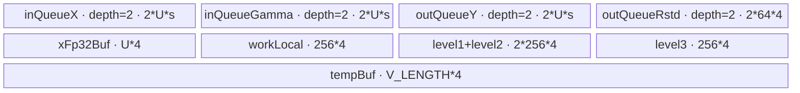

# RmsNorm 950 Direct Invoke 算子知识

## 算子速览

| 项目 | 内容 |
|---|---|
| 实际入口 | `cann_bench::rms_norm` → `rms_norm_npu` → `launch_rms_norm_float` / `launch_rms_norm_half` / `launch_rms_norm_bfloat16` / `launch_rms_norm_bfloat16_d2`；`Direct Invoke` |
| 计算语义 | 对最后一维 `D`：`rstd_i = 1 / sqrt(sum_j(x_ij²) / D + epsilon)`，`y_ij = x_ij * rstd_i * gamma_j` |
| 输入输出 | `x: (..., D)`、`gamma: (D)`、`y: shape(x)`；`x/gamma/y` 同 dtype，支持 `float32/float16/bfloat16`；内部 `rstd` 为 `float32[numRow]`，BF16 `D=2` Route 不物化它 |
| 执行类型 | R-002、R-003：`AIV_VECTOR`；R-001：SIMT。R-003 保留 NDDMA 选择字段，但转换 body 未消费该字段，不构成可达 NDDMA 节点；无可达 Cube/AIC 或 MIX_CV 节点。 |
| Kernel 路线 | P0 R-002 key 5000 RegBase full-load；P1 R-001 BF16 D=2 SIMT；P2 R-003 key 2001 RegBase split-D |
| 核心资源 | R-002/R-003 使用 GM、`TQue`、`TBuf`、MicroAPI `RegTensor`；R-001 直接使用 GM+寄存器；无跨 Kernel workspace |
| 来源闭包 | `direct_implementation_closed`：Torch 注册/校验、dtype/shape 分派、Launcher tiling、POD、全部可达 entry/body/helper 与构建接线闭合 |
| 验证状态 | 已完成源码闭包检查；本次知识提取未执行编译、真机、数值或性能测试。 |

## 接口与语义

### 计算语义

把 `x` 的前导维展平为 `numRow = numel(x) / D`，最后一维长度记为 `D = numCol`。每行独立计算平方和、乘 `1/D`、加 `epsilon`、开方取倒数，再逐元素乘原输入与一维权重 `gamma`。AIV 路线把平方、归约、`rstd` 和最终乘法放在 FP32 计算路径中；FP16/BF16 在寄存器中先升为 FP32，结果以 `CAST_RINT` 降回输入 dtype。BF16 `D=2` SIMT 路线同样显式升为 FP32，使用 `sqrtf`，最后写回 BF16。

公开给 Python 的结果只有 `y`。R-002/R-003 为复用转换来的 Device body，Launcher 仍提供内部 `rstd` GM；该 tensor 由 `rms_norm_npu` 创建并保持到同 stream 上的 Kernel 消费完成。R-001 不创建也不传 `rstd`。

### 输入、输出与属性

| 参数 | shape/layout | dtype | 约束、默认值与语义 |
|---|---|---|---|
| `x` | 连续语义的 `(..., D)`，按最后一维逐行 | `float32/float16/bfloat16` | `dim >= 1`；转换入口未显式调用 `contiguous`，故指针解释要求输入存储可按密集行主序读取 |
| `gamma` | `(D)` | 与 `x` 相同 | 必须一维且 `numel(gamma) == D` |
| `epsilon` | 标量 | Host `double`，传 Kernel 前窄化为 `float` | 默认 `1e-6`；源码未额外约束正值或有限值 |
| `y` | 与 `x` 相同 | 与 `x` 相同 | `empty_like(x)` 分配；只返回该 tensor |
| `rstd` | `(numRow)`；R-001 为 `(0)` 且不传 Device | `float32` | 内部临时结果，不在 schema 中返回 |

### 入口与版本

`TORCH_LIBRARY_FRAGMENT` 注册 `cann_bench::rms_norm(Tensor x, Tensor gamma, float epsilon=1e-6) -> Tensor`；Meta 实现只返回 `empty_like(x)`，PrivateUse1 实现绑定 `rms_norm_npu`。这是转换交付件提供的 Direct Invoke 入口，不是 ACLNN 入口。`OpCommand::RunOpApi("RmsNorm", acl_call)` 只承载 stream 上的直接 launch lambda；lambda 内没有调用 ACLNN 数学算子。

本卡以转换交付件为 Direct 实现事实源。固定官方仓 `ops-nn@ceb4536a2bd6fc99b85aec9d0fdcc0f470376292` 的 `norm/rms_norm` 仅作相关实现映射；不能用转换增加的 Torch 包装、Launcher 或 BF16 `D=2` SIMT 特化反推官方接口，也不能把官方平台声明当作否决本转换 950 载荷的条件。目标构建映射把 `NPU_ARCH=ascend950` 设为 `--npu-arch=dav-3510`，CANN 版本为 `9.1.0`。

## Host/Launcher 执行流程

### 参数校验与前处理

1. `rms_norm_npu` 用 `OptionalDeviceGuard` 切到 `x.device()`。
2. 校验 `x.dim() >= 1`、`gamma.dim() == 1`、`x.size(-1) == gamma.numel()`，再校验二者 dtype 相同。
3. 分配 `y = empty_like(x)`；若 `dtype==bfloat16 && D==2`，内部 `rstd` 为零元素，否则为 `float32[numel(x)/D]`。
4. 获取当前 NPU stream；把 tensor 指针转换为 `GM_ADDR`，把 `D`、`numRow` 转换为 `uint64_t`，把 `epsilon` 窄化为 `float`。
5. dtype 优先分派：FP32、FP16、BF16；BF16 内先判断 `D==2`。其他 dtype 以 `TORCH_CHECK(false, ...)` 终止。
6. 普通 Launcher 调用 `CalcTiling` 后按 key 启动一个 AIV Kernel；BF16 `D=2` Launcher 跳过 `CalcTiling`，以全部 AIV core 启动一个包含 SIMT VF body 的 Kernel。

入口未验证 `D>0`、`numRow>0`、stride/contiguous、设备一致性或 `epsilon` 的数值域。尤其 `D==0` 会在 `numel()/D` 前触发未定义的 Host 除零路径，不能视为空域支持。

### 参数、Workspace 与生命周期

`y` 与普通路线的 `rstd` 均由 PyTorch allocator 持有；输入、权重和输出地址由 lambda 按值捕获。Kernel 在当前 stream 上异步入队，转换 Launcher 的返回类型为 `void`，lambda 无条件返回 `0`。源码没有额外 workspace、event 或跨 Kernel 中间边。

普通路线的参数依赖为：

```text
(numRow, numCol, sizeof(dtype), xIsFloat, epsilon)
  -> 查询 UB 字节与 AIV core 数
  -> blockFactor/useCoreNum
  -> full-load UB 可行性
  -> key 5000 + RMSNormArch35TilingData
     或 key 2001 + RMSNormTilingData
  -> 单 Kernel launch on current stream
```

R-001 只生产 `blockDim=GetCoreNumAiv()`、`threadsPerBlock=1024`（Device `asc_vf_call` 常量）和标量参数；`dynUBufSize=N/A`。

### 启动图与失败传播

| Route | Host 启动函数 | Device 节点 | grid/block | POD/参数 | GM 输入输出 | workspace/ordering/lifetime |
|---|---|---|---|---|---|---|
| R-002 | `launch_rms_norm_{float,half,bfloat16}` | dtype 对应 `rms_norm_*_perf` | `blockDim=useCoreNum`，AIV_ONLY | `RMSNormArch35TilingData` by value | `x,gamma -> y,rstd` | 无 workspace；当前 stream 单节点 |
| R-001 | `launch_rms_norm_bfloat16_d2` | `rms_norm_bfloat16_d2` → `RmsNormBfloat16D2Simt` | `blockDim=AIV core 数`，每块 `1024` SIMT threads | `x,gamma,y,numRow,epsilon` 逐值传递 | `x,gamma -> y` | 无 workspace；当前 stream 单节点；tensor owner 为调用端 |
| R-003 | `launch_rms_norm_{float,half,bfloat16}` | dtype 对应 `rms_norm_*_split` | `blockDim=useCoreNum`，AIV_ONLY | `RMSNormTilingData` by value | `x,gamma -> y,rstd` | 无 workspace；当前 stream 单节点 |

三条 Route 都是单 Kernel graph，因而没有 Device 节点间 edge。资源查询失败时 `CalcTiling` 抛 `runtime_error`；不支持 dtype 在 launch 前失败。Kernel enqueue 错误没有由 `void` Launcher 向 lambda 传播的显式检查，这是 Direct 包装的失败传播缺口。

## Route 与参数设计

### Route 特征与重要性

| 优先级 | Route | 路线特征 | 适用域与实现前提 |
|---:|---|---|---|
| P0 | R-002 RegBase full-load | 通用主路线；整行驻留 UB，gamma 单次搬入并跨行批复用，X/Y/rstd 双缓冲，FP32 寄存器归约 | FP32/FP16/BF16（排除 BF16 `D=2`）；要求 `Ucandidate>=1 && Cfull<=16384`，并保留真实列 mask、末核与末行批处理 |
| P1 | R-001 BF16 D=2 SIMT | 极窄列专用路线；线程私有 FP32 标量、双行 grid-stride，不物化内部 rstd | 仅 BF16 且 `D=2`；依赖 950 SIMT VF、每行唯一线程映射及单行尾保护，在 Host 插件层先于通用 tiling 短路 |
| P2 | R-003 RegBase split-D | 宽列兜底路线；列分块、2 的幂 tile、三级 partial 归约，保持单核内完整行归约 | FP32/FP16/BF16（排除 BF16 `D=2`），且 R-002 资源谓词不成立；要求 UB 可容纳最小分片与固定归约缓冲，无后续 Device fallback |

### 分核与资源计算

记 `R=numRow`、`D=numCol`、`C=GetCoreNumAiv()`、原始 UB 字节为 `UBraw`、元素字节为 `s∈{2,4}`。

```text
UB = UBraw - 1024
blockFactor = ceil(R / C)
useCoreNum = ceil(R / blockFactor)
lastBlockFactor = R - (useCoreNum - 1) * blockFactor
Cfull = ceil(D*s / 32) * 32 / s
P = 2 ^ floor(log2(Cfull - 1))
F = ceil(ceil(P / 128) / 32) * 32
Ucandidate = (UB - 2048 - Cfull*s)
             / (Cfull*s*2*2 + 4*(2+1) + F)
```

若 `Ucandidate>=1 && Cfull<=16384`，选 R-002，并令 `U=min(Ucandidate,blockFactor)`。否则选 R-003：

```text
Calign = ceil(D*s / 512) * 512 / s
U = 最大 2^k，使 ComputeTotalBufSize(s,s,2*U,split=true,xIsFloat) < UB
ubLoop = 最大 2^m，使 ubLoop*2*U <= D
rowFactor = 64
is_nddma = (D < 512 ? 1 : 0)
```

R-003 Device 实际每核行数不读取 `last_block_factor`，而是 `rowWork = blockFactor`，末核取 `R-(blockNum-1)*blockFactor`。每次最多处理 `rowFactor=64` 行，每行先按 `ubLoop*U` 与剩余列构建分级平方和，再按 `ceil(D/U)` 个列 tile 计算输出。

### Route 选择

| 优先级 | Route | Key/模板 | 精确选择条件 | Host 顺序 | 不适用去向 |
|---:|---|---|---|---:|---|
| P0 | R-002 RegBase full-load | key `5000`；`KernelRmsNormRegBasePerf<T,T>` | 非 R-001，且 `Ucandidate>=1 && Cfull<=16384` | 2 | R-003 |
| P1 | R-001 BF16 D=2 SIMT | `launch_rms_norm_bfloat16_d2` / `RmsNormBfloat16D2Simt` | `x.dtype==bfloat16 && D==2`，在插件层短路 `CalcTiling` | 1 | R-002/R-003 普通 BF16 launcher |
| P2 | R-003 RegBase split-D | key `2001`；`KernelRmsNormRegBaseSplitD<T,T>` | 非 R-001，且 R-002 条件不成立 | 3 | 资源查询异常；无后续 Device fallback |

```text
if dtype == bfloat16 and D == 2:
    R-001
else:
    t = CalcTiling(...)
    if t.key == 5000:
        R-002
    else:
        R-003
```

### 模板/实现执行矩阵

| Route | key/selector | dtype/shape/platform 完整命中条件 | 执行拓扑与 Kernel 节点 | 实际模板/body | 内存与同步特征 | tail/fallback |
|---|---|---|---|---|---|---|
| R-002 | `5000` | FP32/FP16/BF16（排除 BF16 D2），full-load UB 谓词成立 | 单 AIV node | `KernelRmsNormRegBasePerf<T,T>::Process/ComputeY` | gamma 单载、X/Y/rstd 双缓冲、MicroAPI 分支归约 | 末核 `lastBlockFactor`，末 UB loop 用 `curUbTails`，列 mask 用真实 `D` |
| R-001 | BF16+D2 selector | BF16、`D=2`、950 Direct 入口 | 单节点 SIMT VF | `RmsNormBfloat16D2Simt` | 直接 GM load/store，线程私有 FP32 标量；无 UB queue、无 rstd GM | 双行展开循环后单行 tail；`row<numRow` 保护 |
| R-003 | `2001` | FP32/FP16/BF16（排除 BF16 D2），R-002 不成立 | 单 AIV node | `KernelRmsNormRegBaseSplitD<T,T>::Process` | 列分块、三级 reduce TBuf、X/gamma/Y/rstd 双缓冲 | 行 tail、列 tile tail、32B/512B padding；无后续 fallback |

### 隐藏性能 Guard

| Guard | Host/Tiling 条件 | Device/资源原因 | 影响 Route | 不满足时去向 | 源码符号 |
|---|---|---|---|---|---|
| 平台资源 | `numCore!=0 && UBraw>1024` | 必须能分核并保留 1 KiB UB | R-002/R-003 | `runtime_error` | `rms_norm_kernel.cpp::CalcTiling` |
| full-load UB | `Ucandidate>=1` | gamma、双缓冲 X/Y/rstd 与 reduce 临时区必须同驻 UB | R-002 | R-003 | `CalcTiling`、`KernelRmsNormRegBasePerf::Init` |
| full-load 列上限 | `Cfull<=16384` | 限制整行驻留与归约规模 | R-002 | R-003 | `FULL_LOAD_R_MAX` |
| BF16 D2 特化 | `dtype==bfloat16 && D==2` | 避免通用 tiling/rstd 临时物化，直接逐行标量 SIMT | R-001 | 普通 BF16 Launcher | `rms_norm_npu` |
| split tile | `ComputeTotalBufSize(...,2*U,true,...) < UB` | 以严格小于保留安全余量，`U` 取 2 的幂 | R-003 | 循环停在前一 `U` | `CalcTiling` |
| NDDMA 相关字段 | `is_nddma=(D<512)` | 来源 Host 保留搬运策略标志 | R-003 | `D>=512` 写 0 | `CalcTiling`；转换 body 无 consumer，不能解释为 NDDMA 节点 |
| 尾搬运 | `calColNum<D tile` 或 `numCol!=numColAlign` | GM 只读写有效元素，UB padding 到 32B/512B | R-002/R-003 | mask/pad 路线 | `DataCopyPad`、`DataCopyImpl`、`UpdateMask` |
| 空域 | 未检查 `D>0 && R>0` | Host 除法、`log(Cfull-1)`、零 blockDim 均要求非空 | 全部 | 未定义/异常，不是有效 Route | `rms_norm_npu`、`CalcTiling` |

### POD/ABI

以下 ABI 按转换头中标准布局与自然对齐闭合：`RMSNormArch35TilingData sizeof=64, alignof=8`，`RMSNormTilingData sizeof=144, alignof=8`，`RMSNormDirectTiling sizeof=216, alignof=8`。`RMSNormDirectTiling` 只在 Host 内部选 key；真正 launch 按 Route 单独传 `perf` 或 `split`。

| 结构 | 字段 | 类型/位宽 | ABI 布局 | 单位 | Host/launcher producer | Device consumer | 边界 |
|---|---|---|---|---|---|---|---|
| `RMSNormDirectTiling` | `key` | `uint32_t/32` | offset 0 | 枚举 | `CalcTiling: 5000/2001` | Launcher 分支 | 不传 Device |
| `RMSNormDirectTiling` | `block_dim` | `uint32_t/32` | offset 4 | AIV core | `useCoreNum` | `<<<block_dim>>>` | `R>0,C>0` |
| `RMSNormDirectTiling` | `perf` | `RMSNormArch35TilingData` | offset 152 | POD | key 5000 聚合初始化 | perf entry by value | key 2001 inactive |
| `RMSNormDirectTiling` | `split` | `RMSNormTilingData` | offset 8 | POD | key 2001 逐字段写入 | split entry by value | key 5000 inactive |
| `RMSNormArch35TilingData` | `num_row` | `uint64_t/64` | offset 0 | 行 | `numRow` | `Perf::Init` | 非零 |
| `RMSNormArch35TilingData` | `num_col` | `uint64_t/64` | offset 8 | 元素/行 | `numCol` | 搬运、归约、mask | 非零 |
| `RMSNormArch35TilingData` | `num_col_align` | `uint64_t/64` | offset 16 | 元素 | `Cfull` | UB stride/capacity | 32B 对齐 |
| `RMSNormArch35TilingData` | `block_factor` | `uint64_t/64` | offset 24 | 行/core | `blockFactor` | 核地址与循环 | 非末核 |
| `RMSNormArch35TilingData` | `col_flod_factor` | `uint64_t/64` | offset 32 | 元素 | `P` | reduce fold point | 2 的幂 |
| `RMSNormArch35TilingData` | `ub_factor` | `uint64_t/64` | offset 40 | 行/tile | `min(Ucandidate,blockFactor)` | 双缓冲容量与 loop | 至少 1 |
| `RMSNormArch35TilingData` | `epsilon` | `float/32` | offset 48 | 标量 | `eps` | Newton-Raphson rstd | 未验证数值域 |
| `RMSNormArch35TilingData` | `avg_factor` | `float/32` | offset 52 | `1/D` | Host 计算 | rstd 前缩放 | `D>0` |
| `RMSNormArch35TilingData` | `last_block_factor` | `uint64_t/64` | offset 56 | 行 | 末核行数 | `Perf::Init` | 只用于末核 |
| `RMSNormTilingData` | `num_row` | `uint64_t/64` | offset 0 | 元素行 | `numRow` | `SplitD::Init` | 必须非零 |
| `RMSNormTilingData` | `num_col` | `uint64_t/64` | offset 8 | 元素/行 | `numCol` | `Init/Process` 地址与循环 | 必须非零 |
| `RMSNormTilingData` | `num_col_align` | `uint64_t/64` | offset 16 | 元素 | `Calign` | `Init` 读取后未参与转换 split body | 兼容字段 |
| `RMSNormTilingData` | `block_factor` | `uint64_t/64` | offset 24 | 行/core | `ceil(R/C)` | `Init` 窄化到成员 `uint32_t` | 大行数存在窄化边界 |
| `RMSNormTilingData` | `row_factor` | `uint32_t/32` | offset 32 | 行/batch | 常量 64 | `Process/SubProcess` | 固定 64 |
| `RMSNormTilingData` | `ub_factor` | `uint32_t/32` | offset 36 | 元素/tile | 2 的幂 `U`，由 `uint64_t` 窄化 | 全部列循环与 buffer | 必须落入 32 位 |
| `RMSNormTilingData` | `reduce_mask` | `uint32_t/32` | offset 40 | lane | 零初始化 | 无 consumer | inactive |
| `RMSNormTilingData` | `left_num` | `uint32_t/32` | offset 44 | 元素 | 零初始化 | 无 consumer | inactive |
| `RMSNormTilingData` | `last_reduce_mask` | `uint32_t/32` | offset 48 | lane | 零初始化 | 无 consumer | inactive |
| `RMSNormTilingData` | `last_left_num` | `uint32_t/32` | offset 52 | 元素 | 零初始化 | 无 consumer | inactive |
| `RMSNormTilingData` | `rstd_size` | `uint32_t/32` | offset 56 | 元素 | 零初始化 | 无 consumer | inactive |
| `RMSNormTilingData` | `ub_loop` | `uint32_t/32` | offset 60 | tile 次数 | 2 的幂 | `ComputeFormer` 分段 | 必须 `ubLoop*U<=D` |
| `RMSNormTilingData` | `col_buffer_length` | `uint32_t/32` | offset 64 | 元素 | `U` | `InitBuffer` | 与 `ub_factor` 相同 |
| `RMSNormTilingData` | `multi_n_num` | `uint32_t/32` | offset 68 | 行 | `UB/ComputeTotalBufSize(...false...)` | 无 consumer | NDDMA/多行兼容字段 |
| `RMSNormTilingData` | `is_nddma` | `uint32_t/32` | offset 72 | bool | `D<512 ? 1 : 0` | 无 consumer | 仅 NDDMA 相关 Host 残留 |
| `RMSNormTilingData` | `epsilon` | `float/32` | offset 76 | 标量 | `static_cast<float>(epsilon)` | `ComputeRstd` | 未验证有限/正值 |
| `RMSNormTilingData` | `avg_factor` | `float/32` | offset 80 | `1/D` | 零初始化 | 无 consumer；Device 自算 | inactive |
| `RMSNormTilingData` | `is_gemma` | `uint8_t/8` | offset 84 | bool | 零初始化 | 无 consumer | inactive；offset 85–87 padding |
| `RMSNormTilingData` | `last_block_factor` | `uint64_t/64` | offset 88 | 行 | 写 0 | 无 consumer；Device 自算末核 | inactive |
| `RMSNormTilingData` | `row_loop` | `uint64_t/64` | offset 96 | 循环 | 零初始化 | 无 consumer | inactive |
| `RMSNormTilingData` | `last_block_row_loop` | `uint64_t/64` | offset 104 | 循环 | 零初始化 | 无 consumer | inactive |
| `RMSNormTilingData` | `row_tail` | `uint64_t/64` | offset 112 | 行 | 零初始化 | 无 consumer | inactive |
| `RMSNormTilingData` | `last_block_row_tail` | `uint64_t/64` | offset 120 | 行 | 零初始化 | 无 consumer | inactive |
| `RMSNormTilingData` | `mul_loop` | `uint32_t/32` | offset 128 | 循环 | 零初始化 | 无 consumer | inactive |
| `RMSNormTilingData` | `mul_tail` | `uint32_t/32` | offset 132 | 元素 | 零初始化 | 无 consumer | inactive |
| `RMSNormTilingData` | `dst_rep_stride` | `uint8_t/8` | offset 136 | repeat stride | 零初始化 | 无 consumer | inactive |
| `RMSNormTilingData` | `is_performance` | `uint8_t/8` | offset 137 | bool | 零初始化 | 无 consumer | inactive |
| `RMSNormTilingData` | `normal_flag` | `uint8_t/8` | offset 138 | bool | 零初始化 | 无 consumer | inactive；offset 139–143 tail padding |

### Route 源码闭包

| Route | Key/selector | Host/Tiling producer | POD/参数 | Kernel entry/router 节点 | Kernel body/直接依赖 | 构建接线 |
|---|---|---|---|---|---|---|
| R-002 | 5000 | `rms_norm_kernel.cpp::CalcTiling` | `RMSNormArch35TilingData` | `rms_norm_{float,half,bfloat16}_perf` | `rms_norm_regbase_perf.h`、`reduce_common_regbase.h` | `csrc/ops/rms_norm/CMakeLists.txt::register_direct_launch_op`、根 `CMakeLists.txt` 950 映射 |
| R-001 | BF16+D2 | `op_plugin/rms_norm_plugin.cpp::rms_norm_npu`、`op_kernel/rms_norm_kernel.cpp::launch_rms_norm_bfloat16_d2` | 逐值参数，无 POD | `rms_norm_bfloat16_d2` | `RmsNormBfloat16D2Simt` | 同上 |
| R-003 | 2001 | `rms_norm_kernel.cpp::CalcTiling` | `RMSNormTilingData` | `rms_norm_{float,half,bfloat16}_split` | `rms_norm_regbase_split_d.h`、`rms_norm_regbase_common.h`、`reduce_common_regbase.h` | 同上 |

## Kernel 实现

### 公共执行流程

R-002/R-003 的 dtype entry 只负责声明 `AIV_ONLY`、实例化 `<float,float>`、`<half,half>` 或 `<bfloat16_t,bfloat16_t>`，随后依次调用 `Init` 与 `Process`。每核处理一段连续行；gamma 对所有核只读共享。两条路线都先从 GM 搬入 X/gamma，在 UB 或寄存器完成 FP32 平方归约和 `rstd`，再计算 `x*rstd*gamma`，只把有效列写回 GM。R-001 则在 AIV Kernel 内用 `asc_vf_call` 进入 SIMT body，绕过 TPipe/TQue。

### Route R-002：RegBase full-load AIV（P0）

#### 适用条件

##### 选择证据

| 层级 | 文件 | 符号 | 源码谓词/参数 | 结果/下一跳 |
|---|---|---|---|---|
| Launcher tiling | `op_kernel/rms_norm_kernel.cpp` | `CalcTiling` | `Ucandidate>=1 && Cfull<=16384` | key 5000 + `perf` POD |
| Launcher | 同上 | `launch_rms_norm_{float,half,bfloat16}` | `t.key==5000` | dtype `*_perf` entry |
| Entry | 同上 | `rms_norm_*_perf` | dtype 模板实例 | `KernelRmsNormRegBasePerf<T,T>` |

#### Device 数据流

##### 函数级调用链

```text
launch_rms_norm_<dtype> -> CalcTiling -> rms_norm_<dtype>_perf
  -> KernelRmsNormRegBasePerf<T,T>::Init
  -> Process
     -> gamma DataCopyPad once
     -> for each UB row batch:
        X DataCopyPad
        -> CalculateSquareReduceSum<T>
        -> ComputeRstdNewtonRaphson<false,true>
        -> rstd DataCopyPad to GM
        -> ComputeY (register broadcast/multiply/cast)
        -> Y DataCopyPad to GM
```

##### 源码等价伪码

```text
coreRow0 = blockIdx * blockFactor
coreRows = (last core ? lastBlockFactor : blockFactor)
gammaLocal[0:Cfull] <- gammaGM[0:D] (valid D, no padding value requested)
for tile in 0 .. ceil(coreRows/U)-1:
    rows = last tile ? tailRows : U
    xLocal[rows,Cfull] <- xGM[tile*U*D] with dstStride=(Cfull-D)*s/32
    sum[row] = fp32 reduce_j(fp32(x[row,j])^2), j<D
    rstd[row] = NewtonRaphson(1/sqrt(sum[row]/D + epsilon))
    rstdGM[tile*U : +rows] <- rstd
    for row and vector column chunk:
        mask = valid remaining D
        y = fp32(x) * broadcast(rstd[row]) * fp32(gamma)
        cast/store to dtype in yLocal[row,Cfull]
    yGM <- yLocal valid D with srcStride=(Cfull-D)*s/32
```

#### 内存与数据搬运

##### 资源与搬运表

| 层级/缓冲区 | offset/地址公式 | extent/容量公式 | dtype/layout | producer | consumer | owner/lifetime | 对齐/复用 |
|---|---|---|---|---|---|---|---|
| core X GM | `blockIdx*blockFactor*D` | `coreRows*D` | T row-major | caller | X DMA | caller | 连续行 |
| `inQueueGamma` | 0 | `Cfull*s` | T | gamma DMA | `ComputeY` | depth 1，整核 lifetime | 32B 对齐容量 |
| `inQueueX` | tile slot | `2*U*Cfull*s` | T | X DMA | reduce/ComputeY | depth 2；ComputeY 后 Free | 行 dstStride padding |
| `outQueueY` | tile slot | `2*U*Cfull*s` | T | `ComputeY` | Y DMA | depth 2；CopyOut 后 Free | 只写有效 D |
| `outQueueRstd` | tile slot | `2*align(U,8)*4` | FP32 | rstd compute | rstd DMA/ComputeY | depth 2 | 32B 对齐 |
| `xTmpBuf` | 0 | `U*align(ceil(P/128),8)*4` | FP32 | 分支归约 | 最终归约 | tile lifetime | TBuf |
| `xReduceTmpBuf` | 0 | `align(U,8)*4` | FP32 | 平方和 | rstd/GM/ComputeY | tile lifetime | 与 outQueueRstd 不别名 |

##### 分层内存布局


##### 字节账与复用顺序

```text
UB_total = Cfull*s
         + 2*U*Cfull*s
         + 2*U*Cfull*s
         + 2*align(U,8)*4
         + U*align(ceil(P/128),8)*4
         + align(U,8)*4
dynamic_ub = N/A
workspace_total = 0
=> Host 用更保守的 Ucandidate 公式并要求 Ucandidate>=1
```

| 复用子区 | 写入者 | 读取者/消费点 | 下一次覆盖 | 同步或释放依据 | 安全条件 |
|---|---|---|---|---|---|
| `inQueueX` slot | X DMA | reduce 与 `ComputeY` | `FreeTensor(xLocal)` 后下一 tile | EnQue/DeQue/FreeTensor | rstd 与 Y 计算完成前不得释放 |
| `outQueueRstd` slot | rstd compute | GM copy 与 `ComputeY` | `FreeTensor(rstdLocal)` 后 | Queue lifecycle | 两个消费者都已完成 |
| `outQueueY` slot | `ComputeY` | Y DMA | CopyOut 后 `FreeTensor` | Queue lifecycle | GM store 提交后覆盖 |
| `xTmpBuf/xReduceTmpBuf` | 当前 tile reduce | 当前 tile rstd | 下一 tile | 顺序调用及 LocalMemBar | 归约读取前需要 store→load barrier |

#### 同步、精度与尾块

##### 同步与数值边界表

| 阶段 | primitive/机制 | producer | consumer/等待点 | 保护对象 | 精度/尾块 |
|---|---|---|---|---|---|
| GM→UB | `DataCopyPad` + Queue | MTE | `DeQue` | gamma/X queue slot | `blockLen=D*s`，X `blockCount=rows`，dstStride 补齐 `Cfull` |
| 平方归约 | MicroAPI `UpdateMask/ReduceSum/LocalMemBar` | register store | 下级归约 | tmp TBuf | 按 `D<=VL`、`<=2VL`、公共 fold 分支；无效列不入 mask |
| rstd | `ComputeRstdNewtonRaphson<false,true>` | sum FP32 | rstd queue | 每行 FP32 | 先乘 `1/D` 再加 epsilon；显式 Newton-Raphson 修正 |
| Y | `LoadRegForDtype/Mul/StoreRegForDtype` | X/gamma/rstd | yLocal | 有效列 | B16→FP32，FP32 两次乘法，`CAST_RINT` 回 B16 |
| UB→GM | Queue + `DataCopyPad` | yLocal/rstdLocal | GM | 输出有效区 | Y 仅 `D` 列；末 tile 用 `curUbTails` |

#### 关键实现

##### 符号证据表

| 阶段 | 文件 | 符号/模板实例 | 实现事实 |
|---|---|---|---|
| Host/Tiling producer | `op_kernel/rms_norm_kernel.cpp` | `CalcTiling` | key 5000、分核、UB 上界与 POD |
| Kernel entry/router | 同上 | `rms_norm_*_perf` | dtype 到 `<T,T>` body |
| Device body/helper | `op_kernel/rms_norm_regbase_perf.h` | `KernelRmsNormRegBasePerf::Init/Process/ComputeY` | buffer、DMA、循环、Y 计算 |
| Reduce helper | `op_kernel/reduce_common_regbase.h` | `CalculateSquareReduceSum`、`ComputeRstdNewtonRaphson` | 分支归约与 FP32 rstd |

### Route R-001：BF16 D=2 SIMT（P1）

#### 适用条件

##### 选择证据

| 层级 | 文件 | 符号 | 源码谓词/参数 | 结果/下一跳 |
|---|---|---|---|---|
| Plugin | `op_plugin/rms_norm_plugin.cpp` | `rms_norm_npu` | `dtype==kBFloat16 && numCol==2` | `launch_rms_norm_bfloat16_d2` |
| Launcher | `op_kernel/rms_norm_kernel.cpp` | `launch_rms_norm_bfloat16_d2` | `blockDim=GetCoreNumAiv()` | 启动 `rms_norm_bfloat16_d2` |
| Entry | 同上 | `rms_norm_bfloat16_d2` | `asc_vf_call<RmsNormBfloat16D2Simt>(dim3{1024}, x, gamma, y, numRow, epsilon, GetBlockIdx(), GetBlockNum())` | `RmsNormBfloat16D2Simt` |

#### Device 数据流

##### 函数级调用链

```text
rms_norm_npu
  -> launch_rms_norm_bfloat16_d2(x,gamma,y,R,eps,stream)
    -> rms_norm_bfloat16_d2<<<AIV_core_num>>>
      -> asc_vf_call<RmsNormBfloat16D2Simt>(threads=1024)
        -> per-thread two-row grid-stride loop
        -> optional one-row tail
```

##### 源码等价伪码

```text
tid = blockIdx * 1024 + threadIdx
stride = blockNum * 1024
g0 = fp32(gamma[0]); g1 = fp32(gamma[1])
row = tid
while row + stride < R:
    for r in [row, row + stride]:
        x0,x1 = fp32(x[2*r]), fp32(x[2*r+1])
        inv = 1 / sqrtf((x0*x0 + x1*x1)*0.5 + eps)
        y[2*r:2*r+2] = bf16(x0*inv*g0), bf16(x1*inv*g1)
    row += 2*stride
if row < R: compute the same one-row body
```

#### 内存与数据搬运

##### 资源与搬运表

| 层级/缓冲区 | offset/地址公式 | extent/容量公式 | dtype/layout | producer | consumer | owner/lifetime | 对齐/复用 |
|---|---|---|---|---|---|---|---|
| GM X | `2*row + {0,1}` | `2R` | BF16 row-major | caller | SIMT thread | caller，Kernel 只读 | 单元素 load |
| GM gamma | `{0,1}` | 2 | BF16 | caller | 每个线程 | caller，Kernel 只读 | 每线程各载一次 |
| thread FP32 scalars | 线程私有 | `g0,g1,x0,x1,inv` | FP32 registers | 当前线程 | 当前线程 | 单行/双行迭代 | 第二行复用 gamma 标量 |
| GM Y | `2*row + {0,1}` | `2R` | BF16 row-major | 当前线程 | caller | caller，Kernel 写 | 每行唯一线程，无冲突 |

##### 分层内存布局

N/A：该 SIMT Route 不分配 AIV `TQue/TBuf` 或 dynamic UB；实际层级为 GM → 线程私有 FP32 寄存器 → GM。

##### 字节账与复用顺序

```text
UB_total = 0（源码无显式 UB 分配）
dynamic_ub = N/A
workspace_total = 0
```

| 复用子区 | 写入者 | 读取者/消费点 | 下一次覆盖 | 同步或释放依据 | 安全条件 |
|---|---|---|---|---|---|
| 线程私有 `gamma0/gamma1` | thread prologue | 同线程所有行 | 线程结束 | SIMT thread 私有 | gamma launch 期间只读 |
| 线程私有 X/rstd 标量 | 当前行 body | 当前行 Y store | 下一行 | 顺序程序语义 | 每个 row 只映射给一个 tid |

#### 同步、精度与尾块

##### 同步与数值边界表

| 阶段 | primitive/机制 | producer | consumer/等待点 | 保护对象 | 精度/尾块 |
|---|---|---|---|---|---|
| 行映射 | grid-stride | Host grid + VF threads | 每线程循环 | GM row 唯一性 | `row+stride<R` 处理两行，`row<R` 处理单尾行 |
| 数值 | 顺序标量算术 | BF16 load | BF16 store | 当前行 | BF16→FP32；平方和/均值/epsilon/sqrt/mul 均 FP32；末端 BF16 cast |
| 同步 | N/A | 独立线程 | N/A | 不共享写地址 | 无 barrier/atomic |

#### 关键实现

##### 符号证据表

| 阶段 | 文件 | 符号/模板实例 | 实现事实 |
|---|---|---|---|
| Host producer | `op_plugin/rms_norm_plugin.cpp` | `rms_norm_npu` | BF16+D2 优先分派且不物化 rstd |
| Kernel entry | `op_kernel/rms_norm_kernel.cpp` | `rms_norm_bfloat16_d2` | `AIV_ONLY` entry 内调用 1024-thread VF |
| Device body | 同上 | `RmsNormBfloat16D2Simt` | 双行 grid-stride、FP32 数学、单行 tail |

### Route R-003：RegBase split-D AIV（P2）

#### 适用条件

##### 选择证据

| 层级 | 文件 | 符号 | 源码谓词/参数 | 结果/下一跳 |
|---|---|---|---|---|
| Launcher tiling | `op_kernel/rms_norm_kernel.cpp` | `CalcTiling` | R-002 谓词不成立 | key 2001 + `split` POD |
| Launcher | 同上 | `launch_rms_norm_{float,half,bfloat16}` | `t.key!=5000` | dtype `*_split` entry |
| Entry | 同上 | `rms_norm_*_split` | dtype 模板实例 | `KernelRmsNormRegBaseSplitD<T,T>` |

#### Device 数据流

##### 函数级调用链

```text
launch_rms_norm_<dtype> -> CalcTiling -> rms_norm_<dtype>_split
  -> KernelRmsNormRegBaseSplitD<T,T>::Init
  -> Process -> for each <=64-row batch: SubProcess
     -> per row ComputeFormer
        -> CopyInX -> ComputeFormerImplV2 (square + fold reduce)
        -> ComputeSum / ComputeMultiLevelReduce
        -> ComputeMultiLevelRstd<false> (得到平方和)
     -> ComputeRstd (sum/D + epsilon -> sqrt -> reciprocal)
     -> for each column tile ComputeLatter
        -> CopyInGamma
        -> per row CopyInX -> ComputeLatterY -> CopyOutY
     -> CopyOutRstd
```

##### 源码等价伪码

```text
coreRow0 = blockIdx * blockFactor
rowWork = last core ? R-(blockNum-1)*blockFactor : blockFactor
for rowBatch in chunks of 64:
    rstdLocal[0:64] = 0
    for localRow in valid rows:
        split = ubLoop*U
        decompose D-split into masterLoop, paired tailLoop, tail
        each CopyInX reads count valid elements and pads to 32B/512B
        ComputeFormerImplV2:
            cast B16 to FP32 if needed; square; power-of-two fold;
            ReduceSum into temp/level1/level2/level3 with LocalMemBar
        rstdLocal[localRow] = complete square sum
    rstdLocal = 1 / sqrt(rstdLocal*(1/D) + epsilon)
    for colTile in 0..ceil(D/U)-1:
        cols = min(U,D-colTile*U)
        gammaLocal <- gamma[colTile*U : +cols]
        for localRow:
            xLocal <- x[row,colTile*U : +cols]
            yLocal = fp32(x)*broadcast(rstd[row])*fp32(gamma)
            yGM valid cols <- cast(yLocal)
    rstdGM valid rows <- rstdLocal
```

#### 内存与数据搬运

##### 资源与搬运表

| 层级/缓冲区 | offset/地址公式 | extent/容量公式 | dtype/layout | producer | consumer | owner/lifetime | 对齐/复用 |
|---|---|---|---|---|---|---|---|
| core X/Y GM | `blockIdx*blockFactor*D` | `rowWork*D` | T row-major | caller/Kernel | Kernel/caller | launch lifetime | 每核连续行 |
| `inQueueX` | tile slot | `2*U*s` | T | `CopyInX` | former/latter compute | depth 2 | tail 右 padding |
| `inQueueGamma` | tile slot | `2*U*s` | T | `CopyInGamma` | `ComputeLatterY` | depth 2 | 每列 tile 复用全部 batch 行 |
| `outQueueY` | tile slot | `2*U*s` | T | `ComputeLatterY` | `CopyOutY` | depth 2 | GM 只写 `calColNum` |
| `outQueueRstd` | 0 | `2*64*4` | FP32 | reduce/rstd | Y compute + GM store | depth 2 | 一批最多 64 行 |
| `xFp32Buf` | 0 | `U*4` | FP32 | 转换 body 当前版本未写入 | 无有效 consumer | 整核 | 保守分配，不可扣除 |
| `workLocalBuf` | 0 | `256*4` | FP32 | 一级 fold | `ComputeFormerImplV2` | 每片重写 | store/load barrier |
| `level1/2/3Buf` | 各自 0 | 各 `256*4` | FP32 | 分级平方和 | 下级/最终 reduce | 每行重置/推进 | 不别名 |
| `tempBuf` | 0 | `V_LENGTH*4` | FP32 | 成对片平方和 | `ComputeSum` | 当前行 | 950 `V_LENGTH=128` |

NDDMA 相关闭包：Host 计算 `multi_n_num` 和 `is_nddma=(D<512)`，POD 也保留两字段；但 `KernelRmsNormRegBaseSplitD::Init/Process` 没有读取它们，实际搬运全部落到 `DataCopyImpl -> DataCopyPad(blockCount=1, blockLen=count*sizeof(T), stride=0)`。因此本 Direct Route 的真实执行族仍是 AIV_VECTOR，不存在 NDDMA stage、中间 NDDMA buffer、CUT_ONCE/CUT_TWICE 图或跨阶段同步。固定官方映射中的同名 arch35 NDDMA 路线不得自动归入这份转换 body。

##### 分层内存布局



##### 字节账与复用顺序

```text
UB_total = 2*U*s + 2*U*s + 2*U*s
         + 2*64*4
         + U*4
         + 4*256*4
         + V_LENGTH*4
         = 6*U*s + 4*U + 5120 bytes（A5 V_LENGTH=128）
dynamic_ub = N/A
workspace_total = 0
Host selector 使用 ComputeTotalBufSize(s,s,2*U,true,...) < UB 的保守上界
```

| 复用子区 | 写入者 | 读取者/消费点 | 下一次覆盖 | 同步或释放依据 | 安全条件 |
|---|---|---|---|---|---|
| `inQueueX` slot | `CopyInX` | former 或 latter | `FreeTensor` 后 | Queue lifecycle | 当前 reduce/Y 完成 |
| `inQueueGamma` slot | `CopyInGamma` | batch 内所有行的 `ComputeLatterY` | 所有行完成后 Free | 外层列 tile 顺序 | 不可逐行提前覆盖 |
| `outQueueRstd` slot | 分级 sum、`ComputeRstd` 原地更新 | 所有列 tile Y 与最终 GM copy | `CopyOutRstd` 后 | EnQue/DeQue/FreeTensor | Y 完整消费后才提交/释放 |
| `workLocal/level*/temp` | 当前行 reduce | 当前行下一层 | 下一行/下一片 | `LocalMemBar` 与顺序调用 | store 对 load 可见 |

#### 同步、精度与尾块

##### 同步与数值边界表

| 阶段 | primitive/机制 | producer | consumer/等待点 | 保护对象 | 精度/尾块 |
|---|---|---|---|---|---|
| CopyIn/Out | `DataCopyPad` + Queue | GM/UB | `DeQue`/GM | queue slot | blockLen 为有效字节；X former 尾部补 0 到 32B/512B |
| 片内平方和 | `UpdateMask/ReduceSum` | register | temp/level1 | 当前片 | FP16/BF16 先 FP32；无效 padding lane 为 0 |
| 多级归约 | `LocalMemBar<VEC_STORE,VEC_LOAD>`、`LevelMergeRstd` | 低层 TBuf | 高层 reduce | work/level buffer | 每层 256 个 FP32 partial；最后得到 sum |
| rstd | `ComputeRstd` | sum | Y compute | rstdLocal | FP32 `sum*(1/D)+eps`→sqrt→1/x |
| Y | `ComputeLatterY` | X/gamma/rstd | yLocal | 有效列 | 双半寄存器布局；B16→FP32→`CAST_RINT` B16 |
| 行/列 tail | `Min/CeilDiv/pad/mask` | POD+循环 | 每次搬运/计算 | 末行批、末列 tile | `calRowNum<=64`、`calColNum<=U` |

#### 关键实现

##### 符号证据表

| 阶段 | 文件 | 符号/模板实例 | 实现事实 |
|---|---|---|---|
| Host/Tiling producer | `op_kernel/rms_norm_kernel.cpp` | `CalcTiling/ComputeTotalBufSize` | key 2001、2 的幂 tile、NDDMA 兼容字段 |
| Kernel entry/router | 同上 | `rms_norm_*_split` | dtype 到 split-D body |
| Device body | `op_kernel/rms_norm_regbase_split_d.h` | `KernelRmsNormRegBaseSplitD::{Init,Process,ComputeFormer,ComputeLatter}` | 行/列循环、buffer 与实际 DataCopyPad 路径 |
| Device helper | `op_kernel/rms_norm_regbase_common.h` | `DataCopyImpl/ComputeFormerImplV2/ComputeLatterY/ComputeMultiLevelReduce` | DMA 参数、FP32 计算、mask/barrier |
| Reduce helper | `op_kernel/reduce_common_regbase.h` | `LevelMergeRstd/ComputeMultiLevelRstd` | 三级 partial 归约 |

## 算子特定优化

### Trick T-002：full-load 路线一次驻留 gamma、批量归约多行（P0 / R-002）

#### 触发与源码依据

- 适用 Route：R-002
- 触发条件：`Ucandidate>=1 && Cfull<=16384`
- 转换片段定位：`op_kernel/rms_norm_regbase_perf.h:87-125`；相关官方源码：[`rms_norm_regbase_perf.h`](https://gitcode.com/cann/ops-nn/blob/ceb4536a2bd6fc99b85aec9d0fdcc0f470376292/norm/rms_norm/op_kernel/arch35/rms_norm_regbase_perf.h)

**转换交付件源码（事实源连续摘录）**：

```cpp
LocalTensor<DG> gammaLocal = inQueueGamma.AllocTensor<DG>();
DataCopyPad(gammaLocal, gammaGm, copyInParamsGamma, dataCopyPadExtParamsGamma);
inQueueGamma.EnQue(gammaLocal);
inQueueGamma.DeQue<DG>();
for (uint64_t i = 0; i < curBlockLoops; i++) {
    curUbFactor = (i == (curBlockLoops - 1)) ? curUbTails : ubFactor;
    // X batch copy and row reductions follow.
}
```

#### 机制与设计原因

gamma 在核开始时只搬入一次，并跨全部 UB row batch 保持有效；X/Y 则按 `U` 行双缓冲。`CalculateSquareReduceSum` 同时处理 `curUbFactor` 行，通过 `D` 与 fold point 选择单 VL、双 VL 或临时区归约分支。这减少同核不同 row batch 对 gamma 的重复 GM 读取，并用 Host UB 谓词保证整行 stride、双缓冲和 partial 区同时容纳。

#### 迁移边界

- 适用：权重沿行共享、整行对齐容量可驻 UB 的最后维归一化。
- 前提：full-load UB 公式成立，gamma launch 期间只读，末列由 mask 控制。
- 失效：UB 不足或 `Cfull>16384` 时必须使用 R-003 分列实现。
- 未验证：本次知识提取未执行编译、真机、数值或性能测试。

#### 错误做法

把 gamma queue 在每个 row tile 后释放会破坏跨 tile 复用；把逻辑 `D` 当成 X/Y buffer 容量会漏算 `Cfull-D` padding 与 depth=2。

### Trick T-001：BF16 D=2 双行 SIMT grid-stride（P1 / R-001）

#### 触发与源码依据

- 适用 Route：R-001
- 触发条件：`dtype==bfloat16 && D==2`
- 转换片段定位：`op_kernel/rms_norm_kernel.cpp:196-225`；相关官方入口：[`rms_norm_apt.cpp`](https://gitcode.com/cann/ops-nn/blob/ceb4536a2bd6fc99b85aec9d0fdcc0f470376292/norm/rms_norm/op_kernel/rms_norm_apt.cpp)

**转换交付件源码（事实源连续摘录）**：

```cpp
uint64_t row = thread;
uint64_t pairStride = stride * 2;
for (; row + stride < numRow; row += pairStride) {
    uint64_t offset = row * 2;
    float x0 = static_cast<float>(x[offset]);
    float x1 = static_cast<float>(x[offset + 1]);
    float rstd = 1.0f / sqrtf((x0 * x0 + x1 * x1) * 0.5f + epsilon);
    y[offset] = static_cast<bfloat16_t>(x0 * rstd * gamma0);
    y[offset + 1] = static_cast<bfloat16_t>(x1 * rstd * gamma1);
    uint64_t pairedOffset = (row + stride) * 2;
```

#### 机制与设计原因

每个线程一次循环处理相距一个全 grid stride 的两行，并把 `gamma[0:2]` 保存在 FP32 线程标量中。触发条件把列循环和通用 UB 归约退化为两个标量平方、一次 `sqrtf` 与两路权重乘法；同时不分配公开结果不需要的 `rstd`。第二行由 `row+stride<numRow` 保证有效，循环退出后的 `row<numRow` 覆盖奇数尾行。

#### 迁移边界

- 适用：最后维固定为 2、每行独立且 gamma 只有两个元素的 BF16 RMSNorm。
- 前提：950 SIMT VF、1024 threads/block、每个 row 唯一映射、FP32 中间数学。
- 失效：dtype 非 BF16或 `D!=2` 时必须回到 R-002/R-003；不能扩展到任意 D 而省略归约。
- 未验证：本次知识提取未执行编译、真机、数值或性能测试。

#### 错误做法

固定转换源码没有给出另一段可验证的错误实现；可证明的边界是不能删去 `row+stride<numRow` 与末尾 `row<numRow` 两个保护。

### Trick T-003：split-D 的 2 的幂片与三级 partial 归约（P2 / R-003）

#### 触发与源码依据

- 适用 Route：R-003
- 触发条件：full-load Route 不可用；`U` 由严格 UB 上界取最大 2 的幂
- 转换片段定位：`op_kernel/rms_norm_regbase_split_d.h:152-196`；相关官方源码：[`rms_norm_regbase_split_d.h`](https://gitcode.com/cann/ops-nn/blob/ceb4536a2bd6fc99b85aec9d0fdcc0f470376292/norm/rms_norm/op_kernel/arch35/rms_norm_regbase_split_d.h)

**转换交付件源码（事实源连续摘录）**：

```cpp
for (uint32_t repeat = 0; repeat < tailLoop; repeat++) {
    ComputeFormerHandle(tempLocal, offset, 0, ubFactor, ubFactor);
    offset += ubFactor;
    ComputeFormerHandle(tempLocal, offset, 1, ubFactor, ubFactor);
    offset += ubFactor;
    ComputeSum(level1Local, tempLocal, level1, SUM_COUNT);
    level1 += 1;
    ComputeMultiLevelReduce(level1Local, level2Local, level3Local, level1, level2, level3);
}
```

#### 机制与设计原因

Host 把 `U` 和 `ubLoop` 约束为 2 的幂，Device 可用 power-of-two fold 把每个列片的平方和压成标量；连续 partial 累积到 256 个时才提升到下一层。尾部先拆成成对整片、半片加 tail 或整片加 tail，再与主片统一进入三级归约。这样无需跨核 atomic 或 workspace，且只需固定四个 256-FP32 partial buffer。

#### 迁移边界

- 适用：最后维过大、单行不能 full-load，但每行独立可在单核内分列归约。
- 前提：每核拥有完整行，`U` 为满足 UB 的 2 的幂，所有 partial 在 rstd 前完成。
- 失效：若一行还需跨核拆分，则当前无 atomic/workspace 合并协议，不能直接复用。
- 未验证：本次知识提取未执行编译、真机、数值或性能测试。

#### 错误做法

不能把 `is_nddma` 字段当作本 Route 的 Device 分支；转换 body 没有读取它。也不能省略 `LocalMemBar` 后立即从刚写入的 work/level buffer 做下一层 load。

## 模板与实现对比

| 对比维度 | P0 R-002 full-load AIV | P1 R-001 BF16 D2 SIMT | P2 R-003 split-D AIV | 设计选择依据 |
|---|---|---|---|---|
| 适用条件/Host 顺序 | 非 R-001，full-load UB 可行且列上限成立；顺序 2 | BF16 且 D=2；顺序 1，插件层短路 | R-002 失败；顺序 3 | Host 先处理专用短路，再由 UB selector 选择通用主路线或兜底路线 |
| 模板与 dtype | `<float/half/bfloat16_t, same>` | 固定 BF16 | `<float/half/bfloat16_t, same>` | R-001 只覆盖 BF16 D2 |
| 循环与分核 | core→row batch→col vector | 1024-thread grid-stride，每次两行 | core→64-row batch→row reduce slices→col tiles | 从整行驻留、极窄列标量到宽列分块 |
| Queue/TBuf/寄存器/dynamic UB | 4 queues+2 TBuf+RegTensor | 线程寄存器，无 dynamic UB | 4 queues+6 TBuf+RegTensor | 由归约规模决定 |
| 内存总占用与复用 | gamma 跨 tile；X/Y/rstd depth2 | 显式 UB 0 | gamma 跨 batch 行；分级 TBuf 循环复用 | Host 资源公式选择 |
| 搬运/Vector/SIMT/NDDMA API | `DataCopyPad`+MicroAPI | GM 标量 load/store，SIMT VF | `DataCopyPad`+MicroAPI；NDDMA 字段无 consumer | 本转换无可达 NDDMA node |
| 同步、精度与 tail | Queue/LocalMemBar；FP32；row/col mask | 无 barrier；FP32 标量；双行+单行 tail | Queue/LocalMemBar；FP32；行批/列片 padding | 都避免无效 lane 进入结果 |
| fallback/失败边界 | 去 R-003 | Dtype/D 不符去普通路线 | 无 Device fallback | 空域和 enqueue 返回未闭合为显式错误 |

## 平台差异

| 项目 | A2 | A3 | 950 |
|---|---|---|---|
| 支持状态 | 本卡不覆盖 | 本卡不覆盖 | 转换交付件目标；`platforms:["950"]` |
| Host/Launcher | 未提取 | 未提取 | `NPU_ARCH=ascend950 -> dav-3510`，Direct Launcher 查询 AIV/UB |
| Kernel/资源 | 未提取 | 未提取 | RegBase AIV + BF16 D2 SIMT；950 `GetVRegSize=512B`，`V_LENGTH=128 FP32` |

固定官方仓的 `ascend950` binary config 与 arch35 实现只作相关映射。Direct Route、Torch schema、内部 rstd 生命周期和 BF16 D2 SIMT 以转换交付件为准；本卡不把这些事实声明为官方公开 API 行为。

## 限制与失败边界

- 只覆盖最后一维 RMSNorm、`gamma` 与 `x` 同 dtype、FP32/FP16/BF16；不覆盖 bias、residual、quant、Grad 或返回 rstd 的其他语义。
- 未显式校验 dense/contiguous、同设备、`D>0`、`R>0`、epsilon 正值/有限值；这些条件不能从成功 Route 外推。
- `block_factor` 从 `uint64_t` POD 读入 R-003 的 `uint32_t` 成员，`U` 也窄化为 `uint32_t`；超大行数/列数没有溢出证明。
- `CalcTiling` 的 `log(Cfull-1)` 和若干无符号 UB 算术依赖非空、资源充足输入；源码没有单独的数值 guard。
- Launcher 为 `void` 且 lambda 总返回 0，未显示传播 Kernel enqueue 失败。
- R-003 的 `multi_n_num/is_nddma` 是未消费兼容字段；本转换没有可达 NDDMA Kernel 或 NDDMA API。相关官方 arch35 映射不可替代 Direct body 证据。
- 给定本地官方仓为浅克隆且不含固定 Commit 对象，因此本卡只保留该 Commit 的相关文件映射，不用不可读对象补写官方谓词、公开支持或实现细节。
- 本次知识提取未执行编译、真机、数值或性能测试。

## 源码索引

### 链路索引

| 链路阶段 | 文件 | 关键符号 | 支撑内容 |
|---|---|---|---|
| 入口声明/约束 | `csrc/ops/rms_norm/op_kernel/rms_norm_launch.h` | `launch_rms_norm_*` | Direct C ABI |
| 入口实现 | `csrc/ops/rms_norm/op_plugin/rms_norm_plugin.cpp` | `cann_bench::rms_norm`、`rms_norm_npu` | schema、校验、dtype/D 分派、stream、临时 rstd |
| Host/Tiling/Launcher | `csrc/ops/rms_norm/op_kernel/rms_norm_kernel.cpp` | `CalcTiling`、`launch_rms_norm_*` | Route、POD、blockDim 与 launch |
| POD | `csrc/ops/rms_norm/op_kernel/rms_norm_tilingdata.h` | 三个 struct | Direct ABI 布局 |
| Kernel body | `csrc/ops/rms_norm/op_kernel/rms_norm_regbase_perf.h` | `KernelRmsNormRegBasePerf` | R-002 AIV body |
| Kernel body | `csrc/ops/rms_norm/op_kernel/rms_norm_regbase_split_d.h` | `KernelRmsNormRegBaseSplitD` | R-003 AIV body |
| Device helper | `csrc/ops/rms_norm/op_kernel/rms_norm_regbase_common.h` | `DataCopyImpl`、`ComputeLatterY`、`ComputeFormerImplV2` | 搬运、平方、Y、tail |
| Device helper | `csrc/ops/rms_norm/op_kernel/reduce_common_regbase.h` | `CalculateSquareReduceSum`、`ComputeRstdNewtonRaphson`、`ComputeMultiLevelRstd` | 归约、精度、barrier |
| 构建接线 | `CMakeLists.txt` | 950 arch mapping、`all_kernels_obj`、`_C` | `ascend950 -> dav-3510` 与共享库 |
| 官方相关映射 | `norm/rms_norm/op_host/config/ascend950/rms_norm_binary.json` | binary config | 固定 Commit 950 相关路径，不作为 Direct 事实源 |
| 官方相关映射 | `norm/rms_norm/op_kernel/arch35/rms_norm_regbase.h` | arch35 body | 固定 Commit NDDMA 相关路径，不并入转换 Route |

### 实现复用检查

| 检查项 | 可复用事实 | 不得改变的约束 | 源码符号 |
|---|---|---|---|
| ABI/POD | key 5000/2001 分别按值传 `perf/split` | 字段顺序、自然对齐、Host/Device 同头；inactive 字段不得误读 | `RMSNormDirectTiling`、两个 POD |
| 调用顺序 | 校验→分配→当前 stream→dtype/D selector→单 Kernel | BF16 D2 必须先于普通 BF16 tiling | `rms_norm_npu` |
| workspace/内存 | 无 workspace；普通 Route 有内部 rstd GM | Queue depth 必须计入，gamma/rstd 生命周期不可提前结束 | 两个 Kernel 类 `Init/Process` |
| 同步 | Queue lifecycle 与 LocalMemBar 足以闭合单核 UB 流 | 不可把 Host 书写顺序替代 stream/queue 语义；无跨核 reduce | `DataCopyPad`、`LocalMemBar` |
| 精度与尾块 | B16 输入先 FP32；平方和/rstd/Y 在 FP32；末端 RINT | mask/pad、末核、末行批、末列片、SIMT 单行 tail 均需保留 | `ComputeY/ComputeLatterY/RmsNormBfloat16D2Simt` |
| 失败边界 | dtype/shape/resource 失败可定位 | 不得把零维、非连续、enqueue 错误宣称已处理 | `rms_norm_npu`、`CalcTiling`、Launcher |

<!-- cannbot:related:start -->
## 相关

- [RmsNorm 950 ACLNN 算子知识](../../../aclnn/nn/norm/rms_norm_950.md)（`same_topic`）：“把 `x` 的前导维展平为 `numRow = numel(x) / D`，最后一维长度记为 `D = numCol`。每行独立计算平方和、乘 `1/D`、加 `epsilon`、开方取倒数，再逐元素乘原输入与一维权重 `gamma`。”与“令 `D=product(gamma.shape)`，`N=product(x.shape［0:xRank-gammaRank］)`。每行计算 `s=sum_{i=0}^{D-1} float(x_i)^2`、`rstd=1/sqrt(s/D+epsilon)`、`y_i=cast_x(float(x_i)*rstd*float(gamma_i))`。归一化域是 `gamma` 对应的全部尾部维；`rstd` 保留这些维但长度均为 1。”提供双方正文证据。Direct 与 ACLNN 两端都按尾部 D 维逐行计算平方均值、epsilon、rstd 并乘 gamma，核心 RMSNorm 合同相同；差异在 Direct 固定一维 gamma，而 ACLNN 支持 gamma 对应的多尾维。
<!-- cannbot:related:end -->
