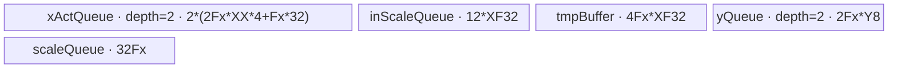
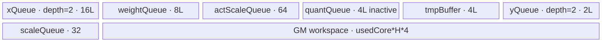

# DequantSwigluQuant 950 Direct Invoke 算子知识

## 算子速览

| 项目 | 内容 |
|---|---|
| 实际入口 | PyTorch schema `cann_bench::dequant_swiglu_quant`，`PrivateUse1` 实现 `dequant_swiglu_quant_npu`；其后按 dtype 调用 `launch_dequant_swiglu_quant_{int32,half,bfloat16}`。入口类型为 Direct Invoke。 |
| 计算语义 | 对 `x[M,2H]` 做可选 INT32 反量化，选择左右半部形成 `Swish(act) * gate`，可选逐列乘 `quant_scale`，再按行动态量化为 `int8 y[M,H]` 并输出 `float32 scale[M]`。 |
| 输入输出 | `x`: contiguous ND、INT32/FP16/BF16；可选 scale 均为 contiguous FP32；`y`: INT8；`scale`: FP32。 |
| 执行类型 | 所有 Route 均为单 Kernel `AIV_VECTOR`；entry 以 `g_coreType != AIV` 直接返回，不含 Cube/AIC 或 MIX_CV。 |
| Kernel 路线 | 重要性顺序：P0 R-002、P1 R-001、P2 R-004、P3 R-006、P4 R-005、P5 R-003、P6 R-008、P7 R-007、P8 R-010、P9 R-012、P10 R-011、P11 R-009。R-001～R-006 为 FL（full-load，`H <= 5120`），R-007～R-012 为 NF（dynamic-not-full，`H > 5120`）；Route ID 保持 Host 叶节点身份。 |
| 核心资源 | GM、AIV UB、`TQue`、`TBuf`、MicroAPI 寄存器；NF 额外使用 `usedCoreNum * H * sizeof(float)` 的用户 workspace。 |
| 来源闭包 | `direct_implementation_closed`：schema/校验/分配 → PrivateUse1 → 三个 named launcher → Host tiling → 12 个 entry → FL/NF body/helper → 构建接线闭合。转换交付件是执行事实主来源；官方固定 Commit 仅作 950 支持、arch35 Route 与 body 相关映射，不把转换入口伪称为官方入口。 |
| 验证状态 | 已完成源码闭包检查；本次知识提取未执行编译、真机、数值或性能测试。 |

## 接口与语义

### 计算语义

令 `M=x.size(0)`、`2H=x.size(1)`。对第 `r` 行、第 `k` 列：

```text
INT32: d[r,k] = float(x[r,k]) * weight_scale[0,k] * activation_scale[r]
FP16/BF16: d[r,k] = float(x[r,k])

activate_left == true : act=d[:,0:H], gate=d[:,H:2H]
activate_left == false: act=d[:,H:2H], gate=d[:,0:H]

z = act / (1 + exp(-act)) * gate
v = quant_scale 存在 ? z * quant_scale[0,:] : z
scale[r] = max(max_k(abs(v[r,k])) / 127, 1e-12)
y[r,k] = saturating_int8_cast(v[r,k] / scale[r])
```

本直调固定 `quantMode=1`、`dstType=2`、`swiGluMode=0`、无 bias/group/quant_offset。INT8 cast 的真实顺序是 FP32→INT16（`CAST_RINT`）→FP16（`CAST_ROUND`）→INT8（`CAST_TRUNC`、饱和），不能简化为任意语言默认取整。

### 输入、输出与属性

| 参数 | shape/layout | dtype | 约束、默认值与语义 |
|---|---|---|---|
| `x` | `[M,2H]`，strided contiguous | INT32/FP16/BF16 | `1 <= M <= 65536`，`1 <= H <= 8192`；必须与可选输入同设备。 |
| `weight_scale` | `[1,2H]`，contiguous | FP32 | INT32 必选；FP16/BF16 必须缺省。 |
| `activation_scale` | `[M]`，contiguous | FP32 | INT32 必选；FP16/BF16 必须缺省。 |
| `quant_scale` | `[1,H]`，contiguous | FP32 | 可选；存在时先逐列乘入 `z`，再求动态量化 scale。 |
| `activate_left` | scalar | bool | 默认 `false`；Host 写 `actRight = activate_left ? 0 : 1`。 |
| `y` | `[M,H]`，contiguous | INT8 | 由 Device 完整写出。 |
| `scale` | `[M]`，contiguous | FP32 | 每行一个动态量化 scale，下限固定为 `1e-12`。 |

### 入口与版本

`TORCH_LIBRARY_FRAGMENT` 注册 schema，Meta 与 PrivateUse1 共用 `CheckInputs` 和 `AllocateOutputs`；Meta 只做形状/类型推导。PrivateUse1 取得当前 NPU stream，通过 `OpCommand::RunOpApi("DequantSwigluQuantDirect", directCall)` 执行 named direct call。INT32、FP16、BF16 分别进入三个 Host launcher；这些符号是转换交付件入口，不是官方 ACLNN/Host 注册入口。

官方固定 Commit 的 README 与 `ascend950` binary config 证明相关 `DequantSwigluQuant` 实现支持 Ascend 950；官方 `dequant_swiglu_quant_apt.cpp` 的 arch35 router 和转换 body 构成相关映射。转换构建在 `NPU_ARCH=ascend950` 时选择 `--npu-arch=dav-3510`。本卡版本为 CANN 9.1.0。

## Host/Launcher 执行流程

### 参数校验与前处理

1. `CheckInputs` 检查二维、strided contiguous、dtype、`M/2H` 范围与可选 scale 的设备/dtype/shape。
2. INT32 强制两个 dequant scale 存在；FP16/BF16 强制二者缺省。`quant_scale` 独立可选。
3. `AllocateOutputs` 创建 `y[M,H]:int8` 与 `scale[M]:float32`。
4. `dequant_swiglu_quant_workspace_bytes` 调用与真实 launch 相同的 `CalcDirectTiling`；请求为零时仍分配 32B 占位 tensor，非零时按请求字节分配。
5. 取输入/输出/workspace GM 指针与当前 stream；按 `dtypeTag` 进入三个 named launcher。未知 dtype tag 在 `ParseDType` 抛出；平台查询、AIV/UB 资源或 tiling 因子非法也抛出。

### 参数、Workspace 与生命周期

设 `C=GetCoreNumAiv()`、`U=UB bytes`、`A32(n)=ceil(n/32)*32`、`A16(n)=ceil(n/16)*16`、`A8(n)=ceil(n/8)*8`。

- FL：`H <= 5120`，workspace 请求为 0；插件分配的 32B 只作非空占位，entry 不接收 workspace。
- NF：`H > 5120`，`usedCore=min(C,M)`，workspace 为 `usedCore*H*4` 字节。Device 以 `blockIdx*H` 为每核私有 slice；同一核处理下一行前，前一行的两遍处理已经完成，可安全覆盖。
- workspace tensor 由 PrivateUse1 调用侧分配，并与当前 stream 上的单次 direct launch 同生命周期；NF entry 直接把用户区映射为 `xTempGm_`，没有官方 runtime system-workspace 前缀。
- 所有 Route 只有一个 Device launch，没有跨 Kernel workspace 边。

### 启动图与失败传播

```text
cann_bench::dequant_swiglu_quant (PrivateUse1)
  -> CheckInputs -> AllocateOutputs -> workspace_bytes
  -> launch_dequant_swiglu_quant_{int32|half|bfloat16}
     -> CalcDirectTiling
     -> {FL/NF}_{dtype}_{q/nq}<<<blockDim, nullptr, stream>>>
        -> AIV class::Init -> Process
        -> GM y[M,H] + GM scale[M]
```

| 节点 | Host 启动函数 | entry | blockDim/POD | 输入输出/workspace | ordering 与失败 |
|---|---|---|---|---|---|
| K-001 | `LaunchInt32/LaunchHalf/LaunchBfloat16` | 12 个 `dequant_swiglu_quant_{fl,nf}_*` 之一 | FL `min(C,ceil(M/Fx))`；NF `min(C,M)`；POD 为 `DequantSwigluQuantV35BaseTilingData` 值传递 | 输入 GM → `y/scale` GM；仅 NF 使用 per-core workspace | 当前 NPU stream 单 launch；Host 校验/tiling 抛出会阻断 launch。entry 在非 AIV core 返回，不另行 fallback。 |

## Route 与参数设计

### 分核与资源计算

FL 定义 `XF32=A8(H)`、`XX=A8(H)`（INT32）或 `A16(H)`（FP16/BF16）、`Y8=A32(H)`、`sX=4/2`。Host 先保留 `1024 + 12*XF32` 字节，再计算：

```text
Dfl = 2*(2*XX*sX + 8*4) + 2*Y8 + 8*4 + XF32*4
Fx  = min(M, floor((U - 1024 - 12*XF32) / Dfl))
usedCore = min(C, ceil(M/Fx))
```

NF 令 `reserve=1024+32`。INT32 的保守 `split=50`，FP16/BF16 为 `split=26`：

```text
L = floor((U-reserve)/split/32)*32
if L > H: L=A32(H)
loops=ceil(H/L), tail=H-(loops-1)*L
usedCore=min(C,M), workspace=usedCore*H*4
```

`L<=0`、`Fx<1`、`C==0` 或 `U<=1056` 均为 Host 失败。输入范围保证 `M,H` 可窄化到 POD 的 int64；`blockDim` 由不超过平台 AIV 核数的 `usedCore` 窄化到 uint32。

### Route 选择

P0→P11 是本卡的实现知识重要性顺序，不是 Host 判断序号。Host 固定先按 dtype 进入 named launcher，再判断 FL/NF，最后按 quant_scale 有无短路；真实控制流保留在最后一列。

| 重要性 | Route | Route 特征 | 适用域与实现前提 | Host 顺序、短路与 fallback |
|---|---|---|---|---|
| P0 | R-002 FL-I32-Q | INT32 双 scale 反量化；整行常驻；逐列 qscale 参与行归约与量化 | `dtypeTag=0 && H<=5120 && hasQuantScale`；FL 行因子可成立 | H0 进入 INT32 launcher；H1 `notFull=false`；H2 `hasQuantScale=true` 后命中并结束。`H>5120` 先转 R-008；无 Device fallback |
| P1 | R-001 FL-I32-NQ | INT32 双 scale 反量化；整行常驻；无逐列 qscale | `dtypeTag=0 && H<=5120 && !hasQuantScale`；FL 行因子可成立 | H0 INT32；H1 FL；H2 qscale 判断为 false 后命中。`H>5120` 转 R-007；无 Device fallback |
| P2 | R-004 FL-F16-Q | FP16 升 FP32；整行常驻；逐列 qscale 乘入后归约 | `dtypeTag=1 && H<=5120 && hasQuantScale`；无需 dequant scales | H0 FP16；H1 FL；H2 qscale 为 true 后命中。`H>5120` 转 R-010；无 Device fallback |
| P3 | R-006 FL-BF16-Q | BF16 升 FP32；整行常驻；逐列 qscale 乘入后归约 | `dtypeTag=2 && H<=5120 && hasQuantScale`；无需 dequant scales | H0 BF16；H1 FL；H2 qscale 为 true 后命中。`H>5120` 转 R-012；无 Device fallback |
| P4 | R-005 FL-BF16-NQ | BF16 升 FP32；整行常驻；无逐列 qscale | `dtypeTag=2 && H<=5120 && !hasQuantScale`；FL 行因子可成立 | H0 BF16；H1 FL；H2 qscale 为 false 后命中。`H>5120` 转 R-011；无 Device fallback |
| P5 | R-003 FL-F16-NQ | FP16 升 FP32；整行常驻；无逐列 qscale | `dtypeTag=1 && H<=5120 && !hasQuantScale`；FL 行因子可成立 | H0 FP16；H1 FL；H2 qscale 为 false 后命中。`H>5120` 转 R-009；无 Device fallback |
| P6 | R-008 NF-I32-Q | INT32 双 scale 反量化；H 分片两遍；逐列 qscale；per-core workspace | `dtypeTag=0 && H>5120 && hasQuantScale`；NF 尾轴因子可成立 | H0 INT32；H1 `notFull=true`；H2 qscale 为 true 后命中并结束。Host 资源失败即异常，无 fallback |
| P7 | R-007 NF-I32-NQ | INT32 双 scale 反量化；H 分片两遍；无逐列 qscale；per-core workspace | `dtypeTag=0 && H>5120 && !hasQuantScale`；NF 尾轴因子可成立 | H0 INT32；H1 NF；H2 qscale 为 false 后命中。Host 资源失败即异常，无 fallback |
| P8 | R-010 NF-F16-Q | FP16 升 FP32；H 分片两遍；逐列 qscale；per-core workspace | `dtypeTag=1 && H>5120 && hasQuantScale`；NF 尾轴因子可成立 | H0 FP16；H1 NF；H2 qscale 为 true 后命中。Host 资源失败即异常，无 fallback |
| P9 | R-012 NF-BF16-Q | BF16 升 FP32；H 分片两遍；逐列 qscale；per-core workspace | `dtypeTag=2 && H>5120 && hasQuantScale`；NF 尾轴因子可成立 | H0 BF16；H1 NF；H2 qscale 为 true 后命中。Host 资源失败即异常，无 fallback |
| P10 | R-011 NF-BF16-NQ | BF16 升 FP32；H 分片两遍；无逐列 qscale；per-core workspace | `dtypeTag=2 && H>5120 && !hasQuantScale`；NF 尾轴因子可成立 | H0 BF16；H1 NF；H2 qscale 为 false 后命中。Host 资源失败即异常，无 fallback |
| P11 | R-009 NF-F16-NQ | FP16 升 FP32；H 分片两遍；无逐列 qscale；per-core workspace | `dtypeTag=1 && H>5120 && !hasQuantScale`；NF 尾轴因子可成立 | H0 FP16；H1 NF；H2 qscale 为 false 后命中。Host 资源失败即异常，无 fallback |

```text
ParseDType(dtypeTag)
  -> H > 5120 ? NF : FL
  -> hasQuantScale ? Q : NQ
  -> dtype-specific named entry
```

### 模板/实现执行矩阵

| 重要性 | Route | key/selector | dtype/shape/platform 完整命中条件 | 执行拓扑与 Kernel 节点 | 实际模板/body | 内存与同步特征 | tail/fallback |
|---|---|---|---|---|---|---|---|
| P0 | R-002 | `fl_i32_q` | INT32、`H<=5120`、有 qscale、950 | 单 AIV K-001 | `Base<float,float,bool,bool,int32_t,int8_t>` | FL UB；Queue 同步；qscale 搬入/乘入；无 workspace | MicroAPI mask；无 fallback |
| P1 | R-001 | `fl_i32_nq` | INT32、`H<=5120`、无 qscale、950 | 单 AIV K-001 | `Base<float,bool,bool,bool,int32_t,int8_t>` | FL UB；Queue 同步；无 workspace | MicroAPI mask；无 fallback |
| P2 | R-004 | `fl_half_q` | FP16、`H<=5120`、有 qscale、950 | 单 AIV K-001 | `Base<bool,float,bool,bool,half,int8_t>` | 16-bit x UB，升至 FP32 + qscale | MicroAPI mask；无 fallback |
| P3 | R-006 | `fl_bfloat16_q` | BF16、`H<=5120`、有 qscale、950 | 单 AIV K-001 | `Base<bool,float,bool,bool,bfloat16_t,int8_t>` | 16-bit x UB，升至 FP32 + qscale | MicroAPI mask；无 fallback |
| P4 | R-005 | `fl_bfloat16_nq` | BF16、`H<=5120`、无 qscale、950 | 单 AIV K-001 | `Base<bool,bool,bool,bool,bfloat16_t,int8_t>` | 16-bit x UB，升至 FP32 | MicroAPI mask；无 fallback |
| P5 | R-003 | `fl_half_nq` | FP16、`H<=5120`、无 qscale、950 | 单 AIV K-001 | `Base<bool,bool,bool,bool,half,int8_t>` | 16-bit x UB，升至 FP32 | MicroAPI mask；无 fallback |
| P6 | R-008 | `nf_i32_q` | INT32、`H>5120`、有 qscale、950 | 单 AIV K-001，内含两遍 | `DynamicNotFull<float,float,bool,bool,int32_t,int8_t>` | NF UB + per-core workspace + HardEvent；第一遍 qscale 原地乘入 | `tail` tile；无 fallback |
| P7 | R-007 | `nf_i32_nq` | INT32、`H>5120`、无 qscale、950 | 单 AIV K-001，内含两遍 | `DynamicNotFull<float,bool,bool,bool,int32_t,int8_t>` | NF UB + per-core workspace + HardEvent | `tail` tile；无 fallback |
| P8 | R-010 | `nf_half_q` | FP16、`H>5120`、有 qscale、950 | 单 AIV K-001，内含两遍 | `DynamicNotFull<bool,float,bool,bool,half,int8_t>` | 16-bit x + qscale + workspace + HardEvent | `tail` tile；无 fallback |
| P9 | R-012 | `nf_bfloat16_q` | BF16、`H>5120`、有 qscale、950 | 单 AIV K-001，内含两遍 | `DynamicNotFull<bool,float,bool,bool,bfloat16_t,int8_t>` | 16-bit x + qscale + workspace + HardEvent | `tail` tile；无 fallback |
| P10 | R-011 | `nf_bfloat16_nq` | BF16、`H>5120`、无 qscale、950 | 单 AIV K-001，内含两遍 | `DynamicNotFull<bool,bool,bool,bool,bfloat16_t,int8_t>` | 16-bit x + workspace + HardEvent | `tail` tile；无 fallback |
| P11 | R-009 | `nf_half_nq` | FP16、`H>5120`、无 qscale、950 | 单 AIV K-001，内含两遍 | `DynamicNotFull<bool,bool,bool,bool,half,int8_t>` | 16-bit x + workspace + HardEvent | `tail` tile；无 fallback |

### 隐藏性能 Guard

| Guard | Host/Tiling 条件 | Device/资源原因 | 影响 Route | 不满足时去向 | 源码符号 |
|---|---|---|---|---|---|
| FL/NF 边界 | `H > 5120` 才 NF | FL 需整行 `2H` 与结果/scale 同驻 UB | 全部 | 另一实现族 | `CalcDirectTiling`, `FULL_LOAD_H_MAX` |
| AIV/UB | `C>0 && U>1056` | entry 只执行 AIV；tiling 至少保留 1024B 与 32B | 全部 | Host 异常 | `CalcDirectTiling` |
| FL 行因子 | `Fx>=1` | 全载一批行的 Queue/TBuf 必须落入 UB | P0 R-002、P1 R-001、P2 R-004、P3 R-006、P4 R-005、P5 R-003 | Host 异常 | `CalcDirectTiling` |
| NF 尾轴因子 | `L>0` 且 32 元素对齐 | INT8/FP32 搬运与保守 UB 切分 | P6 R-008、P7 R-007、P8 R-010、P9 R-012、P10 R-011、P11 R-009 | Host 异常 | `CalcDirectTiling` |
| 输入边界 | `1<=M<=65536, 1<=H<=8192` | POD、地址计算与实现覆盖域 | 全部 | `TORCH_CHECK`/Host 异常 | `CheckInputs`, `CalcDirectTiling` |
| dtype/scale 配对 | INT32 必有 dequant scales；16-bit 必无 | 模板编译期裁剪不同 dequant 分支 | 全部 | `TORCH_CHECK` | `CheckInputs` |
| AIV guard | `g_coreType==AIV` | 防止同 entry 在非 Vector core 执行 | 全部 | 当前 core 返回 | 12 个 kernel entry |

### POD/ABI

`DequantSwigluQuantV35BaseTilingData` 是 standard-layout、trivial；21 个 `int64_t` 后接 3 个 `float`。按 950 Host/Device 共用的自然对齐 ABI，`alignof=8`、`sizeof=184`；下表 offset 为字节。

| 结构 | 字段 | 类型/位宽 | ABI 布局 | 单位 | Host/launcher producer | Device consumer | 边界 |
|---|---|---|---|---|---|---|---|
| POD | `inDimx` | int64/64 | off 0 | row | `rows` | FL/NF 行循环 | `[1,65536]` |
| POD | `inDimy` | int64/64 | off 8 | element | `2*hidden` | GM 行 stride | `[2,16384]` |
| POD | `outDimy` | int64/64 | off 16 | element | `hidden` | y/workspace stride | `[1,8192]` |
| POD | `UbFactorDimx` | int64/64 | off 24 | row | FL `Fx`；NF 1 | FL 批行数 | `>=1` |
| POD | `UbFactorDimy` | int64/64 | off 32 | element | FL `H`；NF `L` | UB tile | `>=1` |
| POD | `usedCoreNum` | int64/64 | off 40 | AIV core | `usedCore` | NF block guard/workspace extent | `<=C` |
| POD | `maxCoreNum` | int64/64 | off 48 | AIV core | FL `usedCore`；NF `C` | 分核步长 | `>=usedCore` |
| POD | `inGroupNum` | int64/64 | off 56 | group | 0 | 模板无 group，不读 | inactive |
| POD | `quantMode` | int64/64 | off 64 | enum | 1 | selected body 不读 | 固定动态量化 |
| POD | `actRight` | int64/64 | off 72 | bool-as-int | `activateLeft?0:1` | act/gate offset | 0/1 |
| POD | `dstType` | int64/64 | off 80 | enum | 2 | output 已由 int8 模板固定 | 固定 int8 |
| POD | `roundMode` | int64/64 | off 88 | enum | 0 | FL/NF cast helper；int8 分支不据此分流 | 固定 0 |
| POD | `activateDim` | int64/64 | off 96 | axis | 1 | selected body 不读 | 二维尾轴 |
| POD | `loopTimesPerRow` | int64/64 | off 104 | loop | FL 0；NF `ceil(H/L)` | NF tile 循环 | NF `>=1` |
| POD | `tailPerRow` | int64/64 | off 112 | element | FL 0；NF `H-(loops-1)L` | NF 尾 tile | `(0,L]` |
| POD | `swiGluMode` | int64/64 | off 120 | enum | 0 | FL/NF 选择 contiguous halves | 固定 0 |
| POD | `biasMode` | int64/64 | off 128 | enum | 0 | bool bias 模板不读 | inactive |
| POD | `groupIndexMode` | int64/64 | off 136 | enum | 0 | bool group 模板不读 | inactive |
| POD | `quantIsOne` | int64/64 | off 144 | bool-as-int | qscale 有则 0，否则 1 | 当前动态 Q/NQ 模板不读 | 仅保留 ABI |
| POD | `speGroupType` | int64/64 | off 152 | enum | 0 | 无 group，不读 | inactive |
| POD | `isSpecialCoreCut` | int64/64 | off 160 | bool-as-int | 0 | 无 group，不读 | inactive |
| POD | `clampLimit` | float/32 | off 168 | value | 7.0 | `swiGluMode=0` 不读 | inactive |
| POD | `gluAlpha` | float/32 | off 172 | value | 1.702 | `swiGluMode=0` 不读 | inactive |
| POD | `gluBias` | float/32 | off 176 | value | 1.0 | `swiGluMode=0` 不读 | inactive；尾部 4B padding |

### Route 源码闭包

| 重要性 / Route | Key/selector | Host/Tiling producer | POD/参数 | Kernel entry/router 节点 | Kernel body/直接依赖 | 构建接线 |
|---|---|---|---|---|---|---|
| P0 R-002、P1 R-001、P2 R-004、P3 R-006、P4 R-005、P5 R-003 | dtype + `H<=5120` + q flag | `dequant_swiglu_quant_plugin.cpp::{CheckInputs,directCall}`；`dequant_swiglu_quant_kernel.cpp::{CalcDirectTiling,Launch*}` | `DequantSwigluQuantV35BaseTilingData` | `dequant_swiglu_quant_fl_*` | `DequantSwigluQuantBase::{Init,Process,ProcessSingleGroup,ProcessSingleGroupPerCore}` + common MicroAPI helpers | op CMake → top-level `all_kernels_obj/all_plugins_obj/_C` |
| P6 R-008、P7 R-007、P8 R-010、P9 R-012、P10 R-011、P11 R-009 | dtype + `H>5120` + q flag | 同上 | 同上 + workspace | `dequant_swiglu_quant_nf_*` | `DynamicNotFull::{Init,Process,ProcessSingleRow,...}` + `DequantAndSwiGlu/CalculateReduceMax/QuantAndCast` | 同上 |

## Kernel 实现

### 公共执行流程

每个 entry 首先做 AIV guard，创建栈上 `TPipe`，按 named entry 选择唯一模板实例，再以相同 POD 调用 `Init/Process`。两族都在 FP32 中完成 dequant、Swish、乘法、绝对值归约与除 scale；最后沿固定三段 cast 生成 INT8。Q Route 在归约前把逐列 `quant_scale` 乘入 FP32 中间值，且后续量化复用这个已缩放值。

FL 在一个 UB resident tile 内完成 `CopyIn → dequant/Swiglu → optional qscale → ReduceMax/scale → quant/cast → CopyOut`。NF 仍是单 Kernel，但对一行分两遍：第一遍逐 H tile 算 FP32 值、更新全行 scale 并写 per-core GM workspace；第二遍逐 tile 回读，用最终 scale 量化写 y。

下列逐 Route 章节按重要性 P0→P11 排列，Route ID 保持不变；该顺序不替代 Host 的 dtype→FL/NF→qscale 嵌套短路。

### P0 / Route R-002：FL-I32-Q

#### 适用条件

##### 选择证据

同 R-001，但 `hasQuantScale=true`，entry 为 `fl_i32_q`，模板为 `Base<float,float,bool,bool,int32_t,int8_t>`。

#### Device 数据流

##### 函数级调用链

```text
R-001 chain -> load quant_scale[0:H] into inScaleQueue[2XF32] -> tmp*=qscale -> reduce/quant
```

##### 源码等价伪码

```text
tmp=swish(dequant(act))*dequant(gate); tmp*=qscale; scale=max(maxabs(tmp)/127,1e-12); y=cast(tmp/scale)
```

#### 内存与数据搬运

##### 资源与搬运表

R-001 的同一物理布局；`inScaleQueue[2XF32:3XF32]` 由 qscale GM 写入并被 scale 阶段逐 VF chunk 读取，tmp 在原位写回缩放值。

##### 分层内存布局

同 R-001，inScaleQueue 第三区由 inactive 变为 active。

##### 字节账与复用顺序

UB 总量与 R-001 相同；tmp 的写入者顺序变为 Swiglu → qscale 乘入 → reduce/quant，后一步不得在乘入前读取。

#### 同步、精度与尾块

##### 同步与数值边界表

qscale 通过 Queue 进入 UB，在 FP32 中乘入；尾 VF 使用 `maskTail`，只有有效 H 元素参与 max 与写回。

#### 关键实现

##### 符号证据表

Host/entry 分别为 `LaunchInt32/fl_i32_q`；body 为 `ProcessSingleGroupPerCore` 中 `hasQuantScale_` 分支。

### P1 / Route R-001：FL-I32-NQ

#### 适用条件

##### 选择证据

| 层级 | 文件 | 符号 | 源码谓词/参数 | 结果/下一跳 |
|---|---|---|---|---|
| Plugin | `op_plugin/dequant_swiglu_quant_plugin.cpp` | `CheckInputs/directCall` | INT32 且 qscale 缺省 | `launch_*_int32` |
| Launcher | `op_kernel/dequant_swiglu_quant_kernel.cpp` | `CalcDirectTiling/LaunchInt32` | `H<=5120 && !hasQuantScale` | `fl_i32_nq` |
| Entry | 同上 | `dequant_swiglu_quant_fl_i32_nq` | AIV | `Base<float,bool,bool,bool,int32_t,int8_t>` |

#### Device 数据流

##### 函数级调用链

```text
LaunchInt32 -> fl_i32_nq -> Base::Init -> Base::Process
  -> ProcessSingleGroup -> ProcessSingleGroupPerCore
  -> GM x/wscale/ascale -> UB -> FP32 tmp -> scale/y -> GM
```

##### 源码等价伪码

```text
core rows = ceil(M/usedCore), last core takes tail rows
load weight_scale act/gate halves once
load x act/gate halves and activation_scale for this core tile
for row, vf chunk: fp32(x)*wscale*broadcast(ascale); swish(act)*gate -> tmp
scale=max(maxabs(tmp)/127,1e-12); y=cast_int8(tmp/scale)
copy scale and valid H bytes of y
```

#### 内存与数据搬运

##### 资源与搬运表

| 层级/缓冲区 | offset/地址公式 | extent/容量公式 | dtype/layout | producer | consumer | owner/lifetime | 对齐/复用 |
|---|---|---|---|---|---|---|---|
| GM x | `row*2H + {actRight*H,H-actRight*H}` | each H | INT32 split halves | caller | DataCopyPad | caller | H valid, UB A8 |
| xActQueue | second half at `Fx*XX`；ascale at reinterpret offset `2*Fx*XX` | per buffer `2Fx*XX*4 + Fx*8*4` | INT32 + FP32 | MTE2 | Vector | pipe/tile | depth 2 |
| inScaleQueue | `0, XF32, 2XF32` | `3XF32*4` | FP32 | MTE2 | Vector | pipe/launch | depth 1；qscale区 inactive |
| tmpBuffer | `row*XF32` | `Fx*XF32*4` | FP32 | Swiglu | reduce/quant | pipe/tile | 原地 q 区不使用 |
| yQueue | `row*Y8` | per buffer `Fx*Y8` | INT8 | cast | MTE3 | pipe/tile | depth 2 |
| scaleQueue | `row*8` | `Fx*8*4` | FP32 | reduce | MTE3/quant | pipe/tile | depth 1 |

##### 分层内存布局



##### 字节账与复用顺序

```text
UB_total = 2*(2Fx*XX*4+32Fx) + 12XF32 + 2Fx*Y8 + 32Fx + 4Fx*XF32 <= U-1024
dynamic_ub = N/A
workspace_total = 0
```

| 复用子区 | 写入者 | 读取者/消费点 | 下一次覆盖 | 同步或释放依据 | 安全条件 |
|---|---|---|---|---|---|
| tmpBuffer row | dequant/Swiglu | reduce、quant | 下一 tile | 同一 Vector 顺序 | quant 完成后覆盖 |
| x/y Queue slot | MTE2/Vector | Vector/MTE3 | 下一 slot | EnQue/DeQue/FreeTensor | depth 2 生命周期完整 |

#### 同步、精度与尾块

##### 同步与数值边界表

| 阶段 | primitive/机制 | producer | consumer/等待点 | 保护对象 | 精度/尾块 |
|---|---|---|---|---|---|
| CopyIn→Vector | TQue | MTE2 | DeQue | x/scales | DataCopyPad + MicroAPI mask |
| FP32 compute | Vector order | dequant | reduce | tmp | INT32→FP32；`H` 尾 mask |
| Vector→CopyOut | TQue | cast/reduce | MTE3 | y/scale | scale clamp `1e-12`; INT8 饱和 |

#### 关键实现

##### 符号证据表

| 阶段 | 文件 | 符号/模板实例 | 实现事实 |
|---|---|---|---|
| Host/Tiling producer | `op_kernel/dequant_swiglu_quant_kernel.cpp` | `CalcDirectTiling` | FL UB/分核与 POD |
| Kernel entry/router | 同上 | `fl_i32_nq` | named entry 到模板 |
| Device body/helper | `op_kernel/dequant_swiglu_quant_full_load.h` | `ProcessSingleGroupPerCore` | 搬运、FP32 计算、scale/cast/tail |

### P2 / Route R-004：FL-F16-Q

#### 适用条件

##### 选择证据

R-003 条件改为 qscale 存在；entry `fl_half_q`；模板 `Base<bool,float,bool,bool,half,int8_t>`。

#### Device 数据流

##### 函数级调用链

```text
R-003 chain -> qscale CopyIn -> FP32 tmp*=qscale -> scale/cast
```

##### 源码等价伪码

`half→FP32; tmp=Swiglu; tmp*=qscale; scale=maxabs(tmp)/127 clamp; y=cast(tmp/scale)`。

#### 内存与数据搬运

##### 资源与搬运表

R-003 固定布局，启用 inScaleQueue qscale 区。

##### 分层内存布局

同 R-003。

##### 字节账与复用顺序

同 R-003；tmp 增加 qscale 原地覆盖阶段。

#### 同步、精度与尾块

##### 同步与数值边界表

FP32 qscale 乘法发生在归约前，尾 mask 同时保护乘法、max 与写回。

#### 关键实现

##### 符号证据表

`LaunchHalf` → `fl_half_q` → FL `hasQuantScale_` 分支。

### P3 / Route R-006：FL-BF16-Q

#### 适用条件

##### 选择证据

R-005 条件改为 qscale 存在；entry `fl_bfloat16_q`；模板 `Base<bool,float,bool,bool,bfloat16_t,int8_t>`。

#### Device 数据流

##### 函数级调用链

```text
R-005 chain -> qscale CopyIn -> tmp*=qscale -> reduce/quant
```

##### 源码等价伪码

`BF16→FP32; tmp=Swiglu; tmp*=qscale; scale=maxabs(tmp)/127 clamp; y=cast(tmp/scale)`。

#### 内存与数据搬运

##### 资源与搬运表

R-005 固定布局，启用 qscale 区与 tmp 原地覆盖。

##### 分层内存布局

同 R-005。

##### 字节账与复用顺序

同 R-005，增加 qscale 写回顺序约束。

#### 同步、精度与尾块

##### 同步与数值边界表

同 R-004，仅输入 cast 为 BF16→FP32。

#### 关键实现

##### 符号证据表

`LaunchBfloat16` → `fl_bfloat16_q` → FL `hasQuantScale_` 分支。

### P4 / Route R-005：FL-BF16-NQ

#### 适用条件

##### 选择证据

`dtypeTag=2 && H<=5120 && !hasQuantScale`；entry `fl_bfloat16_nq`；模板 `Base<bool,bool,bool,bool,bfloat16_t,int8_t>`。

#### Device 数据流

##### 函数级调用链

```text
LaunchBfloat16 -> fl_bfloat16_nq -> BF16 unpack/cast FP32 -> Swiglu -> scale/cast
```

##### 源码等价伪码

同 R-003，只把输入 load/cast 类型替换为 BF16。

#### 内存与数据搬运

##### 资源与搬运表

与 R-003 完全同容量公式，x 的逻辑 dtype 为 BF16。

##### 分层内存布局

同 R-003。

##### 字节账与复用顺序

同 R-003。

#### 同步、精度与尾块

##### 同步与数值边界表

BF16→FP32 后执行全部非线性、归约和量化；tail mask 与 Queue 协议同 R-003。

#### 关键实现

##### 符号证据表

`LaunchBfloat16` → `fl_bfloat16_nq` → FL `ifXBf16Index_` 分支。

### P5 / Route R-003：FL-F16-NQ

#### 适用条件

##### 选择证据

`dtypeTag=1 && H<=5120 && !hasQuantScale`；entry `fl_half_nq`；模板 `Base<bool,bool,bool,bool,half,int8_t>`。

#### Device 数据流

##### 函数级调用链

```text
LaunchHalf -> fl_half_nq -> Base::Init/Process -> half unpack/cast FP32 -> Swiglu -> scale/cast
```

##### 源码等价伪码

与 R-001 相同，但不搬 weight/activation scale，`half` 以 `DIST_UNPACK_B16` 读入后升到 FP32。

#### 内存与数据搬运

##### 资源与搬运表

同 FL 布局，取 `sX=2, XX=A16(H)`；inScaleQueue 与 activation-scale 区仍按固定容量分配但不读取。

##### 分层内存布局

同 R-001 参数化图，将 `4` 字节 x 替换为 `2`。

##### 字节账与复用顺序

`UB_total=2*(2Fx*XX*2+32Fx)+12XF32+2FxY8+32Fx+4FxXF32`；复用顺序同 R-001。

#### 同步、精度与尾块

##### 同步与数值边界表

FP16→FP32 使用 `CAST_BF16_FP16_TO_FP32` trait；其后全为 FP32，tail 由 mask 保护。

#### 关键实现

##### 符号证据表

Host/entry 为 `LaunchHalf/fl_half_nq`；body 为 FL `ifXFloat16Index_` 编译期分支。

### P6 / Route R-008：NF-I32-Q

#### 适用条件

##### 选择证据

R-007 改为 qscale 存在；entry `nf_i32_q`；模板 `DynamicNotFull<float,float,bool,bool,int32_t,int8_t>`。

#### Device 数据流

##### 函数级调用链

```text
R-007 first pass -> quantScaleQueue DeQue -> CalculateReduceMax<true> 原地 tmp*=qscale -> workspace -> second pass
```

##### 源码等价伪码

第一遍每 tile 在归约前执行 `tmp*=qscale[tile]` 并回写 tmp，workspace 因而保存缩放后值；第二遍直接用最终 scale 量化。

#### 内存与数据搬运

##### 资源与搬运表

R-007 的 quantScaleQueue 由 inactive 变为 active，容量不变；workspace extent/offset 不变。

##### 分层内存布局

同 R-007，quantQueue 标记 active。

##### 字节账与复用顺序

`UB_total=34L+96`；tmp 顺序为 Swiglu → qscale 原地乘 → reduce → workspace。

#### 同步、精度与尾块

##### 同步与数值边界表

qscale CopyIn 受 `MTE2_V` 保护；乘法、max 与回写都使用 full/tail mask。

#### 关键实现

##### 符号证据表

`LaunchInt32` → `nf_i32_q` → `CalculateReduceMax<true>`。

### P7 / Route R-007：NF-I32-NQ

#### 适用条件

##### 选择证据

| 层级 | 文件 | 符号 | 源码谓词/参数 | 结果/下一跳 |
|---|---|---|---|---|
| Launcher | `op_kernel/dequant_swiglu_quant_kernel.cpp` | `CalcDirectTiling/LaunchInt32` | `H>5120 && !hasQuantScale` | `nf_i32_nq` |
| Entry | 同上 | `nf_i32_nq` | AIV + workspace | `DynamicNotFull<float,bool,bool,bool,int32_t,int8_t>` |

#### Device 数据流

##### 函数级调用链

```text
LaunchInt32 -> nf_i32_nq -> DynamicNotFull::Init/Process
  -> ProcessSingleRow first pass:
     CopyIn -> PreProcess/DequantAndSwiGlu -> UpdateReduceMax -> CopyOutForXTemp
  -> CopyOutScale -> MTE3_MTE2
  -> second pass: CopyInForXTemp -> QuantAndCast -> CopyOutY
```

##### 源码等价伪码

```text
for row=blockIdx; row<M; row+=C:
  scale=0
  for tile in H: tmp=Swiglu(dequant(x,w,a)); scale=max(scale,maxabs(tmp)/127,1e-12); workspace[blockIdx,tile]=tmp
  write scale[row]; wait workspace writes visible to MTE2
  for tile in H: tmp=workspace[blockIdx,tile]; y[row,tile]=cast(tmp/scale)
```

#### 内存与数据搬运

##### 资源与搬运表

| 层级/缓冲区 | offset/地址公式 | extent/容量公式 | dtype/layout | producer | consumer | owner/lifetime | 对齐/复用 |
|---|---|---|---|---|---|---|---|
| xQueue | halves at `0,L` | per buffer `2L*4` | INT32 | MTE2 | Vector | tile | depth 2 |
| weightScaleQueue | halves `0,L` | `2L*4` | FP32 | MTE2 | Vector | tile | depth 1 |
| activationScaleQueue | 0 | per buffer `8*4` | FP32 | MTE2 | Vector | tile | depth 2 |
| quantScaleQueue | 0 | `L*4` | FP32 | inactive | inactive | pipe | allocated, not read |
| tmpBuffer | 0 | `L*4` | FP32 | Swiglu/MTE2 | reduce/cast/MTE3 | tile | 两遍复用 |
| yQueue | 0 | per buffer `L` | INT8 | cast | MTE3 | tile | depth 2 |
| scaleQueue | 0 | `8*4` | FP32 | reduce | cast/MTE3 | row | depth 1 |
| workspace | `blockIdx*H + tile*L` | per core `H*4` | FP32 flat | first pass | second pass | caller/kernel | per-core 私有，逐行复用 |

##### 分层内存布局



##### 字节账与复用顺序

```text
UB_total = 16L+8L+64+4L+2L+32+4L = 34L+96
Host conservative bound uses split=50 and reserve=1056, so UB_total <= U
workspace_total = usedCore*H*4
```

| 复用子区 | 写入者 | 读取者/消费点 | 下一次覆盖 | 同步或释放依据 | 安全条件 |
|---|---|---|---|---|---|
| tmpBuffer | PreProcess | Reduce/MTE3；第二遍 MTE2/Quant | 下一 tile | `V_MTE3`、`MTE2_V` | 对应搬运完成 |
| workspace core slice | first pass MTE3 | second pass MTE2 | 同 core 下一 row | `MTE3_MTE2`；整行 second pass 完成 | blockIdx 私有 |
| scaleLocal | ReduceMax | CopyOut/Quant | 下一 row | scaleQueue EnQue/DeQue | 第二遍结束后 Free |

#### 同步、精度与尾块

##### 同步与数值边界表

| 阶段 | primitive/机制 | producer | consumer/等待点 | 保护对象 | 精度/尾块 |
|---|---|---|---|---|---|
| CopyIn→Vector | `MTE2_V` | MTE2 | PreProcess | x/scales | tileData mask |
| Vector→workspace | `V_MTE3` | Vector | MTE3 | tmp UB | tail length `tailPerRow` |
| first→second pass | `MTE3_MTE2` | workspace MTE3 | workspace MTE2 | per-core slice | 全行 scale 已最终化 |
| workspace→Vector | `MTE2_V` | MTE2 | QuantAndCast | tmp UB | FP32 |
| Vector→reuse | `V_MTE2` | Vector | next MTE2 | tmp/y | 防止过早覆盖 |

#### 关键实现

##### 符号证据表

| 阶段 | 文件 | 符号/模板实例 | 实现事实 |
|---|---|---|---|
| Host/Tiling producer | `op_kernel/dequant_swiglu_quant_kernel.cpp` | `CalcDirectTiling` | NF L/loop/tail/workspace |
| Kernel entry/router | 同上 | `nf_i32_nq` | workspace 直传模板 |
| Device body/helper | `op_kernel/dequant_swiglu_quant_dynamic_not_full.h` | `ProcessSingleRow` | 两遍、事件、per-core slice |
| Device helper | `op_kernel/dequant_swiglu_quant_dynamic_not_full_vf.h` | `DequantAndSwiGlu/CalculateReduceMax/QuantAndCast` | FP32 计算与 tail |

### P8 / Route R-010：NF-F16-Q

#### 适用条件

##### 选择证据

R-009 改为 qscale 存在；entry `nf_half_q`；模板 `DynamicNotFull<bool,float,bool,bool,half,int8_t>`。

#### Device 数据流

##### 函数级调用链

```text
R-009 flow -> qscale CopyIn -> CalculateReduceMax<true> -> scaled workspace -> second pass
```

##### 源码等价伪码

`half→FP32; tmp=Swiglu; tmp*=qscale; update scale; workspace=tmp; y=cast(workspace/scale)`。

#### 内存与数据搬运

##### 资源与搬运表

R-009 固定布局，启用 quantScaleQueue。

##### 分层内存布局

同 R-009。

##### 字节账与复用顺序

`UB_total=26L+96`；qscale 原地阶段位于 workspace CopyOut 前。

#### 同步、精度与尾块

##### 同步与数值边界表

同 R-008，输入 cast 为 half→FP32。

#### 关键实现

##### 符号证据表

`LaunchHalf` → `nf_half_q` → `CalculateReduceMax<true>`。

### P9 / Route R-012：NF-BF16-Q

#### 适用条件

##### 选择证据

R-011 改为 qscale 存在；entry `nf_bfloat16_q`；模板 `DynamicNotFull<bool,float,bool,bool,bfloat16_t,int8_t>`。

#### Device 数据流

##### 函数级调用链

```text
R-011 flow -> qscale CopyIn -> scaled tmp/workspace -> final-scale quantization
```

##### 源码等价伪码

`BF16→FP32; tmp=Swiglu; tmp*=qscale; update scale; workspace=tmp; y=cast(tmp/scale)`。

#### 内存与数据搬运

##### 资源与搬运表

R-011 固定布局，quantScaleQueue active。

##### 分层内存布局

同 R-011。

##### 字节账与复用顺序

`UB_total=26L+96`；qscale 乘入发生在 workspace 提交前。

#### 同步、精度与尾块

##### 同步与数值边界表

同 R-010，仅输入 cast 为 BF16→FP32。

#### 关键实现

##### 符号证据表

`LaunchBfloat16` → `nf_bfloat16_q` → `CalculateReduceMax<true>`。

### P10 / Route R-011：NF-BF16-NQ

#### 适用条件

##### 选择证据

`dtypeTag=2 && H>5120 && !hasQuantScale`；entry `nf_bfloat16_nq`；模板 `DynamicNotFull<bool,bool,bool,bool,bfloat16_t,int8_t>`。

#### Device 数据流

##### 函数级调用链

```text
LaunchBfloat16 -> nf_bfloat16_nq -> BF16 unpack/cast -> NF two-pass workspace flow
```

##### 源码等价伪码

同 R-009，只替换输入 load/cast dtype。

#### 内存与数据搬运

##### 资源与搬运表

容量、offset、workspace 与 R-009 相同，逻辑 x dtype 为 BF16。

##### 分层内存布局

同 R-009。

##### 字节账与复用顺序

`UB_total=26L+96`；复用顺序同 R-009。

#### 同步、精度与尾块

##### 同步与数值边界表

BF16 升 FP32 后执行全部计算；事件/tail 同 R-007。

#### 关键实现

##### 符号证据表

`LaunchBfloat16` → `nf_bfloat16_nq` → `DequantAndSwiGlu` 的 `IsXBfloat16` 分支。

### P11 / Route R-009：NF-F16-NQ

#### 适用条件

##### 选择证据

`dtypeTag=1 && H>5120 && !hasQuantScale`；entry `nf_half_nq`；模板 `DynamicNotFull<bool,bool,bool,bool,half,int8_t>`。

#### Device 数据流

##### 函数级调用链

```text
LaunchHalf -> nf_half_nq -> half unpack/cast -> NF two-pass workspace flow
```

##### 源码等价伪码

R-007 去掉 wscale/ascale 计算，输入 half 升 FP32 后进入相同 Swiglu、归约、workspace 与 cast。

#### 内存与数据搬运

##### 资源与搬运表

xQueue 为 `8L`；weightQueue `8L` 仍固定分配但 inactive；其余同 R-007。

##### 分层内存布局

```text
xQueue 8L + weightQueue 8L + actScaleQueue 64 + quantQueue 4L + tmp 4L + yQueue 2L + scaleQueue 32
```

##### 字节账与复用顺序

`UB_total=26L+96`，Host `split=26`；workspace 与复用同 R-007。

#### 同步、精度与尾块

##### 同步与数值边界表

half 用 unpack B16 load 并升 FP32；事件图与 tail tile 同 R-007。

#### 关键实现

##### 符号证据表

`LaunchHalf` → `nf_half_nq` → `DequantAndSwiGlu` 的 `IsXFloat16` 分支。

## 算子特定优化

### Trick T-001：整行常驻与分段两遍的 5120 边界

#### 触发与源码依据

- 适用 Route：P0 R-002、P1 R-001、P2 R-004、P3 R-006、P4 R-005、P5 R-003、P6 R-008、P7 R-007、P8 R-010、P9 R-012、P10 R-011、P11 R-009。
- 触发条件：`H<=5120` 选 FL，否则选 NF。
- 转换片段定位：`op_kernel/dequant_swiglu_quant_kernel.cpp:329-383`；相关官方源码：[`dequant_swiglu_quant_apt.cpp`](https://gitcode.com/cann/ops-nn/blob/ceb4536a2bd6fc99b85aec9d0fdcc0f470376292/quant/dequant_swiglu_quant/op_kernel/dequant_swiglu_quant_apt.cpp)

**转换源码（主事实源；与官方映射边界分开）**：

```cpp
result.notFull = hidden > FULL_LOAD_H_MAX;
if (result.notFull) {
    // compute L, loops, tail and per-core workspace
}
```

#### 机制与设计原因

FL 把整行 H 的中间结果留在 UB，从而不物化 GM 中间值；当 H 超出固定边界，NF 把 H 切成 32 元素对齐 tile，并以 per-core workspace 保留第一遍结果，确保全行 scale 最终确定后才量化。官方固定 Commit 的 arch35 Host tiling也使用相同的 `H>5120` 分界，属于相关映射；direct named entry 与 1e-12 floor 是转换实现事实。

#### 迁移边界

- 适用：需要按整行 max 动态量化、且 H 可能超过单次 UB 常驻能力的融合算子。
- 前提：AIV、可查询 UB/core、NF 有 `coreNum*H*4` 用户 workspace。
- 失效：若 workspace 不可用或 L 为 0，不能退化为本实现未提供的 scalar fallback。
- 未验证：本次知识提取未执行编译、真机、数值或性能测试。

#### 错误做法

固定仓未提供可验证反例；但源码明确要求第二遍只能在最终 scale 与 workspace 可见后开始。

### Trick T-002：quant_scale 在 FP32 中间值上原地乘入

#### 触发与源码依据

- 适用 Route：P0 R-002、P2 R-004、P3 R-006、P6 R-008、P8 R-010、P9 R-012。
- 触发条件：`quant_scale` 存在，shape 为 `[1,H]`。
- 转换片段定位：`dequant_swiglu_quant_dynamic_not_full_vf.h:464-501`；相关官方源码：[`dequant_swiglu_quant_dynamic_not_full_vf.h`](https://gitcode.com/cann/ops-nn/blob/ceb4536a2bd6fc99b85aec9d0fdcc0f470376292/quant/dequant_swiglu_quant/op_kernel/arch35/dequant_swiglu_quant_dynamic_not_full_vf.h)

**转换源码（主事实源）**：

```cpp
if constexpr (HasQuantScale) {
    AscendC::MicroAPI::Mul(vreg0, vreg0, vreg1, maskTail);
    AscendC::MicroAPI::DataCopy(tmpXAddr, vreg0, maskTail);
}
```

#### 机制与设计原因

乘法直接覆盖 FP32 tmp，不增加第二个 H 大小的计算 buffer；随后 max 归约与量化读相同物理值，避免重新乘 qscale。FL 对应分支也在 `tmpXLocal` 原地覆盖。mask 来源于当前 H/tile 的 full/tail 元素数。

#### 迁移边界

- 适用：scale 变换必须同时影响动态量化幅值与最终被量化值。
- 前提：tmp 在归约和 cast 完成前不被别的阶段覆盖；qscale 为逐列 FP32。
- 失效：若 qscale 语义是除法、标量广播或不应影响动态 scale，不能复用此顺序。
- 未验证：本次知识提取未执行编译、真机、数值或性能测试。

#### 错误做法

固定仓未提供可验证反例。

### Trick T-003：NF workspace 按 core 而不是按 row 分配

#### 触发与源码依据

- 适用 Route：P6 R-008、P7 R-007、P8 R-010、P9 R-012、P10 R-011、P11 R-009。
- 触发条件：`H>5120`。
- 转换片段定位：`dequant_swiglu_quant_dynamic_not_full.h:305-390`；相关官方源码：[`dequant_swiglu_quant_dynamic_not_full.h`](https://gitcode.com/cann/ops-nn/blob/ceb4536a2bd6fc99b85aec9d0fdcc0f470376292/quant/dequant_swiglu_quant/op_kernel/arch35/dequant_swiglu_quant_dynamic_not_full.h)

**转换源码（主事实源）**：

```cpp
for (size_t rowIndex = blockIdx_; rowIndex < row_; rowIndex += coreNum_) {
    ProcessSingleRow(0, rowIndex);
}
uint64_t gmOffset = blockIdx_ * yLength_ + loop * blockLength_;
```

#### 机制与设计原因

每个 AIV core 串行处理自己负责的行，因此只需一个 `H` 长度的私有 slice；一行第二遍完成后即可被该 core 下一行覆盖。workspace 从 `M*H*4` 收缩到 `min(C,M)*H*4`，同时 blockIdx 隔离消除跨核写冲突。

#### 迁移边界

- 适用：同一 core 上的行处理串行、每行两遍闭合的实现。
- 前提：第二遍结束前不得调度同 core 的下一行覆盖 slice。
- 失效：若同一 core 并发多行或跨 Kernel 异步消费 workspace，必须扩大 slice 或增加更强生命周期协议。
- 未验证：本次知识提取未执行编译、真机、数值或性能测试。

#### 错误做法

固定仓未提供可验证反例。

## 模板与实现对比

| 对比维度 | P0～P5 FL：R-002、R-001、R-004、R-006、R-005、R-003 | P6～P11 NF：R-008、R-007、R-010、R-012、R-011、R-009 | 设计选择依据 |
|---|---|---|---|
| 命中条件/优先级 | `H<=5120` | `H>5120` | 固定边界先决定拓扑，再按 dtype/q flag 选 named entry |
| 模板与 dtype | `DequantSwigluQuantBase<...>`；3 dtype × Q/NQ | `DynamicNotFull<...>`；3 dtype × Q/NQ | 编译期裁剪 dequant 与 qscale 分支 |
| 循环与分核 | 以 `Fx` 行为 UB tile，`usedCore=ceil(M/Fx)` 上限 C | `usedCore=min(C,M)`；每 core 轮询行，每行 H 分 tile 两遍 | 整行是否可常驻 UB |
| Queue/TBuf/寄存器/dynamic UB/通信 window | x/inScale/y/scale Queue + tmp TBuf + MicroAPI regs | x/w/a/q/y/scale Queue + tmp TBuf + regs | 无 dynamic UB、NDDMA 或通信 window |
| 内存总占用与复用 | 无 workspace；tmp 在同 tile 内复用 | `usedCore*H*4` workspace；per-core 逐行复用 | 全行 scale 依赖 |
| 搬运/Vector/SIMT/NDDMA/通信 API | DataCopyPad + MicroAPI cast/exp/div/mul/reduce | 同左 + workspace MTE2/MTE3 | 两者都是 AIV_VECTOR，非 SIMT/NDDMA/通信 |
| 同步、精度与 tail | TQue；FP32；VF mask | TQue + HardEvent；FP32；H tail tile + VF mask | NF 需要两遍 GM 可见性 |
| fallback/失败边界 | `Fx<1` 失败 | `L<=0` 失败 | 无 scalar 或其他 Device fallback |

## 平台差异

| 项目 | A2 | A3 | 950 |
|---|---|---|---|
| 支持状态 | 官方相关算子 README 标为支持；本 direct 交付未建立 A2 卡 | 官方相关算子 README 标为支持；本 direct 交付未建立 A3 卡 | 本卡目标；官方 README/config 与 direct `ascend950→dav-3510` 构建映射共同支撑 |
| Host/Launcher | 本卡不提取 | 本卡不提取 | named launcher + `PlatformAscendCManager` 动态查询 AIV/UB |
| Kernel/资源 | 本卡不提取 | 本卡不提取 | arch35 AIV_VECTOR FL/NF body；无 Cube/MIX_CV |

## 限制与失败边界

- 只覆盖二维 contiguous `x[M,2H]`、动态 INT8 输出、无 bias/group/quant_offset、`swiGluMode=0`；不是官方 ACLNN 全接口能力的替代说明。
- `M`、`H`、可选 scale 的 shape/dtype/device 不满足约束时在 Host 失败；unknown dtype、平台/UB 查询异常、`Fx/L` 为零也没有 Device fallback。
- entry 的非 AIV core 直接返回；所有可达计算节点均为 AIV_VECTOR，未发现 Cube/AIC 或 MIX_CV。
- FL 的无 qscale/16-bit 路线仍保留固定 inScale/activation-scale UB 容量，这是实际分配，不应按逻辑活跃输入扣除。
- NF Host 对 INT32 使用比实际 Queue 字节账更保守的 `split=50`；实现复用时不得只按 `34L+96` 放大 L 而绕过 Host 上界。
- Direct workspace 去除了官方 registered runtime 的 system-workspace 前缀；迁移回注册式入口时必须恢复对应 `GetUserWorkspace` 语义。
- 转换实现相对官方相关 body 增加 scale 的 `clamp_min(1e-12)`；该事实不得表述成官方固定 Commit 的原生语义。
- 本次知识提取未执行编译、真机、数值或性能测试。

## 源码索引

### 链路索引

| 链路阶段 | 文件 | 关键符号 | 支撑内容 |
|---|---|---|---|
| 入口声明/约束 | `csrc/ops/dequant_swiglu_quant/op_kernel/dequant_swiglu_quant_launch.h` | 三个 launcher + workspace API | direct ABI |
| 入口实现 | `csrc/ops/dequant_swiglu_quant/op_plugin/dequant_swiglu_quant_plugin.cpp` | schema/Meta/PrivateUse1 | 校验、分配、stream、dtype dispatch |
| Host/Tiling/Launcher | `csrc/ops/dequant_swiglu_quant/op_kernel/dequant_swiglu_quant_kernel.cpp` | `CalcDirectTiling`, `Launch*`, 12 entries | Route、POD、blockDim、workspace |
| POD | `csrc/ops/dequant_swiglu_quant/op_kernel/dequant_swiglu_quant_tilingdata.h` | `DequantSwigluQuantV35BaseTilingData` | ABI 字段 |
| Kernel entry/body | `csrc/ops/dequant_swiglu_quant/op_kernel/dequant_swiglu_quant_full_load.h` | `DequantSwigluQuantBase` | FL body |
| Kernel helper | `csrc/ops/dequant_swiglu_quant/op_kernel/dequant_swiglu_quant_common.h` | cast traits、`DIV_MODE`、公共 MicroAPI helpers | FL/NF 公共精度与 Vector 参数 |
| SDK 依赖边界 | `csrc/ops/dequant_swiglu_quant/op_kernel/dequant_swiglu_quant_local_deps.h` | `basic_api/kernel_vec_intf.h` | 稳定 SDK include 闭包 |
| Kernel entry/body | `csrc/ops/dequant_swiglu_quant/op_kernel/dequant_swiglu_quant_dynamic_not_full.h` | `DynamicNotFull` | NF pipeline/workspace/sync |
| Kernel helper | `csrc/ops/dequant_swiglu_quant/op_kernel/dequant_swiglu_quant_dynamic_not_full_vf.h` | `DequantAndSwiGlu`, `CalculateReduceMax`, `QuantAndCast` | NF MicroAPI |
| 构建接线 | `csrc/ops/dequant_swiglu_quant/CMakeLists.txt` | `register_direct_launch_op` | op 源文件注册 |
| 构建接线 | `CMakeLists.txt` | `NPU_ARCH`, `all_kernels_obj`, `_C` | 950 编译映射与共享库 |
| 官方相关映射 | `quant/dequant_swiglu_quant/README.md` | 产品支持表 | Ascend 950 支持声明 |
| 官方相关映射 | `quant/dequant_swiglu_quant/op_host/dequant_swiglu_quant_tiling_arch35.cpp` | `DoOpTiling/DoOpTilingNotFull` | 5120 边界、UB/workspace 对应关系 |
| 官方相关映射 | `quant/dequant_swiglu_quant/op_kernel/dequant_swiglu_quant_apt.cpp` | `dequant_swiglu_quant` | AIV guard 与 arch35 router |
| 官方相关映射 | `quant/dequant_swiglu_quant/op_kernel/arch35/dequant_swiglu_quant.h` | `DequantSwigluQuantBase` | FL body 相关映射 |
| 官方相关映射 | `quant/dequant_swiglu_quant/op_kernel/arch35/dequant_swiglu_quant_dynamic_not_full.h` | `DynamicNotFull` | NF body 相关映射 |
| 官方相关映射 | `quant/dequant_swiglu_quant/op_kernel/arch35/dequant_swiglu_quant_dynamic_not_full_vf.h` | VF helpers | MicroAPI 相关映射 |
| 官方相关映射 | `quant/dequant_swiglu_quant/op_host/config/ascend950/dequant_swiglu_quant_binary.json` | `DequantSwigluQuant` binary entries | 950 注册映射 |

### 实现复用检查

| 检查项 | 可复用事实 | 不得改变的约束 | 源码符号 |
|---|---|---|---|
| ABI/POD | 值传递 plain POD | 字段顺序、64/32 位宽、184B 布局；inactive 字段仍初始化 | `DequantSwigluQuantV35BaseTilingData`, `CalcDirectTiling` |
| 调用顺序 | schema→PrivateUse1→launcher→entry→body | dtype 与 q flag 必须选择匹配模板 | `directCall`, `Launch*` |
| workspace/内存 | FL 0；NF per-core H×FP32 | NF offset=`blockIdx*H`、extent=`usedCore*H*4`、两遍完成前不可覆盖 | `SetGlobalTensor`, `ProcessSingleRow` |
| 同步 | FL Queue；NF Queue + HardEvent | NF `MTE3_MTE2` 必须位于两遍之间 | `ProcessSingleRow` |
| 精度与尾块 | FP32 compute/reduce，scale floor，固定 INT8 cast 链 | qscale 乘入必须早于 max；tail mask 只覆盖有效元素 | `CalculateReduceMax`, `QuantAndCast`, FL Vector scope |
| 失败边界 | Host 资源/shape/dtype 失败 | 不得虚构 scalar fallback；非 AIV entry 返回 | `CheckInputs`, `CalcDirectTiling`, entry guard |

<!-- cannbot:related:start -->
## 相关

- [奇数 H 致 B 视图 UB 地址非 32B 对齐](../../../../runbooks/compilation/h_b_ub_32b.md)（`related`）：“对 `x［M,2H］` 做可选 INT32 反量化，选择左右半部形成 `Swish(act) * gate`”定义 Direct Invoke 的 2H 分半数据流；“kernel 把一行 x（长度 `twoH = 2*H`，A、B 两段各 H）整体 `DataCopyPad` 装入一个 UB 缓冲”定位同一算子奇数 H 时后半段地址未对齐的故障点。
<!-- cannbot:related:end -->
