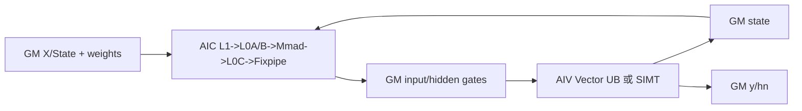
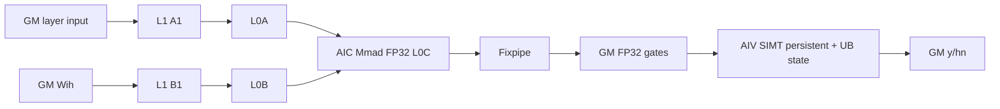
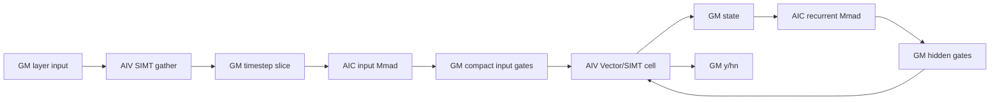

# GRU A5 Direct Invoke 算子知识

## 算子速览

| 项目 | 内容 |
|---|---|
| 实际入口 | PyTorch custom op `cann_bench::gru` → PrivateUse1 `gru_npu` → `launch_gru_*` C ABI；入口类型为 Direct Invoke。 |
| 计算语义 | PyTorch 顺序的 reset/update/new 三门 GRU；按 layer、direction、timestep 递推，输出 `y` 与末状态 `hn`。 |
| 输入输出 | 连续 ND `x`、权重/可选 bias、可选 `h0`；FP16/BF16/FP32；`x` 为 `[S,B,I]` 或 `[B,S,I]`。 |
| 执行类型 | 多 Kernel 图；R-002～R-010 含 `AIC_CUBE` `gemm_ex_kernel_*`，同图含 `AIV_VECTOR` 与 AIV wrapper 内 `SIMT`；R-001 是同一逻辑入口的纯 SIMT 精确特化。 |
| Kernel 路线 | 特征重要性从 P0 到 P9 依次为 R-003、R-004、R-001、R-002、R-005、R-006、R-007、R-008、R-009、R-010；Route ID 保持 Host selector 身份，不随阅读优先级改号。 |
| 核心资源 | GM Tensor/workspace、AIC L1/L0A/L0B/L0C、AIV UB/TBuf、SIMT 线程标量与静态 UB state；无通信、NDDMA、atomic。 |
| 来源闭包 | `direct_implementation_closed`：转换交付的 schema、校验、workspace、selector、所有 launcher/entry/body、跨 kernel 边、精度/tail 与构建接线均闭合。固定官方提交无同构 GRU Device 实现，Frontmatter 文件只作 GRU/BlockMmad/A5 MatMul 的相关映射，不把派生事实反写成官方事实。 |
| 验证状态 | 已完成源码闭包检查；本次知识提取未执行编译、真机、数值或性能测试。 |

## 接口与语义

### 计算语义

令 `G=3H`，输入和循环 GEMM 分别产生三段 gate，段序为 reset、update、new。对 layer `l`、direction `d`、时间 `t`：

```text
i_r,i_z,i_n = x_t W_ih^T 的三段
h_r,h_z,h_n = h_(t-1) W_hh^T 的三段
r_t = sigmoid(i_r + h_r + b_ir + b_hr)
z_t = sigmoid(i_z + h_z + b_iz + b_hz)
n_t = tanh(i_n + b_in + r_t * (h_n + b_hn))
h_t = n_t + z_t * (h_(t-1) - n_t)
```

无显式 bias 列表时两套 bias 都按零处理。反向 direction 仅把递推时间改为 `S-1-step`，输出仍写回逻辑 timestep。多层时上一层 `D*H` 列输出成为下一层输入；dropout 属性只做 `[0,1]` 校验，转换实现没有 dropout kernel，因此本卡不能复用于训练态非零 dropout 语义。

### 输入、输出与属性

| 参数 | shape/layout | dtype | 约束、默认值与语义 |
|---|---|---|---|
| `x` | `batchFirst=false` 为 `[S,B,I]`，否则 `[B,S,I]`；contiguous ND | FP16/BF16/FP32 | rank=3，`S,B,I>0`，末维等于 `inputSize`。 |
| `weight_ih` | 列表第 `l*D+d` 项至少 `[3H,I_l]`，`I_0=I`、`I_l=D*H` | 同 `x` | 允许多余行/列；物理 row stride 大于逻辑列数时先 pack 有效前缀。 |
| `weight_hh` | 每项至少 `[3H,H]` | 同 `x` | stride 大于 `H` 时先 pack；GEMM 以 `transB=true` 解释。 |
| `bias_ih/bias_hh` | 两个列表都存在时，每项至少 `[3H]` | 同 `x` | 只有两者都存在且 `bias=true` 才启用；部分缺省等价零 bias。 |
| `h0` | `[L*D,B,H]` contiguous ND | 同 `x` | 可缺省；缺省时初态为零。 |
| `inputSize/hiddenSize/numLayers` | Host 标量 | int64 | 均为正；进入 Device 前收窄为 uint32/int32 并检查范围。 |
| `bias/batchFirst/bidirectional` | Host 属性 | bool | `bidirectional` 决定 `D=1/2`。 |
| `dropout` | Host 属性 | double | 只检查 `[0,1]`；Device 图不消费。 |
| `y` | `[S,B,DH]` 或 `[B,S,DH]` | 同 `x` | 新分配；各 direction 写互不重叠的最后一维 slice。 |
| `hn` | `[L*D,B,H]` | 同 `x` | 每个 layer/direction 最后一步写对应 slice。 |

### 入口与版本

`TORCH_LIBRARY_FRAGMENT` 声明 `cann_bench::gru`，Meta 和 PrivateUse1 分别绑定 `gru_meta`、`gru_npu`。`gru_npu` 经 `OpCommand::RunOpApi("GruDirect", directCall)` 在当前 NPU stream 直接调用 launcher，不是 ACLNN workspace/executor 两段式入口，也不使用官方 `gert::TilingContext`。

固定官方提交只公开 `CommonGRU` 的 ONNX 属性解析，并以 `experimental/rnn` 作为构建聚合目录；其中没有同构 GRU Host/Tiling/Device body。本文的全部 Route、workspace、BlockMmad 参数和直接调用 ABI 均是转换交付的派生实现事实。相关官方 `BlockMmad` 模板、AIC-only BatchMatMul entry 与 Ascend 950 binary config 只证明所映射的 Cube 执行范式和 A5 MatMul 产品接线。

## Host/Launcher 执行流程

### 参数校验与前处理

1. `CheckInputs` 检查所有 Tensor 同设备、同 dtype、strided contiguous；计算 `D`、`G=3H`、`R=S*B`，对乘法、加法和 ABI 收窄做溢出检查。
2. 权重列表必须至少 `L*D` 项；多余项忽略。输出 `y/hn` 先按最终 shape 分配。
3. 扫描权重 stride，决定 input/recurrent pack workspace；计算 `accurateRoute`、`fp32Internal`、`persistentRoute`、`streamedInputGates`。
4. 按总容量分配 gate、state、层间 ping-pong、转置/升精度权重、时间片输入和 accurate workspace，并计算所有 GM slice 指针。
5. callback 捕获输入、输出、权重、bias、`h0` 和全部 workspace；按 layer→direction→step 顺序在同一 stream 提交节点。

### 参数、Workspace 与生命周期

记 `e=sizeof(x.dtype)`、`R=S*B`、`G=3H`、`Q=R*G`、`Qh=B*G`、`O=R*D*H`、`Imax=max(I,DH)`，`p32` 表示 FP32 内部/persistent/accurate：

```text
gate_bytes = (activeQ + Qh) * (p32 ? 4 : e)
activeQ = streamed ? Qh : Q
state_bytes = B*H*(fp32Internal ? 4 : e)
layer_bytes = max(1, (L<=1?0:(L==2?1:2))*O) * e
recurrent_weight_bytes = p32 ? G*H*4 : 4
input_pack_bytes = needsInputPack ? G*Imax*e : 0（否则别名 x）
recurrent_pack_bytes = needsRecurrentPack ? G*H*e : 0（否则别名 x）
timestep_input_bytes = streamed ? B*Imax*e : 0（否则别名 x）
accurate_bytes = accurate ? (R*I + G*I)*4 : 4
```

gate workspace 的 `inputGates` 从 offset 0 开始，`hiddenGates` 从 `activeQ*(p32?4:e)` 开始。层间 workspace 最多两个 `O*e` slice，按 layer 奇偶交替；每个 layer/direction 顺序复用 gate/state/pack 区。Tensor capture 保活到 callback/stream 框架生命周期结束；源码没有裸临时 Host 指针悬挂。即使某 Route 不消费，state/layer 的最小分配仍存在。

### 启动图与失败传播

```text
gru_npu / directCall（同一 current stream）
  -> 可选 pack(weight_ih/weight_hh)
  -> R-001: cast x -> transpose/promote weights -> accurate-input SIMT -> accurate recurrence SIMT
  -> R-002: input Cube GEMM -> transpose recurrent weight -> persistent SIMT（内部循环 S）
  -> R-003..R-006: input Cube GEMM -> init-state AIV -> S * [recurrent Cube GEMM -> cell AIV/SIMT]
  -> R-007..R-010: init-state AIV -> S * [gather AIV/SIMT -> input Cube GEMM -> recurrent Cube GEMM -> cell AIV/SIMT]
  -> 中间层写 layer ping-pong，最终层写 y；每个方向末步写 hn
```

Cube `blockDim=usedCoreNum`；init/cell/persistent/accurate-recurrence `blockDim=B`；pack/gather/transpose/cast 为 `ceil(elements/256)` 或 `ceil(elements/4096)`，accurate-input 为 `min(AIV核心数,R)`。所有节点传同一 stream，跨 kernel 可见性依赖 stream 顺序；没有 event/flag。launcher 返回 `void`，callback 固定返回 0，源码未逐 launch 检查错误，因此异步 launch 失败的传播属于框架/runtime 边界。

## Route 与参数设计

### 分核与资源计算

Cube 以 `M=m,N=n,K=k`，`A` 为 ND row-major，`B` 存 `[N,K]` 且 `isTransB=1`。FP16/BF16 tile=`128x16x128`，FP32 tile=`32x8x16`。launcher 枚举 `mb=1..min(ceil(M/baseM),AIC)`，令 `nb=min(ceil(N/baseN),AIC/mb)`，选择最大 `mb*nb`；每核 `singleCoreM/N` 向 base 对齐后不超过实际 M/N。Device 再按 256 KiB L0C 上限缩小二维 tile block。

AIV Vector cell 一核对应一个 batch 行，UB 随 H 增长；SIMT cell 同样一 block 对应 batch 行，线程数向 `32/64/128/256` 档取值，`hiddenIndex` 以 256 步长覆盖宽 H。persistent/accurate 一 block 负责一个 batch 行并在 block 内遍历全部 timestep。

### 特征与重要性

P0 为最高重要性，后续等级依次降低。该顺序用于组织实现知识；它不改变 Host selector 的判断顺序、短路关系或 fallback。

| 优先级 | Route | 降序特征 | 重要实现面 |
|---|---|---|---|
| P0 | R-003 materialized normal FP16 Vector | 常规 FP16、完整 input gate 物化、H 落在 Vector 资源域 | 一次 input Cube、逐 timestep recurrent Cube、FP16 state 与 FP32 UB 门控，是通用主干 |
| P1 | R-004 materialized normal SIMT | BF16/FP32 或宽 FP16、完整 input gate 物化 | 覆盖多 dtype 与宽 H，保留同一双 GEMM 主图并把门控切到 SIMT |
| P2 | R-001 accurate FP16 Kahan SIMT | 长递推、单层单向、H≤256 | 取消 Cube，输入与循环 dot 均用 Kahan FP32，优先闭合长递推精度 |
| P3 | R-002 Cube + persistent recurrence | 小 H、非 accurate | input Cube 后把整段 state 留在 UB，改变 launch 粒度和 state 生命周期 |
| P4 | R-005 materialized FP32-internal Vector | 长 FP16、非 accurate、H≤256、gate 可完整物化 | FP32 gate/state/recurrent weight，最终输出才降 FP16 |
| P5 | R-006 materialized FP32-internal SIMT | 长 FP16、非 accurate、宽 H、gate 可完整物化 | 延续 FP32 内部数据流，以 256-thread stride 关闭宽 H |
| P6 | R-007 streamed normal FP16 Vector | 常规 FP16、完整 gate 超 workspace guard、H≤256 | 每步 gather + 双 Cube，以 compact gate 限制 GM 容量 |
| P7 | R-008 streamed normal SIMT | 普通精度 streamed，BF16/FP32 或宽 FP16 | streamed 主图的多 dtype/宽 H 终点 |
| P8 | R-009 streamed FP32-internal Vector | 长 FP16、FP32 内部、streamed、H≤256 | compact FP32 gate/state 与 Vector 门控组合 |
| P9 | R-010 streamed FP32-internal SIMT | 长 FP16、FP32 内部、streamed、宽 H | selector 最终终点，组合最大 GM 压力与宽 H SIMT |

### Route 选择

下表严格保持源码的 producer 与 callback 顺序；P0～P9 仅控制后续知识展开，不参与这些判断。

| Host 顺序 | selector/动作 | 源码条件与短路 | 命中 Route 或后继 |
|---:|---|---|---|
| 1 | 计算 `accurateRoute` | `dtype=FP16 && S*H>=32768 && L=1 && D=1 && H<=256` | true 标记 R-001；false 继续 |
| 2 | 计算 `fp32Internal` | `dtype=FP16 && S*H>=32768 && !accurateRoute` | 保存精度分支，不短路 |
| 3 | 计算 `persistentRoute` | `H<=32` | 保存整段递推分支，不短路 |
| 4 | 计算 `streamedInputGates` | `!accurateRoute && !persistentRoute && Q*gateBytes>256MiB` | true 选择逐步 input gate；false 选择完整物化 |
| 5 | callback accurate 短路 | `if (accurateRoute)` | 启动 R-001 并 `continue`；false 继续 |
| 6 | input gate 预启动 | `if (!streamedInputGates)` | 先启动完整 input Cube；streamed 延迟到 timestep 内 |
| 7 | callback persistent 短路 | `if (persistentRoute)` | 启动 R-002 并 `continue`；false 继续 |
| 8 | recurrent weight 精度分支 | `if (fp32Internal)` | true 先 cast 到 FP32；false 使用输入 dtype/原权重 |
| 9 | timestep input 分支 | `if (streamedInputGates)` | true 每步 gather+input Cube；false 复用完整 input gate |
| 10 | cell launcher | `dtype!=FP16 || H>256` | true 选 SIMT；false 选 Vector |
| 11 | 终端组合映射 | materialized/streamed × normal/FP32-internal × Vector/SIMT | 依次落到 R-003/R-007、R-004/R-008、R-005/R-009、R-006/R-010；无额外 fallback |

```text
accurate = FP16 && S*H>=32768 && L==1 && D==1 && H<=256
fp32Internal = FP16 && S*H>=32768 && !accurate
persistent = H<=32
streamed = !accurate && !persistent && Q*(fp32Internal?4:e) > 256 MiB

callback:
  if accurate: R-001; continue
  if !streamed: launch full input GEMM
  if persistent: R-002; continue
  if fp32Internal: cast recurrent weight
  for timestep:
    if streamed: gather + input GEMM
    recurrent GEMM
    cell = (dtype!=FP16 || H>256) ? SIMT : Vector
```

```text
terminal route:
  materialized + normal + Vector -> R-003
  materialized + normal + SIMT   -> R-004
  materialized + FP32 + Vector   -> R-005
  materialized + FP32 + SIMT     -> R-006
  streamed     + normal + Vector -> R-007
  streamed     + normal + SIMT   -> R-008
  streamed     + FP32 + Vector   -> R-009
  streamed     + FP32 + SIMT     -> R-010
```

### 模板/实现执行矩阵

| Route | key/selector | dtype/shape/platform 完整命中条件 | 执行族与 kernel 节点 | 实际模板/body | 内存与同步特征 | tail/fallback |
|---|---|---|---|---|---|---|
| R-003 | normal/vector | materialized、非内部 FP32、FP16、32<H≤256 | AIC input/recurrent GEMM + AIV init/cell | FP16 Cube + `GruCellImpl<half,half,half>` | gate/state FP16；stream ordering | M/N/K 与 H tail |
| R-004 | normal/SIMT | materialized、非内部 FP32、BF16/FP32 或 H>256 | AIC + AIV SIMT | dtype Cube + `GruCellSimt` | GM state；线程 32～256 | thread guard/stride |
| R-001 | `accurateRoute` | 上表；A5 | AIV SIMT 四节点 | cast、transpose、`GruAccurateInputFp16Simt`、`GruAccurateFp16Simt` | FP32 Kahan、2 KiB state UB、同 stream | H≤256；否则标准路线 |
| R-002 | `persistentRoute` | `!accurate && H<=32` | AIC input GEMM→AIV transpose→SIMT recurrence | `gemm_ex_kernel_*` + `GruPersistentSimt<T,float>` | gate/recurrent FP32；两块 128-float UB state | 内部遍历 S |
| R-005 | fp32/vector | materialized、`fp32Internal`、H≤256 | AIV cast→AIC FP32-output GEMM→AIV Vector | `GruCellImpl<half,float,float>` | gate/state/recurrent weight FP32 | y/hn 降 FP16 |
| R-006 | fp32/SIMT | R-005 但 H>256 | AIV cast→AIC→SIMT | `GruCellSimt<half,float,float>` | 同上，无动态 UB | 256-thread stride |
| R-007 | streamed normal/vector | stream、非内部 FP32、FP16、H≤256 | 每步 gather→input AIC→recurrent AIC→Vector | compact input gates | `activeQ=Qh`，复用 input slice | 每步覆盖由 stream 保护 |
| R-008 | streamed normal/SIMT | stream、非内部 FP32、BF16/FP32 或 H>256 | gather→双 AIC→SIMT | `compactInputGates=true` | 同 R-007 | thread/timestep tail |
| R-009 | streamed fp32/vector | stream、内部 FP32、H≤256 | cast weight→gather→双 AIC→Vector | FP32 gate/state Vector | gate `2Qh*4` | 输出 FP16 |
| R-010 | streamed fp32/SIMT | stream、内部 FP32、H>256 | cast weight→gather→双 AIC→SIMT | FP32 SIMT | gate `2Qh*4` | 输出 FP16 |

### 隐藏性能 Guard

| Guard | Host/Tiling 条件 | Device/资源原因 | 影响 Route | 不满足时去向 | 源码符号 |
|---|---|---|---|---|---|
| accurate 范围 | FP16、`S*H>=32768,L=1,D=1,H<=256` | 256-thread block、两块 256-float UB state；Kahan 固定 k 顺序 | R-001 | persistent/standard | `gru_npu::accurateRoute` |
| persistent H | `H<=32 && !accurate` | 整段 recurrence 保持 state 于 UB，避免每步 state GM 往返 | R-002 | standard | `persistentRoute` |
| gate 容量 | `Q*gateBytes > 256 MiB` | 限制全序列 input gate GM workspace | R-007～R-010 | materialized | `streamedInputGates` |
| cell family | `dtype!=FP16 || H>256` | 避免 Vector UB 随 H 增长；BF16/FP32固定走 SIMT | R-004/6/8/10 | Vector cell | `launch_gru_cell` |
| L0C | `mBlockSize*nBlockSize*baseM*baseN*4 <= 256 KiB` | 限制同时驻留的 FP32 累加 tile | 所有 Cube Route | 继续二分 M/N block | `Compute2DBlocking` |
| 权重 stride | `size(1)!=logicalColumns` | GEMM `ldb=K` 要求有效前缀紧凑 | 所有 Cube Route | pack 后继续 | `needs*WeightPack` |
| ABI | 各维/元素积在 int32/uint32 范围 | tiling 和 launcher 使用 32-bit | 全部 | `TORCH_CHECK` 失败 | `CheckedMul/DirectU32` |

### POD/ABI

唯一命名 POD 为 `GemmExTilingData`，自然对齐 `alignof=4,sizeof=84`；其它 entry 使用 GM 指针和 uint32/bool 按值参数，没有 tiling GM 指针。下表中 inactive 字段仍初始化：

| 结构 | 字段 | 类型/位宽 | ABI 布局 | 单位 | Host/launcher producer | Device consumer | 边界 |
|---|---|---|---|---|---|---|---|
| `GemmExTilingData` | `m` | int32/32 | offset 0 | 元素/行 | `CalcGruGemmTiling` | `InitGemmState` | >0 |
| 同上 | `n` | int32/32 | offset 4 | 元素/列 | 同上 | 同上 | `3H` |
| 同上 | `k` | int32/32 | offset 8 | 元素 | 同上 | K loop | >0 |
| 同上 | `lda` | int32/32 | offset 12 | 元素 stride | `=k` | A offset | 固定 |
| 同上 | `ldb` | int32/32 | offset 16 | 元素 stride | `=k` | B offset | 固定 |
| 同上 | `ldc` | int32/32 | offset 20 | 元素 stride | `=n` | C/Fixpipe | 固定 |
| 同上 | `usedCoreNum` | int32/32 | offset 24 | AIC 核 | selector | entry/block guard | ≥1 |
| 同上 | `mBlocks` | int32/32 | offset 28 | block | selector | block→M | ≥1 |
| 同上 | `nBlocks` | int32/32 | offset 32 | block | selector | block→N | ≥1 |
| 同上 | `singleCoreM` | int32/32 | offset 36 | 行 | selector | core extent | base 对齐后截断 |
| 同上 | `singleCoreN` | int32/32 | offset 40 | 列 | selector | core extent | 同上 |
| 同上 | `baseM` | int32/32 | offset 44 | 行 | dtype selector | 仅作记录；模板常量实际控制 | 128/32 |
| 同上 | `baseN` | int32/32 | offset 48 | 列 | dtype selector | 同上 | 128/16 |
| 同上 | `baseK` | int32/32 | offset 52 | 元素 | dtype selector | 同上 | 16/8 |
| 同上 | `c0Size` | int32/32 | offset 56 | 元素 | dtype selector | 同上 | 16/8 |
| 同上 | `isTransA` | int32/32 | offset 60 | bool tag | `=0` | A load | 固定 |
| 同上 | `isTransB` | int32/32 | offset 64 | bool tag | `=1` | B load | 固定 |
| 同上 | `alpha` | float/32 | offset 68 | 标量 | `=1` | Cube 主图不读；AB dormant | inactive |
| 同上 | `beta` | float/32 | offset 72 | 标量 | `=0` | 同上 | inactive |
| 同上 | `hasBeta` | int32/32 | offset 76 | tag | `=0` | 同上 | inactive |
| 同上 | `outputFp32` | int32/32 | offset 80 | tag | `=0` | entry 由 launcher 专用枚举选择，不读此字段 | inactive |
| direct args | `m/n/k,dtype` | uint32/32 | 无 struct；按值 | 元素/tag | `launch_gru_gemm` 调用点 | launcher/entry | 已收窄 |
| direct args | `batch/hidden/sequence/directions/timestep/direction` | uint32/32 | 无 struct；按值 | 元素/index | `directCall` | cell/SIMT body | 已收窄 |
| direct args | 各 bool | C++ bool | 无 struct；按值，具体 slot 布局为编译器 launch ABI | tag | selector/call site | entry/body | 不得外推为共享 POD |

### Route 源码闭包

| Route | Key/selector | Host/Tiling producer | POD/参数 | Kernel entry/router | Kernel body/直接依赖 | 构建接线 |
|---|---|---|---|---|---|---|
| R-003 | materialized normal Vector | `gru_plugin.cpp::gru_npu` + `CalcGruGemmTiling` | GEMM POD + direct args | input/recurrent GEMM、init、FP16 Vector cell | Cube helpers、`GruCellImpl<half,half,half>` | GRU direct registration |
| R-004 | materialized normal SIMT | 同上 | GEMM POD + direct args | input/recurrent GEMM、init、SIMT cell | Cube helpers、`GruCellSimt` | 同上 |
| R-001 | `accurateRoute` | `gru_plugin.cpp::gru_npu` | direct args | accurate/cast/transpose entries | Kahan SIMT helpers | 同上 |
| R-002 | `persistentRoute` | 同上 + `CalcGruGemmTiling` | GEMM POD + direct args | Cube/transpose/persistent entries | `LoadATile/LoadBTile/Mmad/Fixpipe`,`GruPersistentSimt` | 同上 |
| R-005 | materialized FP32 Vector | 同上 | GEMM POD + direct args | cast、input/recurrent GEMM、init、FP32 Vector cell | Cube helpers、`GruCellImpl<half,float,float>` | 同上 |
| R-006 | materialized FP32 SIMT | 同上 | GEMM POD + direct args | cast、input/recurrent GEMM、init、FP32 SIMT cell | Cube helpers、`GruCellSimt<half,float,float>` | 同上 |
| R-007 | streamed normal Vector | 同上 | GEMM POD + direct args | gather、双 GEMM、init、FP16 Vector cell | gather SIMT、Cube helpers、Vector cell | 同上 |
| R-008 | streamed normal SIMT | 同上 | GEMM POD + direct args | gather、双 GEMM、init、SIMT cell | gather SIMT、Cube helpers、SIMT cell | 同上 |
| R-009 | streamed FP32 Vector | 同上 | GEMM POD + direct args | cast、gather、双 GEMM、init、FP32 Vector cell | gather SIMT、Cube helpers、FP32 Vector cell | 同上 |
| R-010 | streamed FP32 SIMT | 同上 | GEMM POD + direct args | cast、gather、双 GEMM、init、FP32 SIMT cell | gather SIMT、Cube helpers、FP32 SIMT cell | 同上 |

## Kernel 实现

### 公共执行流程

所有 Cube Route 的 `launch_gru_gemm` 令 `A[M,K]`、物理 `B[N,K]`、`C[M,N]`，按 dtype 选择 `gemm_ex_kernel_{fp16,bf16,fp32,*_out_f32}`。AIC 数据流为：

```text
GM A/B(ND) -> L1 A1/B1（各 16 KiB） -> L0A/L0B
-> Mmad(FP32 L0C，kIdx==0 初始化，其后累加)
-> Fixpipe ROW_MAJOR -> GM gate workspace
```

`DataCopy(Nd2Nz)` 和 `LoadData` 处理 ND→Cube layout；每次 copy/load、Mmad block 写出前后用 `PipeBarrier<PIPE_ALL>`。FP16/BF16 的 `baseM/baseK/baseN=128/16/128`，FP32 为 `32/8/16`；AIC 不用 UB。alpha/beta Vector kernel 在本 GRU launcher 中不可达，不进入启动图。

### Route R-003（P0）：materialized normal FP16 Vector

#### 适用条件

##### 选择证据

| 层级 | 文件 | 符号 | 源码谓词/参数 | 结果/下一跳 |
|---|---|---|---|---|
| Host | `gru_plugin.cpp` | `!streamedInputGates` | 非 accurate/persistent、gate≤256MiB、`!fp32Internal` | 一次 input GEMM |
| launcher | `gru_kernel.cpp` | `launch_gru_cell` | `dtype==FP16 && H<=256` | `gru_cell_fp16` |

#### Device 数据流

##### 函数级调用链

```text
input AIC GEMM（一次） -> init-state AIV
-> for t: recurrent AIC GEMM -> GruCellImpl(Vector) 或 GruCellSimt
```

##### 源码等价伪码

```text
inputGates[all rows] = X * Wih^T
state = h0 or 0
for timestep in direction order:
  hiddenGates = state * Whh^T
  r,z,n,next = vector_or_simt(inputGates[row],hiddenGates,bias,state)
  state=next; y[row,direction]=next; if last: hn=next
```

#### 内存与数据搬运

##### 资源与搬运表

| 层级/缓冲区 | offset/地址公式 | extent/容量公式 | dtype/layout | producer | consumer | owner/lifetime | 对齐/复用 |
|---|---|---|---|---|---|---|---|
| gate GM | input=0,hidden=`Q*dg` | `(Q+Qh)*dg` | gate dtype ND | 两类 AIC | cell | call | hidden slice每步覆盖 |
| state GM | 0 | `B*H*ds` | state dtype | init/cell | recurrent GEMM/cell | direction | 原地逐步更新 |
| AIC L1/L0 | 同公共 Cube | 同公共字节账 | dtype→FP32 accum | copy/Mmad | Fixpipe | kernel | 每次 GEMM独立 |
| Vector UB | per batch core | `2A(T)+A(GateT)+A(StateT)+5A(float)` | raw+FP32 | GM load | Vector gates/store | cell kernel | `A(x)=align32(H*sizeof(x))` |
| SIMT | N/A | thread-private scalars | FP32 scalar | GM loads | GM stores | thread | 无显式 dynamic UB |

##### 分层内存布局



##### 字节账、交接边与复用顺序

```text
gate=(Q+Qh)*dg; state=B*H*ds
VectorUB=2A(T)+A(GateT)+A(StateT)+5A(float)
AIC L1=32768 B; L0A/L0B如公共流程; L0C<=262144 B
```

| 边/复用子区 | producer | offset/extent | dtype/layout | consumer | ordering/sync | owner/lifetime | 安全条件 |
|---|---|---|---|---|---|---|---|
| hidden gate | recurrent AIC | `Q*dg`/`Qh*dg` | gate dtype `[B,3H]` | cell | same stream | gate workspace | cell结束后下一步覆盖 |
| state loop | cell | 0/`B*H*ds` | state dtype | next recurrent GEMM | same stream | state workspace | 每步严格串行 |

#### 同步、精度与尾块

##### 同步与数值边界表

| 阶段 | primitive/机制 | producer | consumer/等待点 | 保护对象 | 精度/尾块 |
|---|---|---|---|---|---|
| AIC→cell | stream ordering | Fixpipe | 后继 launch | gate GM | FP32 accum；按 route Fixpipe为原 dtype/FP32 |
| Vector | `PipeBarrier<PIPE_ALL>` | GM load/Vector op | store | UB buffers | BF16 store RINT，FP16 CAST_NONE |
| SIMT | kernel boundary | per thread | next timestep launch | state GM | float scalar；half/bf16 RN |

#### 关键实现

##### 符号证据表

| 阶段 | 文件 | 符号/模板实例 | 实现事实 |
|---|---|---|---|
| Host | `gru_plugin.cpp` | `!fp32Internal&&!streamedInputGates` | R-003 key |
| router | `gru_kernel.cpp` | `launch_gru_cell` | `gru_cell_fp16` |
| body | 同上 | `GruCellImpl<half,half,half>` | FP16 gate/state，FP32 UB 门控 |

### Route R-004（P1）：materialized normal SIMT

#### 适用条件

非 accurate/persistent、非 streamed、`!fp32Internal`，且 `dtype!=FP16 || H>256`。BF16/FP32 无条件选 SIMT；普通 FP16 仅 H>256 选 SIMT。

#### Device 数据流

与 R-003 使用同一 materialized 图，但 cell 节点为 `gru_cell_simt_kernel<<<B>>>`；threads 取 32/64/128/256，宽 H 由 `hiddenIndex+=256` 覆盖。

#### 内存与数据搬运

gate/state 为输入 dtype；Cube 层级同公共流程。cell 不分配 `TBuf`，直接 GM load/store，局部资源为线程 FP32 标量；hidden gate slice 仍在每步结束后复用。

#### 同步、精度与尾块

跨节点依赖同 stream；每线程计算独立 hidden lane，无 atomic/barrier。BF16/FP16 store 分别 round-to-nearest，尾 lane 由 `hiddenIndex<H` 循环保护。

#### 关键实现

`launch_gru_cell` 的 `dtype!=0 || hidden>256` 谓词映射到 `gru_cell_simt_kernel`，body 为 `GruCellSimt<T,GateT,StateT>`。

### Route R-001（P2）：accurate FP16 Kahan SIMT

#### 适用条件

##### 选择证据

| 层级 | 文件 | 符号 | 源码谓词/参数 | 结果/下一跳 |
|---|---|---|---|---|
| Host | `op_plugin/gru_plugin.cpp` | `accurateRoute` | FP16、`S*H>=32768,L=1,D=1,H<=256` | R-001，直接 `continue` |

#### Device 数据流

##### 函数级调用链

```text
cast(x)->transpose/promote(weight_ih,weight_hh)
-> GruAccurateInputFp16Simt（每行三次 Kahan dot）
-> GruAccurateFp16Simt（UB state ping-pong，内部 S 循环）
```

##### 源码等价伪码

```text
for row assigned to AIV block, lane h: KahanSum_k(x[row,k]*Wih[k,gate,h])
for batch block, t, lane h:
  KahanSum_k(previous[k]*Whh[k,gate,h])
  r,z,n = GRU gates; next=n+z*(previous-n)
  sync; write y half-rn; swap UB state
write hn half-rn
```

#### 内存与数据搬运

##### 资源与搬运表

| 层级/缓冲区 | offset/地址公式 | extent/容量公式 | dtype/layout | producer | consumer | owner/lifetime | 对齐/复用 |
|---|---|---|---|---|---|---|---|
| accurate GM | `0` / `R*I*4` | `(R*I+G*I)*4` | FP32 ND/转置权重 | cast/transpose | accurate input | call owner | 两 slice |
| gate GM | 0 | `Q*4`（hidden slice 仍已分配） | FP32 `[R,3H]` | accurate input | recurrence | call owner | 无覆盖 |
| recurrent weight GM | 0 | `G*H*4` | FP32 `[H,3H]` | transpose | recurrence | direction lifetime | 复用 |
| UB state | static | `2*256*4=2048 B` | FP32 | recurrence lanes | 下一 timestep | block lifetime | ping-pong |
| L1/L0 | N/A | N/A | N/A | 无 Cube | N/A | N/A | 以 SIMT dot 替代 |

##### 分层内存布局


##### 字节账、交接边与复用顺序

```text
accurate=(R*I+G*I)*4; recurrentWeight=G*H*4; gate=(Q+Qh)*4
UB=2048 B + thread-private Kahan scalars; L1/L0=N/A
```

| 边/复用子区 | producer | offset/extent | dtype/layout | consumer | ordering/sync | owner/lifetime | 安全条件 |
|---|---|---|---|---|---|---|---|
| FP32 input gates | accurate-input | 0/`Q*4` | FP32 `[R,3H]` | accurate recurrence | same stream | gate workspace | producer 完整结束 |
| state0↔state1 | lane compute | 2×256 float | UB | next timestep | `asc_syncthreads` | block | H≤256 |

#### 同步、精度与尾块

##### 同步与数值边界表

| 阶段 | primitive/机制 | producer | consumer/等待点 | 保护对象 | 精度/尾块 |
|---|---|---|---|---|---|
| timestep | `asc_syncthreads` | 各 lane next | 下一轮读取 previous | UB state | Kahan FP32；y/hn `half_rn` |
| row grid | row-stride loop | AIV block | N/A | input rows | lane `h>=H` 返回 |

#### 关键实现

##### 符号证据表

| 阶段 | 文件 | 符号/模板实例 | 实现事实 |
|---|---|---|---|
| Host | `op_plugin/gru_plugin.cpp` | `accurateRoute` | 最优先 Route |
| entry | `op_kernel/gru_kernel.cpp` | `gru_accurate_*` | 256-thread AIV SIMT |
| body | 同上 | `GruKahanAdd/GruAccurateFp16Simt` | 固定 k 顺序与 UB state |

### Route R-002（P3）：Cube 输入投影 + persistent recurrence

#### 适用条件

##### 选择证据

| 层级 | 文件 | 符号 | 源码谓词/参数 | 结果/下一跳 |
|---|---|---|---|---|
| Host | `gru_plugin.cpp` | `persistentRoute` | `!accurate && H<=32` | R-002 |

#### Device 数据流

##### 函数级调用链

```text
launch_gru_gemm(input)->AIC Mmad/Fixpipe FP32 gates
-> transpose recurrent weight to FP32 [H,3H]
-> GruPersistentSimt<T,float>（内部完成 S 步）
```

##### 源码等价伪码

```text
Cube: [R,I] * [3H,I]^T -> FP32 inputGates
SIMT block=batch: load h0/zero to UB; for step in direction order:
  dot(previous,Whh) in FP32; form r,z,n; sync; write y; swap
write hn
```

#### 内存与数据搬运

##### 资源与搬运表

| 层级/缓冲区 | offset/地址公式 | extent/容量公式 | dtype/layout | producer | consumer | owner/lifetime | 对齐/复用 |
|---|---|---|---|---|---|---|---|
| gate GM | 0 | `(Q+Qh)*4` | FP32 | AIC Fixpipe | persistent | call | hidden slice未消费 |
| L1 | A1 view offset 0，B1 view offset `L1_HALF_SIZE` | 物理地址空间常量 32KiB；16-bit 活跃 tile 4096+4096B，FP32 为 1024+512B | Cube NZ staging | Nd2Nz | LoadData | AIC block | 两个半区 view，活跃 payload 复用 |
| L0A/L0B | 0 | 4096+4096 B（16-bit）或 1024+512 B（FP32） | Cube | LoadData | Mmad | tile | 单 buffer |
| L0C | tile index | ≤256 KiB | FP32 row-major logical | Mmad | Fixpipe | 2D block | 容量 guard |
| persistent UB | static | `2*128*4=1024 B` | FP32 | lanes | next step | block | ping-pong；实际 H≤32 |

##### 分层内存布局



##### 字节账、交接边与复用顺序

```text
gate=(Q+Qh)*4; recurrentWeight=G*H*4
L1 address space=32768 B（active tile=8192 B for 16-bit）;
L0=8192 B + up to 262144 B（16-bit Cube）; UB=1024 B
```

| 边/复用子区 | producer | offset/extent | dtype/layout | consumer | ordering/sync | owner/lifetime | 安全条件 |
|---|---|---|---|---|---|---|---|
| input gate | AIC Fixpipe | 0/`Q*4` | FP32 `[R,3H]` | persistent SIMT | same stream | gate workspace | Cube 完成后启动 |

#### 同步、精度与尾块

##### 同步与数值边界表

| 阶段 | primitive/机制 | producer | consumer/等待点 | 保护对象 | 精度/尾块 |
|---|---|---|---|---|---|
| Cube | `PipeBarrier<PIPE_ALL>` | copy/load/Mmad | Fixpipe | L1/L0 | K tail=`min(baseK,K-k0)` |
| recurrence | `asc_syncthreads` | lane next | next step | UB state | FP32 state；输出按 T round |

#### 关键实现

##### 符号证据表

| 阶段 | 文件 | 符号/模板实例 | 实现事实 |
|---|---|---|---|
| Host/Tiling | `gru_plugin.cpp`/`gru_kernel.cpp` | `persistentRoute/CalcGruGemmTiling` | Route 与 AIC 分核 |
| entry | `gru_kernel.cpp` | `gemm_ex_kernel_*`,`gru_persistent_kernel` | AIC→AIV 图 |
| body | 同上 | `ProcessNTile/GruPersistentSimt` | Mmad 与整段 recurrence |

### Route R-005（P4）：materialized FP32-internal Vector

#### 适用条件

`dtype=FP16 && S*H>=32768 && !accurate && !persistent && !streamed && H<=256`；因 H≤32 已被 persistent 截获，实际 `32<H<=256`。

#### Device 数据流

先把 recurrent weight FP16→FP32；input Cube 以 FP16 输入、FP32 Fixpipe 输出，recurrent Cube 以 FP32 A/B/C 运行；cell 为 `GruCellImpl<half,float,float>`。

#### 内存与数据搬运

gate `(Q+Qh)*4`、state `B*H*4`、recurrent weight `G*H*4`；Vector UB 为 `2A(half)+2A(float)+5A(float)`。y/hn 仍为 FP16 GM。

#### 同步、精度与尾块

同 stream 保证 cast→Cube→cell；state 和 gate 整段保持 FP32，只有 bias load 和公共 y/hn 写出涉及 FP16。Vector store 使用 `CAST_NONE`，H tail 用实际 count。

#### 关键实现

`fp32Internal` 生产 FP32 workspace，`launch_gru_gemm(...GRU_DIRECT_FP32,true)` 与 `gru_cell_fp16_f32_internal` 消费。

### Route R-006（P5）：materialized FP32-internal SIMT

#### 适用条件

与 R-005 相同但 `H>256`。

#### Device 数据流

cast recurrent weight→一次 FP16-input/FP32-output Cube→init FP32 state→每步 FP32 recurrent Cube→`GruCellSimt<half,float,float>`。

#### 内存与数据搬运

GM 容量同 R-005；cell 无显式 UB buffer，256 个线程以 256 步长遍历 H，读取/写回 FP32 state，写 y/hn FP16。

#### 同步、精度与尾块

跨 kernel 同 stream；SIMT 每 lane 独立，无 block barrier。Cube K/M/N tail 与 thread `hiddenIndex<H` 共同闭合。

#### 关键实现

`launch_gru_cell` 因 `hidden>256` 选择 `gru_cell_simt_kernel`，其中 `dtype==0&&fp32Internal` 实例化 FP16/FP32/FP32 traits。

### Route R-007（P6）：streamed normal FP16 Vector

#### 适用条件

##### 选择证据

| 层级 | 文件 | 符号 | 源码谓词/参数 | 结果/下一跳 |
|---|---|---|---|---|
| Host | `gru_plugin.cpp` | `streamedInputGates` | 非 R1/R2、`Q*e>256MiB`、`!fp32Internal` | 每步 gather+input GEMM |
| launcher | `gru_kernel.cpp` | `launch_gru_cell` | FP16 且 H≤256 | `gru_cell_fp16` |

#### Device 数据流

##### 函数级调用链

```text
init-state -> for t:
  GruGatherTimestepSimt -> input AIC GEMM(compact [B,3H])
  -> recurrent AIC GEMM -> Vector/SIMT cell(compactInputGates=true)
```

##### 源码等价伪码

```text
for t in direction order:
  timestepInput[b,:] = layerInput[logical_t,b,:]
  inputGate[B,3H] = timestepInput * Wih^T
  hiddenGate[B,3H] = state * Whh^T
  cell reads gateRow=batch, updates state/y/hn
```

#### 内存与数据搬运

##### 资源与搬运表

| 层级/缓冲区 | offset/地址公式 | extent/容量公式 | dtype/layout | producer | consumer | owner/lifetime | 对齐/复用 |
|---|---|---|---|---|---|---|---|
| timestep GM | 0 | `B*Imax*e` | input dtype `[B,I_l]` | gather | input GEMM | call | 每步覆盖 |
| gate GM | 0/`Qh*dg` | `2Qh*dg` | compact gate | 双 AIC | cell | call | 两 slice |
| AIC L1/L0 | 公共 | 公共 | Cube | gather输出/weights | gate GM | kernel | 每步两次 |
| cell UB/SIMT | 同 R-003～R-006 | 同上 | route dtype | gate/state | state/y | kernel | 同上 |

##### 分层内存布局



##### 字节账、交接边与复用顺序

```text
timestep=B*Imax*e; gate=2*Qh*dg; state=B*H*ds
Cube和cell局部资源同materialized Route
```

| 边/复用子区 | producer | offset/extent | dtype/layout | consumer | ordering/sync | owner/lifetime | 安全条件 |
|---|---|---|---|---|---|---|---|
| timestep slice | gather | 0/`B*I_l*e` | ND | input GEMM | same stream | timestep workspace | GEMM完成后才覆盖 |
| compact input gate | input AIC | 0/`Qh*dg` | `[B,3H]` | cell | same stream | gate workspace | `compactInputGates=true` |

#### 同步、精度与尾块

##### 同步与数值边界表

| 阶段 | primitive/机制 | producer | consumer/等待点 | 保护对象 | 精度/尾块 |
|---|---|---|---|---|---|
| gather→AIC | stream ordering | gather kernel | input GEMM | timestep GM | thread `outputIndex<elements` |
| 双 AIC→cell | stream ordering | Fixpipe | cell | 两 gate slice | Cube M/N/K tail |
| timestep复用 | stream ordering | cell | next gather | timestep/gate/state | 防止提前覆盖 |

#### 关键实现

##### 符号证据表

| 阶段 | 文件 | 符号/模板实例 | 实现事实 |
|---|---|---|---|
| Host | `gru_plugin.cpp` | `streamedInputGates&&!fp32Internal` | R-007 key与slice |
| router | `gru_kernel.cpp` | gather/双 GEMM/`gru_cell_fp16` | 每步节点图 |
| body | 同上 | gather + Cube + `GruCellImpl<half,half,half>` | compact gate地址与复用 |

### Route R-008（P7）：streamed normal SIMT

#### 适用条件

非 accurate/persistent、`streamedInputGates`、`!fp32Internal`，且 `dtype!=FP16 || H>256`。

#### Device 数据流

每步 `GruGatherTimestepSimt`→input Cube→recurrent Cube→`GruCellSimt`；cell 以 `gateRow=batchIndex` 消费 compact input gate。

#### 内存与数据搬运

timestep `B*Imax*e`、gate `2Qh*e`、state `B*H*e`；Cube L1/L0同公共流程，gather/cell均无显式 dynamic UB。

#### 同步、精度与尾块

同 stream 保护 timestep 与两 gate slice 的逐步覆盖；gather 用 `outputIndex<elements`，cell 用 hidden-lane loop，Cube 使用 M/N/K tail。

#### 关键实现

`launch_gru_gather_timestep` 映射 `GruGatherTimestepSimt<T>`；`launch_gru_cell` 映射对应 dtype 的 `GruCellSimt` traits。

### Route R-009（P8）：streamed FP32-internal Vector

#### 适用条件

`fp32Internal && streamedInputGates && H<=256`；实际为长 FP16、非 accurate/persistent。

#### Device 数据流

recurrent weight 先升 FP32；每步 gather FP16 输入，input Cube 输出 FP32 compact gate，recurrent Cube 输出 FP32 hidden gate，Vector cell 更新 FP32 state。

#### 内存与数据搬运

timestep `B*Imax*2`、gate `2Qh*4`、state `B*H*4`、recurrent weight `G*H*4`；Vector UB 与 R-005 相同。

#### 同步、精度与尾块

所有中间递推值为 FP32；同 stream 防止 compact gate提前覆盖，y/hn 最终降 FP16。H≤256 由 Vector UB route 保证。

#### 关键实现

`fp32Gates=true,compactInputGates=true` 传给 `launch_gru_cell`，选择 `gru_cell_fp16_f32_internal`。

### Route R-010（P9）：streamed FP32-internal SIMT

#### 适用条件

与 R-009 相同但 `H>256`；是 selector 的最终可达 Route。

#### Device 数据流

cast recurrent weight→逐步 gather→FP32-output input Cube→FP32 recurrent Cube→`GruCellSimt<half,float,float>`。

#### 内存与数据搬运

GM workspace 同 R-009；cell 以 256 threads和 256 stride 处理宽 H，无显式 UB buffer或 atomic。

#### 同步、精度与尾块

stream ordering闭合所有跨 kernel边；FP32 state/gates、FP16 RN输出；SIMT lane guard与Cube tail共同覆盖非对齐 H/G。

#### 关键实现

`launch_gru_cell` 的 `hidden>256` 分支与 `dtype==0&&fp32Internal` traits 唯一确定该 body；无后续 fallback。

## 算子特定优化

### Trick T-001：BlockMmad 形状/type traits 派生为固定 dtype Cube specialization

#### 触发与源码依据

- 适用 Route：R-002～R-010。
- 触发条件：Direct selector 进入任一 Cube Route；dtype 为 FP16/BF16/FP32。
- Golden 来源：[`matmul/common/cmct/block/block_mmad.h:50-52`](https://gitcode.com/cann/ops-nn/blob/955f8b33985b6d72989ebff341bb9c2c564a51bc/matmul/common/cmct/block/block_mmad.h)

**官方源码（固定 Commit 连续逐字摘录）**：

```cpp
class BlockMmad {
    static_assert(AscendC::Std::always_false_v<DispatchPolicy>, "BlockMmad is not implemented for this DispatchPolicy");
};
```

#### 机制与设计原因

官方相关模板把 dispatch、L1/L0 shape 和 A/B/C 类型作为独立实例轴。转换实现据此派生为显式 `GEMM_CUBE_KERNEL`：16-bit 固定 `128x16x128`，FP32 固定 `32x8x16`，统一 FP32 L0C；Host 只传运行时 M/N/K 与分核信息。这样每个 dtype entry 的 Cube tile、Fixpipe quant mode 和输出类型在编译期唯一，不需要 Device key router。该显式宏和 standalone helper 是派生实现，不是上述官方文件的原代码。

#### 迁移边界

- 适用：A5 上 ND A 与物理 `[N,K]` B 的 `A*B^T` gate 投影。
- 前提：`isTransA=0,isTransB=1`、FP32 累加、L1 32KiB、L0C 256KiB，权重有效前缀已 pack。
- 失效：其它 layout/transpose、量化、split-K 或不同硬件容量必须重新实例化；R-001 不使用 Cube。
- 未验证：本次知识提取未执行编译、真机、数值或性能测试。

#### 错误做法

不能把官方通用 `BlockMmad` 的存在写成当前 GRU 已实例化其某个官方 specialization；当前实现是独立的低层 `Mmad` 派生体。固定仓未提供同构 GRU Device 反例。

### Trick T-002：按递推长度和 workspace 上限切换整段、逐步与高精度图

#### 触发与源码依据

- 适用 Route：R-001～R-010。
- 触发条件：`S*H`、`L/D/H`、dtype 与 `Q*gateBytes` 的完整谓词见 Route 表。
- Golden 来源：[`common/src/framework/gru_onnx_plugin.cpp:30-32`](https://gitcode.com/cann/ops-nn/blob/955f8b33985b6d72989ebff341bb9c2c564a51bc/common/src/framework/gru_onnx_plugin.cpp)

**官方源码（固定 Commit 连续逐字摘录）**：

```cpp
if (attr.name() == "hidden_size" && attr.type() == ge::onnx::AttributeProto::INT) {
    hidden_size = attr.i();
}
```

#### 机制与设计原因

官方映射确认 hidden size 是 GRU 的显式结构属性；转换实现进一步用 H 与 `S*H` 做 Direct 路由：小 H 让整段递推保留 state 于 UB，长 FP16 递推提升 gate/state 到 FP32，特定单层单向形状使用 Kahan，超 256MiB gate 则逐 timestep 物化。机制同时改变 launch graph、GM 容量与舍入点；这些阈值和调度均为派生事实。

#### 迁移边界

- 适用：本卡三种 dtype、连续 ND、推理态直接调用。
- 前提：所有节点同 stream，persistent/accurate 的 H 上限不变。
- 失效：训练 dropout、非连续 layout、其它 gate 顺序或异步多 stream 图必须重做 selector/sync。
- 未验证：本次知识提取未执行编译、真机、数值或性能测试。

#### 错误做法

不能只修改 `accurateRoute` 阈值而不同时修改 gate/state dtype、workspace 和输出 cast；固定仓未提供同构官方 GRU Device fallback。

## 模板与实现对比

| 对比维度 | P0/P1 R-003/R-004 | P2 R-001 | P3 R-002 | P4/P5 R-005/R-006 | P6～P9 R-007～R-010 | 设计选择依据 |
|---|---|---|---|---|---|---|
| 命中条件/优先级 | materialized normal | accurate 长 FP16 | 非 accurate 且 H≤32 | materialized FP32内部 | streamed normal/FP32内部 | 精度、UB、GM上限 |
| 执行族/节点图 | AIC→AIV循环 | AIV SIMT | AIC→AIV SIMT | cast→AIC→AIV循环 | gather AIV→双AIC→AIV循环 | 递推粒度 |
| M/N/K、tile 与 scheduler | input+每步 recurrent | N/A | input `R,3H,I` | input+每步 recurrent | 每步 input+recurrent | dtype固定 Cube tile |
| workspace/L1/L0/UB | 全 Q gate+state | accurate FP32 +2KiB UB | FP32 gate/weight+1KiB UB | 全 Q FP32 gate/state | 2Qh gate+timestep | 容量/复用 |
| AIC/AIV 或 kernel 交接 | gate/state GM | 无 AIC | gate GM | FP32 gate/state GM | timestep/gate/state GM | 同 stream |
| 同步、精度与 tail | barrier+stream/Vector或SIMT | syncthreads/Kahan/half RN | syncthreads/FP32 state | stream/FP32内部 | stream/逐步覆盖 | 源码顺序 |
| fallback/失败边界 | 超容量转 streamed | 条件不符继续 | H>32继续 | 超容量转 streamed | 无内部fallback | Host检查/void launcher |

## 平台差异

| 项目 | A2 | A3 | A5 |
|---|---|---|---|
| 支持状态 | 固定相关映射未证明此 Direct 实现 | 固定相关映射未证明此 Direct 实现 | 本卡目标为 950；相关官方 BatchMatMul binary 含 ascend950 |
| Host/Launcher | 固定仓不可见 | 固定仓不可见 | `gru_npu` + `launch_gru_*` 派生直调 |
| Kernel/资源 | 固定仓不可见 | 固定仓不可见 | DAV 3510 资源常量：L1 32KiB、L0A/B 64KiB、L0C 256KiB |

## 限制与失败边界

- 只支持 FP16/BF16/FP32 contiguous ND；非法 dtype、shape、设备、stride 或 32-bit ABI 溢出在 Host 抛错。
- `dropout` 不参与 Device 计算；不能据此宣称训练态 dropout 完整语义。
- 公开固定提交没有同构 GRU Device/Host/Tiling，平台和机制来源是相关映射；Direct ABI、阈值与 body 属转换派生。
- Cube alpha/beta 后处理实现未被 GRU launcher 调用；不得加入可达图。
- 同 stream 是所有跨 kernel 复用的必要条件；launcher 没有 event、显式 runtime 同步或逐节点错误码。
- 本次知识提取未执行编译、真机、数值或性能测试。

## 源码索引

### 链路索引

| 链路阶段 | 文件 | 关键符号 | 支撑内容 |
|---|---|---|---|
| 入口声明/约束 | `common/src/framework/gru_onnx_plugin.cpp` | `REGISTER_CUSTOM_OP("CommonGRU")` | 官方 GRU 相关属性/版本映射；非 Direct ABI |
| 构建接线 | `experimental/rnn/CMakeLists.txt` | 子目录聚合 | 官方 RNN 相关构建边界；无同构 GRU body |
| Cube 模板参考 | `matmul/common/cmct/block/block_mmad.h` | `BlockMmad` | dispatch/L1/L0/type 实例轴 |
| Kernel entry/body参考 | `matmul/batch_mat_mul_v3/op_kernel/arch35/batch_mat_mul_v3.cpp` | `batch_mat_mul_v3`,`KERNEL_TYPE_AIC_ONLY` | A5 arch35 AIC MatMul 执行范式 |
| 平台配置参考 | `matmul/batch_mat_mul_v3/op_host/config/ascend950/batch_mat_mul_v3_binary.json` | `op_type=BatchMatMulV3` | Ascend 950 MatMul dtype/layout 接线 |

每行仅列 Frontmatter 中的固定官方文件。这些是转换相关映射；转换交付闭包中的 `gru_plugin.cpp`、`gru_launch.h`、`gru_tiling_data.h`、`gru_kernel.cpp` 和 GRU CMake 注册不作为可达外部来源 URL，也不伪称官方 blob。

### 实现复用检查

| 检查项 | 可复用事实 | 不得改变的约束 | 源码符号 |
|---|---|---|---|
| ABI/POD | `GemmExTilingData` 84B；其它参数按值 | 字段顺序、offset、B转置语义、编译器 bool ABI | `CalcGruGemmTiling/GEMM_CUBE_KERNEL` |
| 调用顺序 | layer→direction→timestep，同 stream | producer完成前不得启动/覆盖consumer slice | `directCall` |
| workspace/内存 | gate/state/layer/pack/timestep/accurate 公式 | offset、dtype、256MiB guard、capture lifetime | `gru_npu` |
| 同步 | AIC PipeBarrier、SIMT syncthreads、跨kernel stream顺序 | 不得把 Host launch 顺序外推到不同stream | Cube/recurrence helpers |
| 精度与尾块 | FP32 L0C；BF16 RINT；长FP16 FP32/Kahan；M/N/K/thread tail | gate顺序、cast/round、`h=n+z*(prev-n)` | `WriteFixpipeBlock/GruCell*` |
| 失败边界 | Host `TORCH_CHECK`；unknown dtype不进入 | void launcher无同步错误返回；dropout未实现 | `CheckInputs/launch_gru_*` |
