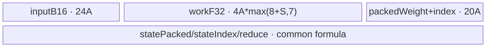
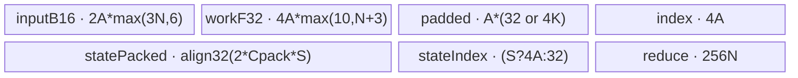
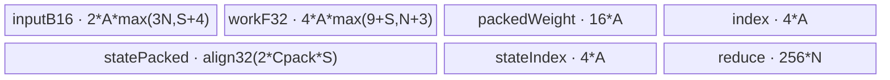
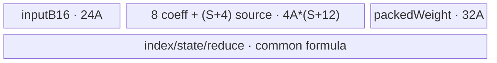

# EngramGateFusion A5 Direct Invoke 算子知识

## 算子速览

| 项目 | 内容 |
|---|---|
| 实际入口 | 派生补充接口 `cann_bench::engram_gate_fusion` → `engram_gate_fusion_npu` → `launch_engram_gate_fusion_bfloat16`；Direct Invoke |
| 计算语义 | 双 RMSNorm 生成缩放点积 gate，gate 调制共享 value 后再做 RMSNorm，执行 depthwise dilated causal convolution、SiLU 和 gated residual，并产出连续 state |
| 输入输出 | BF16 `keys/hidden_states/output [B,L,HC,D]`、BF16 `value [B,L,D]`、FP32 norm/conv weights、可选 BF16 state；输出 state 为连续 `[B,HC*D,(K-1)*dilation]` |
| 执行类型 | 所有 Route 均为单节点 `AIV_VECTOR`，entry 显式 `KERNEL_TYPE_AIV_ONLY`；无 Cube/AIC、MIX_CV、SIMT、NDDMA 或通信节点 |
| Kernel 路线 | 重要性顺序：P0 R-003 materialized K4 register timeline；P1 R-004 bounded generic；P2 R-001 长序列 K4 scale reconstruction；P3 R-002 K8 register timeline。Route ID 保持实现映射，不随阅读顺序改号 |
| 核心资源 | GM、7 个 `VECCALC TBuf`、RegTensor、6 组硬事件；FP32 normalized workspace 与 gate workspace；单 launch 内 `SyncAll<true>` 分隔 normalize/conv 两相，`L=1` 绕过全局栅栏 |
| 来源闭包 | `direct_implementation_closed`：派生候选闭合 schema→校验/Meta→launch config/POD→3 个静态 AIV entry→模板 body/helper→构建接线。官方固定 Commit 无同构 `EngramGateFusion`，仅为 DataCopyPad、causal indexing、register-vector 与 event 约定的相关参考 |

## 接口与语义

### 计算语义

令 `rms(x)=sqrt(sum_d(x_d*x_d)/D+eps)`，对 `(b,l,h)`：

```text
k = (keys[b,l,h,:] / rms(keys[b,l,h,:])) * norm1_weight[h,:]
q = (hidden_states[b,l,h,:] / rms(hidden_states[b,l,h,:])) * norm2_weight[h,:]
raw = sum_d(k_d*q_d) / sqrt(D)
g = sigmoid(sign(raw) * sqrt(max(abs(raw), 1e-6)))
u = ((value[b,l,:] * g) / rms(value[b,l,:] * g)) * conv_norm_weight[h,:]
z[b,l,h,d] = sum_{t=0}^{K-1} timeline[b,h,d,l-S+t*dilation] * conv_weight[h*D+d,0,t]
output[b,l,h,d] = BF16_RINT(silu(z[b,l,h,d]) + FP32(value[b,l,d]) * g)
```

其中 `S=(K-1)*dilation`，负时间先从可选 `conv_state[b,h*D+d,:]` 取，未提供 state 时补零；非负时间取 FP32 `u`。`conv_state_out` 是该 timeline 最后 `S` 行按 `[B,HC*D,S]` 直接连续写出的 BF16 结果。点积、gate、gated-value RMS、卷积累加、SiLU 与 residual 均按源码指定的 FP32 顺序执行；不能把两个 RMS 除法移出点积，也不能把 `sum((value*g)^2)` 重关联成 `g^2*sum(value^2)`。

### 输入、输出与属性

| 参数 | shape/layout | dtype | 约束、默认值与语义 |
|---|---|---|---|
| `keys` | 连续 `[B,L,HC,D]` | BF16 | `B 1..256`、`L 1..4096`、`HC 1..16`、`D 64..2048` |
| `hidden_states` | 同 `keys` | BF16 | 同设备、同 shape |
| `value` | 连续 `[B,L,D]` | BF16 | 每个 HC 共享，gate 按 HC 独立 |
| `norm1_weight/norm2_weight/conv_norm_weight` | 连续 `[HC,D]` | FP32 | 分别用于两路 RMSNorm 和 gated-value RMSNorm |
| `conv_weight` | 连续 `[HC*D,1,K]` | FP32 | depthwise causal taps，`K=kernel_size∈[1,16]` |
| `conv_state` | 可选连续 `[B,HC*D,S]` | BF16 | `S=(K-1)*dilation`；缺省表示负时间补零 |
| `hc_mult/hidden_size` | scalar | int64 | 必须分别等于 `HC/D`；默认 `4/1024` |
| `dilation` | scalar | int64 | `1..16`，默认 3 |
| `norm_eps` | scalar | double→FP32 POD | `(0,1)`，默认 `1e-5` |
| `output` | 连续 `[B,L,HC,D]` | BF16 | 新分配，所有有效元素写出 |
| `conv_state_out` | 连续 `[B,HC*D,S]` | BF16 | 新分配；`S=0` 时为空末维且 Device 不写 |

### 入口与版本

该入口由派生候选通过 `TORCH_LIBRARY_FRAGMENT` 声明，Meta 只创建输出，PrivateUse1 实现校验后直接启动 AscendC kernel；它不是 ACLNN 两段式接口，也没有运行时 OPP lookup、CPU fallback 或框架数值 composite。固定 CANN 9.1.0 `ops-transformer` Commit `be33d95bb755cedec3108f70805c1874d1792540` 没有七步同构算子：`fused_causal_conv1d`、`masked_causal_conv1d` 仅提供 A5 causal-conv 搬运、寄存器和 event 设计参考，不包含双 RMSNorm gate、gated-value RMSNorm、本文 residual 或 state-output schema。因此本文所有 Direct ABI、Route 和资源事实均归于派生补充实现，不能解释为官方公开 `EngramGateFusion` 支持声明。

## Host/Launcher 执行流程

### 参数校验与前处理

`engram_gate_fusion_npu` 先绑定 `keys.device()`，依次检查 rank、范围、属性与 shape 一致性、激活/权重 dtype、连续性和同设备。没有隐式 contiguous、cast、view 或 layout 转换；任一失败由 `TORCH_CHECK` 在 launch 前终止。Meta 分配两个 BF16 输出；NPU 实现另分配两个私有 FP32 workspace，调用 `calc_engram_gate_fusion_launch_config`，取得当前 NPU stream，再把所有 GM 地址、POD、`blockDim` 交给 launcher。

### 参数、Workspace 与生命周期

记 `A=ceil(D/64)*64`、`S=(K-1)*dilation`、`C=B*HC`、AIV 核数为 `P`：

```text
targetTilesPerSequence = max(1, ceil(2P/C))
normTile = clamp(ceil(L/targetTilesPerSequence), 1, 16)
convTile = clamp(ceil(L/targetTilesPerSequence), 1, 4)
if !hasState && K==4 && 1<L<32: normTile=max(2,normTile), convTile=max(2,convTile)
normTaskCount = C * ceil(L/normTile)
convTaskCount = C * ceil(L/convTile)
blockDim = max(1, GetCoreNumAiv())
normalizedWorkspace = B*L*HC*D*4 bytes
gateWorkspace = B*L*HC*4 bytes
```

两个 workspace 由 Torch tensor 持有到当前 stream 上操作完成，不逃逸接口。R-001 仍分配完整 normalized workspace，但仅将每行 RMS 标量写到其前缀标量地址，并物化卷积仍需的末 `S` 行；其余 Route 完整物化 `[B,L,HC,D]` FP32 normalized rows。gate workspace 始终完整物化。

### 启动图与失败传播

```text
engram_gate_fusion_npu
  -> calc_engram_gate_fusion_launch_config
  -> launch_engram_gate_fusion_bfloat16(blockDim=P, stream=current)
       -> exactly one of:
          engram_gate_fusion_scale_kernel_bfloat16   # R-001
          engram_gate_fusion_k8_kernel_bfloat16      # R-002
          engram_gate_fusion_kernel_bfloat16         # R-003/R-004
       -> EngramGateFusionKernel<...>::Process
          L==1: NormalizeOneRow -> state output -> ConvolveTile
          L>1 : NormalizeAllRows -> SyncAll<true> -> WriteStateOutput || ConvolveAllRows
```

只有一个 Device 节点，没有跨 Kernel workspace 边。`SyncAll<true>` 是同一 kernel 内从 normalized/gate GM producer 到 convolution consumer 的全 AIV 可见性边；所有 launched blocks 都参与，即使某 block 没有 normalize task。`L=1` 时同一 sequence owner 顺序完成全部阶段，跳过全局 barrier。launcher 和 kernel entry 为 `void`，`OpCommand::RunOpApi` 的 lambda固定返回 0；源码没有把异步 kernel launch 错误转换为 operator 返回码。

## Route 与参数设计

### 分核与资源计算

Normalize 与 convolution 均以 `(batch,hc,sequence-tile)` 为任务。若 `C<=P && P%C==0`，`lanes=P/C`，`sequence=blockIdx%C`、`lane=blockIdx/C`，每 lane 处理 `tile=lane+n*lanes`；否则 task 以 `blockIdx+n*P` 轮转。Normalize 会按 HC 缓存三条 norm weight；convolution 会按 HC 或 sequence 缓存 packed conv weights/state。尾 tile 分别用 `min(normTile,L-start)`、`min(convTile,L-start)`，内部 norm batch 为 3/4/8 行，conv 固定最多 4 行。

### Route 特征与重要性

P0 为最高重要性，后续等级依次降低。该顺序只用于组织阅读、维护与复用，不改变 Route ID，也不改变 Host selector 的判断顺序、短路关系或 fallback。后续 Route 选择表、执行矩阵、源码闭包、逐 Route 章节和实现对比均按此顺序展开。

| 重要性 | Route | Route 特征 | 适用范围 | 实现前提 |
|---:|---|---|---|---|
| P0 | R-003 materialized K4 register timeline | 常规无 state K4 主干；先完整物化 normalized rows，再以 `S+4` 唯一时间线和四组寄存器累加器计算相邻输出 | A5、BF16 activation/FP32 weight；`!hasState`、`K==4`、`dilation<=3`、`32<=L<1024`、`D>=768`、`A<=1024` | launcher 前两分支均未命中并进入普通 entry；Device `useFusedConv4` 为真；完整 FP32 workspace、packed K4 weight 与 unique timeline 均可用 |
| P1 | R-004 bounded generic | 合法域终点；以 tap×row 有界循环统一处理 state、短序列、较宽对齐维、长 dilation 与非专用 K | A5 全部合法输入中未命中 R-001/R-002/R-003 的部分 | 普通 `<false,false>` entry；10 行 FP32 work 区；根据资源 guard 选择 packed/strided weight、packed/strided state 与 whole-slab/channel-tiled state writer |
| P2 | R-001 长序列 K4 scale reconstruction | 长序列无 state K4 专门化；normalize 相只发布 gate/RMS 标量和末端 state 所需行，卷积侧按需重建 normalized timeline | A5、BF16 activation/FP32 weight；`!hasState`、`K==4`、`dilation<=3`、`L>=1024`、`D>=768`、`A<=1024` | launcher `useScaleRecompute` 为真；`<true,false>` 静态 entry；gate/RMS 标量协议、末 `S` 行物化和 `S+4` timeline 的 UB 账闭合 |
| P3 | R-002 K8 register timeline | 无 state K8 专门化；完整物化 normalized rows，以八组 coefficient 和 `S+4` 唯一时间线执行四行寄存器卷积 | A5、BF16 activation/FP32 weight；`!hasState`、`K==8`、`dilation<=3`、`L>=32`、`D>=768`、`A<=1024` | R-001 未命中后 launcher `useFusedK8` 为真；`<false,true>` 静态 entry；8-tap packed weight 与 K8 UB 资源式成立 |

### Route 选择

下表按重要性排列；`Host 顺序、短路与 fallback` 字段独立记录真实控制流。launcher 固定先检查 R-001，再检查 R-002，否则进入普通 entry；普通 entry 的 Device guard 再在 R-003 与 R-004 之间二选一。

| 重要性 | Route | Host 顺序、短路与 fallback | Key/模板 | 精确选择条件 |
|---:|---|---|---|---|
| P0 | R-003 materialized K4 register timeline | H3：H1/H2 均未返回后进入普通 entry；Device `useFusedConv4` 为真时执行，false 转 R-004 | `EngramGateFusionKernel<false,false>` 内 `useFusedConv4` | 未命中 R-001，且 `!hasState && K==4 && dilation<=3 && L>=32 && D>=768 && A<=1024` |
| P1 | R-004 bounded generic | H4：H1/H2 均未返回后进入普通 entry，且 H3 Device guard 为 false；合法输入的最终 fallback，无后续 Device Route | `EngramGateFusionKernel<false,false>` generic branch | R-001/R-002/R-003 均不成立 |
| P2 | R-001 scale reconstruction K4 | H1：launcher 首个 `if`；命中即发射 scale entry，R-002 与普通 entry 均不再检查；false 继续 H2 | `EngramGateFusionKernel<true,false>` | `!hasState && K==4 && dilation<=3 && L>=1024 && D>=768 && A<=1024` |
| P3 | R-002 K8 register timeline | H2：仅在 H1 false 后检查；命中即发射 K8 entry，false 进入普通 entry | `EngramGateFusionKernel<false,true>` | `!hasState && K==8 && dilation<=3 && L>=32 && D>=768 && A<=1024` |

```text
if no_state && K==4 && dilation<=3 && L>=1024 && D>=768 && A<=1024: R-001
else if no_state && K==8 && dilation<=3 && L>=32 && D>=768 && A<=1024: R-002
else if no_state && K==4 && dilation<=3 && L>=32 && D>=768 && A<=1024: R-003
else: R-004
```

### 模板/实现执行矩阵

| 重要性 | Route | key/selector | dtype/shape/platform 完整命中条件 | 执行拓扑与 Kernel 节点 | 实际模板/body | 内存与同步特征 | tail/fallback |
|---:|---|---|---|---|---|---|---|
| P0 | R-003 | 普通 entry 内 guard | 表中精确谓词且非 R-001 | 单 AIV kernel | `<false,false>` + `Conv4Rows4TapsUniqueVF` | 完整 normalized GM；4 coefficients + `S+4` timeline | 4-row tail；guard false 进 R-004 generic |
| P1 | R-004 | 普通 entry generic | 其余合法输入 | 单 AIV kernel | `<false,false>` + tap/row 循环 `Mul/Add` | 10 FP32 work rows；packed/strided state、packed/per-tap weight 和 batched/tiled state-output 子路径 | `currentLength<=4`；无 Device fallback，Host 合法域在此闭合 |
| P2 | R-001 | launcher 首分支 | 表中精确谓词；BF16 activation/FP32 weights；A5 | 单 AIV kernel | `<true,false>` + `ReconstructValueNormRowsVF` + `Conv4Rows4TapsUniqueVF` | gate+RMS 标量重建，source timeline `S+4` 行；`SyncAll` | 4-row tail；H1 false 才检查 R-002/普通 entry |
| P3 | R-002 | launcher 次分支 | 表中精确谓词 | 单 AIV kernel | `<false,true>` + `Conv4Rows8TapsUniqueVF` | 完整 normalized GM；8 coefficient rows + `S+4` unique timeline | 4-row tail；H2 false 落普通 entry |

### 隐藏性能 Guard

| Guard | Host/Tiling 条件 | Device/资源原因 | 影响 Route | 不满足时去向 | 源码符号 |
|---|---|---|---|---|---|
| 64 元素对齐 | `A=ceil(D/64)*64` | FP32 vector register 为 64 lane；BF16/F32 padding 置零后使用 all-lanes mask | 全部 | 无失败；padding lane 不写 GM | `calc_engram_gate_fusion_launch_config/CopyIn*` |
| packed conv weights | `K<=8`，且 stateful generic 还需 packed-state 条件 | 每 channel 连续 staging 为 `A*4K`；K>8 改 32B stride 避免 UB 膨胀 | R-003/R-004/R-002 | per-tap `DataCopyPad+Gather` | `CanPackConvWeights` |
| packed input state | `hasState && K==4 && S<=16 && A<=1024` | 完整 `[D,S]` slab 保持在 UB | R-004 | strided row load | `CanUsePackedState` |
| state-output slab | `A*S*2 <= 48KiB` if `A<=1024` else `<=32KiB` | 为其他 row buffers 留出 256KiB UB 余量 | 全部 `S>0` | channel-tiled transpose | `CanPackStateOutput/StatePackBudgetBytes` |
| batched state rows | `L>1 && (S<=10 || kFusedK8) && CanPackStateOutput()` | 用已有 work slab 批量搬 normalized rows，减少逐行事件 | R-004/R-002 | row-wise/tiled writer | `CanBatchStateRows` |
| single token | `L==1` | normalize/conv task owner 相同，可去掉全核 barrier | R-004 | `L>1` 两相流程 | `Process/ProcessSingleToken` |
| 2-D DMA | `D%64==0` | 连续有效行不需要逐行 pad，可将多 descriptor 合并 | 全部 | row-wise `CopyInB16/CopyOutB16` | `NormalizeRowBatch/ConvolveTile` |
| sequence pinning | `C<=P && P%C==0` | norm weights与 state/conv weights 在 UB 跨 tile 复用 | 全部 | round-robin task map | `NormalizeAllRows/ConvolveAllRows` |

### POD/ABI

`EngramGateFusionTiling` 由 14 个 `uint32_t` 后接 3 个 `float`；源文件未提供 `static_assert(sizeof/offsetof)`，因此下表的连续 offset 是普通 4-byte ABI 下的源码推导，跨工具链复用必须重新锁定。`reserved` 由零初始化产生且 Device 不读。

| 结构 | 字段 | 类型/位宽 | ABI 布局 | 单位 | Host/launcher producer | Device consumer | 边界 |
|---|---|---|---|---|---|---|---|
| `EngramGateFusionTiling` | `batch` | uint32/32 | offset 0 | batch | `(uint32_t)batch` | task→batch 解码 | 1..256 |
| 同上 | `length` | uint32/32 | offset 4 | token | `(uint32_t)length` | tile/causal 地址 | 1..4096 |
| 同上 | `hc` | uint32/32 | offset 8 | channel group | `(uint32_t)hc` | sequence/address | 1..16 |
| 同上 | `dim` | uint32/32 | offset 12 | element | `(uint32_t)dim` | 有效 DMA/mask | 64..2048 |
| 同上 | `alignedDim` | uint32/32 | offset 16 | element | `ceil(dim/64)*64` | UB row stride/vector loops | 64 multiple |
| 同上 | `kernelSize` | uint32/32 | offset 20 | tap | `(uint32_t)K` | route/conv loop | 1..16 |
| 同上 | `dilation` | uint32/32 | offset 24 | token/tap | `(uint32_t)dilation` | causal source index | 1..16 |
| 同上 | `stateLength` | uint32/32 | offset 28 | token | `(K-1)*dilation` | state shape/timeline | 0..240 |
| 同上 | `normTileLength` | uint32/32 | offset 32 | token/task | Host formula | normalize task loop | 1..16 |
| 同上 | `convTileLength` | uint32/32 | offset 36 | token/task | Host formula | convolution task loop | 1..4 |
| 同上 | `normTaskCount` | uint32/32 | offset 40 | task | `C*ceil(L/normTile)` | round-robin upper bound | checked input范围内不溢出 |
| 同上 | `convTaskCount` | uint32/32 | offset 44 | task | `C*ceil(L/convTile)` | round-robin upper bound | 同上 |
| 同上 | `hasState` | uint32/32 | offset 48 | bool | optional presence | route/GM binding | 0/1 |
| 同上 | `reserved` | uint32/32 | offset 52 | N/A | aggregate zero-init | 不读取 | inactive |
| 同上 | `normEps` | float/32 | offset 56 | scalar | `(float)normEps` | RMS stages | `(0,1)` 经 FP32 窄化 |
| 同上 | `invDim` | float/32 | offset 60 | reciprocal | `1.0f/(float)D` | RMS mean | 正有限 |
| 同上 | `sqrtDim` | float/32 | offset 64 | scalar | `sqrt((float)D)` | dot scale | 正有限 |
| `EngramGateFusionLaunchConfig` | `blockDim` | uint32/32 | offset 0 | AIV block | `GetCoreNumAiv()` or 1 | launch triple-chevron | >=1 |
| 同上 | `tiling` | struct | expected offset 4 | POD | 完整复制 | kernel by-value | expected size 68, config 72；源码未静态锁 ABI |

### Route 源码闭包

| 重要性 | Route | Key/selector | Host/Tiling producer | POD/参数 | Kernel entry/router 节点 | Kernel body/直接依赖 | 构建接线 |
|---:|---|---|---|---|---|---|---|
| P0 | R-003 | `useFusedConv4` | launcher 普通 entry + Device guard | `EngramGateFusionTiling` | `engram_gate_fusion_kernel_bfloat16` | `<false,false>::Process/Conv4Rows4TapsUniqueVF` | 派生候选 `CMakeLists.txt::register_direct_launch_op` |
| P1 | R-004 | default | launcher `else` | 同上 | `engram_gate_fusion_kernel_bfloat16` | `<false,false>::Process` 与 packed/strided/tiled helpers | 同上 |
| P2 | R-001 | `useScaleRecompute` | 派生候选 `engram_gate_fusion_kernel.cpp::launch...` | 同上 | `engram_gate_fusion_scale_kernel_bfloat16` | `<true,false>::Process`、`ComputeNormStatsVF/Reconstruct.../Conv4Rows4...` | 同上 |
| P3 | R-002 | `useFusedK8` | 同上 | 同上 | `engram_gate_fusion_k8_kernel_bfloat16` | `<false,true>::Process/Conv4Rows8TapsUniqueVF` | 同上 |

## Kernel 实现

### 公共执行流程

三个 entry 仅改变两个编译期 bool；都 `Init` 12 个 GM tensor、按 Route 公式分配 7 个 TBuf、建立 gather index，再执行 `Process`。Normalize 的 `ComputeNormStatsVF` 以 64 FP32 lane 为循环单位，BF16→FP32 后依源码顺序算双 RMS、weighted dot、保护平方根 gate、sigmoid 和 gated-value RMS；gate/RMS 通过 MTE3 发布。`L>1` 全核 barrier 后，state output 与 convolution 由独立任务 ownership 执行；convolution 最后批量 `Silu`，取 gate 标量，算 `value*gate` residual，FP32 Add 后 `CAST_RINT` 到 BF16。

下列逐 Route 章节按 P0→P3 排列，Route ID 保持不变；真实 Host H1→H4 顺序、短路与 fallback 仍以“Route 选择”为准。

### P0 / Route R-003：materialized K4 register timeline

#### 适用条件

##### 选择证据

| 层级 | 文件 | 符号 | 源码谓词/参数 | 结果/下一跳 |
|---|---|---|---|---|
| Launcher | 派生候选 kernel `2332` | ordinary entry | 前两分支未命中 | `<false,false>` |
| Device | 派生候选 kernel `488/1738` | `useFusedConv4` | `!hasState && K==4 && dilation<=3 && L>=32 && D>=768 && A<=1024` | R-003，否则 R-004 |

#### Device 数据流

##### 函数级调用链

```text
ordinary entry -> <false,false>::Process -> materialize all u -> SyncAll
  -> ConvolveTile -> Gather 4 coefficients -> stage S+4 unique FP32 source rows
  -> Conv4Rows4TapsUniqueVF -> post-conv/output
```

##### 源码等价伪码

```text
materialize u[b,l,h,:] for all rows
for tile<=4: zero causal prefix; MTE2 valid contiguous normalized rows
for each 64-wide slice load 4 weights once; compute four row accumulators from unique timeline
reuse coefficient/source rows for residual and output staging
```

#### 内存与数据搬运

##### 资源与搬运表

| 层级/缓冲区 | offset/地址公式 | extent/容量公式 | dtype/layout | producer | consumer | owner/lifetime | 对齐/复用 |
|---|---|---|---|---|---|---|---|
| input | UB | `24A` B (`N=4`) | BF16 | normalize/value MTE2 | VF/post-conv | block | two phases alias |
| work | UB | `4A*max(8+S,7)` B | FP32 | weights/source | K4 VF | block | first 4 source rows overwritten by accumulators |
| packed weight/index | UB | `16A+4A` B | FP32/int32 | MTE2/Init | Gather | HC cache | 16B stride |
| GM workspaces | canonical | full formulas | FP32 | normalize | conv | call | global barrier |

##### 分层内存布局



##### 字节账与复用顺序

```text
UB_total = 24A + 4A*max(8+S,7) + 16A + 4A + statePacked + stateIndex + 1024
workspace_total = 4*B*L*HC*D + 4*B*L*HC
```

| 复用子区 | 写入者 | 读取者/消费点 | 下一次覆盖 | 同步或释放依据 | 安全条件 |
|---|---|---|---|---|---|
| work first 4 rows | coefficients then source/accumulator | Gather then K4 VF | residual | `PIPE_V` barriers | coefficient gather completes before reuse |

#### 同步、精度与尾块

##### 同步与数值边界表

| 阶段 | primitive/机制 | producer | consumer/等待点 | 保护对象 | 精度/尾块 |
|---|---|---|---|---|---|
| causal prefix | Duplicate + `V_MTE2/MTE2_V` | zero fill/MTE2 | VF | negative times | prefix stays +0 FP32 |
| accumulator | Reg Duplicate `+0` | four products | StoreAlign | signed zero | canonical +0 seed，不从首乘积起算 |

#### 关键实现

##### 符号证据表

| 阶段 | 文件 | 符号/模板实例 | 实现事实 |
|---|---|---|---|
| Host/Tiling producer | 派生候选 kernel | `calc.../launch...` | ordinary entry |
| Kernel entry/router | 派生候选 kernel | default entry + `useFusedConv4` | host+device two-level selector |
| Device body/helper | 派生候选 kernel | `Conv4Rows4TapsUniqueVF` | unique causal timeline and in-place accumulator |

### P1 / Route R-004：bounded generic

#### 适用条件

##### 选择证据

| 层级 | 文件 | 符号 | 源码谓词/参数 | 结果/下一跳 |
|---|---|---|---|---|
| Launcher | 派生候选 kernel | final `else` | R-001/R-002 均 false | ordinary entry |
| Device | 派生候选 kernel | `useFusedConv4==false` | R-003 guard false | tap/row generic body |
| Device guards | 同上 | `CanPackConvWeights/CanUsePackedState/CanPackStateOutput` | K/state/A/S capacity | packed、strided 或 channel-tiled helper；无失败 |

#### Device 数据流

##### 函数级调用链

```text
ordinary entry -> <false,false>::Process
  L==1 -> ProcessSingleToken -> optional LoadPackedState -> WriteStateSequence -> ConvolveTile
  L>1  -> NormalizeAllRows -> SyncAll -> WriteStateOutput -> ConvolveAllRows
ConvolveTile generic:
  for tap: Load/Gather coefficient
    for row: LoadConvSource(normalized GM | packed/strided state | zero) -> Mul -> Add accumulator
  batch value -> Silu -> residual -> Add -> BF16 output
```

##### 源码等价伪码

```text
for owned tile and tap in [0,K):
  coefficient = packed_gather(tap) or strided_MTE2_gather(tap)
  for row<currentLength:
    srcTime = start+row-S+tap*dilation
    src = normalized[srcTime] if srcTime>=0
          else state[S+srcTime] if state exists and index>=0
          else 0
    accumulator[row] += src*coefficient
stateOut: for s in [0,S), sourceTime=L-S+s; choose normalized/state/zero;
          Scatter channel slab to [D,S], contiguous MTE3 write
```

#### 内存与数据搬运

##### 资源与搬运表

| 层级/缓冲区 | offset/地址公式 | extent/容量公式 | dtype/layout | producer | consumer | owner/lifetime | 对齐/复用 |
|---|---|---|---|---|---|---|---|
| `inputB16Buf` | UB rows | `2*A*max(3N,6)` B | BF16 | input/state/value | norm/conv | block | `N=4` if A<=1024 else 3; default K8 A<=1024 may N=8 |
| `workF32Buf` | UB rows | `4*A*max(10,N+3)` B | FP32 | weights/source/acc | conv | block | generic always 10 conv rows |
| `paddedBuf` | UB | `A*(hasState||K>8 ? 32 : 4K)` B | raw strided staging/packed weights | MTE2 | Gather | block | stateful non-packed path uses 32B stride |
| state slabs | UB | common budget formulas | BF16/int32 | load/scatter | conv/stateOut | block | full or channel-tiled |
| normalized/gate GM | canonical | workspace formulas | FP32 | norm | conv | call | `SyncAll` except L=1 |

##### 分层内存布局



##### 字节账与复用顺序

```text
N = (A<=1024 ? (K==8 ? 8 : 4) : 3)
Cpack=min(D,max(1,floor((A<=1024?49152:32768)/(2S)))) for S>0
UB_total = 2A*max(3N,6) + 4A*max(10,N+3) + A*(hasState||K>8?32:4K)
         + 4A + align32(2*Cpack*S) + (S?4A:32) + 256N
workspace_total = 4*B*L*HC*D + 4*B*L*HC
dynamic_ub = N/A
```

| 复用子区 | 写入者 | 读取者/消费点 | 下一次覆盖 | 同步或释放依据 | 安全条件 |
|---|---|---|---|---|---|
| `sourceF32` | LoadConvSource | Mul/Add | next row/tap | `PIPE_V` barrier | accumulator separate rows |
| packed state slab | LoadPackedState | Gather state rows | next sequence | MTE2/V events | cache keyed by sequence |
| `statePackedBuf` | state Scatter | MTE3 contiguous write | next state task/tile | V_MTE3/MTE3_V | current slab written before reuse |

#### 同步、精度与尾块

##### 同步与数值边界表

| 阶段 | primitive/机制 | producer | consumer/等待点 | 保护对象 | 精度/尾块 |
|---|---|---|---|---|---|
| strided load | `DataCopyPad`→Gather + event | GM | vector | D valid lanes | destination pre-zeroed to A |
| state transpose | Scatter + `PIPE_V`, then MTE3 events | row-wise BF16 | contiguous GM | `[D,S]` slab | oversized state uses `currentDim` tail |
| conv | FP32 `Mul/Add` per tap | source/weight | accumulator | all K | `K=1` yields `S=0`; state writer skipped |
| output | batch Silu/Cast/Add/Cast | accumulator/value/gate | MTE3 | <=4 rows | nonaligned D uses row-wise copyout |

#### 关键实现

##### 符号证据表

| 阶段 | 文件 | 符号/模板实例 | 实现事实 |
|---|---|---|---|
| Host/Tiling producer | 派生候选 kernel | `calc_engram_gate_fusion_launch_config` | bounded tiles/core tasks |
| Kernel entry/router | 派生候选 kernel | default entry `<false,false>` | generic fallback covers legal domain |
| Device body/helper | 派生候选 kernel | `LoadConvSource/ConvolveTile/WriteStateSequence*` | tap loop、state source、continuous state output |

### P2 / Route R-001：长序列 K4 scale reconstruction

#### 适用条件

##### 选择证据

| 层级 | 文件 | 符号 | 源码谓词/参数 | 结果/下一跳 |
|---|---|---|---|---|
| Launcher | 派生候选 `op_kernel/engram_gate_fusion_kernel.cpp:2307` | `launch_engram_gate_fusion_bfloat16` | `hasState==0 && K==4 && dilation<=3 && L>=1024 && D>=768 && A<=1024` | scale entry |
| Entry | 同文件 `2174` | `engram_gate_fusion_scale_kernel_bfloat16` | `<true,false>` | R-001 body |
| Device | 同文件 `924/1028/1800` | `NormalizeOneRow/NormalizeRowBatch/ConvolveTile` | `UseScaleRecompute()==true` | 写 gate+RMS，卷积时重建 |

#### Device 数据流

##### 函数级调用链

```text
scale entry -> Init -> Process
  -> NormalizeAllRows -> NormalizeRowBatch -> ComputeNormStatsVF(emitNormalized only for last S rows)
  -> SyncAll<true>
  -> WriteStateOutput(S>0; no-state prefix is zero)
  -> ConvolveAllRows -> LoadRecomputeConvNorm -> ConvolveTile
       -> ReconstructValueNormRowsVF -> Conv4Rows4TapsUniqueVF
       -> Silu -> value*gate residual -> Add -> BF16_RINT -> output
```

##### 源码等价伪码

```text
for owned norm tiles/rows: compute g,rms; store g; store rms in normalizedWorkspace scalar prefix;
  materialize u only when l+S>=L
global_barrier()
for owned conv tiles of <=4 rows:
  stage K coefficients and unique timeline [l-S, ..., l+rows-1]
  load BF16 value + FP32 g/rms for valid timeline rows
  reconstruct u=(value*g)/rms*convNorm in FP32
  for row,tap: acc=+0; acc += u[row+t*dilation]*w[t]
  output=BF16_RINT(silu(acc)+FP32(value)*g)
```

#### 内存与数据搬运

##### 资源与搬运表

| 层级/缓冲区 | offset/地址公式 | extent/容量公式 | dtype/layout | producer | consumer | owner/lifetime | 对齐/复用 |
|---|---|---|---|---|---|---|---|
| `inputB16Buf` | row-major UB | `2*A*max(3N,S+4)` B | BF16 | MTE2/zero | norm/reconstruct/residual | kernel block | same TBuf both phases |
| `workF32Buf` | row-major UB | `4*A*max(8+S+1,N+3)` B | FP32 | weights/reconstruct | conv/output | kernel block | coefficient/source/accumulator alias by phase |
| `paddedBuf` | UB | `16*A` B (`K=4`) | FP32 packed weight | MTE2 | Gather | block | later scratch |
| `indexBuf` | UB | `4*A` B | int32 byte offsets | Init vector | Gather | whole kernel | stride 16 |
| `statePackedBuf` | UB | `align32(2*Cpack*S)` B | BF16 `[Cpack,S]` | Scatter | MTE3 stateOut | state writer | `Cpack=min(D,floor(48KiB/(2S)))` |
| `stateIndexBuf` | UB | `4*A` B | int32 | Init | Scatter | whole kernel | stride `2S` |
| `reduceBuf` | UB | `256*N` B | FP32 | norm reductions/scalars | GM store/reconstruct | tile | row slots reused |

##### 分层内存布局



##### 字节账与复用顺序

```text
N=4; Cpack=min(D,max(1,floor(49152/(2S))))
UB_total = 2*A*max(12,S+4) + 4*A*max(9+S,7) + 16*A + 4*A
         + align32(2*Cpack*S) + 4*A + 1024
dynamic_ub = N/A
workspace_total = 4*B*L*HC*D + 4*B*L*HC
=> Route guard A<=1024,S<=9 bounds the static specialization below A5 256KiB design ceiling
```

| 复用子区 | 写入者 | 读取者/消费点 | 下一次覆盖 | 同步或释放依据 | 安全条件 |
|---|---|---|---|---|---|
| work coefficient rows | `GatherPackedConvCoefficient` | `Conv4Rows4TapsUniqueVF` | residual cast | `PIPE_V` barrier | coefficient taps consumed first |
| source rows 0..3 | reconstruct | conv VF | conv VF stores accumulators in place | register load-before-store ordering | unique timeline contains all needed taps |
| normalized workspace prefix | norm MTE3 RMS scalar | reconstruction MTE2 | operator end | `SyncAll<true>` | scalar address does not overlap materialized last-S rows needed later |

#### 同步、精度与尾块

##### 同步与数值边界表

| 阶段 | primitive/机制 | producer | consumer/等待点 | 保护对象 | 精度/尾块 |
|---|---|---|---|---|---|
| norm publish | `V_MTE3/MTE3_V` | Reg VF | GM workspace | gate/RMS/u | MTE3 保证跨核可见 |
| phase edge | `SyncAll<true>` | all normalize blocks | conv phase | GM workspaces | zero-task blocks也参与 |
| reconstruction | all-lanes Reg + zero padding | BF16 value/FP32 scalars | FP32 source | padded lanes | `(value*g)/rms` 次序固定 |
| output | `Silu`, FP32 Add, `CAST_RINT` | conv/residual | BF16 MTE3 | valid `D` | currentLength 1..4；只写有效 D |

#### 关键实现

##### 符号证据表

| 阶段 | 文件 | 符号/模板实例 | 实现事实 |
|---|---|---|---|
| Host/Tiling producer | 派生候选 `op_kernel/engram_gate_fusion_kernel.cpp` | `calc_engram_gate_fusion_launch_config` | A/tile/tasks/blockDim |
| Kernel entry/router | 同上 | scale entry / launcher | 精确谓词与 `<true,false>` |
| Device body/helper | 同上 | `ComputeNormStatsVF/ReconstructValueNormRowsVF/Conv4Rows4TapsUniqueVF` | FP32 顺序、重建、unique timeline |

### P3 / Route R-002：K8 register timeline

#### 适用条件

##### 选择证据

| 层级 | 文件 | 符号 | 源码谓词/参数 | 结果/下一跳 |
|---|---|---|---|---|
| Launcher | 派生候选 `op_kernel/engram_gate_fusion_kernel.cpp:2312` | `useFusedK8` | `!hasState && K==8 && dilation<=3 && L>=32 && D>=768 && A<=1024` | K8 entry |
| Entry | 同文件 `2199` | `engram_gate_fusion_k8_kernel_bfloat16` | `<false,true>` | R-002 |

#### Device 数据流

##### 函数级调用链

```text
k8 entry -> <false,true>::Process -> NormalizeAllRows(materialize all u) -> SyncAll
  -> WriteStateOutput -> ConvolveAllRows -> ConvolveTile
     -> gather 8 coefficient rows -> stage S+4 unique source rows
     -> Conv4Rows8TapsUniqueVF -> post-conv/output
```

##### 源码等价伪码

```text
for each 64-wide slice: load w0..w7 once
for row in 0..3: acc=+0
  for tap in 0..7: acc += timeline[row+tap*dilation] * w[tap]
store acc over expired source row; batch SiLU/residual/cast/copyout
```

#### 内存与数据搬运

##### 资源与搬运表

| 层级/缓冲区 | offset/地址公式 | extent/容量公式 | dtype/layout | producer | consumer | owner/lifetime | 对齐/复用 |
|---|---|---|---|---|---|---|---|
| input/work | UB row slabs | `24A` B + `4A*(S+12)` B | BF16/FP32 | MTE2 | norm/K8 VF | block | `N=4`, work holds 8 coeff + S+4 rows |
| packed weight | UB | `32A` B | FP32 `[D,8]` | one MTE2 per cached HC | Gather | HC cache | exact 32B/channel |
| normalized GM | canonical `[B,L,HC,D]` | full workspace | FP32 | normalize MTE3 | source MTE2 | call | `SyncAll` |
| state output staging | state TBuf | budgeted as common formula | BF16 channel-major | Scatter | contiguous MTE3 | state task | batched when possible |

##### 分层内存布局



##### 字节账与复用顺序

```text
N=4; W=S+12; inputRows=12; paddedBytes=32A
UB_total = 24A + 4A(S+12) + 32A + 4A + statePacked + stateIndex + 1024
workspace_total = 4*B*L*HC*D + 4*B*L*HC
```

| 复用子区 | 写入者 | 读取者/消费点 | 下一次覆盖 | 同步或释放依据 | 安全条件 |
|---|---|---|---|---|---|
| source rows 0..3 | source MTE2 | K8 VF | accumulator StoreAlign | VF load order + barrier | all future taps use unique timeline positions |
| packed weights | MTE2 | 8 Gather calls | next HC/sequence | event pair | cache key unchanged |

#### 同步、精度与尾块

##### 同步与数值边界表

| 阶段 | primitive/机制 | producer | consumer/等待点 | 保护对象 | 精度/尾块 |
|---|---|---|---|---|---|
| weight/source | `MTE2_V` + `PIPE_V` | GM loads/Gather | K8 VF | coefficient/timeline | FP32 taps/accumulator |
| state/output | `V_MTE3` | Scatter/cast | GM | contiguous state/output | BF16 `CAST_RINT`; `S=7*dilation` |

#### 关键实现

##### 符号证据表

| 阶段 | 文件 | 符号/模板实例 | 实现事实 |
|---|---|---|---|
| Host/Tiling producer | 派生候选 kernel | `launch...::useFusedK8` | 静态 isolation predicate |
| Kernel entry/router | 派生候选 kernel | K8 entry `<false,true>` | 单 AIV launch |
| Device body/helper | 派生候选 kernel | `NormBatchRows/Conv4Rows8TapsUniqueVF` | 4-row norm batch、8-tap register body |

## 算子特定优化

### Trick T-001：唯一 causal timeline + 寄存器多行多 tap

#### 触发与源码依据

- 适用 Route：R-003/R-001（K4），R-002（K8）；按重要性为 P0→P2→P3。
- 触发条件：对应 Route 完整谓词；conv tile 最多 4 行。
- 官方参考：[`attention/masked_causal_conv1d/op_kernel/arch35/vf/masked_conv1d_vf.h:15-36`](https://gitcode.com/cann/ops-transformer/blob/be33d95bb755cedec3108f70805c1874d1792540/attention/masked_causal_conv1d/op_kernel/arch35/vf/masked_conv1d_vf.h)

**官方源码（固定 Commit 连续逐字摘录）**：

```cpp
 * In-place write: y[s] is stored back to row s (overwrites x[s0+s-2], already consumed).
```

#### 机制与设计原因

官方参考证明 causal prefix/current rows 可统一排成时间线，并在来源已消费后原位写结果。派生实现将其扩展为 `S+4` 个唯一 FP32 row，而不是物化 `4*K` 个 tap-major row；每个 64-wide slice 只加载 K 组 coefficient，四个输出从 `row+t*dilation` 取源，并把 source rows 0..3 原位覆盖为 accumulator，减少 UB 物化和重复权重加载。该机制是派生实现，不归因于官方同名算子。

#### 迁移边界

- 适用：固定小 K、少量相邻输出 row 的 depthwise dilated causal convolution。
- 前提：完整 timeline 在 UB；source row 在最后一次寄存器读取前不可覆盖；FP32 64-lane 对齐。
- 失效：Route guard 不成立时改用 R-004 tap/row bounded loop。

#### 错误做法

不能在某 source row 的全部未来 tap 消费前原位覆盖；固定官方参考没有提供针对本文 K4/K8 派生布局的可验证反例。

### Trick T-002：长序列仅发布 gate/RMS，卷积侧重建 normalized rows

#### 触发与源码依据

- 适用 Route：R-001。
- 触发条件：`!hasState && K==4 && dilation<=3 && L>=1024 && D>=768 && A<=1024`。
- 官方参考：[`attention/fused_causal_conv1d/op_kernel/arch35/fused_causal_conv1d_cut_bh.h:70-75`](https://gitcode.com/cann/ops-transformer/blob/be33d95bb755cedec3108f70805c1874d1792540/attention/fused_causal_conv1d/op_kernel/arch35/fused_causal_conv1d_cut_bh.h)

**官方源码（固定 Commit 连续逐字摘录）**：

```cpp
        SetFlag<event>(eventId);
        WaitFlag<event>(eventId);
```

#### 机制与设计原因

R-001 对绝大多数行不写 `D` 个 FP32 normalized 元素，只以 MTE3 写 gate 和 RMS 两个标量；卷积 tile 再批量搬 BF16 value 与两个标量，并严格按 `(value*gate)/rms*convNorm` 重建。只保留末 `S` 行的完整 normalized 数据供 state output，因而改变 GM 写入/读回量。官方片段只支撑 event 可见性约定；重建 Route 的 selector、双标量协议和数值次序来自派生候选。

#### 迁移边界

- 适用：consumer 只访问有限 halo、归一化可由原输入加少量标量重建的长序列。
- 前提：无输入 state、K4/dilation/UB guard 全成立；两个 scalar 必须分开，不能预合并 scale。
- 失效：条件不成立进入 R-002/R-003/R-004 并完整 materialize。

#### 错误做法

把 `gate/rms` 预合并再乘 value 会改变 overflow、rounding、NaN/Inf 行为；固定官方仓不含本文公式，因此没有同构反例。

### Trick T-003：state 输出按 channel slab 转置后只用连续 MTE3

#### 触发与源码依据

- 适用 Route：全部 `S>0`；当 `A*S*2` 超过 48/32KiB budget 时启用 channel tiling。
- 触发条件：`!CanPackStateOutput()` 进入 `WriteStateSequenceTiled`。
- 官方参考：[`attention/fused_causal_conv1d/op_kernel/arch35/fused_causal_conv1d_cut_bh.h:664-696`](https://gitcode.com/cann/ops-transformer/blob/be33d95bb755cedec3108f70805c1874d1792540/attention/fused_causal_conv1d/op_kernel/arch35/fused_causal_conv1d_cut_bh.h)

**官方源码（固定 Commit 连续逐字摘录）**：

```cpp
    int64_t cacheLen = paddedLen < stateLen_ ? paddedLen : stateLen_;
```

#### 机制与设计原因

尾 state 由“旧 state 后缀 + 当前 normalized 后缀”组成。派生实现逐 stateIdx 选择 normalized/state/zero，Scatter 到 `[currentDim,S]` channel-major slab，再用一次连续 MTE3 写出；大 `D*S` 时按 `StatePackChannels` 分 channel tile，避免完整 state slab 越过 UB budget，也避免逐元素 scalar GM store。官方片段仅支撑尾对齐 cache 组成语义；Scatter 转置和 budget 是派生机制。

#### 迁移边界

- 适用：输出需要与输入时间主序不同的连续 channel-major state。
- 前提：每 tile Scatter offsets 按 `2*S` 字节生成，MTE3 完成后才能复用 slab。
- 失效：`S=0` 不写；小 state 走 batched/whole-slab writer。

#### 错误做法

直接把时间主序 normalized rows 当 `[D,S]` view 返回会产生错误 stride/非连续输出；官方固定仓未提供本文 state schema 的同构反例。

## 模板与实现对比

| 对比维度 | P0 R-003 K4 materialized | P1 R-004 generic | P2 R-001 scale K4 | P3 R-002 K8 | 设计选择依据 |
|---|---|---|---|---|---|
| 命中条件/Host 位置 | ordinary entry 内 K4 guard | ordinary entry 最终分支 | H1 长 L K4 | H2 K8 | 重要性不替代 Host 次序 |
| 模板与 dtype | `<false,false>` fused branch | `<false,false>` generic | `<true,false>` BF16/FP32 | `<false,true>` | 静态 bool 裁掉无关分支 |
| 循环与分核 | 4 rows×4 taps | <=4 rows×K taps | 4 rows，重建 | 4 rows×8 taps | 小 K 用 register timeline |
| Queue/TBuf/寄存器 | 7 TBuf+Reg | 7 TBuf+Vector API | 7 TBuf+Reg | 7 TBuf+Reg，最大 unique timeline | 无 TQue/dynamic UB |
| 内存总占用与复用 | work `S+8` rows | 10 work rows | 标量 GM 协议，work `S+9` rows | work `S+12` rows | Route guard 控 256KiB |
| 搬运/Vector API | Reg K4 | DataCopyPad/Gather/Mul/Add | MTE2重建、Reg K4 | Reg K8 | pack 不可行则有界 strided |
| 同步、精度与 tail | SyncAll；+0 FP32 acc | L=1 可无 SyncAll | SyncAll；严格重建次序 | SyncAll；+0 FP32 acc | output 均 BF16 RINT |
| fallback/失败边界 | Device guard false→R-004 | Host 合法域终点 | H1 false→R-002/ordinary | H2 false→ordinary | Device 无错误码 fallback |

## 平台差异

| 项目 | A2 | A3 | A5 |
|---|---|---|---|
| 支持状态 | 派生候选未提供 | 派生候选未提供 | 派生目标为 Ascend 950/A5；不是官方同构算子支持声明 |
| Host/Launcher | N/A | N/A | `GetCoreNumAiv` + 3 个静态 AIV entry |
| Kernel/资源 | N/A | N/A | arch35 register/MicroAPI、256KiB UB 设计 ceiling、`SyncAll<true>` |

## 限制与失败边界

- 仅支持连续 BF16 activations/state 与 FP32 weights；shape、dtype、device 或属性不符在 Host launch 前失败，没有隐式转换。
- `normEps` 从 double 窄化为 FP32；POD 没有 static ABI assertions，跨编译器复用需补 `sizeof/offsetof` 锁定。
- `blockDim` 平台查询失败时退为 1；task count 依赖已校验的范围，源码没有额外显式溢出检查。
- entry/launcher 为 `void`，lambda 固定返回 0；异步 kernel 错误传播边界在该派生源码中不可见。
- 官方固定仓无同构 Host/API/OpDef/config/build target，故本卡不能证明官方 A5 产品支持、公开 API 或官方 Route；A5/CANN 9.1.0 仅是派生实现的目标工具链和平台。

## 源码索引

### 链路索引

| 链路阶段 | 文件 | 关键符号 | 支撑内容 |
|---|---|---|---|
| 相关语义/平台参考 | 官方映射 `attention/fused_causal_conv1d/README.md` | FusedCausalConv1d | A5 causal conv/state 相关性；非同构入口 |
| Direct 入口实现 | 派生候选 `csrc/ops/engram_gate_fusion/op_plugin/engram_gate_fusion_plugin.cpp` | `check_engram_gate_fusion_contract/engram_gate_fusion_npu` | schema、校验、outputs/workspaces、单 launch |
| Direct ABI | 派生候选 `csrc/ops/engram_gate_fusion/op_kernel/engram_gate_fusion_launch.h` | `EngramGateFusionTiling/LaunchConfig` | POD/launcher ABI |
| Kernel entry/body | 派生候选 `csrc/ops/engram_gate_fusion/op_kernel/engram_gate_fusion_kernel.cpp` | `launch.../EngramGateFusionKernel/ComputeNormStatsVF` | Route、UB、同步、七步 body |
| 构建接线 | 派生候选 `csrc/ops/engram_gate_fusion/CMakeLists.txt` | `register_direct_launch_op` | 静态 direct-launch 注册 |
| causal/event 参考 | 官方映射 `attention/fused_causal_conv1d/op_kernel/arch35/fused_causal_conv1d_cut_bh.h` | `SetWaitFlag/UpdateConvStates` | event 和尾 state 参考 |
| register conv 参考 | 官方映射 `attention/fused_causal_conv1d/op_kernel/arch35/vf/fused_causal_conv1d_128dim.h` | `Conv1dNeedState*VF` | FP32 register causal accumulation 参考 |
| DataCopyPad 参考 | 官方映射 `attention/masked_causal_conv1d/op_kernel/arch35/masked_causal_conv1d.h` | `CopyIn/Process` | prefix 搬运与 MTE2/V/MTE3 约定 |
| timeline 参考 | 官方映射 `attention/masked_causal_conv1d/op_kernel/arch35/vf/masked_conv1d_vf.h` | `MaskedConv1dVF*` | unique timeline、原位 row reuse 参考 |

Frontmatter `sources` 只锁定转换时实际参考的官方固定 Commit 文件。上表标为“派生候选”的四个 Direct 文件是本卡 Route/ABI/Kernel 技术事实源，不是官方公开源码，不进入 `sources`，也不得据此扩张官方接口或产品支持声明。

### 实现复用检查

| 检查项 | 可复用事实 | 不得改变的约束 | 源码符号 |
|---|---|---|---|
| ABI/POD | 14×u32+3×f32 tiling、blockDim+tiling config | 字段顺序、4-byte ABI、单位、double→float 窄化 | `engram_gate_fusion_launch.h` |
| 调用顺序 | 校验→workspace→config→单 route entry | R-001>R-002>ordinary 优先级；`L>1` phase barrier | `engram_gate_fusion_npu/launch.../Process` |
| workspace/内存 | 两个 FP32 GM workspace、7 TBuf 公式 | R-001 RMS scalar alias、state slab budget、owner/lifetime | `Init/NormalizeRowBatch/WriteStateSequence*` |
| 同步 | 六类硬事件 + `SyncAll<true>` | GM scalar 必须 MTE3 发布；所有 blocks 参与 barrier | `Sync* / NormalizeOneRow / Process` |
| 精度与尾块 | FP32 七步顺序、+0 conv seed、BF16 RINT | clamp/sign/NaN、gated RMS 重关联、有效 D/tile tail | `ComputeNormStatsVF/Conv4Rows*VF/ConvolveTile` |
| 失败边界 | Host 严格校验、generic 覆盖合法域 | 不得把派生 A5 目标写成官方公开支持；void async error 边界 | `check_engram_gate_fusion_contract/launch...` |
