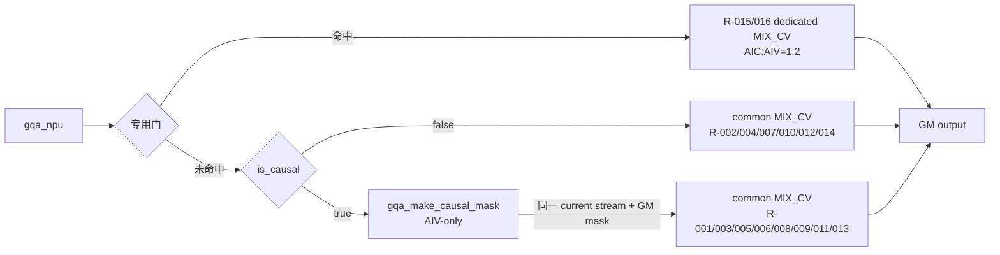
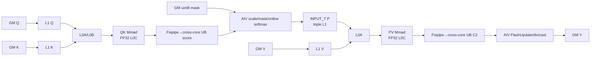

# GQA A5 Direct Invoke 算子知识

## 算子速览

| 项目 | 内容 |
|---|---|
| 实际入口 | Python `cann_bench.gqa` → dispatcher `cann_bench::gqa` → `gqa_npu` → `make_gqa_launch_plan`/`make_flash_gqa_launch_plan` → 16 个 Host 可达 MIX launcher 与可选 `launch_gqa_make_causal_mask`；入口类型为 Direct Invoke。 |
| 计算语义 | 对每只 KV head 的 `G=Nq/Nkv` 个 query heads 计算 `softmax(scale·QK^T+mask)V`；causal 使用右下对齐三角。 |
| 输入输出 | 连续 BSND `[B,S,N,D]`，Q/K/V 同 FP16 或 BF16；K/V shape 相同，`Nq%Nkv=0`，闭合 Route 的 `D∈{128,256}`；输出与 Q 同 shape/dtype/layout。 |
| 执行类型 | causal common 图为 AIV_VECTOR mask 节点 → `KERNEL_TYPE_MIX_AIC_1_2`；其它图只有 MIX_CV。MIX 内 AIC_CUBE 完成 QK/PV，两个 AIV_VECTOR 子核完成 scale、mask、FP32 online softmax、P 写 L1、跨 S2 累积、归一化与 CopyOut。 |
| Kernel 路线 | P0：R-016→R-002→R-001→R-005→R-007→R-008→R-004；P1：R-006→R-009→R-010→R-011→R-012→R-013；P2：R-003→R-014→R-015。common 使用 FIA config 1/3/18，dedicated 使用 non-causal D128 FlashAttn config 2。 |
| 核心资源 | GM Q/K/V/output 与可选 uint8 mask；有效 GM workspace 为 0；512 KiB L1、64 KiB L0A、64 KiB L0B、256 KiB L0C；AIC↔AIV 使用双向 UB/L1 buffer 与跨核 flag。 |
| 来源闭包 | direct_implementation_closed：Direct selector/POD/launcher、可选 mask 节点、common 与 dedicated MIX entry、QK/PV Cube、online softmax、workspace、AIC/AIV 同步、tail 和固定提交官方实现映射已闭合。 |
| 验证状态 | 已完成源码闭包检查；本次知识提取未执行编译、真机、数值或性能测试。 |

## 接口与语义

### 计算语义

令 Q 为 `[B,Sq,Nq,D]`，K/V 为 `[B,Skv,Nkv,D]`，`G=Nq/Nkv`。对 `(b,hq,i)`，令 `hkv=floor(hq/G)`：

```text
score_j = scale * dot(Q[b,i,hq,:], K[b,j,hkv,:])
scale = scaleValue                     , scaleValue > 0
      = 1 / sqrt(D)                    , 其他情况
causal 时 j > Skv - Sq + i 的 score_j = -∞
p_j = exp(score_j-max_j) / sum_k exp(score_k-max_j)
Y[b,i,hq,:] = cast_input_dtype(sum_j p_j * V[b,j,hkv,:])
```

S2 按 128 或 256 分块。AIV 保存每行 FP32 `max/sum`，新块到来时用 `exp(oldMax-newMax)` 重标旧的 PV 累积，再加当前 PV；最后一块才除以总和并 cast 回输入 dtype。因此没有全量概率矩阵的 GM 物化，也没有 LSE、PSE、dropout、量化或 RoPE 路径。

### 输入、输出与属性

| 参数 | shape/layout | dtype | 约束、默认值与语义 |
|---|---|---|---|
| `query` | BSND `[B,Sq,Nq,D]` | FP16/BF16 | rank 4；闭合 specialization 为 D128/D256；连续内存是 Device 地址计算前提。 |
| `key` | BSND `[B,Skv,Nkv,D]` | 与 Q 相同 | rank 4；B、D 与 Q 相同；`Nq%Nkv=0`。 |
| `value` | 与 K 完全同 shape | 与 Q 相同 | rank 4；PV 的 N 维为 D。 |
| `scaleValue` | 标量 | double/接口 float | 默认 -1；严格 `>0` 才采用显式值，否则 Host 生成 FP32 `1/sqrt(D)`。 |
| `is_causal` | 标量 | bool | 默认 false；true 表示右下 causal；安全域要求 `Sq<=Skv`。 |
| 返回值 `y` | 与 Q 同 shape/layout | 与 Q 相同 | `empty_like(query)`，有效行由最终 AIV 写回。 |

Direct Meta 层只显式检查 rank、三输入 dtype 相同、B 与 K/V shape、head 整除和 Q/K 的 D 相同。FP16/BF16、连续、D128/D256、`Sq<=Skv` 是当前已闭合 launcher/Kernel 的真实适配边界，不得把 Meta 的宽松接受误写成 Device 支持。

### 入口与版本

`cann_bench.gqa` 转发到 `torch.ops.cann_bench.gqa`；Meta 注册调用 `gqa_meta`，PrivateUse1 注册调用 `gqa_npu`。`gqa_npu` 在当前 device guard 下分配输出和可选 mask，取得 current NPU stream，并从显式 `extern "C" __global__ __aicore__` launcher 直接启动 Device；它不是 ACLNN，也不调用框架 attention 算子。

转换基线固定为 ops-transformer 提交 `be33d95bb755cedec3108f70805c1874d1792540`、CANN 9.1.0、A5/Ascend 950。官方 registry 的 GQA/FIA 与专用 FlashAttn 实例被具体化为 direct symbols；Direct 适配只替换入口、Host POD producer、TensorList→连续 K/V 指针、布尔 causal mask 物化和 metadata 携带方式，并把 registry 场景的跨 AIV output pre-clear 改为空操作（当前有效行均由计算写满，单 MIX 内 pre-clear 会与计算竞争）。这些适配不改变 QK/PV、online softmax、Cube/Vector 交接与输出数学。

## Host/Launcher 执行流程

### 参数校验与前处理

`gqa_npu` 先调用 `gqa_meta`，然后判断专用候选：`!is_causal && B==4 && D==128 && Sq==Skv`。候选还必须通过 `SectionStreamK::Compute` 的最终能力门：返回成功、恰好一个 section、FA/FD 结果存在、FA 使用核数非零且 FD AIV 数为零；否则落回 common Route。

common 计划先按 D 和序列选择 config：`D<=128 && Sq<=64 && Skv>128` 为 c1；其它 `D<=128` 为 c3；`D>128` 为 c18（正式闭合仅 D256）。causal 生成 mask；non-causal 选择编译期 `HAS_ATTEN_MASK=false` entry。c3 causal 且 `D==128 && Sq>=256 && Skv>=Sq` 使用 256×256 canonical compressed mask，否则使用 `[Sq,align32(Skv)]` full mask。

没有 Contiguous/ViewCopy/TransData。调用者必须提供连续 BSND；Meta 失败在 launch 前抛出。Direct selector 对未知 dtype 走 BF16 分支、对未知 D 走 c18，因此适配边界外不是安全 fallback。

### 参数、Workspace 与生命周期

common POD 从 shape/属性和平台查询按值生成。AIC/AIV 默认上界 36/72；查询到非零核数后分别截断到官方常量。common 还查询 L2，缺失时按 32 MiB；专用计划的 SectionStreamK 固定 `l2Byte=96 MiB`。POD 由值传入，launch 返回后不依赖 Host backing。

当前全部 MIX 实例固定 `bmm2WriteToUb=true`、`splitD=false`、FD 禁用，故 `InitMMResBuf` 不切 GM BMM2/FD workspace；common 和 dedicated 都以 output 指针作为官方 `workspace` ABI 的非空占位，但没有 Device consumer，有效 workspace 为 0 B。causal 临时 mask 不是 workspace：full 为 `Sq*align32(Skv)` B，compressed 为 `256*256` B，由 `gqa_npu` 的局部 Tensor 持有到同 stream 的 MIX 消费完成。Q/K/V/output 由调用者持有。

### 启动图与失败传播



MIX entry 标注 `KERNEL_TYPE_MIX_AIC_1_2`：逻辑 `blockDim=N` 启动 N 个 AIC 和 2N 个 AIV worker；AIV 用 `GetBlockIdx()/GetSubBlockNum()` 映射到对应 AIC，并以 `GetSubBlockIdx()` 划分该 M tile 的两半。mask 节点为 `KERNEL_TYPE_AIV_ONLY`，`maskBlockDim=min(AIV,maskRows)`，每核按 `row=blockIdx+k*blockNum` 生成行。mask→MIX 依靠同 stream 顺序和 GM 可见性；MIX 内使用 cross-core flag 与 pipe event。

launcher 为 `void`，封装 lambda 无条件返回 0，没有同步读取异步 launch 状态；若 mask launch 已提交而 MIX launch 随后出错，源码没有 Host cleanup。运行时错误由 current stream 机制传播。

## Route 与参数设计

### 分核与资源计算

```text
G = Nq / Nkv
config c1 : Mbase=64,  S2base=256, Dbase=DVbase=128
config c3 : Mbase=128, S2base=128, Dbase=DVbase=128
config c18: Mbase=64,  S2base=256, Dbase=DVbase=256
common totalTasks = B*Nkv*ceil(Sq*G/Mbase)
common blockDim = clamp(totalTasks, 1, availableAIC)

D128 metadata 候选：
residentBn = min(B*Nkv, availableAIC)
residentKvBytes = residentBn*Skv*(D+D)*sizeof(input)*2
residentKvBytes < L2 且 split_core_v2 产生 usedCoreNum>0、fdNum=0
  -> faMetadata cursor，enableS1OutSplit=false
否则 -> totalTasks 蛇形 S1-outer，enableS1OutSplit=true
```

metadata cursor 每核携带 `(BN2,M,S2)` 起止与 `firstFdDataWorkspaceIdx`。S1-outer 用正向/反向蛇形轮次减少尾部不均衡。每个 M tile 再由两个 AIV 分为 `ceil(actM/2)` 和 `floor(actM/2)`；S2 tail 记录实际元素数并按 16 个 FP16/BF16 元素对齐，D128/D256 均无 D tail。

### Route 选择

下表按阅读优先级降序排列，不代表 Host 判断顺序。`Host 顺序` 保留真实的候选短路、common 回退、dtype/config/mask 分派位置；同一 Host 顺序内再按源码中的条件先后判定。为保持字段紧凑，`F=H1→H2→H3→H4(hit/return)`，`C=H1→H2(仅候选时执行)→H3→H4(miss)`。

| 优先级 | Route | Route 特征 | Key/模板 | 精确命中条件 | Host 顺序 | 不适用去向 |
|---|---|---|---|---|---|---|
| P0 | R-016 | BF16 square 专用通路 | `flash_bf16_c2_nomask` | BF16，`!causal && B==4 && Sq==Skv && D==128`，且 SectionStreamK 单 section、FA>0、FD=0 | F | H2 失败回 common |
| P0 | R-002 | FP16 short-Q/long-KV no-mask | `fp16_c1_nomask` | FP16，`D<=128 && Sq<=64 && Skv>128 && !causal`，且未取专用通路 | C→H5(skip)→H6 FP16→H7 c1/no-mask | c1 条件失败转 c3 |
| P0 | R-001 | FP16 short-Q/long-KV causal | `fp16_c1` | FP16，`D<=128 && Sq<=64 && Skv>128 && causal` | C→H5 mask→H6 FP16→H7 c1/full | c1 条件失败转 c3 |
| P0 | R-005 | FP16 D128 full causal | `fp16_c3` | FP16，`D<=128 && causal`，且不是 c1/compressed | C→H5 mask→H6 FP16→H7 c3→H8 full | compressed 条件成立转 R-006 |
| P0 | R-007 | FP16 D128 no-mask | `fp16_c3_nomask` | FP16，`D<=128 && !causal`，不是 c1，且专用门未命中 | C→H5(skip)→H6 FP16→H7 c3/no-mask | 无 Device 回退 |
| P0 | R-008 | BF16 D128 full causal | `bf16_c3` | BF16，`D<=128 && causal`，且不是 c1/compressed | C→H5 mask→H6 BF16→H7 c3→H8 full | compressed 条件成立转 R-009 |
| P0 | R-004 | BF16 short-Q/long-KV no-mask | `bf16_c1_nomask` | BF16，`D<=128 && Sq<=64 && Skv>128 && !causal`，且未取专用通路 | C→H5(skip)→H6 BF16→H7 c1/no-mask | c1 条件失败转 c3 |
| P1 | R-006 | FP16 D128 compressed causal | `fp16_c3_compressed` | FP16，`D==128 && causal && Sq>=256 && Skv>=Sq` | C→H5 mask→H6 FP16→H7 c3→H8 compressed | 条件失败转 R-005 |
| P1 | R-009 | BF16 D128 compressed causal | `bf16_c3_compressed` | BF16，`D==128 && causal && Sq>=256 && Skv>=Sq` | C→H5 mask→H6 BF16→H7 c3→H8 compressed | 条件失败转 R-008 |
| P1 | R-010 | BF16 D128 no-mask | `bf16_c3_nomask` | BF16，`D<=128 && !causal`，不是 c1，且专用门未命中 | C→H5(skip)→H6 BF16→H7 c3/no-mask | 无 Device 回退 |
| P1 | R-011 | FP16 D256 causal | `fp16_c18` | FP16，`D>128`；闭合域 D256；causal | C→H5 mask→H6 FP16→H7 c18/full | 边界外无安全回退 |
| P1 | R-012 | FP16 D256 no-mask | `fp16_c18_nomask` | FP16，`D>128`；闭合域 D256；non-causal | C→H5(skip)→H6 FP16→H7 c18/no-mask | 边界外无安全回退 |
| P1 | R-013 | BF16 D256 causal | `bf16_c18` | BF16，`D>128`；闭合域 D256；causal | C→H5 mask→H6 BF16→H7 c18/full | 边界外无安全回退 |
| P2 | R-003 | BF16 short-Q/long-KV causal | `bf16_c1` | BF16，`D<=128 && Sq<=64 && Skv>128 && causal` | C→H5 mask→H6 BF16→H7 c1/full | c1 条件失败转 c3 |
| P2 | R-014 | BF16 D256 no-mask | `bf16_c18_nomask` | BF16，`D>128`；闭合域 D256；non-causal | C→H5(skip)→H6 BF16→H7 c18/no-mask | 边界外无安全回退 |
| P2 | R-015 | FP16 square 专用通路 | `flash_fp16_c2_nomask` | FP16，`!causal && B==4 && Sq==Skv && D==128`，且 SectionStreamK 单 section、FA>0、FD=0 | F | H2 失败回 common |

Host 的真实控制流固定为：

| Host 顺序 | 判断/动作 | 短路与回退语义 |
|---|---|---|
| H1 | 检查 `!is_causal && B==4 && D==128 && Sq==Skv` | 仅建立专用候选；不满足即继续 common |
| H2 | 运行 `make_flash_gqa_launch_plan` 并检查成功、单 section、FA 非空且 `usedCoreNum>0`、FD 非空且 `usedVecNum==0` | 全部成立才置 `useFlashRoute=true`；任一失败均继续 common |
| H3 | 无论专用候选是否成功，调用 `make_gqa_launch_plan` 构造 common plan | common plan 的构造先于 launch lambda 内的专用短路 |
| H4 | lambda 内若 `useFlashRoute`，按 FP16/其余分派 R-015/R-016 并立即返回 | 专用通路短路后续 mask/common launch；H2 失败则继续 common |
| H5 | causal 时先启动共享 mask producer | mask 与随后 MIX launch 依同 stream 排序 |
| H6 | dtype 先判精确 FP16，否则进入 BF16 分支 | 非 FP16/BF16 不在闭合域 |
| H7 | 各 dtype 内依次判 `config==1`、`config==18`、其余 c3 | 这是 common config 的真实 if/else 顺序 |
| H8 | c3 causal 内先判 `compressedMask`，再选 compressed/full；c3 non-causal 选 no-mask | 仅 c3 causal 有二次 mask specialization |

```text
专用候选且 SectionStreamK: one-section && FA>0 && FD==0
  -> R-015 FP16 / R-016 BF16
否则 common:
  D<=128 -> (Sq<=64 && Skv>128 ? c1 : c3)
  D>128  -> c18
  -> dtype
    -> non-causal: *_nomask
    -> causal c3 且 Sq>=256 且 Skv>=Sq: *_compressed
    -> 其它 causal: full-mask symbol
```

### 模板/实现执行矩阵

| 优先级 | Route | Host 顺序 | key/selector | dtype/shape/platform 完整命中条件 | 执行族与 kernel 节点 | 实际模板/body | 内存与同步特征 | tail/fallback |
|---|---|---|---|---|---|---|---|---|
| P0 | R-016 | F | `flash_bf16_c2_nomask` | BF16,B4,square,D128,non-causal,SectionStreamK 单 section/no-FD | MIX_CV | dedicated BF16 config2 | metadata cursor；BMM2→UB；workspace 0 | 门失败回 common |
| P0 | R-002 | C→H5(skip)→H6→H7 | `fp16_c1_nomask` | A5,FP16,D128,short-Q/long-KV,non-causal | MIX_CV | `<half,1,false,false>` | mask queue 编译消除；L1 P triple | M≤64、S2≤256 |
| P0 | R-001 | C→H5→H6→H7 | `fp16_c1` | A5,FP16,D128,short-Q/long-KV,causal | AIV mask→MIX_CV | `RunGqaArch35<half,1,true,false>` | full mask；UB score/C2 DB；L1 P triple | M≤64、S2≤256 |
| P0 | R-005 | C→H5→H6→H7→H8 | `fp16_c3` | FP16,D128,causal,非 compressed | AIV mask→MIX_CV | `<half,3,true,false>` | full mask；M128/S2 128 | M/S2 tail |
| P0 | R-007 | C→H5(skip)→H6→H7 | `fp16_c3_nomask` | FP16,D128,non-causal,专用门未命中 | MIX_CV | `<half,3,false,false>` | 无 mask | M/S2 tail |
| P0 | R-008 | C→H5→H6→H7→H8 | `bf16_c3` | BF16,D128,causal,非 compressed | AIV mask→MIX_CV | `<bfloat16_t,3,true,false>` | BF16 IO、FP32 acc、full mask | M/S2 tail |
| P0 | R-004 | C→H5(skip)→H6→H7 | `bf16_c1_nomask` | BF16,D128,short-Q/long-KV,non-causal | MIX_CV | `<bfloat16_t,1,false,false>` | BF16 IO、FP32 acc、无 mask | M≤64、S2≤256 |
| P1 | R-006 | C→H5→H6→H7→H8 | `fp16_c3_compressed` | FP16,D128,causal,Sq≥256,Skv≥Sq | AIV canonical mask→MIX_CV | `<half,3,true,true>` | 固定 64 KiB mask；compressed offset | M/S2 tail |
| P1 | R-009 | C→H5→H6→H7→H8 | `bf16_c3_compressed` | BF16,D128,causal,Sq≥256,Skv≥Sq | AIV canonical mask→MIX_CV | `<bfloat16_t,3,true,true>` | BF16 IO、FP32 acc、固定 mask | M/S2 tail |
| P1 | R-010 | C→H5(skip)→H6→H7 | `bf16_c3_nomask` | BF16,D128,non-causal,专用门未命中 | MIX_CV | `<bfloat16_t,3,false,false>` | BF16 IO、FP32 acc、无 mask | M/S2 tail |
| P1 | R-011 | C→H5→H6→H7 | `fp16_c18` | FP16,D256,causal | AIV mask→MIX_CV | `<half,18,true,false>` | S2 256；QK/PV D256 | M/S2 tail |
| P1 | R-012 | C→H5(skip)→H6→H7 | `fp16_c18_nomask` | FP16,D256,non-causal | MIX_CV | `<half,18,false,false>` | 无 mask；QK/PV D256 | M/S2 tail |
| P1 | R-013 | C→H5→H6→H7 | `bf16_c18` | BF16,D256,causal | AIV mask→MIX_CV | `<bfloat16_t,18,true,false>` | BF16 IO、FP32 acc、full mask | M/S2 tail |
| P2 | R-003 | C→H5→H6→H7 | `bf16_c1` | BF16,D128,short-Q/long-KV,causal | AIV mask→MIX_CV | `<bfloat16_t,1,true,false>` | BF16 IO、FP32 acc、full mask | M≤64、S2≤256 |
| P2 | R-014 | C→H5(skip)→H6→H7 | `bf16_c18_nomask` | BF16,D256,non-causal | MIX_CV | `<bfloat16_t,18,false,false>` | BF16 IO、FP32 acc、无 mask | M/S2 tail |
| P2 | R-015 | F | `flash_fp16_c2_nomask` | FP16,B4,square,D128,non-causal,SectionStreamK 单 section/no-FD | MIX_CV | dedicated `FANoQuantGqaBlockCube/Vec`, config2 | metadata cursor；BMM2→UB；workspace 0 | 门失败回 common |

全部 common specialization 固定 `layout=BSH`（BSND 字节等价）、`hasRope=false`、`KvLayoutType_NO_PA`、`isFd=false`、`enableKvPrefix=false`、`useDn=false`、`bmm2WriteToUb=true`、`splitD=false`。dedicated c2 同样固定 BSND、no-mask、no-PA、BMM2→UB、no split-D。

### 隐藏性能 Guard

| 优先级组 | Guard | Host/Tiling 条件 | Device/资源原因 | 影响 Route（按阅读顺序） | 不满足时去向 | 源码符号 |
|---|---|---|---|---|---|---|
| P0/P2 | 专用最终门 | `rc==0 && sectionNum==1 && usedCoreNum>0 && usedVecNum==0` | Direct ABI 不暴露 FD metadata/workspace | R-016、R-015 | common | `SectionStreamK::Compute`, `make_flash_gqa_launch_plan` |
| P0/P2 | c1 | `Sq<=64 && Skv>128 && D<=128` | M64/S2 256 减少短 Q 的无效 M | R-002、R-001、R-004、R-003 | c3 | config 1 |
| P0/P1 | c3 compressed | `causal && D==128 && config==3 && Sq>=256 && Skv>=Sq` | canonical 256² mask 配合 compressed offset，限制 GM mask 容量 | R-005→R-006、R-008→R-009 | full c3 | `directCompressedMask`, `AttentionmaskCopyIn` |
| P0/P1 | L2 metadata | `D==128 && residentKvBytes<L2` | K/V resident 后才运行官方代价函数 | R-002、R-001、R-005、R-007、R-008、R-004、R-006、R-009、R-010、R-003 | S1-outer | `officialMetadataRoute` |
| P0/P1/P2 | 禁 FD | `fdNum==0` | Direct POD 不带 FD table，workspace 为 0 | metadata 路径 | S1-outer/common | `splitResult.fdRes.fdNum` |
| P1/P2 | D256 | `D>128`，闭合域 D256 | config18 为 M64/S2 256/D256；D128 GQA capability 不原生覆盖 D256 | R-011、R-012、R-013、R-014 | 无安全 fallback | config 18 |
| 全局 | dtype | FP16/BF16 | 仅有 `half`/`bfloat16_t` entry | 全部 | Meta 未拒绝，错误落入 BF16；禁止使用 | `gqa_npu` dtype branch |
| 全局 | layout/连续性 | 连续 BSND | GM offset 以 BSH/BSND 字节等价计算 | 全部 | 无转换/fallback | `InOutLayoutType_BSH_BSH` |
| 全局 | causal domain | `Sq<=Skv` | `maskDiagonalOffset=Skv-Sq` 写入 uint32 | causal Route | Meta 未拒绝；禁止使用 | `make_gqa_launch_plan` |
| 全局 | 核配置 | common AIC≤36/AIV≤72；专用同上 | POD metadata 固定 36/72 上界 | 全部 | 缺失查询回默认 | `NPU_AIC_CORE_NUM`, `FA_AIC_CORE_NUM` |
| 全局 | UB | common c1≤171776 B、c3/c18≤220928 B；dedicated c2=253184 B（均含 cross-core 区） | 需容纳 score/C2 DB、Vec stage、softmax state 和 mask queue | 全部 | 无运行时 UB fallback | `InitMMResBuf`, `InitBuffers` |
| 全局 | mask producer UB | `maskStride=compressed?256:align32(Skv)` | AIV-only producer 一次在单队列容纳一整行 | causal Route | 无 Host 容量 guard；超界禁止使用 | `RunMakeCausalMask` |
| 全局 | 整数窄化 | shape int64→uint32，`B*Sq` 先做 int64 乘法 | POD 与地址计算混合 32/64 位 | 全部 | 无显式溢出 guard | 两个 plan producer |

### POD/ABI

以下 `sizeof/alignof/offsetof` 按字段顺序和 LP64 自然对齐推导；固定源码没有配套 `static_assert`，移植时必须静态复核。common `NoQuantTilingArch35` 为 272 B/align 8，`GqaDirectTiling` 为 1424 B/align 8，Host-only `GqaLaunchPlan` 推导为 1456 B/align 8；Device 只按值接收其中 `GqaDirectTiling`。

| 结构 | 字段 | 类型/位宽 | ABI 布局 | 单位 | Host/launcher producer | Device consumer | 边界 |
|---|---|---|---|---|---|---|---|
| `FiaBaseParams` | `bSize` | uint32 | off 0 | batch | B | scheduler/offset | uint32 可表 |
| 同上 | `t1Size` | uint32 | off 4 | token | B·Sq | fixed-length parser | 乘法可表 |
| 同上 | `t2Size` | uint32 | off 8 | token | B·Skv | fixed-length parser | 乘法可表 |
| 同上 | `n2Size` | uint32 | off 12 | head | Nkv | scheduler/offset | 非零 |
| 同上 | `gSize` | uint32 | off 16 | group | Nq/Nkv | scheduler/offset | `Nq%Nkv=0` |
| 同上 | `s1Size` | uint32 | off 20 | token | Sq | scheduler/M tail | uint32 |
| 同上 | `s2Size` | uint32 | off 24 | token | Skv | scheduler/S2 tail | uint32 |
| 同上 | `dSize` | uint32 | off 28 | element | D | QK copy/Mmad | 128/256 |
| 同上 | `dSizeV` | uint32 | off 32 | element | D | PV/CopyOut | 128/256 |
| 同上 | `dSizeRope` | uint32 | off 36 | element | 0 | RoPE branch | inactive |
| 同上 | `actualSeqLengthsQSize` | uint32 | off 40 | element | 0 | fixed-length Q parser | inactive 已初始化 |
| 同上 | `actualSeqLengthsKVSize` | uint32 | off 44 | element | 0 | fixed-length KV parser | inactive 已初始化 |
| 同上 | `scaleValue` | float32 | off 48 | scalar | explicit 或 `1/sqrt(D)` | Vec1 | FP32 |
| 同上 | `isKvContinuous` | uint8 | off 52 | bool | 1 | KV offset | contiguous |
| 同上 | `isSoftMaxLseEnable` | uint8 | off 53 | bool | 0 | Vec/LSE | inactive |
| 同上 | `coreNum` | uint32 | off 56 | AIC core | blockDim | scheduler | 1..36 |
| 同上 | `outputLayout` | uint32 | off 60 | enum | 0 | CopyOut | BSH 字节等价 BSND |
| `keyStrides` | `bnStride` | uint64 | off 64 | element stride | 0 | non-contiguous K path | inactive |
| 同上 | `n2Stride` | uint64 | off 72 | element stride | 0 | non-contiguous K path | inactive |
| `valueStrides` | `bnStride` | uint64 | off 80 | element stride | 0 | non-contiguous V path | inactive |
| 同上 | `n2Stride` | uint64 | off 88 | element stride | 0 | non-contiguous V path | inactive |
| `kRopeStrides` | `bnStride` | uint64 | off 96 | element stride | 0 | RoPE path | inactive |
| 同上 | `n2Stride` | uint64 | off 104 | element stride | 0 | RoPE path | inactive |
| `kScaleStrides` | `bnStride` | uint64 | off 112 | element stride | 0 | quant path | inactive |
| 同上 | `n2Stride` | uint64 | off 120 | element stride | 0 | quant path | inactive |
| `vScaleStrides` | `bnStride` | uint64 | off 128 | element stride | 0 | quant path | inactive |
| 同上 | `n2Stride` | uint64 | off 136 | element stride | 0 | quant path | inactive |
| `FiaAttenMaskParams` | `sparseMode` | uint8 | off 144 | enum | causal?3:0 | sparse range/Vec | right-down/default |
| 同上 | `preTokens` | int32 | off 148 | token | INT_MAX | sparse range | 固定 |
| 同上 | `nextTokens` | int32 | off 152 | token | causal?0:INT_MAX | sparse range | 固定 |
| 同上 | `attenMaskBatch` | uint32 | off 156 | batch | 1 | mask offset | 单张共享 mask |
| 同上 | `attenMaskS1Size` | uint32 | off 160 | row | maskRows | mask offset | full Sq 或 256 |
| 同上 | `attenMaskS2Size` | uint32 | off 164 | byte stride | maskStride | mask offset/copy | full align32(Skv) 或 256 |
| 同上 | `isRowInvalidOpen` | uint8 | off 168 | bool | 0 | row-invalid path | inactive |
| 同上 | `isExistRowInvalid` | uint8 | off 169 | bool | 0 | output-init path | inactive |
| `FiaPseParams` | `pseShiftByBatch` | uint8 | off 172 | bool | 0 | PSE path | inactive |
| 同上 | `pseS1Size` | uint32 | off 176 | element | 0 | PSE path | inactive |
| 同上 | `pseS2Size` | uint32 | off 180 | element | 0 | PSE path | inactive |
| 同上 | `pseStride` | uint32 | off 184 | element | 0 | PSE path | inactive |
| 同上 | `qStartIdx` | uint32 | off 188 | token | 0 | PSE path | inactive |
| 同上 | `kvStartIdx` | uint32 | off 192 | token | 0 | PSE path | inactive |
| `FiaSystemPrefixParams` | `isActualSharedPrefixLenNull` | uint8 | off 196 | bool | 0 | prefix path | inactive |
| 同上 | `prefixSeqInnerSize` | uint32 | off 200 | token | 0 | prefix path | inactive |
| `FiaPageAttentionParams` | `paLayoutType` | uint8 | off 204 | enum | 0 | PA path | inactive |
| 同上 | `blockSize` | uint32 | off 208 | token | 0 | PA path | inactive |
| 同上 | `maxBlockNumPerBatch` | uint32 | off 212 | block | 0 | PA path | inactive |
| `FiaLeftPaddingParams` | `isQHasLeftPadding` | uint8 | off 216 | bool | 0 | padding path | inactive |
| 同上 | `isKVHasLeftPadding` | uint8 | off 217 | bool | 0 | padding path | inactive |
| `FiaPostQuantParams` | `isPostQuantPerChnl` | uint8 | off 218 | bool | 0 | quant path | inactive |
| 同上 | `isPostQuantBF16` | uint8 | off 219 | bool | 0 | quant path | inactive |
| `FiaWorkspaceParams` | `accumOutSize` | uint32 | off 220 | float element | 0 | FD accum path | inactive，workspace 0 |
| 同上 | `logSumExpSize` | uint32 | off 224 | float element | 0 | FD max/sum path | inactive，workspace 0 |
| `FiaS1OuterSplitCoreParams` | `enableS1OutSplit` | bool | off 232 | bool | metadata 成功?false:true | scheduler | Route variant |
| 同上 | `totalSize` | uint64 | off 240 | task | metadata?0:totalTasks | snake scheduler | 64 位 |
| `FiaEmptyTensorParams` | `singleCoreSize` | uint32 | off 248 | element | 0 | empty init | inactive |
| 同上 | `needInit` | uint8 | off 252 | bool | 0 | empty init | inactive |
| 同上 | `totalOutputSize` | uint64 | off 256 | element | 0 | empty init | inactive |
| 同上 | `totalSoftMaxLseOutputSize` | uint64 | off 264 | element | 0 | empty LSE init | inactive |
| `GqaDirectTiling` | `faMetadata[*][0]` CORE_ENABLE | uint32 | off `272+core*32` | bool | metadata route 写 1 | scheduler | S1-outer 时忽略 |
| 同上 | `faMetadata[*][1]` BN2_START | uint32 | row+4 | tile cursor | 前核 BN2_END/首核0 | scheduler | metadata route |
| 同上 | `faMetadata[*][2]` M_START | uint32 | row+8 | tile cursor | 前核 M_END/首核0 | scheduler | metadata route |
| 同上 | `faMetadata[*][3]` S2_START | uint32 | row+12 | tile cursor | 前核 S2_END/首核0 | scheduler | metadata route |
| 同上 | `faMetadata[*][4]` BN2_END | uint32 | row+16 | tile cursor | split_core_v2 | scheduler | metadata route |
| 同上 | `faMetadata[*][5]` M_END | uint32 | row+20 | tile cursor | split_core_v2 | scheduler | metadata route |
| 同上 | `faMetadata[*][6]` S2_END | uint32 | row+24 | tile cursor | split_core_v2 | scheduler | metadata route |
| 同上 | `faMetadata[*][7]` FIRST_FD_DATA_WORKSPACE_IDX | uint32 | row+28 | workspace index | split_core_v2 | FD boundary | accepted route FD=0 |
| `GqaLaunchPlan` | `blockDim` | uint32 | off 1424 | AIC core | core clamp | MIX launcher | ≥1 |
| 同上 | `maskBlockDim` | uint32 | off 1428 | AIV core | min(AIV,maskRows) | mask launcher | causal |
| 同上 | `maskRows` | uint32 | off 1432 | row | full/compressed 公式 | mask launcher/tiling | causal |
| 同上 | `maskCols` | uint32 | off 1436 | col | full/compressed 公式 | mask launcher | causal |
| 同上 | `maskStride` | uint32 | off 1440 | byte | full/compressed 公式 | mask launcher/Vec | causal |
| 同上 | `maskDiagonalOffset` | uint32 | off 1444 | token | full `Skv-Sq`；compressed 0 | mask launcher | causal |
| 同上 | `compressedMask` | bool | off 1448 | flag | selector | launcher symbol | c3 causal variant |
| 同上 | `config` | uint16 | off 1450 | key | selector | launcher symbol | 1/3/18 |

dedicated POD 单独定义：`FlashAttnNoQuantTilingArch35` 推导为 144 B/align 8，`FlashGqaDirectTiling` 为 2448 B/align 8，Host-only `FlashGqaLaunchPlan` 为 2456 B/align 8。

| 结构 | 字段 | 类型/位宽 | ABI 布局 | 单位 | Host/launcher producer | Device consumer | 边界 |
|---|---|---|---|---|---|---|---|
| `FlashAttnBaseParams` | `bSize` | uint32 | off 0 | batch | B | scheduler | 固定 B4 candidate |
| 同上 | `t1Size` | uint32 | off 4 | token | B·Sq | parser | uint32 |
| 同上 | `t2Size` | uint32 | off 8 | token | B·Skv | parser | square route |
| 同上 | `n2Size` | uint32 | off 12 | head | Nkv | scheduler | 非零 |
| 同上 | `gSize` | uint32 | off 16 | group | Nq/Nkv | scheduler | 整除 |
| 同上 | `s1Size` | uint32 | off 20 | token | Sq | Cube/Vec | square |
| 同上 | `s2Size` | uint32 | off 24 | token | Skv | Cube/Vec | square |
| 同上 | `dSize` | uint32 | off 28 | element | 128 | QK | 固定 |
| 同上 | `dSizeV` | uint32 | off 32 | element | 128 | PV/output | 固定 |
| 同上 | `dSizeRope` | uint32 | off 36 | element | 0 | RoPE path | inactive |
| 同上 | `cuSeqLensQSize` | uint32 | off 40 | element | 0 | varlen Q | inactive |
| 同上 | `cuSeqLensKVSize` | uint32 | off 44 | element | 0 | varlen KV | inactive |
| 同上 | `seqUsedQSize` | uint32 | off 48 | element | 0 | seq-used Q | inactive |
| 同上 | `seqUsedKvSize` | uint32 | off 52 | element | 0 | seq-used KV | inactive |
| 同上 | `scaleValue` | float32 | off 56 | scalar | explicit/default | Vec1 | FP32 |
| 同上 | `iscuSeqLengthsNull` | uint8 | off 60 | bool | 1 | Q parser | fixed length |
| 同上 | `iscuSeqLengthsKVNull` | uint8 | off 61 | bool | 1 | KV parser | fixed length |
| 同上 | `isKvContinuous` | uint8 | off 62 | bool | 1 | KV offset | contiguous |
| 同上 | `isSoftMaxLseEnable` | uint8 | off 63 | bool | 0 | Vec/LSE | inactive |
| 同上 | `coreNum` | uint32 | off 64 | AIC core | usedCoreNum | scheduler | 1..36 |
| 同上 | `outputLayout` | uint32 | off 68 | enum | 0 | CopyOut | BSND/BSH-compatible route |
| 同上 | `needInitOutput` | bool | off 72 | bool | false | `ClearOutput` | preclear inactive |
| `FlashAttnAttenMaskParams` | `sparseMode` | uint8 | off 76 | enum | 0 | Vec sparse | no-mask |
| 同上 | `winLefts` | int32 | off 80 | token | INT_MAX | sparse range | no-mask |
| 同上 | `winRights` | int32 | off 84 | token | INT_MAX | sparse range | no-mask |
| 同上 | `attenMaskBatch` | uint32 | off 88 | batch | 0 | mask path | inactive |
| 同上 | `attenMaskS1Size` | uint32 | off 92 | row | 0 | mask path | inactive |
| 同上 | `attenMaskS2Size` | uint32 | off 96 | col/stride | 0 | mask path | inactive |
| 同上 | `isExistRowInvalid` | uint8 | off 100 | bool | 0 | output init | inactive |
| `FlashAttnPageAttentionParams` | `paLayoutType` | uint8 | off 104 | enum | 0 | PA path | inactive |
| 同上 | `blockSize` | uint32 | off 108 | token | 0 | PA path | inactive |
| 同上 | `maxBlockNumPerBatch` | uint32 | off 112 | block | 0 | PA path | inactive |
| `FlashAttnWorkspaceParams` | `accumOutSize` | uint32 | off 116 | float element | 0 | FD accum | inactive |
| 同上 | `logSumExpSize` | uint32 | off 120 | float element | 0 | FD state | inactive |
| `FlashAttnS1OuterSplitCoreParams` | `enableS1OutSplit` | bool | off 128 | bool | false | scheduler | metadata Route |
| 同上 | `totalSize` | uint64 | off 136 | task | 0 | S1-outer | inactive |
| `FlashGqaDirectTiling` | `faMetadata[*][0]` BN2_START | uint32 | off `144+core*64` | cursor | SectionStreamK | dedicated scheduler | active core |
| 同上 | `faMetadata[*][1]` M_START | uint32 | row+4 | cursor | SectionStreamK | dedicated scheduler | active core |
| 同上 | `faMetadata[*][2]` S2_START | uint32 | row+8 | cursor | SectionStreamK | dedicated scheduler | active core |
| 同上 | `faMetadata[*][3]` BN2_END | uint32 | row+12 | cursor | SectionStreamK | dedicated scheduler | active core |
| 同上 | `faMetadata[*][4]` M_END | uint32 | row+16 | cursor | SectionStreamK | dedicated scheduler | active core |
| 同上 | `faMetadata[*][5]` S2_END | uint32 | row+20 | cursor | SectionStreamK | dedicated scheduler | active core |
| 同上 | `faMetadata[*][6]` FIRST_FD_DATA_WORKSPACE_IDX | uint32 | row+24 | workspace index | SectionStreamK | FD boundary | accepted route FD=0 |
| 同上 | `faMetadata[*][7..15]` | uint32[9] | row+28..63 | reserved | `{}` | 当前 body 未读 | inactive storage 已初始化 |
| `FlashGqaLaunchPlan` | `blockDim` | uint32 | off 2448 | AIC core | SectionStreamK FA usedCoreNum | Host launcher | 1..36 |
| 同上 | `supported` | bool | off 2452 | flag | SectionStreamK gate | Host selector | false 时回 common |

### Route 源码闭包

| 优先级 | Route | Host 顺序 | Key/selector | Host/Tiling producer | POD/参数 | Kernel entry/router | Kernel body/直接依赖 | 构建接线 |
|---|---|---|---|---|---|---|---|---|
| P0 | R-016 | F | BF16 dedicated c2 | `make_flash_gqa_launch_plan` + SectionStreamK | `FlashGqaDirectTiling` | `flash_gqa_arch35_bf16_c2_nomask` | dedicated FlashAttn Cube/Vec closure | by-value cursor + concrete symbol |
| P0 | R-002 | C→H5(skip)→H6→H7 | FP16 c1 no-mask | `make_gqa_launch_plan` + `split_core_v2` | `GqaDirectTiling` | `gqa_arch35_fp16_c1_nomask` | FIA GQA Cube/Vec/no-mask closure | concrete symbol |
| P0 | R-001 | C→H5→H6→H7 | FP16 c1 full mask | 同 R-002 + mask producer | `GqaDirectTiling` | `gqa_arch35_fp16_c1` | FIA GQA Cube/Vec/mask closure | concrete symbol |
| P0 | R-005 | C→H5→H6→H7→H8 | FP16 c3 full mask | common plan + `split_core_v2` | `GqaDirectTiling` | `gqa_arch35_fp16_c3` | FIA GQA Cube/Vec/full-mask closure | concrete symbol |
| P0 | R-007 | C→H5(skip)→H6→H7 | FP16 c3 no-mask | common plan + `split_core_v2` | `GqaDirectTiling` | `gqa_arch35_fp16_c3_nomask` | FIA GQA Cube/Vec/no-mask closure | concrete symbol |
| P0 | R-008 | C→H5→H6→H7→H8 | BF16 c3 full mask | common plan + `split_core_v2` | `GqaDirectTiling` | `gqa_arch35_bf16_c3` | FIA GQA Cube/Vec/full-mask closure | concrete symbol |
| P0 | R-004 | C→H5(skip)→H6→H7 | BF16 c1 no-mask | common plan + `split_core_v2` | `GqaDirectTiling` | `gqa_arch35_bf16_c1_nomask` | FIA GQA Cube/Vec/no-mask closure | concrete symbol |
| P1 | R-006 | C→H5→H6→H7→H8 | FP16 c3 compressed | common plan + compressed mask producer | `GqaDirectTiling` | `gqa_arch35_fp16_c3_compressed` | FIA GQA Cube/Vec/compressed-mask closure | concrete symbol |
| P1 | R-009 | C→H5→H6→H7→H8 | BF16 c3 compressed | 同 R-006 | `GqaDirectTiling` | `gqa_arch35_bf16_c3_compressed` | FIA GQA Cube/Vec/compressed-mask closure | concrete symbol |
| P1 | R-010 | C→H5(skip)→H6→H7 | BF16 c3 no-mask | common plan + `split_core_v2` | `GqaDirectTiling` | `gqa_arch35_bf16_c3_nomask` | FIA GQA Cube/Vec/no-mask closure | concrete symbol |
| P1 | R-011 | C→H5→H6→H7 | FP16 c18 full mask | common plan + c18 mapping | `GqaDirectTiling` | `gqa_arch35_fp16_c18` | FIA GQA Cube/Vec/D256 mask closure | concrete symbol |
| P1 | R-012 | C→H5(skip)→H6→H7 | FP16 c18 no-mask | common plan + c18 mapping | `GqaDirectTiling` | `gqa_arch35_fp16_c18_nomask` | FIA GQA Cube/Vec/D256 no-mask closure | concrete symbol |
| P1 | R-013 | C→H5→H6→H7 | BF16 c18 full mask | common plan + c18 mapping | `GqaDirectTiling` | `gqa_arch35_bf16_c18` | FIA GQA Cube/Vec/D256 mask closure | concrete symbol |
| P2 | R-003 | C→H5→H6→H7 | BF16 c1 full mask | common plan + mask producer | `GqaDirectTiling` | `gqa_arch35_bf16_c1` | FIA GQA Cube/Vec/mask closure | concrete symbol |
| P2 | R-014 | C→H5(skip)→H6→H7 | BF16 c18 no-mask | common plan + c18 mapping | `GqaDirectTiling` | `gqa_arch35_bf16_c18_nomask` | FIA GQA Cube/Vec/D256 no-mask closure | concrete symbol |
| P2 | R-015 | F | FP16 dedicated c2 | `make_flash_gqa_launch_plan` + SectionStreamK | `FlashGqaDirectTiling` | `flash_gqa_arch35_fp16_c2_nomask` | dedicated FlashAttn Cube/Vec closure | by-value cursor + concrete symbol |

## Kernel 实现

### 公共执行流程

common 与 dedicated 都是单个 MIX launch，而不是“先 Cube kernel 再 Vector kernel”。同一 launch 内的真实任务图为：

```text
AIC: GM Q/K -> L1 -> L0A/L0B -> QK Mmad(float L0C) -> Fixpipe -> cross-core UB score
AIV0/1: wait score -> scale/mask -> FP32 online max/sum -> cast INPUT_T P -> cross-core L1
AIC: wait P -> GM V -> L1 -> L0A/L0B -> PV Mmad(float L0C) -> Fixpipe -> cross-core UB C2
AIV0/1: wait C2 -> exp-rescale/accumulate -> final divide -> cast -> GM output
```

`PRELOAD_N=2`：当前 task 做 QK/Vec1，早两轮 task 做 PV/Vec2。common task ring 为 3、使用 `%3`；dedicated task ring 为 4、使用 `loop&3` 消除内环取模，但 P/softmax 状态仍按 preload 所需的三槽轮转。每个跨核 UB score/C2 是双缓冲双向同步；P 是三缓冲正向同步。`MAKE_ID=((++idCounterNum)%11)` 在 0～10 循环分配；同步 mode 为 4，AIC/AIV0 共用 id，AIV1 使用 `id+16`（0～10 对应 16～26）。`CROSS_CORE_SYNC_BOTH` 的 `id0` 是 producer→consumer、`id1` 是 consumer→producer；P 的 forward-only L1 只用 `id0`。AIV 初始化“空闲”反向 flag，AIC 在生产前 wait；producer set 后 consumer wait，consumer 完成后再 set 允许覆盖。L1/L0 内部另以 `MTE1_MTE2`、`MTE2_MTE1`、`M_FIX`、`FIX_M` 和 `MTE3_V`/`V_MTE3` pipe event 排序。

### 共享 MIX_CV 实现闭包

#### 适用条件

##### 选择证据

| 层级 | 文件 | 符号 | 源码谓词/参数 | 结果/下一跳 |
|---|---|---|---|---|
| Host | Direct launcher | `gqa_npu` | 专用候选优先，其后 common config/dtype/causal | R-001～R-016 |
| Host/Tiling | `attention/common/op_host/arch35/fia_tiling_nonquant_gqa.cpp` | GQA capability/tiling | D128 specialized GQA tile 与资源门 | c1/c3 映射基线 |
| Host scheduler | `attention/common/op_host/arch35/split_core_v2.cpp` | `SplitCore` | L2 residency、streamK、FD result | metadata 或 S1-outer |
| Dedicated scheduler | `attention/common/op_kernel/load_balance/section_stream_k/section_stream_k_impl.h` | `SectionStreamK::Compute` | one section、FA>0、FD=0 | R-015/016 或 common |
| Router | `attention/fused_infer_attention_score/op_kernel/fused_infer_attention_score_v3.cpp` | arch35 GQA template dispatch | config/type/mask template | Direct concrete entry |

#### Device 数据流

##### 函数级调用链

```text
gqa_arch35_* / flash_gqa_arch35_*(Q,K,V,[mask],Y,by_value_tiling)
  -> RunGqaArch35 / RunFlashGqaArch35
    -> FlashAttentionNoQuantGqaKernel::Init
      -> InitMMResBuf + Cube/Vec InitBuffers
    -> Process -> FlashAttention -> ExecuteTask
      -> AIC IterateBmm1 -> QK
      -> AIV ProcessVec1Nd -> scale/mask/online softmax -> P(L1)
      -> AIC IterateBmm2 -> PV
      -> AIV ProcessVec2OnUb -> online output update/divide -> CopyOut
```

##### 源码等价伪码

```text
for each assigned (b,nkv,M_tile,S2_tile), preload ring size=3:
  AIC:
    Q tile first S2 loop GM->L1 and retain; each S2 tile K GM->L1
    L1->L0A/L0B; float QK in L0C; Fixpipe dual-dst to two AIV UB halves
  each AIV:
    wait score[loop%2]
    scores = scores*scale; optional boolean mask -> negative scalar
    (newMax,newSum,expScale,P) = online_softmax(scores, oldMax, oldSum)
    cast P to FP16/BF16; MTE3 copies own rows into P_L1[loop%3]; signal AIC
  two issues later, AIC:
    wait P_L1[(loop-2)%3]; V tile GM->L1; P*V in float L0C
    Fixpipe dual-dst to two AIV C2 UB halves; signal AIV
  each AIV:
    wait C2; first block copies, later blocks FlashUpdate with expScale
    final block divides by sum, casts to input dtype and writes valid M×D to GM
```

#### 内存与数据搬运

##### 资源与搬运表

| 层级/缓冲区 | offset/地址公式 | extent/容量公式 | dtype/layout | producer | consumer | owner/lifetime | 对齐/复用 |
|---|---|---|---|---|---|---|---|
| GM Q/K/V | BSND/BSH-equivalent offsets `(b,s,h,d)` | logical tensor extent | FP16/BF16 ND | caller | Cube copy helper | caller/stream | contiguous |
| GM causal mask | full `row*align32(Skv)`；compressed canonical offset | full `Sq*align32(Skv)` B；compressed 65536 B | uint8 row-major | AIV mask node | Vec1 mask copy | local Tensor/current stream | 32 B row；compressed 256 square |
| GM workspace | output pointer placeholder | 有效 0 B | N/A | N/A | 无 consumer | output owner | BMM2→UB、FD=false |
| cross-core UB score | manager base，DB index | `2*(Mbase/2*S2base*4)=65536` B | FP32 row-major | AIC Fixpipe | corresponding AIV Vec1 | MIX launch | bidirectional DB |
| cross-core UB C2 | score DB 后，DB index | c1 `2*16384=32768` B；c3/c18 `2*32768=65536` B | FP32 row-major | AIC Fixpipe | AIV Vec2 | MIX launch | bidirectional DB |
| L1 P | L1 起始，slot `loop%3` | `3*Mbase*S2base*2=98304` B | FP16/BF16, P matrix | 两 AIV MTE3 | AIC PV | task t→t+2 | forward flag，triple |
| L1 Q/K/V c1 | P 后依 policy 顺序 | DB Q 32768；DB K 131072；DB V 131072 B | FP16/BF16 NZ | GM copy | L0 load | AIC launch | Q 跨 S2 驻留 |
| L1 Q/K/V c3 | 同上 | DB Q/K/V 各 65536 B | FP16/BF16 NZ | GM copy | L0 load | AIC launch | DB |
| L1 Q/K/V c18 | 同上 | DB Q 65536；single K/V 各 131072 B | FP16/BF16 NZ | GM copy | L0 load | AIC launch | S2=256,D=256 single K/V |
| L0A | manager base | 65536 B physical；2×32768 B | input type | MTE1 | M | AIC launch | DB |
| L0B | manager base | 65536 B physical；c1/c3 DB，c18 single 32768 B | input type | MTE1 | M | AIC launch | policy specialization |
| L0C | manager base | 262144 B physical；4×65536 B | FP32 | Mmad | Fixpipe | AIC launch | four-buffer policy |
| AIV Vec private UB c1 | cross-core 区后 | nonmask 57088；causal 73472 B | mixed | Vec/MTE | Vec/MTE | AIV launch | queues/events |
| AIV Vec private UB c3 | 同上 | nonmask 73472；causal 89856 B | mixed | Vec/MTE | Vec/MTE | AIV launch | same |
| AIV Vec private UB c18 | 同上 | nonmask 73472；causal 89856 B | mixed | Vec/MTE | Vec/MTE | AIV launch | D256 stage2 |
| AIV Vec private UB dedicated c2 | 同上 | `2*8192 + 32768 + 2*33024 + 6400 + 512 = 122112` B | mixed | Vec/MTE | Vec/MTE | AIV launch | shared queues + softmax state |
| softmax state | Vec private UB | 3×(sum/max/exp)×256 + max/sum broadcast 2×2048 = 6400 B | FP32 | Vec1 | Vec1/Vec2 | three-task ring | modulo 3 |
| mask producer UB | one queue slot | `maskStride` B | uint8 row | Duplicate/scalar fill | DataCopy GM | one row | depth 1 |

dedicated c2 的 M128/S2 128/D128、P triple、Q/K/V L1、L0A/B/C 和 cross-core score/C2 规模与 common c3 相同；其 Vec private UB 使用两只 8192 B VECIN、32768 B shared TBuf、两只 33024 B VECOUT、6400 B softmax state 和 512 B common buffer，故总 UB 为 253184 B。其它区别是 scheduler/POD、四槽 task ring、专用 body 与 no-mask 编译实例。

##### 分层内存布局



##### 字节账、交接边与复用顺序

```text
workspace_total = 0
causal_temp = full ? Sq*align32(Skv) : 256*256 bytes

L1 c1  = P 98304 + Q 32768 + K 131072 + V 131072 = 393216 B
L1 c3  = P 98304 + Q 65536 + K 65536 + V 65536   = 294912 B
L1 c18 = P 98304 + Q 65536 + K 131072 + V 131072 = 425984 B

L0 physical = L0A 65536 + L0B 65536 + L0C 262144
crossUB c1 = 65536 + 32768 = 98304 B
crossUB c3/c18 = 65536 + 65536 = 131072 B
AIV UB total: c1 causal max 171776 B；c3/c18 causal max 220928 B；dedicated c2 131072+122112=253184 B
```

| 边/复用子区 | producer | offset/extent | dtype/layout | consumer | ordering/sync | owner/lifetime | 安全条件 |
|---|---|---|---|---|---|---|---|
| mask→Vec1 | AIV mask node | GM row offset；full/compressed extent | uint8 ND | `AttenMaskCopyIn` | same stream | causal Tensor to MIX completion | maskStride 与 POD 一致 |
| QK→Vec1 | AIC Fixpipe | DB slot，`Mbase/2*S2base*4` B/AIV | FP32 row-major | AIV `ProcessVec1` | CROSS_CORE_SYNC_BOTH | slot until Vec1 release | loop%2 |
| Vec1→PV | AIV MTE3 | triple slot，`Mbase*S2base*2` B | input dtype, P | AIC `IterateBmm2` | CROSS_CORE_SYNC_FORWARD | t 到 t+2 | loop%3、两 AIV 写不重叠 M 半区 |
| PV→Vec2 | AIC Fixpipe | DB slot，`Mbase/2*Dbase*4` B/AIV | FP32 row-major | AIV `ProcessVec2` | CROSS_CORE_SYNC_BOTH | slot until Vec2 release | loop%2 |
| Vec2 state reuse | AIV | stage2 + max/sum/exp ring | FP32 | next S2 tile | `MTE3_V/V_MTE3` + modulo3 | one output row across S2 | last tile前禁止覆盖 |

#### 同步、精度与尾块

##### 同步与数值边界表

| 阶段 | primitive/机制 | producer | consumer/等待点 | 保护对象 | 精度/尾块 |
|---|---|---|---|---|---|
| mask→MIX | current stream order | AIV-only mask | MIX Vec1 GM read | causal mask | full/compressed 布尔语义 |
| Q/K/V GM→L1→L0 | MTE2/MTE1 hard events | copy engine | Mmad | L1/L0 slot | M/S2 tail；D 固定 128/256 |
| QK | Mmad + M_FIX/FIX_M | Cube M | Fixpipe | FP32 L0C | K=D，FP32 accumulate |
| QK→Vec1 | cross-core both | AIC Fixpipe | AIV wait | FP32 score UB DB | dualDst 分两 AIV；M 奇数由 actVecMSize 划分 |
| online softmax | Vector/MicroAPI | current S2 score | next block/PV update | FP32 max/sum/exp | scale FP32；mask 置负值；S2 tail specialization ≤64/≤128/≤256 |
| P→PV | MTE3 queue + cross-core forward | AIV | AIC wait | input-dtype P L1 triple | P cast 为 FP16/BF16 |
| PV | Mmad + Fixpipe | Cube | AIV Vec2 | FP32 L0C/C2 UB | K=actual S2 tile，N=D |
| PV→Vec2 | cross-core both | AIC | AIV wait | FP32 C2 UB DB | D128/256 完整 |
| output update | `FlashUpdateNew/LastDivNew` | AIV | CopyOut | FP32 stage2/state | 旧累积按 expScale 重标；最后除 sum |
| CopyOut | V_MTE3 + MTE3_V | AIV Vector | GM output | valid M×D | cast 回输入 dtype；只写有效 M tail |

#### 关键实现

##### 符号证据表

| 阶段 | 文件 | 符号/模板实例 | 实现事实 |
|---|---|---|---|
| Host/Tiling producer | `attention/common/op_host/arch35/fia_tiling_nonquant_gqa.cpp` | GQA capability/tiling | D128 tile、资源与 Host route 基线 |
| Host scheduler | `attention/common/op_host/arch35/split_core_v2.cpp` | `SplitCore` | FA/FD 代价函数与 cursor |
| Kernel entry/router | `attention/fused_infer_attention_score/op_kernel/fused_infer_attention_score_v3.cpp` | arch35 GQA dispatch | 官方 key→GQA body 映射，Direct 具体化为 symbols |
| Device scheduler | `attention/common/op_kernel/arch35/fia_kernel_noquant_gqa.h` | `FlashAttentionNoQuantGqaKernel::Process/ExecuteTask` | preload 2、任务 ring、AIC/AIV 分支 |
| QK/PV Cube | `attention/common/op_kernel/arch35/fia_block_cube_noquant_gqa.h` | `IterateBmm1`, `IterateBmm2` | GM→L1→L0→Mmad→L0C→Fixpipe |
| online softmax/输出 | `attention/common/op_kernel/arch35/fia_block_vec_noquant_gqa.h` | `ProcessVec1Nd`, `ProcessVec2OnUb` | scale/mask、FP32 online state、P L1、输出更新 |
| AIC/AIV 协议 | `attention/common/op_kernel/buffer.h` | `Buffer<...,CROSS_CORE_SYNC_*>` | mode 4、id0/id1、AIV1 +16 与 pipe 方向 |
| Dedicated | `attention/flash_attn/op_kernel/arch35/flash_attn_kernel_noquant_gqa.h` | `FlashAttentionNoQuantGqaKernel` | c2 no-mask 专用 MIX body |

### 优先级分组

| 优先级 | 逐 Route 阅读顺序 | 共享实现族 | Host 顺序语义 |
|---|---|---|---|
| P0 | R-016 → R-002 → R-001 → R-005 → R-007 → R-008 → R-004 | dedicated c2；common c1/c3 | R-016 走 F；其余走 C 后的 H5～H8 |
| P1 | R-006 → R-009 → R-010 → R-011 → R-012 → R-013 | common c3 compressed/no-mask；c18 | 全部走 C 后的 H5～H8 |
| P2 | R-003 → R-014 → R-015 | common c1/c18；dedicated c2 | R-015 走 F；其余走 C 后的 H5～H8 |

### Route R-016（P0）：BF16 dedicated c2 no-mask

#### 适用条件

BF16，`!causal && B==4 && Sq==Skv && D==128`；H1 建立候选，H2 要求 SectionStreamK 单 section、FA>0、FD=0，H3 仍构造 common plan，H4 命中后立即返回。

#### Device 数据流

专用 `FANoQuantGqaBlockCube/Vec` 以 M128/S2 128/D128 执行 FP32 QK、AIV online softmax、输入 dtype 的 P、FP32 PV 和最终 BF16 CopyOut；task ring 为 4，P/softmax 状态为三槽。

#### 内存与数据搬运

L1/L0/cross-core UB 与 common c3 同规模；private Vec UB 122112 B、总 UB 253184 B。metadata cursor 按值传入，workspace 为 0。

#### 同步、精度与尾块

score/C2 使用双向 cross-core DB，P 使用正向 L1 三缓冲；QK/PV 均 FP32 累加，P 与输出落为 BF16，M/S2 tail 由 metadata cursor 和实际 tile 长度约束。

#### 关键实现

入口为 `flash_gqa_arch35_bf16_c2_nomask`；H2 任一门失败必须回到 common selector，不允许继续执行半闭合专用图。

### Route R-002（P0）：FP16 common c1 no-mask

#### 适用条件

FP16，`D<=128 && Sq<=64 && Skv>128 && !causal`；C 在 H4 未短路，H5 跳过，H6 选 FP16，H7 首分支选 c1。

#### Device 数据流

`RunGqaArch35<half,1,false,false>` 以 M64/S2 256/D128 完成 QK→online softmax→P→PV→输出，mask 读取路径在编译期消除。

#### 内存与数据搬运

L1 393216 B，cross-core UB 98304 B，AIV private UB 57088 B；workspace 为 0，Q 跨 S2 tile 驻留。

#### 同步、精度与尾块

score/C2 双缓冲、P 三缓冲；QK/PV FP32 累加，P/输出为 FP16；M tail≤64、S2 tail≤256。

#### 关键实现

入口为 `gqa_arch35_fp16_c1_nomask`；c1 条件失败转 c3，不存在 Device 内二次回退。

### Route R-001（P0）：FP16 common c1 full causal

#### 适用条件

FP16，`D<=128 && Sq<=64 && Skv>128 && causal`；H5 先物化 full mask，H6/H7 选择 FP16 c1。

#### Device 数据流

`RunGqaArch35<half,1,true,false>` 在 c1 QK 后由 AIV 执行 scale/full-mask/online softmax，再完成 P×V 与输出更新。

#### 内存与数据搬运

L1 393216 B，cross-core UB 98304 B，AIV 总 UB 上界 171776 B；GM mask 为 `Sq*align32(Skv)` B，workspace 为 0。

#### 同步、精度与尾块

mask producer 与 MIX 依同 stream 排序；MIX 内 score/C2 双向同步、P 正向同步；FP32 max/sum/acc 保持跨 S2 tile 更新。

#### 关键实现

入口为 `gqa_arch35_fp16_c1`；`maskDiagonalOffset=Skv-Sq`，要求 `Sq<=Skv`。

### Route R-005（P0）：FP16 common c3 full causal

#### 适用条件

FP16，D128，causal，非 c1，且 `Sq<256 || Skv<Sq`；H8 选择 full-mask c3。

#### Device 数据流

`RunGqaArch35<half,3,true,false>` 以 M128/S2 128/D128 完成 FP32 QK、masked online softmax、P×V 与 FP32 output update。

#### 内存与数据搬运

L1 294912 B，cross-core UB 131072 B，causal 总 UB 上界 220928 B；full mask 为 `Sq*align32(Skv)` B，workspace 为 0。

#### 同步、精度与尾块

两 AIV 分担 M tile；score/C2 使用双向 DB，P 使用三槽 L1；M/S2 tail 只在有效区域参与 softmax 与 CopyOut。

#### 关键实现

入口为 `gqa_arch35_fp16_c3`；compressed 条件成立时 H8 改选 R-006。

### Route R-007（P0）：FP16 common c3 no-mask

#### 适用条件

FP16，D128，non-causal，非 c1，且专用能力门未命中；H7 的 c3 no-mask 分支收口。

#### Device 数据流

`RunGqaArch35<half,3,false,false>` 保留 QK、online softmax、PV 与输出更新，编译期移除 mask queue/copy/apply。

#### 内存与数据搬运

L1 294912 B，cross-core UB 131072 B，AIV private UB 73472 B；没有 mask 临时区，workspace 为 0。

#### 同步、精度与尾块

QK/PV FP32 累加，P/输出 FP16；M/S2 tail 由实际 tile 长度约束，跨核握手与 common c3 一致。

#### 关键实现

入口为 `gqa_arch35_fp16_c3_nomask`；专用候选失败只改变入口，不改变 common plan 的生成。

### Route R-008（P0）：BF16 common c3 full causal

#### 适用条件

BF16，D128，causal，非 c1，且不满足 compressed 条件；H8 选择 full-mask c3。

#### Device 数据流

`RunGqaArch35<bfloat16_t,3,true,false>` 以 BF16 IO、FP32 QK/PV/online state 执行 M128/S2 128 主链。

#### 内存与数据搬运

资源账与 R-005 相同：L1 294912 B、cross-core UB 131072 B、causal 总 UB 上界 220928 B；workspace 为 0。

#### 同步、精度与尾块

full mask 先于 MIX；P 从 FP32 softmax 结果转 BF16 后送入 PV，最终 FP32 累积除 sum 后转 BF16。

#### 关键实现

入口为 `gqa_arch35_bf16_c3`；compressed 条件成立时 H8 改选 R-009。

### Route R-004（P0）：BF16 common c1 no-mask

#### 适用条件

BF16，`D<=128 && Sq<=64 && Skv>128 && !causal`，且未走专用通路；H7 选择 c1 no-mask。

#### Device 数据流

`RunGqaArch35<bfloat16_t,1,false,false>` 使用 M64/S2 256/D128，BF16 IO 与 FP32 QK/PV/online state。

#### 内存与数据搬运

L1 393216 B，cross-core UB 98304 B，AIV private UB 57088 B；无 mask 临时区，workspace 为 0。

#### 同步、精度与尾块

score/C2 双缓冲、P 三缓冲；M tail≤64、S2 tail≤256，输出仅写有效 BF16 区域。

#### 关键实现

入口为 `gqa_arch35_bf16_c1_nomask`；非 BF16 输入不得依赖 Host 的 else 分支。

### Route R-006（P1）：FP16 common c3 compressed causal

#### 适用条件

FP16，`D==128 && causal && Sq>=256 && Skv>=Sq`；H8 在 c3 causal 内优先选择 compressed specialization。

#### Device 数据流

主链与 R-005 相同，但 `AttentionmaskCopyIn` 按官方 compressed offset 从 canonical 256×256 mask 取片。

#### 内存与数据搬运

L1 294912 B、cross-core UB 131072 B、causal 总 UB 上界 220928 B；GM mask 固定 65536 B，workspace 为 0。

#### 同步、精度与尾块

mask producer/MIX 依同 stream；compressed row/column shift 必须与 Host 的 canonical mask 参数共同切换，M/S2 tail 保留实际长度。

#### 关键实现

入口为 `gqa_arch35_fp16_c3_compressed`；不得把 full-mask producer 与 compressed consumer 交叉组合。

### Route R-009（P1）：BF16 common c3 compressed causal

#### 适用条件

BF16，`D==128 && causal && Sq>=256 && Skv>=Sq`；H8 选择 BF16 compressed specialization。

#### Device 数据流

`RunGqaArch35<bfloat16_t,3,true,true>` 使用 canonical mask、BF16 P、FP32 QK/PV/online state。

#### 内存与数据搬运

资源账与 R-006 相同；固定 65536 B mask 与 0 B workspace 互不重叠。

#### 同步、精度与尾块

跨核协议与 common c3 相同；softmax max/sum/exp 始终为 FP32，最终转 BF16。

#### 关键实现

入口为 `gqa_arch35_bf16_c3_compressed`；条件失败时 H8 回到 R-008。

### Route R-010（P1）：BF16 common c3 no-mask

#### 适用条件

BF16，D128，non-causal，非 c1，且专用能力门未命中；H7 的 c3 no-mask 分支收口。

#### Device 数据流

`RunGqaArch35<bfloat16_t,3,false,false>` 运行 BF16 IO、FP32 QK/online softmax/PV/output update，无 mask 分支。

#### 内存与数据搬运

L1 294912 B，cross-core UB 131072 B，AIV private UB 73472 B；workspace 为 0。

#### 同步、精度与尾块

score/C2 双向 DB 与 P 正向三缓冲闭合两条 Cube 链；M/S2 tail 只访问有效元素。

#### 关键实现

入口为 `gqa_arch35_bf16_c3_nomask`；专用 H2 失败后安全落到此 Route 或 c1。

### Route R-011（P1）：FP16 common c18 full causal

#### 适用条件

FP16，D256，causal；H7 在 `config==1` 失败后命中 `config==18`。

#### Device 数据流

`RunGqaArch35<half,18,true,false>` 以 M64/S2 256/D256 执行 QK、full-mask online softmax、P×V 和输出更新。

#### 内存与数据搬运

L1 425984 B，cross-core UB 131072 B，causal 总 UB 上界 220928 B；full mask 为 `Sq*align32(Skv)` B，workspace 为 0。

#### 同步、精度与尾块

K/V 使用 131072 B single buffer，P 仍为三槽；M/S2 tail 有效，D 固定 256 无 D tail。

#### 关键实现

入口为 `gqa_arch35_fp16_c18`；D256 之外没有已闭合的 c18 安全外推。

### Route R-012（P1）：FP16 common c18 no-mask

#### 适用条件

FP16，D256，non-causal；H7 命中 c18 后直接选择 no-mask entry。

#### Device 数据流

`RunGqaArch35<half,18,false,false>` 以 M64/S2 256/D256 执行两次 FP32 Cube 乘法与无 mask online softmax。

#### 内存与数据搬运

L1 425984 B，cross-core UB 131072 B，AIV private UB 89856 B；无 mask 临时区，workspace 为 0。

#### 同步、精度与尾块

跨核协议与 R-011 相同；P 与最终输出为 FP16，max/sum/exp 和 output state 为 FP32。

#### 关键实现

入口为 `gqa_arch35_fp16_c18_nomask`；Host 对 D>128 的映射仅在 D256 闭合。

### Route R-013（P1）：BF16 common c18 full causal

#### 适用条件

BF16，D256，causal；H6 进入 BF16，H7 命中 c18 full-mask entry。

#### Device 数据流

`RunGqaArch35<bfloat16_t,18,true,false>` 使用 BF16 IO/P，QK/PV/online state 为 FP32。

#### 内存与数据搬运

L1 425984 B，cross-core UB 131072 B，causal 总 UB 上界 220928 B；workspace 为 0。

#### 同步、精度与尾块

mask producer 先行，MIX 内保持 score/C2 双向与 P 正向握手；D256 固定宽度完整搬运。

#### 关键实现

入口为 `gqa_arch35_bf16_c18`；`Sq<=Skv` 是 right-down causal offset 的必要边界。

### Route R-003（P2）：BF16 common c1 full causal

#### 适用条件

BF16，`D<=128 && Sq<=64 && Skv>128 && causal`；H5 先生成 full mask，H7 选择 c1。

#### Device 数据流

`RunGqaArch35<bfloat16_t,1,true,false>` 以 M64/S2 256/D128 执行 BF16 IO/P 和 FP32 QK/PV/online state。

#### 内存与数据搬运

L1 393216 B，cross-core UB 98304 B，causal 总 UB 上界 171776 B；workspace 为 0。

#### 同步、精度与尾块

full mask 依 stream 交接，MIX 依 cross-core flag 与 pipe event 排序；M/S2 tail 有效。

#### 关键实现

入口为 `gqa_arch35_bf16_c1`；c1 条件失败转 BF16 c3。

### Route R-014（P2）：BF16 common c18 no-mask

#### 适用条件

BF16，D256，non-causal；H6 进入 BF16，H7 命中 c18 no-mask entry。

#### Device 数据流

`RunGqaArch35<bfloat16_t,18,false,false>` 执行 BF16 IO/P、FP32 QK/PV/online state，mask 路径编译消除。

#### 内存与数据搬运

L1 425984 B，cross-core UB 131072 B，AIV private UB 89856 B；workspace 为 0。

#### 同步、精度与尾块

score/C2 双向 DB 与 P 正向三缓冲保持 preload=2；M/S2 tail 有效，D 固定 256。

#### 关键实现

入口为 `gqa_arch35_bf16_c18_nomask`；不在闭合域的 D 值禁止落入此符号。

### Route R-015（P2）：FP16 dedicated c2 no-mask

#### 适用条件

FP16，`!causal && B==4 && Sq==Skv && D==128`；H2 还要求 SectionStreamK 单 section、FA>0、FD=0，H3 构造 common plan后由 H4 短路返回。

#### Device 数据流

专用 config2 body 以 M128/S2 128/D128 完成 FP32 QK、无 mask online softmax、FP16 P、FP32 PV 与 FP16 输出；task ring 为 4。

#### 内存与数据搬运

L1/L0/cross-core UB 与 common c3 同规模，private Vec UB 122112 B、总 UB 253184 B；workspace 为 0。

#### 同步、精度与尾块

score/C2 双向同步，P 正向三缓冲；metadata cursor 约束 M/S2 tail，P/输出在 FP32 状态边界转 FP16。

#### 关键实现

入口为 `flash_gqa_arch35_fp16_c2_nomask`；H2 失败必须回 common，不允许由 Device 猜测后续调度。

## 算子特定优化

### Trick T-001：按 M/S2/D 选择 c1、c3、c18 静态 tile

#### 触发与源码依据

- 适用 Route：R-002、R-001、R-005、R-007、R-008、R-004、R-006、R-009、R-010、R-011、R-012、R-013、R-003、R-014。
- 触发条件：c1=`M64/S2 256/D128`，c3=`M128/S2 128/D128`，c18=`M64/S2 256/D256`。
- Golden 来源：[`prompt_flash_attention_template_tiling_key_enum.h:142-161`](https://gitcode.com/cann/ops-transformer/blob/be33d95bb755cedec3108f70805c1874d1792540/attention/common/op_kernel/prompt_flash_attention_template_tiling_key_enum.h)

**官方源码（固定 Commit 连续逐字摘录）**：

```cpp
static constexpr ConfigParams ConfigValue[] ={
   {inferS1TemplateType::Aligned64, inferS2TemplateType::Aligned256, inferDTemplateType::Aligned64, inferDTemplateType::Aligned64}, //0
   {inferS1TemplateType::Aligned64, inferS2TemplateType::Aligned256, inferDTemplateType::Aligned128, inferDTemplateType::Aligned128}, //1
   {inferS1TemplateType::Aligned128, inferS2TemplateType::Aligned128, inferDTemplateType::Aligned64, inferDTemplateType::Aligned64}, //2
   {inferS1TemplateType::Aligned128, inferS2TemplateType::Aligned128, inferDTemplateType::Aligned128, inferDTemplateType::Aligned128}, //3
```

#### 机制与设计原因

config 把 tile 变成编译期模板参数，驱动 L1 policy、L0B/L0C buffer 数、Matmul specialization、Vec tail 和 UB 容量。Direct Host 对短 Q/长 KV 选 M64/S2 256，对一般 D128 选 M128/S2 128；D256 使用表中 c18 的 M64/S2 256/D256 实例，避免运行时通用分支进入 Device 主循环。

#### 迁移边界

- 适用：连续 BSND、FP16/BF16、D128/D256。
- 前提：tile 的 L1/L0/UB 字节账满足 A5 资源，Host 与模板 config 一致。
- 失效：其它 D、layout、量化、PA、RoPE 必须新增能力门与实例，不得复用 c18 名义兜底。
- 未验证：本次知识提取未执行编译、真机、数值或性能测试。

#### 错误做法

把 `D>128` 当成任意 D 的支持声明会让 `dSize` 与 D256 specialization 不一致；固定仓未提供该 Direct 越界输入的安全 fallback。

### Trick T-002：preload=2 的 QK/Vec1 与 PV/Vec2 软件流水

#### 触发与源码依据

- 适用 Route：R-016、R-002、R-001、R-005、R-007、R-008、R-004、R-006、R-009、R-010、R-011、R-012、R-013、R-003、R-014、R-015。
- 触发条件：MIX_CV 主 body，`PRELOAD_N=2`；common task ring 为 3，dedicated task ring 为 4，P buffer 为三槽。
- Golden 来源：[`fia_kernel_noquant_gqa.h:563-613`](https://gitcode.com/cann/ops-transformer/blob/be33d95bb755cedec3108f70805c1874d1792540/attention/common/op_kernel/arch35/fia_kernel_noquant_gqa.h)；[`flash_attn_kernel_noquant_gqa.h:57-67`](https://gitcode.com/cann/ops-transformer/blob/be33d95bb755cedec3108f70805c1874d1792540/attention/flash_attn/op_kernel/arch35/flash_attn_kernel_noquant_gqa.h)

**官方源码（固定 Commit 连续逐字摘录）**：

```cpp
if (runInfo0.isValid) {
    if ASCEND_IS_AIC {
        ComputeMm1(runInfo0);
    } else {
        ComputeVec1(runInfo0);
    }
}
if (loop >= PRELOAD_N) {
    if (runInfoNegN.isValid) {
        if ASCEND_IS_AIC {
            ComputeMm2(runInfoNegN);
        } else {
            ComputeVec2(runInfoNegN);
        }
```

#### 机制与设计原因

当前任务的 QK/softmax 与两轮前任务的 PV/output 更新交错，P 用三槽 L1 匹配两轮依赖，score/C2 用双槽 UB。common 直接 `%3` 管理三只 task slot；dedicated 将仅保存 `RunInfoX` 的 task ring 扩为 4 并用位掩码索引，但不改变三槽 P/softmax 生命周期。这样 AIC 和两个 AIV 在同一 launch 内持续推进不同阶段，且同步协议精确绑定槽的 producer/consumer。

#### 迁移边界

- 适用：同一 MIX 1:2 launch、QK→P→PV 依赖图不变。
- 前提：P triple、UB double buffer、loop modulo 与跨核 flag 必须一起迁移。
- 失效：改 preload 深度、AIC:AIV 比或拆成多 Kernel 后必须重做槽数、offset、flag 和 lifetime。
- 未验证：本次知识提取未执行编译、真机、数值或性能测试。

#### 错误做法

只复制 `ExecuteTask` 的错峰顺序而仍保留双槽 P，会在 `t` 与 `t+2` 间覆盖尚未由 AIC 消费的数据。

### Trick T-003：BMM2 直接写 UB 并在 AIV 做 FP32 online 更新

#### 触发与源码依据

- 适用 Route：R-016、R-002、R-001、R-005、R-007、R-008、R-004、R-006、R-009、R-010、R-011、R-012、R-013、R-003、R-014、R-015。
- 触发条件：`bmm2WriteToUb=true`、FD=false、D≤256。
- Golden 来源：[`fia_block_vec_noquant_gqa.h:513-558`](https://gitcode.com/cann/ops-transformer/blob/be33d95bb755cedec3108f70805c1874d1792540/attention/common/op_kernel/arch35/fia_block_vec_noquant_gqa.h)

**官方源码（固定 Commit 连续逐字摘录）**：

```cpp
bmm2ResBuf.WaitCrossCore();
ProcessVec2OnUb(bmm2ResBuf, runInfo);
return;
```

#### 机制与设计原因

PV 的 FP32 L0C 结果经 Fixpipe 进入 cross-core UB，AIV 直接与旧累积做 `FlashUpdateNew/FlashUpdateLastNew`，最后 `LastDivNew` 并 CopyOut。它消除了每个 S2 tile 的 GM C2 临时区，也使 current Direct workspace 的有效字节数为 0；online max/sum 保持跨 S2 的数值稳定性。

#### 迁移边界

- 适用：D128/D256、AIV UB 能容纳 C2 与 stage2。
- 前提：FP32 accumulate/update，P 仅在 softmax 后 cast；最后一块才 divide。
- 失效：更大 D、FD/S2 split、UB 不足时需恢复 GM workspace 和对应 metadata/归并协议。
- 未验证：本次知识提取未执行编译、真机、数值或性能测试。

#### 错误做法

在每个 S2 tile 单独归一化后累加 PV 会改变 softmax；把 output 指针占位误当可写 workspace 也可能破坏未完成的输出行。

### Trick T-004：D128 优先官方 metadata cursor，FD 需求回退 S1-outer

#### 触发与源码依据

- 适用 Route：R-002、R-001、R-005、R-007、R-008、R-004、R-006、R-009、R-010、R-003。
- 触发条件：D128、resident K/V 小于 L2；`split_core_v2` 最终 `fdNum==0 && usedCoreNum>0`。
- Golden 来源：[`split_core_v2.cpp:782-805`](https://gitcode.com/cann/ops-transformer/blob/be33d95bb755cedec3108f70805c1874d1792540/attention/common/op_host/arch35/split_core_v2.cpp)

**官方源码（固定 Commit 连续逐字摘录）**：

```cpp
result.maxCost = INT64_MAX;
result.usedCoreNum = 1U;

FAMetaData tmpResult{coreNum, result.vecCubeRatio};
for (uint32_t i = minCore; i <= maxCore; ++i) {
    CalcSplitPlan(i, result.maxCost, splitContext, tmpResult);
    if (tmpResult.maxCost < result.maxCost) {
        CopyTmpResult(tmpResult, result);
    }
    ClearTmpResult(tmpResult);
}
```

#### 机制与设计原因

Direct 将每核 FA cursor 按值嵌入 POD，避免 registry 路径的 metadata tensor/copy。若代价函数要求 FD，Direct ABI 因没有 FD table、accumOut/logSumExp workspace 而不做半闭合复刻，改用已闭合的 S1-outer 蛇形调度；这保持 workspace=0 和单 MIX 图。

#### 迁移边界

- 适用：fixed-length D128、metadata FA-only 结果。
- 前提：cursor 字段顺序、coreNum、L2 predicate 与官方代价函数一致。
- 失效：FD 非零、D256 或 L2 miss 使用 S1-outer；需要 FD 时必须新增 workspace 和完整归并节点。
- 未验证：本次知识提取未执行编译、真机、数值或性能测试。

#### 错误做法

忽略 `fdNum` 仍只启动 FA 会遗漏跨 S2 分块归并；Direct 的正确边界是回退，不是静默丢弃 FD。

### Trick T-005：causal mask 单次共享物化与编译期 no-mask 消除

#### 触发与源码依据

- 适用 Route：causal R-001/R-005/R-008/R-006/R-009/R-011/R-013/R-003；non-causal 对应 Route 按 R-016/R-002/R-007/R-004/R-010/R-012/R-014/R-015 顺序编译消除 mask。
- 触发条件：布尔 `is_causal`；c3 大 causal 使用 256² canonical mask，其余 full mask。
- Golden 来源：[`attenmask_gs1.h:464-479`](https://gitcode.com/cann/ops-transformer/blob/be33d95bb755cedec3108f70805c1874d1792540/attention/common/op_kernel/arch35/attenmask_gs1.h)

**官方源码（固定 Commit 连续逐字摘录）**：

```cpp
uint64_t maskOffset = ComputeAttenMaskOffsetCompressDn(info, info.gs1StartIdx);
GlobalTensor<ATTENTIONMASK_T> srcGmAddr;
srcGmAddr.SetGlobalBuffer((__gm__ ATTENTIONMASK_T *)srcGm);
if constexpr (S2_BASE_SIZE == 128) {
    DataCopyParams dataCopyParams;
```

#### 机制与设计原因

Direct 先用一个 AIV-only 节点把布尔属性转换为共享 uint8 GM mask，避免每个 `(B,Nkv,G)` task 重建三角。大 c3 causal 复用官方 compressed offset 只保存 canonical tile；non-causal 用独立模板令 mask queue、copy 和 select 整段编译消除。mask 节点与 MIX 之间只通过 GM 和同 stream 排序交接。

#### 迁移边界

- 适用：右下 causal、`Sq<=Skv`、uint8 mask。
- 前提：full/compressed 的 `attenMaskS1Size/S2Size`、offset 语义和物理 stride 同步变化。
- 失效：任意用户 mask、左上 causal、band/tree 或不同 batch mask 需独立 producer/POD。
- 未验证：本次知识提取未执行编译、真机、数值或性能测试。

#### 错误做法

只把 full mask 缩成 256² 而仍用 raw `[Sq,Skv]` row offset 会越界或读错三角；必须同时切换 compressed consumer specialization。

### Trick T-006：专用 FlashAttn 只在 one-section/no-FD 后覆盖 common

#### 触发与源码依据

- 适用 Route：R-016、R-015。
- 触发条件：non-causal、B4、square、D128，再由 SectionStreamK 的 one-section/FA>0/FD=0 判定。
- Golden 来源：[`section_stream_k_impl.h:596-608`](https://gitcode.com/cann/ops-transformer/blob/be33d95bb755cedec3108f70805c1874d1792540/attention/common/op_kernel/load_balance/section_stream_k/section_stream_k_impl.h)

**官方源码（固定 Commit 连续逐字摘录）**：

```cpp
if (m_param.fdOn) {
    ScheduleFa(faWithFdConfig, computeContext, tmpResult);
    if (tmpResult.maxCost < bestResultWithFd.maxCost) {
        bestResultWithFd = tmpResult;
        faWithFdConfig.coreLimit = bestResultWithFd.usedCoreNum;
        faWithFdConfig.costLimit = bestResultWithFd.maxCost;
    }
    tmpResult.Clear();
}
ScheduleFd(deviceInfo.aivCoreMaxNum, bestResultWithFd);
return (CheckChooseWithFd(computeContext.gridInfo.sectionNum, bestResultNoFd, bestResultWithFd)) ?
       bestResultWithFd : bestResultNoFd;
```

#### 机制与设计原因

专用 c2 使用 M128/S2 128/D128 与专用 FlashAttn GQA body，Host 把 SectionStreamK 的 FA endpoint metadata 直接放入 by-value POD。能力门放在 launch 前；任何多 section、空 FA 或 FD 需求都保留 common 路线，避免专用 body 只闭合一半调度协议。

#### 迁移边界

- 适用：当前精确 predicate 与 FP16/BF16 no-mask。
- 前提：SectionStreamK 参数、metadata 字段顺序、usedCoreNum 与 blockDim一致。
- 失效：causal、多 section、FD、D256 或非 square 回 common。
- 未验证：本次知识提取未执行编译、真机、数值或性能测试。

#### 错误做法

仅以 B4/square/D128 选择专用 kernel、跳过 SectionStreamK 最终门，会把需要 FD 或不同 section 图的输入送入不完整 Direct ABI。

## 模板与实现对比

| 对比维度 | P0：R-016→R-002→R-001→R-005→R-007→R-008→R-004 | P1：R-006→R-009→R-010→R-011→R-012→R-013 | P2：R-003→R-014→R-015 | 设计选择依据 |
|---|---|---|---|---|
| 命中条件 | dedicated BF16 square；高频 common c1/c3 FP16/BF16 full/no-mask | c3 compressed/no-mask；c18 FP16/BF16 causal/no-mask | BF16 c1 causal；BF16 c18 no-mask；dedicated FP16 square | 精确 Host predicate + capability gate |
| Host 顺序 | R-016 为 F；其余为 C 后的 H5～H8 | C 后的 H5～H8 | R-015 为 F；其余为 C 后的 H5～H8 | 专用短路与 common 回退分离 |
| 执行族/节点图 | causal 为 mask→MIX，其余 MIX | causal 为 mask→MIX，其余 MIX | R-003 为 mask→MIX，其余 MIX | boolean mask 与编译期实例 |
| tile | dedicated/c3 为 M128,S2 128,D128；c1 为 M64,S2 256,D128 | c3 为 M128,S2 128,D128；c18 为 M64,S2 256,D256 | c1/c18/dedicated 对应相同静态配置 | `ConfigValue` 与 dedicated config2 |
| workspace/L1/crossUB | 全部 ws0；c1 393216/98304 B，c3/dedicated 294912/131072 B | 全部 ws0；c3 294912/131072 B，c18 425984/131072 B | 全部 ws0；按 c1/c18/dedicated 取对应账 | BMM2→UB、FD=false |
| AIC/AIV 交接 | score UB DB→P L1 triple→C2 UB DB | 同 | 同 | MIX 1:2 flags |
| 精度与 tail | FP32 acc/online；按 M64/M128、S2 128/256 收尾 | 同；D256 无 D tail | 同 | body specialization |
| 回退边界 | dedicated 门失败回 common；common 无 Device 回退 | c3 full/compressed/no-mask 由 Host 定符号；c18 边界外无安全回退 | dedicated 门失败回 common；common 边界同前 | Host 决策树 |

## 平台差异

| 项目 | A2 | A3 | A5 |
|---|---|---|---|
| 支持状态 | 本 Direct 交付未提供 | 本 Direct 交付未提供 | 支持；目标 `ascend950`/`dav-3510` |
| Host/Launcher | N/A | N/A | 平台查询 AIC/AIV/L2；显式 MIX 1:2 launcher |
| Kernel/资源 | N/A | N/A | arch35 common FIA + dedicated FlashAttn；512 KiB L1、AIC/AIV cross-core buffer |

官方文件中出现 `arch35` 不能单独外推任意产品支持；本卡的平台事实来自固定 A5 Direct 交付范围，未把 A2/A3 的其它 FIA 实现合入。

## 限制与失败边界

- 正式闭合域是连续 BSND FP16/BF16、D128/D256、K/V 同 shape、Q/K batch 与 D 相同、`Nq%Nkv=0`；Meta 没有完整拒绝适配边界外输入，调用方必须先守卫。
- causal 必须 `Sq<=Skv`；否则无符号 diagonal offset 下溢。full causal mask 占 `Sq*align32(Skv)` bytes，分配失败在 launch 前传播。
- D256 是从共享 generic arch35 tile 适配的 Direct route，不得称为官方 specialized-GQA capability；其它 D 没有安全 fallback。
- Direct ABI 没有 actual-seq、PSE、RoPE、PA、prefix、quant、LSE、FD metadata 或 FD workspace；相应 POD storage 为 inactive/default。
- metadata 代价函数请求 FD 时必须回 S1-outer；不得只提交 FA 部分。专用 SectionStreamK 任一门失败也必须回 common。
- workspace 有效 extent 为 0；output 只是官方 ABI 的非空占位。未来切 `bmm2WriteToUb=false` 或启用 FD 时必须新增并闭合 GM slice、offset、owner、同步和异常生命周期。
- launcher 不同步检查异步 Device launch；mask 与 MIX 依赖 current stream。跨 stream 复用 mask/output 必须由上层建立事件，不可仅依赖 Host 调用先后。
- 固定官方仓不包含这套任务接口的 Direct Python/PrivateUse1 schema；本卡只把固定提交的官方计算/调度闭包映射到明确的 Direct 适配边界，不把它补造成 ACLNN。
- 本次知识提取未执行编译、真机、数值或性能测试。

## 源码索引

### 链路索引

| 链路阶段 | 文件 | 关键符号 | 支撑内容 |
|---|---|---|---|
| Host/Tiling 声明 | `attention/common/op_host/arch35/fia_tiling_nonquant_gqa.h` | GQA tiling class/声明 | Host producer 的固定版本声明边界 |
| Host/Tiling | `attention/common/op_host/arch35/fia_tiling_nonquant_gqa.cpp` | GQA capability/tiling | c1/c3 D128 specialization 基线 |
| Host scheduler | `attention/common/op_host/arch35/split_core_v2.cpp` | `SplitCore` | FA/FD 代价函数与 metadata cursor |
| 官方 registry | `attention/fused_infer_attention_score/op_kernel/fused_infer_attention_score_v3.cpp` | arch35 GQA dispatch | key/模板到 common body |
| 模板表 | `attention/common/op_kernel/prompt_flash_attention_template_tiling_key_enum.h` | `ConfigValue` | c1/c3/c18 的 M/S2/D/DV |
| POD | `attention/common/op_kernel/fia_tiling_data_public.h` | `Fia*Params`, `FiaMetaData` | 字段顺序与 metadata index |
| POD aggregate | `attention/common/op_kernel/arch35/fia_tiling_data_noquant_gqa.h` | `NoQuantTilingArch35` | common POD 聚合顺序 |
| common scheduler | `attention/common/op_kernel/arch35/fia_kernel_noquant_gqa.h` | `FlashAttentionNoQuantGqaKernel` | preload、workspace、任务和交接 |
| common Cube | `attention/common/op_kernel/arch35/fia_block_cube_noquant_gqa.h` | `FANoQuantGqaBlockCube` | QK/PV、L1/L0、Fixpipe、tail |
| common Vector | `attention/common/op_kernel/arch35/fia_block_vec_noquant_gqa.h` | `FANoQuantGqaBlockVec` | mask、online softmax、P/C2/output |
| mask helper | `attention/common/op_kernel/arch35/attenmask_gs1.h` | `AttentionmaskCopyIn` | full/compressed mask offset/copy |
| cross-core | `attention/common/op_kernel/buffer.h` | `Buffer`, `SyncType` | mode 4、flag 0～10/AIV1 +16、pipe 与 AIC/AIV owner |
| dedicated Host | `attention/flash_attn/op_host/arch35/flash_attn_tiling.cpp` | FlashAttn tiling | c2 route tiling 基线 |
| dedicated metadata | `attention/flash_attn_metadata/op_kernel_aicpu/flash_attn_metadata_aicpu.cpp` | metadata producer | FA/FD endpoint metadata 语义 |
| dedicated scheduler | `attention/common/op_kernel/load_balance/section_stream_k/section_stream_k_impl.h` | `SectionStreamK` | section capability/FA/FD result |
| dedicated Kernel | `attention/flash_attn/op_kernel/arch35/flash_attn_kernel_noquant_gqa.h` | `FlashAttentionNoQuantGqaKernel` | 专用 c2 MIX schedule |
| dedicated Cube | `attention/flash_attn/op_kernel/arch35/flash_attn_block_cube_noquant_gqa.h` | `FANoQuantGqaBlockCube` | 专用 QK/PV Cube |
| dedicated Vector | `attention/flash_attn/op_kernel/arch35/flash_attn_block_vec_noquant_gqa.h` | `FANoQuantGqaBlockVec` | 专用 online softmax/output |

### 实现复用检查

| 检查项 | 可复用事实 | 不得改变的约束 | 源码符号 |
|---|---|---|---|
| ABI/POD | common/dedicated base params 与 FA cursor 可按值携带 | 字段顺序、位宽、36 核上界、inactive 初始化 | `NoQuantTilingArch35`, FlashAttn tiling data |
| 调用顺序 | mask可选→单 MIX；MIX 内 QK→Vec1→PV→Vec2 | preload=2、P triple、score/C2 double | `ExecuteTask` |
| workspace/内存 | BMM2→UB 时有效 workspace 0 | 不得让 inactive FD/GM C2 路径读取 output 占位；L1/UB 容量公式不变 | `InitMMResBuf` |
| 同步 | cross-core both/forward 与 MTE/FIX events 可复用 | mode 4、id0/id1、AIV1 +16、slot modulo、AIV sub-block 映射、防覆盖周期 | `buffer.h`, Cube/Vec blocks |
| 精度与尾块 | FP32 QK/PV/online state，末块 divide 后 cast | scale/mask/max/sum/exp 顺序；M/S2 有效域；D 仅128/256 | `ProcessVec1Nd`, `ProcessVec2OnUb` |
| Route | c1/c3/c18 与 dedicated c2 selector | dedicated 最终门、FD=0、compressed producer/consumer 同步切换 | Host plan + `ConfigValue` |
| 失败边界 | 门失败回 common；FD 请求回 S1-outer | 不得把 Meta 宽松域、unknown D/dtype 当支持；异步错误按 stream 传播 | `gqa_npu`, two plan producers |
