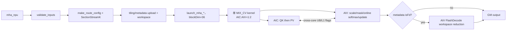
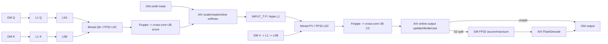

# MHA A5 Direct Invoke 算子知识

## 算子速览

| 项目 | 内容 |
|---|---|
| 实际入口 | Python `mha` → dispatcher `cann_bench::mha` → `mha_npu` → `launch_mha_{fp16,bf16}_{mask,nomask}` → `mha_*_c0..c4`；Direct Invoke。 |
| 计算语义 | BSND dense MHA：`O=softmax(scale·QK^T+mask)V`；causal 使用右下对齐规则 `j<=i+(S_kv-S)`。 |
| 输入输出 | 连续 rank-4 BSND；Q `[B,S,N,D]`，K/V `[B,S_kv,N,D]`；统一 FP16/BF16，`D∈{64,128,256}`；输出同 Q。 |
| 执行类型 | 单节点 `MIX_CV`，entry 标注 `KERNEL_TYPE_MIX_AIC_1_2`：AIC_CUBE 做 QK/PV，AIV_VECTOR 做 scale、mask、online softmax、P/状态交接、归一化与输出；SectionStreamK 需要时同一 launch 追加 AIV FlashDecode 归并。 |
| Kernel 路线 | P0：R-013、R-009、R-010、R-012、R-017、R-018；P1：R-001、R-002、R-004、R-011、R-014、R-015、R-016；P2：R-003、R-005、R-006、R-007、R-008、R-019、R-020。Host 仍按源码 config→dtype→causal 顺序分发。 |
| 核心资源 | GM Q/K/V/mask/output、runtime metadata、workspace；512 KiB L1、64 KiB L0A、64 KiB L0B、256 KiB L0C，以及 AIC/AIV 共用 UB 与 AIV 私有 UB。 |
| 来源闭包 | `direct_implementation_closed`：schema/校验、POD、SectionStreamK metadata、workspace、全部 Host 可达 entry、AIC/AIV body、同步、精度、tail 与构建接线均闭合。 |
| 验证状态 | 已完成源码闭包检查；本次知识提取未执行编译、真机、数值或性能测试。 |

## 接口与语义

### 计算语义

令 `Q∈R[B,S,N,D]`、`K,V∈R[B,S_kv,N,D]`。每个 `(b,i,h)` 独立计算：

```text
score[i,j] = scale * dot(Q[b,i,h,:], K[b,j,h,:])
scale = scaleValue                         if scaleValue > 0
      = 1 / sqrt(D)                        otherwise
causal valid(i,j) = (j <= i + S_kv - S)
p[i,:] = softmax(score[i,:] with invalid positions set to negative large)
O[b,i,h,:] = cast_input_dtype(sum_j p[i,j] * V[b,j,h,:])
```

QK 与 PV 都以 FP32 L0C 累加。AIV 按 S2 tile 维护 FP32 max、sum 和输出累计：新 tile 的 max 改变时先用 `exp(oldMax-newMax)` 重标度旧 sum/旧输出，再合入新概率；只有最后一个有效 S2 tile 才除以总 sum 并 `CAST_ROUND` 到输入 dtype。概率 P 在 FP32 softmax 后转换为输入 dtype，再通过 L1 交给 PV Cube。

causal mask 在 Host 物化为 2048×2048 的上三角 uint8 表，Device 结合 `sparseMode=RIGHT_DOWN_CAUSAL` 和 `S_kv-S` 进行右下语义的块裁剪与边界 mask；不能把最终规则简化成固定 `j<=i`。

### 输入、输出与属性

| 参数 | shape/layout | dtype | 约束、默认值与语义 |
|---|---|---|---|
| `query` | `[B,S,N,D]`, contiguous BSND | FP16/BF16 | rank 4；`B,S,N>0`；决定 device、dtype、输出与 route。 |
| `key` | `[B,S_kv,N,D]`, contiguous BSND | 同 Q | B/N/D 与 Q 一致；`S_kv>0`。 |
| `value` | `[B,S_kv,N,D]`, contiguous BSND | 同 Q | shape 与 K 一致。 |
| `scaleValue` | scalar | double→FP32 | 默认 -1；`<=0` 时使用 `1/sqrt(D)`。 |
| `is_causal` | scalar | bool | 默认 false；true 时要求 `S<=S_kv`。 |
| 返回值 | `[B,S,N,D]`, BSND | 同 Q | `empty_like(query)`，由最后一次 AIV Vec2 提交有效行。 |

不支持 GQA/MQA、BNSD/TND、paged KV、PSE、RoPE、dropout、量化、sink 或 LSE 输出；这些能力虽存在于官方公共模板，Direct Host 没有 producer。

### 入口与版本

`TORCH_LIBRARY_FRAGMENT` 声明 schema，Meta 入口 `mha_meta` 只执行同一组校验并返回 `empty_like(query)`；PrivateUse1 入口 `mha_npu` 取得当前 NPU stream，直接调用 C ABI launcher。它不是 ACLNN 两段式入口，也不调用 OPP 中的 PromptFlashAttention、FusedInferAttentionScore、IncreFlashAttention 或 SparseFlashAttention。

固定官方仓中的上述四个家族分别提供 prefill、融合推理、decode 与 sparse/mask 的相关实现边界；本转换实际 Device body 对应 `flash_attn` arch35 no-quant GQA 家族及 `attention/common`。本文不会把 sibling family 的公开接口、支持域或 tiling ABI套到 Direct Invoke。

## Host/Launcher 执行流程

### 参数校验与前处理

`mha_npu` 先用 `OptionalDeviceGuard(query.device())` 绑定设备，再检查 rank、dtype 集合、Q/K/V dtype 相同、连续 BSND、B/N/D 一致、K/V 序列一致、非空 B/S/N/S_kv、`D∈{64,128,256}`，以及 causal 的 `S<=S_kv`。没有 Contiguous、ViewCopy、TransData 或隐式 cast；失败由 `TORCH_CHECK` 在 launch 前终止。

随后分配输出并把非正 scale 变为 `1/sqrt(D)`。route cache 的 key 包含 device、B、S、S_kv、N、D、scale 的 float bit pattern与 causal；miss 时构造 tiling、运行 SectionStreamK、将 tiling/runtime metadata 上传到 device。causal mask 按 device 缓存；workspace 每次调用新分配。

### 参数、Workspace 与生命周期

Host 固定 `AIC=36`、`AIV=72`，SectionStreamK 参数为 `l2Byte=96 MiB`、`fdTolerance=10`、`fdLeastBlock=3`、`fdOn=true`。runtime metadata 的物理布局为：

```text
header = 16 * uint32                         # [sectionNum,isFd,mBase,s2Base,...]
FA     = sectionNum * 36 * 16 * uint32      # 每 AIC 的 BN2/M/S2 起止与首个 FD workspace index
FD     = sectionNum * 72 * 16 * uint32      # 每 AIV 的 BN2/M/workspace/split/start/len
metadata_bytes = 64 + sectionNum * 6912
```

route tiling 与 metadata tensor 由静态 cache 持有；causal mask tensor 也由 per-device cache 持有。workspace/output/输入由调用栈与框架保持到当前 stream 完成。tiling 和 metadata 的 H2D 拷贝必须在首次 launch 前可见；代码使用同步 `aclrtMemcpy`。cache mutex 保护 Host map 与创建过程，不是 Device stream event。

记 `M=mBase`。Host workspace 公式为：

```text
reserved_bmm2 = (D>128 ? M*256*4 : 0) * 3 * 72
accumOutSize  = 72 * 2 * M * D             # FP32 element
logSumExpSize = 72 * 2 * M * 8             # FP32 element
workspace = align4096(reserved_bmm2 + (accumOutSize + 2*logSumExpSize)*4)
```

当前五个 config 的 BMM2 都由 `GetC2Position` 选为 UB：D≤128 直接命中，D256 因 `(S1Template,S2Template)=(64,256)` 命中 `isNdS2Size256`。因此 `reserved_bmm2` 是 Host 过量预留；FD 实际使用 workspace 起点的 `accumOut`、其后的 sum 和 max。若 metadata `isFd=0`，这些 FP32 slice 也不被 Device 访问。

### 启动图与失败传播



launcher 的 `switch(config)` 对 0..3 显式分发，default 发 c4；`make_route_config` 只产生 0..4。每个 entry 以 `<<<36,nullptr,currentStream>>>` 启动，MIX 标注编码 1:2，因此逻辑 block `aicIdx` 对应 AIV `2*aicIdx` 与 `2*aicIdx+1`。launcher 返回 `void`，`RunOpApi` lambda 固定返回 0；源码没有同步检查异步 launch 状态，也没有后续 Host kernel gate 或 cleanup 节点。

## Route 与参数设计

### 分核与资源计算

```text
默认: sOuter=64, sInner=128
if D<=128 && S<=64 && S_kv>128: sOuter=32, sInner=256
if D==256:                     sOuter=32, sInner=256
mBase = 2*sOuter

c0: M128, S2Base128, D64
c1: M64,  S2Base256, D64
c2: M128, S2Base128, D128
c3: M64,  S2Base256, D128
c4: M64,  S2Base256, D256
```

SectionStreamK 把 `(B,N,M-block,S2-block)` 的区间写入每 section 的 FA metadata；每 AIC 按 metadata 的半开起止坐标遍历。AIV 用 `aicIdx=GetBlockIdx()/2`、`subBlockIdx=GetSubBlockIdx()` 将每个 M tile 分成 `ceil(actM/2)` 与余数两半。S2 tail 为 `actSingleLoopS2Size`，并对齐到 `32B/sizeof(INPUT_T)=16` 元素；M tail 由 `actMSize` 与两个 AIV 的 `actVecMSize` 保护。

### Route 选择

P0 是首要实现与审计路线，P1 是紧随其后的覆盖路线，P2 是仍由 Host 可达的防御性 specialization。优先级只决定本文阅读和复用顺序，不改变运行时 selector。

| 优先级 | Route | Route 特征 | Host顺序 | 不适用去向 |
|---|---|---|---|---|
| P0 | R-013 | FP16、non-causal、D128、短 query/长 KV；c3 M64×S2 256 | H1 默认 tile→短长谓词真→c3；H2 FP16真→causal假→nomask | H1谓词假去c2；dtype或属性改变去对应 Route |
| P0 | R-009 | FP16、non-causal、D128 general；c2 M128×S2 128、DN | H1 默认 tile→短长谓词假→c2；H2 FP16真→causal假 | 短长谓词真去R-013 |
| P0 | R-010 | FP16、causal、D128 general；c2、ND+mask | H1同R-009；H2 FP16真→causal真 | 短长谓词真去R-014；causal域失败终止 |
| P0 | R-012 | BF16、causal、D128 general；c2、ND+mask | H1同R-009；H2 FP16假→BF16→causal真 | 短长谓词真去R-016；causal域失败终止 |
| P0 | R-017 | FP16、non-causal、D256；c4 M64×S2 256 | H1 D256覆盖 tile→config else分支c4；H2 FP16真→causal假 | dtype/属性改变去对应 c4 Route |
| P0 | R-018 | FP16、causal、D256；c4、ND+mask | H1同R-017；H2 FP16真→causal真 | causal域失败终止 |
| P1 | R-001 | FP16、non-causal、D64 general；c0 M128×S2 128、DN | H1 默认 tile→短长谓词假→c0；H2 FP16真→causal假 | 短长谓词真去R-005 |
| P1 | R-002 | FP16、causal、D64 general；c0、ND+mask | H1同R-001；H2 FP16真→causal真 | 短长谓词真去R-006；causal域失败终止 |
| P1 | R-004 | BF16、causal、D64 general；c0、ND+mask | H1同R-001；H2 FP16假→BF16→causal真 | 短长谓词真去R-008；causal域失败终止 |
| P1 | R-011 | BF16、non-causal、D128 general；c2、DN | H1同R-009；H2 FP16假→BF16→causal假 | 短长谓词真去R-015 |
| P1 | R-014 | FP16、causal、D128短长；c3、ND+mask | H1默认→短长谓词真→c3；H2 FP16真→causal真 | causal假去R-013；域失败终止 |
| P1 | R-015 | BF16、non-causal、D128短长；c3、ND | H1同R-013；H2 FP16假→BF16→causal假 | causal真去R-016 |
| P1 | R-016 | BF16、causal、D128短长；c3、ND+mask | H1同R-013；H2 FP16假→BF16→causal真 | causal域失败终止 |
| P2 | R-003 | BF16、non-causal、D64 general；c0、DN | H1同R-001；H2 FP16假→BF16→causal假 | 短长谓词真去R-007 |
| P2 | R-005 | FP16、non-causal、D64短长；c1 M64×S2 256、ND | H1默认→短长谓词真→c1；H2 FP16真→causal假 | causal真去R-006 |
| P2 | R-006 | FP16、causal、D64短长；c1、ND+mask | H1同R-005；H2 FP16真→causal真 | causal域失败终止 |
| P2 | R-007 | BF16、non-causal、D64短长；c1、ND | H1同R-005；H2 FP16假→BF16→causal假 | causal真去R-008 |
| P2 | R-008 | BF16、causal、D64短长；c1、ND+mask | H1同R-005；H2 FP16假→BF16→causal真 | causal域失败终止 |
| P2 | R-019 | BF16、non-causal、D256；c4、ND | H1同R-017；H2 FP16假→BF16→causal假 | causal真去R-020 |
| P2 | R-020 | BF16、causal、D256；c4、ND+mask | H1同R-017；H2 FP16假→BF16→causal真 | causal域失败终止 |

```text
validate_inputs；失败立即终止
  -> sOuter=64,sInner=128
  -> if D<=128 && S<=64 && S_kv>128: overwrite 32,256
  -> if D==256: overwrite 32,256
  -> if D==64: config=(sOuter==64 ? c0 : c1)
     else if D==128: config=(sOuter==64 ? c2 : c3)
     else: c4
  -> if dtype==FP16:
       if causal: launch_fp16_mask else launch_fp16_nomask
     else:
       if causal: launch_bf16_mask else launch_bf16_nomask
  -> launcher switch c0,c1,c2,c3；default发c4
```

### 模板/实现执行矩阵

| 优先级 | Route | Host顺序 | key/selector 与完整命中条件 | 执行族与实际模板/body | 内存、同步、tail/fallback |
|---|---|---|---|---|---|
| P0 | R-013 | H1 c3；H2 FP16→nomask | `mha_fp16_nomask_c3`；A5、D128、`S<=64&&S_kv>128` | MIX；`<half,false,c3>`；ND Cube/Vec/FD | c3资源；M/S2 tail；无Device fallback |
| P0 | R-009 | H1 c2；H2 FP16→nomask | `mha_fp16_nomask_c2`；A5、D128、短长谓词假 | MIX；`<half,false,c2>`；DN | c2资源；M/S2 tail；谓词真去R-013 |
| P0 | R-010 | H1 c2；H2 FP16→mask | `mha_fp16_mask_c2`；同R-009且causal | MIX；`<half,true,c2>`；ND+mask | c2资源；right-down tail；域失败终止 |
| P0 | R-012 | H1 c2；H2 BF16→mask | `mha_bf16_mask_c2`；同R-009、BF16、causal | MIX；`<bfloat16_t,true,c2>`；ND+mask | c2资源；FP32 state；域失败终止 |
| P0 | R-017 | H1 D256→c4；H2 FP16→nomask | `mha_fp16_nomask_c4`；A5、D256、non-causal | MIX；`<half,false,c4>`；ND | c4 K/V single L1；M/S2 tail |
| P0 | R-018 | H1 D256→c4；H2 FP16→mask | `mha_fp16_mask_c4`；A5、D256、causal | MIX；`<half,true,c4>`；ND+mask | c4资源；right-down tail；域失败终止 |
| P1 | R-001 | H1 c0；H2 FP16→nomask | `mha_fp16_nomask_c0`；A5、D64、短长谓词假 | MIX；`<half,false,c0>`；DN | c0资源；M/S2 tail；谓词真去R-005 |
| P1 | R-002 | H1 c0；H2 FP16→mask | `mha_fp16_mask_c0`；同R-001且causal | MIX；`<half,true,c0>`；ND+mask | c0资源；域失败终止 |
| P1 | R-004 | H1 c0；H2 BF16→mask | `mha_bf16_mask_c0`；同R-001、BF16、causal | MIX；`<bfloat16_t,true,c0>`；ND+mask | c0资源；FP32 state；域失败终止 |
| P1 | R-011 | H1 c2；H2 BF16→nomask | `mha_bf16_nomask_c2`；D128 general、BF16 | MIX；`<bfloat16_t,false,c2>`；DN | c2资源；M/S2 tail；谓词真去R-015 |
| P1 | R-014 | H1 c3；H2 FP16→mask | `mha_fp16_mask_c3`；D128短长、causal | MIX；`<half,true,c3>`；ND+mask | c3资源；域失败终止 |
| P1 | R-015 | H1 c3；H2 BF16→nomask | `mha_bf16_nomask_c3`；D128短长、BF16 | MIX；`<bfloat16_t,false,c3>`；ND | c3资源；M/S2 tail |
| P1 | R-016 | H1 c3；H2 BF16→mask | `mha_bf16_mask_c3`；D128短长、BF16、causal | MIX；`<bfloat16_t,true,c3>`；ND+mask | c3资源；域失败终止 |
| P2 | R-003 | H1 c0；H2 BF16→nomask | `mha_bf16_nomask_c0`；D64 general、BF16 | MIX；`<bfloat16_t,false,c0>`；DN | c0资源；谓词真去R-007 |
| P2 | R-005 | H1 c1；H2 FP16→nomask | `mha_fp16_nomask_c1`；D64短长、FP16 | MIX；`<half,false,c1>`；ND | c1资源；M/S2 tail |
| P2 | R-006 | H1 c1；H2 FP16→mask | `mha_fp16_mask_c1`；同R-005且causal | MIX；`<half,true,c1>`；ND+mask | c1资源；域失败终止 |
| P2 | R-007 | H1 c1；H2 BF16→nomask | `mha_bf16_nomask_c1`；D64短长、BF16 | MIX；`<bfloat16_t,false,c1>`；ND | c1资源；M/S2 tail |
| P2 | R-008 | H1 c1；H2 BF16→mask | `mha_bf16_mask_c1`；D64短长、BF16、causal | MIX；`<bfloat16_t,true,c1>`；ND+mask | c1资源；域失败终止 |
| P2 | R-019 | H1 D256→c4；H2 BF16→nomask | `mha_bf16_nomask_c4`；D256、BF16 | MIX；`<bfloat16_t,false,c4>`；ND | c4资源；M/S2 tail |
| P2 | R-020 | H1 D256→c4；H2 BF16→mask | `mha_bf16_mask_c4`；D256、BF16、causal | MIX；`<bfloat16_t,true,c4>`；ND+mask | c4资源；域失败终止 |

完整模板还固定 BSND、`PSE_NONE`、no-quant、no-RoPE、continuous KV、`KvLayoutType=0`、`splitD=false`；`bmm2Write2Ub=true` 对所有 Route 成立。

### 隐藏性能 Guard

| Guard | Host/Tiling 条件 | Device/资源原因 | 影响 Route | 不满足时去向 | 源码符号 |
|---|---|---|---|---|---|
| dtype/layout | FP16/BF16、三输入同 dtype、contiguous rank-4 BSND | 仅对应 entry 与 GM offset specialization | 全部 | `TORCH_CHECK` | `validate_inputs` |
| head dim | D=64/128/256 | `ConfigValue` 只有五组 D specialization | 全部 | `TORCH_CHECK` | `make_route_config`, `ConfigValue` |
| short-long tile | `D<=128 && S<=64 && S_kv>128` | M64/S2 256 将短 query 与长 KV 配对 | c1/c3 | 否则 c0/c2 | `make_route_config` |
| causal domain | `!causal || S<=S_kv` | right-down offset 非负 | causal | `TORCH_CHECK` | `validate_inputs` |
| causal mask extent | 固定 2048×2048，Host 未校验 `S,S_kv<=2048` | mask GM 物理边界与 stride 均固定 2048 | causal | 无 fallback | `get_causal_mask`, `make_route_config` |
| causal mask batch | Host 留 `attenMaskBatch=0`；Device 仅值为1时强制 batch0 | 当前仅物化一张共享 mask，B>1 会按 batch stride寻址 | causal | 无 Host guard/fallback | `AttenMaskCopyIn` |
| AIC/AIV 数 | 固定 36/72 | metadata 数组与 MIX 1:2 ABI 固定 | 全部 | 无资源查询/fallback | `kAicCoreNum`, `kAivCoreNum` |
| C2 position | D≤128 或 M64/S2 256 | `GetC2Position` 令五组 route 全部 C2→UB | 全部 | dormant GM body | `GetC2Position`, `bmm2Write2Ub` |
| UB peak | c2/c4 约 253184 B，其余更低 | cross-core C1/C2 与 AIV shared/private buffers 同占 UB | 全部 | 无 Host capacity guard | `InitMMResBuf`, `InitBuffers` |
| metadata width | shape int64→uint32；offset/cost再混用 uint64 | POD 与 SectionStreamK ABI | 全部 | 无显式溢出 fallback | `make_route_config`, `build_metadata` |
| FD workspace | metadata 任一 section `usedVecNum>0` | S2 跨核 split 需 FP32 reduction | 动态子路径 | `isFd=0` 直接输出 | `build_metadata`, `FlashDecode` |

### POD/ABI

Direct POD 在 LP64 自然对齐下：`FlashAttnBaseParams` 76 B/align4，Mask 28 B/align4，Page 12 B/align4，Workspace 8 B/align4，S1OuterSplit 16 B/align8，`FlashAttnNoQuantTilingArch35` 144 B/align8，`FlashAttnMetaData` 6912 B，`FlashAttnTilingData` 7056 B/align8，`RouteConfig` 7080 B/align8。源码未提供 `static_assert(sizeof/offsetof)`，迁移时必须重新核验；Device 只解析上传对象的 `baseTiling`，内嵌 metadata 为零，实际调度 metadata 通过独立 GM 参数传入。

| 结构 | 字段 | 类型/位宽 | ABI 布局 | 单位 | Host/launcher producer | Device consumer | 边界 |
|---|---|---|---|---|---|---|---|
| `RouteConfig` | `config` | uint8/8 | off0 | key | `make_route_config` | launcher switch | 0..4 |
| 同上 | `sOuter/sInner/mBase` | uint32/32 | off4/8/12 | row/token | tile selector | metadata producer | 32/64；128/256；64/128 |
| 同上 | `workspaceBytes` | uint64/64 | off16 | byte | workspace formula | Host allocation | 4096B aligned |
| `FlashAttnBaseParams` | `bSize` | uint32/32 | off0 | batch | B | scheduler/offset | >0，窄化未 guard |
| 同上 | `t1Size/t2Size` | uint32/32 | off4/off8 | token | 零初始化 | 固定 BSND route 不依赖 | inactive |
| 同上 | `n2Size/gSize` | uint32/32 | off12/off16 | head | N/1 | scheduler/offset | MHA 无 GQA |
| 同上 | `s1Size/s2Size` | uint32/32 | off20/off24 | token | S/S_kv | task/tail/mask | >0 |
| 同上 | `dSize/dSizeV/dSizeRope` | uint32/32 | off28/off32/off36 | element | D/D/0 | QK/PV/offset | 64/128/256；no RoPE |
| 同上 | `cuSeqLensQSize/cuSeqLensKVSize` | uint32/32 | off40/off44 | element | 0 | TND parser | inactive |
| 同上 | `seqUsedQSize/seqUsedKvSize` | uint32/32 | off48/off52 | element | 0 | BY_BATCH parser默认 S | inactive backing，不得传非空语义 |
| 同上 | `scaleValue` | float/32 | off56 | scalar | explicit/default scale | Vec1 | FP32 |
| 同上 | `iscuSeqLengthsNull/iscuSeqLengthsKVNull` | uint8/8 | off60/off61 | bool | 1/1 | parser | 固定长度 |
| 同上 | `isKvContinuous/isSoftMaxLseEnable` | uint8/8 | off62/off63 | bool | 1/0 | KV/LSE path | continuous；无 LSE |
| 同上 | `coreNum/outputLayout` | uint32/32 | off64/off68 | core/enum | 36/0 | scheduler/CopyOut | BSND |
| 同上 | `needInitOutput` | bool/8 | off72 | bool | 0 | `ClearOutput` | 不预清零 |
| `FlashAttnAttenMaskParams` | `sparseMode` | uint8/8 | off0 | enum | causal?3:0 | sparse range/Vec | right-down/none |
| 同上 | `winLefts/winRights` | int32/32 | off4/off8 | token | INT32_MAX | sparse range | 无限窗 |
| 同上 | `attenMaskBatch` | uint32/32 | off12 | batch | 0 | mask offset | Device 仅值为1时复用 batch0；当前值0使 causal B>1 边界不闭合 |
| 同上 | `attenMaskS1Size/attenMaskS2Size` | uint32/32 | off16/off20 | row/stride | causal?2048:0 | mask copy | causal 固定 2048 |
| 同上 | `isExistRowInvalid` | uint8/8 | off24 | bool | 0 | row-invalid/output | false |
| `FlashAttnPageAttentionParams` | `paLayoutType/blockSize/maxBlockNumPerBatch` | uint8+2×uint32 | off0/4/8 | enum/element/block | 0 | PA path | inactive |
| `FlashAttnWorkspaceParams` | `accumOutSize/logSumExpSize` | uint32/32 | off0/off4 | FP32 element | workspace formula | FA/FD Vec | uint32 narrowing未 guard |
| `FlashAttnS1OuterSplitCoreParams` | `enableS1OutSplit/totalSize` | bool+uint64 | off0/off8 | bool/task | 0/0 | alternative scheduler | inactive；runtime metadata接管 |
| runtime metadata header | `[0]/[1]/[2]/[3]` | uint32/32 | off0/4/8/12 | section/bool/row/token | `build_metadata` | Kernel init | sectionNum/isFd/M/S2 |
| FA metadata record | `[0..6]` | 7×uint32 | record off0..24 | coord/index | SectionStreamK result | `GetFASectionInfo` | 每 section×36，余 9 字段清零 |
| FD metadata record | `[0..5]` | 6×uint32 | record off0..20 | coord/index/count | SectionStreamK result | `GetFDSectionInfo` | 每 section×72，`mLen=0` 禁用 |

### Route 源码闭包

| Route | Key/selector | Host/Tiling producer | POD/参数 | Kernel entry/router | Kernel body/直接依赖 | 构建接线 |
|---|---|---|---|---|---|---|
| P0：R-013、R-009、R-010、R-012、R-017、R-018 | c3/c2/c4 的精确 dtype×mask key | `mha_npu`, `make_route_config`, `build_metadata` | `RouteConfig`, base tiling, runtime metadata | 对应 `mha_*_cN` → `flash_attn_kernel_run` | noquant GQA Cube/Vec/FD + common buffer/matmul/mask/VF | MHA 注册，A5 `dav-3510` |
| P1：R-001、R-002、R-004、R-011、R-014、R-015、R-016 | c0/c2/c3 的精确 dtype×mask key | 同上 | 同上 | 同上 | 同上 | 同上 |
| P2：R-003、R-005、R-006、R-007、R-008、R-019、R-020 | c0/c1/c4 的精确 dtype×mask key | 同上 | 同上 | 同上 | 同上 | 同上 |

官方 `flash_attn` Host tiling、entry、三类 block 与 SectionStreamK 是转换依据；Direct schema、机械 POD、cache 与 C ABI launcher 是独立适配，不能反向声称为官方公开 API。

## Kernel 实现

### 公共执行流程

`run_mha<T,HasMask,Config>` 固定 BSND input/output、continuous KV、no quant/PSE/RoPE、无 LSE。`flash_attn_kernel_run` 从 config 取 M/S2/D/DV，推导 `useDn`、C2位置和模板别名；CUBE pass 实例化真实 `FANoQuantGqaBlockCube` + dummy Vector，AIV pass 实例化 dummy Cube + 真实 `FANoQuantGqaBlockVec/FiaBlockVecFlashDecode`。双方读取同一 base tiling 与 runtime metadata。

每 section 先执行 FlashAttention。task t 的 AIC 做 BMM1、两个 AIV 分别做 Vec1；延迟 `PRELOAD_N=2` 后，task t-2 的 AIC 做 BMM2、两个 AIV 做 Vec2。section 结束后，若 `isFd`，AIV 进入 `FlashDecode`，在前后各一次 `SyncAll()` 之间归并 workspace split；AIC 不执行 FD body。

### 公共 Route 闭包：FlashAttn no-quant GQA MIX_CV

#### 适用条件

##### 选择证据

| 层级 | 文件 | 符号 | 源码谓词/参数 | 结果/下一跳 |
|---|---|---|---|---|
| Host | `op_plugin/mha_plugin.cpp` | `validate_inputs` | rank/dtype/contiguous/shape/D/causal | 失败终止或继续 |
| Launcher tiling | `op_kernel/mha_launch.h` | `make_route_config` | D、`S<=64&&S_kv>128` | config 0..4 |
| Host selector | `op_plugin/mha_plugin.cpp` | `mha_npu` | dtype→causal | 四类 launcher |
| Launcher | `op_kernel/mha_kernel.cpp` | `DEFINE_LAUNCHER` | config 0..3/default c4 | 精确 entry，blockDim36 |
| Router | 同上 | `flash_attn_kernel_run` | config/mask/type | 完整 Cube/Vec/FD specialization |

#### Device 数据流

##### 函数级调用链

```text
mha_{dtype}_{mask}_cN
  -> run_mha<T,HasMask,N>
    -> flash_attn_kernel_run<...,BSND,NO_PA,...>
      -> FlashAttentionNoQuantGqaKernel::Init
      -> Process -> for section: FlashAttention
        -> ExecuteTask
          -> AIC FANoQuantGqaBlockCube::IterateBmm1
          -> AIV FANoQuantGqaBlockVec::ProcessVec1
          -> AIC FANoQuantGqaBlockCube::IterateBmm2
          -> AIV FANoQuantGqaBlockVec::ProcessVec2
      -> optional AIV FiaBlockVecFlashDecode::FlashDecode
```

##### 源码等价伪码

```text
for section in runtime_metadata:
  for each assigned (b, head, M_tile, reachable S2_tile):
    split M_tile between AIV subBlock 0/1
    AIC:
      Q GM -> L1 -> L0A
      K GM -> L1 -> L0B
      QK, accumulate FP32 in L0C
      Fixpipe each AIV half to double-buffered cross-core UB
    AIV:
      wait score; multiply FP32 scale; optional uint8 mask select
      online softmax update FP32 max/sum/exp
      cast P to INPUT_T; MTE3 P -> triple-buffered L1; signal AIC
    after two-task preload:
      AIC waits P; V GM -> L1 -> L0B; PV -> FP32 L0C
      Fixpipe C2 to double-buffered cross-core UB
      AIV waits C2; rescale/accumulate FP32 output
      if last local S2 and not split: divide by sum, CAST_ROUND, copy valid D to GM
      if S2 split: write FP32 accum/max/sum workspace
  if metadata isFd:
    all AIV SyncAll; assigned AIV combines split states; SyncAll; final output
```

#### 内存与数据搬运

##### 资源与搬运表

| 层级/缓冲区 | offset/地址公式 | extent/容量公式 | dtype/layout | producer | consumer | owner/lifetime | 对齐/复用 |
|---|---|---|---|---|---|---|---|
| GM Q/K/V | BSND offset `(b*S+h...)*D` 由 GM calculator生成 | 逻辑 tensor | INPUT_T, BSND | caller | Cube copy | caller/stream | contiguous |
| GM mask | fixed matrix row stride 2048 | 4,194,304 B | uint8 ND | Host cache upload | Vec1 mask copy | static cache | 32B block |
| GM metadata | header+FA+FD | `64+6912*sections` B | uint32 records | Host SectionStreamK | scheduler/FD | route cache | 16-word record |
| GM workspace | base；FD index按 M/D state布局 | route-specific reserved bytes | FP32 slices | Vec2 split | FD Vec | per call/stream | total 4096B aligned |
| L1 P | first manager allocation | `3*M*S2Base*2` = 98304 B | INPUT_T, NZ-like | AIV MTE3 | AIC BMM2 | MIX launch/task t..t+2 | triple buffer |
| L1 Q/K/V | sequential manager allocations | 见字节账 | INPUT_T, NZ | MTE2 | MTE1/Matmul | AIC/section | Q/K/V DB；c4 K/V single |
| L0A | manager | 65536 B physical | INPUT_T | L1 load | Mmad | AIC launch | 2×32KiB |
| L0B | manager | 65536 B physical；c4 分配32768 B active，其余分配65536 B | INPUT_T | L1 load | Mmad | AIC launch | c4 single，其余 DB |
| L0C | manager | 262144 B physical | FP32 | Mmad QK/PV | Fixpipe | AIC launch | 4×64KiB |
| cross-core UB score | DB slot | `2*(M/2*S2Base*4)=65536` B | FP32 row | AIC Fixpipe | AIV Vec1 | task | 双向 flag |
| cross-core UB C2 | DB slot | `2*(M/2*align64(D)*4)` | FP32 row | AIC Fixpipe | AIV Vec2 | task | 双向 flag |
| AIV shared/private UB | stage1/mask/stage2/state/common | 122112 B | mixed | copy/Vec | Vec/copy | AIV launch | DB + 3-state slots |
| 寄存器/VF | 当前 Vec1/Vec2 microkernel tile | 固定仓不暴露独立物理容量 | FP32/INPUT_T | UB load | VF store | VF call | mask按实际 S2 tail |

##### 分层内存布局



##### 字节账、交接边与复用顺序

```text
config       c0       c1       c2        c3       c4
L1 allocated 196608   245760   294912    393216   425984   # physical manager均为524288
L0 active    393216   393216   393216    393216   360448
L0 physical  393216   393216   393216    393216   393216
C1 UB        65536    65536    65536     65536    65536
C2 UB        32768    16384    65536     32768    65536
AIV other    122112   122112   122112    122112   122112
UB total     220416   204032   253184    220416   253184
workspace    5898240  2949120  10616832  5308416  24182784 bytes
FD used cap  5898240  2949120  10616832  5308416  10027008 bytes
```

| 边/复用子区 | producer | offset/extent | dtype/layout | consumer | ordering/sync | owner/lifetime | 安全条件 |
|---|---|---|---|---|---|---|---|
| QK→Vec1 | AIC Fixpipe | DB slot；每 AIV `(M/2)*S2Base*4` | FP32 row | AIV Vec1 | cross-core BOTH：AIC set，AIV wait/ack | MIX launch | 两 AIV ack 后覆盖 |
| Vec1→PV | AIV MTE3 | slot=`loop%3`；总每 slot `M*S2Base*2` | INPUT_T NZ-like | AIC MTE1 | CROSS_CORE_SYNC_FORWARD | t 到 t+2 | preload2/三槽不可分离 |
| PV→Vec2 | AIC Fixpipe | DB slot；每 AIV `(M/2)*align64(D)*4` | FP32 row | AIV Vec2 | cross-core BOTH | MIX launch | ack 后覆盖 |
| online state | AIV Vec1/Vec2 | slot=`mloop%3`，每 max/sum/exp 256B | FP32 | 后续 S2/Vec2 | 同 AIV程序序+HardEvent | 一 M group | 首块初始化，后续更新 |
| split state→FD | AIV Vec2 | workspace index×M×D/8 | FP32 accum/max/sum | assigned FD AIV | section内 `SyncAll` | per-call workspace | metadata split count/extent一致 |
| FD→output | FD AIV | assigned `(BN2,M range)` | FP32→OUTPUT_T BSND | caller | 第二次 `SyncAll` 后可提交 | output tensor | `mLen>0` 才执行 |

#### 同步、精度与尾块

##### 同步与数值边界表

| 阶段 | primitive/机制 | producer | consumer/等待点 | 保护对象 | 精度/尾块 |
|---|---|---|---|---|---|
| GM→L1→L0 | `MTE2_MTE1`, `MTE1_M`, buffer wait/set | copy | Mmad | Q/K/V slot | K/D/S2 tail按真实长度 |
| L0C→UB | `M_FIX/FIX_M` + cross-core BOTH | AIC | AIV | QK/PV DB | L0C FP32；Fixpipe row-major |
| Vec1→L1 P | `V_MTE3/MTE3_V` + forward flag | AIV | AIC | P triple slot | softmax FP32，P cast INPUT_T |
| online softmax | `ProcessVec1Vf` first/update specialization | AIV Vec1 | AIV Vec2/next S2 | max/sum/exp | S2 tail分 `<=64`,`<128`,`<=256` |
| causal | sparse block range + uint8 mask select | metadata/mask | Vec1 | invalid logits | right-down；负大值；边界 block逐元素 |
| output | FlashUpdate/divide + `CAST_ROUND` | AIV | GM output | valid M×D | FP32 state，最终 FP16/BF16 |
| section FD | `SyncAll(); FlashDecode(); SyncAll()` | FA AIV | FD AIV/output | workspace states | FP32归并；mLen tail |
| teardown | `CrossCoreBufferUnInit` wait | AIV/AIC | buffer release | score/C2 DB | 防止末尾未消费覆盖 |

#### 关键实现

##### 符号证据表

| 阶段 | 文件 | 符号/模板实例 | 实现事实 |
|---|---|---|---|
| Host/Tiling producer | `op_kernel/mha_launch.h`, `op_plugin/mha_plugin.cpp` | `make_route_config`, `build_metadata`, `mha_npu` | config、POD/workspace、SectionStreamK、cache、完整分发 |
| Kernel entry/router | `op_kernel/mha_kernel.cpp` | `DEFINE_MHA_KERNEL`, `flash_attn_kernel_run` | MIX 1:2、全部可达 entry、CUBE/AIV pass specialization |
| Cube body | official mapped cube block | `FANoQuantGqaBlockCube`, `IterateBmm1`, `IterateBmm2` | GM→L1→L0A/B→Mmad→L0C→Fixpipe |
| Vector body | official mapped vec block | `ProcessVec1`, `ProcessVec2` | scale/mask/online softmax、P交接、累计/除法/cast |
| FD body | official mapped flashdecode block | `FiaBlockVecFlashDecode::FlashDecode` | split-S2 FP32状态归并与最终输出 |

以下按 P0→P1→P2 展开独立 Route；每条都共享上述 task graph 和交接协议，但保留自己的 Host 顺序、entry、模板类型、资源账与失败去向。

### Route R-013：P0 FP16 non-causal D128 短 query/长 KV

#### 适用条件
Host H1 先取默认 tile，再因 `D<=128&&S<=64&&S_kv>128` 覆盖为 32/256，D128 映射 c3；H2 依次命中 FP16 与 non-causal。

#### Device 数据流
`mha_fp16_nomask_c3` → `run_mha<half,false,3>` → 公共 MIX_CV body；QK/PV 使用 ND，M64、S2Base256、D128。

#### 内存与数据搬运
workspace 5308416 B，L1 allocated 393216 B，L0 active/physical 393216 B，UB 220416 B；C2 由 AIC Fixpipe 到 cross-core UB，再交 AIV Vec2。

#### 同步、精度与尾块
沿用 QK/C2 双向 flag、P forward flag 与可选 FD 双 `SyncAll`；FP32 累加/online state，P 与输出转 FP16；M≤64、S2≤256 尾块有效，D128 无尾。

#### 关键实现
精确 entry 只由 c3→FP16→nomask 到达；短长谓词不成立时 Host 改选 R-009，causal 改选 R-014，非法输入在 selector 前终止，不存在 Device fallback。

### Route R-009：P0 FP16 non-causal D128 general

#### 适用条件
Host H1 的短长谓词为假，保留 64/128，D128 映射 c2；H2 依次命中 FP16 与 non-causal。

#### Device 数据流
`mha_fp16_nomask_c2` → `run_mha<half,false,2>` → 公共 MIX_CV body；non-mask specialization 使用 DN，M128、S2Base128、D128。

#### 内存与数据搬运
workspace 10616832 B，L1 allocated 294912 B，L0 active/physical 393216 B，UB 253184 B；C2 走 UB 交接。

#### 同步、精度与尾块
公共三条 AIC/AIV 交接边保持不变；FP32 QK/PV 与 online state，P/output 为 FP16；M≤128、S2≤128 尾块有效，D128 无尾。

#### 关键实现
短长谓词转真时 Host 改选 R-013；causal 改选 R-010，BF16 改选 R-011；entry 内没有二次 selector 或 fallback。

### Route R-010：P0 FP16 causal D128 general

#### 适用条件
Host H1 与 R-009 相同得到 c2；H2 先命中 FP16，再命中 causal；`S>S_kv` 在此前终止。

#### Device 数据流
`mha_fp16_mask_c2` → `run_mha<half,true,2>` → 公共 MIX_CV body；mask specialization 使用 ND，Vec1 执行 right-down 裁剪与 uint8 mask 选择。

#### 内存与数据搬运
workspace 10616832 B，L1 allocated 294912 B，L0 active/physical 393216 B，UB 253184 B；额外读取固定 stride 2048 的 GM mask，C2 仍走 UB。

#### 同步、精度与尾块
公共 cross-core 协议不变；FP32 状态、FP16 P/output；M≤128、S2≤128 尾块叠加 causal 边界 mask，D128 无尾。

#### 关键实现
短长谓词转真时 Host 改选 R-014，non-causal 改选 R-009；mask extent 或 batch 语义越界没有 fallback，必须由边界约束阻止。

### Route R-012：P0 BF16 causal D128 general

#### 适用条件
Host H1 的短长谓词为假，D128 得 c2；H2 先走 FP16 false 的 BF16 分支，再命中 causal；非法 causal 域提前终止。

#### Device 数据流
`mha_bf16_mask_c2` → `run_mha<bfloat16_t,true,2>` → 公共 MIX_CV body；ND QK/PV，Vec1 叠加 right-down mask。

#### 内存与数据搬运
资源同 c2：workspace 10616832 B、L1 294912 B、L0 393216 B、UB 253184 B；GM mask 与 C2 UB 的生命周期分别由 cache 与本次 launch 持有。

#### 同步、精度与尾块
QK/PV/online state 始终 FP32，P 与最终输出转 BF16；M≤128、S2≤128 尾块与 causal 有效域共同限制 copy/VF。

#### 关键实现
短长谓词转真时 Host 改选 R-016，non-causal 改选 R-011；entry 不接受 dtype 或 mask 的运行时改写。

### Route R-017：P0 FP16 non-causal D256

#### 适用条件
Host H1 先执行短长判断，但随后 `D==256` 无条件覆盖为 32/256，head-dim 分支的 else 得 c4；H2 命中 FP16 与 non-causal。

#### Device 数据流
`mha_fp16_nomask_c4` → `run_mha<half,false,4>` → 公共 MIX_CV body；ND，M64、S2Base256、D256，K/V L1 采用 single buffer。

#### 内存与数据搬运
workspace 24182784 B，L1 allocated 425984 B，L0 active 360448 B/physical 393216 B，UB 253184 B；Host 保留的 BMM2 GM 前缀不被当前 C2→UB specialization 使用。

#### 同步、精度与尾块
single K/V 不改变跨核 QK/P/C2 协议；FP32 累加/状态、FP16 P/output；M≤64、S2≤256 尾块有效，D256 无尾。

#### 关键实现
launcher switch 的 default 也指向 c4，但合法 Host 路径只由 D256 产生；causal 改选 R-018，BF16 改选 R-019，非法 config 不得利用 default 兜底。

### Route R-018：P0 FP16 causal D256

#### 适用条件
Host H1 的 D256 覆盖与 c4 映射同 R-017；H2 命中 FP16 与 causal；`S>S_kv` 先终止。

#### Device 数据流
`mha_fp16_mask_c4` → `run_mha<half,true,4>` → 公共 MIX_CV body；ND、K/V single L1，Vec1 执行 right-down mask。

#### 内存与数据搬运
使用 c4 的 workspace 24182784 B、L1 425984 B、L0 active 360448 B/physical 393216 B、UB 253184 B，并读取共享 GM mask；C2 仍落 UB。

#### 同步、精度与尾块
公共 flag 与 FD barrier 不变；FP32 state、FP16 P/output；M≤64、S2≤256 尾块叠加 causal 有效域，D256 无尾。

#### 关键实现
non-causal 改选 R-017，BF16 causal 改选 R-020；固定 mask extent/batch 失配不会触发其他 entry。

### Route R-001：P1 FP16 non-causal D64 general

#### 适用条件
Host H1 的短长谓词为假，默认 64/128 与 D64 映射 c0；H2 命中 FP16 与 non-causal。

#### Device 数据流
`mha_fp16_nomask_c0` → `run_mha<half,false,0>` → 公共 MIX_CV body；DN，M128、S2Base128、D64。

#### 内存与数据搬运
workspace 5898240 B，L1 allocated 196608 B，L0 active/physical 393216 B，UB 220416 B；C2 走 32768 B 双缓冲 cross-core UB。

#### 同步、精度与尾块
公共 QK/P/C2 协议；FP32 累加/状态、FP16 P/output；M≤128、S2≤128 尾块有效，D64 无尾。

#### 关键实现
短长谓词转真时 Host 改选 R-005，causal 改选 R-002，BF16 改选 R-003；Device 无 fallback。

### Route R-002：P1 FP16 causal D64 general

#### 适用条件
Host H1 同 R-001 得 c0；H2 命中 FP16 与 causal，causal 域校验先于分发。

#### Device 数据流
`mha_fp16_mask_c0` → `run_mha<half,true,0>` → 公共 MIX_CV body；mask 令布局为 ND，Vec1 执行 right-down mask。

#### 内存与数据搬运
使用 c0 的 workspace 5898240 B、L1 196608 B、L0 393216 B、UB 220416 B；GM mask 独立于 QK/P/C2 buffer。

#### 同步、精度与尾块
FP32 QK/PV/state 与 FP16 P/output；M≤128、S2≤128 尾块必须同时满足 mask 有效域，cross-core 顺序不变。

#### 关键实现
短长谓词转真时 Host 改选 R-006，non-causal 改选 R-001；mask 物理边界失败时没有 fallback。

### Route R-004：P1 BF16 causal D64 general

#### 适用条件
Host H1 的短长谓词为假并取 c0；H2 走 BF16 分支后命中 causal；非法 causal 域提前终止。

#### Device 数据流
`mha_bf16_mask_c0` → `run_mha<bfloat16_t,true,0>` → 公共 MIX_CV body；ND，Vec1 执行 mask 与 online softmax。

#### 内存与数据搬运
c0 资源为 workspace 5898240 B、L1 196608 B、L0 393216 B、UB 220416 B；C2→UB，不使用 BMM2 GM body。

#### 同步、精度与尾块
FP32 累加/softmax/state，P/output 为 BF16；M≤128、S2≤128 与 right-down mask 联合收尾，D64 无尾。

#### 关键实现
短长谓词转真时 Host 改选 R-008，non-causal 改选 R-003；不存在 dtype fallback。

### Route R-011：P1 BF16 non-causal D128 general

#### 适用条件
Host H1 的短长谓词为假并由 D128 得 c2；H2 走 BF16 分支与 non-causal。

#### Device 数据流
`mha_bf16_nomask_c2` → `run_mha<bfloat16_t,false,2>` → 公共 MIX_CV body；DN，M128、S2Base128、D128。

#### 内存与数据搬运
c2 资源为 workspace 10616832 B、L1 294912 B、L0 393216 B、UB 253184 B；C2 占 65536 B 双缓冲 UB。

#### 同步、精度与尾块
公共交接协议；FP32 QK/PV/online state，P/output 为 BF16；M≤128、S2≤128 尾块有效。

#### 关键实现
短长谓词转真时 Host 改选 R-015，causal 改选 R-012，FP16 改选 R-009；entry 无运行时重路由。

### Route R-014：P1 FP16 causal D128 短 query/长 KV

#### 适用条件
Host H1 命中短长谓词并由 D128 得 c3；H2 命中 FP16 与 causal，`S>S_kv` 先终止。

#### Device 数据流
`mha_fp16_mask_c3` → `run_mha<half,true,3>` → 公共 MIX_CV body；ND，M64、S2Base256、D128，Vec1 叠加 right-down mask。

#### 内存与数据搬运
c3 资源为 workspace 5308416 B、L1 393216 B、L0 393216 B、UB 220416 B；C2 由 UB 交接。

#### 同步、精度与尾块
FP32 累加/state、FP16 P/output；M≤64、S2≤256 尾块与 causal 边界共同生效，公共 flag/barrier 不变。

#### 关键实现
non-causal 改选 R-013，BF16 改选 R-016；谓词为假则回到 c2 的 R-010，而非 Device fallback。

### Route R-015：P1 BF16 non-causal D128 短 query/长 KV

#### 适用条件
Host H1 命中短长谓词并由 D128 得 c3；H2 走 BF16 分支与 non-causal。

#### Device 数据流
`mha_bf16_nomask_c3` → `run_mha<bfloat16_t,false,3>` → 公共 MIX_CV body；ND，M64、S2Base256、D128。

#### 内存与数据搬运
使用 c3 的 workspace 5308416 B、L1 393216 B、L0 393216 B、UB 220416 B；C2→UB。

#### 同步、精度与尾块
公共跨核协议；FP32 QK/PV/state，P/output 为 BF16；M≤64、S2≤256 尾块有效，D128 无尾。

#### 关键实现
causal 改选 R-016，FP16 改选 R-013；短长谓词为假时 Host 改选 R-011。

### Route R-016：P1 BF16 causal D128 短 query/长 KV

#### 适用条件
Host H1 命中短长谓词并由 D128 得 c3；H2 走 BF16 分支后命中 causal，非法 causal 域提前终止。

#### Device 数据流
`mha_bf16_mask_c3` → `run_mha<bfloat16_t,true,3>` → 公共 MIX_CV body；ND，Vec1 叠加 right-down mask。

#### 内存与数据搬运
c3 资源为 workspace 5308416 B、L1 393216 B、L0 393216 B、UB 220416 B，并读取共享 GM mask；C2 走 UB。

#### 同步、精度与尾块
FP32 累加/online state、BF16 P/output；M≤64、S2≤256 与 causal 有效域联合收尾，公共同步不变。

#### 关键实现
non-causal 改选 R-015，FP16 改选 R-014；短长谓词为假时 Host 改选 R-012，边界失配无 fallback。

### Route R-003：P2 BF16 non-causal D64 general

#### 适用条件
Host H1 的短长谓词为假并由 D64 得 c0；H2 走 BF16 分支与 non-causal。

#### Device 数据流
`mha_bf16_nomask_c0` → `run_mha<bfloat16_t,false,0>` → 公共 MIX_CV body；DN，M128、S2Base128、D64。

#### 内存与数据搬运
使用 c0 的 workspace 5898240 B、L1 196608 B、L0 393216 B、UB 220416 B；C2→UB。

#### 同步、精度与尾块
公共 flag/barrier；FP32 累加/状态、BF16 P/output；M≤128、S2≤128 尾块有效。

#### 关键实现
短长谓词转真时 Host 改选 R-007，causal 改选 R-004，FP16 改选 R-001；Device 无 fallback。

### Route R-005：P2 FP16 non-causal D64 短 query/长 KV

#### 适用条件
Host H1 命中短长谓词并由 D64 得 c1；H2 命中 FP16 与 non-causal。

#### Device 数据流
`mha_fp16_nomask_c1` → `run_mha<half,false,1>` → 公共 MIX_CV body；ND，M64、S2Base256、D64。

#### 内存与数据搬运
workspace 2949120 B，L1 allocated 245760 B，L0 active/physical 393216 B，UB 204032 B；C2 使用 16384 B 双缓冲 UB。

#### 同步、精度与尾块
公共 QK/P/C2 交接；FP32 state、FP16 P/output；M≤64、S2≤256 尾块有效，D64 无尾。

#### 关键实现
causal 改选 R-006，BF16 改选 R-007；短长谓词为假时 Host 改选 R-001。

### Route R-006：P2 FP16 causal D64 短 query/长 KV

#### 适用条件
Host H1 命中短长谓词并由 D64 得 c1；H2 命中 FP16 与 causal，causal 域校验先行。

#### Device 数据流
`mha_fp16_mask_c1` → `run_mha<half,true,1>` → 公共 MIX_CV body；ND，Vec1 执行 right-down mask。

#### 内存与数据搬运
c1 资源为 workspace 2949120 B、L1 245760 B、L0 393216 B、UB 204032 B；GM mask 与 C2 UB 各按公共协议持有。

#### 同步、精度与尾块
FP32 累加/state、FP16 P/output；M≤64、S2≤256 尾块叠加 causal 有效域，公共同步不变。

#### 关键实现
non-causal 改选 R-005，BF16 改选 R-008；谓词为假时 Host 改选 R-002，mask 边界失败无 fallback。

### Route R-007：P2 BF16 non-causal D64 短 query/长 KV

#### 适用条件
Host H1 命中短长谓词并由 D64 得 c1；H2 走 BF16 分支与 non-causal。

#### Device 数据流
`mha_bf16_nomask_c1` → `run_mha<bfloat16_t,false,1>` → 公共 MIX_CV body；ND，M64、S2Base256、D64。

#### 内存与数据搬运
使用 c1 的 workspace 2949120 B、L1 245760 B、L0 393216 B、UB 204032 B；C2→UB。

#### 同步、精度与尾块
公共 AIC/AIV 交接；FP32 QK/PV/state、BF16 P/output；M≤64、S2≤256 尾块有效。

#### 关键实现
causal 改选 R-008，FP16 改选 R-005；短长谓词为假时 Host 改选 R-003。

### Route R-008：P2 BF16 causal D64 短 query/长 KV

#### 适用条件
Host H1 命中短长谓词并由 D64 得 c1；H2 走 BF16 分支后命中 causal，非法 causal 域提前终止。

#### Device 数据流
`mha_bf16_mask_c1` → `run_mha<bfloat16_t,true,1>` → 公共 MIX_CV body；ND，Vec1 叠加 right-down mask。

#### 内存与数据搬运
c1 资源为 workspace 2949120 B、L1 245760 B、L0 393216 B、UB 204032 B，并读取共享 GM mask；C2 走 UB。

#### 同步、精度与尾块
FP32 累加/online state、BF16 P/output；M≤64、S2≤256 与 mask 域联合收尾，公共同步不变。

#### 关键实现
non-causal 改选 R-007，FP16 改选 R-006；谓词为假时 Host 改选 R-004，边界失配无 fallback。

### Route R-019：P2 BF16 non-causal D256

#### 适用条件
Host H1 由 D256 覆盖为 32/256 并进入 head-dim else 的 c4；H2 走 BF16 分支与 non-causal。

#### Device 数据流
`mha_bf16_nomask_c4` → `run_mha<bfloat16_t,false,4>` → 公共 MIX_CV body；ND，M64、S2Base256、D256，K/V L1 single buffer。

#### 内存与数据搬运
c4 资源为 workspace 24182784 B、L1 425984 B、L0 active 360448 B/physical 393216 B、UB 253184 B；C2→UB，Host 的 BMM2 GM 预留不活跃。

#### 同步、精度与尾块
公共交接协议；FP32 QK/PV/state、BF16 P/output；M≤64、S2≤256 尾块有效，D256 无尾。

#### 关键实现
causal 改选 R-020，FP16 改选 R-017；launcher default 不构成合法输入的 fallback。

### Route R-020：P2 BF16 causal D256

#### 适用条件
Host H1 的 D256 覆盖与 c4 映射同 R-019；H2 走 BF16 分支后命中 causal，causal 域校验先行。

#### Device 数据流
`mha_bf16_mask_c4` → `run_mha<bfloat16_t,true,4>` → 公共 MIX_CV body；ND、K/V L1 single buffer，Vec1 执行 right-down mask。

#### 内存与数据搬运
使用 c4 的 workspace 24182784 B、L1 425984 B、L0 active 360448 B/physical 393216 B、UB 253184 B，并读取共享 GM mask；C2 走 UB。

#### 同步、精度与尾块
FP32 累加/state、BF16 P/output；M≤64、S2≤256 尾块叠加 causal 有效域，公共 flag 与 FD barrier 不变。

#### 关键实现
non-causal 改选 R-019，FP16 改选 R-018；非法 config 或 mask 边界均不得借 launcher default 兜底。

## 算子特定优化

### Trick T-001：C1-C1-C2 两拍预取与 MIX_CV 分工

#### 触发与源码依据

- 适用 Route：全部 Route，按 P0→P1→P2、组内顺序同 Route 特征表。
- 触发条件：`PRELOAD_N=2`、MIX AIC:AIV=1:2、task ring 至少三槽。
- Golden 来源：[`flash_attn_kernel_noquant_gqa.h:617`](https://gitcode.com/cann/ops-transformer/blob/be33d95bb755cedec3108f70805c1874d1792540/attention/flash_attn/op_kernel/arch35/flash_attn_kernel_noquant_gqa.h)

**官方源码（固定 Commit 连续逐字摘录）**：

```cpp
if (runInfo0.isValid) {
    if ASCEND_IS_AIC {
        ComputeMm1(runInfo0);
    } else {
        ComputeVec1(runInfo0);
    }
}
if (loop >= PRELOAD_N) {
    RunInfoX &runInfoNegN = taskRunInfo[(loop - PRELOAD_N) & PRELOAD_TASK_CACHE_MASK]; // 上PRELOAD_N轮任务
```

#### 机制与设计原因

当前 task 并行执行 QK/softmax，早两拍 task 同时执行 PV/output；两只 AIV 各处理一半 M 行。P 的三槽 L1 与两拍距离匹配，QK/C2 的双向 cross-core buffer 则保证 producer 不覆盖未消费 slot。

#### 迁移边界

- 适用：相同 1:2 配比、相同 task 顺序和三槽 P。
- 前提：AIC/AIV 对同一 metadata task 解释一致，flag ID 与 buffer轮次一致。
- 失效：改变 preload、slot 数、core ratio 或让任一侧提前退出时必须重做同步图。
- 未验证：本次知识提取未执行编译、真机、数值或性能测试。

#### 错误做法

只保留三缓冲而删除 cross-core wait/set 会产生可见性和覆盖错误；三缓冲不是内存栅栏。

### Trick T-002：FP32 online softmax 与 P 降精度交接

#### 触发与源码依据

- 适用 Route：全部 Route，按 P0→P1→P2、组内顺序同 Route 特征表。
- 触发条件：S2 按 128/256 分块；首块与 update 块分别实例化；P dtype 等于 INPUT_T。
- Golden 来源：[`flash_attn_block_vec_noquant_gqa.h:551`](https://gitcode.com/cann/ops-transformer/blob/be33d95bb755cedec3108f70805c1874d1792540/attention/flash_attn/op_kernel/arch35/flash_attn_block_vec_noquant_gqa.h)

**官方源码（固定 Commit 连续逐字摘录）**：

```cpp
ProcessVec1Vf<T, INPUT_T, INPUT_T /*pseShiftType*/, false, mBaseSize, s2BaseSize, EQ_128, hasAtten,
              PseTypeEnum::PSE_NONE_TYPE, hasDrop, false, false>(
    stage1CastTensor, this->vselrIndexesBuf, sumUb, maxUb, mm1Res, expUb, sumUb, maxUb, attenMaskUb,
    nonePseUb, dropMaskUb, apiTmpBuffer, pScaleUb, runInfo.actVecMSize, runInfo.actSingleLoopS2Size,
```

#### 机制与设计原因

QK、scale、max/sum/exp 与跨 S2 输出状态保持 FP32；只有传给 PV 的概率矩阵转成 FP16/BF16，既压缩 L1 P 流量与容量，又保留 softmax/归一化的关键中间精度。首块初始化与后续 update 不能交换。

#### 迁移边界

- 适用：FP16/BF16 no-quant attention。
- 前提：PV Matmul 的 A 输入 dtype 与 P cast 一致，softmax state 仍为 FP32。
- 失效：量化 P、FP8 输入、PSE/dropout 或不同概率布局需另选 VF specialization。
- 未验证：本次知识提取未执行编译、真机、数值或性能测试。

#### 错误做法

提前把 max/sum 或输出累计降成输入 dtype 会改变 online update；固定仓的模板参数明确区分 `T=float` 与 `INPUT_T`。

### Trick T-003：五组 tile 统一令 PV C2 驻留 UB

#### 触发与源码依据

- 适用 Route：全部 Route，按 P0→P1→P2、组内顺序同 Route 特征表。
- 触发条件：D≤128，或 D256 配 M64/S2Base256。
- Golden 来源：[`flash_attention_score_common_regbase.h:204`](https://gitcode.com/cann/ops-transformer/blob/be33d95bb755cedec3108f70805c1874d1792540/attention/common/op_kernel/arch35/flash_attention_score_common_regbase.h)

**官方源码（固定 Commit 连续逐字摘录）**：

```cpp
if ((uint16_t)dTemplateType <= (uint16_t)regbaseutil::DTemplateType::Aligned128 ||
    (ubOutCondition && (uint16_t)dTemplateType <= (uint16_t)regbaseutil::DTemplateType::Aligned192) ||
    (ubOutCondition && isMlaFullQuant) ||
    isNdS2Size256) {
    return TPosition::VECCALC;
}
```

#### 机制与设计原因

D64/D128 由维度条件选 UB，D256 由 ND S2=256 条件选 UB；PV 的 FP32 L0C 经 Fixpipe 直接进入 cross-core UB，AIV 就地完成 FlashUpdate/除法/cast，避免常规 FA 阶段的 GM C2 往返。Host 对 D256 保留的三份 BMM2 workspace 因而是预留而非当前可达数据边。

#### 迁移边界

- 适用：卡中五个 config 的 UB 字节账。
- 前提：AIV UB 至少覆盖 route peak，C2 row pitch 与 DTemplate 一致。
- 失效：增大 M/D、增加 PSE/dropout buffer 或改变 S2 tile 时 `GetC2Position` 可能转 GM。
- 未验证：本次知识提取未执行编译、真机、数值或性能测试。

#### 错误做法

按 Host `reserved_bmm2` 推断当前 AIC→AIV 经过 GM 会画错交接图；当前模板的 `BMM2_TOUB` 为 true。

### Trick T-004：SectionStreamK 让 S2 split 与 FlashDecode 共用一次 launch

#### 触发与源码依据

- 适用 Route：全部 Route 中 metadata 产生 FD task 的动态子路径，按 P0→P1→P2、组内顺序同 Route 特征表。
- 触发条件：SectionStreamK 选择 `usedVecNum>0`，Host 写 `isFd=1` 与 FA/FD records。
- Golden 来源：[`section_stream_k.h:32`](https://gitcode.com/cann/ops-transformer/blob/be33d95bb755cedec3108f70805c1874d1792540/attention/common/op_kernel/load_balance/section_stream_k/section_stream_k.h)

**官方源码（固定 Commit 连续逐字摘录）**：

```cpp
auto implResult = impl.Compute(deviceInfo, baseInfo);

result.sectionNum = implResult.size();
for (size_t i = 0; i < result.sectionNum; ++i) {
    SectionStreamKFaResult tmpFa(deviceInfo.aicCoreMaxNum);
    tmpFa.usedCoreNum = implResult[i].usedCoreNum;
```

#### 机制与设计原因

Host 把 FA 区间与 FD 归并任务一起编码。Device 每 section 先让 MIX 产生 FP32 accum/max/sum，再在同一 kernel 内用 AIV `SyncAll` 建立全核可见性并执行 FlashDecode；无需额外 Host launch 或跨 kernel event。

#### 迁移边界

- 适用：相同 36/72 上界、metadata record 和 workspace index 解释。
- 前提：所有 AIV 都参与两次 `SyncAll`，即使本核 `mLen=0` 也不能提前离开 section协议。
- 失效：改变 core 数、record stride、workspace布局或拆成多 kernel 时必须新增显式 ordering。
- 未验证：本次知识提取未执行编译、真机、数值或性能测试。

#### 错误做法

仅启动有 FD task 的 AIV 或在第一次 `SyncAll` 前读取 workspace 会破坏归并可见性。

## 模板与实现对比

| 优先级 | Route（组内保持降序） | Host顺序与模板 | 资源、同步与 tail | 不命中/失败去向 |
|---|---|---|---|---|
| P0 | R-013、R-009、R-010、R-012、R-017、R-018 | c3 FP16 nomask；c2 FP16 nomask/mask、BF16 mask；c4 FP16 nomask/mask。H1始终先 tile/config，H2再 dtype→causal | c3/c2/c4 精确资源；DN仅 R-009，其余ND；公共 C1-C1-C2、FP32 state、M/S2 tail | 短长谓词在 c2/c3 间切换；dtype/causal 转对应 Route；校验失败终止 |
| P1 | R-001、R-002、R-004、R-011、R-014、R-015、R-016 | c0 FP16 nomask/mask、BF16 mask；c2 BF16 nomask；c3 FP16 mask、BF16 nomask/mask；Host顺序不变 | c0/c2/c3 精确资源；DN为 R-001/R-011，其余ND；同步与精度闭包复用公共 body | 谓词在 c0/c1 或 c2/c3 间切换；属性改变转对应 Route；非法 causal 域终止 |
| P2 | R-003、R-005、R-006、R-007、R-008、R-019、R-020 | c0 BF16 nomask；c1 FP16/BF16×nomask/mask；c4 BF16 nomask/mask；Host顺序不变 | c0/c1/c4 精确资源；DN仅 R-003；c4 K/V single L1；公共 flag/barrier 与 FP32 state | 谓词、dtype、causal 转对应 Route；launcher default 不作为合法 fallback |

FP16/BF16 只改变 Q/K/V/P/output dtype，Cube 与 online state仍为 FP32；causal route增加 mask pointer、sparse block裁剪和 Vec mask选择，并使 c0/c2 不再走 DN，因此均保留独立 Route。

## 平台差异

| 项目 | A2 | A3 | A5 |
|---|---|---|---|
| 支持状态 | 本 Direct Invoke 未闭合 | 本 Direct Invoke 未闭合 | 目标实现固定 Ascend 950、CANN 9.1.0 |
| Host/Launcher | 未提取 | 未提取 | 36 AIC/72 AIV、5 config、全部 Direct entry、SectionStreamK |
| Kernel/资源 | 未提取 | 未提取 | dav-3510/arch35，MIX 1:2，RegBase/Fixpipe/512KiB L1 |

Prompt/Fused/Incre/Sparse FlashAttention 的公开平台支持不能替代本 Direct Invoke 的平台证明；本卡 A5 结论来自独立 A5 构建目标与 arch35/C310 适配接线。

## 限制与失败边界

- 不支持 rank/layout/dtype/D/shape 约束外输入；没有内部复制、cast、layout转换、CPU或 Device fallback。
- causal mask 固定 2048×2048，Host 未检查 S/S_kv 上界；超出时 mask stride/extent 与真实访问域不闭合。
- causal 只物化一张共享 mask，却把 `attenMaskBatch` 留为0；Device 仅在该字段等于1时固定 batch0，因此 causal `B>1` 会按 4 MiB batch stride访问未分配区域，当前 Host没有 guard。
- causal cache 只按 device，不按 stream；首次同步 H2D 上传后可见，但本实现没有为未来异步 mask构造提供跨 stream event。
- route cache 将 int64 shape 窄化为 uint32，workspace字段再窄化为 uint32 element count；没有显式溢出检查。
- 修复共享 causal mask时应把 `attenMaskBatch` 与真实一张 mask 的语义对齐；不得只扩大 batch或直接接入任意 per-batch mask而不重做 extent与offset。
- 固定 36/72 core 与 metadata数组上界，没有运行时 AIC/AIV查询或降核 fallback。
- launcher `switch` 的 default 是 c4；若绕过 `make_route_config` 传入非法 config，不会报错而会误入 D256实例。
- launcher 为 void，lambda固定返回0；异步 Device错误仅按运行时/stream机制传播。
- sibling Prompt/Fused/Incre/Sparse 实现只作语义和编程范式参照，不是本 Direct POD、selector或接口来源。
- 本次知识提取未执行编译、真机、数值或性能测试。

## 源码索引

### 链路索引

| 链路阶段 | 文件 | 关键符号 | 支撑内容 |
|---|---|---|---|
| 入口声明/约束 | `cann_bench/__init__.py` | `mha` | Direct Python 参数与默认值 |
| 入口实现 | `op_plugin/mha_plugin.cpp` | schema、`mha_meta`, `mha_npu` | 校验、cache、workspace、完整 launch 分发 |
| Host/Tiling/Launcher | `op_kernel/mha_launch.h` | POD、`make_route_config`、launcher声明 | 5 config 与机械 tiling ABI |
| Kernel entry/body | `op_kernel/mha_kernel.cpp` | `DEFINE_MHA_KERNEL`, `flash_attn_kernel_run` | MIX entry、官方 header closure、AIC/AIV body |
| 构建接线 | `csrc/ops/mha/CMakeLists.txt` | `register_direct_launch_op` | kernel/plugin对象接线 |
| 官方 Host 映射 | `attention/flash_attn/op_host/arch35/flash_attn_tiling.cpp` | arch35 tiling | base/workspace/metadata来源语义 |
| 官方 Kernel 映射 | `attention/flash_attn/op_kernel/arch35/flash_attn_kernel_noquant_gqa.h` | `FlashAttentionNoQuantGqaKernel` | section/task/MIX图 |
| 官方公共映射 | `attention/common/op_kernel/load_balance/section_stream_k/section_stream_k.h` | `SectionStreamK` | FA/FD调度records |
| sibling 边界 | prompt/fused/incre/sparse attention 的 Frontmatter 文件 | 各自 entry/kernel | prefill/infer/decode/sparse相关映射，不替代 Direct ABI |

Frontmatter 仅列固定提交下转换相关的官方 HTTP(S) 文件 blob URL；Direct Host/POD/launcher 是转换实现事实，不伪装成官方公开接口。

### 实现复用检查

| 检查项 | 可复用事实 | 不得改变的约束 | 源码符号 |
|---|---|---|---|
| ABI/POD | 五组 Config 与 no-quant base tiling | 字段顺序/位宽/对齐、runtime metadata独立指针、inactive字段清零 | `RouteConfig`, `FlashAttnTilingData` |
| 调用顺序 | 单 MIX launch内 FA→optional FD | section顺序、所有 AIV参与两次 `SyncAll` | `Process`, `FlashDecode` |
| workspace/内存 | C2 UB；workspace仅承担 FD state并含过量预留 | offset为 FP32 element、metadata index与capacity一致、owner到stream完成 | `InitMMResBuf`, `InitVecInput` |
| 同步 | QK/C2 双向 flag、P forward flag、pipe HardEvent | 1:2 core映射、DB/三槽、preload2与teardown wait | `Buffer`, `ExecuteTask` |
| 精度与尾块 | QK/PV/softmax/state FP32，P与输出回输入dtype | first/update顺序、right-down mask、M/S2/D valid extent、`CAST_ROUND` | `ProcessVec1Vf`, `ProcessVec2` |
| 失败边界 | Host校验后直达精确 entry | 不得让非法 config进入default c4；不得越过2048 mask与uint32边界 | `validate_inputs`, `DEFINE_LAUNCHER` |
