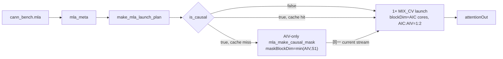
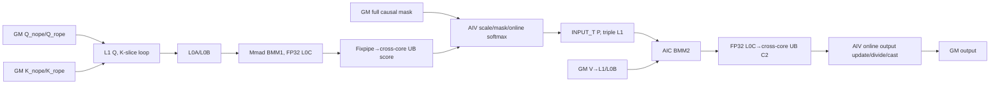

# MLA 950 Direct Invoke 算子知识

## 算子速览

| 项目 | 内容 |
|---|---|
| 实际入口 | Python `cann_bench.mla` → dispatcher `cann_bench::mla` → `mla_npu` → `make_mla_launch_plan` → `launch_mla_make_causal_mask`（仅 causal）与 16 个 Host 可达 `launch_mla_*_ub*`；入口类型为 Direct Invoke。 |
| 计算语义 | `Q=[q_nope,q_rope]`、`K=[k_nope,k_rope]`，计算 `softmax(scale·QK^T + causal_mask)V`；一只 KV head 被全部 query heads 共享。 |
| 输入输出 | rank-4、连续、统一 FP16/BF16；BSND 或 BNSD；`D_nope∈{448,512}`、`D_rope=64`、`N_kv=1`；输出与 `q_nope` 同 shape/dtype/layout。 |
| 执行类型 | causal 图含 AIV_VECTOR mask 节点和一个 `KERNEL_TYPE_MIX_AIC_1_2` 节点；non-causal 图只含后者。MIX 节点内 AIC_CUBE 做 BMM1/BMM2，两个 AIV_VECTOR 子核做 mask/online softmax、P 写 L1、跨 S2 累积、归一化和输出。 |
| Kernel 路线 | 重要性顺序：P0 R-002、R-001；P1 R-005、R-004；P2 R-003、R-006、R-007、R-010、R-011、R-013；P3 R-008、R-009、R-012、R-014、R-015、R-016。Route ID 不变，Host 仍按源码分支顺序选择。 |
| 核心资源 | GM 输入/输出与可选全量 uint8 causal mask；Host 常驻 32 MiB workspace（当前可达 specialization 不读写）；每 MIX core 512 KiB L1、64 KiB L0A、64 KiB L0B、256 KiB L0C，以及按 D/mask 变化的 UB。 |
| 来源闭包 | direct_implementation_closed：Python/dispatcher、Meta 校验、PrivateUse1 Host selector、POD、所有 Host 可达 launcher、mask Kernel、MIX_CV entry/body、Cube/Vector helper、workspace、同步及构建接线均在交付件闭合。 |
| 验证状态 | 已完成源码闭包检查；本次知识提取未执行编译、真机、数值或性能测试。 |

## 接口与语义

### 计算语义

令 `B` 为 batch，`S1`/`S2` 为 query/KV 序列长度，`Nq` 为 query heads，`D∈{448,512}`，`Dr=64`。对每个 `(b,h,i)`：

```text
q = concat(q_nope[b,i,h,0:D], q_rope[b,i,h,0:64])
k_j = concat(k_nope[b,j,0,0:D], k_rope[b,j,0,0:64])
logit_j = scale * dot(q, k_j)
scale = scaleValue, 当且仅当 scaleValue > 0
      = 1 / sqrt(D + 64), 其他情况
causal 时：j > (S2 - S1) + i 的 logit 被 uint8 mask 置为负大值
p = softmax(logit)，以 FP32 max/sum 做分块 online 更新
out[b,i,h,:] = cast_input_dtype(sum_j p_j * v[b,j,0,:])
```

causal 是右下对齐三角，而不是左上固定 `j<=i`：当 `S2>S1` 时对角偏移为 `S2-S1`。BMM1 把 nope 与 RoPE 两段在 L1 中拼成 K 维；BMM2 的 V 维仍是 `D`。无 PSE、dropout、量化、post-quant 或 softmax-LSE 输出。

### 输入、输出与属性

| 参数 | shape/layout | dtype | 约束、默认值与语义 |
|---|---|---|---|
| `q_nope` | BSND `[B,S1,Nq,D]`；BNSD `[B,Nq,S1,D]` | FP16/BF16 | rank-4、连续；`D=448/512`；决定设备、输出和 Route dtype。 |
| `q_rope` | 与 Q 前三轴一致，末轴 64 | 同 `q_nope` | rank-4、连续。 |
| `k_nope` | BSND `[B,S2,1,D]`；BNSD `[B,1,S2,D]` | 同 `q_nope` | rank-4、连续；KV head 必须为 1。 |
| `k_rope` | 与 K 前三轴一致，末轴 64 | 同 `q_nope` | rank-4、连续。 |
| `v` | 与 `k_nope` 的前三轴一致，末轴 D | 同 `q_nope` | rank-4、连续。 |
| `numKVHeads` | 标量 | int64 | 默认 1，且只允许 1；还会从 K shape 再校验 `nkv==1`。 |
| `scaleValue` | 标量 | double/接口 float | 默认 -1；只有严格大于 0 时采用，其他值触发 `1/sqrt(D+64)`。 |
| `inputLayout` | `BSND` 或 `BNSD` | string | 默认 `BSND`；`BSND` 在 Device 模板中映射为 `LAYOUT_BSH`。 |
| `is_causal` | 标量 | bool | 默认 false；true 时要求 `S1<=S2`，先生成/复用右下 causal mask。 |
| 返回值 | 与 `q_nope` 完全相同 | FP16/BF16 | `empty_like(q_nope)`；Device 写满每个有效输出行。 |

### 入口与版本

`cann_bench.mla` 只转发到 `torch.ops.cann_bench.mla`。`TORCH_LIBRARY_FRAGMENT` 注册 schema，Meta 后端调用 `mla_meta` 做 shape/dtype/layout/连续性校验并返回 meta 输出，PrivateUse1 后端绑定 `mla_npu`。`mla_npu` 直接取得当前 NPU stream，构造 by-value tiling 并调用显式 launcher；它不是 ACLNN 接口，也不调用同名官方算子。

官方固定范围 `attention/sparse_flash_attention` 只提供相关映射：两者都有 `softmax(QK^T·scale)V`、MLA 的 nope+RoPE 输入和 950 MIX 1:2 编程范式。但官方 SparseFlashAttention 以 `sparse_indices` 选择离散 KV，公开约束、输入、输出和 Host/Tiling ABI 均不同；本直调实现没有 sparse indices，而是 dense/non-causal 或 full right-down causal mask，并额外实现 D448/BNSD。因此不得把 SparseFlashAttention 的接口语义、支持表或 tiling 强套到本卡。

## Host/Launcher 执行流程

### 参数校验与前处理

`mla_npu` 首先用 `OptionalDeviceGuard(q_nope.device())` 切到 Q 所在设备，再原样调用 `mla_meta`。它不做 Contiguous/ViewCopy：任何一个输入非连续都直接失败。校验顺序是 rank → layout → `numKVHeads` → dtype 集合与五输入 dtype 相等 → 全部 contiguous → 解析 B/S/N/D → `D/Dr` → KV head/GQA 比 → nope/value 与 rope 的末轴 → 按 layout 校验其余轴 → causal 的 `S1<=S2`。

随后创建输出、计算 `bnsd/d512/bf16`，把 `useC2Ub` 固定为 true，调用 `make_mla_launch_plan(...,mBase=64)`。causal 时从静态 cache 查找 `[S1,align32(S2)]` uint8 mask；未命中则在当前 stream 启动 mask Kernel。最后取得输入/输出指针与静态 workspace，在 `OpCommand::RunOpApi("MlaGqaArch35", aclCall)` 内执行精确 launcher。

### 参数、Workspace 与生命周期

Host 为每个 device 懒分配一个 32 MiB uint8 workspace，并由静态 map 持有到进程结束。当前全部 Host 可达 Route 都令 `bmm2WriteToUb=true`、`splitD=false`、`isFd=false`：`InitMMResBuf` 不建立 GM BMM2 slice，Vector 也不建立 split-D/flash-decode slice，所以 Device 不读写这 32 MiB；它仍是 launcher ABI 的非空实参，不能据此推导有 32 MiB 有效临时数据。

causal mask cache 的 owner 也是静态 map，key 是 `(device,S1,S2)`，物理容量 `S1*align32(S2)` bytes。cache miss 时 mask 生成与随后 MLA 在同一 stream 排序；cache hit 不再发 mask Kernel。输出由调用者持有，输入、输出和 mask 必须按 PyTorch stream 语义存活；POD 按值传给 Kernel，launcher 返回后不依赖 Host backing。

### 启动图与失败传播



`plan.blockDim=min(availableAIC, B*ceil(S1*Nq/64))`，最小为 1；`maskBlockDim=min(availableAIV,S1)`，最小为 1。平台查询缺失或返回 0 时回退到 36 AIC/72 AIV，再分别截断到 POD 常量上界。MIX entry 标注 `KERNEL_TYPE_MIX_AIC_1_2`，每个逻辑 AIC 配两个 AIV sub-core。

launcher 本身是 `void`，lambda 无条件返回 0；源码没有读取异步 launch 状态来阻止后继。cache miss 的两个节点依靠同 stream 顺序而非 Host 同步。Meta/TORCH_CHECK 异常在启动前终止；Device 启动后的错误按运行时/stream 机制传播，本实现没有额外 cleanup。

## Route 与参数设计

### 分核与资源计算

```text
M = S1*Nq（每 batch 的 G×S1 输出行）
totalTasks = B * ceil(M/64)
blockDim = clamp(totalTasks, 1, availableAIC<=36)
每 AIC 的 task index 以 coreNum 为跨度、奇偶轮蛇形分配
每 task: M_tile<=64, S2_tile<=128
BMM1 K = D+64: D448→512（4×128）；D512→576（4×128+64 tail）
BMM2 N = D: D448→3×128+64 tail；D512→4×128
每个 AIV sub-core 处理 M_tile 的一半：ceil(M/2) 与 floor(M/2)
```

`fiaS1OuterSplitCoreParams.enableS1OutSplit=true`，因此 36×8 的 FA metadata 保持零且不参与 route；Device 用 `totalSize`、`coreNum` 和 `aicIdx` 自行计算蛇形任务。S2 由 128 分块，tail 以 `actSingleLoopS2Size` 和 16 元素/32-byte 对齐值保护。causal route 先用 sparseMode=3 缩小可达 S2 block，再把物化全 mask 以 DEFAULT_MASK 地址语义搬进 AIV UB。

### Route 选择

P0→P3 只规定本卡的阅读与复用顺序，不参与运行时分派。`Host 顺序`完整保留 `mla_npu` 的 `if/else if` 次序：每个 H 层先判 D/dtype/layout，命中后再按 causal 二分并短路；分支为假才进入下一 H 层。

| 重要性 | Route | Route 特征 | Key/模板 | 精确选择条件 | Host 顺序、短路与 fallback |
|---|---|---|---|---|---|
| P0 | R-002 | FP16、BSND、D512、non-causal；最短单 MIX 路径 | `fp16_bsh_d512_decode_ub_nomask`；`<half,false,true,false,true>` | `useC2Ub && d512 && !bf16 && !bnsd && !isCausal` | H1；外层命中后在 causal 二分的 `else` 启动并短路；外层不命中→H2 |
| P0 | R-001 | FP16、BSND、D512、causal；右下 mask 后接 MIX | `fp16_bsh_d512_decode_ub`；`<half,false,true,true,true>` | `useC2Ub && d512 && !bf16 && !bnsd && isCausal` | H1；外层命中后在 causal 二分的 `if` 启动并短路；外层不命中→H2 |
| P1 | R-005 | BF16、BSND、D512、causal；BF16 IO、FP32 累积 | `bf16_bsh_d512_decode_ub`；`<bfloat16_t,false,true,true,true>` | `useC2Ub && d512 && bf16 && !bnsd && isCausal` | H3；H1/H2 为假后检查，命中短路；外层不命中→H4 |
| P1 | R-004 | FP16、BNSD、D512、non-causal；BNSD offset | `fp16_bnsd_d512_decode_ub_nomask`；`<half,true,true,false,true>` | `useC2Ub && d512 && !bf16 && bnsd && !isCausal` | H2；H1 为假后检查，命中短路；外层不命中→H3 |
| P2 | R-003 | FP16、BNSD、D512、causal；BNSD offset + mask | `fp16_bnsd_d512_decode_ub`；`<half,true,true,true,true>` | `useC2Ub && d512 && !bf16 && bnsd && isCausal` | H2；H1 为假后检查，命中短路；外层不命中→H3 |
| P2 | R-006 | BF16、BSND、D512、non-causal | `bf16_bsh_d512_decode_ub_nomask`；`<bfloat16_t,false,true,false,true>` | `useC2Ub && d512 && bf16 && !bnsd && !isCausal` | H3；H1/H2 为假后检查，命中短路；外层不命中→H4 |
| P2 | R-007 | BF16、BNSD、D512、causal | `bf16_bnsd_d512_decode_ub`；`<bfloat16_t,true,true,true,true>` | `useC2Ub && d512 && bf16 && bnsd && isCausal` | H4；H1～H3 为假后检查，命中短路；外层不命中→H5 |
| P2 | R-010 | FP16、BSND、D448、non-causal；真实 448 C2 pitch | `fp16_bsh_d448_ub_nomask`；`<half,false,false,false,true>` | `useC2Ub && !d512 && !bf16 && !bnsd && !isCausal` | H5；H1～H4 为假后检查，命中短路；外层不命中→H6 |
| P2 | R-011 | FP16、BNSD、D448、causal；真实 448 pitch + mask | `fp16_bnsd_d448_ub`；`<half,true,false,true,true>` | `useC2Ub && !d512 && !bf16 && bnsd && isCausal` | H6；H1～H5 为假后检查，命中短路；外层不命中→H7 |
| P2 | R-013 | BF16、BSND、D448、causal；BF16 + 448 pitch | `bf16_bsh_d448_ub`；`<bfloat16_t,false,false,true,true>` | `useC2Ub && !d512 && bf16 && !bnsd && isCausal` | H7；H1～H6 为假后检查，命中短路；外层不命中→H8 |
| P3 | R-008 | BF16、BNSD、D512、non-causal | `bf16_bnsd_d512_decode_ub_nomask`；`<bfloat16_t,true,true,false,true>` | `useC2Ub && d512 && bf16 && bnsd && !isCausal` | H4；H1～H3 为假后检查，命中短路；外层不命中→H5 |
| P3 | R-009 | FP16、BSND、D448、causal | `fp16_bsh_d448_ub`；`<half,false,false,true,true>` | `useC2Ub && !d512 && !bf16 && !bnsd && isCausal` | H5；H1～H4 为假后检查，命中短路；外层不命中→H6 |
| P3 | R-012 | FP16、BNSD、D448、non-causal | `fp16_bnsd_d448_ub_nomask`；`<half,true,false,false,true>` | `useC2Ub && !d512 && !bf16 && bnsd && !isCausal` | H6；H1～H5 为假后检查，命中短路；外层不命中→H7 |
| P3 | R-014 | BF16、BSND、D448、non-causal | `bf16_bsh_d448_ub_nomask`；`<bfloat16_t,false,false,false,true>` | `useC2Ub && !d512 && bf16 && !bnsd && !isCausal` | H7；H1～H6 为假后检查，命中短路；外层不命中→H8 |
| P3 | R-015 | BF16、BNSD、D448、causal | `bf16_bnsd_d448_ub`；`<bfloat16_t,true,false,true,true>` | `useC2Ub && !d512 && bf16 && bnsd && isCausal` | H8；H1～H7 为假后检查，命中短路；外层不命中→H9 dormant 非-UB 链 |
| P3 | R-016 | BF16、BNSD、D448、non-causal | `bf16_bnsd_d448_ub_nomask`；`<bfloat16_t,true,false,false,true>` | `useC2Ub && !d512 && bf16 && bnsd && !isCausal` | H8；H1～H7 为假后检查，命中短路；外层不命中→H9 dormant 非-UB 链 |

```text
useC2Ub=true
  -> D512/D448
    -> FP16/BF16
      -> BSND/BNSD
        -> causal: *_ub 或 *_decode_ub + mask entry
        -> non-causal: *_ub_nomask 或 *_decode_ub_nomask
```

### 模板/实现执行矩阵

| 重要性 | Route | Host 顺序 | key/selector 与完整命中条件 | 执行族与实际模板/body | 内存、同步、tail/fallback |
|---|---|---|---|---|---|
| P0 | R-002 | H1→non-causal | `fp16_bsh_d512_decode_ub_nomask`；950、FP16、BSND、D512、non-causal | MIX_CV；`<half,false,true,false,true>` | 无 mask；D512 UB；S2 128、K tail64；无 Device fallback |
| P0 | R-001 | H1→causal | `fp16_bsh_d512_decode_ub`；950、FP16、BSND、D512、causal | AIV mask→MIX_CV；`<half,false,true,true,true>` | full mask；D512 UB；S2 128、K tail64；域失败终止 |
| P1 | R-005 | H3→causal | `bf16_bsh_d512_decode_ub`；BF16、BSND、D512、causal | AIV mask→MIX_CV；`<bfloat16_t,false,true,true,true>` | BF16 IO、FP32 accumulate；D512 UB；域失败终止 |
| P1 | R-004 | H2→non-causal | `fp16_bnsd_d512_decode_ub_nomask`；FP16、BNSD、D512、non-causal | MIX_CV；`<half,true,true,false,true>` | BNSD offset；无 mask；K tail64；无 Device fallback |
| P2 | R-003 | H2→causal | `fp16_bnsd_d512_decode_ub`；FP16、BNSD、D512、causal | AIV mask→MIX_CV；`<half,true,true,true,true>` | BNSD/full mask；K tail64；域失败终止 |
| P2 | R-006 | H3→non-causal | `bf16_bsh_d512_decode_ub_nomask`；BF16、BSND、D512、non-causal | MIX_CV；`<bfloat16_t,false,true,false,true>` | 无 mask；D512 UB；K tail64；无 Device fallback |
| P2 | R-007 | H4→causal | `bf16_bnsd_d512_decode_ub`；BF16、BNSD、D512、causal | AIV mask→MIX_CV；`<bfloat16_t,true,true,true,true>` | BNSD/full mask；K tail64；域失败终止 |
| P2 | R-010 | H5→non-causal | `fp16_bsh_d448_ub_nomask`；FP16、BSND、D448、non-causal | MIX_CV；`<half,false,false,false,true>` | 真实 448 pitch；BMM2 N tail64；无 Device fallback |
| P2 | R-011 | H6→causal | `fp16_bnsd_d448_ub`；FP16、BNSD、D448、causal | AIV mask→MIX_CV；`<half,true,false,true,true>` | BNSD/full mask；BMM2 N tail64；域失败终止 |
| P2 | R-013 | H7→causal | `bf16_bsh_d448_ub`；BF16、BSND、D448、causal | AIV mask→MIX_CV；`<bfloat16_t,false,false,true,true>` | BF16 IO、D448 pitch；BMM2 N tail64；域失败终止 |
| P3 | R-008 | H4→non-causal | `bf16_bnsd_d512_decode_ub_nomask`；BF16、BNSD、D512、non-causal | MIX_CV；`<bfloat16_t,true,true,false,true>` | BNSD/no mask；K tail64；无 Device fallback |
| P3 | R-009 | H5→causal | `fp16_bsh_d448_ub`；FP16、BSND、D448、causal | AIV mask→MIX_CV；`<half,false,false,true,true>` | full mask；D448 pitch；BMM2 N tail64；域失败终止 |
| P3 | R-012 | H6→non-causal | `fp16_bnsd_d448_ub_nomask`；FP16、BNSD、D448、non-causal | MIX_CV；`<half,true,false,false,true>` | BNSD/no mask；BMM2 N tail64；无 Device fallback |
| P3 | R-014 | H7→non-causal | `bf16_bsh_d448_ub_nomask`；BF16、BSND、D448、non-causal | MIX_CV；`<bfloat16_t,false,false,false,true>` | BF16/no mask；D448 pitch；无 Device fallback |
| P3 | R-015 | H8→causal | `bf16_bnsd_d448_ub`；BF16、BNSD、D448、causal | AIV mask→MIX_CV；`<bfloat16_t,true,false,true,true>` | BNSD/full mask；BMM2 N tail64；域失败终止 |
| P3 | R-016 | H8→non-causal | `bf16_bnsd_d448_ub_nomask`；BF16、BNSD、D448、non-causal | MIX_CV；`<bfloat16_t,true,false,false,true>` | BNSD/no mask；BMM2 N tail64；无 Device fallback |

模板五元组依次为 `INPUT_T,BNSD,D512,HAS_ATTEN_MASK,DECODE_C2_UB`。全部 MIX Route 进一步固定 `M=64,S2=128,DTemplate={512,576},DVTemplate={448,512},hasRope=true,useDn=false,bmm2WriteToUb=true,splitD=false,isFd=false`。

### 隐藏性能 Guard

| Guard | Host/Tiling 条件 | Device/资源原因 | 影响 Route | 不满足时去向 | 源码符号 |
|---|---|---|---|---|---|
| dtype | 仅 FP16/BF16 且五输入相等 | entry 只有 `half`/`bfloat16_t` 实例 | 全部 | `TORCH_CHECK` | `mla_meta` |
| D/Dr | `D==448||512` 且 `Dr==64` | K 模板为 512/576；V pitch 为 448/512 | 全部 | `TORCH_CHECK` | `mla_meta`, `RunMlaArch35` |
| layout | 仅 BSND/BNSD | 决定 GM offset calculator 与输出格式 | 全部 | `TORCH_CHECK` | `mla_meta`, `RunMlaArch35` |
| KV head | `numKVHeads==1 && nkv==1` | `n2Size=1`，所有 Q heads 共享一只 KV head | 全部 | `TORCH_CHECK` | `mla_meta`, `make_mla_launch_plan` |
| causal domain | `!causal || S1<=S2` | `diagonalOffset=S2-S1` 使用 uint32 | causal | `TORCH_CHECK` | `mla_meta` |
| UB C2 | `useC2Ub=true` | 消除当前可达 route 的 GM C2/workspace | 全部 | 非-UB entry dormant | `mla_npu` |
| AIV UB | D512+mask 总计约 257280 B；D448+mask 约 232704 B | 需低于 route 可用 UB；源码无运行时容量查询 | 全部 | 无 fallback | `InitMMResBuf`, `FANoQuantGqaBlockVec::InitBuffers` |
| mask row UB | `maskStride=align32(S2)` | mask Kernel 单队列一次容纳一整行 | causal | 无 Host 容量 guard/fallback | `RunMakeCausalMask` |
| core count | AIC≤36、AIV≤72，平台查询值再截断 | POD metadata 固定上界 | 全部 | 默认 36/72 | `make_mla_launch_plan` |
| integer width | shape 由 int64 转 uint32；`B*S1` 在赋值前做有符号乘法 | POD/地址公式依赖 32/64 位混合 | 全部 | 无显式溢出 guard | `make_mla_launch_plan` |

### POD/ABI

以下 offset/size 按源码字段顺序和目标 C++ LP64 自然对齐推导；源码没有 `static_assert(sizeof/offsetof)`，移植时必须重新静态核验。`NoQuantTilingArch35` 推导为 272 B/align 8，`GqaDirectTiling` 为 1424 B/align 8，`MlaLaunchPlan` 为 Host-only 1448 B/align 8。

| 结构 | 字段 | 类型/位宽 | ABI 布局 | 单位 | Host/launcher producer | Device consumer | 边界 |
|---|---|---|---|---|---|---|---|
| `GqaDirectTiling.baseTiling.fiaBaseParams` | `bSize` | uint32/32 | off 0 | batch | `batch` cast | `InitConstInfo` | 应可表为 uint32 |
| 同上 | `t1Size` | uint32/32 | off 4 | token | `B*S1` cast | 固定长度 parser/公共状态 | 乘法未 guard |
| 同上 | `t2Size` | uint32/32 | off 8 | token | `B*S2` cast | 公共状态 | 同上 |
| 同上 | `n2Size` | uint32/32 | off 12 | head | 常量 1 | task/offset | 仅 1 |
| 同上 | `gSize` | uint32/32 | off 16 | Q/KV ratio | `Nq` cast | task/offset | 未显式拒绝 0 |
| 同上 | `s1Size` | uint32/32 | off 20 | token | `S1` cast | scheduler | uint32 |
| 同上 | `s2Size` | uint32/32 | off 24 | token | `S2` cast | scheduler | uint32 |
| 同上 | `dSize` | uint32/32 | off 28 | element | D | Cube/offset | 448/512 |
| 同上 | `dSizeV` | uint32/32 | off 32 | element | D | BMM2/CopyOut | 448/512 |
| 同上 | `dSizeRope` | uint32/32 | off 36 | element | 64 | BMM1 copy | 64 |
| 同上 | `actualSeqLengthsQSize` | uint32/32 | off 40 | element | 0 | parser | inactive，固定 S1 |
| 同上 | `actualSeqLengthsKVSize` | uint32/32 | off 44 | element | 0 | parser | inactive，固定 S2 |
| 同上 | `scaleValue` | float/32 | off 48 | scalar | 正值或默认公式 | Vec1 | FP32 |
| 同上 | `isKvContinuous` | uint8/8 | off 52 | bool | 1 | 公共状态 | contiguous |
| 同上 | `isSoftMaxLseEnable` | uint8/8 | off 53 | bool | 0 | Vec/Kernel | 不分配 LSE |
| 同上 | `coreNum` | uint32/32 | off 56 | AIC core | `blockDim` | scheduler | 1..36 |
| 同上 | `outputLayout` | uint32/32 | off 60 | enum | BNSD?1:0 | CopyOut | BSH/BNSD |
| 同上 | `keyStrides.bnStride` | uint64/64 | off 64 | element | 默认 0 | 当前 contiguous route 未读 | inactive |
| 同上 | `keyStrides.n2Stride` | uint64/64 | off 72 | element | 默认 0 | 同上 | inactive |
| 同上 | `valueStrides.bnStride` | uint64/64 | off 80 | element | 默认 0 | 同上 | inactive |
| 同上 | `valueStrides.n2Stride` | uint64/64 | off 88 | element | 默认 0 | 同上 | inactive |
| 同上 | `kRopeStrides.bnStride` | uint64/64 | off 96 | element | 默认 0 | 同上 | inactive |
| 同上 | `kRopeStrides.n2Stride` | uint64/64 | off 104 | element | 默认 0 | 同上 | inactive |
| 同上 | `kScaleStrides.bnStride` | uint64/64 | off 112 | element | 默认 0 | 量化 route 未实例化 | inactive |
| 同上 | `kScaleStrides.n2Stride` | uint64/64 | off 120 | element | 默认 0 | 同上 | inactive |
| 同上 | `vScaleStrides.bnStride` | uint64/64 | off 128 | element | 默认 0 | 同上 | inactive |
| 同上 | `vScaleStrides.n2Stride` | uint64/64 | off 136 | element | 默认 0 | 同上 | inactive |
| `fiaAttenMaskParams` | `sparseMode` | uint8/8 | off 144 | enum | causal?3:0 | scheduler/Vec | right-down causal/none |
| 同上 | `preTokens` | int32/32 | off 148 | token | INT32_MAX | sparse range | 固定 |
| 同上 | `nextTokens` | int32/32 | off 152 | token | causal?0:INT32_MAX | sparse range | 固定 |
| 同上 | `attenMaskBatch` | uint32/32 | off 156 | batch | 1 | mask offset | 共享 mask |
| 同上 | `attenMaskS1Size` | uint32/32 | off 160 | row | S1 | mask offset | causal consumer |
| 同上 | `attenMaskS2Size` | uint32/32 | off 164 | byte stride | align32(S2) | mask offset | causal consumer |
| 同上 | `isRowInvalidOpen` | uint8/8 | off 168 | bool | 0 | RowInvalid | false |
| 同上 | `isExistRowInvalid` | uint8/8 | off 169 | bool | 0 | output init/LSE | false |
| `fiaPseParams` | `pseShiftByBatch` | uint8/8 | off 172 | bool | 0 | PSE path | inactive |
| 同上 | `pseS1Size` | uint32/32 | off 176 | element | 0 | PSE path | inactive |
| 同上 | `pseS2Size` | uint32/32 | off 180 | element | 0 | PSE path | inactive |
| 同上 | `pseStride` | uint32/32 | off 184 | element | 0 | PSE path | inactive |
| 同上 | `qStartIdx` | uint32/32 | off 188 | token | 0 | PSE path | inactive |
| 同上 | `kvStartIdx` | uint32/32 | off 192 | token | 0 | PSE path | inactive |
| `fiaSystemPrefixParams` | `isActualSharedPrefixLenNull` | uint8/8 | off 196 | bool | 0 | prefix path | inactive |
| 同上 | `prefixSeqInnerSize` | uint32/32 | off 200 | token | 0 | prefix path | inactive |
| `fiaPageAttentionParams` | `paLayoutType` | uint8/8 | off 204 | enum | 0 | PA path | inactive |
| 同上 | `blockSize` | uint32/32 | off 208 | token | 0 | PA path | inactive |
| 同上 | `maxBlockNumPerBatch` | uint32/32 | off 212 | block | 0 | PA path | inactive |
| `fiaLeftPaddingParams` | `isQHasLeftPadding` | uint8/8 | off 216 | bool | 0 | padding path | inactive |
| 同上 | `isKVHasLeftPadding` | uint8/8 | off 217 | bool | 0 | padding path | inactive |
| `fiaPostQuantParams` | `isPostQuantPerChnl` | uint8/8 | off 218 | bool | 0 | quant path | inactive |
| 同上 | `isPostQuantBF16` | uint8/8 | off 219 | bool | 0 | quant path | inactive |
| `fiaWorkspaceParams` | `accumOutSize` | uint32/32 | off 220 | float element | 0 | FD path | inactive |
| 同上 | `logSumExpSize` | uint32/32 | off 224 | float element | 0 | FD path | inactive |
| `fiaS1OuterSplitCoreParams` | `enableS1OutSplit` | bool/实现 ABI | off 232 | bool | true | scheduler | 启用 direct totalSize 调度 |
| 同上 | `totalSize` | uint64/64 | off 240 | task | `B*ceil(S1*Nq/64)` | scheduler | 64 位 |
| `fiaEmptyTensorParams` | `singleCoreSize` | uint32/32 | off 248 | element | 0 | empty init | inactive |
| 同上 | `needInit` | uint8/8 | off 252 | bool | 0 | empty init | inactive |
| 同上 | `totalOutputSize` | uint64/64 | off 256 | element | 0 | empty init | inactive |
| 同上 | `totalSoftMaxLseOutputSize` | uint64/64 | off 264 | element | 0 | empty init | inactive |
| `GqaDirectTiling` | `faMetadata` | uint32[36][8] | off 272, row 32 B | cursor | 全零初始化 | `RunMlaArch35` 传参；split=true 时忽略 | inactive storage 已初始化 |
| `MlaLaunchPlan` | `blockDim` | uint32/32 | off 1424 | AIC core | launcher plan | MIX launch | 1..36 |
| 同上 | `maskBlockDim` | uint32/32 | off 1428 | AIV core | launcher plan | mask launch | 1..72 |
| 同上 | `maskRows` | uint32/32 | off 1432 | row | S1 cast | mask Kernel | causal |
| 同上 | `maskCols` | uint32/32 | off 1436 | col | S2 cast | mask Kernel | causal |
| 同上 | `maskStride` | uint32/32 | off 1440 | byte | align32(S2) | mask Kernel/Vec | causal |
| 同上 | `maskDiagonalOffset` | uint32/32 | off 1444 | token | S2-S1 cast | mask Kernel | causal 有 `S1<=S2` |

### Route 源码闭包

| 重要性 | Route | Host 顺序 | Key/selector | Host/Tiling producer | POD/参数 | Kernel entry/router | Kernel body/直接依赖 | 构建接线 |
|---|---|---|---|---|---|---|---|---|
| P0 | R-002 | H1→non-causal | `fp16_bsh_d512_decode_ub_nomask` | `mla_npu`, `make_mla_launch_plan` | `MlaLaunchPlan`, `GqaDirectTiling` | 同名 launcher/entry | `RunMlaArch35<half,false,true,false,true>` + Cube/Vec body | MLA direct target |
| P0 | R-001 | H1→causal | `fp16_bsh_d512_decode_ub` | 同上 + mask producer | 同上 | mask entry→同名 MIX entry | `RunMlaArch35<half,false,true,true,true>` + Cube/Vec body | 同上 |
| P1 | R-005 | H3→causal | `bf16_bsh_d512_decode_ub` | 同上 + mask producer | 同上 | mask entry→同名 MIX entry | `RunMlaArch35<bfloat16_t,false,true,true,true>` + Cube/Vec body | 同上 |
| P1 | R-004 | H2→non-causal | `fp16_bnsd_d512_decode_ub_nomask` | 同上 | 同上 | 同名 launcher/entry | `RunMlaArch35<half,true,true,false,true>` + Cube/Vec body | 同上 |
| P2 | R-003 | H2→causal | `fp16_bnsd_d512_decode_ub` | 同上 + mask producer | 同上 | mask entry→同名 MIX entry | `RunMlaArch35<half,true,true,true,true>` + Cube/Vec body | 同上 |
| P2 | R-006 | H3→non-causal | `bf16_bsh_d512_decode_ub_nomask` | 同上 | 同上 | 同名 launcher/entry | `RunMlaArch35<bfloat16_t,false,true,false,true>` + Cube/Vec body | 同上 |
| P2 | R-007 | H4→causal | `bf16_bnsd_d512_decode_ub` | 同上 + mask producer | 同上 | mask entry→同名 MIX entry | `RunMlaArch35<bfloat16_t,true,true,true,true>` + Cube/Vec body | 同上 |
| P2 | R-010 | H5→non-causal | `fp16_bsh_d448_ub_nomask` | 同上 | 同上 | 同名 launcher/entry | `RunMlaArch35<half,false,false,false,true>` + Cube/Vec body | 同上 |
| P2 | R-011 | H6→causal | `fp16_bnsd_d448_ub` | 同上 + mask producer | 同上 | mask entry→同名 MIX entry | `RunMlaArch35<half,true,false,true,true>` + Cube/Vec body | 同上 |
| P2 | R-013 | H7→causal | `bf16_bsh_d448_ub` | 同上 + mask producer | 同上 | mask entry→同名 MIX entry | `RunMlaArch35<bfloat16_t,false,false,true,true>` + Cube/Vec body | 同上 |
| P3 | R-008 | H4→non-causal | `bf16_bnsd_d512_decode_ub_nomask` | 同上 | 同上 | 同名 launcher/entry | `RunMlaArch35<bfloat16_t,true,true,false,true>` + Cube/Vec body | 同上 |
| P3 | R-009 | H5→causal | `fp16_bsh_d448_ub` | 同上 + mask producer | 同上 | mask entry→同名 MIX entry | `RunMlaArch35<half,false,false,true,true>` + Cube/Vec body | 同上 |
| P3 | R-012 | H6→non-causal | `fp16_bnsd_d448_ub_nomask` | 同上 | 同上 | 同名 launcher/entry | `RunMlaArch35<half,true,false,false,true>` + Cube/Vec body | 同上 |
| P3 | R-014 | H7→non-causal | `bf16_bsh_d448_ub_nomask` | 同上 | 同上 | 同名 launcher/entry | `RunMlaArch35<bfloat16_t,false,false,false,true>` + Cube/Vec body | 同上 |
| P3 | R-015 | H8→causal | `bf16_bnsd_d448_ub` | 同上 + mask producer | 同上 | mask entry→同名 MIX entry | `RunMlaArch35<bfloat16_t,true,false,true,true>` + Cube/Vec body | 同上 |
| P3 | R-016 | H8→non-causal | `bf16_bnsd_d448_ub_nomask` | 同上 | 同上 | 同名 launcher/entry | `RunMlaArch35<bfloat16_t,true,false,false,true>` + Cube/Vec body | 同上 |

所有行共享 MLA 子目录的 kernel/plugin 注册以及顶层 Bisheng/Host C++ 编译与 `_C` 链接接线；表中仍逐 Route 保留真实 entry 与模板实例，避免以共享 body 掩盖 selector 差异。

## Kernel 实现

### 公共执行流程

MIX entry 在 Host pass 保留空壳/launcher，在 Device pass设置 `KERNEL_TYPE_MIX_AIC_1_2` 并进入 `RunMlaArch35`。它按 `g_coreType` 选择真实 Cube 或 Vector block，另一侧用 Dummy 类型，双方共享同一 by-value POD。`InitMMResBuf` 建立跨核 UB/L1 buffer；AIV 初始化 Vec block，AIC 初始化 Cube block。`Process` 在每个 task 上以 preload=2 执行：当前 task 做 BMM1/Vec1，早两轮 task 做 BMM2/Vec2。

```text
AIC: GM Q/K(+RoPE) -> L1 -> L0A/L0B -> BMM1 FP32 L0C -> Fixpipe -> cross-core UB
AIV: wait UB -> scale/mask/online softmax FP32 -> cast INPUT_T -> cross-core L1 P
AIC: wait L1 P -> GM V -> L1/L0 -> BMM2 FP32 L0C -> Fixpipe -> cross-core UB C2
AIV: wait UB C2 -> FP32 online output update/divide -> CAST_ROUND -> GM output
```

causal mask entry 是独立 AIV-only Kernel：每核按 `row=blockIdx+k*blockNum` 处理一行，先把 `maskStride` bytes 清零，再从 `S2-S1+row+1` 起写 1，最后整行 DataCopy 到 GM。它与 MIX 节点没有 workspace 边，只有 GM mask 和同 stream ordering。

### 公共 Route 实现闭包

#### 适用条件

##### 选择证据

| 层级 | 文件 | 符号 | 源码谓词/参数 | 结果/下一跳 |
|---|---|---|---|---|
| Host | `op_plugin/mla_plugin.cpp` | `mla_npu` | `useC2Ub=true`，按 H1～H8 判 D/dtype/layout，各叶再判 causal | 精确映射 R-001～R-016；无 Device fallback |
| Launcher | `op_kernel/mla_launch.h` | 16 个 `launch_mla_*_ub*` | `blockDim`, by-value tiling, current stream | MIX entry |
| Router | `op_kernel/mla_kernel.cpp` | `DEFINE_MLA_KERNEL` | 五模板实参 | `RunMlaArch35` |

#### Device 数据流

##### 函数级调用链

```text
mla_arch35_*_ub*(..., GqaDirectTiling)
  -> RunMlaArch35<INPUT_T,BNSD,D512,HAS_MASK,true>
    -> FlashAttentionNoQuantGqaKernel::Init
    -> Process -> FlashAttention -> ExecuteTask
      -> AIC IterateBmm1NdL1SplitK
      -> AIV ProcessVec1Nd
      -> AIC IterateBmm2L1SplitN
      -> AIV ProcessVec2OnUb -> Bmm2ResCastAndCopyOut
```

##### 源码等价伪码

```text
for each snake-assigned 64-row task and each reachable 128-column S2 tile:
  AIC: copy Q_nope/Q_rope and K_nope/K_rope in 128-K slices
       FP32 BMM1 accumulate; Fixpipe score tile to cross-core UB
  AIV0/AIV1: consume own half rows
       score *= scale; optional full-mask select; online max/sum/exp
       cast probability tile to input dtype; write P to rotating L1 slot
  two task issues later, AIC waits P, loads V in 128-column slices
       FP32 BMM2; Fixpipe C2 to cross-core UB
  AIV: merge C2 with prior S2 state using exp rescale
       on final S2 tile divide by sum, CAST_ROUND, copy D valid columns to GM
```

#### 内存与数据搬运

##### 资源与搬运表

| 层级/缓冲区 | offset/地址公式 | extent/容量公式 | dtype/layout | producer | consumer | owner/lifetime | 对齐/复用 |
|---|---|---|---|---|---|---|---|
| GM Q/K/V/RoPE | layout offset calculator | 输入逻辑 extent | FP16/BF16, BSND/BNSD | caller | Cube copy helper | caller/stream | contiguous |
| GM mask | `row*align32(S2)` | `S1*align32(S2)` B | uint8 full matrix | mask Kernel/cache | Vec1 | static cache | 32 B row |
| GM workspace | base pointer | 32 MiB Host allocation | uint8 | Host | 当前 Route 无 consumer | static cache | 当前有效 extent=0 |
| L1 manager | local offset allocator | 524288 B physical | mixed | Cube/AIV | Cube | Kernel | no alias deduction |
| L1 P | 3 rotating slots | `3*64*128*2=49152` B | INPUT_T, NZ-like P | two AIV | AIC BMM2 | task t→t+2 | forward cross-core flag |
| L1 Q | after P slots | D448 route 65536 B；D512 73728 B | INPUT_T, NZ | MTE2 | MTE1 | task row across S2 | single buffer |
| L1 K/V | after Q | each logical DB `2*128*128*2=65536` B | INPUT_T, NZ | MTE2 | MTE1 | each K/N slice | ping-pong |
| L0A | manager base | 65536 B physical，2×32768 | INPUT_T | MTE1 | M | AIC Kernel | DB |
| L0B | manager base | 65536 B physical，2×32768 | INPUT_T | MTE1 | M | AIC Kernel | DB |
| L0C | manager base | 262144 B physical，2×131072 | FP32 | M | Fixpipe | AIC Kernel | DB |
| cross-core UB BMM1 | UB manager start | `2*(32*128*4)=32768` B | FP32 row-major score | AIC Fixpipe | AIV Vec1 | MIX Kernel | bidirectional flags |
| cross-core UB BMM2 | after BMM1 | D448 `2*(32*448*4)=114688` B；D512 `131072` B | FP32 row-major C2 | AIC Fixpipe | AIV Vec2 | MIX Kernel | bidirectional flags |
| AIV stage1 queue | Vec UB | 16896 B | INPUT_T | Vec1 | MTE3→L1 | one slot | `(32+1)*128` 消 bank conflict |
| AIV softmax state | Vec UB | 9×256=2304 B | FP32 | Vec1/Vec2 | 后续 S2 | 3 task slots | mloop/loop modulo 3 |
| AIV stage2 | Vec UB | D448 57344 B；D512 65536 B | FP32 | Vec2 | Vec2/CopyOut | one task | 32 rows×D |
| AIV mask queues | Vec UB | causal 2×4096 B；non-causal N/A | uint8 | GM copy | Vec1 select | per S2 tile | ping-pong allocation |
| mask Kernel UB | queue slot | `align32(S2)` B | uint8 | Duplicate/scalar | DataCopy GM | one row | depth 1 |

##### 分层内存布局



##### 字节账、交接边与复用顺序

```text
workspace_effective = 0 B（Host 仍保留 32 MiB allocation）
L1_physical = 524288 B
L1_occupied = 49152 + (D448?65536:73728) + 65536 + 65536
            = D448 245760 B；D512 253952 B
L0 = 65536 + 65536 + 262144 = 393216 B physical
cross_core_UB = D448 147456 B；D512 163840 B
Vec_UB_noncausal = D448 77056 B；D512 85248 B
Vec_UB_causal = D448 85248 B；D512 93440 B
AIV_UB_peak = cross_core_UB + Vec_UB
            = D448 224512/232704 B（noncausal/causal）
            = D512 249088/257280 B（noncausal/causal）
```

| 边/复用子区 | producer | offset/extent | dtype/layout | consumer | ordering/sync | owner/lifetime | 安全条件 |
|---|---|---|---|---|---|---|---|
| mask→Vec1 | mask AIV Kernel | GM `row*stride`, tile rows×128 | uint8 full | `AttenMaskCopyIn` | cache miss 同 stream；cache hit 无新 event | static cache | 跨 stream 首次复用存在限制 |
| BMM1→Vec1 | AIC Fixpipe | DB slot，32×128 FP32/每 AIV | FP32 row | Vec1 | AIC PIPE_FIX set id0/id0+16；AIV PIPE_V wait；AIV PIPE_V set id1；AIC PIPE_FIX wait | MIX launch | 两 AIV 都 ack 后覆盖 |
| Vec1→BMM2 | AIV MTE3 | triple slot，64×128 INPUT_T | NZ-like P | AIC MTE1 | AIV PIPE_MTE3 set forward id；AIC PIPE_MTE1 wait | task t 至 BMM2(t) | preload=2 + 3 slots；无 reverse ack |
| BMM2→Vec2 | AIC Fixpipe | DB slot，32×D FP32/每 AIV | FP32 row | Vec2 | 与 BMM1 UB 相同的双向 cross-core 协议 | MIX launch | AIV ack 后覆盖 |
| softmax state | Vec1/Vec2 | slot=`mloop%3`/`loop%3` | FP32 max/sum/exp | 后续 S2 | 同 AIV 程序序；MTE/V event 保护 copy | 一组 M task | 3-slot preload |

#### 同步、精度与尾块

##### 同步与数值边界表

| 阶段 | primitive/机制 | producer | consumer/等待点 | 保护对象 | 精度/尾块 |
|---|---|---|---|---|---|
| L1/L0 内部 | `MTE2_MTE1`, `MTE1_M`, `M_FIX`, `FIX_M` | copy/Mmad/Fixpipe | 下一 pipe | L1/L0 slot | K=128 loop，D512 最后 64 |
| AIC↔AIV UB | `CrossCoreSetFlag/WaitFlag<mode=4>`，AIV1 ID+16 | AIC/AIV | 对端 pipe | BMM1/BMM2 DB | AIV 分半行，tail 可为 0 |
| AIV→AIC L1 | forward cross-core flag | AIV MTE3 | AIC MTE1 | P triple slot | P 从 FP32 softmax cast 到 INPUT_T |
| Vec UB/GM | `MTE3_V`, `V_MTE3`, queue EnQue/DeQue | MTE/Vector | Vector/MTE | state/output | online max/sum FP32；最终 `CAST_ROUND` |
| causal | sparse range + full uint8 mask | mask Kernel/Host POD | Vec1 | invalid logits | 右下三角；padding bytes 为 0，不参与 S2 valid tail |
| output tail | `actMSize`, `actVecMSize`, `actSingleLoopS2Size`, `realN` | scheduler | Cube/Vec copy | M/S2/D tails | D448 BMM2 尾 64，只输出 D 有效列 |

#### 关键实现

##### 符号证据表

| 阶段 | 文件 | 符号/模板实例 | 实现事实 |
|---|---|---|---|
| Host/Tiling producer | `op_plugin/mla_plugin.cpp`, `op_kernel/mla_launch.h` | `mla_npu`, `make_mla_launch_plan` | 16-way selector、core/task/mask/POD 生成、cache 生命周期 |
| Kernel entry/router | `op_kernel/mla_kernel.cpp` | `DEFINE_MLA_KERNEL`, `RunMlaArch35` | MIX 1:2 与完整 template specialization |
| Device body/helper | 同上 | `FlashAttentionNoQuantGqaKernel`, `FANoQuantGqaBlockCube`, `FANoQuantGqaBlockVec` | BMM1/softmax/BMM2、memory hierarchy、cross-core sync、tail |

Route 差异已经在执行矩阵逐 key 保留；共同调用链、内存图和同步图完全一致，D/dtype/layout/mask 的实际 specialization 与字节差异均在本节显式参数化，没有把不同 key 伪装成同一模板实例。下面按重要性顺序逐 Route 展开，Host 顺序仍以 H1～H8 为准。

### Route R-002（P0）：FP16 BSND D512 non-causal

H1 外层谓词 `useC2Ub && d512 && !bf16 && !bnsd` 成立且 `isCausal=false` 时启动 `mla_arch35_fp16_bsh_d512_decode_ub_nomask` 并短路；外层不成立才进入 H2。模板 `<half,false,true,false,true>` 省去 mask producer 与 Vec1 mask queue，保留 D512 的 K=576 tail64。

### Route R-001（P0）：FP16 BSND D512 causal

与 R-002 共享 H1 外层谓词，`isCausal=true` 时优先落入 causal 子支并启动 mask→`mla_arch35_fp16_bsh_d512_decode_ub`。模板 `<half,false,true,true,true>` 使用右下 full mask；`S1>S2` 在进入 selector 前终止，没有 Device fallback。

### Route R-005（P1）：BF16 BSND D512 causal

H1/H2 未命中后，H3 谓词 `useC2Ub && d512 && bf16 && !bnsd` 成立且 causal 时启动 `mla_arch35_bf16_bsh_d512_decode_ub`。模板 `<bfloat16_t,false,true,true,true>` 只改变 IO/P 类型与 mask specialization，BMM 和 online state 仍为 FP32。

### Route R-004（P1）：FP16 BNSD D512 non-causal

H1 未命中后，H2 谓词 `useC2Ub && d512 && !bf16 && bnsd` 成立且 non-causal 时启动 `mla_arch35_fp16_bnsd_d512_decode_ub_nomask`。模板 `<half,true,true,false,true>` 采用 BNSD GM offset/output calculator，不启动 mask producer。

### Route R-003（P2）：FP16 BNSD D512 causal

R-003 与 R-004 共享 H2 外层谓词，但 causal 子支先于 non-causal 子支选择 `mla_arch35_fp16_bnsd_d512_decode_ub`。模板 `<half,true,true,true,true>` 同时启用 BNSD offset 与 full-mask Vec1 路径。

### Route R-006（P2）：BF16 BSND D512 non-causal

R-006 与 R-005 共享 H3 外层谓词，`isCausal=false` 时启动 `mla_arch35_bf16_bsh_d512_decode_ub_nomask`。模板 `<bfloat16_t,false,true,false,true>` 删除 mask 节点，其余 D512 C2/状态 UB 与 K tail 不变。

### Route R-007（P2）：BF16 BNSD D512 causal

H1～H3 未命中后，H4 谓词 `useC2Ub && d512 && bf16 && bnsd` 成立且 causal 时启动 `mla_arch35_bf16_bnsd_d512_decode_ub`。模板 `<bfloat16_t,true,true,true,true>` 组合 BF16、BNSD、D512 与 full mask。

### Route R-010（P2）：FP16 BSND D448 non-causal

H1～H4 未命中后，H5 谓词 `useC2Ub && !d512 && !bf16 && !bnsd` 成立且 non-causal 时启动 `mla_arch35_fp16_bsh_d448_ub_nomask`。模板 `<half,false,false,false,true>` 采用真实 448 C2 pitch，并由 BMM2 N tail64 收尾。

### Route R-011（P2）：FP16 BNSD D448 causal

H1～H5 未命中后，H6 谓词 `useC2Ub && !d512 && !bf16 && bnsd` 成立且 causal 时启动 `mla_arch35_fp16_bnsd_d448_ub`。模板 `<half,true,false,true,true>` 在 448 pitch 上叠加 BNSD offset 与 full mask。

### Route R-013（P2）：BF16 BSND D448 causal

H1～H6 未命中后，H7 谓词 `useC2Ub && !d512 && bf16 && !bnsd` 成立且 causal 时启动 `mla_arch35_bf16_bsh_d448_ub`。模板 `<bfloat16_t,false,false,true,true>` 保留 BF16 IO、FP32 累积和 D448 BMM2 tail。

### Route R-008（P3）：BF16 BNSD D512 non-causal

R-008 与 R-007 共享 H4 外层谓词，`isCausal=false` 时启动 `mla_arch35_bf16_bnsd_d512_decode_ub_nomask`。模板 `<bfloat16_t,true,true,false,true>` 不生成 mask，H4 外层为假才继续 H5。

### Route R-009（P3）：FP16 BSND D448 causal

R-009 与 R-010 共享 H5 外层谓词，causal 子支先启动 mask，再启动 `mla_arch35_fp16_bsh_d448_ub`。模板 `<half,false,false,true,true>` 使用 448 C2 pitch、full mask 与 BMM2 N tail64。

### Route R-012（P3）：FP16 BNSD D448 non-causal

R-012 与 R-011 共享 H6 外层谓词，non-causal 时启动 `mla_arch35_fp16_bnsd_d448_ub_nomask`。模板 `<half,true,false,false,true>` 保留 BNSD offset 与 448 pitch，省去 mask 节点。

### Route R-014（P3）：BF16 BSND D448 non-causal

R-014 与 R-013 共享 H7 外层谓词，non-causal 时启动 `mla_arch35_bf16_bsh_d448_ub_nomask`。模板 `<bfloat16_t,false,false,false,true>` 保留 BF16/FP32 精度边界与真实 448 C2 pitch。

### Route R-015（P3）：BF16 BNSD D448 causal

H1～H7 未命中后，H8 谓词 `useC2Ub && !d512 && bf16 && bnsd` 成立且 causal 时启动 mask→`mla_arch35_bf16_bnsd_d448_ub`。模板 `<bfloat16_t,true,false,true,true>` 命中后短路；若 H8 外层为假才会进入 dormant 非-UB 链。

### Route R-016（P3）：BF16 BNSD D448 non-causal

R-016 与 R-015 共享 H8 外层谓词，`isCausal=false` 时启动 `mla_arch35_bf16_bnsd_d448_ub_nomask` 并短路。模板 `<bfloat16_t,true,false,false,true>` 是可达 selector 的末个叶节点；`useC2Ub=true` 使后续非-UB fallback 链不可达。

## 算子特定优化

### Trick T-001：M64 + C2/online-state 全驻 UB

#### 触发与源码依据

- 适用 Route：P0 R-002、R-001；P1 R-005、R-004；P2 R-003、R-006、R-007、R-010、R-011、R-013；P3 R-008、R-009、R-012、R-014、R-015、R-016。
- 触发条件：Host 固定 `useC2Ub=true`，模板固定 `DECODE_C2_UB=true`，D=448/512，MBase=64。
- 转换片段定位：`op_kernel/mla_kernel.cpp:33976`；相关官方源码：[`sparse_flash_attention_service_cube_mla.h`](https://gitcode.com/cann/ops-transformer/blob/c77c0829f1f0f0b8f882db1d9b051a758b605472/attention/sparse_flash_attention/op_kernel/arch35/sparse_flash_attention_service_cube_mla.h)

**转换交付件源码（主事实源）**：

```cpp
constexpr bool bmm2WriteToUb = DECODE_C2_UB;
constexpr bool splitD = !DECODE_C2_UB;
```

#### 机制与设计原因

BMM2 Fixpipe 直接把每 AIV 的 32×D FP32 C2 写入 cross-core UB，Vec2 的同尺寸 FP32 online accumulator 也在 UB；当前 route 因而不物化 GM C2，也不切 split-D workspace。M64 使 D512 causal 的 AIV UB 总账约 257280 B，仍落在源码预期的 256 KiB 资源边界内。

#### 迁移边界

- 适用：D448/D512、M64、S2Base128、AIC:AIV=1:2。
- 前提：目标 UB 容量覆盖上述严格字节账。
- 失效：增大 M/D、增加 mask/PSE buffer 或减少 UB 时必须重新选 GM/split-D 路线；当前 Host 没有运行时 fallback。
- 未验证：本次知识提取未执行编译、真机、数值或性能测试。

#### 错误做法

把 32 MiB Host workspace 当作当前 C2 存储会得到错误的数据流；可达模板中该指针不被读写。

### Trick T-002：两级 BMM 的 C1-C1-C2 preload 与跨核缓冲协议

#### 触发与源码依据

- 适用 Route：P0 R-002、R-001；P1 R-005、R-004；P2 R-003、R-006、R-007、R-010、R-011、R-013；P3 R-008、R-009、R-012、R-014、R-015、R-016。
- 触发条件：`PRELOAD_N=2`、BMM1/BMM2 UB 双缓冲、P L1 三缓冲。
- 转换片段定位：`op_kernel/mla_kernel.cpp:33670`；相关官方源码：[`sparse_flash_attention_kernel_mla.h`](https://gitcode.com/cann/ops-transformer/blob/c77c0829f1f0f0b8f882db1d9b051a758b605472/attention/sparse_flash_attention/op_kernel/arch35/sparse_flash_attention_kernel_mla.h)

**转换交付件源码（主事实源）**：

```cpp
if (runInfo0.isValid) {
    if ASCEND_IS_AIC { ComputeMm1(runInfo0); }
    else { ComputeVec1(runInfo0); }
}
if (loop >= PRELOAD_N && runInfoNegN.isValid) {
    if ASCEND_IS_AIC { ComputeMm2(runInfoNegN); }
    else { ComputeVec2(runInfoNegN); }
}
```

#### 机制与设计原因

当前 task 产生 score/概率，早两轮 task 同时完成 PV 和输出，形成 C1-C1-C2 流水。UB 的双向 flag 防止 AIC 覆盖 AIV 尚未消费的数据；P 使用三 L1 slot 与两轮距离匹配，只做 producer→consumer 通知。

#### 迁移边界

- 适用：相同 AIC:AIV 配比、相同 task 顺序和 buffer 轮转。
- 前提：flag ID 分配顺序一致，AIV1 保留 `+16` 映射。
- 失效：改变 preload 距离、slot 数、跨核比例或任一侧提前 return 时必须重做同步图。
- 未验证：本次知识提取未执行编译、真机、数值或性能测试。

#### 错误做法

只保留 Host launch 顺序而删除 `CrossCoreSetFlag/WaitFlag` 会破坏同一 MIX Kernel 内的可见性；三缓冲本身不是跨核内存栅栏。

### Trick T-003：右下 causal mask 的一次物化与 shape/device cache

#### 触发与源码依据

- 适用 Route：P0 R-001；P1 R-005；P2 R-003、R-007、R-011、R-013；P3 R-009、R-015。
- 触发条件：`is_causal=true && S1<=S2`。
- 转换片段定位：`op_kernel/mla_kernel.cpp:34085`；相关官方源码：[`sparse_flash_attention_service_vector_mla.h`](https://gitcode.com/cann/ops-transformer/blob/c77c0829f1f0f0b8f882db1d9b051a758b605472/attention/sparse_flash_attention/op_kernel/arch35/sparse_flash_attention_service_vector_mla.h)

**转换交付件源码（主事实源）**：

```cpp
const uint32_t firstMasked = diagonalOffset + row + 1U;
const uint32_t alignedStart = (firstMasked + 31U) & ~31U;
```

#### 机制与设计原因

独立 AIV Kernel 生成右下三角的全量 uint8 mask，行 stride 对齐 32 B；Host 以 device/S1/S2 缓存，避免同 shape 重复生成。MIX scheduler 同时用 sparseMode=3 裁掉完全无效的 S2 block，Vec1 再用 full mask 处理边界 block。

#### 迁移边界

- 适用：所有 batch/head 共享同一个右下 causal 几何。
- 前提：mask row 能装入 UB，GM 容量为 `S1*align32(S2)`，首次生成与消费有 stream ordering。
- 失效：per-batch 长度/任意 mask、`S1>S2`、跨 stream 并发首次复用需新 key/同步或不同实现。
- 未验证：本次知识提取未执行编译、真机、数值或性能测试。

#### 错误做法

把 causal 解释成固定 `j<=i` 会在 `S2>S1` 时错位；忽略 cache-hit 跨 stream 可见性也没有源码保证。

### Trick T-004：D448 使用真实 448 C2 pitch，D512 的 BMM1 K 尾为 64

#### 触发与源码依据

- 适用 Route：D512 按重要性为 R-002、R-001、R-005、R-004、R-003、R-006、R-007、R-008；D448 为 R-010、R-011、R-013、R-009、R-012、R-014、R-015、R-016。
- 触发条件：`D512` 编译期布尔。
- 转换片段定位：`op_kernel/mla_kernel.cpp:33988`；相关官方源码：[`sparse_flash_attention_service_cube_mla.h`](https://gitcode.com/cann/ops-transformer/blob/c77c0829f1f0f0b8f882db1d9b051a758b605472/attention/sparse_flash_attention/op_kernel/arch35/sparse_flash_attention_service_cube_mla.h)

**转换交付件源码（主事实源）**：

```cpp
constexpr DTemplateType dVTemplateType = D512
    ? DTemplateType::Aligned512 : DTemplateType::Aligned448;
```

#### 机制与设计原因

D448 的 V/C2/online accumulator 按真实 448 列布局，避免携带 64 个无效列；BMM1 仍把 448 nope 与 64 RoPE 合成恰好 512。D512 的 BMM1 总 K 为 576，L1 split-K 产生 4 个 128 块和一个 64 tail；BMM2 则是整齐的 4×128 N slice。

#### 迁移边界

- 适用：D448/512、RoPE64。
- 前提：CopyOut 只写 `dSizeV`，跨核 UB 与 Vec stage2 采用同一 pitch。
- 失效：其它 D/Dr 需要新 DTemplate、UB 账和 matmul tail。
- 未验证：本次知识提取未执行编译、真机、数值或性能测试。

#### 错误做法

固定把 D448 padding 到 512 会改变 UB 容量和跨核 buffer extent；固定仓中的 D448 specialization 明确使用 448 pitch。

## 模板与实现对比

| 对比维度 | D512（R-002→R-001→R-005→R-004→R-003→R-006→R-007→R-008） | D448（R-010→R-011→R-013→R-009→R-012→R-014→R-015→R-016） | 设计选择依据 |
|---|---|---|---|
| 命中条件/优先级 | D512，先于 D448 分支 | `!d512` | Host if/else 顺序 |
| 执行族/节点图 | causal 两节点，non-causal 单 MIX | 相同 | causal bool |
| M/N/K、tile 与 scheduler | M64,S2 128,K576,DV512 | M64,S2 128,K512,DV448 | D/Dr 模板 |
| workspace/L1/L0/UB | effective WS 0；L1 512KiB；AIV peak 249088/257280 | effective WS 0；AIV peak 224512/232704 | C2/状态真实 pitch |
| AIC/AIV 或 kernel 交接 | UB score→L1 P→UB C2 | 相同，C2 extent 更小 | MIX 1:2 buffer policy |
| 同步、精度与 tail | K tail64；BMM2 无 D tail | BMM1 无 K tail；BMM2 N tail64 | 128 slice |
| fallback/失败边界 | 无 Device fallback | 无 Device fallback | Host 校验/selector |

FP16 与 BF16 Route 只替换输入、P 和输出类型，BMM1/BMM2 与 online state 都是 FP32；BSND 与 BNSD Route 只替换 GM offset/output calculator；causal 与 non-causal Route 则改变 launch graph、模板 `hasAtten` 和 AIV mask UB，因此均保留为不同 Route ID。

## 平台差异

| 项目 | A2 | A3 | 950 |
|---|---|---|---|
| 支持状态 | 本直调交付件未闭合；相关官方 SparseFlashAttention 的支持不能替代直调证明 | 同左 | 目标交付件声明 Ascend 950/dav-3510；`platforms:["950"]` |
| Host/Launcher | 未提取 | 未提取 | `mla_npu` + 36/72 上界 + 16 个 UB launcher |
| Kernel/资源 | 未提取 | 未提取 | arch35、MIX AIC:AIV=1:2、C310 Fixpipe/RegBase 路径 |

官方 SparseFlashAttention 在固定范围内与本实现“相关”，但不是本 Direct Invoke 的平台否决来源；本卡的平台结论来自交付件 950 构建目标和实际直调接线，不把转换后的实现伪称为官方 MLA 接口。

## 限制与失败边界

- 不支持非连续、非 rank-4、非 FP16/BF16、混合 dtype、非 BSND/BNSD、KV head 非 1、D 非 448/512、RoPE 非 64；无内部复制或 fallback。
- Host 未显式检查五个 tensor 位于同一 device、shape 能安全窄化到 uint32、`B*S1`/`B*S2` 乘法溢出、scale 有限性、正 extent 或 32 MiB workspace 与未来 route 的容量关系。
- causal full mask 为 `S1*align32(S2)` bytes，且 mask Kernel 单行 UB 为 `align32(S2)` bytes；源码无容量 guard。
- mask cache 用 `(device<<44)|(S1<<22)|S2` 直接按位或，没有对 S1/S2 做 22-bit 上界检查；超出该编码域可能发生 key 重叠。
- cache miss 在当前 stream 上保证 mask→MIX 顺序；不同 stream 并发首次创建/复用同 cache key 没有 event，mutex 只保护 Host map，不等待 Device 完成。
- L1 P 交接只有 AIV→AIC forward flag；实现依赖 preload=2 与三槽轮转，没有 AIC→AIV 消费完成 ack，改变调度/slot 数时不能复用该假设。
- launcher 返回 `void` 且 Host lambda 固定返回 0；没有同步 launch-status gate。调用异步返回，错误依赖运行时 stream 机制。
- 非 `_ub` 的 16 个 Device entry/launcher 虽被编译和导出，但 `useC2Ub=true` 使其在当前 Host selector 中 dormant，不属于正式 Route。
- 相关官方仓的指定 40 位 Commit 对象未包含在当前只读浅快照中，因此这里只保留固定链接与语义边界，不用工作树内容冒充该 Commit 的逐行事实；这不影响交付件内 Direct Invoke 闭包。
- 本次知识提取未执行编译、真机、数值或性能测试。

## 源码索引

### 链路索引

| 链路阶段 | 文件 | 关键符号 | 支撑内容 |
|---|---|---|---|
| 入口声明/约束 | `cann_bench/__init__.py` | `mla` | Python 参数顺序与 dispatcher 入口 |
| 入口实现 | `op_plugin/mla_plugin.cpp` | `TORCH_LIBRARY_FRAGMENT`, `mla_meta`, `mla_npu` | schema、校验、cache、selector、launch |
| Host/Tiling/Launcher | `op_kernel/mla_launch.h` | `MlaLaunchPlan`, `make_mla_launch_plan`, launcher declarations | POD、core/task/mask 参数 |
| Kernel entry/body | `op_kernel/mla_kernel.cpp` | `RunMlaArch35`, `RunMakeCausalMask`, `DEFINE_MLA_KERNEL` | 32 个 specialization、16 个 Host 可达、MIX/Mask body |
| 构建接线 | `csrc/ops/mla/CMakeLists.txt` | `register_direct_launch_op` | MLA kernel/plugin 注册 |
| 构建接线 | `CMakeLists.txt` | `NPU_ARCH`, `KERNEL_COMPILE_FLAGS`, `_C` | ascend950→dav-3510、Host/Device object 与共享库 |
| 相关官方映射 | `attention/sparse_flash_attention/README.md` | 公式/产品表 | 只证明相关 attention 语义，不证明直调 ABI |
| 相关官方映射 | `attention/sparse_flash_attention/op_kernel/sparse_flash_attention.cpp` | `KERNEL_TYPE_MIX_AIC_1_2` | 只映射相关 950 MIX 编程范式 |

Frontmatter 只保留转换所参考的固定官方 HTTP 源码；正文中的 Direct Host、POD、launcher 和适配路线均为转换交付件事实，不伪称官方接口原文。

### 实现复用检查

| 检查项 | 可复用事实 | 不得改变的约束 | 源码符号 |
|---|---|---|---|
| ABI/POD | 直接构造 `NoQuantTilingArch35` 和 36×8 metadata | 字段顺序/宽度、by-value、inactive 字段清零、ABI 必须重新 static_assert | `GqaDirectTiling` |
| 调用顺序 | optional mask → one MIX launch | cache miss 必须同 stream；causal 不得跳过未完成 mask | `mla_npu` |
| workspace/内存 | 当前 UB C2 route effective workspace=0 | 不能把 32 MiB 当有效 slice；D/mask UB 字节账不能放宽 | `InitMMResBuf`, `InitBuffers` |
| 同步 | UB 双向 flag + L1 forward flag + intra-core HardEvent | flag ID、AIV1+16、preload=2、DB/3-buffer 轮转 | `Buffer`, `ExecuteTask` |
| 精度与尾块 | FP32 matmul/softmax/state，P cast input dtype，最终 CAST_ROUND | D512 K tail64、D448 N tail64、S2/M tail 必须保留 | Cube/Vec block |
| 失败边界 | Host 校验后直接 specialization | 无 Device fallback；溢出、UB capacity、cross-stream cache 是显式外部前提 | `mla_meta`, `mla_npu` |

<!-- cannbot:related:start -->
## 相关

- [MlaProlog 950 Direct Invoke 算子知识](mla_prolog_950.md)（`related`）：`Q=［q_nope,q_rope］`、`K=［k_nope,k_rope］`，计算 `softmax(scale·QK^T + causal_mask)V`；一只 KV head 被全部 query heads 共享。；`X` 同时生成 query 与压缩 KV：`Cq=RMSNorm(X·W_dq)`，`［Qc,Qr］=Cq·W_uq_qr`，`Q=Qc·W_uk`，`Q_rope=RoPE_half(Qr)`；`［Ckv,Kr］=X·W_dkv_kr`，输出 `RMSNorm(Ckv)` 与 `RoPE_half(Kr)`。。MlaProlog 从 X 生成 query/query_rope 与压缩 KV/RoPE 分量，MLA 随后消费 nope/rope 形式的 Q/K 执行注意力；二者构成 950 Direct MLA 推理的前处理到注意力计算链。
<!-- cannbot:related:end -->
