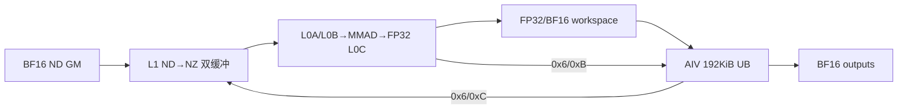

# MlaProlog A5 Direct Invoke 算子知识

## 算子速览

| 项目 | 内容 |
|---|---|
| 实际入口 | `cann_bench::mla_prolog`（Torch schema）→ `mla_prolog_npu`（PrivateUse1）→ `launch_mla_prolog_bfloat16_nd_half`（C ABI）；Direct Invoke。 |
| 计算语义 | `X` 同时生成 query 与压缩 KV：`Cq=RMSNorm(X·W_dq)`，`[Qc,Qr]=Cq·W_uq_qr`，`Q=Qc·W_uk`，`Q_rope=RoPE_half(Qr)`；`[Ckv,Kr]=X·W_dkv_kr`，输出 `RMSNorm(Ckv)` 与 `RoPE_half(Kr)`。 |
| 输入输出 | 输入与输出均为连续 BF16 ND；`B∈[1,128]`、`S∈[1,16]`、`He∈{6144,7168}`、`N=128`、`D=128`、`Dr=64`、`Hcq=1536`、`Hckv=512`。 |
| 执行类型 | 单 Kernel `MIX_CV`：AIC_CUBE 做四组 Matmul，AIV_VECTOR 做 RMSNorm、FP32/BF16 分解/归并、RoPE、cast 与输出；C:V 为 1:2。 |
| Kernel 路线 | R-001～R-017：M16/M32/M64/M128 静态 QcQr tile、默认 tile，以及 fused/separate/segmented 精度路线。 |
| 核心资源 | workspace GM；每个 AIC 双缓冲 L1A/L1B 各 `2×128 KiB`、L0A/L0B 各 `2×32 KiB`、L0C `2×64 KiB`；每个 AIV 总 UB `192 KiB`。 |
| 来源闭包 | `direct_implementation_closed`：Torch schema/校验/分配、C ABI launcher、by-value POD、全部 Host 可达 MIX_CV entry、实际 Matmul/RMSNorm/RoPE body、workspace、同步与构建接线均在转换交付源码中闭合。转换新增的精度与静态 tile 路线不归因于官方仓。 |
| 验证状态 | 已完成源码闭包检查；本次知识提取未执行编译、真机、数值或性能测试。 |

## 接口与语义

### 计算语义

令 `M=B·S`。输入 `X∈BF16[B,S,He]`，权重为普通行主序 ND：

```text
Cq_raw  = X · W_dq                                      # [M,1536]，Cube FP32
Cq      = RMSNorm(Cq_raw; gamma_cq, epsilon_cq)          # AIV FP32
[Qc,Qr] = Cq · W_uq_qr                                  # [M,128,128+64]，Cube FP32
Q[h]    = Qc[h] · W_uk[h]                               # [M,128,512]，Cube FP32→AIV BF16
Q_rope  = RoPE_half(Qr, sin, cos)                       # [M,128,64]，AIV FP32→BF16
[Ckv_raw,Kr_raw] = X · W_dkv_kr                         # [M,512+64]，Cube FP32
C_kv    = RMSNorm(Ckv_raw; gamma_ckv, epsilon_ckv)       # [M,512]，AIV BF16
K_rope  = RoPE_half(Kr_raw, sin, cos)                   # [M,64]，AIV BF16
```

`RoPE_half` 将 64 维拆成两个 32 维半区；`GatherSinCos` 先对 `sin` 的下半区乘 `-1`，随后 `RotaryPosEmb` 以两次 `MulAddDst` 实现 `rotate_half([x0,x1])=[-x1,x0]`。转换路线为保留长点积精度，把 AIV 的 FP32 `Cq` 拆成 BF16 high/residual/可选 low 三项；QcQr 与 Qn 可在同一 FP32 L0C 中融合累加，也可分别累加后在 AIV 按固定顺序相加。所有最终输出执行 `RoundMode::CAST_RINT` 到 BF16。这里的三项分解、分段归并和静态 tile 均是转换交付事实，不是官方映射事实。

### 输入、输出与属性

| 参数 | shape/layout | dtype | 约束、默认值与语义 |
|---|---|---|---|
| `token_x` | `[B,S,He]`, contiguous ND | BF16 | `B=1..128`，`S=1..16`，`He=6144/7168`。 |
| `w_dq` | `[He,1536]`, contiguous ND | BF16 | Cq 下采样权重。 |
| `w_uq_qr` | `[1536,128×(128+64)]`, contiguous ND | BF16 | 每行按 128 个 head 的 `[Qc(128),Qr(64)]` 排列。 |
| `w_uk` | `[128,128,512]`, contiguous ND | BF16 | 每个 head 独立的 Q-nope 上采样权重。 |
| `w_dkv_kr` | `[He,512+64]`, contiguous ND | BF16 | 前 512 列生成 Ckv，后 64 列生成 Kr。 |
| `rmsnorm_gamma_cq` | `[1536]`, contiguous ND | BF16 | Cq RMSNorm gamma。 |
| `rmsnorm_gamma_ckv` | `[512]`, contiguous ND | BF16 | Ckv RMSNorm gamma。 |
| `rope_sin`,`rope_cos` | `[B,S,64]`, contiguous ND | BF16 | shape 必须相同；前两维等于 token 域。 |
| `n_heads` | 标量 | int64 | 必须为 128，且 `w_uk.size(0)==128`。 |
| `rmsnorm_epsilon_cq`,`rmsnorm_epsilon_ckv` | 标量 | double→float | 默认均 `1e-5`，必须大于 0；launcher POD 中窄化为 FP32。 |
| `query` | `[B,S,128,512]`, ND | BF16 | Q-nope 输出。 |
| `query_rope` | `[B,S,128,64]`, ND | BF16 | Q 的 split-half RoPE 输出。 |
| `c_kv` | `[B,S,512]`, ND | BF16 | 直接 ND 写出，不使用 cache index。 |
| `k_rope` | `[B,S,64]`, ND | BF16 | 直接 ND 写出，不使用 cache index。 |

### 入口与版本

`TORCH_LIBRARY_FRAGMENT(cann_bench)` 注册 `cann_bench::mla_prolog`；Meta 与 PrivateUse1 都调用同一组 shape/dtype/device 校验。`mla_prolog_npu` 分配四个输出及 UInt8 workspace，解析全部设备地址与标量，再通过 `RunOpApi("MlaPrologDirect", callback)` 调用 C ABI launcher。launcher 只发射一个 by-value POD 的 MIX_CV kernel，不经过官方 ACLNN、OpDef、图 tiling 或 tiling-key router。

本卡固定 A5、CANN 9.1.0 和上述 Direct Invoke。指定官方 Commit 的 `attention/mla_prolog` 仅作语义与 split-N MIX_CV 相关映射；README 对 Ascend 950 的 `×` 是公开 ACLNN/API 产品边界，不否定这里独立存在的 A5 Direct Invoke。官方映射 Commit 在本地快照不可解析，因此不能把转换路线的 ND 权重适配、split-half RoPE、三项精度分解或 Host selector 声称为该 Commit 的官方实现。

量化闭包为“唯一可达路线不量化”：所有 entry 的基类实参固定为 `MLAPType<bfloat16_t,bfloat16_t,bfloat16_t,float,CACHE_MODE::ND,false,false,...>`，Host 写 `kvQuantMode=0`，所有 dequant/quant/smooth-scale 地址传 `nullptr`，`queryNormFlag=0`。因此可达 body 只走 BF16 输入、FP32 RMS/MMAD 中间值与 BF16 `CAST_RINT` 输出；同一内联源码中 INT8/FP8/HIF8、per-channel/per-token/per-tile 分支没有 Direct Host producer，不属于本卡 Route，也不应由调用者仅改 POD 字段激活。

## Host/Launcher 执行流程

### 参数校验与前处理

`CheckTensor` 依次检查 defined、BF16、strided、contiguous、rank 与同 device；`CheckMlaInputs` 再检查固定维度、权重 shape、sin/cos shape 和正 epsilon。没有隐式 contiguous、view、transpose、layout transform 或量化前处理。`c10::OptionalDeviceGuard` 固定当前设备；校验失败由 `TORCH_CHECK` 终止，不分配/launch。Meta 只复用校验和输出 shape 分配。

### 参数、Workspace 与生命周期

`M=min(128,B·S)`。`mla_prolog_workspace_size` 先由 `SelectProjectionRoute` 选精度族，再调用 `CalcMlaTiling`；plugin 用返回字节数分配 UInt8 Tensor。callback 注册前已解析 13 个输入/输出地址、workspace 地址、`B/S/He`、两个 FP32 epsilon 和 stream，lambda 只按值捕获；Torch Tensor 与 workspace 由框架保持到当前 stream 完成。

设 `L=platform->GetLibApiWorkSpaceSize()`，Host 分配式为：

```text
W_common = L
         + M*576*4                       # CkvKr FP32
         + M*1536*4                      # Cq FP32
         + M*1536*2*3                    # Cq high/residual/low BF16
         + M*24576*4                     # QcQr main FP32
         + M*16384*2*3                   # Qn input high/residual/low BF16
         + M*65536*4                     # Qn main FP32

FUSED_THREE_PART:
  W = W_common + M*65536*4*2
SEPARATE_THREE_PART / SEPARATE_QCQR_FUSED_QN:
  W = W_common + M*24576*4*2 + M*65536*4*2
SEGMENTED_THREE_PART:
  W = W_common + M*24576*4*2 + M*65536*4*2 + M*24576*4*3
```

Device `WorkspaceInit` 从传入基址 offset 0 排布实际中间张量；它没有先加 `L`，因此 `L` 是总分配中的额外容量，不是 body 使用的前导 slice。部分 Host 预留只为某些 trait 使用：例如 FUSED 的两份 Qn correction 仅在 stacked-Qn entry 使用；fused-Qn entry 不读取它们。

### 启动图与失败传播

```text
cann_bench::mla_prolog
  -> mla_prolog_npu / CheckMlaInputs / AllocateMlaOutputs
  -> mla_prolog_workspace_size -> SelectProjectionRoute -> CalcMlaTiling
  -> RunOpApi callback
  -> launch_mla_prolog_bfloat16_nd_half
  -> 按 Host 顺序选择一个 entry <<<aic_num, nullptr, stream>>>
  -> 单 Kernel MIX_CV（KERNEL_TYPE_MIX_AIC_1_2）
       AIC: Cq MM -> CkvKr MM -> QcQr MM -> Qn MM
       AIV: Cq RMS -> Ckv RMS/Kr RoPE -> Qc 分解/Qr RoPE -> Qn 合并
  -> 四个已分配输出在同一 stream 上可见
```

`CalcMlaTiling` 在平台对象为空、AIC 为 0、`AIV != 2*AIC` 或 token 域为空时抛出 `runtime_error`。launcher 的每个分支均只发射一个 kernel 并立即返回；末尾分支必选其一，没有 unknown-key 空落点。源码 launcher 返回 `void`，callback 固定返回 0，因此 launch 的异步设备错误由运行时/stream 机制传播，callback 本身不翻译错误码，也不存在后继 kernel 被错误提交的问题。

## Route 与参数设计

### 分核与资源计算

`T=B·S`，`M=min(128,T)`，每 `M` token 一步，尾步由 `UpdateStepBatchParams` 更新四个 Matmul 的 `m` 和 `curVectorBlockNum`。AIC 规模来自平台，AIV 必须为其两倍；`block_dim=aic_num`，MIX entry 用 `GetSubBlockNum()==2` 映射每个 AIC 到两个 AIV。AIV token 分配为 former/back：`back=M/aiv_num`、`front_count=M%aiv_num`、`front=back+(front_count!=0)`。

四个 Matmul 的 Host 分核为：

| Matmul | M/N/K | AIC N/head 分配 | Device tile |
|---|---|---|---|
| Cq | `M×He · He×1536` | `singleN=max(ceil(1536/(16*AIC))*16,64)` | BF16 `baseK=256` 当 `M<=64`，否则 128；`baseN=128`,`stepK=4`。 |
| CkvKr | `M×He · He×576` | AIC≥9 时固定 9 核×64；否则 16 对齐均分 | 同 Cq。 |
| QcQr | `M×1536 · 1536×24576` | `singleN=ceil(24576/(16*AIC))*16` | 默认 `baseK=64`,`baseN=(M<=64?256:128)`,`stepK=4`；静态路线见 Route 表。 |
| Qn | 每 head `M×128 · 128×512` | `heads/core=ceil(128/AIC)` | `baseK=128`,`baseN=128`,`stepK=1`，B ND 全载。 |

所有 A/B GM 都是 ND；`CopyNDGmToL1` 用 `Nd2NzParams` 搬到 L1 NZ，`dstNzC0Stride=ceil(M/16)*16`。N、M 尾块分别由 per-core `n` 与 `mSize=align(M,16)` 处理，Fixpipe 只提交有效 `m×n`。

### 特征与重要性

P0 为最高重要性，后续等级依次降低。该顺序仅用于组织实现知识；它不改变 Host selector 的判断顺序、短路关系或 fallback。

| 重要性 | Route | 降序特征 | 重要实现面 |
|---:|---|---|---|
| P0 | R-002 Q3N2-M16 | 28 AIC 下的常规短 token 主路径；覆盖单 token 与 `B=1,He=7168` 的短序列 | M16 静态 QcQr tile、QcQr 三项、stacked Qn 两项和 A prefetch |
| P1 | R-011 Fused-M128 | `T>64` 的 fused 静态主路径，并负责 `M=128` step 与多 step | M128 `(128,128,2)`、QcQr/Qn 单 L0C 三项累加和 step 尾块 |
| P2 | R-010 Fused-M64 | 中等 token 域的 fused 静态路径 | M64 `(64,256,4)`、A prefetch、三项 QcQr/Qn 融合 |
| P3 | R-009 SepQcQr-FusedQn-M32 | `T<=32` 的 mixed 精度路径 | QcQr 三份 FP32 结果在 AIV 归并，Qn 保持单 L0C 融合 |
| P4 | R-012 Separate-M128 | 大 token 的 separate 精度路径 | M128 独立 FP32 accumulators、AIV 补偿归并与多 step 生命周期 |
| P5 | R-015 Separate-default | static M64 不接受 separate 时的动态 tile 终点，也承接非专门化 core geometry | 默认 QcQr tile、两组 correction/low workspace 和确定性归并 |
| P6 | R-008 Fused-M32 | `T<=32` 的 fused 静态路径 | M32 `(32,512,4)`、A full-load/prefetch 与三项融合 |
| P7 | R-007 Separate-M16 | `T<=16` 的 separate 静态路径 | M16 QcQr 分离累加、segmented small-first Qn 与 correction workspace |
| P8 | R-006 Fused-M16 | `T<=16` 的通用 fused 静态路径 | M16 三项 QcQr、stacked Qn 三结果和 ordered add |
| P9 | R-003 Q2N3-M16 | 小批 decode 的两项 QcQr/三项 Qn 专门路径 | M16 A prefetch、QcQr low 关闭、Qn low 激活 |
| P10 | R-001 Q2N2-M16 | 单 token 小 `epsilon_cq` 的最窄精度专门路径 | QcQr/Qn 均为两项，保持独立 compile-time trait |
| P11 | R-013 SepQcQr-FusedQn-M128 | 大 token mixed 精度静态路径 | M128 QcQr separate、Qn fused 与多 step |
| P12 | R-014 Fused-default | fused 精度族未命中静态专门化时的动态终点 | 默认 tile、单 L0C fused QcQr/Qn 与公共 workspace |
| P13 | R-016 SepQcQr-FusedQn-default | mixed 精度族未命中静态专门化时的动态终点 | 默认 tile、QcQr correction/low 与 fused Qn |
| P14 | R-004 Q3N2-default | Q3N2 专门语义在非 28 AIC geometry 上的默认 tile 路径 | QcQr 三项、Qn 两项，保留 decode 精度策略而放弃静态 geometry |
| P15 | R-005 Q2N3-default | Q2N3 专门语义在非 28 AIC geometry 上的默认 tile 路径 | QcQr 两项、Qn 三项，保留小批 decode 精度策略 |
| P16 | R-017 Segmented-default | plugin 校验域外的宽 C ABI 最终保守终点 | QcQr 分段 partial、三项 separate Qn 与 AIV 补偿归并 |

### Route 选择

下表严格保持源码 launcher 的判断次序；P0～P16 不参与 Host 选择。每个命中分支发射一次并立即 `return`，最后再按 `precision_route` 落入一个 default entry。

| Host 顺序 | Route | Key/模板 | 精确选择条件与短路 | 不命中/fallback |
|---:|---|---|---|---|
| 1 | R-001 Q2N2-M16 | `BenchmarkQ2N2M16TileRoute` | fast、AIC=28、`T=1`、`epsilon_cq<5e-6`；命中即返回 | R-002 |
| 2 | R-002 Q3N2-M16 | `BenchmarkQ3N2M16TileRoute` | fast、AIC=28、`T=1`；命中即返回 | R-003 |
| 3 | R-003 Q2N3-M16 | `BenchmarkQ2N3M16TileRoute` | fast、AIC=28、`S=1`,`B<=4`；命中即返回 | Host 顺序 4 |
| 4 | R-002 Q3N2-M16 | 同上 | fast、AIC=28、`B=1`,`S<=16`,`He=7168`；命中即返回 | R-004 |
| 5 | R-004 Q3N2-default | `BenchmarkQcQrThreeQnTwoRoute` | fast、`T=1`（非前述 AIC=28）；命中即返回 | R-005 |
| 6 | R-005 Q2N3-default | `BenchmarkQcQrTwoQnThreeRoute` | fast、`S=1`,`B<=4`；命中即返回 | Host 顺序 7 |
| 7 | R-004 Q3N2-default | 同上 | fast、`B=1`,`S<=16`,`He=7168`；命中即返回 | Host 顺序 8 |
| 8 | R-006/R-007 M16 | fused/separate static | fast、AIC=28、`T<=16`；按 `SelectProjectionRoute`，命中即返回 | Host 顺序 9 |
| 9 | R-008/R-009 M32 | fused/separate-qcqr-fused-qn static | fast、AIC=28、`T<=32`；按 route，命中即返回 | Host 顺序 10 |
| 10 | R-010 M64 | fused static | fast、AIC=28、`T<=64` 且 route=fused；命中即返回 | Host 顺序 11 |
| 11 | R-011/R-012/R-013 M128 | 三种 static | fast、AIC=28、`T>64`；按 route，命中即返回 | default 终点 |
| 12 | R-014～R-017 default | 四种动态实现 | 前述均未命中；按 route | 必选其一 |

```text
fast := S<=16 && (He==6144 || He==7168)
precision_route:
  !fast                                                     -> segmented
  He=7168 && T=16 && B>1                                    -> separate-three
  He=7168 && T=32                                           -> separate-qcqr/fused-qn
  He=7168 && T>=512 && !(B=128 && S=4)                      -> separate-qcqr/fused-qn
  S=1 && ((64<=B<128 && He=7168) || (B>=128 && He=6144))    -> separate-three
  otherwise                                                 -> fused-three

entry_selector 按上表 1→12 短路；plugin 校验域内 fast 恒真，segmented 仅可由更宽的 C ABI 直接调用域到达。
```

```text
importance routes:
P0 R-002 -> P1 R-011 -> P2 R-010 -> P3 R-009 -> P4 R-012
-> P5 R-015 -> P6 R-008 -> P7 R-007 -> P8 R-006 -> P9 R-003
-> P10 R-001 -> P11 R-013 -> P12 R-014 -> P13 R-016
-> P14 R-004 -> P15 R-005 -> P16 R-017
```

### 模板/实现执行矩阵

| 重要性 | Route | key/selector | dtype/shape/platform 完整命中条件 | 执行族与 kernel 节点 | 实际模板/body | 内存与同步特征 | tail/fallback |
|---:|---|---|---|---|---|---|---|
| P0 | R-002 Q3N2-M16 | `q3_n2_m16_tile` | Host 顺序 2/4 | 单 MIX_CV | `(16,1024,4)`，QcQr 3 项、stacked Qn 2 项，A prefetch | 同步公共；Qn low inactive | 不命中继续 Host 后继 |
| P1 | R-011 Fused-M128 | `fused_m128_tile` | Host 顺序 11+fused | 单 MIX_CV | `(128,128,2)`，fused 3+3 | 单 L0C fused | 不命中→dynamic fused |
| P2 | R-010 Fused-M64 | `fused_m64_tile` | Host 顺序 10 | 单 MIX_CV | `(64,256,4,prefetchA)`，fused 3+3 | 单 L0C fused | 不命中继续 Host 后继 |
| P3 | R-009 SepQcQr-FusedQn-M32 | `separate_qcqr_fused_qn_m32` | Host 顺序 9+对应 route | 单 MIX_CV | `(32,512,4)`，QcQr separate 3，Qn fused 3 | QcQr AIV merge；Qn 单 L0C | 不命中继续 Host 后继 |
| P4 | R-012 Separate-M128 | `separate_m128_tile` | Host 顺序 11+separate | 单 MIX_CV | `(128,128,2)`，separate 3+3 | 双/独立 FP32 accumulators + AIV merge | 不命中→dynamic separate |
| P5 | R-015 Separate-default | `_separate_kernel` | default+separate | 单 MIX_CV | 默认 tile，separate 3+3 | correction/low 两组 workspace | 终点 |
| P6 | R-008 Fused-M32 | `fused_m32_tile` | Host 顺序 9+fused | 单 MIX_CV | `(32,512,4,prefetchA)`，QcQr 3、stacked Qn 3 | fused workspace；AIV ordered add | 不命中继续 Host 后继 |
| P7 | R-007 Separate-M16 | `separate_m16_tile` | Host 顺序 8+separate | 单 MIX_CV | `(16,1024,4)`，QcQr high/res 双 L0C+low pass，stacked Qn 3 | QcQr correction/low workspace | 不命中继续 Host 后继 |
| P8 | R-006 Fused-M16 | `fused_m16_tile` | Host 顺序 8+fused | 单 MIX_CV | `(16,1024,4,prefetchA)`，QcQr 3、stacked Qn 3 | Qn 三结果连续写、AIV ordered add | 不命中继续 Host 后继 |
| P9 | R-003 Q2N3-M16 | `q2_n3_m16_tile` | Host 顺序 3 | 单 MIX_CV | `(16,1024,4)`，QcQr 2 项、stacked Qn 3 项，A prefetch | QcQr low inactive | 不命中继续 Host 后继 |
| P10 | R-001 Q2N2-M16 | `q2_n2_m16_tile` | Host 顺序 1 | 单 MIX_CV | static `(BK,BN,stepK)=(16,1024,4)`，QcQr 2 项、stacked Qn 2 项 | 单 L0C fused QcQr；stacked Qn 连续三矩阵区只用两项 | 不命中→R-002 |
| P11 | R-013 SepQcQr-FusedQn-M128 | 对应 `_m128` | Host 顺序 11+对应 route | 单 MIX_CV | `(128,128,2)`，QcQr separate、Qn fused | QcQr merge，Qn 单 L0C | 不命中→dynamic mixed |
| P12 | R-014 Fused-default | base route entry | default+fused | 单 MIX_CV | 默认 QcQr tile，fused 3+3 | 公共 workspace | 终点 |
| P13 | R-016 SepQcQr-FusedQn-default | 对应 entry | default+对应 route | 单 MIX_CV | 默认 tile，QcQr separate、Qn fused | QcQr correction/low | 终点 |
| P14 | R-004 Q3N2-default | `q3_n2` | Host 顺序 5/7 | 单 MIX_CV | 默认 QcQr tile，fused QcQr 3、fused Qn 2 | 单 L0C，各级双缓冲 | 不命中继续 Host 后继 |
| P15 | R-005 Q2N3-default | `q2_n3` | Host 顺序 6 | 单 MIX_CV | 默认 QcQr tile，fused QcQr 2、fused Qn 3 | 单 L0C，各级双缓冲 | 不命中继续 Host 后继 |
| P16 | R-017 Segmented-default | `_segmented_kernel` | default+segmented | 单 MIX_CV | QcQr high 的 K=1536 分 3×512，另 residual/low full-K；Qn separate | 3 segment + correction/low，AIV 补偿归并 | 终点 |

### 隐藏性能 Guard

| Guard | Host/Tiling 条件 | Device/资源原因 | 影响 Route | 不满足时去向 | 源码符号 |
|---|---|---|---|---|---|
| A5 C:V | `aic_num>0 && aiv_num==2*aic_num` | `KERNEL_TYPE_MIX_AIC_1_2` 与 `blockIdx/cvRatio` 映射 | 全部 | 抛异常 | `CalcMlaTiling` |
| Fast domain | `S<=16 && He∈{6144,7168}` | 静态 selector 的业务域 | R-001～R-016 | R-017 | `IsMeasuredFastDomain` |
| 28 AIC | `block_dim==28` | `mm3SingleCoreN=880`，静态 QcQr N tile 专门实例化 | P0 R-002、P1 R-011、P2 R-010、P3 R-009、P4 R-012、P6 R-008、P7 R-007、P8 R-006、P9 R-003、P10 R-001、P11 R-013 | 默认 tile | launcher |
| M16/M32/M64/M128 | `T` 阈值与 Host 顺序 | 保证 `BaseK*BaseN<=16384` 即 L0B≤32 KiB；适配 L0C/Fixpipe 生命周期 | 静态 routes | 默认 tile | `BenchmarkStaticQcQrTileRoute` |
| A prefetch | trait `benchmarkPrefetchQcQrA` | 下一 K-L1 A ping 与当前 MMAD 重叠 | 指定 fused static | 同 route 非预取实现 | `MatmulSplitKThreePartND` |
| A full-load | 默认 QcQr 中 `M<=32`（BF16） | Cq A 可留在 L1，跨 N tile 复用 | 默认 routes | split-K 重载 A | `MatmulQcQr` |
| UB | `usedBytes <= 192 KiB` | fixed buffers 后剩余全给 `shareBuffer_`；chunk=4096 使归并≤96 KiB | 全部 | 无 fallback，参数域保证 | `VectorBufferInit`,`AddQcQrCorrections` |
| L1/L0 | A/B 每 ping 128 KiB；L0A/B/C 每 ping 32/32/64 KiB | compile-time `BaseK*BaseN` 与 M 对齐必须容纳 tile | 全部 | selector 换实例；无 device fallback | constants/static_assert |
| 非空 | `T>0` | direct body 不实现 EMPTY_QUERY | 全部 | 抛异常 | `CalcMlaTiling` |
| dtype/layout | 全输入 BF16 contiguous ND | ND→NZ copy 与 route type 固定 | 全部 | `TORCH_CHECK` | `CheckTensor`,`BenchmarkFp32QcQrFusedRoute` |
| epsilon 小值 | `T=1,AIC=28,epsilon_cq<5e-6` | 选择两项 QcQr/Qn 的独立 compile-time route | P10 R-001 | P0 R-002 | launcher |

### POD/ABI

`MlaPrologTilingData` 只有一个 `MlaPrologBaseParams`，按值传入 kernel；自然 4 字节对齐，`sizeof=172`、`alignof=4`，外层同尺寸。下表 offset 均为字节；所有字段由 `CalcMlaTiling` 生产，Device 由 `Init/Mm*ParamInit/Process` 消费。

| 结构 | 字段 | 类型/位宽 | ABI 布局 | 单位 | Host/launcher producer | Device consumer | 边界 |
|---|---|---|---|---|---|---|---|
| Base | `batchSize` | u32 | off 0 | batch | `batch` | actual-seq dormant path | 1..128 |
| Base | `stepBatchSize` | u32 | off 4 | token | `min(128,T)` | 四 MM、AIV/UB | 1..128 |
| Base | `mSubSize` | u32 | off 8 | token | 0 | 当前 route 不读 | inactive=0 |
| Base | `mSubCoreNum` | u32 | off 12 | core | 0 | 当前 route 不读 | inactive=0 |
| Base | `stepNumHeadDequant` | u32 | off 16 | head | 16 | `CastQc` | 固定16 |
| Base | `tokenSize` | u32 | off 20 | token | `B*S` | `Process` | 非零，u32 乘法 |
| Base | `seq1Size` | u32 | off 24 | token/batch | `S` | offset/cache helper | 1..16 |
| Base | `seq2Size` | u32 | off 28 | token/batch | `S` | 公共体；当前 ND route 无独立消费 | =S |
| Base | `headSizeX` | u32 | off 32 | element | `He` | Cq/CkvKr K | 6144/7168 |
| Base | `headSizeCq` | u32 | off 36 | element | 1536 | Cq N/QcQr K/RMS | 固定 |
| Base | `headSizeCkv` | u32 | off 40 | element | 512 | Ckv/Qn N | 固定 |
| Base | `headSizeQc` | u32 | off 44 | element | 16384 | Qc 全 head stride | 128×128 |
| Base | `headSizeQr` | u32 | off 48 | element | 8192 | Qr 全 head stride | 128×64 |
| Base | `headSizeKr` | u32 | off 52 | element | 64 | Kr slice | 固定 |
| Base | `numHeadSize` | u32 | off 56 | head | 128 | Qc/Qr/Qn loops | 固定 |
| Base | `numHeadKvSize` | u32 | off 60 | head | 1 | 公共体 | 固定1 |
| Base | `dimHeadSizeQc` | u32 | off 64 | element/head | 128 | Qn K/Qc stride | 固定 |
| Base | `dimHeadRope` | u32 | off 68 | element/head | 64 | RoPE | 偶数、固定 |
| Base | `blockNum` | u32 | off 72 | block | `T` | ND cache helper | 当前 blockSize=1 |
| Base | `blockSize` | u32 | off 76 | token/block | 1 | ND cache helper | 固定1 |
| Base | `mm1BlockNum` | u32 | off 80 | AIC | `ceil(1536/singleN)` | Cq guard | ≤AIC |
| Base | `mm2BlockNum` | u32 | off 84 | AIC | 9 或均分 | CkvKr guard | ≤AIC |
| Base | `mm3BlockNum` | u32 | off 88 | AIC | `ceil(24576/singleN)` | QcQr guard | ≤AIC |
| Base | `mm4BlockNum` | u32 | off 92 | AIC | `ceil(128/headsPerCore)` | Qn guard | ≤AIC |
| Base | `vectorBlockNum` | u32 | off 96 | AIV | `min(M,aiv)` | AIV token mapping | 1..aiv |
| Base | `mm1SingleCoreN` | u32 | off 100 | element | 16-align/max64 | Cq per-core N | tail on last |
| Base | `mm2SingleCoreN` | u32 | off 104 | element | 64 或16-align | CkvKr per-core N | tail on last |
| Base | `mm3SingleCoreN` | u32 | off 108 | element | 16-align | QcQr per-core N | 28核时880 |
| Base | `mm4SingleCoreBatch` | u32 | off 112 | head/AIC | `ceil(128/AIC)` | Qn head loops | tail last core |
| Base | `dtileSize` | u32 | off 116 | element | 512 | dormant quant helper | 当前固定 |
| Base | `kvQuantMode` | u32 | off 120 | enum | 0 | quant branches | no-quant |
| Base | `tileSize` | u32 | off 124 | element | 128 | dormant quant helper | 固定 |
| Base | `ckvkrRepoMode` | u32 | off 128 | enum | 0 | cache helper | ND direct |
| Base | `quantScaleRepoMode` | u32 | off 132 | enum | 0 | dormant | inactive |
| Base | `queryNormFlag` | u32 | off 136 | bool-u32 | 0 | workspace/output | 不单独输出 norm |
| Base | `reciprocalCq` | f32 | off 140 | scalar | `1/1536` | Cq RMS | 有限正值 |
| Base | `epsilonCq` | f32 | off 144 | scalar | attr cast | Cq RMS/selector | >0 |
| Base | `reciprocalCkv` | f32 | off 148 | scalar | `1/512` | Ckv RMS | 有限正值 |
| Base | `epsilonCkv` | f32 | off 152 | scalar | attr cast | Ckv RMS | >0 |
| Base | `kNopeClipAlpha` | f32 | off 156 | scalar | 0 | dormant | inactive |
| Base | `qcQrScale` | f32 | off 160 | scalar | 0 | RMS scale guard | disabled |
| Base | `kcScale` | f32 | off 164 | scalar | 0 | Ckv scale guard | disabled |
| Base | `isQcQrScaleEnable` | u16 | off 168 | bool | 0 | RMS | disabled |
| Base | `isKcScaleEnable` | u16 | off 170 | bool | 0 | Ckv RMS | disabled |

### Route 源码闭包

| 重要性 | Route | Key/selector | Host/Tiling producer | POD/参数 | Kernel entry/router | Kernel body/直接依赖 | 构建接线 |
|---:|---|---|---|---|---|---|---|
| P0 | R-002 | launcher Host 顺序 2/4 + Q3N2 M16 trait | `mla_prolog_kernel.cpp::SelectProjectionRoute/CalcMlaTiling` | 172B by-value POD | `...q3_n2_m16_tile_kernel` | `MlaPrologVecS1CubS2` + `MatmulSplitK*ND` + Vector service | operator `CMakeLists.txt::register_direct_launch_op` |
| P1 | R-011 | Host 顺序 11 + fused M128 trait | 同上 | 同上 | `...fused_m128_tile_kernel` | 同上 | 同上 |
| P2 | R-010 | Host 顺序 10 + fused M64 trait | 同上 | 同上 | `...fused_m64_tile_kernel` | 同上 | 同上 |
| P3 | R-009 | Host 顺序 9 + mixed M32 trait | 同上 | 同上 | `...separate_qcqr_fused_qn_m32_tile_kernel` | 同上 | 同上 |
| P4 | R-012 | Host 顺序 11 + separate M128 trait | 同上 | 同上 | `...separate_m128_tile_kernel` | 同上 | 同上 |
| P5 | R-015 | default + separate | 同上 | 同上 | `..._separate_kernel` | two-output + residual pass | 同上 |
| P6 | R-008 | Host 顺序 9 + fused M32 trait | 同上 | 同上 | `...fused_m32_tile_kernel` | `MlaPrologVecS1CubS2` + `MatmulSplitK*ND` + Vector service | 同上 |
| P7 | R-007 | Host 顺序 8 + separate M16 trait | 同上 | 同上 | `...separate_m16_tile_kernel` | 同上 | 同上 |
| P8 | R-006 | Host 顺序 8 + fused M16 trait | 同上 | 同上 | `...fused_m16_tile_kernel` | 同上 | 同上 |
| P9 | R-003 | Host 顺序 3 + Q2N3 M16 trait | 同上 | 同上 | `...q2_n3_m16_tile_kernel` | 同上 | 同上 |
| P10 | R-001 | Host 顺序 1 + Q2N2 M16 trait | 同上 | 同上 | `...q2_n2_m16_tile_kernel` | 同上 | 同上 |
| P11 | R-013 | Host 顺序 11 + mixed M128 trait | 同上 | 同上 | `...separate_qcqr_fused_qn_m128_tile_kernel` | 同上 | 同上 |
| P12 | R-014 | default + fused | 同上 | 同上 | `mla_prolog_bfloat16_nd_half_kernel` | fused three-part | 同上 |
| P13 | R-016 | default + separate-qcqr/fused-qn | 同上 | 同上 | `..._separate_qcqr_fused_qn_kernel` | QcQr separate、Qn fused | 同上 |
| P14 | R-004 | Host 顺序 5/7 + Q3N2 default trait | 同上 | 同上 | `...q3_n2_kernel` | `MlaPrologVecS1CubS2` + default `MatmulSplitK*ND` | 同上 |
| P15 | R-005 | Host 顺序 6 + Q2N3 default trait | 同上 | 同上 | `...q2_n3_kernel` | 同上 | 同上 |
| P16 | R-017 | default + segmented | 同上 | 同上 | `..._segmented_kernel` | `MatmulQcQrSegmentedPart` + compensated AIV reduction | 同上 |

## Kernel 实现

### 公共执行流程

所有 Route 共享一个 entry ABI 和同一 `MlaPrologVecS1CubS2<RouteType>`。`Init` 令 AIC `cubeBlockIdx=blockIdx`，AIV `cubeBlockIdx=blockIdx/2`；设置 GM tensor、四组 MM 参数、workspace slices，并按 `ASCEND_IS_AIC/AIV` 分配私有 L1/L0 或 UB。`Process` 以 128-token step 遍历 T，AIC 与 AIV 在同一 launch 中并行。

```text
AIC Cq FP32 --flag 0x6/PIPE_FIX--> AIV RMSNorm Cq + BF16 significand split
    ^                                      |
    |                         all-AIV barrier + flag 0x6/PIPE_MTE3
    |                                      v
AIC CkvKr FP32 --flag 0x6--> AIV RMSNorm Ckv / RoPE Kr -> c_kv,k_rope
                                           |
AIC QcQr FP32 <----------------------------+
    | --flag 0x6--> AIV merge/cast Qc + RoPE Qr
    |                    | flag 0x6/PIPE_MTE3
    v                    v
AIC Qn FP32 --flag 0xB--> AIV ordered merge + BF16 query --flag 0xC--> next step
```

Cross-core IDs `0x6` 在不同阶段复用但每次都有配对 wait/set；补充精度路线使用 `0xB`（AIC→AIV Qn ready）和 `0xC`（AIV→AIC output consumed）。AIC 内部 L1/L0/Fixpipe 使用 `A_EVENT0/1`、`B_EVENT0/1`、`L0A/L0B/L0C_EVENT0/1` ping-pong；AIV 内部用 `MTE2_V`、`V_MTE3`、`MTE3_MTE2` event 和 `PIPE_V` barrier。

### Route R-002（P0）：Q3N2 M16 静态路线

#### 适用条件

##### 选择证据

| 层级 | 文件 | 符号 | 源码谓词/参数 | 结果/下一跳 |
|---|---|---|---|---|
| Launcher | kernel source | launcher | AIC=28 且 T=1（R-001 未中），或 B=1,S<=16,He=7168 | QcQr三项/Qn两项 |

#### Device 数据流

##### 函数级调用链

```text
entry -> fused QcQr three-part(prefetchA) -> CastQc(high,res,low) -> stacked Qn two-part -> CombineQnAndStore
```

##### 源码等价伪码

```text
QcQr=MMAD(high)+MMAD(res)+MMAD(low) in FP32 L0C; Qn=MMAD(qHigh)+MMAD(qResidual); cast_rint(query)
```

#### 内存与数据搬运

##### 资源与搬运表

| 层级/缓冲区 | offset/地址公式 | extent/容量公式 | dtype/layout | producer | consumer | owner/lifetime | 对齐/复用 |
|---|---|---|---|---|---|---|---|
| 全层级 | 公共 GM/L1/L0/UB 布局 | FUSED 公共分配式 | ND→NZ/FP32/BF16 | 公共 AIC/AIV 流程 | 公共 AIC/AIV 流程 | step | A prefetch ping；Qn low slice inactive |

##### 分层内存布局


##### 字节账、交接边与复用顺序

```text
使用 FUSED 公共分配；QcQr low BF16 slice active，Qn low BF16/FP32 correction inactive。
```

| 边/复用子区 | producer | offset/extent | dtype/layout | consumer | ordering/sync | owner/lifetime | 安全条件 |
|---|---|---|---|---|---|---|---|
| three-part QcQr | AIV RMS | 3*M*1536*2 | BF16 ND | AIC | 0x6 | workspace step | A ping 容量满足 M16 |

#### 同步、精度与尾块

##### 同步与数值边界表

| 阶段 | primitive/机制 | producer | consumer/等待点 | 保护对象 | 精度/尾块 |
|---|---|---|---|---|---|
| QcQr/Qn | 公共 flags | AIC/AIV | 对侧 | main/correction | 3项后2项；有效 M 行提交 |

#### 关键实现

##### 符号证据表

| 阶段 | 文件 | 符号/模板实例 | 实现事实 |
|---|---|---|---|
| Host/Tiling producer | kernel source | launcher | Host 顺序 2/4 |
| Kernel entry/router | kernel source | `...q3_n2_m16_tile_kernel` | static trait |
| Device body/helper | kernel source | `BenchmarkQ3N2M16TileRoute` | `(16,1024,4,prefetch)` |

### Route R-011（P1）：Fused M128 静态路线

#### 适用条件

##### 选择证据

| 层级 | 文件 | 符号 | 源码谓词/参数 | 结果/下一跳 |
|---|---|---|---|---|
| Launcher | kernel source | launcher | fast,AIC=28,T>64,route=fused | M128 fused |

#### Device 数据流

##### 函数级调用链

```text
fused_m128 -> `(128,128,2)` QcQr fused3 -> Qn fused3 -> AIV
```

##### 源码等价伪码

```text
step M=128；最后一步 M<128 时 UpdateStepBatchParams 只改 m，静态 BK/BN 保持。
```

#### 内存与数据搬运

##### 资源与搬运表

| 层级/缓冲区 | offset/地址公式 | extent/容量公式 | dtype/layout | producer | consumer | owner/lifetime | 对齐/复用 |
|---|---|---|---|---|---|---|---|
| 全层级 | 公共 | FUSED | mixed | 公共 | 公共 | each step | M128 static |

##### 分层内存布局


##### 字节账、交接边与复用顺序

```text
workspace 按 stepBatch=128；多 step 复用同一 slices，依赖 0xB/0xC 防覆盖。
```

| 边/复用子区 | producer | offset/extent | dtype/layout | consumer | ordering/sync | owner/lifetime | 安全条件 |
|---|---|---|---|---|---|---|---|
| step reuse | AIC/AIV | all slices | mixed | next step | final 0xC + CkvKr handshake | whole launch | consumer完成后覆盖 |

#### 同步、精度与尾块

##### 同步与数值边界表

| 阶段 | primitive/机制 | producer | consumer/等待点 | 保护对象 | 精度/尾块 |
|---|---|---|---|---|---|
| step tail | UpdateStepBatchParams | Process | MM/AIV | last step | M align16，output有效M |

#### 关键实现

##### 符号证据表

| 阶段 | 文件 | 符号/模板实例 | 实现事实 |
|---|---|---|---|
| Host/Tiling producer | kernel source | launcher | T>64 fused |
| Kernel entry/router | kernel source | `...fused_m128_tile_kernel` | static |
| Device body/helper | kernel source | `BenchmarkFusedM128TileRoute` | `(128,128,2)` |

### Route R-010（P2）：Fused M64 静态路线

#### 适用条件

##### 选择证据

| 层级 | 文件 | 符号 | 源码谓词/参数 | 结果/下一跳 |
|---|---|---|---|---|
| Launcher | kernel source | launcher | fast,AIC=28,T<=64,route=fused，前路未中 | M64 |

#### Device 数据流

##### 函数级调用链

```text
fused_m64 -> QcQr `(64,256,4,prefetch)` fused3 -> Qn fused3 -> AIV
```

##### 源码等价伪码

```text
三项 QcQr/Qn 均单 L0C；Qn 不使用 stacked service。
```

#### 内存与数据搬运

##### 资源与搬运表

| 层级/缓冲区 | offset/地址公式 | extent/容量公式 | dtype/layout | producer | consumer | owner/lifetime | 对齐/复用 |
|---|---|---|---|---|---|---|---|
| 全层级 | 公共 | FUSED | mixed | 公共 | 公共 | step | static M64 |

##### 分层内存布局


##### 字节账、交接边与复用顺序

```text
FUSED 总式；两份 Qn correction reserve inactive。
```

| 边/复用子区 | producer | offset/extent | dtype/layout | consumer | ordering/sync | owner/lifetime | 安全条件 |
|---|---|---|---|---|---|---|---|
| Qn main | AIC | M*65536*4 | FP32 | AIV | 0xB | step | fused complete |

#### 同步、精度与尾块

##### 同步与数值边界表

| 阶段 | primitive/机制 | producer | consumer/等待点 | 保护对象 | 精度/尾块 |
|---|---|---|---|---|---|
| M64 | 公共 | 公共 | 公共 | tiles | exact M64 或更小前路已截获 |

#### 关键实现

##### 符号证据表

| 阶段 | 文件 | 符号/模板实例 | 实现事实 |
|---|---|---|---|
| Host/Tiling producer | kernel source | launcher | T<=64 fused |
| Kernel entry/router | kernel source | `...fused_m64_tile_kernel` | static |
| Device body/helper | kernel source | `BenchmarkFusedM64TileRoute` | `(64,256,4,prefetch)` |

### Route R-009（P3）：Separate QcQr / Fused Qn M32 静态路线

#### 适用条件

##### 选择证据

| 层级 | 文件 | 符号 | 源码谓词/参数 | 结果/下一跳 |
|---|---|---|---|---|
| Launcher | kernel source | launcher | fast,AIC=28,T<=32,route=separate-qcqr-fused-qn | 对应 M32 entry |

#### Device 数据流

##### 函数级调用链

```text
entry -> QcQr two-output+low -> AIV merge/cast -> Qn fused three-part -> AIV cast
```

##### 源码等价伪码

```text
QcQr 三个 FP32 矩阵在 AIV 合并；Qn 三项在单 L0C 内合并，仅写 main。
```

#### 内存与数据搬运

##### 资源与搬运表

| 层级/缓冲区 | offset/地址公式 | extent/容量公式 | dtype/layout | producer | consumer | owner/lifetime | 对齐/复用 |
|---|---|---|---|---|---|---|---|
| QcQr corr | main后两块 | 2*M*24576*4 | FP32 | AIC | AIV | step | active |
| Qn corr reserve | Host 总式尾部 | 2*M*65536*4 | FP32 bytes | 无 | 无 | workspace | body inactive |

##### 分层内存布局


##### 字节账、交接边与复用顺序

```text
Host 按 separate 总式分配；实际 fused-Qn 不读两份 Qn correction reserve。
```

| 边/复用子区 | producer | offset/extent | dtype/layout | consumer | ordering/sync | owner/lifetime | 安全条件 |
|---|---|---|---|---|---|---|---|
| QcQr merge | AIC | main/corr/low | FP32 | AIV | 0x6/all-AIV | step | merge后 CastQc |

#### 同步、精度与尾块

##### 同步与数值边界表

| 阶段 | primitive/机制 | producer | consumer/等待点 | 保护对象 | 精度/尾块 |
|---|---|---|---|---|---|
| mixed policy | flags | AIC/AIV | 对侧 | QcQr/Qn | QcQr separate，Qn fused |

#### 关键实现

##### 符号证据表

| 阶段 | 文件 | 符号/模板实例 | 实现事实 |
|---|---|---|---|
| Host/Tiling producer | kernel source | route selector | He7168,T32 |
| Kernel entry/router | kernel source | `...separate_qcqr_fused_qn_m32...` | static |
| Device body/helper | kernel source | `BenchmarkSeparateQcQrFusedQnM32TileRoute` | split/fused trait |

### Route R-012（P4）：Separate M128 静态路线

#### 适用条件

##### 选择证据

| 层级 | 文件 | 符号 | 源码谓词/参数 | 结果/下一跳 |
|---|---|---|---|---|
| Launcher | kernel source | launcher | fast,AIC=28,T>64,route=separate | M128 separate |

#### Device 数据流

##### 函数级调用链

```text
separate_m128 -> QcQr separate3/AIV merge -> Qn separate3/AIV merge
```

##### 源码等价伪码

```text
每个投影保留独立 FP32 accumulation order，AIV main+=corr+=low 后 BF16。
```

#### 内存与数据搬运

##### 资源与搬运表

| 层级/缓冲区 | offset/地址公式 | extent/容量公式 | dtype/layout | producer | consumer | owner/lifetime | 对齐/复用 |
|---|---|---|---|---|---|---|---|
| workspace | separate formula | common+2QcQr+2Qn | FP32/BF16 | AIC/AIV | 对侧 | step | 4096 chunks |

##### 分层内存布局


##### 字节账、交接边与复用顺序

```text
W=W_common+2*M*24576*4+2*M*65536*4；其它本地容量同公共。
```

| 边/复用子区 | producer | offset/extent | dtype/layout | consumer | ordering/sync | owner/lifetime | 安全条件 |
|---|---|---|---|---|---|---|---|
| both merges | AIC | QcQr/Qn main,corr,low | FP32 | AIV | 0x6/0xB/0xC | step | merge完成再复用 |

#### 同步、精度与尾块

##### 同步与数值边界表

| 阶段 | primitive/机制 | producer | consumer/等待点 | 保护对象 | 精度/尾块 |
|---|---|---|---|---|---|
| merge | ordered Add | AIV | subsequent Cast | chunks | FP32固定次序，BF16 RINT |

#### 关键实现

##### 符号证据表

| 阶段 | 文件 | 符号/模板实例 | 实现事实 |
|---|---|---|---|
| Host/Tiling producer | kernel source | selector | separate large M |
| Kernel entry/router | kernel source | `...separate_m128_tile_kernel` | static |
| Device body/helper | kernel source | `BenchmarkSeparateM128TileRoute` | separate3+3 |

### Route R-015（P5）：Separate 默认路线

#### 适用条件

##### 选择证据

| 层级 | 文件 | 符号 | 源码谓词/参数 | 结果/下一跳 |
|---|---|---|---|---|
| Launcher | kernel source | fallback branch | route=separate | separate entry |

#### Device 数据流

##### 函数级调用链

```text
separate entry -> default QcQr separate3 -> AIV merge -> Qn separate3 -> AIV merge
```

##### 源码等价伪码

```text
同 R-012，QcQr 使用默认 BK/BN/stepK。
```

#### 内存与数据搬运

##### 资源与搬运表

| 层级/缓冲区 | offset/地址公式 | extent/容量公式 | dtype/layout | producer | consumer | owner/lifetime | 对齐/复用 |
|---|---|---|---|---|---|---|---|
| 公共 | 公共 | separate total | mixed | 公共 | 公共 | step | default geometry |

##### 分层内存布局


##### 字节账、交接边与复用顺序

```text
separate 总式；所有 correction active。
```

| 边/复用子区 | producer | offset/extent | dtype/layout | consumer | ordering/sync | owner/lifetime | 安全条件 |
|---|---|---|---|---|---|---|---|
| corrections | AIC | QcQr/Qn correction slices | FP32 | AIV | common flags | step | ordered add |

#### 同步、精度与尾块

##### 同步与数值边界表

| 阶段 | primitive/机制 | producer | consumer/等待点 | 保护对象 | 精度/尾块 |
|---|---|---|---|---|---|
| merges | PIPE_V+events | AIV | MTE3 | chunks | FP32 then BF16 |

#### 关键实现

##### 符号证据表

| 阶段 | 文件 | 符号/模板实例 | 实现事实 |
|---|---|---|---|
| Host/Tiling producer | kernel source | selector | separate fallback |
| Kernel entry/router | kernel source | `..._separate_kernel` | entry |
| Device body/helper | kernel source | `BenchmarkFp32QcQrSeparateRoute` | separate3+3 |

### Route R-008（P6）：Fused M32 静态路线

#### 适用条件

##### 选择证据

| 层级 | 文件 | 符号 | 源码谓词/参数 | 结果/下一跳 |
|---|---|---|---|---|
| Launcher | kernel source | launcher | fast,AIC=28,T<=32,route非separate-qcqr-fused-qn | fused M32 |

#### Device 数据流

##### 函数级调用链

```text
fused_m32 -> three-part QcQr(BK32,BN512,prefetch) -> stacked three-part Qn -> AIV
```

##### 源码等价伪码

```text
QcQr 与 Qn 都使用三项 fused 机制，QcQr 改用 M32 静态 tile。
```

#### 内存与数据搬运

##### 资源与搬运表

| 层级/缓冲区 | offset/地址公式 | extent/容量公式 | dtype/layout | producer | consumer | owner/lifetime | 对齐/复用 |
|---|---|---|---|---|---|---|---|
| 全层级 | 公共 | FUSED | mixed | 公共 | 公共 | step | BK32/BN512 |

##### 分层内存布局


##### 字节账、交接边与复用顺序

```text
使用 FUSED 公共字节账；M32 对齐无需 M tail padding。
```

| 边/复用子区 | producer | offset/extent | dtype/layout | consumer | ordering/sync | owner/lifetime | 安全条件 |
|---|---|---|---|---|---|---|---|
| Qn 3-part | AIC | 3*Qn | FP32 | AIV | 0xB/0xC | step | M<=32 stacked容量 |

#### 同步、精度与尾块

##### 同步与数值边界表

| 阶段 | primitive/机制 | producer | consumer/等待点 | 保护对象 | 精度/尾块 |
|---|---|---|---|---|---|
| tiles | ping flags | pipes | pipes | tiles | N tail only |

#### 关键实现

##### 符号证据表

| 阶段 | 文件 | 符号/模板实例 | 实现事实 |
|---|---|---|---|
| Host/Tiling producer | kernel source | launcher | M32 branch |
| Kernel entry/router | kernel source | `...fused_m32_tile_kernel` | static |
| Device body/helper | kernel source | `BenchmarkFusedM32TileRoute` | `(32,512,4,prefetch)` |

### Route R-007（P7）：Separate M16 静态路线

#### 适用条件

##### 选择证据

| 层级 | 文件 | 符号 | 源码谓词/参数 | 结果/下一跳 |
|---|---|---|---|---|
| Launcher | kernel source | launcher | fast,AIC=28,T<=16,route=separate | M16 separate |

#### Device 数据流

##### 函数级调用链

```text
separate_m16 -> MatmulSplitKTwoOutputND(high,res) + low pass -> AIV AddQcQrCorrections
 -> stacked Qn three-part -> AIV ordered add
```

##### 源码等价伪码

```text
high/res 各保留 FP32 L0C 累加顺序并共享B；low独立；AIV main+=corr; main+=low。
```

#### 内存与数据搬运

##### 资源与搬运表

| 层级/缓冲区 | offset/地址公式 | extent/容量公式 | dtype/layout | producer | consumer | owner/lifetime | 对齐/复用 |
|---|---|---|---|---|---|---|---|
| QcQr correction | main 后 | 2*M*24576*4 | FP32 ND | AIC | AIV | step | 4096-element chunks |
| 其它 | 公共 | separate 总式 | mixed | 公共 | 公共 | step | M16 tile |

##### 分层内存布局


##### 字节账、交接边与复用顺序

```text
W=W_common+2*QcQrFP32+2*QnFP32；UB merge 六个4096 FP32 tensor=96KiB。
```

| 边/复用子区 | producer | offset/extent | dtype/layout | consumer | ordering/sync | owner/lifetime | 安全条件 |
|---|---|---|---|---|---|---|---|
| QcQr corrections | AIC | 3 matrices | FP32 | AIV | 0x6 + all-AIV | step | merge完才0x6通知Qn |

#### 同步、精度与尾块

##### 同步与数值边界表

| 阶段 | primitive/机制 | producer | consumer/等待点 | 保护对象 | 精度/尾块 |
|---|---|---|---|---|---|
| QcQr merge | MTE2_V/V_MTE3 | workspace | AIV | 4096 chunks | 固定 main,corr,low 次序 |

#### 关键实现

##### 符号证据表

| 阶段 | 文件 | 符号/模板实例 | 实现事实 |
|---|---|---|---|
| Host/Tiling producer | kernel source | selector | separate T=16 subdomain |
| Kernel entry/router | kernel source | `...separate_m16_tile_kernel` | static entry |
| Device body/helper | kernel source | `MatmulSplitKTwoOutputND`,`AddQcQrCorrections` | separate accumulators |

### Route R-006（P8）：Fused M16 静态路线

#### 适用条件

##### 选择证据

| 层级 | 文件 | 符号 | 源码谓词/参数 | 结果/下一跳 |
|---|---|---|---|---|
| Launcher | kernel source | launcher | fast,AIC=28,T<=16,route=fused，前置特例未中 | M16 fused |

#### Device 数据流

##### 函数级调用链

```text
fused_m16 -> QcQr three-part single-L0C(prefetch) -> Qn stacked three-part -> AIV ordered add
```

##### 源码等价伪码

```text
BK/BN/stepK=16/1024/4；B每K-L1 tile加载一次，三项A交错MMAD；Qn把3*M视为更高A矩阵。
```

#### 内存与数据搬运

##### 资源与搬运表

| 层级/缓冲区 | offset/地址公式 | extent/容量公式 | dtype/layout | producer | consumer | owner/lifetime | 对齐/复用 |
|---|---|---|---|---|---|---|---|
| L1/L0 | 公共 ping | 公共容量 | NZ/FP32 | MTE/MMAD | MMAD/Fix | AIC | prefetch A；stacked Qn |
| workspace | FUSED | 公共+2Qn | mixed | AIC/AIV | 对侧 | step | 连续 main/corr/low |

##### 分层内存布局


##### 字节账、交接边与复用顺序

```text
同 FUSED 总式；L1/L0/UB 同公共。
```

| 边/复用子区 | producer | offset/extent | dtype/layout | consumer | ordering/sync | owner/lifetime | 安全条件 |
|---|---|---|---|---|---|---|---|
| stacked Qn | Fixpipe | contiguous 3*M*65536*4 | FP32 | AIV | 0xB/0xC | step | M<=16，L0A/L0C容量成立 |

#### 同步、精度与尾块

##### 同步与数值边界表

| 阶段 | primitive/机制 | producer | consumer/等待点 | 保护对象 | 精度/尾块 |
|---|---|---|---|---|---|
| prefetch | A/B ping flags | MTE2 | MTE1/MMAD | next K tile | 末K不预取；N tail有效提交 |

#### 关键实现

##### 符号证据表

| 阶段 | 文件 | 符号/模板实例 | 实现事实 |
|---|---|---|---|
| Host/Tiling producer | kernel source | launcher | T<=16 fused |
| Kernel entry/router | kernel source | `...fused_m16_tile_kernel` | static entry |
| Device body/helper | kernel source | `BenchmarkFusedM16TileRoute` | M16/prefetch/stacked |

### Route R-003（P9）：Q2N3 M16 静态路线

#### 适用条件

##### 选择证据

| 层级 | 文件 | 符号 | 源码谓词/参数 | 结果/下一跳 |
|---|---|---|---|---|
| Launcher | kernel source | launcher | fast,AIC=28,S=1,B<=4 且前两路未中 | QcQr两项/Qn三项 |

#### Device 数据流

##### 函数级调用链

```text
entry -> fused QcQr two-part(prefetchA) -> three BF16 Qn inputs -> stacked Qn three-part -> AIV cast
```

##### 源码等价伪码

```text
忽略 Cq low 对 QcQr；Qc FP32 再拆 high/res/low，stacked Qn 一次提交三份 FP32，再 ordered add。
```

#### 内存与数据搬运

##### 资源与搬运表

| 层级/缓冲区 | offset/地址公式 | extent/容量公式 | dtype/layout | producer | consumer | owner/lifetime | 对齐/复用 |
|---|---|---|---|---|---|---|---|
| 全层级 | 公共 slices | fused allocation | mixed | 公共 | 公共 | step | QcQr low inactive；Qn 3项 active |

##### 分层内存布局


##### 字节账、交接边与复用顺序

```text
workspace 同 FUSED；Qn main/correction/low 三块连续，stacked Fixpipe 依赖该连续性。
```

| 边/复用子区 | producer | offset/extent | dtype/layout | consumer | ordering/sync | owner/lifetime | 安全条件 |
|---|---|---|---|---|---|---|---|
| stacked Qn | AIC | 3*M*65536*4 | FP32 ND | AIV | 0xB/0xC | workspace | 三块连续、M<=4 |

#### 同步、精度与尾块

##### 同步与数值边界表

| 阶段 | primitive/机制 | producer | consumer/等待点 | 保护对象 | 精度/尾块 |
|---|---|---|---|---|---|
| Qn | 0xB/0xC | AIC | AIV/AIC | 三结果 | FP32顺序加，CAST_RINT |

#### 关键实现

##### 符号证据表

| 阶段 | 文件 | 符号/模板实例 | 实现事实 |
|---|---|---|---|
| Host/Tiling producer | kernel source | launcher | Host 顺序 3 |
| Kernel entry/router | kernel source | `...q2_n3_m16_tile_kernel` | static entry |
| Device body/helper | kernel source | `BenchmarkQ2N3M16TileRoute` | Q2/N3 trait |

### Route R-001（P10）：Q2N2 M16 静态两项路线

#### 适用条件

##### 选择证据

| 层级 | 文件 | 符号 | 源码谓词/参数 | 结果/下一跳 |
|---|---|---|---|---|
| Launcher | `op_kernel/mla_prolog_kernel.cpp` | launcher | fast && AIC=28 && T=1 && epsCq<5e-6 | Q2N2 M16；否则 R-002 |

#### Device 数据流

##### 函数级调用链

```text
q2_n2_m16 entry -> MlaPrologVecS1CubS2<BenchmarkQ2N2M16TileRoute>::Process
  -> AicProcess/MatmulQcQr(MatmulSplitKThreePartND<useLow=false,prefetch=true>)
  -> AivProcess/CastQc(high,residual)/RopeQr
  -> MatmulFullLoadStackedParts<useLow=false> -> CombineQnAndStore
```

##### 源码等价伪码

```text
Cq_fp32 -> RMS(Cq)_fp32 -> {high,residual}_bf16
QcQr_fp32 = MMAD(high,W) + MMAD(residual,W) in one L0C
Qc_fp32 -> {high,residual}_bf16 -> stacked Qn MMAD -> FP32 -> BF16 query
Qr_fp32 -> split-half RoPE -> BF16 query_rope
```

#### 内存与数据搬运

##### 资源与搬运表

| 层级/缓冲区 | offset/地址公式 | extent/容量公式 | dtype/layout | producer | consumer | owner/lifetime | 对齐/复用 |
|---|---|---|---|---|---|---|---|
| GM inputs/outputs | token/head row-major offsets | API shapes | BF16 ND | Host | AIC/AIV | Torch tensors/stream | 32B copy granularity |
| workspace | 公共公式 slices | `W_common+2*QnFP32` | mixed | AIC/AIV | AIC/AIV | workspace Tensor | contiguous slices |
| L1A/L1B | ping×128KiB | 各256KiB | BF16 NZ | MTE2 | MTE1 | AIC step | ping-pong |
| L0A/B/C | ping×32/32/64KiB | 64/64/128KiB | BF16/BF16/FP32 | MTE1/MMAD | MMAD/Fixpipe | AIC tile | ping-pong |
| UB | fixed+share=192KiB | 192KiB | BF16/FP32 | MTE2/V | V/MTE3 | AIV step | shareBuffer 复用 |

##### 分层内存布局



##### 字节账、交接边与复用顺序

```text
workspace_total = W_common + 2*M*65536*4
L1=2*128KiB(A)+2*128KiB(B); L0=2*32+2*32+2*64 KiB; UB=192KiB
```

| 边/复用子区 | producer | offset/extent | dtype/layout | consumer | ordering/sync | owner/lifetime | 安全条件 |
|---|---|---|---|---|---|---|---|
| QcQr→Qn | AIC QcQr | main FP32 + high/res BF16 | GM ND | AIV cast、AIC Qn | 0x6 then AIV barrier/0x6 | workspace/step | Qn wait before overwrite |
| Qn→query | AIC Qn | main+correction FP32 | GM ND | AIV combine | 0xB/0xC | workspace/step | 每 AIC 的 head slice 独占 |

#### 同步、精度与尾块

##### 同步与数值边界表

| 阶段 | primitive/机制 | producer | consumer/等待点 | 保护对象 | 精度/尾块 |
|---|---|---|---|---|---|
| Cq/QcQr/Qn | cross-core flags + AIV all-core barrier | AIC/AIV | 对侧 | step workspace | 两项 BF16 分解，FP32 L0C，M=1 padded16 后只写有效行 |

#### 关键实现

##### 符号证据表

| 阶段 | 文件 | 符号/模板实例 | 实现事实 |
|---|---|---|---|
| Host/Tiling producer | `op_kernel/mla_prolog_kernel.cpp` | launcher/`CalcMlaTiling` | Host 顺序 1、M16 `(16,1024,4)` |
| Kernel entry/router | 同文件 | `...q2_n2_m16_tile_kernel` | `MIX_AIC_1_2` |
| Device body/helper | 同文件 | `MatmulSplitKThreePartND`,`MatmulFullLoadStackedParts` | 两项单 L0C 与 stacked Qn |

### Route R-013（P11）：Separate QcQr / Fused Qn M128 静态路线

#### 适用条件

##### 选择证据

| 层级 | 文件 | 符号 | 源码谓词/参数 | 结果/下一跳 |
|---|---|---|---|---|
| Launcher | kernel source | launcher | fast,AIC=28,T>64,route=separate-qcqr-fused-qn | 对应 M128 |

#### Device 数据流

##### 函数级调用链

```text
entry -> QcQr separate3/AIV merge -> Qn fused3 -> AIV cast
```

##### 源码等价伪码

```text
与 R-009 相同精度策略，tile 改为 128/128/2，并支持多 step。
```

#### 内存与数据搬运

##### 资源与搬运表

| 层级/缓冲区 | offset/地址公式 | extent/容量公式 | dtype/layout | producer | consumer | owner/lifetime | 对齐/复用 |
|---|---|---|---|---|---|---|---|
| 全层级 | R-009 + M128 | separate Host total | mixed | 公共 | 公共 | step | Qn reserve inactive |

##### 分层内存布局


##### 字节账、交接边与复用顺序

```text
同 separate 总式；M=128 step复用。
```

| 边/复用子区 | producer | offset/extent | dtype/layout | consumer | ordering/sync | owner/lifetime | 安全条件 |
|---|---|---|---|---|---|---|---|
| QcQr | AIC | 3 matrices | FP32 | AIV | 0x6 | step | merge后通知Qn |

#### 同步、精度与尾块

##### 同步与数值边界表

| 阶段 | primitive/机制 | producer | consumer/等待点 | 保护对象 | 精度/尾块 |
|---|---|---|---|---|---|
| step | 0xB/0xC | AIC/AIV | 对侧 | workspace | 尾step有效M |

#### 关键实现

##### 符号证据表

| 阶段 | 文件 | 符号/模板实例 | 实现事实 |
|---|---|---|---|
| Host/Tiling producer | kernel source | selector | large-M mixed policy |
| Kernel entry/router | kernel source | `...separate_qcqr_fused_qn_m128...` | static |
| Device body/helper | kernel source | route trait | separate/fused |

### Route R-014（P12）：Fused 默认路线

#### 适用条件

##### 选择证据

| 层级 | 文件 | 符号 | 源码谓词/参数 | 结果/下一跳 |
|---|---|---|---|---|
| Launcher | kernel source | final else | selector route=fused 且无前置 entry | base fused entry |

#### Device 数据流

##### 函数级调用链

```text
base entry -> default QcQr fused3 -> default Qn fused3 -> AIV
```

##### 源码等价伪码

```text
QcQr BK64,BN(M<=64?256:128),step4；Qn BK/BN128；三项单 L0C。
```

#### 内存与数据搬运

##### 资源与搬运表

| 层级/缓冲区 | offset/地址公式 | extent/容量公式 | dtype/layout | producer | consumer | owner/lifetime | 对齐/复用 |
|---|---|---|---|---|---|---|---|
| 公共 | 公共 | FUSED | mixed | 公共 | 公共 | step | default tile |

##### 分层内存布局


##### 字节账、交接边与复用顺序

```text
FUSED 总式；本地公共容量。
```

| 边/复用子区 | producer | offset/extent | dtype/layout | consumer | ordering/sync | owner/lifetime | 安全条件 |
|---|---|---|---|---|---|---|---|
| common | AIC/AIV | common slices | mixed | 对侧 | common flags | step | selector guarantees traits |

#### 同步、精度与尾块

##### 同步与数值边界表

| 阶段 | primitive/机制 | producer | consumer/等待点 | 保护对象 | 精度/尾块 |
|---|---|---|---|---|---|
| all | public graph | public | public | all slices | 3+3 fused |

#### 关键实现

##### 符号证据表

| 阶段 | 文件 | 符号/模板实例 | 实现事实 |
|---|---|---|---|
| Host/Tiling producer | kernel source | final selector | fused fallback |
| Kernel entry/router | kernel source | `mla_prolog_bfloat16_nd_half_kernel` | base entry |
| Device body/helper | kernel source | `BenchmarkFp32QcQrFusedRoute` | fused3+3 |

### Route R-016（P13）：Separate QcQr / Fused Qn 默认路线

#### 适用条件

##### 选择证据

| 层级 | 文件 | 符号 | 源码谓词/参数 | 结果/下一跳 |
|---|---|---|---|---|
| Launcher | kernel source | fallback first branch | route=separate-qcqr-fused-qn | mixed-policy entry |

#### Device 数据流

##### 函数级调用链

```text
entry -> default QcQr separate3/AIV merge -> Qn fused3 -> AIV cast
```

##### 源码等价伪码

```text
同 R-009/R-013；仅 QcQr tile 改为默认动态字段。
```

#### 内存与数据搬运

##### 资源与搬运表

| 层级/缓冲区 | offset/地址公式 | extent/容量公式 | dtype/layout | producer | consumer | owner/lifetime | 对齐/复用 |
|---|---|---|---|---|---|---|---|
| 公共 | 公共 | separate Host total | mixed | 公共 | 公共 | step | Qn correction inactive |

##### 分层内存布局


##### 字节账、交接边与复用顺序

```text
Host 采用 separate 总式；实际 Qn 只写 main。
```

| 边/复用子区 | producer | offset/extent | dtype/layout | consumer | ordering/sync | owner/lifetime | 安全条件 |
|---|---|---|---|---|---|---|---|
| QcQr only | AIC | 3 matrices | FP32 | AIV | 0x6 | step | merge complete |

#### 同步、精度与尾块

##### 同步与数值边界表

| 阶段 | primitive/机制 | producer | consumer/等待点 | 保护对象 | 精度/尾块 |
|---|---|---|---|---|---|
| policy edge | flags | AIC/AIV | 对侧 | Qc/Qn | separate→fused |

#### 关键实现

##### 符号证据表

| 阶段 | 文件 | 符号/模板实例 | 实现事实 |
|---|---|---|---|
| Host/Tiling producer | kernel source | selector | mixed fallback |
| Kernel entry/router | kernel source | `...separate_qcqr_fused_qn_kernel` | entry |
| Device body/helper | kernel source | `BenchmarkQcQrSeparateQnFusedRoute` | split/fused |

### Route R-004（P14）：Q3N2 默认 tile 路线

#### 适用条件

##### 选择证据

| 层级 | 文件 | 符号 | 源码谓词/参数 | 结果/下一跳 |
|---|---|---|---|---|
| Launcher | kernel source | launcher | fast 且 T=1，或 B=1,S<=16,He=7168；前置28核路未中 | 默认 tile Q3N2 |

#### Device 数据流

##### 函数级调用链

```text
q3_n2 entry -> MatmulSplitKThreePartND<low=true> -> MatmulFullLoadThreePart<low=false> -> AIV store
```

##### 源码等价伪码

```text
QcQr 三项融合；Qn 两项融合；default QcQr BK=64, BN=256(M<=64), stepK=4。
```

#### 内存与数据搬运

##### 资源与搬运表

| 层级/缓冲区 | offset/地址公式 | extent/容量公式 | dtype/layout | producer | consumer | owner/lifetime | 对齐/复用 |
|---|---|---|---|---|---|---|---|
| 全层级 | 公共 | FUSED | mixed | 公共 | 公共 | step | 无 static prefetch trait |

##### 分层内存布局


##### 字节账、交接边与复用顺序

```text
公共 FUSED 字节账；Qn correction host reserve 不被 fused-Qn body 读取。
```

| 边/复用子区 | producer | offset/extent | dtype/layout | consumer | ordering/sync | owner/lifetime | 安全条件 |
|---|---|---|---|---|---|---|---|
| Qn main | AIC | M*65536*4 | FP32 | AIV | 0xB | workspace | Qn两项已在L0C融合 |

#### 同步、精度与尾块

##### 同步与数值边界表

| 阶段 | primitive/机制 | producer | consumer/等待点 | 保护对象 | 精度/尾块 |
|---|---|---|---|---|---|
| default tiles | ping events | MTE/MMAD/Fix | 相邻 pipe | L1/L0 | N tail+M pad |

#### 关键实现

##### 符号证据表

| 阶段 | 文件 | 符号/模板实例 | 实现事实 |
|---|---|---|---|
| Host/Tiling producer | kernel source | launcher | 非28核 fallback |
| Kernel entry/router | kernel source | `...q3_n2_kernel` | Q3/N2 |
| Device body/helper | kernel source | `BenchmarkQcQrThreeQnTwoRoute` | 默认 geometry |

### Route R-005（P15）：Q2N3 默认 tile 路线

#### 适用条件

##### 选择证据

| 层级 | 文件 | 符号 | 源码谓词/参数 | 结果/下一跳 |
|---|---|---|---|---|
| Launcher | kernel source | launcher | fast,S=1,B<=4；前置路未中 | 默认 Q2N3 |

#### Device 数据流

##### 函数级调用链

```text
q2_n3 entry -> fused QcQr two-part -> fused Qn three-part -> AIV CAST_RINT
```

##### 源码等价伪码

```text
与 R-004 相同默认 tile；仅 QcQr/Qn 各自是否读取 low significand 相反。
```

#### 内存与数据搬运

##### 资源与搬运表

| 层级/缓冲区 | offset/地址公式 | extent/容量公式 | dtype/layout | producer | consumer | owner/lifetime | 对齐/复用 |
|---|---|---|---|---|---|---|---|
| 全层级 | 公共 | FUSED | mixed | 公共 | 公共 | step | QcQr low inactive，Qn low active |

##### 分层内存布局


##### 字节账、交接边与复用顺序

```text
同 R-004；inactive slice 仍由 Host 总式覆盖。
```

| 边/复用子区 | producer | offset/extent | dtype/layout | consumer | ordering/sync | owner/lifetime | 安全条件 |
|---|---|---|---|---|---|---|---|
| Qc/Qn | AIV/AIC | 公共 slices | BF16/FP32 | AIC/AIV | 0x6/0xB | step | 固定 trait |

#### 同步、精度与尾块

##### 同步与数值边界表

| 阶段 | primitive/机制 | producer | consumer/等待点 | 保护对象 | 精度/尾块 |
|---|---|---|---|---|---|
| QcQr/Qn | 公共 | 公共 | 公共 | step | 两项/三项，CAST_RINT |

#### 关键实现

##### 符号证据表

| 阶段 | 文件 | 符号/模板实例 | 实现事实 |
|---|---|---|---|
| Host/Tiling producer | kernel source | launcher | Host 顺序 6 |
| Kernel entry/router | kernel source | `...q2_n3_kernel` | 默认 entry |
| Device body/helper | kernel source | `BenchmarkQcQrTwoQnThreeRoute` | Q2/N3 |

### Route R-017（P16）：Segmented 默认路线

#### 适用条件

##### 选择证据

| 层级 | 文件 | 符号 | 源码谓词/参数 | 结果/下一跳 |
|---|---|---|---|---|
| Launcher | kernel source | selector/fallback | `!fast`→segmented；仅宽于 plugin 校验域的 C ABI 可达 | segmented entry |

#### Device 数据流

##### 函数级调用链

```text
segmented entry -> high Cq: 3×K512 QcQr partials
 -> residual full-K + low full-K -> AIV ReduceQcQrSegments(error accumulation)
 -> Qn separate3 -> AIV CombineQnAndStore
```

##### 源码等价伪码

```text
partials=[MM(high[:,0:512]),MM(high[:,512:1024]),MM(high[:,1024:1536]),MM(res),MM(low)]
sum,error = compensated_ordered_reduce(partials); Qc high/res/low -> Qn separate -> ordered add -> BF16
```

#### 内存与数据搬运

##### 资源与搬运表

| 层级/缓冲区 | offset/地址公式 | extent/容量公式 | dtype/layout | producer | consumer | owner/lifetime | 对齐/复用 |
|---|---|---|---|---|---|---|---|
| segment workspace | after QcQr corrections | `3*M*24576*4` | FP32 ND | AIC | AIV | step | 3 high K segments |
| corrections | common separate slices | QcQr2 + Qn2 | FP32 | AIC | AIV | step | active |
| UB reduce | five×4096 FP32 | 80KiB | FP32 | MTE2/V | V/MTE3 | chunk | sum/term/rounded/tmp/error |

##### 分层内存布局


##### 字节账、交接边与复用顺序

```text
W=separate_total+3*M*24576*4；L1/L0/UB仍为公共上限。
```

| 边/复用子区 | producer | offset/extent | dtype/layout | consumer | ordering/sync | owner/lifetime | 安全条件 |
|---|---|---|---|---|---|---|---|
| 5 partials | AIC | 3 segment + corr + low | FP32 | AIV | 0x6 + all-AIV | step | 每chunk补偿归并完成后写main |

#### 同步、精度与尾块

##### 同步与数值边界表

| 阶段 | primitive/机制 | producer | consumer/等待点 | 保护对象 | 精度/尾块 |
|---|---|---|---|---|---|
| compensated reduce | Add/Sub/PipeBarrier | AIV | next op | five FP32 terms | 保存逐次舍入 residual；chunk tail=min(4096,remain) |

#### 关键实现

##### 符号证据表

| 阶段 | 文件 | 符号/模板实例 | 实现事实 |
|---|---|---|---|
| Host/Tiling producer | kernel source | `SelectProjectionRoute` | 非 fast 选择 segmented |
| Kernel entry/router | kernel source | `..._segmented_kernel` | entry |
| Device body/helper | kernel source | `MatmulQcQrSegmentedPart`,`ReduceQcQrSegments` | 3×K512+2 full-K |

## 算子特定优化

### Trick T-001：按 M 固化 QcQr MMAD 几何

#### 触发与源码依据

- 适用 Route：P0 R-002、P1 R-011、P2 R-010、P3 R-009、P4 R-012、P6 R-008、P7 R-007、P8 R-006、P9 R-003、P10 R-001、P11 R-013。
- 触发条件：AIC=28、fast domain，并命中 M16/M32/M64/M128 launcher 分支。
- Golden 来源：转换交付 `csrc/ops/mla_prolog/op_kernel/mla_prolog_kernel.cpp`；官方相关映射见 [`kernel_mla_prolog_split_n.h`](https://gitcode.com/cann/ops-transformer/blob/c77c0829f1f0f0b8f882db1d9b051a758b605472/attention/mla_prolog/op_kernel/arch35/kernel_mla_prolog_split_n.h)。

**转换交付源码（事实主来源；非官方）**：

```cpp
template <typename BaseRoute, uint32_t BaseK, uint32_t BaseN, uint32_t StepK,
          bool PrefetchA = false>
struct BenchmarkStaticQcQrTileRoute : BaseRoute {
    static_assert(BaseK * BaseN <= 16384U, "QcQr L0B tile exceeds 32 KiB");
    static constexpr uint32_t benchmarkQcQrBaseK = BaseK;
    static constexpr uint32_t benchmarkQcQrBaseN = BaseN;
    static constexpr uint32_t benchmarkQcQrStepK = StepK;
};
```

#### 机制与设计原因

把 runtime MMAD descriptor 变成 Route type 常量；M16/32/64/128 分别使用 `(16,1024,4)`、`(32,512,4)`、`(64,256,4)`、`(128,128,2)`，乘积固定 16384 个 BF16，即 L0B 32 KiB。Host 只在 28 AIC 下选择这些实例，保证 per-core QcQr N=880 与 tail 行为确定。

#### 迁移边界

- 适用：BF16 ND、C:V 1:2、同样 L0 容量和 M 阈值。
- 前提：selector 能证明 AIC 数、M、N 分核与 compile-time trait 一致。
- 失效：其它 core geometry 或未命中阈值按 Host 顺序落入 P5 R-015、P12 R-014、P13 R-016、P14 R-004、P15 R-005 或 P16 R-017 默认 tile。
- 未验证：本次知识提取未执行编译、真机、数值或性能测试。

#### 错误做法

把 `baseK/baseN/stepK` 改回运行时字段会失去当前 compile-time specialization；固定仓未提供可验证的其它安全组合。

### Trick T-002：三 BF16 significand 共用一个 FP32 L0C

#### 触发与源码依据

- 适用 Route：fused QcQr 或 fused Qn 路线。
- 触发条件：`benchmarkFp32Accumulate && benchmarkFusedThreePart` 或 `benchmarkFusedQn`。
- Golden 来源：转换交付 kernel source；相关官方 MIX_CV 框架映射同上。

**转换交付源码（事实主来源；非官方）**：

```cpp
MatmulSplitKThreePartND<bfloat16_t, float, dequantScaleType,
    MLAPT::benchmarkQcQrLowPart, MLAPT::benchmarkPrefetchQcQrA>(
    mmQcQrResGm_[aicOffset.qcQrResOffset],
    rmsNormCqResGm_[aicOffset.rmsNormCqResOffset],
    rmsNormCqResidualGm_[aicOffset.rmsNormCqResOffset],
    rmsNormCqLowResidualGm_[aicOffset.rmsNormCqResOffset],
    weightUqQrGm_[aicOffset.weightUqQrOffset], mmQcQrParam_, bufParam_,
    nL1 * nL1SplitSize, subNL1SplitSize);
```

#### 机制与设计原因

AIV 先把 FP32 RMS 输出拆为 BF16 high/residual/low；AIC 对同一 B tile 依次 MMAD 三个 A part，并保持同一个 FP32 L0C 到最终一次 Fixpipe。这样保留 Cube 计算，又避免把三份 FP32 结果都物化后再 Vector 相加。Qn fused 路线对三份 Qc BF16 使用同类服务。

#### 迁移边界

- 适用：可按值无关方式拆分为 2/3 个 BF16 significand 的 FP32 输入。
- 前提：L1 能容纳 parts、L0C 为 FP32、B layout/stride 相同、累加顺序固定。
- 失效：需要独立 accumulation order 时使用 separate 或 segmented Route。
- 未验证：本次知识提取未执行编译、真机、数值或性能测试。

#### 错误做法

在三项之间执行 Fixpipe 并覆盖 L0C 会改变精度路线和 workspace 协议。

### Trick T-003：AIC/AIV 双向握手保护 step workspace

#### 触发与源码依据

- 适用 Route：全部；补充 `0xB/0xC` 用于 FP32 Qn 路线。
- 触发条件：单 Kernel C:V 1:2，`benchmarkFp32Accumulate=true`。
- Golden 来源：转换交付 kernel source；官方相关入口映射见 [`mla_prolog.cpp`](https://gitcode.com/cann/ops-transformer/blob/c77c0829f1f0f0b8f882db1d9b051a758b605472/attention/mla_prolog/op_kernel/mla_prolog.cpp)。

**转换交付源码（事实主来源；非官方）**：

```cpp
CrossCoreSetFlag<SYNC_MODE_CUBE_VEC, PIPE_FIX>(FINISH_MM_QN_BENCHMARK);
// AIV
CrossCoreWaitFlag(FINISH_MM_QN_BENCHMARK);
CombineQnAndStore(batchOffset, curStepBatchSize, numHeadOffset, mmQnLoops);
CrossCoreSetFlag<SYNC_MODE_CUBE_VEC, PIPE_MTE3>(FINISH_VEC_QN_BENCHMARK);
```

#### 机制与设计原因

`0xB` 表示 AIC 已完成某 head slice 的 Qn FP32，AIV 才能从 workspace 合并并写 BF16 query；`0xC` 表示 AIV 已消费完，AIC 下一 step 才可复用对应 slice。局部 event 再保证 GM↔UB↔Vector↔GM pipeline 顺序。

#### 迁移边界

- 适用：同 launch 的 MIX_CV producer/consumer 且 workspace 跨 step 复用。
- 前提：flag ID、pipe、set/wait 计数和 C:V 映射完整迁移。
- 失效：多 Kernel 必须改用 stream/event；不能假设 Host launch 顺序替代 cross-core flag。
- 未验证：本次知识提取未执行编译、真机、数值或性能测试。

#### 错误做法

删除 `0xC` 会允许下一 step 的 AIC 在 AIV 读完前覆盖 Qn workspace。

### Trick T-004：分段 QcQr 的补偿归并

#### 触发与源码依据

- 适用 Route：P16 R-017。
- 触发条件：`SelectProjectionRoute` 返回 segmented。
- Golden 来源：转换交付 kernel source；这是转换特有路线。

**转换交付源码（事实主来源；非官方）**：

```cpp
constexpr uint32_t segmentCount = 3U;
const uint32_t segmentK = 512U;
segmentParam.k = segmentK;
// AIV reduces 3 high-K partials plus residual and low with FP32 error tracking.
```

#### 机制与设计原因

QcQr 的 high part 沿 K=1536 分为三个 K=512 的独立 FP32 partial，residual/low 保留 full-K；AIV 对五项执行 TwoSum 风格的 `Add/Sub` 误差追踪，再把 residual 折回 leading sum。chunk 4096 使五个 FP32 向量只占 80 KiB UB。

#### 迁移边界

- 适用：需要改变 K 累加分组但仍保持确定 FP32 归并的兜底域。
- 前提：segment 数、K offset、matrix extent 与五项顺序完全一致。
- 失效：plugin 的固定输入域通常不进入此 route；其它 K 需重算 segment。
- 未验证：本次知识提取未执行编译、真机、数值或性能测试。

#### 错误做法

把五项直接无序归约会改变 FP32 舍入路径；把 segment workspace 当作三个完整最终矩阵会误算 lifetime。

## 模板与实现对比

| 对比维度 | P0 R-002 / P1 R-011 / P2 R-010 / P6 R-008 / P8 R-006 / P9 R-003 / P10 R-001 / P12 R-014 / P14 R-004 / P15 R-005 fused | P4 R-012 / P5 R-015 / P7 R-007 separate | P3 R-009 / P11 R-013 / P13 R-016 mixed | P16 R-017 segmented | 设计选择依据 |
|---|---|---|---|---|---|
| 命中条件/Host 顺序 | 小 M 特例、静态阈值或 fused fallback | selector 的 conservative subdomain | selector 指定 QcQr separate/Qn fused | `!fast` | launcher 顺序短路 |
| 执行族/节点图 | 单 MIX_CV | 单 MIX_CV | 单 MIX_CV | 单 MIX_CV | 拓扑相同，精度 body 不同 |
| M/N/K、tile 与 scheduler | static 或 default；single-L0C | static/default；双输出+low pass | QcQr separate，Qn fused | QcQr 3×K512+2 full-K | L0容量与累加顺序 |
| workspace/L1/L0/UB | common+fused reserve | +2QcQr+2Qn | Host 同 separate，Qn reserve inactive | separate+3 segments | materialization 规模 |
| AIC/AIV 或 kernel 交接 | 0x6/0xB/0xC | 同步相同，AIV多两次 merge | QcQr merge、Qn直接 | 五项补偿 merge | 防覆盖协议不变 |
| 同步、精度与 tail | BF16 parts→FP32 L0C→RINT | 独立 FP32→ordered add→RINT | 混合 | compensated add→RINT | 固定数值路径 |
| fallback/失败边界 | selector 下一路 | default separate | default mixed | 最终 direct fallback | 无第二 kernel |

## 平台差异

| 项目 | A2 | A3 | A5 |
|---|---|---|---|
| 支持状态 | 本 Direct Invoke 转换事实源未提供 | 本 Direct Invoke 转换事实源未提供 | 支持，`platforms:["950"]`；官方 README 的 950 `×` 只表示公开 ACLNN/API 边界 |
| Host/Launcher | 未闭合 | 未闭合 | `launch_mla_prolog_bfloat16_nd_half`，要求 C:V 1:2 |
| Kernel/资源 | 未闭合 | 未闭合 | c310/dav-3510 构建映射；MIX_AIC_1_2，AIC/L1/L0 与 AIV/192KiB UB 路线 |

## 限制与失败边界

- Torch 入口只接受所有 tensor 为同 device、连续 BF16 strided ND；不做自动 contiguous/transpose。B/S/He/head/D/Dr/Hcq/Hckv 均固定在本文约束。
- `batch*sequence` 在 Host 用 u32 计算；当前 plugin 上界 2048 安全。更宽 C ABI 调用者必须自行避免乘法溢出，并保证所有实际 buffer shape 与 POD 一致。
- `mla_prolog_workspace_size` 使用默认 epsilon 选 route；当前 epsilon 只会把 T=1/AIC=28 从 fused M16 改到更小的 R-001，而 FUSED 分配式覆盖其需要。若新增依赖 epsilon 且 workspace 更大的 route，必须同步修改 size API。
- Device workspace 从 offset 0 使用，`GetLibApiWorkSpaceSize()` 只扩大总分配；复用时不能擅自把所有 device slice 整体后移 `L`。
- launcher 是 `void` 且 callback 返回 0；异步 launch/device 错误不在 callback 内转码。
- 指定官方 Commit 在本地只读快照不可解析，因此官方 arch35 mapping 的精确行级一致性未完成；转换交付的 Direct Invoke 源码闭包不受此缺口影响，但转换特有事实不得升级为官方事实。
- 本次知识提取未执行编译、真机、数值或性能测试。

## 源码索引

### 链路索引

| 链路阶段 | 文件 | 关键符号 | 支撑内容 |
|---|---|---|---|
| 入口声明/约束 | `attention/mla_prolog/README.md` | 产品表/公式 | 官方公开 API 边界与逻辑语义映射 |
| 入口实现 | `attention/mla_prolog/op_kernel/mla_prolog.cpp` | `mla_prolog` | 官方相关 MIX_CV entry 形态映射 |
| Host/Tiling/Launcher | `attention/mla_prolog/op_kernel/mla_prolog_tiling_data.h` | `MlaPrologBaseParams` | POD 字段相关映射；Direct producer 以转换源码为准 |
| Kernel entry/body | `attention/mla_prolog/op_kernel/arch35/kernel_mla_prolog_split_n.h` | `MlaPrologVecS1CubS2` | 官方相关 split-N AIC/AIV 图映射；转换适配与新增路线非官方 |
| 构建接线 | `attention/mla_prolog/CMakeLists.txt` | operator target | 官方目录接线映射；Direct 构建以转换源码 operator CMake 为准 |

转换交付闭包文件为 `csrc/ops/mla_prolog/op_plugin/mla_prolog_plugin.cpp`、`op_kernel/mla_prolog_launch.h`、`op_kernel/mla_prolog_kernel.cpp` 与算子 `CMakeLists.txt`；它们是本卡技术事实主来源，但不伪装成上述固定 Commit 的官方文件。

### 实现复用检查

| 检查项 | 可复用事实 | 不得改变的约束 | 源码符号 |
|---|---|---|---|
| ABI/POD | 172B by-value `MlaPrologTilingData` | 字段顺序、u32/f32/u16 位宽、offset、4B align | `MlaPrologBaseParams` |
| 调用顺序 | schema→NPU→size→RunOpApi→launcher→单 MIX kernel | callback 按值捕获、同 stream、单 entry | `mla_prolog_npu`,`launch_*` |
| workspace/内存 | common/separate/segmented 公式、L1/L0/UB 上限 | slice 顺序、连续 Qn matrices、offset 0 起始、step lifetime | `CalcMlaTiling`,`WorkspaceInit` |
| 同步 | 0x6 stage flags、0xB/0xC Qn handshake、pipe events | set/wait pipe、轮次、AIC:AIV=1:2 | `AicProcess`,`AivProcess`,`Process` |
| 精度与尾块 | FP32 RMS/MMAD、BF16 significand、RINT、M align16/N tail | fused/separate/segmented 顺序和 split-half RoPE | `BenchmarkRmsNormFloatToBf16`,`Matmul*`,`RotaryPosEmb` |
| 失败边界 | Host 校验、平台资源异常、selector final route | 不把公开 API 的 A5 边界外推到 Direct Invoke；不吞异步错误 | `CheckMlaInputs`,`CalcMlaTiling` |
