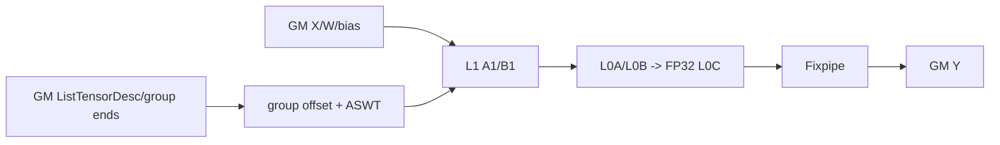
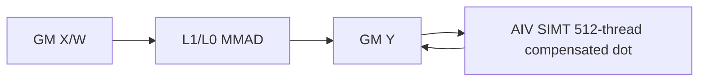
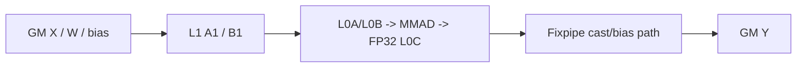

# GroupedMatmul 950 Direct Invoke 算子知识

## 算子速览

| 项目 | 内容 |
|---|---|
| 实际入口 | `cann_bench::grouped_matmul`（Torch schema）→ `grouped_matmul_npu`（PrivateUse1）→ `launch_grouped_matmul`（C linkage direct launcher） |
| 计算语义 | 对累积边界 `r_g=group_list[g]`，计算 `Y[r_{g-1}:r_g,:] = X[r_{g-1}:r_g,:] × W[g] + bias[g]`；`transpose_weight=true` 时 `W[g]` 的存储 shape 为 `[N,K]`。 |
| 输入输出 | `X:[M,K]`、`weight:[E,K,N]` 或 `[E,N,K]`、可选 `bias:[E,N]`，连续 ND；输出底层为连续 `[M,N]`。 |
| 执行类型 | 所有 Route 都有 `AIC_CUBE`；R-004、R-002、R-005 追加 `AIV_VECTOR/SIMT` 节点。 |
| Kernel 路线 | P0 R-006 通用 Cube；P1 R-004 大型转置 FP16 重算；P2 R-002 小 N 转置 FP32 重算；P3 R-001 小 N 转置 FP16；P4 R-005 转置 FP32 重算；P5 R-003 小 N 转置 FP32。 |
| 核心资源 | GM 输入/输出与 320 B 描述符区，AIC 的 L1/L0A/L0B/L0C，Fixpipe 直写 GM；重算节点使用 GM 与线程寄存器，不申请动态 UB。 |
| 来源闭包 | `direct_implementation_closed`：Torch schema、校验、描述符、Host tiling、6 条 launcher Route、AIC body、同图 AIV/SIMT body、同 stream 顺序、构建接线均已闭合。 |
| 验证状态 | 已完成源码闭包检查；本次知识提取未执行编译、真机、数值或性能测试。 |

## 接口与语义

### 计算语义

令 `r_-1=0`，`r_g=group_list[g]`，`M_g=r_g-r_{g-1}`。每个专家 `g∈[0,E)` 的有效行是 `X_g=X[r_{g-1}:r_g,:]`。当 `transpose_weight=false` 时，`weight[g]` 按 `[K,N]` 解释；为真时按 `[N,K]` 存储并在 Cube 模板中用 `layout::ColumnMajor` 表达转置 B。基础节点计算 `Y_g=X_g×W_g`，`hasBias` 时在 Matmul bias 路径中加 `bias[g,:]`，再以 X dtype 写回。

R-004、R-002、R-005 的第二节点读取 Cube 已写出的 `Y`。只有 `Y[i]` 严格落入 `(-reliabilityLimit,+reliabilityLimit)` 时才以 FP32 `fmaf` 乘积残差和补偿求和重算整条 dot；R-004 随后加 FP16 bias，R-002/R-005 无 bias，最后 cast 为输出 dtype。NaN、Inf 与区间外单元保留 Cube 结果。

`split_item` 不改变数学结果：0/1 返回 E 个共享底层存储的行切片，2/3 返回单个 `[M,N]` Tensor。

### 输入、输出与属性

| 参数 | shape/layout | dtype | 约束、默认值与语义 |
|---|---|---|---|
| `x` | `[M,K]`，连续 ND | FP16/BF16/FP32 | 与 weight 同设备、同 dtype；`M,K>0`。 |
| `weight` | `[E,K,N]` 或 `[E,N,K]`，连续 ND | 同 `x` | `E>0`、`E<=8`；由 `transpose_weight` 决定 K/N 位置。 |
| `bias` | 可选 `[E,N]`，连续 ND | 同 X，或 FP16/BF16 X 配 FP32 bias | 缺省时 `hasBias=0`；BF16 无 bias 规范化到 BF16-X/FP32-bias entry，但 Device 不读 bias。 |
| `group_list` | 长度 E 的 Host 整数数组 | int64 | 累积、非递减、每项在 `[0,M]`，最后一项等于 M；相等边界形成空 group。 |
| `split_item` | 标量 | int64 | 仅允许 0..3；0/1 返回分组 views，2/3 返回完整 Y。 |
| `transpose_weight` | 标量 | bool | false 对应 B RowMajor，true 对应 B ColumnMajor。 |
| `y` | 底层 `[M,N]`，连续 ND | 同 `x` | views 与描述符 workspace 共用一块 storage；描述符位于 32 B 对齐的输出区之后。 |

### 入口与版本

这是 Direct Invoke 卡，不是 ACLNN 卡。`TORCH_LIBRARY_FRAGMENT` 声明 `cann_bench::grouped_matmul`，Meta 与 PrivateUse1 分别绑定 `grouped_matmul_meta`、`grouped_matmul_npu`。NPU 实现通过 `OpCommand::RunOpApi("GroupedMatmulDirect", directCall)` 排入当前 NPU stream；callable 先复制 launch metadata，再调用 `launch_grouped_matmul`。Device 数学节点由同一 direct-launch TU 暴露。

目标构建选择 `NPU_ARCH=ascend950`，映射 Bisheng `--npu-arch=dav-3510`，知识版本固定为 CANN 9.1.0。Frontmatter 的固定 Commit 文件仅是同算子 950 no-quant 路线的相关官方映射；本卡的 direct schema、额外 Route、阈值与 launcher 是转换源码事实，不归因于官方公开 API。

## Host/Launcher 执行流程

### 参数校验与前处理

`CheckInputs` 依次检查 defined/device/连续 ND、rank、X/weight dtype 相同、`M/K/N/E>0`、weight K 一致、`E<=8`、`M/K/N<=INT32_MAX`、`split_item∈[0,3]`、累积 group 边界和 bias shape/dtype。它生成 `CheckedInputs{E,M,K,N,maxGroupM,xDtype,biasDtype,hasBias,transposeWeight,splitItem,ends}`。不存在隐式 contiguous、transpose 或值计算；`transpose_weight` 只改变 descriptor shape、B layout specialization 与地址解释。

### 参数、Workspace 与生命周期

Host 分配一个一维 `storage`。前 `M*N` 个元素构造 `[M,N]` 的 Y，随后将 byte offset 向上对齐到 32 B，再放置固定 320 B metadata：X descriptor `[0,40)`、weight descriptor `[64,112)`、bias descriptor `[128,168)`、Y descriptor `[192,232)`、8 个 int64 group end `[256,320)`；间隙初始化为 0。无 bias 时 bias descriptor 的 data pointer 填 X 地址以保持非空，但 `hasBias=0` 阻止 Device 读取。

`workspaceOffset=align_up(M*N*elementBytes,32)`，`totalBytes=workspaceOffset+320`。所有返回 views 持有同一 storage；callable 还按值捕获 inputs、optional bias、CheckedInputs、metadata vector 和 storage。描述符由 `aclrtMemcpyAsync` 复制到 storage 尾部，之后同 stream 的 Device 节点消费。算子没有另行分配数学 workspace。

### 启动图与失败传播

```text
cann_bench::grouped_matmul
  -> grouped_matmul_npu / CheckInputs / storage+views
    -> RunOpApi callable（当前 stream）
      -> aclrtMemcpyAsync(H2D, metadata[320 B])
        -> launch_grouped_matmul / QueryPlatform / CalcOfficialTiling
          -> 一个 AIC_CUBE entry
            -> [R-004/R-002/R-005] 同 stream 的一个 AIV_ONLY/SIMT refine entry
              -> 返回共享 storage 的 Tensor list
```

H2D copy 非成功立即 `TORCH_CHECK`。平台对象为空、核心/片上内存为 0、`baseK=0`、`baseM=0`、L1 step 为 0 或 group 数越界时抛异常，阻止 launch。Kernel launch 语句不读取独立返回码；第二节点只在第一节点 launch 语句之后提交，Device 可见性依赖同一 stream 的顺序语义。空 group 在 AIC body 中跳过；接口已禁止全局空 M/N/K。

## Route 与参数设计

### 分核与资源计算

Host 先查询 `aicNum/aivNum/L1/L0A/L0B/L0C/L2`。默认 `baseN=256`；只要 `transposeWeight && N<256`，tiling 起点改为 `align_up(N,16)`。随后：

```text
baseK = floor((L0B/2)/(baseN*dtypeBytes), 16)
baseM = min((L0A/2)/(baseK*dtypeBytes), L0C/(baseN*4), 256)
stepKa = floor((L1_A/2)/(baseM*baseK*dtypeBytes))
stepKb = floor((L1_B/2)/(baseN*baseK*dtypeBytes))
depthA1 = 2*stepKa; depthB1 = 2*stepKb
dbL0A=2; dbL0B=2; dbL0C=1
```

有 bias 时先从 L1 总量预留 `256*sizeof(float)=1024 B`；A/B 一侧固定分配 256 KiB，另一侧取余量，取决于 `baseM>baseN`。`stepKa/stepKb` 调成较大者为较小者的整数倍。单 group 会先用 `FormulateBasicBlock` 平衡 M/N tile 并计算 `usedCoreNum=min(ceil(M/baseM)*ceil(N/baseN),aicNum)`，再重算 ASWT L1 depth 与尾块拆分计数；多 group 初值 `usedCoreNum=aicNum`。R-002/R-001/R-003 最终把 `coreNum` 与 `usedCoreNum` 覆盖为 `groupNum`。AIV 节点用 `aivNum` 个 block，每 block 512 个 SIMT thread，dynamic UB 参数为 `nullptr`。

### Route 选择

记 `Psmall=T && N<=128 && K<=512 && maxGroupM<=128`。

| 重要性 | Route | Route 特征 | 精确选择条件 | Host 顺序、短路与 fallback |
|---:|---|---|---|---|
| P0 | R-006 通用 Cube | 10 个 dtype/bias/layout entry 之一；AIC-only | R-001/R-002/R-003 均未提前返回，且 R-004/R-005 谓词均为 false | Host 公共 Cube dispatch；位于两个 small shortcut（覆盖三条 Route）之后。Cube 完成后依次检查 R-004、R-005；两者均 false 时它才是 final fallback。dtype 校验失败在进入 launcher 前终止。 |
| P1 | R-004 大型转置 FP16 重算 | dtype/layout Cube entry → `refine_f16_bias` | `X=FP16 && biasDtype=FP16 && hasBias && T && K>=1024 && N>=1536 && maxGroupM>=256` | Host 公共 Cube dispatch 后第 1 个 refine `if`；仅在 R-001/R-002/R-003 未提前返回后可达。命中不 `return`，继续检查 R-005；因 dtype 谓词互斥，R-005 不会同时命中。false 后继续 R-005。 |
| P2 | R-002 小 N 转置 FP32 重算 | `f32_f32_t`, blocks=E → `refine_f32` | `Psmall && X=FP32 && !hasBias && K>=256` | Host 第 2 个 small shortcut；仅在 R-001 false 后进入。先启动 small FP32 Cube，再由内层谓词追加 refine，最后无条件 `return`，短路公共 dispatch 与 R-004/R-005。内层 false 则归入 R-003。 |
| P3 | R-001 小 N 转置 FP16 | `f16_f16_t`, blocks=E；AIC-only | `Psmall && X=FP16 && biasDtype=FP16` | Host 第 1 个 small shortcut；true 时启动后立即 `return`，短路 R-002/R-003、公共 Cube dispatch 与 R-004/R-005。false 后继续第 2 个 small shortcut。 |
| P4 | R-005 转置 FP32 重算 | `f32_f32_t` → `refine_f32` | `!Psmall && X=FP32 && !hasBias && T && K>=256 && N<=256 && maxGroupM<=256` | Host 公共 Cube dispatch 后第 2 个 refine `if`；仅在 R-001/R-002/R-003 未提前返回后可达。R-004 检查完成后进入；命中后函数自然结束，false 时 R-006 为 final fallback。 |
| P5 | R-003 小 N 转置 FP32 | `f32_f32_t`, blocks=E；AIC-only | `Psmall && X=FP32 && (hasBias \|\| K<256)` | Host 第 2 个 small shortcut 的内层 fallback；仅在 R-001 false 后进入。先启动 small FP32 Cube，内层 R-002 谓词 false 后无条件 `return`，短路公共 dispatch 与 R-004/R-005。 |

```text
if Psmall && FP16 && biasDtype==FP16: R-001
else if Psmall && FP32:
  if !hasBias && K>=256: R-002
  else: R-003
else:
  launch dtype × biasDtype × transposeWeight Cube entry
  if large-FP16-refine predicate: R-004
  if non-small-FP32-refine predicate: R-005
  if neither refine predicate: R-006
```

### 模板/实现执行矩阵

| Route | key/selector | dtype/shape/platform 完整命中条件 | 执行族与 kernel 节点 | 实际模板/body | 内存与同步特征 | tail/fallback |
|---|---|---|---|---|---|---|
| P0 R-006 | general | catch-all，Host 合法域，950 | AIC-only | FP16/BF16/FP32 × bias type × Row/ColumnMajor | Fixpipe 直写 Y | 空 group 跳过；ASWT tail |
| P1 R-004 | large FP16 robust | 表中 R-004 谓词，950 | AIC-only → AIV-only/SIMT | FP16 Cube + FP16-bias compensated dot | 同 stream；无中间 workspace | 阈值 0.03125 |
| P2 R-002 | small-T FP32 robust | 表中 R-002 谓词，950 | AIC-only → AIV-only/SIMT | FP32 Cube + compensated dot | Y 为跨 kernel 正式输出边 | 区间外、NaN、Inf不重算 |
| P3 R-001 | small-T FP16 | 表中 R-001 谓词，950 | AIC-only | `KernelGroupedMatmul<...,GroupedMatmulAswtScheduler>`，FP16/FP16/ColumnMajor | metadata→AIC→Y，同 stream | E blocks；ASWT M/N/K tail |
| P4 R-005 | FP32 robust | 表中 R-005 谓词，950 | AIC-only → AIV-only/SIMT | FP32 Cube + compensated dot | 同 stream；无中间 workspace | 阈值 8.0 |
| P5 R-003 | small-T FP32 | 表中 R-003 谓词，950 | AIC-only | FP32/FP32/ColumnMajor | metadata→AIC→Y | E blocks |

### 隐藏性能 Guard

| Guard | Host/Tiling 条件 | Device/资源原因 | 影响 Route | 不满足时去向 | 源码符号 |
|---|---|---|---|---|---|
| 950 Cube 资源 | AIC/AIV/L1/L0A/L0B/L0C 全非 0 | tiling 和重算 launch 需要真实资源 | 全部 | 抛异常 | `QueryPlatform` |
| L0B baseK | `floor((L0B/2)/(baseN*dtypeBytes),16)>0` | B 双缓冲且 K 以 16 对齐 | 全部 | 抛异常 | `CalcOfficialTiling` |
| L0A/L0C baseM | `min(L0A/2/baseK/dtypeBytes,L0C/baseN/4,256)>0` | A 双缓冲与 FP32 L0C 容量 | 全部 | 抛异常 | `CalcOfficialTiling` |
| L1 steps | `stepKa>0 && stepKb>0` | A1/B1 双深度 | 全部 | 抛异常 | `CalcOfficialTiling` |
| small transpose | `T && N<256` 影响 baseN；`Psmall` 影响 launch blocks | 减小 N tile；固定每 group 一 block | R-002/R-001/R-003 及其它转置 N<256 tiling | 使用 256 起点或通用 blocks | `supplementalSmallTransposedN`, `supplementalSmallTransposed` |
| L2 hint | tensor 总 bytes 与 L2；128 B divisibility | 仅改变 B 的 cache hint | 全部 Cube | normal/disable hint | `weightNoL2Cache`, `SetL2CacheHint` |
| AIV grid | `aivNum>0`，`threads=512` | 每 block 负责连续 Y 区间，thread stride 512 | R-004/R-002/R-005 | predicate false 则无第二节点 | `kRefineThreads`, `DEFINE_GMM_REFINE_GLOBAL` |
| int32 Cube ABI | `M,K,N<=INT32_MAX` | `TCubeTiling` 与 Device shape setter 使用 int32 | 全部 | Host 报错 | `CheckInputs`, `SetOrgShape` |

### POD/ABI

| 结构 | 字段 | 类型/位宽 | ABI 布局 | 单位 | Host/launcher producer | Device consumer | 边界 |
|---|---|---|---|---|---|---|---|
| X descriptor | `payloadBytes` | uint64/64 | offset 0 | bytes | 固定 `4*sizeof(uint64_t)=32` | `ListTensorDesc` parser | slot `[0,64)` |
| 同上 | `rankHeader` | uint64/64 | offset 8 | encoded rank | `(1ULL<<32)|2` | parser | rank 2 |
| 同上 | `dim0` | uint64/64 | offset 16 | elements | M | `GetTensorShape` | 正数 |
| 同上 | `dim1` | uint64/64 | offset 24 | elements | K | `GetTensorShape` | 正数 |
| 同上 | `dataPtr` | uint64/64 | offset 32 | GM address | X pointer | `GetDataPtr` | X lifetime 覆盖 stream work |
| weight descriptor | `payloadBytes` | uint64/64 | offset 64 | bytes | 固定 `5*sizeof(uint64_t)=40` | parser | slot `[64,128)` |
| 同上 | `rankHeader` | uint64/64 | offset 72 | encoded rank | `(1ULL<<32)|3` | parser | rank 3 |
| 同上 | `dim0` | uint64/64 | offset 80 | elements | E | `GetTensorShape` | 1..8 |
| 同上 | `dim1` | uint64/64 | offset 88 | elements | T?N:K | `GetTensorShape` | 正数 |
| 同上 | `dim2` | uint64/64 | offset 96 | elements | T?K:N | `GetTensorShape` | 正数 |
| 同上 | `dataPtr` | uint64/64 | offset 104 | GM address | weight pointer | `GetDataPtr` | weight lifetime 覆盖 stream work |
| bias descriptor | `payloadBytes` | uint64/64 | offset 128 | bytes | 固定 32 | parser | slot `[128,192)` |
| 同上 | `rankHeader` | uint64/64 | offset 136 | encoded rank | `(1ULL<<32)|2` | parser | rank 2 |
| 同上 | `dim0` | uint64/64 | offset 144 | elements | E | `GetTensorShape` | 1..8 |
| 同上 | `dim1` | uint64/64 | offset 152 | elements | N | `GetTensorShape` | 正数 |
| 同上 | `dataPtr` | uint64/64 | offset 160 | GM address | bias pointer；无 bias 时 X pointer | `GetDataPtr` | `hasBias=0` 时不读 |
| Y descriptor | `payloadBytes` | uint64/64 | offset 192 | bytes | 固定 32 | parser | slot `[192,256)` |
| 同上 | `rankHeader` | uint64/64 | offset 200 | encoded rank | `(1ULL<<32)|2` | parser | rank 2 |
| 同上 | `dim0` | uint64/64 | offset 208 | elements | M | `GetTensorShape` | 正数 |
| 同上 | `dim1` | uint64/64 | offset 216 | elements | N | `GetTensorShape` | 正数 |
| 同上 | `dataPtr` | uint64/64 | offset 224 | GM address | Y pointer | `GetDataPtr` | returned storage |
| metadata | `groupEnds[i]` | int64/64 | offset `256+8*i` | rows | `i<E ? checked.ends[i] : 0` | AIC split；AIV expert lookup | `i∈[0,7]`；`i>=E` 不读 |
| `GMMNoQuantBaseParams` | `groupNum` | uint32 | offset 0 | groups | `E` | group loop | 1..8 |
| 同上 | `coreNum` | uint32 | offset 4 | AIC cores | tiling；small route 覆盖为 E | launch blocks/tiling | >0 |
| 同上 | `singleWeight` | uint32 | offset 8 | bool | 固定 1 | descriptor index/offset | 固定 1 |
| 同上 | `singleX` | uint32 | offset 12 | bool | 固定 1 | descriptor index/offset | 固定 1 |
| 同上 | `singleY` | uint32 | offset 16 | bool | 固定 1 | descriptor index/offset | 固定 1 |
| 同上 | `groupType` | int32 | offset 20 | enum | 固定 0 | `SPLIT_M` | 固定 0 |
| 同上 | `groupListType` | uint32 | offset 24 | enum | 固定 0 | 累积差分 | 固定 0 |
| 同上 | `hasBias` | uint32 | offset 28 | bool | optional bias | bias Set/skip | 0/1 |
| 同上 | `mTailCnt` | uint32 | offset 32 | split count | 单 group tail 计算 | ASWT tail split | >=1 |
| 同上 | `nTailCnt` | uint32 | offset 36 | split count | 单 group tail 计算 | ASWT tail split | >=1 |
| 同上 | `weightNoL2Cache` | uint32 | offset 40 | bool | L2/128 B predicate | B cache hint | 0/1 |
| 同上 | `placeHolder` | uint32 | offset 44 | reserved | 零初始化 | 当前 body 不读 | 必须为 0 |
| `TCubeTiling` | `usedCoreNum` | SDK 固定位宽字段 | SDK `kernel_tiling.h` ABI | cores | tiling；small route 覆盖为 E | Matmul/launch | 与 coreNum 一致 |
| 同上 | `M` | SDK 固定位宽字段 | SDK ABI | elements | M | Matmul original shape | 正数、int32 域 |
| 同上 | `N` | SDK 固定位宽字段 | SDK ABI | elements | N | Matmul original shape | 正数、int32 域 |
| 同上 | `Ka` | SDK 固定位宽字段 | SDK ABI | elements | K | A K extent | 正数、int32 域 |
| 同上 | `Kb` | SDK 固定位宽字段 | SDK ABI | elements | K | B K extent | 正数、int32 域 |
| 同上 | `singleCoreM` | SDK 固定位宽字段 | SDK ABI | elements | M | Matmul | 正数 |
| 同上 | `singleCoreN` | SDK 固定位宽字段 | SDK ABI | elements | baseN | Matmul | 16 对齐起点 |
| 同上 | `singleCoreK` | SDK 固定位宽字段 | SDK ABI | elements | K | Matmul | 正数 |
| 同上 | `baseM` | SDK 固定位宽字段 | SDK ABI | elements | L0A/L0C 容量公式 | scheduler/Matmul | >0，最大 256 |
| 同上 | `baseN` | SDK 固定位宽字段 | SDK ABI | elements | 256 或 `align_up(N,16)` | scheduler/Matmul | >0，16 对齐 |
| 同上 | `baseK` | SDK 固定位宽字段 | SDK ABI | elements | L0B 容量公式 | scheduler/Matmul | >0，16 对齐 |
| 同上 | `depthA1` | SDK 固定位宽字段 | SDK ABI | stages | `2*stepKa` | A1 pipeline | >=2 |
| 同上 | `depthB1` | SDK 固定位宽字段 | SDK ABI | stages | `2*stepKb` | B1 pipeline | >=2 |
| 同上 | `stepM` | SDK 固定位宽字段 | SDK ABI | tiles | 固定 1 | Matmul | 固定值 |
| 同上 | `stepN` | SDK 固定位宽字段 | SDK ABI | tiles | 固定 1 | Matmul | 固定值 |
| 同上 | `isBias` | SDK 字段 | SDK ABI | bool | hasBias | Matmul bias path | 0/1 |
| 同上 | `stepKa` | SDK 固定位宽字段 | SDK ABI | K tiles | L1 A 公式 | Matmul A K pipeline | >=1，与 stepKb 整倍数关系 |
| 同上 | `stepKb` | SDK 固定位宽字段 | SDK ABI | K tiles | L1 B 公式 | Matmul B K pipeline | >=1，与 stepKa 整倍数关系 |
| 同上 | `dbL0A` | SDK 固定位宽字段 | SDK ABI | stages | 固定 2 | L0A pipeline | double buffer |
| 同上 | `dbL0B` | SDK 固定位宽字段 | SDK ABI | stages | 固定 2 | L0B pipeline | double buffer |
| 同上 | `dbL0C` | SDK 固定位宽字段 | SDK ABI | stages | 固定 1 | L0C pipeline | single buffer |
| `GMMNoQuantTilingData` | `gmmNoQuantParam` | 48 B | offset 0，`sizeof=48, alignof=4`，外层 `#pragma pack(8)` | POD | `CalcOfficialTiling` | AIC entry | 按值 launch |
| 同上 | `mmTilingData` | `TCubeTiling` | offset=`align_up(48,alignof(TCubeTiling))` | POD | `CalcOfficialTiling` | Matmul API | 数字 `sizeof/alignof/offsetof` 属 CANN 9.1.0 SDK 头边界 |

### Route 源码闭包

| Route | Key/selector | Host/Tiling producer | POD/参数 | Kernel entry/router | Kernel body/直接依赖 | 构建接线 |
|---|---|---|---|---|---|---|
| P0 R-006 | general | `grouped_matmul_plugin.cpp::CheckInputs`; `grouped_matmul_kernel.cpp::CalcOfficialTiling/launch_grouped_matmul` | metadata + `GMMNoQuantTilingData` | 10 entry dispatch | Cube body | operator CMake + top-level dav-3510 |
| P1 R-004 | large FP16 robust | 同上 | metadata + `GMMNoQuantTilingData` + raw X/W/Y/groupList/scalars | dtype Cube entry → `grouped_matmul_refine_f16_bias` | Cube body + `RefineCancelledTransposedDots<half,half,true>` | 同上 |
| P2 R-002 | small-T FP32 robust | 同上 | 同 R-004 | `grouped_matmul_f32_f32_t` → `grouped_matmul_refine_f32` | Cube body + `RefineCancelledTransposedDots<float,float,false>` | 同上 |
| P3 R-001 | small-T FP16 | 同上 | metadata + `GMMNoQuantTilingData` | `grouped_matmul_f16_f16_t` | `OfficialGmmNoQuantAswt`; `KernelGroupedMatmul`; ASWT/MatmulMultiBlockBias | 同上 |
| P4 R-005 | FP32 robust | 同上 | 同 R-004 | `grouped_matmul_f32_f32_t` → `grouped_matmul_refine_f32` | Cube body + FP32 refine | 同上 |
| P5 R-003 | small-T FP32 | 同上 | metadata + tiling | `grouped_matmul_f32_f32_t` | Cube body | 同上 |

## Kernel 实现

### 公共执行流程

每个 Route 先消费 320 B metadata。AIC entry 设置 overflow 行为并声明 `KERNEL_TYPE_AIC_ONLY`，实例化 `XType/LayoutB/BiasType + MatmulMultiBlockBias<> + GroupedMatmulAswtScheduler + BlockEpilogueEmpty + TileCopy<DAV3510,CopyWithParams>`。`KernelGroupedMatmul` 只在 AIC 执行：逐 group 从累积 group list 得到 `M_g`，从 ListTensorDesc 取地址/shape，空 group 跳过；ASWT 以 4 行 window 蛇形遍历 M/N tile，并可把最后一轮 tail 分给 `mTailCnt*nTailCnt` 个 core。Matmul 完成 GM→L1→L0A/L0B→FP32 L0C→Fixpipe→GM Y，bias 由 Matmul bias specialization 融合，空 epilogue 不申请 workspace。

R-004、R-002、R-005 在同 stream 追加 AIV-only entry。每个 AIV block 取得 `ceil(M*N/aivNum)` 个连续线性单元，512 threads 以 blockDim 为步长互不重叠地扫描；没有 atomic、shared memory、显式 barrier 或 dynamic UB。

### Route R-006（P0）：通用 Cube

#### 适用条件

##### 选择证据

| 层级 | 文件 | 符号 | 源码谓词/参数 | 结果/下一跳 |
|---|---|---|---|---|
| Host | `grouped_matmul_plugin.cpp` | `DTypeCode`/bias check | FP16/BF16/FP32 与支持的 bias 配对 | dtype codes |
| Launcher | `grouped_matmul_kernel.cpp` | dtype/bias/T tree | 未命中 R-001..005 | 10 个 Cube entry 之一 |
| Router | 同上 | `DEFINE_GMM_GLOBAL` | RowMajor B for NT，ColumnMajor B for T | AIC-only |

#### Device 数据流

##### 函数级调用链

```text
selected grouped_matmul_{x}_{bias}_{nt|t}
  -> OfficialGmmNoQuantAswt<XType,BiasType,LayoutB>
    -> KernelGroupedMatmul -> GroupedMatmulAswtScheduler -> MatmulMultiBlockBias -> GM Y
```

##### 源码等价伪码

```text
for group:
  advance single X/W/bias/Y offsets by previous group shape
  derive M_g from cumulative ends; skip zero M_g
  for ASWT tiles assigned to core:
    bind A/B/bias GM slices; IterateAll directly to Y
```

#### 内存与数据搬运

##### 资源与搬运表

| 层级/缓冲区 | offset/地址公式 | extent/容量公式 | dtype/layout | producer | consumer | owner/lifetime | 对齐/复用 |
|---|---|---|---|---|---|---|---|
| GM metadata | fixed offsets | 320 B | descriptor/int64 | Host copy | AIC | Y storage tail | 32 B workspace start |
| GM tensors | group prefix formulas | X/W/bias/Y logical extents | FP16/BF16/FP32 ND | caller/AIC | AIC/caller | tensors | B T selects layout |
| L1 | current tile | A/B common formulas + optional 1024 B bias reserve | input dtype | GM copy | L0 | Matmul invocation | depthA/B double-step |
| L0A/B/C | current tile | common formulas | input/input/FP32 | L1/MMAD | MMAD/Fixpipe | tile | 2/2/1 buffers |
| UB/regs | N/A | N/A | N/A | N/A | N/A | Cube-only | direct Fixpipe output |

##### 分层内存布局



##### 字节账、交接边与复用顺序

```text
workspace_total = 320 B metadata
L1_total = depthA1*baseM*baseK*dtypeBytes + depthB1*baseN*baseK*dtypeBytes + biasReserve
L0_total = 2*baseM*baseK*dtypeBytes + 2*baseN*baseK*dtypeBytes + baseM*baseN*4
UB_total = 0 explicit bytes
```

| 边/复用子区 | producer | offset/extent | dtype/layout | consumer | ordering/sync | owner/lifetime | 安全条件 |
|---|---|---|---|---|---|---|---|
| L0C→Y | MMAD | tile C extent | FP32→X dtype RowMajor | Fixpipe/GM | Matmul pipe | tile/output | scheduler gives disjoint tile |

#### 同步、精度与尾块

##### 同步与数值边界表

| 阶段 | primitive/机制 | producer | consumer/等待点 | 保护对象 | 精度/尾块 |
|---|---|---|---|---|---|
| double buffers | Matmul internal pipeline | GM/L1/L0 load | MMAD | A/B stages | depth/step from POD |
| tile ownership | ASWT | scheduler | AIC core | Y tile | 4-row snake; split last round |
| output | Fixpipe | FP32 L0C | X-dtype GM | tile | M/N/K tail；bias before output cast |

#### 关键实现

##### 符号证据表

| 阶段 | 文件 | 符号/模板实例 | 实现事实 |
|---|---|---|---|
| Host/Tiling producer | `grouped_matmul_plugin.cpp`; `grouped_matmul_kernel.cpp` | `CheckInputs`; `CalcOfficialTiling` | valid domain、descriptor、tile/core/resource |
| Kernel entry/router | `grouped_matmul_kernel.cpp` | 10 `DEFINE_GMM_GLOBAL` instances | dtype/bias/layout mapping |
| Device body/helper | `cgmct/kernel/kernel_grouped_matmul.h`; `cgmct/block/block_scheduler_grouped_matmul_aswt.h` | `IterateOneGroup`; `GetTileIdx/GetBlockShape` | group offsets、snake schedule、tail split |
### Route R-004（P1）：大型转置 FP16 重算

#### 适用条件

##### 选择证据

| 层级 | 文件 | 符号 | 源码谓词/参数 | 结果/下一跳 |
|---|---|---|---|---|
| Launcher | `grouped_matmul_kernel.cpp` | `robustLargeFp16Transposed` | FP16/FP16 bias，hasBias，T，K>=1024，N>=1536，maxGroupM>=256 | Cube 后追加 FP16-bias refine，limit 0.03125 |

#### Device 数据流

##### 函数级调用链

```text
dtype-selected grouped_matmul_f16_f16_t -> Cube Y
  -> grouped_matmul_refine_f16_bias
    -> RefineCancelledTransposedDots<half,half,true>
```

##### 源码等价伪码

```text
Cube full output with bias
for assigned Y cells: if abs(prior)<0.03125, compensated FP32 dot over K, add FP16 bias, cast half and overwrite
```

#### 内存与数据搬运

##### 资源与搬运表

| 层级/缓冲区 | offset/地址公式 | extent/容量公式 | dtype/layout | producer | consumer | owner/lifetime | 对齐/复用 |
|---|---|---|---|---|---|---|---|
| Cube GM/L1/L0 | common formulas，dtypeBytes=2 | common formulas | half input/output，FP32 L0C | AIC | Fixpipe | tile | ASWT blocks |
| GM Y/bias | Y linear；bias `expert*N+col` | `M*N*2`; `E*N*2` | half ND | Cube/Host | AIV | tensor storage | same stream |
| AIV registers | thread local | scalar set | FP32 arithmetic | thread | thread | invocation | no UB/shared |

##### 分层内存布局


##### 字节账、交接边与复用顺序

```text
workspace_total=320 B; Cube L1/L0=common formulas(dtypeBytes=2); AIV extra memory=registers only
```

| 边/复用子区 | producer | offset/extent | dtype/layout | consumer | ordering/sync | owner/lifetime | 安全条件 |
|---|---|---|---|---|---|---|---|
| Cube Y→AIV | Cube | `[0,M*N)*2` | FP16 ND | refine_f16_bias | same stream | output storage | disjoint linear ownership |

#### 同步、精度与尾块

##### 同步与数值边界表

| 阶段 | primitive/机制 | producer | consumer/等待点 | 保护对象 | 精度/尾块 |
|---|---|---|---|---|---|
| cross-kernel | stream order | Cube | AIV | Y | no event/flag needed outside stream |
| dot | fmaf residual + compensated sum | FP16 inputs | FP16 store | selected Y | product FP32；bias after sum；block/count tail |

#### 关键实现

##### 符号证据表

| 阶段 | 文件 | 符号/模板实例 | 实现事实 |
|---|---|---|---|
| Host/Tiling producer | `grouped_matmul_kernel.cpp` | `CalcOfficialTiling` | common Cube fields |
| Kernel entry/router | 同上 | `robustLargeFp16Transposed` | exact shape/dtype predicate and threshold |
| Device body/helper | 同上 | `RefineCancelledTransposedDots<half,half,true>` | compensated sum then bias |

### Route R-002（P2）：小 N 转置 FP32 重算

#### 适用条件

##### 选择证据

| 层级 | 文件 | 符号 | 源码谓词/参数 | 结果/下一跳 |
|---|---|---|---|---|
| Launcher | `grouped_matmul_kernel.cpp` | small FP32 branch | `Psmall && FP32` | E-block Cube |
| Launcher | 同上 | local robust predicate | `!hasBias && K>=256` | 追加 `refine_f32`, limit 8.0 |
| AIV | 同上 | `DEFINE_GMM_REFINE_GLOBAL` | aivNum blocks，512 threads | FP32 compensated dot |

#### Device 数据流

##### 函数级调用链

```text
grouped_matmul_f32_f32_t -> Cube full Y
  -> grouped_matmul_refine_f32
    -> asc_vf_call<RefineCancelledTransposedDots<float,float,false>>(512)
```

##### 源码等价伪码

```text
Cube 先写完整 Y
parallel for linear in each AIV block range:
  if -8 < Y[linear] < 8:
    expert = first cumulative end greater than row
    (hi,lo)=compensated_sum_k(fmaf residual of X[row,k]*W[expert,col,k])
    Y[linear]=hi+lo
```

#### 内存与数据搬运

##### 资源与搬运表

| 层级/缓冲区 | offset/地址公式 | extent/容量公式 | dtype/layout | producer | consumer | owner/lifetime | 对齐/复用 |
|---|---|---|---|---|---|---|---|
| Cube hierarchy | 同 R-001，dtypeBytes=4 | 公式同 R-001 | FP32 | AIC | Fixpipe | AIC tile | E blocks |
| GM Y edge | linear `[0,M*N)` | `M*N*4` | FP32 ND | Cube | AIV | output storage | 原位条件覆盖 |
| AIV registers | per thread | `prior,hi,lo,av,bv,product,...` | FP32 scalars | SIMT thread | same thread | thread lifetime | 无 shared/UB |

##### 分层内存布局



##### 字节账、交接边与复用顺序

```text
workspace_total = 320 B metadata
Cube L1/L0 = common formulas with dtypeBytes=4
AIV dynamic_ub = 0; shared = 0; extra GM = 0
```

| 边/复用子区 | producer | offset/extent | dtype/layout | consumer | ordering/sync | owner/lifetime | 安全条件 |
|---|---|---|---|---|---|---|---|
| Cube Y→AIV | `f32_f32_t` | `[0,M*N)*4` | FP32 ND | `refine_f32` | 同 stream 后继 launch | returned storage | 每 linear 仅一 thread；先读后条件写 |

#### 同步、精度与尾块

##### 同步与数值边界表

| 阶段 | primitive/机制 | producer | consumer/等待点 | 保护对象 | 精度/尾块 |
|---|---|---|---|---|---|
| 跨 kernel | current stream order | Cube | AIV launch | 全 Y | AIV 读到 Cube 完成值 |
| AIV 映射 | disjoint block range + thread stride | grid | thread | Y cell | count tail guard；无 atomic |
| 重算 | `fmaf` 残差+补偿和 | X/W | Y store | dot | open interval；NaN/Inf 保留 |

#### 关键实现

##### 符号证据表

| 阶段 | 文件 | 符号/模板实例 | 实现事实 |
|---|---|---|---|
| Host/Tiling producer | `grouped_matmul_kernel.cpp` | `CalcOfficialTiling` | FP32 小 N tiling |
| Kernel entry/router | 同上 | small FP32 branch | Cube→AIV launch graph |
| Device body/helper | 同上 | `RefineCancelledTransposedDots<float,float,false>` | expert lookup、fmaf 残差、compensated sum |

### Route R-001（P3）：小 N 转置 FP16

#### 适用条件

##### 选择证据

| 层级 | 文件 | 符号 | 源码谓词/参数 | 结果/下一跳 |
|---|---|---|---|---|
| Host | `op_plugin/grouped_matmul_plugin.cpp` | `CheckInputs` | FP16；bias absent/FP16；T；合法 shape | biasDtype=FP16 |
| Launcher | `op_kernel/grouped_matmul_kernel.cpp` | `supplementalSmallTransposed` | `T && N<=128 && K<=512 && maxGroupM<=128` | R-001 |
| Router | 同上 | first branch | `X=FP16 && biasDtype=FP16` | coreNum=usedCoreNum=E；`f16_f16_t` |

#### Device 数据流

##### 函数级调用链

```text
grouped_matmul_f16_f16_t
  -> OfficialGmmNoQuantAswt<half,half,ColumnMajor>
    -> KernelGroupedMatmul::operator()
      -> Init(group) -> IterateOneGroup -> BlockMmad::IterateAll(Y)
```

##### 源码等价伪码

```text
for group in [0,E):
  M_g = ends[g]-ends[g-1]; if M_g==0: continue
  for ASWT tile assigned to this group block:
    A=GM X slice; B=GM [N,K] transposed view; optional bias=GM [N]
    GM->L1->L0A/L0B; MMAD accumulate FP32 L0C; Fixpipe cast half->GM Y
```

#### 内存与数据搬运

##### 资源与搬运表

| 层级/缓冲区 | offset/地址公式 | extent/容量公式 | dtype/layout | producer | consumer | owner/lifetime | 对齐/复用 |
|---|---|---|---|---|---|---|---|
| GM X/W/bias/Y | group offsets `ΣM_g*K`, `g*N*K`, `g*N`, `ΣM_g*N` | 输入/输出逻辑 extent | half；A/C RowMajor，B ColumnMajor | Host tensors/AIC | AIC/Y caller | tensor storage | K/N tail 由 Matmul |
| L1 A1/B1 | tile-local | `depthA1*baseM*baseK*2`; `depthB1*baseN*baseK*2` | half/fractal internal | GM copy | L0 load | AIC invocation | depth=2*step |
| L0A/L0B | tile-local | `2*baseM*baseK*2`; `2*baseN*baseK*2` | Cube format | L1 load | MMAD | AIC tile | double buffer |
| L0C | tile-local | `baseM*baseN*4` | FP32 accumulator | MMAD | Fixpipe | AIC tile | single buffer |
| UB/寄存器 | N/A | N/A | N/A | N/A | N/A | Cube-only | Fixpipe 直写 GM |

##### 分层内存布局



##### 字节账、交接边与复用顺序

```text
workspace_total = 320 B metadata
L1 = depthA1*baseM*baseK*2 + depthB1*baseN*baseK*2 + (hasBias?1024:0)
L0 = 2*baseM*baseK*2 + 2*baseN*baseK*2 + baseM*baseN*4
UB = 0 (no explicit UB allocation)
```

| 边/复用子区 | producer | offset/extent | dtype/layout | consumer | ordering/sync | owner/lifetime | 安全条件 |
|---|---|---|---|---|---|---|---|
| metadata→AIC | H2D copy | 固定 slices，共 320 B | descriptors/int64 | AIC entry | 同 stream copy-before-launch | Y storage 尾部 | 返回 views 保持 storage |

#### 同步、精度与尾块

##### 同步与数值边界表

| 阶段 | primitive/机制 | producer | consumer/等待点 | 保护对象 | 精度/尾块 |
|---|---|---|---|---|---|
| GM/L1/L0 pipeline | Matmul API 内部 pipe | copy stages | MMAD/Fixpipe | tile buffers | K 16 对齐；M/N tail shape |
| group/tile | ASWT block mapping | scheduler | assigned AIC core | Y tile | 蛇形 window；空 group skip |
| output | Fixpipe | FP32 L0C | GM Y | 当前 tile | cast 为 FP16；bias 按 hasBias |

#### 关键实现

##### 符号证据表

| 阶段 | 文件 | 符号/模板实例 | 实现事实 |
|---|---|---|---|
| Host/Tiling producer | `grouped_matmul_kernel.cpp` | `CalcOfficialTiling` | 小转置 N 的 16 对齐 baseN 与 L1/L0 参数 |
| Kernel entry/router | 同上 | `grouped_matmul_f16_f16_t` | E blocks、AIC-only |
| Device body/helper | `cgmct/kernel/kernel_grouped_matmul.h` | `IterateOneGroup` | group offsets、ASWT tile、bias、IterateAll |

### Route R-005（P4）：转置 FP32 重算

#### 适用条件

##### 选择证据

| 层级 | 文件 | 符号 | 源码谓词/参数 | 结果/下一跳 |
|---|---|---|---|---|
| Launcher | `grouped_matmul_kernel.cpp` | trailing `robustFp32Transposed` | FP32，no bias，T，K>=256，N<=256，maxGroupM<=256，且未被 small branch 提前返回 | blocks Cube→aivNum refine |

#### Device 数据流

##### 函数级调用链

```text
grouped_matmul_f32_f32_t(blocks) -> Cube Y
  -> grouped_matmul_refine_f32(aivNum)
    -> RefineCancelledTransposedDots<float,float,false>
```

##### 源码等价伪码

```text
与 R-002 相同的 FP32 重算；差别是 Cube blocks 来自 tiling.coreNum，而不是强制 E。
```

#### 内存与数据搬运

##### 资源与搬运表

| 层级/缓冲区 | offset/地址公式 | extent/容量公式 | dtype/layout | producer | consumer | owner/lifetime | 对齐/复用 |
|---|---|---|---|---|---|---|---|
| Cube hierarchy | common formulas，dtypeBytes=4 | common formulas | FP32 | AIC | GM Y | tile | tiling blocks |
| GM Y edge/AIV regs | 同 R-002 | `M*N*4`/scalars | FP32 | Cube/thread | AIV/thread | output/invocation | no atomic |

##### 分层内存布局


##### 字节账、交接边与复用顺序

```text
workspace_total=320 B; L1/L0=common formulas(dtypeBytes=4); dynamic_ub=0
```

| 边/复用子区 | producer | offset/extent | dtype/layout | consumer | ordering/sync | owner/lifetime | 安全条件 |
|---|---|---|---|---|---|---|---|
| Cube Y→AIV | f32 Cube | `[0,M*N)*4` | FP32 ND | refine_f32 | same stream | output storage | one writer per cell |

#### 同步、精度与尾块

##### 同步与数值边界表

| 阶段 | primitive/机制 | producer | consumer/等待点 | 保护对象 | 精度/尾块 |
|---|---|---|---|---|---|
| launch edge | stream order | Cube | AIV | Y | limit 8.0；NaN/Inf unchanged |
| SIMT | block range/thread stride | grid | cell | Y | `begin>=total` return；last count clamp |

#### 关键实现

##### 符号证据表

| 阶段 | 文件 | 符号/模板实例 | 实现事实 |
|---|---|---|---|
| Host/Tiling producer | `grouped_matmul_kernel.cpp` | `CalcOfficialTiling` | blocks/resource fields |
| Kernel entry/router | 同上 | trailing FP32 predicate | general Cube then refine |
| Device body/helper | 同上 | FP32 refine | exact-product residual and compensated reduction |

### Route R-003（P5）：小 N 转置 FP32

#### 适用条件

##### 选择证据

| 层级 | 文件 | 符号 | 源码谓词/参数 | 结果/下一跳 |
|---|---|---|---|---|
| Launcher | `grouped_matmul_kernel.cpp` | small FP32 branch | `Psmall && FP32 && (hasBias || K<256)` | E-block `f32_f32_t` 后返回 |

#### Device 数据流

##### 函数级调用链

```text
grouped_matmul_f32_f32_t
  -> OfficialGmmNoQuantAswt<float,float,ColumnMajor>
    -> KernelGroupedMatmul -> MatmulMultiBlockBias -> GM Y
```

##### 源码等价伪码

```text
按 group 和 ASWT tile 搬运 FP32 A/B；FP32 MMAD 累加并可加 FP32 bias；Fixpipe 写 FP32 Y；无后继节点。
```

#### 内存与数据搬运

##### 资源与搬运表

| 层级/缓冲区 | offset/地址公式 | extent/容量公式 | dtype/layout | producer | consumer | owner/lifetime | 对齐/复用 |
|---|---|---|---|---|---|---|---|
| GM/L1/L0A/L0B/L0C/Y | 同 R-001，dtypeBytes=4 | common formulas | FP32；B ColumnMajor | AIC | AIC/Fixpipe | tile/output | L0A/B double，L0C single |
| UB/寄存器 | N/A | N/A | N/A | N/A | N/A | Cube-only | 无 AIV |

##### 分层内存布局


##### 字节账、交接边与复用顺序

```text
workspace_total=320 B; L1/L0=common formulas(dtypeBytes=4); UB=0
```

| 边/复用子区 | producer | offset/extent | dtype/layout | consumer | ordering/sync | owner/lifetime | 安全条件 |
|---|---|---|---|---|---|---|---|
| metadata→AIC | H2D | 320 B | descriptors/int64 | Cube | same stream | Y storage | copy before launch |

#### 同步、精度与尾块

##### 同步与数值边界表

| 阶段 | primitive/机制 | producer | consumer/等待点 | 保护对象 | 精度/尾块 |
|---|---|---|---|---|---|
| Cube | Matmul pipeline | GM/L1 | MMAD/Fixpipe | tile | FP32 output；ASWT M/N/K tail |

#### 关键实现

##### 符号证据表

| 阶段 | 文件 | 符号/模板实例 | 实现事实 |
|---|---|---|---|
| Host/Tiling producer | `grouped_matmul_kernel.cpp` | `CalcOfficialTiling` | small-transposed baseN |
| Kernel entry/router | 同上 | `grouped_matmul_f32_f32_t` | E-block Cube-only |
| Device body/helper | `cgmct/block/block_mmad_multi_block_bias.h` | `IterateAll` | Matmul bias 与 GM output |


## 算子特定优化

### Trick T-001：小 N 转置 shape specialization

#### 触发与源码依据

- 适用 Route：R-002、R-001、R-003，并影响所有 `transposeWeight && N<256` 的 tiling 起点。
- 触发条件：`transposeWeight && n<256`；独立 launch shortcut 还要求 `n<=128 && k<=512 && maxGroupM<=128`。
- Golden 来源：转换源码 `csrc/ops/grouped_matmul/op_kernel/grouped_matmul_kernel.cpp:146-151,464-478`；[官方相关 no-quant 映射](https://gitcode.com/cann/ops-transformer/blob/c77c0829f1f0f0b8f882db1d9b051a758b605472/gmm/grouped_matmul/op_kernel/arch35/non_quant/grouped_matmul_basic_kernel.h)。

**转换源码（连续摘录；额外 specialization 不归因于官方映射）**：

```cpp
const bool supplementalSmallTransposedN =
    transposeWeight && n < kBaseDefault;
uint64_t baseN = supplementalSmallTransposedN
    ? CeilAlignHost<uint64_t>(n, 16UL) : kBaseDefault;
uint64_t baseK = (p.l0BSize / 2) / (baseN * dtypeSize);
baseK &= ~15UL;
```

#### 机制与设计原因

它只依赖公开 shape：将默认 256-wide N tile 缩到覆盖 N 的最小 16 对齐宽度，再用同一 L0B/L0A/L0C 与 L1 公式重算 baseK/baseM/depth。更窄 N 改变每 tile 搬运和 core 覆盖，但不改变 Matmul、bias 或输出布局。最窄子域还把 Cube blocks 固定为 E。

#### 迁移边界

- 适用：950、转置 B、N<256 的 no-quant ND GMM。
- 前提：L0/L1 查询有效，baseK/baseM 非 0，K 以 16 tile 处理。
- 失效：非转置或 N>=256 使用默认 256 起点；不满足 shortcut 时仍走通用 blocks。
- 未验证：本次知识提取未执行编译、真机、数值或性能测试。

#### 错误做法

不得只改 baseN 而沿用旧 baseK/baseM/depth；这会破坏 L0/L1 容量账。固定转换源码提供了重新推导链路。

### Trick T-002：ASWT window 与最后一轮 tail 拆分

#### 触发与源码依据

- 适用 Route：全部 Cube 节点。
- 触发条件：M/N tile 网格；单 group 且 tile 数超过 AIC 数且有余数时可令 `mTailCnt*nTailCnt>1`。
- Golden 来源：转换源码 `cgmct/block/block_scheduler_grouped_matmul_aswt.h:67-143`；[官方相关 tiling 映射](https://gitcode.com/cann/ops-transformer/blob/c77c0829f1f0f0b8f882db1d9b051a758b605472/gmm/grouped_matmul/op_host/op_tiling/arch35/grouped_no_quant_matmul_tiling.cpp)。

**转换源码（连续摘录）**：

```cpp
mainWindow_ = WINDOW_LEN < mTileNum_ ? WINDOW_LEN : mTileNum_;
mainRow_ = mTileNum_ / mainWindow_ - 1;
tailWindow_ = mTileNum_ - mainWindow_ * mainRow_;
...
if (rowIdx % EVEN_ROWS != 0) {
    nTileIdx = nTileNum_ - 1 - nTileIdx;
}
```

#### 机制与设计原因

调度器用最多 4 个 M tiles 为窗口，奇偶 window 反转 N 遍历，保持相邻任务的 B/N 访问方向连续；最后一轮可将原 tail tile 再沿 M/N 拆给多个 core。`GetBlockShape` 同时生成真实 tail shape 与 split address offset，因此地址与有效 extent 一起变化。

#### 迁移边界

- 适用：`GroupedMatmulAswtScheduler` 与本卡 MatmulMultiBlockBias 实例。
- 前提：`mTailCnt/nTailCnt` 与 `baseM/baseN/blockNum` 同源。
- 失效：其它 scheduler 或禁用 tailSplit 时不能复用该映射。
- 未验证：本次知识提取未执行编译、真机、数值或性能测试。

#### 错误做法

只复用蛇形 tile index 而忽略 `GetBlockShape` 的 split offsets，会让多个 core 写重叠 Y 或漏写 tail。

### Trick T-003：Cube 全输出后按可靠区间选择性补偿重算

#### 触发与源码依据

- 适用 Route：R-004、R-002、R-005。
- 触发条件：Route 谓词命中，且单元的 Cube 输出严格落在 FP16 的 `(-0.03125,0.03125)` 或 FP32 的 `(-8,8)`。
- Golden 来源：转换源码 `csrc/ops/grouped_matmul/op_kernel/grouped_matmul_kernel.cpp:335-377,479-485,533-546`；官方固定 Commit 只提供相关 no-quant Cube 映射，不包含本 direct refine。

**转换源码（连续摘录；AIV refine 不归因于官方映射）**：

```cpp
const float product = av * bv;
const float productError = fmaf(av, bv, -product);
const float sum = hi + product;
const float bridge = sum - hi;
const float sumError =
    (hi - (sum - bridge)) + (product - bridge);
hi = sum;
lo += sumError + productError;
```

#### 机制与设计原因

Cube 保持全域 producer，AIV 只重算输出幅值不足以可靠代表长 reduction 的单元。`fmaf` 得到 FP32 乘法舍入残差，`hi/lo` 追踪加法误差；R-004 的 bias 在补偿 dot 完成后加入。该机制增加一个同 stream kernel，但不引入临时 GM、atomic 或跨核归约。

#### 迁移边界

- 适用：本卡精确 dtype/transpose/shape/hasBias Route 与固定阈值。
- 前提：Cube Y 可由后继 AIV 在同 stream 可见，W 的转置地址为 `(expert*N+col)*K`，每 Y cell 单写者。
- 失效：非转置、不同 bias 顺序、不同输出布局或阈值外单元保留 Cube；BF16 无该节点。
- 未验证：本次知识提取未执行编译、真机、数值或性能测试。

#### 错误做法

若在 Cube 前筛选、让多个 thread 归约同一 cell，或在补偿和前加 bias，会改变选择依据、产生写冲突或改变数值顺序。

## 模板与实现对比

| 对比维度 | P0 R-006 | P1 R-004 | P2 R-002 | P3 R-001 | P4 R-005 | P5 R-003 | 设计选择依据 |
|---|---|---|---|---|---|---|---|
| 命中条件/优先级 | catch-all | large FP16 bias | small FP32 no-bias K>=256 | small FP16/FP16 | non-small FP32 robust | small FP32 其余 | 重要性与 Host 检查位置分离 |
| 执行族/节点图 | Cube | Cube→AIV | Cube→AIV | Cube | Cube→AIV | Cube | 数值重算谓词决定后继 |
| M/N/K、tile 与 scheduler | common ASWT | common ASWT | small baseN，E blocks | small baseN，E blocks | common ASWT | small baseN，E blocks | shape 与资源公式 |
| workspace/L1/L0/UB | 320 B + Cube | Cube+AIV regs | 320 B + Cube+AIV regs | 320 B + Cube | Cube+AIV regs | 320 B + Cube | refine 无额外 GM/UB |
| AIC/AIV 或 kernel 交接 | N/A | Y FP16 | Y FP32 | N/A | Y FP32 | N/A | same-stream Y edge |
| 同步、精度与 tail | Cube tail | limit 0.03125+bias | limit 8 | Cube tail | limit 8 | Cube tail | ASWT 与 SIMT count tail |
| fallback/失败边界 | 前置与 refine 均未命中；Host 非法域终止 | false→R-005，再 false→R-006 | 内层 false→R-003；分支末 return | false→第二个 small shortcut | false→R-006 | 内层 fallback，分支末 return | 无隐藏 Device fallback |

## 平台差异

| 项目 | A2 | A3 | 950 |
|---|---|---|---|
| 支持状态 | 本 direct 交付范围不可见 | 本 direct 交付范围不可见 | 目标支持，`platforms:["950"]` |
| Host/Launcher | 不得由本卡外推 | 不得由本卡外推 | `grouped_matmul_npu`→`launch_grouped_matmul` |
| Kernel/资源 | 不得复用 DAV3510 specialization | 不得复用 DAV3510 specialization | `dav-3510`，AIC Cube；部分 Route 追加 AIV/SIMT |

官方相关映射用于确认同算子 no-quant arch35 源码关系；本卡是 Direct Invoke 转换实现，不能用公开 ACLNN 产品表替代其入口类型，也不能把 direct-only Route 宣称为官方 API 行为。

## 限制与失败边界

- 只覆盖 no-quant、连续 ND、`E<=8`、正 `M/K/N`、累积 group list；不覆盖量化、NZ weight、非连续输入或其它 groupType。
- `M/K/N` 必须在 int32 域，Host 的 `M*N*elementBytes`、storage element count 最终还要能由 tensor allocator 表示；源码未增加独立的 uint64 乘法溢出检查。
- BF16 无 bias 会选择 BF16-X/FP32-bias entry，但 `hasBias=0` 保证 bias descriptor 不被数学 body 读取。
- 第二节点仅存在于三个精确 Route；阈值不是通用误差判据，不得外推到 BF16、非转置或不同 bias 顺序。
- direct kernel launch 未显式读取 launch status；异常前置检查与 stream/runtime 的异步错误报告构成外部边界。
- `TCubeTiling` 的完整数字 `sizeof/alignof/offsetof` 位于 CANN 9.1.0 `kernel_tiling.h`，转换源码未复制该 SDK 定义；Host producer 与 Device consumer在同一 TU/工具链共享此类型。
- 固定官方 Commit 对象在当前只读镜像中不可解析，因此未逐字核验该 Commit 的平台声明与行号；Frontmatter 仅保留指定 Commit 的相关映射，不据此改写 direct 实现事实。
- 本次知识提取未执行编译、真机、数值或性能测试。

## 源码索引

### 链路索引

| 链路阶段 | 文件 | 关键符号 | 支撑内容 |
|---|---|---|---|
| 入口声明/约束 | `gmm/grouped_matmul/op_api/grouped_matmul.h` | GroupedMatmul API declaration | 固定 Commit 的同算子相关 header 映射 |
| 入口实现 | `gmm/grouped_matmul/op_kernel/grouped_matmul_apt.cpp` | APT entry/router | 固定 Commit 的 950 相关 entry 映射 |
| Host/Tiling/Launcher | `gmm/grouped_matmul/op_host/op_tiling/arch35/grouped_no_quant_matmul_tiling.cpp` | no-quant tiling | 固定 Commit 的相关 tiling 映射 |
| Kernel entry/body | `gmm/grouped_matmul/op_kernel/arch35/non_quant/grouped_matmul_basic_kernel.h` | no-quant basic kernel | 固定 Commit 的相关 AIC body 映射 |
| 构建接线 | `gmm/grouped_matmul/CMakeLists.txt` | operator targets | 固定 Commit 的相关 build mapping |

转换实现的可复用符号闭包位于 `csrc/ops/grouped_matmul/op_plugin/grouped_matmul_plugin.cpp`、`op_kernel/grouped_matmul_launch.h`、`op_kernel/grouped_matmul_official_abi.h`、`op_kernel/grouped_matmul_kernel.cpp` 与其实际实例化的 `op_kernel/cgmct` 依赖；这些是本卡主事实来源，以上官方文件只是相关映射。

### 实现复用检查

| 检查项 | 可复用事实 | 不得改变的约束 | 源码符号 |
|---|---|---|---|
| ABI/POD | 320 B metadata、48 B base params、按值 `GMMNoQuantTilingData` | descriptor offsets、field width/order、group list int64、SDK TCube ABI | `grouped_matmul_launch.h`; `grouped_matmul_official_abi.h` |
| 调用顺序 | validate→allocate→H2D metadata→Cube→optional AIV | H2D/Cube/AIV 必须同 stream 有序 | `grouped_matmul_npu`; `launch_grouped_matmul` |
| workspace/内存 | Y 与 metadata 同 storage；Matmul 无额外 workspace | 32 B workspace offset、320 B extent、owner 到 stream 完成 | `grouped_matmul_npu` |
| 同步 | Matmul pipe + same-stream cross-kernel edge | refine 不能早于 Cube；每 cell 单写者 | `IterateAll`; refine launches |
| 精度与尾块 | FP32 L0C、Fixpipe cast、ASWT tail、选择性 compensated dot | bias 顺序、阈值、open interval、M/N/K/count tail | `GetBlockShape`; `RefineCancelledTransposedDots` |
| 失败边界 | Host validation/resource exceptions；空 group skip | 不把异步 launch error 或 unsupported dtype静默成输出 | `CheckInputs`; `QueryPlatform`; `KernelGroupedMatmul::Init` |

<!-- cannbot:related:start -->
## 相关

- [GroupedMatmul 950 ACLNN 算子知识](../../../aclnn/transformer/gmm/grouped_matmul_950.md)（`same_topic`）：对累积边界 `r_g=group_list［g］`，计算 `Y［r_{g-1}:r_g,:］ = X［r_{g-1}:r_g,:］ × W［g］ + bias［g］`；`transpose_weight=true` 时 `W［g］` 的存储 shape 为 `［N,K］`。；每组计算 Y_i=X_i×W_i+bias_i。。两端实现同一 950 GroupedMatmul 分组矩阵乘加核心，分别记录 Direct Invoke 的 Torch/launcher 契约与 ACLNN V5 的 TensorList、量化和 arch35 路线，联合阅读可完成前端与实现路线选型。
<!-- cannbot:related:end -->
