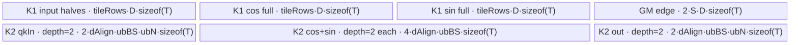
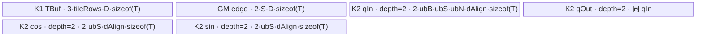

# ApplyRotaryPosEmb A5 Direct Invoke 算子知识

## 算子速览

| 项目 | 内容 |
|---|---|
| 实际入口 | `cann_bench::apply_rotary_pos_emb` → `rope_npu` → `launch_apply_rotary_pos_emb_float/half/bf16`；入口类型为 Direct Invoke。 |
| 计算语义 | 对 `query`、`key` 同时计算 `x * cosFull + rotate(x) * sinFull`；`half` 按前后半维配对，`interleaved` 按相邻偶奇维配对。 |
| 输入输出 | `query/key` 为连续解释的 4-D ND：`layout=0` 是 `[B,S,N,D]`，`layout=1` 是 `[B,N,S,D]`；交付件 launcher 实际把 `cos/sin` 作为 `[S,D/2]`，先展开为 `[S,D]`；dtype 为 FP32/FP16/BF16；输出 shape/dtype 与 `query/key` 各自相同。 |
| 执行类型 | 两个节点均为 `AIV_VECTOR`：K1 系数展开，K2 为 AB 或 ABA/B 广播 RoPE；entry 使用 `KERNEL_TYPE_AIV_ONLY`，RoPE entry 另有 `g_coreType==AIC` 早退。 |
| Kernel 路线 | R-001：`layout=0` 的 `[B,S,N,D]` AB；R-002：`layout=1` 的 `[B,N,S,D]` ABA/B 广播。每条 Route 均为 K1→K2 两 Kernel。 |
| 核心资源 | K1：GM 中间张量 `cosFull/sinFull`、单个 `VECCALC TBuf`、FP32 RegTensor；K2：四个双缓冲 TQue、FP32 RegTensor；无调用者提供的 workspace。 |
| 来源闭包 | `direct_implementation_closed`：交付件内已从 schema、Meta/NPU launcher、tiling、按 dtype entry、K1/K2 body/helper 到 CMake 接线闭合；官方固定 Commit 仅作相关算子与 A5 注册范围映射，不主张与转换交付件逐项等价。 |
| 验证状态 | 已完成源码闭包检查；本次知识提取未执行编译、真机、数值或性能测试。 |

## 接口与语义

### 计算语义

令 `x` 分别取 `query` 与 `key`，`d=0..D-1`。Direct launcher 先把每个位置的半长系数 `c[s,j], s[s,j] (j<D/2)` 展开：

- `rotaryMode="half"`：`cosFull[s,j]=cosFull[s,j+D/2]=c[s,j]`，`sinFull` 同理；`rotate(x)[...,j]=-x[...,j+D/2]`，`rotate(x)[...,j+D/2]=x[...,j]`。
- `rotaryMode="interleaved"`：`cosFull[s,2j]=cosFull[s,2j+1]=c[s,j]`，`sinFull` 同理；`rotate(x)[...,2j]=-x[...,2j+1]`，`rotate(x)[...,2j+1]=x[...,2j]`。

随后 K2 写 `out = x * cosFull + rotate(x) * sinFull`。`query` 与 `key` 使用相同的 `[S,D]` 系数表。交付件只公开 `half` 与 `interleaved`，虽然继承 body 还含 `quarter` 分支，该分支从 Direct schema 不可达，不属于本卡 Route。

### 输入、输出与属性

| 参数 | shape/layout | dtype | 约束、默认值与语义 |
|---|---|---|---|
| `query` | `layout=0:[B,S,N,D]`；`layout=1:[B,N,S,D]` | FP32/FP16/BF16 | 必须与 `key` shape 相同；交付件按连续 ND 地址计算，未显式做 contiguous 转换。 |
| `key` | 同 `query` | 同 `query` | 与 `query` 分别产生输出，共享系数。 |
| `cos` | 实际消费为 `[S,D/2]` | 同 `query` | Meta 仅检查 rank=2，未检查两个维度；K1 无条件按 `S*D/2` 元素读取。 |
| `sin` | 实际消费为 `[S,D/2]` | 同 `query` | shape 语义同 `cos`；Meta 未检查 `cos/sin` shape 相等。 |
| `layout` | 标量 | `int64` | 默认 `0`；只允许 `0/1`。`0` 选择 R-001，`1` 选择 R-002。 |
| `rotaryMode` | 标量字符串 | string | 默认 `"half"`；只允许 `"half"/"interleaved"`，分别映射整数 `1/2`。 |
| `qOut` | 与 `query` 相同 | 同 `query` | `empty_like(query)` 新分配，不是原地输出。 |
| `kOut` | 与 `key` 相同 | 同 `key` | `empty_like(key)` 新分配。 |
| `cosFull/sinFull` | `[S,D]` | 同 `query` | `rope_npu` 内部分配的 GM 中间张量，仅连接 K1 与 K2。 |

### 入口与版本

受控入口是 `Direct Invoke`，不是 ACLNN：`TORCH_LIBRARY_FRAGMENT` 注册 `cann_bench::apply_rotary_pos_emb`，`PrivateUse1` 实现落到 `rope_npu`，再按 dtype 选择三个 `extern "C"` launcher。目标版本为 CANN `9.1.0`、A5（`platforms:["950"]`）。交付件构建将 `NPU_ARCH=ascend950` 映射到 Bisheng `--npu-arch=dav-3510 -xasc`。

给定官方映射是 `ops-transformer@c77c0829f1f0f0b8f882db1d9b051a758b605472` 的 `posembedding/apply_rotary_pos_emb`。它只证明相关逻辑算子、A5 注册与官方 AIV body 的关联；本卡的半长系数输入、K1 展开节点、PyTorch schema、非原地输出和 Direct launcher 均为交付件事实，不伪称官方接口原文。官方 README/API 的接口形态或平台措辞不用于否决这张 A5 Direct Invoke 卡。

## Host/Launcher 执行流程

### 参数校验与前处理

`rope_meta` 依次检查：`query/key` shape 相同；四输入 dtype 相同；`query` rank=4 且 `cos/sin` rank=2；`layout∈{0,1}`；mode 是 `half/interleaved`。它随后用 `empty_like` 分配两个输出。`rope_npu` 设置 `query.device()` guard，按 layout 解释 `S/N`，分配 `[S,D]` 的 `cosFull/sinFull`，取得 `typeSize`，把 mode 映射为 `1/2`，调用 `calc_apply_rotary_pos_emb_tiling`，取得当前 NPU stream，并捕获所有 GM 地址进入 `OpCommand::RunOpApi`。

源码未检查设备一致性、连续性、`D` 为偶数、`B/S/N/D>0`、`cos/sin=[S,D/2]`、输入容量、支持 dtype 的穷尽性。三个已支持 dtype 各有明确 launcher；若出现其它 dtype，闭包内的 lambda 不 launch 但仍返回 `0`。

### 参数、Workspace 与生命周期

`calc_apply_rotary_pos_emb_tiling(B,S,N,D,typeSize,layout,mode)` 从 `PlatformAscendCManager` 取得 AIV core 数和 UB 字节数，返回按值的 `ApplyRotaryPosEmbLaunchTiling`。K1 固定 `blockDim=56`；K2 使用 `tiling.blockDim`。调用者 workspace 为 N/A；K2 的 `Init(...,workspace,...)` 形参未被 body 使用，wrapper 仅把 `qOut` 地址占位传入。

真正的跨节点介质是 `cosFull/sinFull`：由 `rope_npu` 分配，K1 写、K2 读。两次 `<<<...>>>` 使用同一 stream 且按源码顺序提交，无显式 event。临时张量的 C++ owner 是 `rope_npu` 栈上的 Tensor handle；交付件未显式展示异步返回后的 allocator stream-lifetime 记录，这是框架边界，复用实现时必须由调用框架保证中间 GM 在 K2 完成前不回收。

### 启动图与失败传播

| 节点 | Host 启动 | entry/grid | POD/标量 | 输入→输出 | workspace/GM slice | ordering 与失败 |
|---|---|---|---|---|---|---|
| K1 系数展开 | `DEFINE_LAUNCH` 中 `ADAPTOR<<<56,...,stream>>>` | `rope_coeff_adaptor_{float,half,bf16}`；56 AIV blocks | `B=1,S,D,mode` 按值 | `cos/sin [S,D/2]` → `cosFull/sinFull [S,D]` | 两个完整 GM 中间张量，无 workspace offset | 同 stream 第一节点；entry/launcher 均无可见返回码。 |
| K2-R001 RoPE | `layout==0` 分支 | `rope_{float,half,bf16}_ab<<<tiling.blockDim>>>` | `tiling.ab` 按值 | `q/k + cosFull/sinFull` → `qOut/kOut` | 无 workspace | 同 stream 在 K1 后提交；`AIV_ONLY`，AIC 早退。 |
| K2-R002 RoPE | `layout!=0` 分支 | `rope_{float,half,bf16}_aba<<<tiling.blockDim>>>` | `tiling.aba` 按值 | 同上 | 无 workspace | 同 stream 在 K1 后提交；`AIV_ONLY`，AIC 早退。 |

```text
rope_npu
  -> dtype launcher
    -> K1 rope_coeff_adaptor_T<<<56, stream>>>
       writes cosFull[0:S,0:D], sinFull[0:S,0:D]
    -> same-stream GM edge (extent S*D*sizeof(T) each)
    -> K2 layout==0 ? rope_T_ab<<<ab.blockDim, stream>>>
                    : rope_T_aba<<<aba.blockDim, stream>>>
       writes qOut and kOut
```

`acl_call` 始终返回 `0`，三个 C launcher 返回 `void`，源码未传播单个 launch 的同步错误；Meta 抛出的检查失败会在提交前终止。

## Route 与参数设计

### Route 特征与重要性

下表的 P0/P1 只表示本卡的阅读与复用重要性，不改变 Host 的真实选择顺序。Host 控制流以后续“Route 选择”表的 `Host 顺序`、短路和 fallback 字段为准。

| 重要性 | Route | Route 特征 | 适用域 | 实现前提 |
|---|---|---|---|---|
| P0 | R-001 BSND-AB | 按 BS 连续域分核，用 `ApplyRotaryPosEmbAB<T>` 处理 `[B,S,N,D]`；系数从共享 `[S,D]` 表按 `globalBS%S` 取行，Q/K 在当前 BS 行内复用 | `layout=0`；4-D BSND；FP32/FP16/BF16；`half` 或 `interleaved` | 四输入 dtype 一致；`query/key` shape 一致；`cos/sin=[S,D/2]`；D 为正偶数；`baseBlockInUb>1`；B>1 时必须保留 `ubFactorBS=1` 的共享系数边界保护 |
| P1 | R-002 BNSD-BA | 按 B×S 域分核，用 `ApplyRotaryPosEmbABAAndBA<T,true>` 处理 `[B,N,S,D]`；借助 LoopMode DMA 跨 B/N/S 搬运，系数在 B 维广播 | `layout=1`；4-D BNSD；dtype 与 mode 有效域同 P0 | 通用 shape/dtype/偶数 D 前提同 P0；`ubFactorS>0`；UB 可容纳系数与数据的四类双缓冲队列；必须保留广播模板参数 `true` |

### 分核与资源计算

公共定义：`split=(mode==half?2:1)`，`alignElems=32/typeSize`。K1：`tileRows=max(1,floor(192KiB/(3*D*sizeof(T))))`；56 blocks 在 body 中映射成 `logicalBlockNum=GetBlockNum()/2=28`、`logicalBlockIdx=GetBlockIdx()/2`，每个逻辑分区覆盖 `ceil(S/28)` 行。

R-001：`bs=B*S`，`dAlign=ceil_align(D/split,alignElems)*split`，`blockFactorBS=ceil(bs/cores)`，`blockNumBS=ceil(bs/blockFactorBS)`，尾核 `blockTailBS=bs-(blockNumBS-1)*blockFactorBS`。令 `baseBufferSize=dAlign*typeSize`，`baseBlockInUb=floor_align(ubSize/4,32)/baseBufferSize`，则 `ubLoopN=ceil((2N)/(baseBlockInUb-1))`，`ubFactorN=min(ceil((2N)/ubLoopN),4095/split)`，`ubTailN=2N-(ubLoopN-1)*ubFactorN`。`ubFactorBS=max(1,min(baseBlockInUb/(2N+1),blockFactorBS))`，但 `B!=1` 时强制为 `1`。

R-002：优先整除分核；否则比较 B-first 与 S-first 两种 `blockNumB*blockNumS`，选择用核更多者。`dSize=ceil_align(D*typeSize/split,32)*split=dAlign*sizeof(T)`，`avail=ubSize/(4*dSize)`；`ubFactorB=1`，`ubFactorS=min(blockFactorS,avail/2,4095/split)`；再令 `avail/=ubFactorS`，若 `avail>2`，则 `ubFactorQN=ubFactorKN=min(N,avail-1)`、`avail/=(ubFactorQN+1)`，剩余大于 1 时 `ubFactorB=min(blockFactorB,avail)`。K2 grid 为 `blockNumB*blockNumS`。

### Route 选择

| 重要性 | Route | Host 顺序 | Key/模板 | 精确选择条件 | 短路/fallback |
|---|---|---:|---|---|---|
| P0 | R-001 BSND-AB | 0 Meta → 1 dtype → 2 K1 → 3 `layout==0` | `layout==0`；`ApplyRotaryPosEmbAB<T>` | Meta 已保证 `layout∈{0,1}`；受支持 dtype 的 launcher 在 K1 后先判断 `layout==0` | 命中后启动 AB 并跳过 `else`；`layout==1` 落入 R-002；无其它 fallback |
| P1 | R-002 BNSD-BA | 0 Meta → 1 dtype → 2 K1 → 3 R-001 未命中 → 4 `else` | `layout==1`；`ApplyRotaryPosEmbABAAndBA<T,true>` | launcher 的 `else`；在 Meta 有效域内等价于 `layout==1` | R-001 未命中时启动 ABA；非 0/1 已在 Meta 短路失败，不会到达该 `else` |

Host 的完整前置顺序是：0）`rope_meta` 依次执行 shape、dtype、rank、layout 与 mode 检查，任一失败即在提交前短路；1）`rope_npu` 按 FP32→FP16→BF16 的 `if/else if` 顺序分发，其它 dtype 不启动 Kernel 而 lambda 返回 `0`；2）受支持 dtype 先无条件启动 K1 系数展开；3）`layout==0` 启动 R-001；4）否则启动 R-002。K1 或 K2 启动后都没有 Host 侧可见的返回码 fallback。

```text
dtype == FP32  -> float entry family
dtype == FP16  -> half entry family
dtype == BF16  -> bfloat16_t entry family
otherwise      -> no launch, lambda returns 0

for every supported dtype:
  launch K1 coefficient adaptor
  if layout == 0: R-001 AB
  else:           R-002 ABAAndBA<T,true>
```

### 模板/实现执行矩阵

| 重要性 | Route | key/selector | dtype/shape/platform 完整命中条件 | 执行拓扑与 Kernel 节点 | 实际模板/body | 内存与同步特征 | tail/fallback |
|---|---|---|---|---|---|---|---|
| P0 | R-001 BSND-AB | `layout=0`；dtype 三 launcher | A5；4-D `[B,S,N,D]`；四输入同 dtype；mode `1/2` | K1 `run_coeff_adaptor<T>` → K2 `run_ab<T>` | `expand_coeff_tile<T>`；`ApplyRotaryPosEmbAB<T>::Process/ProcessLoop/ProcessQKLoop`；`HalfAlignVF` 或 `InterleaveModeVF` | K1 TBuf+barrier；GM edge；K2 四 TQue 双缓冲，Queue ordering | K1 行尾；K2 尾 BS、尾 N、寄存器 mask；无 fallback |
| P1 | R-002 BNSD-BA | `layout=1`；dtype 三 launcher | A5；4-D `[B,N,S,D]`；其它同上 | K1 → K2 `run_aba<T>` | K1 同上；`ApplyRotaryPosEmbABAAndBA<T,true>`；`BatchHalfAlignVF` 或 `BatchInterleaveModeVF` | K1 TBuf+barrier；GM edge；K2 q/cos/sin/out 双缓冲 TQue，LoopMode DMA | 尾 B/S/N 与寄存器 mask；无 fallback |

### 隐藏性能 Guard

| Guard | Host/Tiling 条件 | Device/资源原因 | 影响 Route | 不满足时去向 | 源码符号 |
|---|---|---|---|---|---|
| dtype 分发 | 仅 FP32/FP16/BF16 三个 `if/else if` | body 和 load/store helper 只实例化这三类 | 两条 Route | 未 launch 且 lambda 返回 0 | `apply_rotary_pos_emb_plugin.cpp::rope_npu` |
| 模式有效域 | `mode==half/interleaved` | `split`、系数展开与 rotate body 必须一致 | 两条 Route | Meta 失败 | `rope_meta`、`expand_coeff_tile` |
| 偶数 D | 源码未显式检查；所有有效 Direct 语义需要 `D%2==0` | K1 读取 `D/2`，half/interleave 都按成对元素重排 | 两条 Route | 无源码 fallback，调用者必须拒绝 | `expand_coeff_tile` |
| K1 UB | `tileRows=max(1,192KiB/(3D*sizeof(T)))` | 单 TBuf 同时容纳两路半长输入和两路全长输出 | 两条 Route | `D` 过大时 min=1 仍可能使分配超过 192KiB；无检查 | `run_coeff_adaptor` |
| R001 UB 分母 | `baseBlockInUb>1` | `ubLoopN` 使用 `baseBlockInUb-1` | R-001 | 无错误返回，调用者必须保证 | `calc_apply_rotary_pos_emb_tiling` |
| R001 DMA count | `ubFactorN<=4095/split` | `DataCopyExtParams.blockCount` 是 `uint16_t` 且硬件 copy block count 有界 | R-001 | 仅截上限，无独立 fallback | 同上 |
| 跨 batch 系数边界 | `B!=1 => ubFactorBS=1` | 一次连续系数 DMA 不得跨共享 `[S,D]` 表尾 | R-001 | 保守单 BS tile | 同上 |
| R002 UB | `ubFactorS>0` 且 `avail` 足够 | 四类双缓冲队列至少容纳一组系数与数据 | R-002 | 源码在除法前无失败检查 | 同上 |
| AIV-only | entry 声明 AIV-only；K2 `g_coreType==AIC` 返回 | 所有 body 仅使用 Vector/MicroAPI 与 MTE | 两条 Route | AIC 不执行，无 Cube fallback | `ENTRY_BODY_AB/ABA` |

### POD/ABI

`ApplyRotaryPosEmbLaunchTiling` 在 Host 侧按值传入 launcher，K2 再只传对应子结构。以下 offset/sizeof 是依据 LP64 下连续 `int64_t`、尾部 `bool` 和 8 字节结构对齐推导；交付件没有 `static_assert(sizeof/offsetof)`，因此复用时应补 ABI 静态断言。

| 结构 | 字段 | 类型/位宽 | ABI 布局 | 单位 | Host/launcher producer | Device consumer | 边界 |
|---|---|---|---|---|---|---|---|
| `ApplyRotaryPosEmbLaunchTiling` | `blockDim` | `int64_t/64` | offset 0；结构推导 size 352 | block | 两 Route 最后写入 | launcher 的 K2 grid | 必须正数 |
| `...ABTilingData` | `B` | `int64_t/64` | offset 0；结构推导 size 144 | batch | `B` | body 不读 | 信息字段 |
| 同上 | `CosB` | `int64_t/64` | offset 8 | batch | 常量 1 | body 不读 | inactive |
| 同上 | `S` | `int64_t/64` | offset 16 | row | `S` | `globalBS%S` | 必须正数 |
| 同上 | `D` | `int64_t/64` | offset 24 | element | `D` | GM stride | 必须为偶数 |
| 同上 | `QN` | `int64_t/64` | offset 32 | head | `N` | Q offset/count | 正数 |
| 同上 | `KN` | `int64_t/64` | offset 40 | head | `N` | K offset/count | 正数 |
| 同上 | `dAlign` | `int64_t/64` | offset 48 | element | 对齐公式 | UB stride/capacity | `>=D` 或 half 分段对齐 |
| 同上 | `dSplitCoef` | `int64_t/64` | offset 56 | segment | `split` | DMA blockCount、half offset | mode1=2，mode2=1 |
| 同上 | `blockNumBS` | `int64_t/64` | offset 64 | block | BS 分核公式 | 尾核判断 | K2 grid 同值 |
| 同上 | `blockFactorBS` | `int64_t/64` | offset 72 | BS/core | ceil 分核 | GM base、循环 | 正数 |
| 同上 | `blockTailBS` | `int64_t/64` | offset 80 | BS | 尾核公式 | 尾核 BSNum | `1..blockFactorBS` |
| 同上 | `ubFactorBS` | `int64_t/64` | offset 88 | BS/tile | UB 公式；B>1 强制1 | Queue 容量、tile 循环 | 正数 |
| 同上 | `ubLoopN` | `int64_t/64` | offset 96 | loop | `ceil(2N/(baseBlock-1))` | `ProcessLoop` 次数 | `currBSNum==1` 时读 |
| 同上 | `ubFactorN` | `int64_t/64` | offset 104 | head/tile | N tile 公式 | Queue 容量、N 起点 | `<=4095/split` |
| 同上 | `ubTailN` | `int64_t/64` | offset 112 | head | 尾 N 公式 | 最后 `ProcessLoop` | 可跨 Q/K 边界 |
| 同上 | `rotaryMode` | `int64_t/64` | offset 120 | enum | 1/2 | compute、copy 分支 | Direct 不可达 quarter |
| 同上 | `realDim` | `int64_t/64` | offset 128 | element | `D` | DMA/vector 有效 D | 等于 D |
| 同上 | `isPartialRope` | `bool/8` | offset 136，尾填充 7 | bool | `false` | partial copy 分支 | Direct 恒 false |
| `...TilingData` | `B` | `int64_t/64` | offset 0；结构推导 size 200 | batch | `B` | 分核尾部 | 正数 |
| 同上 | `CosB` | `int64_t/64` | offset 8 | batch | 常量1 | body 不读；模板已固定 true | inactive |
| 同上 | `S` | `int64_t/64` | offset 16 | row | `S` | GM stride、尾部 | 正数 |
| 同上 | `D` | `int64_t/64` | offset 24 | element | `D` | GM stride | 偶数 |
| 同上 | `QN` | `int64_t/64` | offset 32 | head | `N` | Q 循环 | 正数 |
| 同上 | `KN` | `int64_t/64` | offset 40 | head | `N` | K 循环 | 正数 |
| 同上 | `blockNumB` | `int64_t/64` | offset 48 | block | B/S 分核 | `bIdx=blockIdx%blockNumB` | 正数 |
| 同上 | `blockFactorB` | `int64_t/64` | offset 56 | B/core | B/S 分核 | B 起点、尾长 | 正数 |
| 同上 | `blockNumS` | `int64_t/64` | offset 64 | block | B/S 分核 | `sIdx=blockIdx/blockNumB` | 正数 |
| 同上 | `blockFactorS` | `int64_t/64` | offset 72 | S/core | B/S 分核 | S 起点、尾长 | 正数 |
| 同上 | `ubLoopNumS` | `int64_t/64` | offset 80 | loop | 零初始化 | body 不读 | inactive |
| 同上 | `ubFactorS` | `int64_t/64` | offset 88 | S/tile | UB 公式 | Queue、S loop | 正数 |
| 同上 | `ubTailFactorS` | `int64_t/64` | offset 96 | row | 零初始化 | body 不读 | inactive |
| 同上 | `ubLoopNumB` | `int64_t/64` | offset 104 | loop | 零初始化 | body 不读 | inactive |
| 同上 | `ubFactorB` | `int64_t/64` | offset 112 | B/tile | UB 公式 | Queue、B loop | 正数 |
| 同上 | `ubTailFactorB` | `int64_t/64` | offset 120 | batch | 零初始化 | body 不读 | inactive |
| 同上 | `ubLoopNumQN` | `int64_t/64` | offset 128 | loop | 零初始化 | body 自行 ceil-div，不读 | inactive |
| 同上 | `ubFactorQN` | `int64_t/64` | offset 136 | head/tile | UB 公式 | Q/K 共用 N tile | 正数 |
| 同上 | `ubTailFactorQN` | `int64_t/64` | offset 144 | head | 零初始化 | body 不读 | inactive |
| 同上 | `ubLoopNumKN` | `int64_t/64` | offset 152 | loop | 零初始化 | body 不读 | inactive |
| 同上 | `ubFactorKN` | `int64_t/64` | offset 160 | head/tile | 1 或等于 QN factor | body 不读 | inactive；body 共用 QN factor |
| 同上 | `ubTailFactorKN` | `int64_t/64` | offset 168 | head | 零初始化 | body 不读 | inactive |
| 同上 | `rotaryMode` | `int64_t/64` | offset 176 | enum | 1/2 | copy/compute 分支 | Direct 两值 |
| 同上 | `realDim` | `int64_t/64` | offset 184 | element | `D` | dAlign、DMA、vector | 等于 D |
| 同上 | `isPartialRope` | `bool/8` | offset 192，尾填充7 | bool | `false` | partial copy 分支 | Direct 恒 false |

### Route 源码闭包

| 重要性 | Route | Key/selector | Host/Tiling producer | POD/参数 | Kernel entry/router 节点 | Kernel body/直接依赖 | 构建接线 |
|---|---|---|---|---|---|---|---|
| P0 | R-001 BSND-AB | `layout==0` | `apply_rotary_pos_emb_plugin.cpp::rope_npu`；`apply_rotary_pos_emb_kernel.cpp::calc_apply_rotary_pos_emb_tiling` | `LaunchTiling::ab` | `rope_coeff_adaptor_*`；`rope_*_ab`；`run_ab<T>` | `run_coeff_adaptor/expand_coeff_tile`；`ApplyRotaryPosEmbAB`；common/load-store helper | 算子 `CMakeLists.txt::register_direct_launch_op`；顶层 `all_kernels_obj/_C` |
| P1 | R-002 BNSD-BA | `layout==1` | 同上 | `LaunchTiling::aba` | `rope_coeff_adaptor_*`；`rope_*_aba`；`run_aba<T>` | K1 同上；`ApplyRotaryPosEmbABAAndBA<T,true>`；common/load-store helper | 同上 |

## Kernel 实现

### 公共执行流程

K1 把每个逻辑 row 的半长 `cos/sin` 各搬入 TBuf，MicroAPI 以 FP32 RegTensor 加载；half 模式把寄存器各写两次，interleaved 模式以 `Interleave(reg,reg)` 生成相邻重复值，再写入全长本地子区，最终 DMA 到 GM `cosFull/sinFull`。K2 从同一 GM 中间表读取，分别完成 Q、K 的 RoPE。所有 FP16/BF16 load 先升到 FP32，store 采用 `NO_SAT + CAST_RINT` 降回原 dtype；FP32 直接 load/store。

K1 与 K2 之间没有 workspace 或 host copy，仅有同 stream 的 GM producer→consumer 边。K1 用 `PIPE_ALL` barrier 隔开 GM→UB、Vector、UB→GM；K2 依靠 TQue 的 `EnQue/DeQue/FreeTensor` 和 R-002 的 LoopMode 设置/复位管理阶段与复用。

### Route P0 · R-001：BSND-AB

#### 适用条件

##### 选择证据

| 层级 | 文件 | 符号 | 源码谓词/参数 | 结果/下一跳 |
|---|---|---|---|---|
| Schema/Meta | `op_plugin/apply_rotary_pos_emb_plugin.cpp` | `rope_meta` | rank/dtype/shape；`layout==0||1`；mode 二选一 | 有效后进入 `rope_npu` |
| Launcher | 同上 | `rope_npu` | `layout==0` | 生成 AB tiling |
| Router | `op_kernel/apply_rotary_pos_emb_kernel.cpp` | `DEFINE_LAUNCH` | `layout==0` | K1 后启动 `PREFIX_ab` |
| Entry | 同上 | `rope_{float,half,bf16}_ab` | dtype 对应 entry；AIV-only；AIC 返回 | `run_ab<T>` |

#### Device 数据流

##### 函数级调用链

```text
launch_apply_rotary_pos_emb_T
  -> rope_coeff_adaptor_T<<<56>>>
    -> run_coeff_adaptor<T>
      -> DataCopyPad half coefficients
      -> expand_coeff_tile<T>
      -> DataCopyPad full coefficients
  -> same-stream GM edge: cosFull/sinFull
  -> rope_T_ab<<<tiling.blockDim>>>
    -> run_ab<T>
      -> ApplyRotaryPosEmbAB<T>::Init
      -> ApplyRotaryPosEmbAB<T>::Process
        -> ProcessQKLoop (currBSNum>1) OR ProcessLoop (currBSNum==1)
          -> DataCopyPad Q/K + coefficients
          -> HalfAlignVF OR InterleaveModeVF
          -> DataCopyPad qOut/kOut
```

##### 源码等价伪码

```text
# 伪码；先执行公共 K1
logical = blockIdx / 2
for row in logical_partition(S), step tileRows:
  DMA cos[row:row+rows, 0:D/2], sin[...] -> TBuf
  barrier
  if mode == half: duplicate each half-row into [0:D/2] and [D/2:D]
  else:            interleave each coefficient with itself
  barrier
  DMA expanded rows -> cosFull/sinFull
  barrier

# K2 AB
globalBS0 = blockIdx * blockFactorBS
BSNum = last_core ? blockTailBS : blockFactorBS
for bsTile in ceil(BSNum/ubFactorBS):
  currBS = tail-aware length
  coeffRow = (globalBS0 + bsTile*ubFactorBS) % S
  DMA currBS rows of cosFull/sinFull -> coefficient queues
  if currBS > 1:
    process all Q heads, then all K heads, reusing coefficients
  else:
    for nTile across concatenated logical [Q heads, K heads]:
      DMA current segment(s) -> qkInQueue
      vector rotate/mul/add with tail mask -> outQueue
      split copyout back to qOut and/or kOut
```

#### 内存与数据搬运

##### 资源与搬运表

| 层级/缓冲区 | offset/地址公式 | extent/容量公式 | dtype/layout | producer | consumer | owner/lifetime | 对齐/复用 |
|---|---|---|---|---|---|---|---|
| K1 `cos/sin` GM | `row*D/2` | `S*D/2` elements each | T, row-major | caller | K1 | caller through launch | half-length |
| K1 `workBuf` input halves | cos offset0；sin offset `tileRows*D/2` | 各 `tileRows*D/2*sizeof(T)` | T/UB | DMA | expand | K1 TPipe/tile | 共享一 TBuf 子区 |
| K1 expanded halves | cos offset `tileRows*D`；sin offset `2*tileRows*D` | 各 `tileRows*D*sizeof(T)` | T/UB | expand | DMA out | K1 TPipe/tile | barrier 后复用下一 tile |
| GM edge `cosFull/sinFull` | `row*D` | 各 `S*D*sizeof(T)` | T `[S,D]` | K1 | K2 | `rope_npu` temporaries | 同 stream |
| K2 `qkInQueue` | block base + tile/head offset | depth2 × `dAlign*ubFactorBS*ubFactorN*sizeof(T)` | T/UB | DMA in | VF | K2 TPipe | 32B 分段对齐 |
| K2 `cos/sinQueue` | coefficient row offset | 每路 depth2 × `dAlign*ubFactorBS*sizeof(T)` | T/UB | DMA in | VF | K2 TPipe | 跨 Q/K 复用 |
| K2 `outQueue` | 对应 q/k offset | depth2 × `dAlign*ubFactorBS*ubFactorN*sizeof(T)` | T/UB | VF | DMA out | K2 TPipe | tail mask 后仅有效域写出 |

##### 分层内存布局



##### 字节账与复用顺序

```text
K1_UB = 3 * tileRows * D * sizeof(T) <= 192 KiB（仅当 floor 结果>=1；min=1 的超大 D 无 host 拒绝）
K2_UB = 4 * dAlign * ubFactorBS * (ubFactorN + 1) * sizeof(T)
dynamic_ub = N/A
workspace_total = 0
GM_intermediate = 2 * S * D * sizeof(T)
```

| 复用子区 | 写入者 | 读取者/消费点 | 下一次覆盖 | 同步或释放依据 | 安全条件 |
|---|---|---|---|---|---|
| K1 `workBuf` 四子区 | DMA/expand | expand/DMA out | 下一 row tile | 三次 `PIPE_ALL` barrier | 后一阶段不得越过 barrier |
| K2 cos/sin queue slot | coefficient DMA | 所有 Q/K head tile | 下一 BS tile | DeQue 后直到 Q/K 完成才 Free | 当前系数覆盖完整 `currBS` |
| K2 qk/out slot | DMA/VF | VF/DMA | 下一 N tile | EnQue→DeQue→FreeTensor | depth=2 容量公式成立 |

#### 同步、精度与尾块

##### 同步与数值边界表

| 阶段 | primitive/机制 | producer | consumer/等待点 | 保护对象 | 精度/尾块 |
|---|---|---|---|---|---|
| K1 copy→expand | `PipeBarrier<PIPE_ALL>` | `DataCopyPad` | `expand_coeff_tile` | input halves | `rows` 尾 tile；Reg mask 为 D/2 |
| K1 expand→copy | `PIPE_ALL` | MicroAPI store | GM DMA | full local rows | interleave D=64 单寄存器，否则两段 store |
| K1→K2 | 同 stream launch ordering | K1 GM write | K2 GM read | `cosFull/sinFull` | 无显式 event |
| K2 DMA→VF | TQue EnQue/DeQue | CopyIn | VF | q/k、系数 | FP16/BF16→FP32；FP32 原生 |
| K2 VF→DMA | outQueue EnQue/DeQue | VF | CopyOut | 输出 tile | FP16/BF16 `CAST_RINT`；mask 抑制尾 lane |
| FP32 half | compensated product correction | `HalfAlignVF` | output store | 半维配对 | 两次 product error correction 后加/减 |

#### 关键实现

##### 符号证据表

| 阶段 | 文件 | 符号/模板实例 | 实现事实 |
|---|---|---|---|
| Host/Tiling producer | `op_plugin/apply_rotary_pos_emb_plugin.cpp`、`op_kernel/apply_rotary_pos_emb_kernel.cpp` | `rope_npu`、`calc_apply_rotary_pos_emb_tiling` | layout/dtype 分发、AB POD、两个 launch |
| Kernel entry/router | `op_kernel/apply_rotary_pos_emb_kernel.cpp` | `rope_coeff_adaptor_*`、`rope_*_ab`、`run_ab<T>` | AIV-only 与模板映射 |
| Device body/helper | `op_kernel/apply_rotary_pos_emb_ab.h`、`apply_rotary_pos_emb_common.h` | `ApplyRotaryPosEmbAB<T>`、`HalfAlignVF/InterleaveModeVF` | BS/N 循环、DMA、FP32 RegTensor、tail |

### Route P1 · R-002：BNSD-BA 广播

#### 适用条件

##### 选择证据

| 层级 | 文件 | 符号 | 源码谓词/参数 | 结果/下一跳 |
|---|---|---|---|---|
| Schema/Meta | `op_plugin/apply_rotary_pos_emb_plugin.cpp` | `rope_meta` | `layout==1` 有效 | 进入 `rope_npu` |
| Launcher | 同上 | `rope_npu` | `S=q.size(2),N=q.size(1)` | 生成 ABA POD |
| Router | `op_kernel/apply_rotary_pos_emb_kernel.cpp` | `DEFINE_LAUNCH` | `layout!=0` | K1 后启动 `PREFIX_aba` |
| Entry | 同上 | `rope_{float,half,bf16}_aba` | AIV-only；AIC 返回 | `ApplyRotaryPosEmbABAAndBA<T,true>` |

#### Device 数据流

##### 函数级调用链

```text
launch_apply_rotary_pos_emb_T
  -> K1 rope_coeff_adaptor_T（同 R-001）
  -> same-stream GM edge
  -> rope_T_aba<<<blockNumB*blockNumS>>>
    -> run_aba<T>
      -> ApplyRotaryPosEmbABAAndBA<T,true>::Init
        -> InitAllGlobalBuffer -> InitAllBuffer -> InitLoopParams
      -> Process -> ProcessInSLoop -> ProcessInSBLoop
        -> ProcessInSBNLoop for Q, then for K
          -> CopyInQOrK -> Compute -> CopyOutQOrK
          -> BatchHalfAlignVF OR BatchInterleaveModeVF
```

##### 源码等价伪码

```text
# K1 同 R-001
bIdx = blockIdx % blockNumB; sIdx = blockIdx / blockNumB
bRange, sRange = factor with last-block tail
for sTile in sRange step ubFactorS:
  DMA one broadcast coefficient tile [sTile, D] -> cos/sin queues
  for bTile in bRange step ubFactorB:
    for qHeadTile in QN step ubFactorQN:
      LoopMode DMA [bTile,nTile,sTile,D] -> qInQueue
      Batch{Half|Interleave} VF -> qOutQueue
      LoopMode DMA -> qOut
    for kHeadTile in KN step ubFactorQN:
      same pipeline -> kOut
  Free coefficient queues after all B/Q/K consumers
```

#### 内存与数据搬运

##### 资源与搬运表

| 层级/缓冲区 | offset/地址公式 | extent/容量公式 | dtype/layout | producer | consumer | owner/lifetime | 对齐/复用 |
|---|---|---|---|---|---|---|---|
| K1 与 GM edge | 同 R-001 | 同 R-001 | T `[S,D/2]→[S,D]` | K1 | K2 | `rope_npu` | 同流 |
| `qInQueue` | `b*N*S*D+n*S*D+s*D` | depth2 × `ubB*ubS*ubN*dAlign*sizeof(T)` | T/BNSD→UB BNSD tile | LoopMode DMA | VF | K2 TPipe | 32B dAlign |
| `cos/sinQueue` | `s*D`；模板 true 不加 B 偏移 | 每路 depth2 × `ubS*dAlign*sizeof(T)` | T/SD | DMA | 全部 B/N tile | K2 TPipe | B 广播复用 |
| `qOutQueue` | UB tile | depth2 × `ubB*ubS*ubN*dAlign*sizeof(T)` | T | VF | LoopMode DMA | K2 TPipe | 与 qIn 同形 |
| q/k GM | 同输入 BNSD offset | 各 `B*N*S*D` elements | T/BNSD | caller | K2/outputs | caller/output Tensor | Q 完成后队列复用于 K |

##### 分层内存布局



##### 字节账与复用顺序

```text
K1_UB = 3 * tileRows * D * sizeof(T)
K2_UB = 4 * ubFactorS * dAlign * (ubFactorB * ubFactorQN + 1) * sizeof(T)
dynamic_ub = N/A
workspace_total = 0
GM_intermediate = 2 * S * D * sizeof(T)
```

| 复用子区 | 写入者 | 读取者/消费点 | 下一次覆盖 | 同步或释放依据 | 安全条件 |
|---|---|---|---|---|---|
| cos/sin queue | `CopyInCosAndSin` | 当前 sTile 的全部 B、Q、K | 下一 sTile | 全部内循环完成后 Free | `IsBBoardcast=true` 且表为 `[S,D]` |
| qIn/qOut slots | `CopyInQOrK`/`Compute` | `Compute`/`CopyOutQOrK` | 下一 head tile，Q 后复用于 K | Queue EnQue/DeQue/Free | LoopMode 在每次 DMA 后 reset |

#### 同步、精度与尾块

##### 同步与数值边界表

| 阶段 | primitive/机制 | producer | consumer/等待点 | 保护对象 | 精度/尾块 |
|---|---|---|---|---|---|
| K1 与跨节点 | 与 R-001 相同 | K1 | K2 | 系数 GM | S/tileRows 尾 |
| 多维 DMA | `SetLoopModePara`/`ResetLoopModePara` + TQue | GM→UB | Compute | B/N/S/D tile | 最后 B/S/N tile 按实际 length |
| Batch VF | RegTensor mask | qIn/cos/sin | qOut | 当前 B/N/S 行 | half mask 为 D/2；interleave 分两 VL 并处理尾 |
| UB→GM | outQueue + LoopMode | Compute | output GM | BNSD stride | 只写有效 sLength、nLength、bLength |
| dtype | helper cast | UB T | FP32 Reg→UB T | 数值 lane | FP16/BF16 升 FP32，RINT 降精度 |

#### 关键实现

##### 符号证据表

| 阶段 | 文件 | 符号/模板实例 | 实现事实 |
|---|---|---|---|
| Host/Tiling producer | `op_kernel/apply_rotary_pos_emb_kernel.cpp` | `calc_apply_rotary_pos_emb_tiling` layout else | B/S 分核与 UB factors |
| Kernel entry/router | 同上 | `rope_*_aba`、`run_aba<T>` | 强制模板 `<T,true>`，AIV-only |
| Device body/helper | `op_kernel/apply_rotary_pos_emb_aba_and_ba.h`、`apply_rotary_pos_emb_common.h` | `ApplyRotaryPosEmbABAAndBA<T,true>`、Batch VF | BNSD LoopMode DMA、B 广播、Q→K 顺序 |

## 算子特定优化

### Trick T-001：先展开一次系数，再供 Q/K 与全部 head 复用

#### 触发与源码依据

- 适用 Route：R-001、R-002。
- 触发条件：三个受支持 dtype，mode 为 `half/interleaved`；`cos/sin` 按交付件约定提供 `[S,D/2]`。
- 转换片段定位：`apply_rotary_pos_emb_kernel.cpp:257-264`；相关官方源码：[`apply_rotary_pos_emb_apt.cpp`](https://gitcode.com/cann/ops-transformer/blob/c77c0829f1f0f0b8f882db1d9b051a758b605472/posembedding/apply_rotary_pos_emb/op_kernel/apply_rotary_pos_emb_apt.cpp)

**交付件源码（连续逐字摘录，不是官方接口原文）**：

```cpp
#define DEFINE_LAUNCH(FN, ADAPTOR, PREFIX) \
extern "C" void FN(GM_ADDR q, GM_ADDR k, GM_ADDR cos, GM_ADDR sin, GM_ADDR cosFull, GM_ADDR sinFull, \
    GM_ADDR qOut, GM_ADDR kOut, int64_t B, int64_t S, int64_t D, int64_t layout, int64_t mode, \
    ApplyRotaryPosEmbLaunchTiling tiling, void* stream) { \
    ADAPTOR<<<56, nullptr, stream>>>(cos,sin,cosFull,sinFull,1,S,D,mode); \
    if (layout==0) PREFIX##_ab<<<tiling.blockDim,nullptr,stream>>>(q,k,cosFull,sinFull,qOut,kOut,tiling.ab); \
    else PREFIX##_aba<<<tiling.blockDim,nullptr,stream>>>(q,k,cosFull,sinFull,qOut,kOut,tiling.aba); \
}
```

#### 机制与设计原因

系数从半长表示只展开一次并物化为两个 `[S,D]` GM 张量，K2 的 Q、K 以及全部 N head 都直接广播复用。这样把重排从 RoPE 内层 B/N 循环移出，避免每个 Q/K head 重做 duplicate/interleave；代价是两个全长中间 GM 和一次额外读写。关键参数 `56` 是交付件固定 grid，`S/D/mode` 来自 `rope_npu`，K2 `blockDim` 来自 layout-specific tiling。

#### 迁移边界

- 适用：同一位置系数跨 Q/K、batch/head 复用，且能提供同 stream 中间 GM 的 Direct launcher。
- 前提：系数输入为 `[S,D/2]`，D 为偶数；中间张量存活到 K2 完成；K1→K2 同流可见。
- 失效：系数随 B/N 变化时不能使用单 `[S,D]` 表；应改写 K1 extent/索引与 K2广播模板。
- 未验证：本次知识提取未执行编译、真机、数值或性能测试。

#### 错误做法

不能在 K1 完成前复用或释放 `cosFull/sinFull`；交付件未提供跨 stream event fallback。

### Trick T-002：B>1 时收紧 AB 的 BS tile，保护共享系数表边界

#### 触发与源码依据

- 适用 Route：R-001。
- 触发条件：`B!=1`。
- 转换片段定位：`apply_rotary_pos_emb_kernel.cpp:214-220`；相关官方源码：[`apply_rotary_pos_emb_apt.cpp`](https://gitcode.com/cann/ops-transformer/blob/c77c0829f1f0f0b8f882db1d9b051a758b605472/posembedding/apply_rotary_pos_emb/op_kernel/apply_rotary_pos_emb_apt.cpp)

**交付件源码（连续逐字摘录，不是官方原文）**：

```cpp
if (B != 1) {
    t.ubFactorBS = 1;
}
```

#### 机制与设计原因

AB body 用 `globalBS%S` 找系数起点，却以 `currBSNum` 做连续多 row DMA。若在 batch 尾仍复制多个 BS row，会越过共享 `[S,D]` 表。Host 在 `B>1` 时把 `ubFactorBS` 强制为 1，使每次只搬一行系数；Q/K head 仍在该行内复用。这个 guard 改变 DMA 粒度与 UB 使用，是转换交付件为半长系数适配新增的事实。

#### 迁移边界

- 适用：数据是 BSND、系数只存一份 `[S,D]` 且跨 B 广播。
- 前提：`sinOffset=(globalBS%S)*D`；一行系数足够当前 BS 元素。
- 失效：若系数真实布局为 `[B,S,D]`，应恢复按 B 的 GM stride，而不是保留 `%S` 共享索引。
- 未验证：本次知识提取未执行编译、真机、数值或性能测试。

#### 错误做法

在共享 `[S,D]` 表上保持 `B>1 && ubFactorBS>1` 会让连续 DMA 跨过表尾；源码用强制单行 tile 明确规避。

## 模板与实现对比

| 对比维度 | P0 · R-001 BSND-AB | P1 · R-002 BNSD-BA 广播 | 设计选择依据 |
|---|---|---|---|
| 命中条件/优先级 | `layout=0` | `layout=1` | Direct layout 值直接决定 |
| 模板与 dtype | `ApplyRotaryPosEmbAB<T>`；T三类 | `ApplyRotaryPosEmbABAAndBA<T,true>`；T三类 | 内存维序与系数 B 广播方式 |
| 循环与分核 | BS 分核；BS tile；串接 Q/K N 域 | B×S 分核；S→B→Q/K N tile | 连续 BSND 与 BNSD stride 不同 |
| Queue/TBuf/寄存器/dynamic UB/通信 window | K1单TBuf；K2四队列；FP32 Reg；无 dynamic UB/通信 | 同类资源，容量公式不同 | R002 需多维 LoopMode DMA |
| 内存总占用与复用 | `4*dAlign*ubBS*(ubN+1)*sizeof(T)` | `4*ubS*dAlign*(ubB*ubN+1)*sizeof(T)` | 系数按 BS row 或 S tile 复用 |
| 搬运/Vector/SIMT/NDDMA/通信 API | DataCopyPad + Half/Interleave VF | LoopMode DataCopyPad + Batch VF | 均无 SIMT/NDDMA/通信 |
| 同步、精度与 tail | Queue；BS/N/mask tail；half FP32补偿 | Queue；B/S/N/mask tail | FP16/BF16 均 FP32计算后 RINT |
| fallback/失败边界 | 无 fallback；B>1收紧 BS tile | 无 fallback；UB factor 需非零 | 非法 layout 在 Meta 失败 |

## 平台差异

| 项目 | A2 | A3 | A5 |
|---|---|---|---|
| 支持状态 | 本 Direct 交付件构建可见 `ascend910b`，但不在本卡平台范围 | 本 Direct 交付件构建可见 `ascend910_93`，但不在本卡平台范围 | 目标平台；交付件映射 `ascend950→dav-3510` |
| Host/Launcher | 同一 Direct 源码，不在本卡闭包中展开 | 同左 | `rope_npu` + 三 dtype launcher |
| Kernel/资源 | 编译目标不同，未提取平台资源差异 | 同左 | AIV-only，VReg 宽度通过 `__CCE_AICORE__==310` 选择 |

## 限制与失败边界

- Direct Meta 的显式约束弱于 body 的真实要求：调用者还必须保证所有张量在同一 A5 device、连续 ND、容量匹配，`B/S/N/D>0`、`D` 为偶数，`cos/sin` 各为 `[S,D/2]`。
- `cores<=0`、R-001 的 `baseBlockInUb<=1`、R-002 的 `ubFactorS==0` 都没有交付件失败终点；这些会导致除零或非法 tiling，必须在复用 launcher 时补 Host guard。
- K1 固定 launch 56 blocks，却以 `GetBlockIdx()/2` 映射成 28 个逻辑分区；每对物理 block 写同一系数行。源码没有跨 block 去重或原子协议，属于真实的重复写/潜在并发写风险。
- launcher 为 `void`、`acl_call` 固定返回 `0`，异步 launch 错误和 unsupported dtype 没有正确失败传播。
- `cosFull/sinFull` 的异步 allocator 生命周期由框架边界承担；交付件未显式 `record_stream` 或 event。跨 stream 迁移必须补事件与 owner 协议。
- `ApplyRotaryPosEmbLaunchTiling` 缺少 ABI `static_assert`；表中 offset/size 是 LP64 推导，移植时必须在 Host 与 device 编译单元同时核验。
- 官方给定 40 位 Commit 对象在提供的只读副本中不可见，故官方链接仅按用户给定映射保留，不把当前检出的其它版本当成该 Commit 证据；Direct 实现事实全部来自转换交付件。
- 本次知识提取未执行编译、真机、数值或性能测试。

## 源码索引

### 链路索引

| 链路阶段 | 文件 | 关键符号 | 支撑内容 |
|---|---|---|---|
| 入口声明/约束 | `op_plugin/apply_rotary_pos_emb_plugin.cpp` | schema、`rope_meta` | Direct 接口、Meta 有效域 |
| 入口实现 | `op_plugin/apply_rotary_pos_emb_plugin.cpp` | `rope_npu` | 临时 GM、dtype 分发、stream |
| Host/Tiling/Launcher | `op_kernel/apply_rotary_pos_emb_launch.h` | `calc_*`、三 launcher 声明 | Direct ABI 声明 |
| Host/Tiling/Launcher | `op_kernel/apply_rotary_pos_emb_tilingdata.h` | 三 POD struct | 按值参数布局 |
| Host/Tiling/Launcher | `op_kernel/apply_rotary_pos_emb_kernel.cpp` | `calc_*`、`DEFINE_LAUNCH` | tiling 与两 Kernel 顺序 |
| Kernel entry/body | `op_kernel/apply_rotary_pos_emb_kernel.cpp` | adaptor/AB/ABA entries | AIV 执行族与 router |
| Kernel entry/body | `op_kernel/apply_rotary_pos_emb_ab.h` | `ApplyRotaryPosEmbAB` | R-001 body |
| Kernel entry/body | `op_kernel/apply_rotary_pos_emb_aba_and_ba.h` | `ApplyRotaryPosEmbABAAndBA<T,true>` | R-002 body |
| Kernel entry/body | `op_kernel/apply_rotary_pos_emb_common.h` | VF 与 copy helper | 数学、mask、tail、DMA |
| Kernel entry/body | `op_kernel/op_kernel/load_store_utils.h` | load/store helper | FP32 register cast 顺序 |
| 构建接线 | `csrc/ops/apply_rotary_pos_emb/CMakeLists.txt` | `register_direct_launch_op` | 算子源注册 |
| 构建接线 | `CMakeLists.txt` | `NPU_ARCH`、`all_kernels_obj`、`_C` | A5 编译映射与共享库 |
| 官方相关映射 | `op_host/apply_rotary_pos_emb_def.cpp` | `ApplyRotaryPosEmb` | 固定 Commit 的相关 A5 OpDef 链接 |
| 官方相关映射 | `op_kernel/apply_rotary_pos_emb_apt.cpp` | `apply_rotary_pos_emb` | 固定 Commit 的相关 AIV router 链接 |
| 官方相关映射 | `op_host/config/ascend950/apply_rotary_pos_emb_binary.json` | `ApplyRotaryPosEmb` config | 固定 Commit 的相关 A5 binary config 链接 |

### 实现复用检查

| 检查项 | 可复用事实 | 不得改变的约束 | 源码符号 |
|---|---|---|---|
| ABI/POD | 两个 layout 子 POD 按值直传 | 字段顺序、64位整数、尾部 bool、Host/device 一致布局 | `apply_rotary_pos_emb_tilingdata.h` |
| 调用顺序 | K1 展开→同流 GM edge→K2 RoPE | K2 不得早于 K1；dtype/layout entry 必须匹配 POD | `DEFINE_LAUNCH` |
| workspace/内存 | workspace=0；两个 `[S,D]` GM 中间；真实 UB 公式 | 中间 GM 生命周期、32B dAlign、双缓冲倍数 | `run_coeff_adaptor`、两 Route `InitBuffer` |
| 同步 | K1 barrier；K2 Queue；跨节点同 stream | 跨 stream 必须加 event；不能提前覆盖 queue/TBuf | `run_coeff_adaptor`、`Process*` |
| 精度与尾块 | FP16/BF16升 FP32、RINT降精度；Reg mask | mode 与展开/rotate 必须一致；只提交有效 tail | load/store helper、VF helper |
| 失败边界 | Meta 可拒绝 rank/layout/mode/dtype不一致 | 还需补连续性、shape、D/UB/core、launch status guard | `rope_meta`、`calc_*`、`acl_call` |
